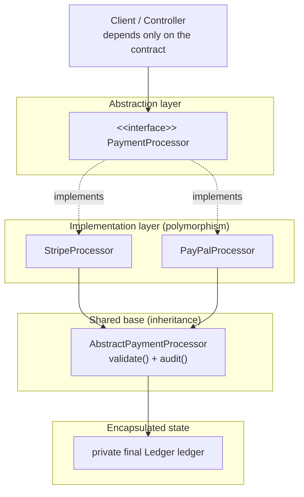

# OOP Foundations and the 4 Pillars

> **Level:** Beginner → Intermediate
> **Interview Frequency:** ★★★★★ (the opening question of ~90% of Java interviews)
> **Prerequisite:** [Core Java & OOP Index](../README.md) — no earlier chapter required
> **Last Updated:** 2026

---

## 📋 Table of Contents
- [0. TL;DR — The 30-Second Answer](#0-tldr--the-30-second-answer)
- [1. What & Why — The Problem This Solves](#1-what--why--the-problem-this-solves)
- [2. Mental Model — The One Picture That Explains OOP](#2-mental-model--the-one-picture-that-explains-oop)
- [3. Deep Dive — Theory](#3-deep-dive--theory)
- [4. Visualizations](#4-visualizations)
- [5. Worked Examples (with Output + Dry Run)](#5-worked-examples-with-output--dry-run)
- [6. Code from Scratch — Production-Grade](#6-code-from-scratch--production-grade)
- [7. Common Pitfalls & Gotchas](#7-common-pitfalls--gotchas)
- [8. Interview Q&A — Level-wise](#8-interview-qa--level-wise)
- [9. Counter-Questions & Traps](#9-counter-questions--traps)
- [10. Rapid-Fire MCQs](#10-rapid-fire-mcqs)
- [11. Cheat Sheet / One-Page Summary](#11-cheat-sheet--one-page-summary)
- [12. Real-World Production Notes](#12-real-world-production-notes)
- [13. Follow-up Learning](#13-follow-up-learning)

---

## 0. TL;DR — The 30-Second Answer

- **OOP = model the domain as objects bundling state (fields) with behaviour (methods)**, so the code that changes data and the code that reads it live together.
- **The 4 pillars:** **Encapsulation** (hide state behind a controlled API), **Abstraction** (expose *what*, hide *how*), **Inheritance** (reuse + specialise), **Polymorphism** (one call site, many implementations).
- **Encapsulation is about *data*; abstraction is about *complexity*.** Encapsulation = `private` fields + validating public methods. Abstraction = `interface` / `abstract class` contracts.
- **Java supports single, multilevel and hierarchical class inheritance, plus *multiple* inheritance of *type* via interfaces only.** Multiple inheritance of *state* is banned (diamond problem).
- **Overloading resolves at compile time (static binding); overriding resolves at runtime (dynamic binding, via the vtable).** `static`/`final`/`private` methods are never dynamically dispatched.
- **A class is a blueprint; an object is a runtime instance.** The class lives in Metaspace, the object's *state* on the heap, the *reference* wherever the variable lives.
- **Every class implicitly `extends java.lang.Object`** — source of `toString()`, `equals()`, `hashCode()`, `getClass()`. Override `equals()` ⟹ you *must* override `hashCode()`.
- **Java is not 100% object-oriented**: 8 primitives (+`void`) are not objects, `static` members belong to the class, `null` is not an object.
- **Liskov Substitution is the law behind pillar 4**: an override may only *widen* access, never narrow it.
- **"Prefer composition over inheritance"**: inheritance for *is-a* substitutability, composition for *has-a* and for anything that must vary at runtime.

---

## 1. What & Why — The Problem This Solves

### 1.1 The problem with procedural code

It compiles, runs, and is *immediately* dangerous for three reasons:

| Problem | Consequence in the example |
|---|---|
| **No single owner of the rules** | Anybody can write `balances[0] -= 100000` and break the invariant "balance ≥ 0". |
| **State and behaviour drift apart** | Add a `setBalance` requirement and there are *N* places to update, none of them the class. |
| **No way to vary behaviour** | An account with an overdraft needs a *different* `withdraw` — procedurally you add a flag parameter (the "flag argument" smell). |

### 1.2 The OOP answer

Move the data **into** the thing that owns the rules, and let the rules be *polymorphic*:

```java
// ✅ OOP style
class Account {
    private String holder;
    private double balance;
    Account(String holder, double balance) { this.holder = holder; this.balance = balance; }
    void withdraw(double amount) {
        if (amount <= 0) throw new IllegalArgumentException("Amount must be positive");
        if (amount > balance) throw new IllegalStateException("Insufficient funds");
        balance -= amount;
    }
}
```

The invariant "balance ≥ 0" is now enforced in **one** place, the data and its guarding rule live together, and a `SavingsAccount` can legally *replace* an `Account` because it still **is an** `Account`.

> **Analogy.** Procedural code is a **workshop with tools on the floor** — anyone can pick up the drill. OOP is a **workshop where each tool lives in a labelled drawer that owns the safety guard**: you ask the drawer to do the job and it decides whether it is safe.

### 1.3 Why this matters in interviews and in production

1. **Interviewers use the 4 pillars as a diagnostic tool.** "Model a discount engine supporting card, coupon and loyalty discounts" tests *abstraction + polymorphism*; "stop callers corrupting the order total" tests *encapsulation*.
2. **Production systems are judged on how they change.** A design where a new payment provider is added by writing one new class — touching nothing else — is *open for extension, closed for modification*.
3. **Bugs live at the seams.** Most Java production incidents are "someone set a field directly and skipped validation" — a *missing encapsulation* bug.

---

## 2. Mental Model — The One Picture That Explains OOP

Think of a class as a **vending machine with a glass front**: the **items (state)** are behind the glass (`private`), the **buttons (public methods)** validate your request and then reach in for you, the **blueprint (the class)** describes the layout, and different machines can sell the same product under the same **contract (interface)** — that is polymorphism.

```text
        THE 4 PILLARS OF OOP  (all four protect the same thing: YOUR mental model)

  ┌────────────────────────────────────────────────────────────────────────┐
  │  ENCAPSULATION   │  ABSTRACTION   │  INHERITANCE   │  POLYMORPHISM     │
  │  Protect data    │  Hide          │  Reuse code    │  Same call,       │
  │  via access      │  complexity,   │  from parent   │  different        │
  │  modifiers       │  show only     │  classes       │  behaviour        │
  ├──────────────────┼────────────────┼────────────────┼──────────────────┤
  │  private fields  │  abstract      │  extends       │  overloading     │
  │  + getters/      │  classes,      │  implements    │  (compile-time)   │
  │  setters         │  interfaces    │                │  overriding      │
  │                  │                │                │  (runtime)       │
  └──────────────────┴────────────────┴────────────────┴──────────────────┘
   "the machine" ──▶ "the glass" ──▶ "the buttons" ──▶ "the item"
```

**What to look at:** the *glass front* — data is behind it, the contract is in front of it, and every pillar is a different way of widening or narrowing what the caller can see.

### 2.1 Two orthogonal axes — where most confusion comes from

- **Visibility axis** → *encapsulation* & access modifiers: **who may touch this member?** (chapter 02)
- **Behaviour axis** → *abstraction* & *polymorphism*: **which implementation runs for this call?** (chapter 05)

They never intersect: a *private* method is not overridden, and an *overloaded* method is dispatched statically regardless of access.
---

## 3. Deep Dive — Theory

### 3.1 Class vs Object — the mechanics

| Aspect | Class | Object |
|-------|--------|--------|
| Blueprint/Template | Instance of class |
| Defined once | Created many times |
| No memory for data | Allocated on heap |
| Declared with `class` | Created with `new` |
| Compile-time concept | Runtime concept |

**Class (the blueprint):**

```java
public class Car {
    // State (what it HAS)
    private String brand;
    private int speed;
    private boolean engineOn;
    // Behavior (what it DOES)
    public void start() { engineOn = true; System.out.println(brand + " started"); }
    public void accelerate(int increment) { if (engineOn) speed += increment; }
    public Car(String brand) { this.brand = brand; this.speed = 0; this.engineOn = false; }
}
```

**Object (the instance):** `Car myCar = new Car("Toyota");` (Object 1) and `Car yourCar = new Car("Honda");` (Object 2) are separate objects with their own state — `myCar.accelerate(60)` changes only `myCar`.

**Memory view:** the *reference* (`myCar`) sits in the stack frame; the *object* (its `brand`, `speed`, `engineOn`) sits on the **heap**; the *blueprint* (`Car.class` — bytecode, field layout, method table) sits once in **Metaspace** per ClassLoader, holding no user data.

**What to look at:** two objects of the *same class* have identical shape but different contents — that is the difference between "class" and "object" in one picture. (JVM's view → [02-Java-Memory-Model](../02-Java-Memory-Model/01-Memory-Areas.md))


### 3.2 Pillar 1 — Encapsulation: "Protect the Data"

```java
public class BankAccount {
    private double balance;       // ← Hidden state
    public void deposit(double amount) {
        if (amount <= 0) throw new IllegalArgumentException("Amount must be positive");
        balance += amount;        // ← Controlled modification with validation
    }
    public void withdraw(double amount) {
        if (amount > balance) throw new IllegalStateException("Insufficient funds");
        balance -= amount;
    }
    public double getBalance() { return balance; }   // ← Read-only access
    // No setBalance() — can't arbitrarily set balance
}
BankAccount acc = new BankAccount();
acc.deposit(1000);          // ✅ Goes through validation
// acc.balance = 1000000;   // ❌ COMPILE ERROR — private field
```

**Why it matters:** prevents invalid state, internal changes don't break external code, easier debugging. A `public` field never buys you (1) **invariant enforcement**, (2) **implementation freedom** — change `double balance` into `long balanceCents` and *no caller changes*, (3) **an audit point** — every mutation logged and validated in one place.

> **Deep dive → [03-Encapsulation-vs-Abstraction.md](03-OOP-Encapsulation-vs-Abstraction.md)**

### 3.3 Pillar 2 — Abstraction: "Hide the Complexity"

```java
// User sees simple interface:
interface PaymentProcessor {
    boolean pay(double amount);
    boolean refund(String transactionId);
}
// Complex implementation hidden (5 internal steps, 1 visible result):
class StripeProcessor implements PaymentProcessor {
    public boolean pay(double amount) { /* validate→encrypt→3DS→charge */ return true; }
    public boolean refund(String id) { return true; }
}
PaymentProcessor processor = new StripeProcessor();
processor.pay(99.99);  // Simple! Complexity hidden.
```

```text
Encapsulation: HOW to protect data    → private fields, getters/setters
Abstraction:   WHAT to show the user  → interfaces, abstract classes
```

**What to look at:** the first line is about *data* and the second is about *complexity* — that one-word difference ("how" vs "what") is the whole distinction interviewers test.

**The one-sentence test an interviewer will accept:** encapsulation answers **"how do I stop you messing with my data?"**; abstraction answers **"what do you actually need me to do?"** An **ATM** is canonical: *abstraction* = the screen shows "Withdraw / Deposit / Balance" and nothing about the switch; *encapsulation* = the cash cassette, ledger and PIN check are private to the machine.

> **Deep dive → [03-Encapsulation-vs-Abstraction.md](03-OOP-Encapsulation-vs-Abstraction.md)**

### 3.4 Pillar 3 — Inheritance: "Reuse and Extend"

```java
class Animal { protected String name;
    void eat() { System.out.println(name + " is eating"); } }
class Dog extends Animal {
    void bark() { System.out.println(name + " says Woof!"); } }
Dog dog = new Dog();
dog.name = "Rex";
dog.eat();   // ✅ Inherited from Animal
dog.bark();  // ✅ Own method
```

```text
            ┌──────────┐
            │  Animal   │  eat()
            └────┬─────┘
         ┌───────┴───────┐
         ▼               ▼
    ┌─────────┐    ┌─────────┐
    │   Dog   │    │   Cat   │
    │ bark()  │    │ purr()  │
    └─────────┘    └─────────┘
```

**What to look at:** `Animal` has two children — `Dog` and `Cat` — i.e. **hierarchical** inheritance; each child adds its own behaviour on top of the inherited `eat()`.

**Supported:** Single ✅, Multilevel ✅, Hierarchical ✅, Multiple via interfaces ✅
**NOT supported:** Multiple via classes ❌ (diamond problem)

> **Deep dive → [04-OOP-Inheritance-Types-and-Diamond-Problem.md](04-OOP-Inheritance-Types-and-Diamond-Problem.md)**

### 3.5 Pillar 4 — Polymorphism: "One Interface, Many Forms"

**Compile-time (Method Overloading)** — the compiler decides from the *argument types*:

**Runtime (Method Overriding)** — the JVM decides, from the actual object type:

```java
class Animal { void sound() { System.out.println("Some sound"); } }
class Dog extends Animal { @Override void sound() { System.out.println("Bark!"); } }
class Cat extends Animal { @Override void sound() { System.out.println("Meow!"); } }
Animal[] animals = { new Dog(), new Cat(), new Dog() };
for (Animal a : animals) a.sound();   // Bark! → Meow! → Bark!
```

**Overloading vs Overriding:**

| Aspect | Overloading | Overriding |
|--------|-------------|------------|
| Where / parameters | Same class, different parameter lists | Parent → Child, same signature |
| Return type | Can differ | Same or covariant |
| Binding | Compile-time | Runtime (vtable) |
| static methods | Can overload | Cannot override (hiding) |
| Access | No restriction | Cannot narrow (can widen) |

> **Deep dive → [05-OOP-Polymorphism-Deep-Dive.md](05-OOP-Polymorphism-Deep-Dive.md)**

**How the JVM does it (vtable).** Each class gets an array of method pointers at link time; `invokevirtual` reads the *runtime class* of the receiver and jumps to that slot's pointer — so `Shape s = new Circle(); s.draw()` runs `Circle.draw()`. The slot index is fixed at compile time but the pointer is resolved at runtime, which is why **fields are not polymorphic** (a field read is a `getfield` on the *reference* type, never a vtable lookup).

### 3.6 OOP vs Procedural — the honest trade-off

**Procedural** organises around functions, keeps data separate, has no access control, and reuses by copy-paste. **OOP** organises around objects, bundles data with methods, uses access modifiers, and reuses via inheritance/composition — which is why it scales.

**The expert caveat:** OOP is not automatically better. For a pure numerical transform a procedural/array-oriented design is often faster and simpler. OOP wins when the domain has *variation* and *invariants*; it loses when it degenerates into a deep "is-a" hierarchy nobody can navigate — see [11-OOP-Advanced-Design-and-Object-Class.md](11-OOP-Advanced-Design-and-Object-Class.md).

### 3.7 Java's OOP building blocks

**Constructor rules:** same name as the class and no return type; the compiler provides a default constructor **only if you write none**; `super()` is called implicitly as the first statement; `this(...)` and `super(...)` **cannot both appear** — only one, and it must be first. `this` = current instance, `super` = parent instance (`super(name)` calls the parent constructor, `super.display()` calls the parent method).


**Object Class — Root of All.** `class MyClass { }` is implicitly `class MyClass extends Object { }`. `Object` provides **11 methods to ALL classes**: `toString()`, `equals()`, `hashCode()`, `getClass()`, `clone()`, `finalize()` (deprecated), `wait()`, `wait(long)`, `wait(long, int)`, `notify()`, `notifyAll()`. Three you *must* understand:

| Method | Default behaviour | When you override it |
|--------|-------------------|---------------------|
| `equals(Object)` | Reference identity (`this == obj`) | Whenever you define value equality |
| `hashCode()` | Derived from identity hash | **Always, together with `equals`** |
| `toString()` | `ClassName@hexHash` | When the object's state is meaningful to a human |


> **Deep dive → [08-OOP-equals-hashCode-toString.md](08-OOP-equals-hashCode-toString.md)**

### 3.8 Is Java really 100% object-oriented?

No — and knowing *exactly where* it breaks is a favourite interview question.

| Break | Detail |
|-------|--------|
| **8 primitives + `void`** | `int`, `long`, `short`, `byte`, `char`, `float`, `double`, `boolean`, `void` are not objects — `int x = 5;` stores a value, not a reference. |
| **`static`** | A `static` member belongs to the class, not to any instance — no "object" owns it. |
| **`null`** | `null` is not an object; it is the absence of one. |
| **`final` primitives** | `static final int MAX = 10` is inlined at compile time; it lives in the constant pool, not the heap. |

The *historical* answer ("Everything is an object") is that primitives are **autoboxed** on demand (`Integer.valueOf(5)`) — but boxing is a **conversion**, not a change of the type system: `int` is still not an object.

---

## 4. Visualizations

### 4.1 Mermaid — how a Spring-style service wires the four pillars — how a Spring-style service wires the four pillars



**What to look at:** the *dotted* edges are the abstraction contract, the *solid* edges are inheritance of shared code, and the orange box is the encapsulated state — the client never touches it.

---

## 5. Worked Examples (with Output + Dry Run)

### 5.1 Worked Example A — One class, four pillars (bank account)

**Problem:** design an account type that (1) hides its balance, (2) exposes a small contract, (3) lets a provider specialise it, and (4) lets the caller drive it polymorphically.

```java
public class F01Demo {
    // ---------- Encapsulation: state hidden, invariants enforced ----------
    static class BankAccount {
        private long balanceCents;
        BankAccount(long openingCents) { this.balanceCents = openingCents; }
        public void deposit(long amountCents) {
            if (amountCents <= 0) throw new IllegalArgumentException("Amount must be positive");
            balanceCents += amountCents; }
        public void withdraw(long amountCents) {
            if (amountCents > balanceCents) throw new IllegalStateException("Insufficient funds");
            balanceCents -= amountCents; }
        public long getBalanceCents() { return balanceCents; }
    }
    // ---------- Abstraction: "what", not "how" ----------
    interface NotificationChannel { void send(String recipient, String message); }
    static class EmailChannel implements NotificationChannel {
        public void send(String r, String m) { System.out.println("[EMAIL ] to=" + r + " body=" + m); }
    }
    // ---------- Inheritance + Polymorphism ----------
    static abstract class PaymentProcessor {
        protected final String provider;
        PaymentProcessor(String provider) { this.provider = provider; }
        abstract String providerName();
        public final String charge(long amountCents, String customerId) {
            if (amountCents <= 0) return "INVALID_AMOUNT";
            String txn = providerName().toUpperCase() + "-"
                    + Math.abs((customerId + amountCents).hashCode());
            System.out.println("  charging " + amountCents + " via " + providerName() + " -> " + txn);
            return txn; }
    }
    static class StripeProcessor extends PaymentProcessor {
        StripeProcessor() { super("stripe"); }
        @Override String providerName() { return provider; } }
    static class PayPalProcessor extends PaymentProcessor {
        PayPalProcessor() { super("paypal"); }
        @Override String providerName() { return provider; } }
    public static void main(String[] args) {
        BankAccount acc = new BankAccount(100_000L);   // 1000.00
        acc.deposit(50_000L);
        acc.withdraw(20_000L);
        System.out.println("balance(cents)=" + acc.getBalanceCents());
        try { acc.withdraw(500_000L); }
        catch (IllegalStateException e) { System.out.println("withdraw failed -> " + e.getMessage()); }
        NotificationChannel channel = new EmailChannel();
        channel.send("a@b.com", "OTP 1234");
        for (PaymentProcessor p : new PaymentProcessor[]{ new StripeProcessor(), new PayPalProcessor() }) {
            System.out.println("result=" + p.charge(4999L, "CUST-9")); }
    }
}
```

**Actual output (JDK 17+):**

```text
balance(cents)=130000
withdraw failed -> Insufficient funds
[EMAIL ] to=a@b.com body=OTP 1234
  charging 4999 via stripe -> STRIPE-2088483804
result=STRIPE-2088483804
  charging 4999 via paypal -> PAYPAL-2088483804
result=PAYPAL-2088483804
```

**Dry run — line by line:**

| # | Statement | What actually happens | Why |
|---|-----------|----------------------|-----|
| 1 | `new BankAccount(100_000L)` | ctor runs, `balanceCents = 100000` | opening balance in **cents** — no floating-point money bug |
| 2 | `acc.deposit(50_000L)` | `50000 > 0` → balance = 150000 | **encapsulation**: the caller cannot set the balance directly |
| 3 | `acc.withdraw(20_000L)` | `20000 <= 150000` → balance = 130000 | invariant "balance ≥ 0" held at every instant |
| 4 | `getBalanceCents()` / `acc.withdraw(500_000L)` | `130000`; then `IllegalStateException("Insufficient funds")` | read-only view, **no** `setBalance`; **fail fast**, state untouched |
| 5 | `channel = new EmailChannel(); send(...)` | `EmailChannel.send` runs | static type `NotificationChannel`, runtime type `EmailChannel` |
| 6 | `processors` loop, iteration 1 | `charge` is `final` → no override; `providerName()` is virtual → `"stripe"` | `final` = no dynamic dispatch for `charge`; **abstract method** = dynamic dispatch for `providerName()` |
| 7 | iteration 2 | identical bytecode, runtime class = `PayPalProcessor` → `"paypal"` | the whole point: *one loop, N providers* |

**Takeaway:** all four pillars are visible in this one class — `private balanceCents` (encapsulation), `NotificationChannel` (abstraction), `PaymentProcessor` → `StripeProcessor` (inheritance), and the `processors[]` loop (polymorphism).

### 5.2 Worked Example B — Overloading vs Overriding, side by side

**Problem:** predict the output of a program that mixes both.

**Problem:** a `Shape` declares `draw()`, `draw(String)`, `static describe()` and `size()`; a `Circle` overrides all four. Predict the output of `Shape s = new Circle(); s.draw(); s.draw("tag"); s.describe(); System.out.println(s.size());` and of the `for` loop over `new Shape[]{ new Shape(), new Circle() }`.

**Actual output:**

```text
Circle.draw
Circle.draw(tag)
Shape.describe
10
Shape.draw
Circle.draw
```

**Dry run:**

| Call | Compile-time decision (overload) | Runtime decision (override) | Result |
|------|----------------------------------|------------------------------|--------|
| `s.draw()` | only one no-arg `draw` exists → `Shape.draw()` | receiver is `Circle` → vtable → `Circle.draw()` | `Circle.draw` |
| `s.draw("tag")` | only one 1-arg `draw` exists → `Shape.draw(String)` | receiver is `Circle` → `Circle.draw(String)` | `Circle.draw(tag)` |
| `s.describe()` | `static` → bound to the **reference type** `Shape` at compile time; **not** overridden (it is *hidden*) | — | `Shape.describe` |
| `s.size()` / loop | resolved on `Shape`; one overload | `Circle.size()` → `10`; runtime type of each element | `10`; `Shape.draw`, `Circle.draw` |

**Takeaway:** overloading picks the *signature*; overriding picks the *body*. A `static` method is **hidden**, not overridden — the reference type always wins.

### 5.3 Worked Example C — The "why is OOP better" proof: adding a new provider

**Problem:** the business adds a UPI provider. How many lines of existing code change?

```java
// BEFORE — the caller knows about every provider (violates abstraction)
if (provider.equals("stripe"))       new StripeProcessor().charge(100, "C1");
else if (provider.equals("paypal"))  new PayPalProcessor().charge(100, "C1");
else throw new IllegalArgumentException("unknown provider " + provider);

// AFTER — the caller knows about one thing: the contract
PaymentProcessor processor = registry.get(provider);   // Stripe, PayPal, Upi, ...
processor.charge(100, "CUST-1");
```

| Provider added (Stripe / PayPal / UPI / Crypto) | Lines changed in the *caller* | Lines changed in *new* class |
|----------------|-------------------------------|------------------------------|
| each one | **0** | 1 new class |

**Takeaway:** the *real* metric of a good abstraction is **how many existing files you must not touch**. This is the Open/Closed Principle, and it is the strongest practical argument for abstraction + polymorphism in a code review.
---

## 6. Code from Scratch — Production-Grade

A single, compilable file modelling a **payment domain** the way a production banking/e-commerce service would: immutable value objects, encapsulated aggregates, an interface at the boundary, and an abstract base for shared invariants.

```java
import java.math.BigDecimal;
import java.util.List;
import java.util.Objects;

/**
 * Production-grade OOP: a payment gateway domain model.
 * Money is BigDecimal (never double); mutable aggregates keep state
 * private and enforce invariants; the boundary (PaymentGateway) is an
 * interface, so the service layer never depends on a concrete provider;
 * immutable value objects (PaymentRequest, Receipt) are safe to share.
 */
public final class PaymentDomain {
    private PaymentDomain() { }   // utility class — no instances
    /** An immutable request. Safe to pass across threads. */
    public record PaymentRequest(String orderId, BigDecimal amount,
                                 String currency, String idempotencyKey) {
        public PaymentRequest {                       // compact constructor
            Objects.requireNonNull(orderId, "orderId");
            Objects.requireNonNull(amount, "amount");
            Objects.requireNonNull(currency, "currency");
            Objects.requireNonNull(idempotencyKey, "idempotencyKey");
            if (amount.signum() <= 0)
                throw new IllegalArgumentException("amount must be > 0");
            if (orderId.isBlank())
                throw new IllegalArgumentException("orderId must not be blank");
        }
    }
    /** An immutable receipt returned by a gateway. */
    public record Receipt(String txnId, String orderId, BigDecimal amount,
                          String currency, String status) { }
    /** ABSTRACTION — the boundary the application codes against. */
    public interface PaymentGateway {
        Receipt authorise(PaymentRequest request);
        void refund(String transactionId); }
    /** Typed failure so callers can apply a policy (retry vs fail-fast). */
    public static class PaymentException extends RuntimeException {
        private final String code;
        public PaymentException(String c, String m) { super(m); this.code = c; }
        public String getCode() { return code; } }
    /**
     * INHERITANCE — abstract base owning the invariant workflow
     * (validate → call → wrap errors); subclasses supply the provider
     * specific part. Template Method expressed with inheritance.
     */
    public abstract static class AbstractPaymentGateway implements PaymentGateway {
        protected final String providerName;
        protected AbstractPaymentGateway(String p) { this.providerName = p; }
        @Override
        public final Receipt authorise(PaymentRequest request) {
            validate(request);                                  // 1. invariant
            try {
                return doAuthorise(request);                    // 2. subclass hook
            } catch (RuntimeException ex) {
                throw new PaymentException("GATEWAY_ERROR",
                        providerName + " failed: " + ex.getMessage());
            }
        }
        @Override
        public void refund(String transactionId) {
            Objects.requireNonNull(transactionId, "transactionId"); }
        /** Provider-specific behaviour — the "abstract" part. */
        protected abstract Receipt doAuthorise(PaymentRequest request);
        /** Shared validation — the "concrete" part every provider reuses. */
        protected void validate(PaymentRequest request) {
            if (request.amount().scale() > 2)
                throw new PaymentException("BAD_SCALE",
                        "amount must have at most 2 decimal places: " + request.amount());
        }
    }
    /** ENCAPSULATION — a concrete, stateful aggregate. */
    public static final class Ledger {
        private final String accountId;
        private BigDecimal balance;
        public Ledger(String accountId, BigDecimal opening) {
            this.accountId = Objects.requireNonNull(accountId, "accountId");
            this.balance = Objects.requireNonNull(opening, "openingBalance");
            if (opening.signum() < 0)
                throw new IllegalArgumentException("opening balance must be >= 0"); }
        public synchronized void debit(BigDecimal amount) {
            if (amount == null || amount.signum() <= 0)
                throw new IllegalArgumentException("amount must be > 0");
            if (amount.compareTo(balance) > 0)
                throw new IllegalStateException("insufficient funds in " + accountId);
            balance = balance.subtract(amount); }
        public BigDecimal balance() { return balance; }   // no setter, by design
        public String accountId()  { return accountId; }
    }
    /** POLYMORPHISM — two providers, one call site. */
    public static final class SimulatedCardGateway extends AbstractPaymentGateway {
        private final Ledger ledger;
        public SimulatedCardGateway(Ledger l) { super("sim-card"); this.ledger = l; }
        @Override protected Receipt doAuthorise(PaymentRequest r) {
            ledger.debit(r.amount());
            return new Receipt("TX-" + r.idempotencyKey(), r.orderId(),
                    r.amount(), r.currency(), "AUTHORISED");
        }
    }
    public static final class SimulatedWalletGateway extends AbstractPaymentGateway {
        public SimulatedWalletGateway() { super("sim-wallet"); }
        @Override protected Receipt doAuthorise(PaymentRequest r) {
            return new Receipt("TX-" + r.idempotencyKey(), r.orderId(),
                    r.amount(), r.currency(), "CAPTURED");
        }
    }
    public static void main(String[] args) {
        Ledger ledger = new Ledger("ACC-77", new BigDecimal("1000.00"));
        List<PaymentGateway> gateways = List.of(
                new SimulatedCardGateway(ledger), new SimulatedWalletGateway());
        for (PaymentGateway gateway : gateways) {          // ONE call site
            PaymentRequest req = new PaymentRequest(
                    "ORD-1", new BigDecimal("99.99"), "INR", "IDEM-1");
            Receipt receipt = gateway.authorise(req);
            System.out.println(receipt.status() + " " + receipt.transactionId()
                    + " " + receipt.amount() + " " + receipt.currency());
        }
        System.out.println("ledger balance = " + ledger.balance());
    }
}
```

**Actual output:**

```text
AUTHORISED TX-IDEM-1 99.99 INR
CAPTURED TX-IDEM-1 99.99 INR
ledger balance = 900.01
```

**Two failure modes, enforced by the design (not shown above for brevity):**

```java
ledger.debit(new BigDecimal("10000.00"));
// → IllegalStateException: insufficient funds in ACC-77
//    (encapsulation: the Ledger itself refuses to go negative)

new SimulatedWalletGateway().authorise(
        new PaymentRequest("ORD-2", new BigDecimal("1.999"), "INR", "IDEM-2"));
// → PaymentException: failed with code BAD_SCALE
//    (abstraction: a typed, machine-readable failure, not a raw RuntimeException)
```

**Why this is "production-grade":** `BigDecimal` for money (never `double`); immutable `record` inputs safe to share and log; a `Ledger` that *cannot* be driven negative and has no setter; a typed `PaymentException` carrying a machine-readable `code`; `synchronized` on the one mutable aggregate; and — most importantly — a **new provider is one new class**, with the application loop untouched.

---

## 7. Common Pitfalls & Gotchas

### ❌ Pitfall 1 — Public fields "because it's a simple DTO"

```java
// ❌ WRONG — a mutable, anemic bean
class MutableUser { public String name; public int age; }

// ✅ RIGHT — an immutable value object
public final class User {
    private final String name;
    private final int age;
    public User(String name, int age) {
        this.name = Objects.requireNonNull(name, "name").trim();
        if (age < 0 || age > 150) throw new IllegalArgumentException("age out of range: " + age);
        this.age = age;
    }
    public String name() { return name; }
    public int age()     { return age; }
}
```

**Why it's wrong:** the object has *no* invariant, *no* validation and *no* place to evolve. The moment you need "age ≥ 0", you must change every caller. A public field is an **API commitment** you can never take back. (For pure data carriers a Java `record` gives immutability without boilerplate — but a record still has *no* validation unless you add a compact constructor.)

### ❌ Pitfall 2 — Confusing *overloading* with *overriding*, and expecting fields to be polymorphic

`Dog.speak(String)` **does not override** `Animal.speak()` — different parameter lists mean different methods, i.e. *overloading*. A compiler error appears if you write `Animal a = new Dog(); a.speak();`

And `class Parent { int x = 10; } class Child extends Parent { int x = 20; }` → `Parent p = new Child(); p.x` prints **10**, not 20: field access compiles to `getfield`, which uses the **reference type**. Only *method* calls go through the vtable. The fix is to hide fields behind **accessor methods** (which *are* virtual) or use `getClass()`/`super`.

### ❌ Pitfall 3 — Calling an overridable method from a constructor

`class Base { Base() { display(); } void display() { System.out.println("Base"); } }` with `class Derived extends Base { int value = 10; @Override void display() { System.out.println("Derived: " + value); } }` → `new Derived()` prints **"Derived: 0"**, not "Derived: 10".

**Why:** the superclass constructor runs *before* the subclass field initialisers, so the override sees default values (`0`, `null`, `false`). **Rule: never call an overridable method from a constructor** — use a static factory or an `init()` method called after construction.

### ❌ Pitfall 4 — Assuming `super()` and `this()` can coexist, or that a default constructor survives

```java
class A { A() { this(1); super(); } }   // ❌ both — and neither is first
class Person { Person(String n) { this.name = n; } }
new Person();   // ❌ COMPILE ERROR — no no-arg constructor exists
```
Only **one** constructor-delegation call is allowed and it must be the **first statement** (`this(...)` must come *after* an explicit `super(...)`). Separately: the compiler generates a default constructor **only if you declare none** — adding any constructor (even a private one) removes it, which breaks frameworks (JPA, Jackson, Spring) that need a no-arg constructor.

### ❌ Pitfall 5 — Setters that defeat encapsulation

```java
// ❌ A setter re-opens the door you just closed
public void setBalance(double balance) { this.balance = balance; }
// ✅ Expose *intent*, not *state*
public void setBalance(BigDecimal newBalance) {
    if (newBalance == null || newBalance.signum() < 0)
        throw new IllegalArgumentException("balance must be >= 0");
    this.balance = newBalance;
}
```
**Rule of thumb:** if a setter needs to validate, it should probably be a *domain method* instead (`deposit`, `close`, `activate`).

### ❌ Pitfall 7 — Setters that defeat encapsulation, and "is-a" abuse

```java
// ❌ A setter re-opens the door you just closed
public void setBalance(double balance) { this.balance = balance; }
// ✅ Expose *intent*, not *state*
public void setBalance(BigDecimal newBalance) {
    if (newBalance == null || newBalance.signum() < 0)
        throw new IllegalArgumentException("balance must be >= 0");
    this.balance = newBalance;
}
```
**Rule of thumb:** if a setter needs to validate, it should probably be a *domain method* instead (`deposit`, `close`, `activate`).

```java
class ArrayList extends MyAbstractList { }   // ArrayList is-a MyAbstractList ✅ (true)
class HashMap  extends MyAbstractMap  { }   // ⚠️ true, but for the wrong reason
```
**The test:** if the relationship cannot be expressed as "X **is a** Y" in plain English, do not use `extends`. "HashMap **is a** AbstractMap" is technically true and practically a maintenance trap.

### ❌ Pitfall 7 — Believing OOP makes code "fast" or "safe" automatically

Encapsulation and abstraction **cost** an extra object, a virtual call and a layer of indirection, and they buy **maintainability**. Hot-path code sometimes needs the opposite trade-off — plain fields, flat structs, no abstraction.

---
---

## 8. Interview Q&A — Level-wise

### 🟢 Beginner

**Q: What are the 4 pillars of OOP?**
**A:** Encapsulation — bundling data with the methods that operate on it and restricting direct access (`private` fields + public methods). Abstraction — hiding implementation complexity and exposing only what the client needs, via interfaces and abstract classes. Inheritance — reusing and specialising a parent's state and behaviour via `extends`. Polymorphism — one call site behaving differently per actual object type, via overloading (compile-time) and overriding (runtime).

**Q: Difference between a class and an object?**
**A:** A class is a blueprint — a compile-time description of fields and methods, stored once in Metaspace. An object is a runtime instance created with `new`, whose state is allocated on the heap. You can have one class and millions of objects; each object has its own copy of the state.

**Q: What is the difference between overloading and overriding?**
**A:** Overloading = same method *name*, different *parameter list*, usually in the same class; resolved by the compiler at compile time using the static types of the arguments. Overriding = same *signature* in a subclass; resolved by the JVM at runtime using the object's actual class. Overloading is "many ways to call", overriding is "one way to call, many behaviours".

**Q: Why doesn't Java support multiple inheritance of classes?**
**A:** Because of the diamond problem — if a class inherits the same method (and state) from two parents, the compiler cannot decide which one applies, and the semantics of duplicated state are undefined. Java allows multiple inheritance of *type* through interfaces instead, where there is no state to duplicate.

**Q: Is Java 100% object-oriented?**
**A:** No. The 8 primitives (plus `void`) are not objects, `static` members belong to the class rather than an instance, and `null` is the absence of an object. Primitives are *autoboxed* on demand (`Integer.valueOf(5)`), but boxing is a conversion, not a change of the type system — `int` is still not an object.

**Q: Can we override a `static` method?**
**A:** No. A `static` method is *hidden*, not overridden — it is bound at compile time to the reference type, so `Shape s = new Circle(); s.describe();` calls `Shape.describe()`. The reason is that static methods have no receiver instance, so there is no runtime object whose implementation could be chosen. You *can* declare a `static` method with the same signature in a subclass; it simply shadows the parent's.

**Q: Why can't we *narrow* access when overriding?**
**A:** Liskov Substitution. If the parent declares a method `protected`, any client holding a parent-typed reference may call it. A subclass making it `private` would revoke a promise the parent's type made — code that worked against the parent would break against the child. Overrides may keep the same access or widen it, never narrow it.

**Q: How do you design a class that is safe to publish across threads?**
**A:** Make it **immutable** — `final` fields, no setters, defensive copies of mutable inputs, and no leaking of `this` during construction. JMM final-field semantics then guarantee that a properly constructed object is visible to other threads with its final fields initialised, even without `volatile` or synchronization. If it must be mutable, use proper synchronization and never publish a partially-constructed object.

### 🟡 Intermediate

**Q: What is the difference between abstraction and encapsulation? Give one concrete example each.**
**A:** Encapsulation is about *protecting state* — bundling data with the methods that guard it and preventing outside code from putting the object into an invalid state (`private balance` + `deposit()`/`withdraw()` that validate). Abstraction is about *hiding complexity behind a contract* — exposing "what it can do" while hiding "how" (a `PaymentProcessor` interface with `StripeProcessor` and `PayPalProcessor` implementations behind it). A good one-liner: *encapsulation is about the data, abstraction is about the behaviour.*

**Q: Can a class be both fully encapsulated and fully abstract? What about the reverse?**
**A:** Yes and yes, in the sense that they are orthogonal axes. A `final` concrete class with `private` fields and a narrow public API is fully encapsulated but not abstract (it *is* something). An `interface` with no fields and no implementation detail exposed is fully abstract but has nothing to encapsulate — it has no state at all. The axes are about *data protection* and *interface generality* respectively, so a type can be on either axis independently.

**Q: Why does Java not allow multiple inheritance of classes, but does allow multiple interfaces?**
**A:** The diamond problem. With two classes contributing *state* (fields) and behaviour, the compiler cannot decide which copy of a duplicated field wins, and the semantics of duplicated mutable state are undefined. Interfaces contribute *type* and *behaviour* but (before Java 8) no state, so there is nothing to duplicate — the conflict is only in method resolution, which is solved deterministically by "the most specific type wins; otherwise the class must override".

**Q: Is composition always better than inheritance?**
**A:** No — it is a *default*, not a law. Inheritance gives you an `is-a` substitutability relationship and code reuse that composition has to re-implement by delegation. Use inheritance when the relationship is genuinely substitutable and the parent is designed for extension; use composition when the relationship is "has-a", when you need to change the strategy at runtime, or when the parent's invariants cannot be guaranteed by the subclass.

**Q: What is the difference between overloading and overriding, and can a method do both?**
**A:** Overloading = same method *name*, different parameter list, resolved by the compiler using the *static* types of the arguments (compile-time polymorphism). Overriding = same *signature* in a subclass, resolved by the JVM using the object's *actual* class (runtime polymorphism). A method can be both: `print(String)` in the parent is overloaded by `print(int)` **and** overridden by a subclass's `print(String)`.

**Q: Why is `static` binding early, but `instance` binding late?**
**A:** Because the choice differs in what is known at compile time. A `static` method has no receiver instance, so the only thing that exists is the *compile-time* reference type — the JVM has nothing to dispatch on. An instance method has a receiver object whose actual class is known only at runtime, so the JVM can (and must) look up the override in that class's method table.

### 🔴 Advanced / Senior

**Q: How do you decide whether to expose an abstraction, and what is the cost of a wrong abstraction?**
**A:** Expose an abstraction when there is (a) genuine variability — at least two implementations that differ behaviourally, not just cosmetically — or (b) a need to break a dependency cycle. The cost of a *wrong* abstraction is high and asymmetric: a premature interface locks in a shape that real implementations must distort to fit ("the interface was designed for the first implementation"), and every future implementation inherits that distortion. The rule of three is the practical guardrail — wait until the third implementation appears before generalising.

**Q: How would you model a `PaymentMethod` that must support many payment types but keep the domain type-safe?**
**A:** With a closed hierarchy: an `interface PaymentMethod` (or a `sealed interface` in Java 17+) and implementations per type, so the domain never switches on a string or enum. The key decision is **where** the polymorphism lives — if `PaymentService` contains `if (type == CARD)`, the `switch` is a type switch that should be a `switch` on the *type* via pattern matching (`case Card c -> …`), which the compiler can check for exhaustiveness. That converts a runtime `IllegalArgumentException` into a compile error.

**Q: What breaks if you make a field `public` and later want to add validation?**
**A:** Binary and source compatibility. Existing clients read the field directly via `getfield`; introducing a getter and privatising the field breaks every compiled caller at link time (`NoSuchFieldError`). The safe migration is: add the getter, deprecate the public field, keep the field in sync during the deprecation window, then remove it in a major version. This is the same rule as narrowing a method's visibility.

**Q: Explain "prefer composition over inheritance" with a concrete failure it prevents.**
**A:** Consider `Stack extends ArrayList` — the classic textbook example. `Stack` inherits `add(int index, E e)`, which inserts into the *middle* of a stack, violating the Liskov Substitution Principle: code holding a `Stack` and calling `add(0, x)` gets a data structure that is no longer a stack. With composition (`Stack` holds an `ArrayList` delegate) you expose only `push`/`pop`, so the invalid operation simply does not exist. The same argument applies to `HashMap` exposing `put`, which lets a caller corrupt the bucket structure.

### ⚫ Expert / Principal

**Q: When would you deliberately break encapsulation — and how do you make it safe?**
**A:** In performance-critical inner loops, in low-level interop with native memory (off-heap buffers, `ByteBuffer`), and in data-carrier objects that are provably immutable (a `record` or a `final` class with all-`final` fields). The safety requirement is that the invariant must be **enforceable by the type system**, not by convention: `final` fields + no setters + defensive copies in the constructor means there is no window in which the object can be observed in an invalid state. If you expose a mutable buffer publicly, you have traded a compile-time invariant for a runtime bug generator — that trade is only acceptable when the invariant is checked by the caller.

**Q: How do you keep a large codebase's abstraction from decaying into a "class explosion"?**
**A:** Set explicit budgets: one abstraction per *behavioural axis*, not per implementation detail; require every interface to have at least two production implementations, otherwise use a concrete class. Review interfaces for *behavioural* rather than *structural* cohesion — an interface with `save()`, `send()`, and `render()` is three interfaces wearing a trench coat. And track interface churn in the code review: if an interface changes more than once a month, it is modelling the database, not the domain.

**Q: How do you decide between a sealed hierarchy and an enum for a closed set of domain cases?**
**A:** Use an **enum** when the cases carry no per-case behaviour beyond data (order statuses, currencies). Use **sealed types** when cases need distinct behaviour or distinct fields — an enum can only vary by data, not by algorithm; a sealed interface lets `CardPayment` and `WalletPayment` each carry their own validation. Sealed types are the modern answer to "enum with behaviour", and combined with pattern-matching `switch` (Java 21) the compiler enforces exhaustiveness, so adding a new case becomes a compile error at every `switch` that must handle it — which is exactly the safety property an enum gives you, without the enum's rigidity.

**Q: Explain how encapsulation, abstraction and the module system relate to a public library's API evolution.**
**A:** They form three nested layers of visibility: `private`/`package-private` protect *implementation* inside a class and inside a package; `public` on an exported package defines the *API surface* other modules may compile against; `opens` controls *deep reflection* into a package. A library that wants to change its internals must either keep them behind the public surface or use `opens` deliberately for frameworks that need to proxy. The module system is what finally makes "the API is public but the implementation is hidden" enforceable by the toolchain rather than by convention — which is precisely the encapsulation story, scaled from the class to the package.

## 9. Counter-Questions & Traps

These are the questions a strong interviewer asks **after** you give a correct answer. Answering them is what separates a "knows the definition" candidate from a "can defend the design" candidate.

### CQ1. "Isn't encapsulation just about using `private`? Why do I need all these getters and setters?"

- **Naive:** "Encapsulation means making fields private and exposing getters and setters."  ← *incomplete and slightly wrong*
- **Trap:** A class with a public getter **and** a public setter for every field is barely more encapsulated than one with public fields — the caller can still put the object into any state. Getters/setters are also a code-generation smell; they add boilerplate with no behaviour.
- **Expert:** Encapsulation is about **controlling state transitions**, not about hiding names. The correct test is: *can an external caller put this object into an invalid state?* If `setBalance(-100)` exists, the answer is yes and the encapsulation is decorative. Prefer **intent-revealing methods** (`deposit`, `activate`, `close`) that validate and may also emit events, and expose *read-only* accessors. Where you genuinely need a value object, use a `record` (immutable, no setters at all). A well-encapsulated class often has *zero* setters.

### CQ2. "If getters and setters exist, how is a `private` field different from a `public` field at all?"

- **Naive:** "You can't access it directly."  ← true but superficial
- **Trap:** Someone may argue the difference is only syntactic. In reality the difference is *where the invariant is enforced*.
- **Expert:** With a public field, the invariant is enforced *nowhere* — every caller is responsible, and one caller will forget. With a private field plus methods, the invariant is enforced in **one** place that all callers must go through. This is the difference between "each caller must remember to check" and "the object cannot be in a bad state". It is also why the *same* public field makes the class impossible to evolve: changing `double balance` to `long balanceCents` is a breaking change for field-readers but a transparent change for method-callers.

### CQ3. "If inheritance gives you code reuse, why do we say 'prefer composition over inheritance'?"

- **Naive:** "Composition is more flexible."  ← true but incomplete
- **Trap:** The claim is often heard as "never use inheritance" — which is wrong. Java *requires* single inheritance of classes, and it is the right tool for genuine is-a substitutability.
- **Expert:** Inheritance couples you to the parent's **implementation**; composition couples you only to its **interface**. Inheritance gives you *one* parent (so you cannot combine two behaviours), exposes protected state that subclasses can corrupt, and propagates changes: adding a method to the base can break every subclass. Composition gives you *many* collaborators, allows **runtime** variation (you can swap the strategy), and keeps the parts independently testable. Use `extends` when the child truly *is a* parent and substitutability holds; use composition for everything else. The classic failure is a 6-level hierarchy of `AbstractXxx` that nobody can navigate.

### CQ4. "What happens if you call an overridable method from a constructor? Is that a compile error?"

- **Naive:** "It's a compile error."  ← **false**
- **Trap:** It compiles and runs; it just produces a *wrong result* that is very hard to diagnose, because the symptom (e.g. `Derived: 0`) appears far from the cause.
- **Expert:** It compiles because the JVM must allow it — the superclass constructor is not allowed to know about subclasses. At runtime, `invokevirtual` dispatches to the subclass override, but the subclass's *field initialisers have not run yet*, so the override sees default values (`0`, `null`, `false`). The rule: **constructors should only initialise their own state; never call an overridable method from one.** If you need post-construction behaviour, expose an `init()`/`start()` method or use a static factory that fully constructs the object before returning it.

### CQ5. "How would you prove the four pillars actually help? Give me a metric."

- **Naive:** "Cleaner code, better maintainability."  ← unmeasurable, and the interviewer will push back
- **Trap:** Vague maintainability claims are not evidence; the interviewer is testing whether you can defend a design with numbers.
- **Expert:** Use *change amplification* metrics: (a) **files touched to add a feature** — the classic "one new class, zero modified files" for a new payment provider; (b) **blast radius** of a bug fix — how many call sites can regress; (c) **defect density** in the module; (d) **time-to-first-commit** for a new engineer (a proxy for the clarity of the model). In reviews, I would argue from the Open/Closed Principle: every `if (type.equals(...))` branch in the caller is a *future bug*, and abstraction converts it into a compile-time obligation.

### CQ6. "Does making a class immutable really eliminate all thread-safety concerns?"

- **Naive:** "Yes, immutable classes are thread-safe."  ← true for *state*, incomplete overall
- **Trap:** Immutability protects the object's state, but not the *system around it*: a `static` cache, a `static` counter, or a mutable collection returned by the getter can still be shared unsafely. Also, `final` on a field of a mutable type does not make the *contents* immutable.
- **Expert:** A **deeply** immutable object — all fields `final`, all reachable objects also immutable, and no `this` escaping during construction — is safely publishable across threads with no synchronization, thanks to JMM final-field semantics. But you must check: does the getter return a defensive copy? Is the collection wrapped with `List.copyOf`/`unmodifiableList`? Is the object registered in a `static` map? Immutability is a property of the *object graph*, not of a single class.

### CQ7. "If polymorphism is resolved at runtime, isn't it slow? Should I avoid it in hot paths?"

- **Naive:** "Yes, virtual calls are slow, avoid them."  ← outdated
- **Trap:** In modern JVMs, a monomorphic call site is *inlined* by the JIT after profiling; the "cost" is close to zero, and `final` classes/methods make it statically provable.
- **Expert:** The real cost of a megamorphic call site (> 2 receiver types at the same call site) is that the JIT can no longer inline and must use the vtable. But the *allocation* of a short-lived object usually costs more than the dispatch. So the ordering of optimisation is: (1) reduce allocation, (2) reduce megamorphism, (3) worry about dispatch. `final` on a class lets CHA (class hierarchy analysis) devirtualise even without profiling. Use `final` or a sealed type (Java 17 `sealed`/`permits`) in performance-critical code.

### CQ8. "You used a `record` for the request. Isn't that 'functional' rather than OOP?"

- **Naive:** "Records are just a syntax feature."  ← misses the design point
- **Trap:** It frames records as a stylistic choice, when they actually encode a *design* decision about where behaviour lives.
- **Expert:** A `record` is a deliberate statement: "this type has no identity and no valid mutable state — it is a value". It gives you `equals`/`hashCode`/`toString` for free, is inherently immutable, and is the correct choice for DTOs, events, and command objects. `record` is not "less OOP" — it is OOP with the *encapsulation* pillar applied maximally. OOP is a way of organising responsibility; a record is just a class with a very restrictive and very useful contract.
---

## 10. Rapid-Fire MCQs

**Q1.** How many access modifiers can a class *member* (field, method, constructor) have in Java?
A) 1  B) 2  C) 3  D) 4

**Q2.** Which method is called when you call `super()` inside a constructor?
A) The immediate parent's constructor  B) The grandparent's constructor  C) `Object`'s constructor only  D) The overridden method of the subclass

**Q3.** Can an interface have a `static` method?
A) No, only `default` methods are allowed  B) Yes, since Java 8  C) Yes, but only `private static`  D) Yes, since Java 17

**Q4.** What does `System.out.println` print for a `record`?
A) `ClassName@1a2b3c`  B) `ClassName[fields=...]`  C) The generated `toString()` with all components  D) `null`

**Q5.** Two unrelated interfaces both declare a `default` method with the same signature, and a class implements both. What must the class do?
A) Override the method and optionally call `InterfaceName.super.method()`  B) Nothing — the leftmost interface always wins  C) Nothing — the most specific interface wins automatically  D) The `Object` implementation is used

**Q6.** Which of the following is **not** a pillar of OOP?
A) Encapsulation  B) Abstraction  C) Inheritance  D) Composition

**Q7.** What is the default access modifier for a member of a class?
A) `public`  B) `protected`  C) package-private  D) `private`

**Q8.** Which class does every Java class implicitly extend?
A) `java.lang.Class`  B) `java.lang.Object`  C) `java.util.Base`  D) `java.lang.Record`

**Q9.** If a class has no explicitly declared constructor, what does the compiler generate?
A) Nothing — you must call `super()` manually  B) A no-arg constructor calling `super()`  C) A copy constructor  D) A private constructor

**Q10.** What happens when a superclass constructor calls a method that the subclass overrides?
A) It compiles and dispatches to the override — but the subclass fields are still uninitialised  B) It is a compile error  C) The superclass version always runs  D) It throws `AbstractMethodError`

**Q11.** What return type may an override use when the parent returns `Object`?
A) Must be exactly `Object`  B) Any covariant subtype of `Object`  C) Must be `void`  D) Any primitive type

### ✅ Answer Key

| # | Answer | One-line explanation |
|---|--------|----------------------|
| 1 | **D** | A member can be `public`, `protected`, package-private (default) or `private` — four levels. |
| 2 | **A** | `super()` invokes the *immediate* parent's constructor, which calls *its* parent's — the chain runs bottom-up. |
| 3 | **B** | Since Java 8, interfaces may have `static` methods (not inherited) and `private` methods (Java 9+). |
| 4 | **C** | A record generates a `toString()` listing all components. |
| 5 | **A** | With two *unrelated* interfaces providing the same default method, the class **must** override it (`InterfaceName.super.method()` disambiguates). |
| 6 | **D** | Composition is a *technique* for reuse, not one of the four canonical pillars. |
| 7 | **C** | With no modifier, the member is package-private. |
| 8 | **B** | Every class implicitly extends `java.lang.Object`. |
| 9 | **B** | The compiler generates a public no-arg constructor; declaring *any* constructor removes it. |
| 10 | **A** | It dispatches to the *override* — the classic trap: subclass fields are still `0`/`null`. |
| 11 | **B** | Since Java 5, an override may return a covariant subtype of the parent's return type. |

---

## 11. Cheat Sheet / One-Page Summary

```text
  THE 4 PILLARS IN ONE GLANCE
  ┌──────────────────┬──────────────────────┬───────────────────────────┐
  │ Encapsulation    │ HOW to protect data  │ private fields + public   │
  │                  │                      │ methods that validate     │
  ├──────────────────┼──────────────────────┼───────────────────────────┤
  │ Abstraction      │ WHAT to show         │ interface / abstract class│
  ├──────────────────┼──────────────────────┼───────────────────────────┤
  │ Inheritance      │ REUSE + extend       │ extends / implements      │
  ├──────────────────┼──────────────────────┼───────────────────────────┤
  │ Polymorphism     │ ONE call, MANY forms │ overloading + overriding  │
  └──────────────────┴──────────────────────┴───────────────────────────┘

  ACCESS MODIFIERS  (same cls | package | subclass | anywhere)
  public      ✅ ✅ ✅ ✅
  protected   ✅ ✅ ✅* ❌   * only via this./super. from another package
  (default)   ✅ ✅ ❌ ❌
  private     ✅ ❌ ❌ ❌

  BINDING            │ NEVER POLYMORPHIC
  Overloading = C-T  │ static | final | private
  Overriding  = R-T  │ constructors | fields

  GOLDEN RULES
  1. Overrides may WIDEN access, never narrow.        (Liskov)
  2. If you override equals() → override hashCode().   (contract)
  3. Never call an overridable method from a ctor.     (partly-built object)
  4. Prefer composition over inheritance.              (coupling)
  5. Keep fields private; expose intent, not state.    (encapsulation)
```

**What to look at:** the left column is *what the pillar is about*, the middle is *the question it answers*, and the right is *the Java mechanism*. The "NEVER POLYMORPHIC" row is the single most-asked trap in interviews.

---

## 12. Real-World Production Notes

### 12.1 Where each pillar shows up in a banking/e-commerce backend

| Pillar | Production artefact | Concrete example |
|---|---|---|
| **Encapsulation** | Aggregate roots (JPA entities) | `Order` owns `List<OrderLine>`; the list is never exposed raw — `addLine()` validates quantity and price. |
| **Abstraction** | Ports & adapters (hexagonal) | The application depends on `PaymentGateway`; the Stripe SDK is an *adapter* at the edge. |
| **Inheritance** / **Polymorphism** | Template Method + Strategy | `AbstractSettlementJob` defines the workflow; `PricingStrategy` → `CouponPricing` at runtime. |

### 12.2 DDD-flavoured mapping

| Domain concept | Maps to |
|---|---|
| **Aggregate Root** | Encapsulation (owns invariants) |
| **Entity** / **Value Object** | Has identity (`orderId`) / no identity (`Money`) |
| **Repository interface** | Abstraction (persistence contract) |
| **Domain Service** / **Domain Event** | Logic spanning aggregates / "what happened" |

- **Aggregate root = encapsulated boundary.** Nothing outside the aggregate may mutate its internals; all changes go through root methods that enforce invariants. This is the single most useful application of encapsulation in a large codebase.
- **Value object = deep immutability.** `Money(BigDecimal amount, String currency)` with `equals`/`hashCode` by value. Passing a `Money` around is safe; passing a `double` around is not.

### 12.3 Tuning knobs, metrics and failure modes

| Concern | Metric / knob | Failure mode to watch |
|---|---|---|
| **Too many layers of abstraction** | Stack depth in traces | A request traversing 12 layers of delegation — each layer adds latency and a place to fail. |
| **God objects** | Method count per class; SonarQube "class too large" | A `UserService` that also sends emails, writes SQL and computes tax — untestable. |
| **Deep hierarchies / public mutable state** | Inheritance depth; `instanceof` chains; "fields should be private" violations | `if (x instanceof A) ... else if (x instanceof B)` — should have been a `switch`/visitor/strategy; race conditions under load. |

### 12.4 Rules that survive code review

1. **Fields are `private` by default**; `public` only for genuinely immutable constants.
2. **No setter for anything a domain rule touches.** Add an intent method instead.
3. **Interfaces are declared by the consumer**, not next to the implementation.
4. **Cap inheritance depth at 3**; beyond that prefer composition. **`equals`/`hashCode`/`toString` are part of the public contract** — define all three (or use a `record`).
5. **Constructors must leave the object fully initialised** (no overridable calls, no leaking `this`), and money is always `BigDecimal`, never `double`.

---

## 13. Follow-up Learning

**Next in this folder (read in order):** [02-OOP-Access-Modifiers.md](02-OOP-Access-Modifiers.md) → [03-OOP-Encapsulation-vs-Abstraction.md](03-OOP-Encapsulation-vs-Abstraction.md) → [04-OOP-Inheritance-Types-and-Diamond-Problem.md](04-OOP-Inheritance-Types-and-Diamond-Problem.md) → [05-OOP-Polymorphism-Deep-Dive.md](05-OOP-Polymorphism-Deep-Dive.md) → [06-OOP-Interface-vs-Abstract-Class.md](06-OOP-Interface-vs-Abstract-Class.md) → [08-OOP-equals-hashCode-toString.md](08-OOP-equals-hashCode-toString.md) → [11-OOP-Advanced-Design-and-Object-Class.md](11-OOP-Advanced-Design-and-Object-Class.md).

**Adjacent topics in the repo:** [../10-SOLID-Principles/](../10-SOLID-Principles/) (where the pillars become enforceable rules), [../09-Design-Patterns/](../09-Design-Patterns/) (Strategy, Template Method and Factory are the pillars with names), [../12-Strings/](../12-Strings/) (`String` is the canonical encapsulated, immutable, `final` class), and [../02-Java-Memory-Model/01-Memory-Areas.md](../02-Java-Memory-Model/01-Memory-Areas.md) (where the object actually lives at runtime).

**Self-check before moving on:** you should be able to answer, *without notes*: the four pillars with a real-world example each; why you cannot narrow access when overriding (Liskov); why fields are not polymorphic but methods are; what the JVM actually does to dispatch an overridden method (vtable); why `private` is per-class rather than per-instance; and when you would choose composition over inheritance — and how you would justify it to a reviewer.

---

**Next Chapter:** → [02-OOP-Access-Modifiers.md](02-OOP-Access-Modifiers.md)
**Previous Chapter:** ← [Core Java & OOP Index](../README.md)
