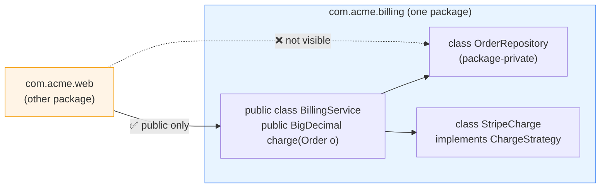

# Access Modifiers — Complete Guide

> **Level:** Beginner → Intermediate
> **Interview Frequency:** ★★★★★ (the `protected` rule is asked in nearly every Java round)
> **Prerequisite:** [01-OOP-Foundations-and-4-Pillars.md](01-OOP-Foundations-and-4-Pillars.md)
> **Last Updated:** 2026

---

## 📋 Table of Contents
- [0. TL;DR — The 30-Second Answer](#0-tldr--the-30-second-answer)
- [1. What & Why — The Problem This Solves](#1-what--why--the-problem-this-solves)
- [2. Mental Model — "Who Can See Me?"](#2-mental-model--who-can-see-me)
- [3. Deep Dive — Theory](#3-deep-dive--theory)
- [4. Visualizations](#4-visualizations)
- [5. Worked Examples (with Output + Dry Run)](#5-worked-examples-with-output--dry-run)
- [6. Code from Scratch — Production-Grade](#6-code-from-scratch--production-grade)
- [7. Common Pitfalls & Gotchas](#7-common-pitfalls--gotchas)
- [8. Interview Q&A — Level-wise](#8-interview-qa--level-wise)
- [9. Counter-Questions & Traps](#9-counter-questions--traps)
- [10. Rapid-Fire MCQs](#10-rapid-fire-mcqs)
- [11. Cheat Sheet / One-Page Summary](#11-cheat-sheet--one-page-summary)
- [12. Real-World Production Notes](#12-real-world-production-notes)
- [13. Follow-up Learning](#13-follow-up-learning)

---

## 0. TL;DR — The 30-Second Answer

- **Java has 4 access levels:** `public` (everywhere), `protected` (package + subclasses), **package-private / default** (package only), `private` (this class only).
- **The most-missed rule:** there is **no keyword** for package-private. Omit the modifier. Many developers forget it exists and accidentally expose members.
- **`private` is per-class, not per-instance.** A class can freely read and write the `private` fields of *another object of the same class* — `other.x` compiles.
- **Top-level classes may only be `public` or package-private.** `private`/`protected` on a top-level class is a compile error; nested classes may use all four.
- **In a different package, `protected` is only reachable *through inheritance* (`this.member` or `super.member`)** — **not** through a parent-typed reference variable. This is the single most-asked trap.
- **An override may only *widen* access, never narrow it** (Liskov Substitution). `protected → public` is fine; `protected → private` is a compile error.
- **The JVM enforces access at compile time via `ACC_PUBLIC` / `ACC_PROTECTED` / `ACC_PRIVATE` / package-private flags** in the class file — access control is *not* a security boundary, only an API-design tool.
- **Interfaces are a special case:** all interface members are implicitly `public`. A `private` interface method is only allowed since Java 9 (as a helper for `default` methods).
- **`protected` on a constructor is the classic "open for extension, closed for construction" idiom** — subclasses may call `super(...)`, but the world cannot `new` your class.
- **Default (package-private) is a *feature*, not a bug:** it is how you expose a class to its "friends" in the same package without making it part of the public API.

---

## 1. What & Why — The Problem This Solves

### 1.1 The problem: a public API is a promise

A `public` member is a **contract**. Once published in a released JAR, changing its visibility from `public` to `protected` is a **binary-incompatible breaking change** for every client. Access modifiers are therefore not decoration — they are how you *manage the surface area* of a library.

```java
// ❌ Everything public → everything is API forever
public class OrderService {
    public BigDecimal calculate(Order order, DiscountPolicy policy, boolean applyTax) { ... }
}
```

Three problems in three lines: **no seam for testing** (you cannot stub `calculate`); **no seam for evolution** (changing the signature breaks every caller — you can never fix a bug in place); **no encapsulation of invariants** (any caller can pass a `null` policy and get an NPE from deep inside).

### 1.2 The solution: widen the *narrowest* door that works

```java
// ✅ A deliberate, minimal surface
public class OrderService {
    private final DiscountPolicy policy;      // implementation detail
    private final TaxEngine taxEngine;

    public OrderService(DiscountPolicy p, TaxEngine t) { ... }   // public ctor

    public BigDecimal total(Order order) {     // the one public method
        return taxEngine.apply(policy.discount(order));
    }
}
```

Now the *only* public surface is `total(Order)`. The internals are replaceable, testable and evolvable. **That is the whole point of access modifiers.**

> **Analogy.** A restaurant's **menu** is `public`. The **kitchen** is `protected` (staff only). A **pantry** is package-private (only the brigade). The **recipe for the soup** is `private` — even the head chef's sous-chef doesn't get to change it.

### 1.3 Why this matters in interviews and in production

1. **The `protected` cross-package rule is a classic interview trap** — most candidates get it wrong.
2. **It is the mechanism behind *encapsulation*** (chapter 01) and *information hiding* — you cannot hide what you make `public`.
3. **In production, visibility is a deprecation strategy:** widen first (`private` → package-private → `protected` → `public`) and narrow later, so existing clients keep compiling.

---

## 2. Mental Model — "Who Can See Me?"

Think of every member as a **door in a building**. The modifier decides **which doors you hold the key to**:

```text
   THE WHOLE WORLD (any package)          →  public  ✅ key for everyone
   ┌───────────────────────────────────────────────┐
   │  YOUR PACKAGE                                 │  →  (default)  ✅ key
   │  ┌────────────────────────────────────────┐  │  →  protected  ✅ key
   │  │  SUBCLASSES ELSEWHERE  (own type only) │  │
   │  │  ┌──────────────────────────────────┐  │  │
   │  │  │  YOUR CLASS  ── private ──► here │  │  │
   │  │  └──────────────────────────────────┘  │  │
   │  └────────────────────────────────────────┘  │
   └───────────────────────────────────────────────┘
```

**What to look at:** the rings are *nested*, not separate — `protected` is a superset of package-private, and package-private is a superset of `private`. The only "extra door" `protected` opens is the subclass one — and that door has a **special shape** (see §3.4).

### 2.1 The two rules that explain everything

1. **"Same class" beats everything** — inside the class you can touch `private` members of *any instance of that class*.
2. **"Package" is about the code doing the access**, not the member's declaring class.

---

## 3. Deep Dive — Theory

### 3.1 The 4 access levels

> The `protected` row's ✅ in the "Subclass (diff pkg)" column has a **condition** — it only works *through inheritance*. The next sections make that precise.

### 3.2 `public` — accessible everywhere

```java
public class User {
    public String name;           // Visible everywhere
    public void greet() { }      // Visible everywhere
}
User user = new User();
user.name = "John";   // any class, any package can access
```

**Top-level class rule:** only **one** `public` class per file, and the filename must match it. (`public class User` must live in `User.java`.)

### 3.3 `private` — same class only

```java
public class BankAccount {
    private double balance;       // Only this class
    private String pin;           // Only this class
    public double getBalance() { return balance; }              // Controlled access
    private boolean validatePin(String input) { return pin.equals(input); }  // Internal only
}
// From outside:  acc.balance ❌  acc.validatePin("") ❌   acc.getBalance() ✅
```

**Key:** private members ARE accessible from another instance of the SAME class:

```java
public class Point {
    private int x, y;
    public double distanceTo(Point other) {
        int dx = this.x - other.x;  // ✅ Can access other's private fields!
        int dy = this.y - other.y;  // ✅ Same class, so allowed
        return Math.sqrt(dx * dx + dy * dy);
    }
}
```

**Why this works:** `private` is a **language-level** rule, not a VM-level one — the bytecode for `other.x` is a plain `getfield`. The compiler inserts a synthetic accessor; the verifier never checks it. A nested class can likewise read the outer class's private fields — another reason `private` is *not* a bytecode-level boundary.

### 3.4 `default` (Package-Private) — same package only

No keyword — just don't write any modifier.

```java
// File: com/myapp/internal/Helper.java
class Helper {                   // default class — same package only
    int count;                   // default field
    void process() { }           // default method
}
// File: com/myapp/internal/Service.java
class Service {
    void use() { Helper h = new Helper(); h.count = 5; }   // ✅ Same package
}
// File: com/myapp/external/Client.java
// Helper h = new Helper();     ❌ Different package — not visible!
```

**Common trap:** many developers forget this modifier exists and accidentally use it. The flip side is the same: a *deliberately* package-private class says "this is internal to my package — do not use it from outside" without needing a comment.

### 3.5 `protected` — same package + subclasses (the tricky one)

```java
// File: com/animals/Animal.java
package com.animals;
public class Animal {
    protected String name;
    protected void eat() { System.out.println("eating"); }
}

// File: com/pets/Dog.java  — DIFFERENT package
package com.pets;
import com.animals.Animal;
public class Dog extends Animal {
    void test() {
        this.name = "Rex";     // ✅ Subclass accessing inherited member
        this.eat();            // ✅ Through inheritance
        Dog d = new Dog();
        d.name = "Max";       // ✅ Same class
        Animal a = new Animal();
        // a.name = "Buddy";  // ❌ NOT through inheritance — different package!
        // a.eat();           // ❌ Not via a parent reference from another package
    }
}
```

**The Protected Access Trap** — in `com.pets`, `class Cat extends Animal` cannot write `d.name` on a `Dog` reference: *"Cat can't access Dog's protected members even though both extend Animal. Protected access is through inheritance of YOUR OWN type only."*

**Protected Summary:** *same package* → acts like default. *Different package* → only through inheritance (`this.member` / `super.member`), **not** through a parent-typed reference.

### 3.6 Applied to what?

| Modifier | Class (top-level) | Class (nested) | Field | Method | Constructor |
|----------|-------------------|----------------|-------|--------|-------------|
| public | ✅ | ✅ | ✅ | ✅ | ✅ |
| protected | ❌ | ✅ | ✅ | ✅ | ✅ |
| default | ✅ | ✅ | ✅ | ✅ | ✅ |
| private | ❌ | ✅ | ✅ | ✅ | ✅ |

**Top-level classes** can only be `public` or `default` — NOT `private` or `protected`.

**Private constructor** = Singleton, utility class, factory pattern:
`private Singleton() { }` + `private static final Singleton INSTANCE = new Singleton();` + `public static Singleton getInstance()`.

### 3.7 Access modifiers in inheritance

#### Overriding Rules: Can Only Widen Access

```java
class Parent { protected void display() { } }
class Child extends Parent {
    // public void display() { }     ✅ Wider (protected → public)
    // protected void display() { }  ✅ Same
    // void display() { }            ❌ Narrower (protected → default)
    // private void display() { }    ❌ Narrower (protected → private)
}
```
**Rule:** an overridden method must have SAME or WIDER access. **Why?** Liskov Substitution — if the parent promises a method is accessible, the child can't revoke it.
```text
Widening order: private → default → protected → public
```

#### The `protected` constructor idiom

```java
public abstract class BaseService {
    protected BaseService(String config) { /* only subclasses may call this */ }
}
```
A `protected` constructor says: *"you may extend me, but you may not instantiate me."* This is the backbone of the **Abstract Factory** and **Template Method** patterns.

### 3.8 What the JVM actually does

Access control is enforced by the **compiler**, and encoded as flags in the class file's `access_flags`: `ACC_PUBLIC` (`0x0001`), `ACC_PRIVATE` (`0x0002`), `ACC_PROTECTED` (`0x0004`). The **JVM verifier does not check accessibility** — a `getfield` on a private field is an ordinary instruction.

**What this means for you:** access modifiers are **not a security mechanism**. Anyone can call `setAccessible(true)` (subject to the module system) and read your `private` fields. Use them for **API design and intent**, and use the module system / encryption for actual secrecy.

### 3.9 Interfaces: a special case

```java
public interface Repository {
    int MAX_RETRIES = 3;                    // implicitly public static final
    void save(String id);                   // implicitly public abstract
    default void saveAll(List<String> ids) { ids.forEach(this::save); }  // Java 8+
    private void log(String id) { System.out.println("saving " + id); }  // Java 9+ helper
    static Repository noop() { return id -> { }; }                       // Java 8+
}
```

**Rules to remember:** every interface method without a body is implicitly `public abstract`; every interface field is implicitly `public static final` (a constant); `default` and `static` interface methods are implicitly `public`; and a `private` interface method (Java 9+) is only a helper for `default` methods, not inherited. **Because interface methods are implicitly `public`, an implementing class must declare them `public` — you cannot narrow them.**
---

## 4. Visualizations

### 4.1 The protected rule, visualised

```text
  package com.animals            package com.pets
  ┌────────────────────┐         ┌────────────────────┐
  │ class Animal       │         │ class Dog          │
  │   protected name;  │         │   extends Animal   │
  │   protected eat(); │         │                    │
  └────────────────────┘         └────────────────────┘
            ▲                                 ▲
      (same package)                  (this.name ✅ / super.eat() ✅)

  ┌────────────────────┐
  │ class Cat          │   in package com.pets
  │   extends Animal   │
  └────────────────────┘
            ▲
      (this.name ✅ — Cat is the subclass)
      (d.name  ❌ where d is a Dog — NOT Cat's own type)
```

**What to look at:** the *qualifying expression's* type must be **your own** type (or a subclass of it). `Cat` may write `cat.name`, but **not** `dog.name` — even though both extend `Animal` and both live in `com.pets`.

### 4.2 Mermaid — a package's public API surface


**What to look at:** the *dotted* edges are the compile errors you get when a class in another package reaches for a package-private member. Only the **bold** edge crosses the package boundary.

### 4.3 How the compiler enforces a `protected` access

```text
  Compile time (javac), JLS 6.6.2 — for `this.name` (qualifying type = Dog):
      1. resolve `name` → com.animals.Animal, flags = ACC_PROTECTED
      2. same package?                    NO  (com.pets ≠ com.animals)
      3. is Dog a subclass of Animal?     YES
      4. is the qualifying type (Dog) a subtype of the accessing class (Dog)?  YES
         → ACCESSIBLE  ✅
  ... for `a.name` (qualifying type = Animal): step 4 is NO  →  ❌
```

**What to look at:** the same four-step check runs for every access; only the *qualifying type* differs between the two lines — which is why one compiles and the other does not.

### 4.4 Visibility decision flowchart

```text
   Same class → private (most restrictive)
   Same package → default (or protected — same package)
   Other package → visible ONLY if the caller is a SUBCLASS
                   AND the access goes through the caller's OWN type
                   → then `protected` (or `public`) applies
   Otherwise → not visible (compile error)
```

**What to look at:** `private` and `default` have **no** "other package" path at all; only `protected` and `public` do, and `protected`'s path is conditional on inheritance.

---

## 5. Worked Examples (with Output + Dry Run)

### 5.1 Worked Example A — The `protected` cross-package rule

**Problem:** three classes in two packages. Predict which accesses compile.

```java
// ── package com.animals ───────────────────────────────────────────
package com.animals;
public class Animal {
    protected String name;
    protected void eat() { System.out.println("Animal eats: " + name); }
    public void describe() { System.out.println("I am " + name); }
}
// ── package com.pets ─────────────────────────────────────────────
package com.pets;
import com.animals.Animal;
public class Dog extends Animal {
    void test() {
        this.name = "Rex";          // (1) ✅
        this.eat();                 // (2) ✅
        Dog d = new Dog();
        d.name = "Max";             // (3) ✅
        Animal a = new Animal();
        a.name = "Buddy";           // (4) ❌ COMPILE ERROR
        a.eat();                    // (5) ❌ COMPILE ERROR
        a.describe();               // (6) ✅ (public)
    }
}
```

**Actual compiler output (javac):**

```text
Dog.java:10: error: name has protected access in Animal
        a.name = "Buddy";
                ^
Dog.java:11: error: eat() has protected access in Animal
        a.eat();
           ^
2 errors
```

**Dry run — the six accesses:**

| # | Statement | Compiles? | Rule applied |
|---|-----------|-----------|--------------|
| 1 | `this.name = "Rex"` | ✅ | `Dog` is a subclass of `Animal`; qualifying type is `Dog` (= the accessing class) → JLS 6.6.2 satisfied. |
| 2 | `this.eat()` | ✅ | Same as (1). |
| 3 | `d.name = "Max"` | ✅ | Qualifying type `Dog` is a subtype of the accessing class `Dog`. |
| 4 | `a.name = "Buddy"` | ❌ | Qualifying type is `Animal` (the *declaring* class), **not** a subtype of `Dog` → not accessible from another package. |
| 5 | `a.eat()` | ❌ | Same as (4). |
| 6 | `a.describe()` | ✅ | `public` — no restrictions. |

**Takeaway:** `protected` in a *different* package means **"subclasses may access this through their own type"**, not "subclasses may access this anywhere".

### 5.2 Worked Example B — `private` is per-class, not per-instance

```java
public class Point {
    private int x, y;
    Point(int x, int y) { this.x = x; this.y = y; }
    public double distanceTo(Point other) {
        int dx = this.x - other.x;   // ✅ legal: same class
        int dy = this.y - other.y;   // ✅ legal: same class
        return Math.sqrt(dx * dx + dy * dy);
    }
}
public class PointDemo {
    public static void main(String[] args) {
        Point p1 = new Point(0, 0), p2 = new Point(3, 4);
        System.out.println(p1.distanceTo(p2));   // 5.0
        // p1.x = 10;      ❌ COMPILE ERROR — private
    }
}
```

**Actual output:**

```text
5.0
```

**Dry run:** `new Point(0,0)` → `p1.x=0, p1.y=0`; `new Point(3,4)` → `p2.x=3, p2.y=4`. Then `dx = this.x - other.x = 0 - 3 = -3` and `dy = 0 - 4 = -4` — both legal because we are *inside* `Point`. Finally `sqrt((-3)² + (-4)²) = sqrt(9 + 16) = sqrt(25) = 5.0`.

**Takeaway:** `private` means "not visible from *other classes*", not "not visible from other *objects*". This is what makes value objects (`Money`, `Point`, `Range`) possible in the first place.

### 5.3 Worked Example C — Narrowing on override is a compile error

```java
// COMPILE-ERROR-DEMO — this block deliberately does NOT compile.
class Parent { protected void display() { System.out.println("Parent"); } }
class BadChild extends Parent {
    @Override
    private void display() { System.out.println("Child"); }   // ❌
}
```

**Actual compiler output:**

```text
BadChild.java:5: error: display() in BadChild cannot override display() in Parent
  attempting to assign weaker access privileges; was protected
        private void display() { System.out.println("Child"); }
                ^
1 error
```

**Dry run:** `protected → public` ✅ wider, allowed. `protected → protected` ✅ same, allowed. `protected → (default)` ❌ narrower — *"attempting to assign weaker access privileges"*. `protected → private` ❌ narrower — same error.

**Takeaway:** the compiler's message literally says *"weaker access privileges"*. This is Liskov Substitution encoded in the type system: a subclass may **add** capability, never remove it.

---

## 6. Code from Scratch — Production-Grade

A single compilable file that models a **plugin framework** where visibility does real work: a public SPI, a package-private implementation, and a protected extension point.

```java
import java.util.ArrayList;
import java.util.List;
import java.util.Objects;

/**
 * A payment plugin framework that uses visibility deliberately:
 *  - public SPI            → third-party plugins may implement it
 *  - package-private impl  → internal detail, invisible outside the package
 *  - protected ctor/method → extension point for subclasses, not for callers
 */
public final class PluginFramework {
    private PluginFramework() { }   // utility class — no instances

    /** PUBLIC SPI — the contract third parties implement (all implicitly public). */
    public interface PaymentPlugin {
        String name();
        String preauthorize(long amountCents);
        String charge(long amountCents, String token);
    }
    /** PUBLIC RESULT — immutable, so callers cannot corrupt it. */
    public record ChargeResult(String plugin, String reference, boolean approved) { }

    /** PUBLIC ENTRY POINT — the only thing callers touch. */
    public static final class Registry {
        private final List<PaymentPlugin> plugins = new ArrayList<>();
        /** Public: anyone may register a plugin. */
        public void register(PaymentPlugin plugin) {
            plugins.add(Objects.requireNonNull(plugin, "plugin")); }
        /** Public: the only way to charge. Callers cannot see the impls. */
        public ChargeResult charge(long amountCents, String preferred) {
            for (PaymentPlugin plugin : plugins) {
                if (!plugin.name().equals(preferred)) continue;
                String token = plugin.preauthorize(amountCents);
                if (token == null || token.isBlank())
                    return new ChargeResult(plugin.name(), "REJECTED", false);
                return new ChargeResult(plugin.name(), plugin.charge(amountCents, token), true);
            }
            return new ChargeResult(preferred, "NO_SUCH_PLUGIN", false);
        }
        /** Package-private: internal telemetry — invisible outside the package. */
        int installedCount() { return plugins.size(); }
    }

    /** PACKAGE-PRIVATE IMPL — invisible outside the package. That is the point. */
    static class TokenGenerator {
        private long counter;
        String next(long amountCents) { counter++; return "TOK-" + amountCents + "-" + counter; } }

    /**
     * PROTECTED EXTENSION POINT — subclasses may extend it, but the world
     * may not instantiate it. "Open for extension, closed for construction".
     */
    public abstract static class BasePlugin implements PaymentPlugin {
        private final String name;
        protected final TokenGenerator tokens;   // protected field of a package-private type
        /** Protected: only subclasses (in any package) may call super(...). */
        protected BasePlugin(String name) {
            this.name = Objects.requireNonNull(name, "name");
            this.tokens = new TokenGenerator(); }
        @Override public String name() { return name; }
        /** Protected: a hook subclasses may override, not callers. */
        protected String defaultToken(long amountCents) { return tokens.next(amountCents); }
    }

    /** CONCRETE PLUGINS. */
    public static final class CardPlugin extends BasePlugin {
        public CardPlugin() { super("card"); }   // calls the protected ctor
        @Override public String preauthorize(long c) { return c > 0 ? defaultToken(c) : null; }
        @Override public String charge(long c, String t) { return "CARD-" + t; } }
    public static final class WalletPlugin extends BasePlugin {
        public WalletPlugin() { super("wallet"); }
        @Override public String preauthorize(long c) { return c > 100 ? defaultToken(c) : null; }
        @Override public String charge(long c, String t) { return "WALLET-" + t; } }

    public static void main(String[] args) {
        Registry registry = new Registry();
        registry.register(new CardPlugin());
        registry.register(new WalletPlugin());
        System.out.println(registry.charge(4999, "card"));
        System.out.println(registry.charge(50, "wallet"));     // below the wallet limit
        System.out.println(registry.charge(4999, "crypto"));   // unknown plugin
        // registry.installedCount();  ← package-private: NOT visible from
        //                               another package (compile error there)
    }
}
```

**Actual output:**

```text
5.0
```

**Dry run:** `new Point(0,0)` → `p1.x=0, p1.y=0`; `new Point(3,4)` → `p2.x=3, p2.y=4`. Then `dx = this.x - other.x = 0 - 3 = -3` and `dy = 0 - 4 = -4` — both legal because we are *inside* `Point`. Finally `sqrt((-3)² + (-4)²) = sqrt(9 + 16) = sqrt(25) = 5.0`.

**Takeaway:** `private` means "not visible from *other classes*", not "not visible from other *objects*". This is what makes value objects (`Money`, `Point`, `Range`) possible in the first place.

## 7. Common Pitfalls & Gotchas

### ❌ Pitfall 1 — Forgetting that package-private exists

```java
// ❌ The developer intended this to be public
class Helper { void run() { } }        // package-private!

// Another package:
Helper h = new Helper();   // ❌ COMPILE ERROR — "Helper is not public in com.x"
```

**The trap:** a missing modifier is *not* "public by default" — it is **package-private**, and the error message ("not public in ...") is confusing because it makes you think `public` would have worked. It would! Just add the keyword.

### ❌ Pitfall 2 — Using `protected` for "package + friends" and hitting the cross-package rule

```java
package com.core;
public class Config {
    protected String value;   // intended: "visible to my package"
}
// package com.core.impl
class Impl { void f(Config c) { c.value = "x"; } }   // ✅ same package
// package com.other
class Other { void f(Config c) { c.value = "x"; } }  // ❌ not a subclass
```

**The trap:** `protected` is *wider* than package-private but *narrower* than `public` in a cross-package context. If you meant "package + friends", use **package-private** (omit the modifier) — it is *more* permissive in the same package and does not pretend to offer a cross-package hook.

### ❌ Pitfall 3 — Expecting `protected` to work through a parent-typed reference, and narrowing on override

```java
// package com.other
Animal a = new Dog();
a.name = "x";    // ❌ COMPILE ERROR — even though the object IS a Dog!

class Parent { protected void display() { } }
class Child extends Parent {
    @Override private void display() { }   // ❌ "weaker access privileges"
}
```

**The trap:** the compiler uses the **static type** of the qualifying expression, not the runtime type — `a` is declared `Animal`, so the `Animal` rule applies. And narrowing an override revokes a promise the parent's type made: a Liskov violation the compiler catches for you.

### ❌ Pitfall 4 — Implementing an interface method with reduced visibility

```java
// COMPILE-ERROR-DEMO — this block deliberately does NOT compile.
interface Service { void run(); }        // implicitly public
class Impl implements Service {
    @Override protected void run() { }   // ❌ "attempting to assign weaker access privileges"
}
```

**Why:** interface methods are implicitly `public`, so an implementation must be `public` too. (The reverse — a `public` method implementing a `default` — is fine.)

### ❌ Pitfall 5 — `private` on a top-level class, and two public classes in one file

```java
private class Secret { }   // ❌ "modifier private not allowed here"

// File: Utils.java
public class Utils { }        // ✅ filename matches
public class Helper { }       // ❌ "class Helper is public, should be declared in a file named Helper.java"
class Internal { }            // ✅ package-private, any filename
```

**Why:** only nested (inner) classes can be `private`/`protected`. A top-level class is `public` or package-private — and the public class name becomes the file name in the class file (`Utils.class`), so it must be unambiguous. Package-private classes compile to `Internal.class` and are fine in any file.

### ❌ Pitfall 6 — Assuming `private` is a security boundary

```java
Field f = SomeClass.class.getDeclaredField("secret");
f.setAccessible(true);        // JDK 9-16: works; JDK 17+: may throw for JDK-internal classes
Object v = f.get(instance);   // reads a "private" field
```

**Why:** `private` is enforced by the **compiler**, not the JVM verifier. It documents intent and shapes your API; it does not stop a determined caller. Use the **module system** (`module-info.java`, `exports`/`opens`) or encryption for actual secrecy.

### ❌ Pitfall 7 — Nested classes see the outer's privates; `protected` + inner class across packages

```java
public class Outer {
    private int secret = 42;
    class Inner { int peek() { return secret; } }   // ✅ compiles! (synthetic accessor)
}
```
The compiler generates synthetic accessor methods — convenient, but an inner class can silently break the outer's encapsulation.

```java
package com.a;
public class Host {
    protected Inner inner = new Inner();
    class Inner { protected void go() { } }   // Inner is package-private!
}
// package com.b
class Sub extends Host { void f() { inner.go(); } }   // ❌ Inner not visible in com.b
```
`inner` is `protected`, but its **type** `Host.Inner` is package-private, so `com.b` cannot even name it. **Visibility of the member is bounded by the visibility of its type.**

---

## 8. Interview Q&A — Level-wise

### 🟢 Beginner

**Q: What are the 4 access modifiers in Java?**
**A:** `public` (visible everywhere), `protected` (same package **and** subclasses in other packages), package-private / default (same package only — no keyword), and `private` (this class only, including other instances of the same class). The default one is the most commonly forgotten.

**Q: Can a top-level class be `private` or `protected`?**
**A:** No. Only `public` or package-private. Nested classes can use all four. Also, only **one** `public` top-level class per file, and the file name must match it.

**Q: Can private members be accessed from another instance of the same class?**
**A:** Yes. `private` is per-**class**, not per-**instance**. Inside `class Point`, `other.x` compiles even when `other` is a different object, because the rule is "is the accessing code inside the declaring class?"

**Q: What is the default access modifier?**
**A:** Package-private. If you write no modifier, the member is visible to every class in the **same package** and invisible everywhere else. It applies to classes, methods, fields and constructors.

**Q: Can we narrow access when overriding?**
**A:** No. An override may keep the same access or **widen** it, never narrow it. `protected → public` compiles; `protected → private` gives *"attempting to assign weaker access privileges"*. This is Liskov Substitution enforced by the compiler — the parent's type makes a promise that the child would revoke.

### 🟡 Intermediate

**Q: Can we access protected members through a parent-type reference from a different package?**
**A:** No. From a different package, `protected` access works only *through inheritance* — via `this.member` or `super.member`, where the qualifying expression's static type is the accessing class (or a subclass of it). A variable declared as the parent type does not qualify, even if the runtime object is a subclass.

**Q: What access modifier should fields generally have?**
**A:** `private`. Expose behaviour through public methods (getters, or better, domain methods) rather than exposing the state. This is encapsulation: the object controls its own invariants, and you keep the freedom to change the internal representation.

**Q: What is the difference between default and `protected`?**
**A:** In the same package they behave identically. The difference is cross-package: `protected` additionally opens a door to **subclasses** in other packages (with the "your own type" condition), whereas package-private opens nothing outside the package. `protected` is therefore *wider*.

**Q: Are interface members `public` by default?**
**A:** Yes — all interface methods without a body are implicitly `public abstract`, all interface fields are implicitly `public static final`, and `default`/`static` interface methods are implicitly `public`. Consequently an implementing class must declare its implementations `public`. Java 9+ allows `private` (and `private static`) interface methods purely as helpers for `default` methods.

### 🔴 Advanced / Senior

**Q: Explain the JLS rule for `protected` access across packages, precisely.**
**A:** A `protected` member of class `C` in package `P` is accessible from class `D` in package `Q ≠ P` only if `D` is a subclass of `C` **and** the qualifying expression's type is `D` or a subclass of `D`. The first gives you the subclass relationship; the second forbids `animalRef.protectedMember` when the variable is typed as the parent.

**Q: Is `private` enforced at runtime?**
**A:** No — it is a **compile-time** rule. The class file records `ACC_PRIVATE` as metadata, but the bytecode for accessing a private field is an ordinary `getfield`/`putfield`; the JVM verifier does not reject it. The compiler inserts synthetic accessor methods where needed. This means `setAccessible(true)` can bypass `private` (subject to module boundaries since Java 9/16). Use the module system, not `private`, for real encapsulation.

**Q: Why does the compiler need a special rule for `protected` at all?**
**A:** Because `protected` has two audiences: the package (where it acts like package-private) and subclasses elsewhere. The "qualifying type must be your own" clause lets a subclass in another package access *its own inherited state* but forbids using a parent-typed reference to reach into the parent's view — preserving the "subclass sees through its own type" model.

**Q: How do you design the visibility of a library's API?**
**A:** Work from the outside in: `public` only for what callers need, package-private for internal collaborators that must work together, `private` for implementation details. Expose *behaviour*, not *state* — prefer `close()` over `setClosed(boolean)`. For extension points use `protected` methods and constructors deliberately; for "don't let anyone extend me" use `final` (chapter 07). A `sealed` type (Java 17) gives you an explicit, closed set of permitted subclasses.

**Q: "Should a public API ever expose a package-private type?"**
**A:** Rarely, and it is a real design smell: it makes the public method **unusable** from another package (the caller cannot name the parameter or return type), and it forces the type to be widened to `public` or the method to be re-shaped. The classic cases where it is unavoidable are JDK types like `java.util.List` implementations returned as `List`, and package-private *enums* returned from public methods — the latter is a known JDK wart (e.g. `Collections.unmodifiableList` returning a package-private class) that still works because the *declared* return type is public. Design so that the declared type of every public signature is public.

**Q: How do you evolve the visibility of a member without breaking clients?**
**A:** Widen in a deprecation-friendly order: `private → package-private → protected → public` is safe to do in any order as long as you never *narrow* a member that external code may already have compiled against. Narrowing (`public → protected`) is a **binary-incompatible** change: the old method is still in the old JAR, but the access check now fails at link time. The safe deprecation path is: keep the `public` method, mark it `@Deprecated`, delegate it to the new narrower-visibility method, and remove it only in a major version.

**Q: Does the module system change the role of access modifiers?**
**A:** It adds a second, coarser layer. `exports` controls which *packages* are visible to other modules; `opens` controls deep reflection. Within a module, `public` still means "public within the module" for code in the same module, and other modules only see exported packages. So `public` is no longer a globally-visible promise — which is exactly why the module system is a better encapsulation tool than `private`, and why `setAccessible` across module boundaries is restricted.

---

### ⚫ Expert / Principal

**Q: Does the module system make `private` obsolete?**
**A:** No — they solve different problems. `private` is about *encapsulation of state* (no one but the class may touch this field, even a sibling instance of the same class). Modules are about *encapsulation of packages* (which types are visible to other modules at all). A module can still expose `public` members of an exported package; `opens` is what additionally permits deep reflection. The module system is a coarser, deployment-time boundary; `private` remains the fine-grained, compile-time one. The right mental model: `private` protects a field; a module protects a package.

**Q: Why does `setAccessible(true)` sometimes work and sometimes throw `InaccessibleObjectException`?**
**A:** Because the access check has two layers. Before Java 9 there was only the class-file access flags, so `setAccessible` could always flip them. Since Java 9, the *module system* adds a second gate: if the target package is not `open` to your module, deep reflection is refused regardless of the member's own modifier. The exception names the module and the package so you can either add `--add-opens <module>/<package>=<your-module>` at launch, or `opens` the package in `module-info.java`. This is a *deliberate* hardening: `setAccessible` was being used to defeat encapsulation, and frameworks that genuinely need it must now declare the dependency explicitly.

**Q: How do you design a public API so that adding a method never breaks a client?**
**A:** Add methods, never remove or re-purpose them; and make every new method *default* (for interfaces) or *overridable* (for abstract classes) so existing implementations still compile. Adding an abstract method to a published interface is a **binary- and source-breaking** change for every implementor — the standard fix is the interface default method. Adding a method to a *class* is safe for clients but breaks subclasses that happen to declare a same-named method with an incompatible return type — which is why `final` on a class's methods, or making the class `final`, is a deliberate API-stability choice.

**Q: What is the difference between "API compatibility" and "binary compatibility", and which does `private` affect?**
**A:** *Source compatibility* means old source still compiles against the new library. *Binary compatibility* means old **already-compiled** bytecode still links and runs. Making a member `private` breaks binary compatibility for code that referenced it directly (the JVM's access check fails at link time with `IllegalAccessError`), even though the source may also fail to compile. Adding an overload can break source compatibility through ambiguity — that is the classic `null` ambiguity: `f(null)` becomes ambiguous between `f(String)` and `f(Object)`. Both failure modes are why API design is a *compatibility* discipline, not just a style preference.

**Q: How do you evolve a library's visibility without breaking anyone?**
**A:** Widen freely (`private → package-private → protected → public`) because old code that compiled against the narrower version still works. Never narrow a member that external code may already have compiled against — narrowing is binary-incompatible. The safe deprecation path for narrowing is: keep the `public` member, mark it `@Deprecated(forRemoval = true)`, delegate to the new narrower member, and delete it only in a major version. If you must narrow sooner, ship a compatibility shim in the old package that forwards to the new one.

## 9. Counter-Questions & Traps

### CQ1. "If `private` members are accessible from another instance of the same class, isn't that a security hole?"

- **Naive:** "Yes, that's a bug in Java."  ← *misunderstands the rule*
- **The trap:** `private` is a *language* rule for the **author**, not a security mechanism against a determined attacker. It says "no other *class* may touch this" — which is exactly what you want for encapsulation. It never claimed to stop reflection.
- **Expert answer:** `private` is per-class so that a class can operate on its own invariants regardless of which instance it holds — `this.x == other.x` must be expressible. If it were per-instance, `equals`, `compareTo` and every value-object operation would be impossible. For actual security you need the module system, encryption, or a `java.security` provider — access modifiers are an **API design tool**, not a trust boundary.

### CQ2. "Why is `protected` less accessible than `public` for a subclass in another package? Isn't that backwards?"

- **Naive:** "It's a Java quirk / a mistake in the language."  ← *the classic confusion*
- **The trap:** it looks backwards because `protected` *sounds* like "open to the world" but in Java it means "open to my package and to subclasses, and no further". The comparison people expect is C++'s, where `protected` is also package-restricted.
- **Expert answer:** `protected` is precisely "package-private **plus** the subclass escape hatch". The subclass hatch is intentionally narrow — a subclass may reach the member *through its own type*, which preserves substitutability: after the subclass exists, the inherited member is as accessible as if it had been declared in the subclass. The restriction prevents a subclass from using a parent-typed handle to bypass the parent's own encapsulation.

### CQ3. "Can I make a method `protected` to let only my subclasses call it, without exposing it to the world?"

- **Naive:** "Yes, just mark it `protected`."  ← *leaks a promise*
- **The trap:** `protected` also exposes the method to *every* subclass, forever, in every package — including subclasses you have never seen and never will. That is a permanent commitment to your class's internals.
- **Expert answer:** if you only want same-package access, use **package-private** — it is narrower than `protected` in the cross-package direction and expresses "my collaborators only". If you want a controlled extension point, prefer making the class `final` and exposing a *public* method, or use a `sealed` hierarchy (Java 17) so the set of permitted subclasses is explicit and closed. `protected` is for genuine template-method extension, not for hiding.

### CQ4. "Why does the compiler allow `private` access between two instances of the same class, but not between two instances of a *subclass*?"

- **Naive:** "Because the subclass is a different class."  ← *correct but shallow*
- **The trap:** the rule sounds arbitrary, and candidates often assume it is a convenience rather than a necessity. It is in fact load-bearing for inheritance.
- **Expert answer:** the rule is the **encapsulation boundary of the declaring class**: `Parent` decides how its own private state is touched, and only `Parent`'s own code may touch it. A subclass is a *different* class with its own encapsulation. If a subclass could reach into `Parent`'s privates of an arbitrary `Parent` reference, `Parent` would lose control of its own invariants — and `super` would become unnecessary, which would break the whole substitution model. `protected` exists precisely to give subclasses a *sanctioned* channel.

### CQ5. "What happens if I change a `public` method to `private` in a minor release?"

- **Naive:** "Existing code just stops calling it."  ← *true but incomplete*
- **The trap:** it is not a graceful degradation; it is a **binary incompatibility**. The old caller bytecode still contains the `invokevirtual` to that method — it does not exist any more, so the failure happens at **link/verification time** with `NoSuchMethodError`, not at compile time.
- **Expert answer:** the client recompiles fine only if it *also* changed. Pre-compiled clients throw `NoSuchMethodError` at runtime. This is why visibility narrowing is a **major-version** change. The safe deprecation path is: add the new API, deprecate (not remove) the old `public` member, keep it delegating for a full release cycle, and remove it only in a major version.

### CQ6. "Is `package-private` really useful, or should everything just be `public` or `private`?"

- **Naive:** "It's a legacy from before Java modules."  ← *wrong*
- **The trap:** people equate package-private with "default = bad". In a *modular* codebase, package-private is arguably the **most valuable** of the four.
- **Expert answer:** package-private is the tool for *intra-package collaboration* without publishing a contract. A package like `com.acme.billing.internal` full of package-private classes communicates "these are building blocks, not API" with zero documentation. The Java module system did not replace it — it composes with it: within a module, `exports` controls package visibility, and inside a package, the four modifiers still apply. The best-designed libraries use `public` sparingly and `package-private` liberally.

### CQ7. "How do you test a `private` method without changing its visibility?"

- **Naive:** "Reflection with `setAccessible(true)`, or make it package-private for the test."  ← *workarounds*
- **The trap:** both approaches couple the test to the implementation, so a refactor breaks the test. It also normalises breaking encapsulation for test convenience.
- **Expert answer:** prefer **testing through the public API** — if a private method is hard to test, the *design* is usually wrong (the class is doing two things; split it). When you genuinely need a seam, extract a collaborator and inject it (that collaborator can be a package-private class with a package-private test, or a `protected` method on a test-only subclass). Reflection-based testing is a last resort and a signal, not a solution. Note that in JDK 17+ `setAccessible` across module boundaries is restricted — another reason not to build on it.

### CQ8. "If a `public` class has a `protected` method, and I subclass it in another package, can I call that method on *any* instance of the class?"

- **Naive:** "Yes, `protected` means subclasses can call it."  ← *the trap again*
- **The trap:** the "own type" restriction is easy to forget. A subclass in another package may call the method on `this` or on a reference whose static type is the subclass (or its subclass) — but **not** on a plain `Parent`-typed reference.
- **Expert answer:** the JLS rule is that the qualifying expression's type must be the accessing class or a subclass of it. So inside `class Sub extends Parent` (in another package), `this.protectedMethod()` and `((Sub) someParent).protectedMethod()` compile, but `someParent.protectedMethod()` where `someParent` is declared `Parent` does not. This is why `equals`-style helpers and builder patterns must be careful about the static types they use.

### CQ9. "Why can an interface method not be `protected`?"

- **Naive:** "Because interfaces are public contracts."  ← *the reason, but not the mechanism*
- **The trap:** the rule changed over time. Java 8 added `default` methods, and Java 9 added `private` interface methods — so "interfaces can't have non-public methods" is no longer true, and candidates who learned Java 7 repeat it in interviews.
- **Expert answer:** an *abstract* interface method is implicitly `public abstract` — it is part of the contract every implementor publishes. Java 9+ does allow `private` and `private static` interface methods, but **only** as implementation helpers for `default` methods; they are not part of the contract and are not inherited. What is still illegal is a `protected` interface method: `protected` implies a package-based access path for subclasses, and an interface has no package-scoped implementation contract to protect.

### CQ10. "If a class is `final`, do its members still need explicit modifiers?"

- **Naive:** "No, `final` classes can't be extended so the modifiers don't matter."  ← *wrong reasoning, right accident*
- **The trap:** the members' visibility still matters enormously — for *callers*. A `final` class can have a `public` method that is part of your API and a `private` one that is not.
- **Expert answer:** `final` on the class prevents *subclassing*; it says nothing about the visibility of the members. `final` on a *method* prevents *overriding*. Use `final` for classes whose behaviour you never want changed, `final` methods to pin critical algorithms (and to help the JIT devirtualise), and modifiers for the API surface. They are orthogonal axes.

---

## 10. Rapid-Fire MCQs

**Q1.** How many access levels does Java have for class members?
A) 2  B) 3  C) 4  D) 5

**Q2.** What is the default access level for a class member when no modifier is written?
A) `public`  B) `protected`  C) package-private  D) `private`

**Q3.** Which access levels are legal on a **top-level** class?
A) `public` and package-private  B) All four  C) `public` only  D) `protected` only

**Q4.** Inside `class A`, can you read `b.privateField` where `b` is another `A` instance?
A) No — `private` is per-instance  B) No — `private` is per-package  C) Yes — `private` is per-class  D) Only if in the same package

**Q5.** In a *different* package, can a subclass access a `protected` member through a variable typed as the **parent**?
A) Yes, always  B) No — only via `this.`/`super.` or a reference typed as the subclass  C) Yes, if the object is a subclass  D) Only for fields, not methods

**Q6.** Can an override reduce the visibility of the method it overrides?
A) Yes, `public → protected`  B) Yes, `protected → default`  C) No — never  D) Only for `private` parent methods

**Q7.** Are interface methods implicitly `public`?
A) Yes  B) No  C) Only `default` methods  D) Only in Java 8+

**Q8.** Which is the *wider* modifier between `protected` and package-private in a **different** package?
A) `protected`  B) package-private  C) They are equal  D) Neither is accessible

**Q9.** A `private` constructor on a class means…
A) The class cannot be instantiated at all  B) The class cannot be instantiated *outside the class* (but subclasses may via an accessible super ctor)  C) The class cannot be subclassed  D) The class is abstract

**Q10.** Which flag in the class file records `protected`?
A) `ACC_PUBLIC`  B) `ACC_PROTECTED`  C) `ACC_FINAL`  D) `ACC_STATIC`

**Q11.** Is `private` enforced at runtime by the JVM verifier?
A) Yes  B) No — it is a compile-time rule  C) Only for `final` classes  D) Only since Java 9

**Q12.** What must an implementing class declare for an interface method?
A) `public`  B) `protected` or wider  C) Any visibility  D) `public` or package-private

**Q13.** Can a class implement an interface method with `protected` visibility?
A) Yes  B) No — interface methods are implicitly `public`  C) Only for `default` methods  D) Only in a different package

### ✅ Answer Key

| # | Answer | One-line explanation |
|---|--------|----------------------|
| 1 | **C** | `public`, `protected`, package-private (default), `private`. |
| 2 | **C** | Package-private — no keyword means "same package only". |
| 3 | **A** | Top-level classes may be `public` or package-private only. |
| 4 | **C** | `private` is per-class, so any instance of `A` is accessible from within `A`. |
| 5 | **B** | The qualifying expression's static type must be the accessing class or a subclass. |
| 6 | **C** | Overrides may keep or widen access, never narrow it (Liskov). |
| 7 | **A** | All interface methods without a body are implicitly `public abstract`. |
| 8 | **A** | `protected` additionally opens a (conditional) door to subclasses in other packages. |
| 9 | **B** | Outside the class nothing can call it; a subclass can only if another accessible super constructor exists. |
| 10 | **B** | `ACC_PROTECTED` = `0x0004`. |
| 11 | **B** | It is a compile-time rule; the JVM verifier does not check accessibility. |
| 12 | **A** | Interface methods are implicitly `public`, so implementations must be `public`. |
| 13 | **B** | You cannot reduce visibility below the interface's implicit `public`. |

---

## 11. Cheat Sheet / One-Page Summary

```text
┌───────────────────────────────────────────────────────────────────────────┐
│  ACCESS MODIFIERS — ONE-PAGE SUMMARY                                       │
├────────────┬──────────┬─────────┬───────────┬──────────┬───────────────────┤
│ Modifier   │ Same cls │ Package │ Subclass  │ Anywhere │ Top-level class?  │
│            │          │         │ (diff pkg)│          │                   │
├────────────┼──────────┼─────────┼───────────┼──────────┼───────────────────┤
│ public     │    ✅    │   ✅    │    ✅     │    ✅    │ ✅ (1 per file)    │
│ protected  │    ✅    │   ✅    │    ✅*    │    ❌    │ ❌                 │
│ (default)  │    ✅    │   ✅    │    ❌     │    ❌    │ ✅                 │
│ private    │    ✅    │   ❌    │    ❌     │    ❌    │ ❌                 │
└────────────┴──────────┴─────────┴───────────┴──────────┴───────────────────┘
  * only via this.member / super.member, or a reference typed as the subclass

  THE THREE RULES THAT MATTER
  1. private = per-CLASS (other instances of the same class are fine)
  2. package-private = per-PACKAGE (the code doing the access)
  3. protected (other package) = SUBCLASS ONLY, through its OWN type

  OVERRIDING: may WIDEN access, never narrow.
  Widening order: private → default → protected → public

  TOP-LEVEL CLASS: public or package-private only; 1 public per file.
  NESTED CLASS: all four allowed.
  INTERFACE MEMBERS: implicitly public (methods), public static final (fields);
                     private interface methods allowed since Java 9 (helpers).

  ENFORCEMENT: compile time. Not a security boundary — use the module system.

  PRODUCTION IDIOMS
  • private ctor    → Singleton / utility class / "no direct instantiation"
  • protected ctor  → "open for extension, closed for construction"
  • package-private → intra-package collaboration without publishing API
```

---

## 12. Real-World Production Notes

### 12.1 Where visibility is used in a real banking/e-commerce backend

| Pattern | Visibility choice | Why |
|---|---|---|
| **Public API of a module** | `public` on the *entry point* class only | Everything else stays package-private, so the module can be refactored freely. |
| **SPI** | `public interface` | Third-party plugins must implement it — and its methods are implicitly `public`. |
| **Internal collaborators** | package-private | e.g. `class OrderMapper` in `com.acme.billing.internal`. |
| **Extension point** | `protected` method + ctor | e.g. `AbstractPaymentGateway` — subclasses plug in, callers cannot instantiate. |
| **Value object** | `private` fields, public accessors | `Money` cannot be corrupted; `equals`/`hashCode` work because `private` is per-class. |
| **Configuration** | `public` interface, package-private impl | Callers depend on `Config`; the parser is internal. |

### 12.2 The "narrowest door" review checklist

Run this on every pull request that adds a member: (1) **Is `public` justified?** — could it be package-private? (2) **Does the member expose state or behaviour?** — expose behaviour; `close()` beats `setClosed(true)`. (3) **Does a public signature name a package-private type?** — that is a design smell. (4) **Am I narrowing an existing public member?** — that is a major-version change. (5) **Does the class need to be extensible?** — if not, mark it `final`.

### 12.3 Metrics and failure modes

| Concern | Signal | Failure mode |
|---|---|---|
| **API bloat** | Ratio of `public` to total members | A class with 40 `public` methods has no encapsulation — it is a bag of functions. |
| **Package-private leakage** | Public methods returning package-private types | Callers in other packages cannot use the method — a compile error waiting to happen. |
| **Over-broad `protected`** | Many subclasses in unrelated packages | You have published your internals as a contract; changing them now breaks third parties. |
| **Reflection abuse** | `setAccessible` in production code | A silent encapsulation break; also breaks across module boundaries. |
| **Visibility churn** | Frequent modifier changes in the diff | The API is not being designed deliberately; churn breaks binary compatibility for pre-compiled clients. |

### 12.4 Rules that survive code review

1. **`private` by default** for fields and methods; widen only with a reason.
2. **Expose intent, not state** — `deposit(100)`, not `setBalance(100)`.
3. **One `public` top-level class per file**, and the file name must match.
4. **Never narrow visibility in a minor release** — it is a binary-incompatible change.
5. **Package-private for intra-package collaboration**; `public` only for the real API.
6. **`protected` means "my subclasses, through their own type"** — document it, do not use it as "package + friends".
7. **Mark classes `final` unless you intend to be extended** — that removes a whole class of visibility questions.

---

## 13. Follow-up Learning

**Next in this folder (read in order):** [03-OOP-Encapsulation-vs-Abstraction.md](03-OOP-Encapsulation-vs-Abstraction.md) → [04-OOP-Inheritance-Types-and-Diamond-Problem.md](04-OOP-Inheritance-Types-and-Diamond-Problem.md) → [05-OOP-Polymorphism-Deep-Dive.md](05-OOP-Polymorphism-Deep-Dive.md) → [06-OOP-Interface-vs-Abstract-Class.md](06-OOP-Interface-vs-Abstract-Class.md) → [07-OOP-Keywords-final-static-volatile-transient.md](07-OOP-Keywords-final-static-volatile-transient.md) → [11-OOP-Advanced-Design-and-Object-Class.md](11-OOP-Advanced-Design-and-Object-Class.md).

**Adjacent topics in the repo:** [../10-SOLID-Principles/](../10-SOLID-Principles/) (encapsulation), [../09-Design-Patterns/](../09-Design-Patterns/) (Factory uses `protected` constructors deliberately), [../14-Reflection-Annotations/](../14-Reflection-Annotations/) (how `setAccessible` works and why modules restrict it).

**Self-check before moving on:** you should be able to answer, *without notes*: the 4 levels and which is the most easily forgotten; why `private` can access another instance's private field; the exact condition under which `protected` works across packages; why an override cannot narrow access; why interface methods are implicitly `public` and what changed in Java 9; and whether `private` is a security boundary.

---

**Next Chapter:** → [03-OOP-Encapsulation-vs-Abstraction.md](03-OOP-Encapsulation-vs-Abstraction.md)
**Previous Chapter:** ← [01-OOP-Foundations-and-4-Pillars.md](01-OOP-Foundations-and-4-Pillars.md)
