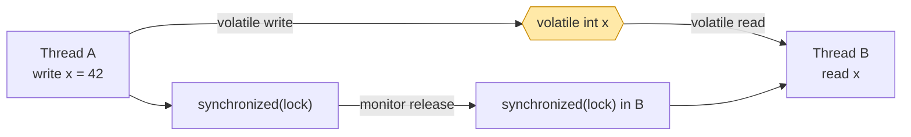

# Java Memory Areas — The JVM Runtime Data Model

> **Level:** Expert
> **Interview Frequency:** ★★★★★ (asked in 90% of Java interviews, and the *follow-up* — "so where does a `static` field live?" — is where most candidates fail)
> **Prerequisite:** [01 · Core Java OOP Foundations](../01-Core-Java-OOP/01-OOP-Foundations-and-4-Pillars.md)
> **Last Updated:** 2026

---

## 📋 Table of Contents

- [0. TL;DR — The 30-Second Answer](#0-tldr--the-30-second-answer)
- [1. What & Why — The Problem This Solves](#1-what--why--the-problem-this-solves)
- [2. Mental Model — One Picture That Explains Everything](#2-mental-model--one-picture-that-explains-everything)
- [3. Deep Dive — Theory](#3-deep-dive--theory)
  - [3.1 The Seven Runtime Data Areas (JVMS §2.5)](#31-the-seven-runtime-data-areas-jvms-25)
  - [3.2 PC Register](#32-pc-register)
  - [3.3 JVM Stack — Frames, Slots and StackOverflowError](#33-jvm-stack--frames-slots-and-stackoverflowerror)
  - [3.4 Heap — Allocation, TLAB and Alignment](#34-heap--allocation-tlab-and-alignment)
  - [3.5 Method Area / Metaspace](#35-method-area--metaspace)
  - [3.6 Runtime Constant Pool & the String Pool](#36-runtime-constant-pool--the-string-pool)
  - [3.7 Direct (Off-Heap) Memory](#37-direct-off-heap-memory)
  - [3.8 The Object Header — Mark Word, Klass Pointer, Array Length](#38-the-object-header--mark-word-klass-pointer-array-length)
  - [3.9 So Where Does *My* Variable Live?](#39-so-where-does-my-variable-live)
  - [3.10 The JMM: Happens-Before and Visibility](#310-the-jmm-happens-before-and-visibility)
  - [3.11 The OOM Taxonomy — Six Different Deaths](#311-the-oom-taxonomy--six-different-deaths)
- [4. Visualizations](#4-visualizations)
- [5. Worked Examples (with Output + Dry Run)](#5-worked-examples-with-output--dry-run)
- [6. Code from Scratch — Production-Grade](#6-code-from-scratch--production-grade)
- [7. Common Pitfalls & Gotchas](#7-common-pitfalls--gotchas)
- [8. Interview Q&A — Level-wise](#8-interview-qa--level-wise)
- [9. Counter-Questions & Traps](#9-counter-questions--traps)
- [10. Rapid-Fire MCQs](#10-rapid-fire-mcqs)
- [11. Cheat Sheet / One-Page Summary](#11-cheat-sheet--one-page-summary)
- [12. Real-World Production Notes](#12-real-world-production-notes)
- [13. Follow-up Learning](#13-follow-up-learning)

---

## 0. TL;DR — The 30-Second Answer

- The JVM divides memory into **runtime data areas**: **per-thread** (PC register, JVM stack, native method stack) and **shared** (heap, method area/Metaspace).
- **Primitives and references live in the stack frame's local-variable array; the *objects* they point to live in the heap.** A local `String s` is a *reference on the stack*; the `String` object is on the heap.
- **The heap is garbage-collected; the stack is not.** When a method returns, its frame is popped and the stack memory is *reused instantly* — no GC needed.
- **Metaspace (Java 8+) replaced PermGen.** Class metadata now lives in *native* memory and grows automatically; it no longer has a fixed size, but it *can* still OOM.
- **The String pool moved from PermGen to the heap in Java 7.** `intern()` returns the canonical instance; `new String("x")` never does.
- **Every object carries a 12-byte header** on 64-bit JVMs with compressed oops: an 8-byte **Mark Word** + a 4-byte **Klass Pointer**; arrays add a 4-byte **length**. This is why `new Object()` costs 16 bytes, not 0.
- **`StackOverflowError` = stack exhausted** (infinite recursion, usually fixed with `-Xss` or by removing the recursion). **`OutOfMemoryError: Java heap space` = heap exhausted** (fixed with `-Xmx` or by fixing the leak).
- **There are at least six distinct OOMs** — heap, Metaspace, direct buffer, native thread, code cache, and "unable to create native thread". They have *different* causes and *different* fixes; guessing is a junior move.
- **Visibility across threads is not guaranteed by default.** The JMM gives you ordering only through **happens-before** edges: `synchronized`, `volatile`, `final` field freeze, `Thread.start/join`, and concurrent collections.
- **`jcmd <pid> GC.heap_info` and `jmap -histo:live <pid>` are the two commands that turn "the server is slow" into a number.**

---

## 1. What & Why — The Problem This Solves

**The problem.** Java removed `free()`/`malloc()` from the programmer's hands, but it did not remove the *question*: "where does this value live, who owns it, and who frees it?" Every unmanaged language forces you to answer that question for every allocation. Java answers it once, globally:

> **Every thread gets its own stack. All threads share one heap. The garbage collector owns the heap; the thread owns the stack.**

That is a *contract*, and it explains almost every Java runtime behaviour you will ever debug:

- Why `StackOverflowError` is **per-thread** (each thread has its own stack budget) but `OutOfMemoryError: Java heap space` is **global** (one heap).
- Why a `ThreadLocal` in a thread pool is a **memory leak** (the value is anchored to the *thread*, and pooled threads never die).
- Why a `static` field survives `System.gc()` (it is anchored in the **method area**, which is a GC root).
- Why `String` interning matters (the pool is on the heap, in the *old* generation, and interned strings are effectively immortal).
- Why increasing `-Xmx` when you are seeing `OutOfMemoryError: Metaspace` **does absolutely nothing** (Metaspace is not heap).

**The analogy.** Think of the JVM as a *hotel*:

| Hotel area | JVM area | Who cleans it | When it is released |
|---|---|---|---|
| Guest rooms (one per guest) | Thread stacks | The guest, on checkout | The moment the method returns |
| The lobby (shared) | Heap | The night porter (GC) | Whenever the porter decides |
| The filing cabinet of guest records (shared) | Metaspace | Nobody — it only grows | Only when the hotel is demolished (JVM exit) |
| The valet's overflow lot (off-site) | Direct buffers / native memory | The valet, lazily | Only when the car is reclaimed |

The single most common interview mistake is claiming "the method area is part of the heap" (it is *logically* separate, and in modern HotSpot it is **native memory**, not heap at all) or "the GC cleans the stack" (it does not — the stack is *stack discipline*, cleaned by popping).

**Why this matters in production.** A memory incident is 90% a *classification* problem. If you cannot say "this is a Metaspace leak, not a heap leak", you will spend a week adding `-Xmx` to a service that OOMs because a hot-reload feature is generating a new class per request.

---

## 2. Mental Model — One Picture That Explains Everything

```text
┌────────────────────────────────────────────────────────────────────────────────────┐
│                      PROCESS ADDRESS SPACE  (64-bit, Linux)                        │
├─────────────────────────────────┬──────────────────────────────────────────────────┤
│  NON-HEAP  (NATIVE MEMORY)      │              JAVA HEAP   (-Xms … -Xmx)            │
│  NOT reclaimed by the Java GC   │  Managed by the collector. Contains every        │
│  (but it IS counted by it)      │  `new` object and every array.                    │
│                                 │                                                  │
│  ┌───────────────────────────┐  │  ┌────────────────────────────────────────────┐  │
│  │ METASPACE                 │  │  │  YOUNG GENERATION                         │  │
│  │  • class metadata         │  │  │  ┌──────────────┐  ┌──────────────────┐  │  │
│  │  • runtime constant pool  │  │  │  │    EDEN      │  │  SURVIVOR  S0/S1 │  │  │
│  │  •  method bytecode       │  │  │  │  new objects │  │  age 0…15      │  │  │
│  │  • annotations            │  │  │  │  TLAB alloc │  │  (from / to)   │  │  │
│  │  -XX:MetaspaceSize       │  │  │  └──────────────┘  └──────────────────┘  │  │
│  │  -XX:MaxMetaspaceSize    │  │  ├────────────────────────────────────────────┤  │
│  ├───────────────────────────┤  │  │  OLD GENERATION  (promoted / tenured)     │  │
│  │ COMPRESSED CLASS SPACE    │  │  │  long-lived objects, humongous objects     │  │
│  │  (class pointers, since 8)│  │  ├────────────────────────────────────────────┤  │
│  ├───────────────────────────┤  │  │  HUMONGOUS OBJECTS  (> ½ region) are     │  │
│  │ CODE CACHE (JIT)          │  │  │  allocated straight into contiguous old   │  │
│  │  C1 + C2 native code      │  │  │  regions (G1)                            │  │
│  │  -XX:ReservedCodeCache   │  │  ├────────────────────────────────────────────┤  │
│  ├───────────────────────────┤  │  │  G1 / ZGC / Shenandoah keep ONE contiguous │  │
│  │ THREAD STACKS  (N × -Xss) │  │  │  heap and emulate the generations with    │  │
│  │  per-thread frames        │  │  │  region metadata instead of fixed spaces. │  │
│  │  -Xss512k … -Xss1m        │  │  └────────────────────────────────────────────┘  │
│  ├───────────────────────────┤  │                                                  │
│  │ DIRECT BUFFERS (NIO)      │  │                                                  │
│  │  off-heap, malloc'ed      │  │                                                  │
│  │  -XX:MaxDirectMemorySize  │  │                                                  │
│  ├───────────────────────────┤  │                                                  │
│  │ GC DATA / CARDS / BITMAPS │  │                                                  │
│  └───────────────────────────┘  │                                                  │
└─────────────────────────────────┴──────────────────────────────────────────────────┘
```

**What to look at:** the *left* column is native memory the Java GC does **not** free for you (Metaspace, stacks, direct buffers, code cache); the *right* column is the only region the collector manages. A container that only budgets for the right column gets OOM-killed by the kernel for the left one.

```text
┌──────────────────── PER THREAD ────────────────────┐   ┌──────────── SHARED ─────────────┐
│                                                    │   │                                │
│  ┌──────────┐   ┌──────────────────────────────┐   │   │  ┌──────────────────────────┐  │
│  │   PC     │   │      JVM STACK  (-Xss)       │   │   │  │  HEAP                   │  │
│  │ Register │   │  ┌────────────────────────┐  │   │   │  │  Eden / Survivor / Old  │  │
│  │ (address │   │  │ frame  │ frame  │ frame │  │   │   │  └──────────────────────────┘  │
│  │  of the  │   │  │────────│────────│───────│  │   │   │  ┌──────────────────────────┐  │
│  │  current │   │  │ locals │ locals │ locals│  │   │   │  │  METASPACE (native)     │  │
│  │  byte-   │   │  │ opnd   │ opnd   │ opnd  │  │   │   │  └──────────────────────────┘  │
│  │  code)   │   │  │ frame  │ frame  │ frame │  │   │   └──────────────────────────────┘
│  └──────────┘   │  └────────┴────────┴───────┘  │   │
│                 │        ▲ grows downward      │   │
│  ┌──────────┐   │        │ (towards lower addrs)│   │
│  │  NATIVE  │   └──────────────────────────────┘   │
│  │  METHOD  │                                      │
│  │  STACK   │                                      │
│  └──────────┘                                      │
└────────────────────────────────────────────────────┘
```

**What to look at:** the stack grows *downward* per thread and is **released by popping, not by GC**; the heap is **shared** and **GC-managed**. Every thread has a private copy of the left column, and *all* threads contend for the right column.

---

## 3. Deep Dive — Theory

### 3.1 The Seven Runtime Data Areas (JVMS §2.5)

The Java Virtual Machine Specification, §2.5, defines **seven** runtime data areas. Five are created when the JVM starts (one per Java thread) and two are created when the JVM itself starts.

| # | Area | Lifetime | Threading | Managed by GC? | Primary contents |
|---|---|---|---|---|---|
| 1 | **PC Register** | Per thread | Thread-local | No | Address of the currently executing bytecode instruction |
| 2 | **JVM Stack** | Per thread | Thread-local | No | Method frames: locals, operand stack, return address, exception table |
| 3 | **Native Method Stack** | Per thread | Thread-local | No | Frames for JNI / native method calls |
| 4 | **Heap** | JVM lifetime | **Shared** | **Yes** | All objects and arrays |
| 5 | **Method Area** | JVM lifetime | **Shared** | Class unloading only | Class metadata, runtime constant pool, method bytecode, static fields |
| 6 | **Runtime Constant Pool** | JVM lifetime | **Shared** | Part of the method area | Literals and symbolic references resolved at runtime |
| 7 | **Object Area (Metaspace)** | JVM lifetime | **Shared** | Class unloading only | *HotSpot implementation detail* of #5 |

**The single most important nuance:** areas 1–3 are created **per Java thread**; areas 4–6 are created **once per JVM**. Everything else in this chapter follows from that sentence.

> **Note on "the method area is part of the heap".** The JVMS says the method area is a *separate* area, but it does not mandate an implementation. **HotSpot ≥ JDK 8** places it in **native memory** (Metaspace). Other JVMs (e.g. OpenJ9) place it in the Java heap. Therefore the correct interview answer is: *"Logically separate; in HotSpot since Java 8 it lives in native memory called Metaspace, not in the Java heap."*

### 3.2 PC Register

- Each thread has its own **program counter**, holding the **address of the currently executing instruction** in that thread's bytecode.
- After an instruction executes, the PC advances to the next instruction. Branch instructions overwrite it.
- For a **native method**, the PC register value is **undefined** — the JVM cannot know what the native code is doing, so it is set to `null`/undefined in the frame.
- Conceptually it is a *register* (very fast), but the HotSpot implementation uses a **per-frame `pc` field** in the frame object rather than a physical CPU register for every frame. Only the *currently executing* frame's PC is hot in the CPU.

**Why it matters:** the PC is what makes the JVM able to **resume a thread** after it is descheduled, and what lets the GC know where each thread currently is. When the VM walks a stack for a stack trace, it reads each frame's PC to find the current bytecode offset, then maps that offset back to a source line via the LineNumberTable.

### 3.3 JVM Stack — Frames, Slots and StackOverflowError

Each method invocation pushes a **frame** onto the calling thread's stack. A frame contains three regions:

```text
┌──────────────────────────────────────────────────────────────┐
│  FRAME  (one per method invocation)                          │
├──────────────────────────────────────────────────────────────┤
│  Local Variable Array   │ slot 0 = this                     │
│  (one 4-byte slot per   │ slot 1 = param 1                  │
│   local / param)        │ slot 2 = param 2 ...              │
│                         │ long/double take TWO slots        │
├──────────────────────────────────────────────────────────────┤
│  Operand Stack          │ the "registers" of the bytecode   │
│  (computed values,      │ machine: push/pop, dup, arithmetic│
│   intermediate results) │ depth is dynamic, not fixed       │
├──────────────────────────────────────────────────────────────┤
│  Frame Data             │ • return address (PC of caller)   │
│                         │ • pointers to the exception table │
│                         │ • constant-pool resolution cache  │
└──────────────────────────────────────────────────────────────┘
```

**Key facts:**

- **Slots, not bytes.** A `long` or `double` occupies **two** 4-byte slots; every other type occupies one. This is why the local variable table in `javap -v` output shows `slot 0, 1, 2, 4, 5…` with gaps.
- **The slot count is computed at compile time** from the method descriptor, so the frame size is known before the method starts. It does *not* include the operand stack, which grows and shrinks dynamically.
- **`-Xss` sets the per-thread stack size** (default is usually 1 MB on 64-bit Linux, and is *not* the same for all platforms; the JDK 8+ default is `1024 KB` on x86-64 Linux).
- **`StackOverflowError`** is thrown when the JVM cannot push another frame. It is an `Error` (unchecked) and, crucially, **it can be caught** — but the stack is still full, so any handler must not recurse.

**Measured reality (JDK 25, x86-64 Linux, `-Xss` default 1 MB):**

```text
$ java StackOverflowDemo
StackOverflowError after 45208 frames
stack trace depth = 1024
   at StackOverflowDemo.recurse(StackOverflowDemo.java:5)
   at StackOverflowDemo.recurse(StackOverflowDemo.java:5)
   ...

$ java -Xss512k StackOverflowDemo
StackOverflowError after 10102 frames

$ java -Xss16m StackOverflowDemo
StackOverflowError after 943696 frames
```

**What to look at:** the frame count scales almost linearly with `-Xss` (45208 → 10102 for a halving; → 943696 for a 16× increase). Note the **stack trace is truncated at 1024 frames** (`MaxJavaStackTraceDepth=1024`) — the *real* depth was 45208. A truncated stack trace in a `StackOverflowError` is normal, not a bug.

### 3.4 Heap — Allocation, TLAB and Alignment

- **Everything allocated with `new`** (objects, arrays, and the objects behind autoboxing) lives on the heap, and is reclaimed only by the GC.
- The heap is created at JVM start and grows/shrinks between `-Xms` and `-Xmx` (subject to `-XX:MinHeapFreeRatio` / `-XX:MaxHeapFreeRatio`).
- **Allocation is *bump-pointer* fast, not free-list slow.** The GC maintains a "top" pointer; allocation is `top += size`, and the object is zeroed. This is why Java allocation is dramatically faster than `malloc` in C.
- **TLAB (Thread-Local Allocation Buffer):** each thread gets a private *slice* of Eden. Allocating from the TLAB is a **pointer bump with no synchronization** — the reason multi-threaded allocation scales. When a thread's TLAB is exhausted it grabs a new one (an "allocation slow path" that is a GC safepoint).
- **Object alignment:** every object is aligned to **8 bytes** on 64-bit JVMs. This is why `new Object()` (12 bytes of header) consumes **16** bytes, and `new Long()` (12 + 8 = 20) consumes **24**.

**Measured object sizes (JDK 25, 64-bit, compressed oops on, heap 1 GB):**

```text
$ java -Xmx1g AllocMeasure
=== Measured bytes per allocation (64-bit, compressed oops) ===
new Tiny()      -> 16 bytes/obj     // header 12 + int 4 = 16, already aligned
new Node()      -> 32 bytes/obj     // header 12 + int 4 + long 8 + ref 4 = 28 -> pad 32
new int[10]     -> 56 bytes/obj     // header 12 + length 4 = 16 + 10*4 = 56
new Object[10]  -> 56 bytes/obj     // header 12 + length 4 = 16 + 10*4 = 56
```

**What to look at:** the **12-byte header is invisible in source code** but shows up in every heap profile. A `HashMap` with 1M entries is not 1M entries — it is 1M `Node` objects (32 bytes each) **plus** the table array **plus** the boxed keys and values.

### 3.5 Method Area / Metaspace

**What lives here:**

- The **`Class` metadata** for every loaded class: the class's structure (fields, methods, annotations), its **method bytecode**, the **runtime constant pool**, and the **static variable slots**.
- **Static variables** are stored here — but *only the storage slot*; the *object* a static field references is on the heap.
- **Interned strings** (the String pool) were here in Java 6 and below; they moved to the **heap** in Java 7.

**PermGen vs Metaspace:**

| Aspect | PermGen (Java 7 and below) | Metaspace (Java 8+) |
|---|---|---|
| Location | Inside the **Java heap** | **Native memory** (outside the heap) |
| Size | Fixed at `-XX:PermSize` | Unbounded by default; `-XX:MaxMetaspaceSize` is the cap |
| Growth | Fixed — can OOM | Grows automatically; can still OOM if capped |
| Full GC | A full GC was required to unload classes | Class unloading happens during concurrent cycles (G1/ZGC) |
| Tuning flags | `-XX:PermSize`, `-XX:PermSizeMax` | `-XX:MetaspaceSize` (initial high-water mark), `-XX:MaxMetaspaceSize` |
| String pool | Inside PermGen | On the **heap** (moved in Java 7) |
| Diagnostic | `java.lang.OutOfMemoryError: PermGen space` | `java.lang.OutOfMemoryError: Metaspace` |

**Why Metaspace was introduced.** The PermGen failure mode was brutal: a class-loader leak (e.g. a redeployed WAR in Tomcat, or a hot-reload framework) would exhaust PermGen and trigger a **full GC** — a multi-second stop-the-world pause — every time. And PermGen was *inside* the heap, so `-Xmx` and PermGen competed for the same budget. Metaspace's native placement plus automatic growth means the *symptom* becomes a clean `OutOfMemoryError: Metaspace` instead of a mysterious full-GC storm.

**The subtle bit:** `-XX:MetaspaceSize` is **not** "the initial size". It is the threshold at which the JVM triggers the *first* Metaspace GC (to try to reclaim unused class metadata). If Metaspace usage never exceeds it, **no Metaspace GC ever happens** — which is exactly what you want. `MaxMetaspaceSize` defaults to `unlimited`, which is dangerous in a container because Metaspace growth is invisible to `-Xmx`.

### 3.6 Runtime Constant Pool & the String Pool

**Runtime Constant Pool** — per class, holds the symbolic references (CONSTANT_Class, CONSTANT_Fieldref, CONSTANT_Methodref, …) and the literals (`CONSTANT_String`, `CONSTANT_Integer`, …) that appear in the bytecode. It is resolved lazily: a symbolic reference becomes a direct reference the first time it is used.

**String pool** — the interned strings live in the **heap** since Java 7. A `String` literal in the source is a reference to a pool entry; the pool entry is created when the class is initialized.

```java
String s1 = "Hello";      // pool
String s2 = "Hello";      // reuses the pool entry
String s3 = new String("Hello");  // a NEW heap object, not in the pool

s1 == s2            // true  (same pool entry)
s1 == s3            // false (different objects)
s1 == s3.intern()   // true  (intern() returns the pool entry)
s1.equals(s3)       // true  (same characters — value equality)
```

**Measured (JDK 25):**

```text
$ java -Xmx256m MemAreasDemo
=== String pool ===
s1 == s2 ? true
s1 == s3 ? false
s1 == s3.intern() ? true
s1.hashCode() == s3.hashCode() ? true
```

**Two traps that catch people:**

1. **Interning is unbounded and permanent.** Every distinct interned string is a *heap* object pinned by the class's constant pool. Interning user-supplied strings (e.g. `input.intern()`) is a classic way to leak the heap.
2. **`hashCode` is cached**, computed once and stored in the `String` object. `s1.hashCode() == s3.hashCode()` is true because `String.hashCode()` is defined by the spec (`s[0]*31^(n-1) + …`), *not* by identity.

### 3.7 Direct (Off-Heap) Memory

`ByteBuffer.allocateDirect(n)` allocates memory **outside** the Java heap using `malloc`/`mmap`. It is not managed by the Java GC's heap accounting; it is reclaimed by a **`Cleaner`** when the buffer becomes unreachable, and the JVM enforces a limit with `-XX:MaxDirectMemorySize`.

**Measured (JDK 25, `-XX:MaxDirectMemorySize=64m`):**

```text
$ java -Xmx256m -XX:MaxDirectMemorySize=64m Dbg3
OOM at i=4 : Cannot reserve 16777216 bytes of direct buffer memory (allocated: 67108864, limit: 67108864)
```

**What to look at:** the limit is on **direct** memory, completely independent of the 256 MB heap, and the failure message names the *byte count* and the *limit* — a completely different shape from `OutOfMemoryError: Java heap space`. This is the #1 cause of the "the heap has 200 MB free but the app still OOMs" mystery in Netty-based services.

**Direct memory is not free.** It is *faster* to use (no copy through the heap for I/O) but it costs **native** memory, which the container limits see and the Java GC does not.

### 3.8 The Object Header — Mark Word, Klass Pointer, Array Length

Every object in HotSpot has a header. On a 64-bit JVM with **compressed oops** (the default for heaps < 32 GB):

```text
  ┌──────────────────────────────────────────────┬───────────────────┐
  │           MARK WORD  (64 bits)               │  KLASS POINTER     │
  ├──────────────────────────────────────────────┴───────────────────┤
  │  31 bits │  1 │  4 bits  │  1 │  2 bits  │ 1 bit │  24 bits     │
  │   hash   │unused│  age    │unused│  lock  │ tag  │  (unused)     │
  └─────────────────────────────────────────────────────────────────┘
        └──────────────┬───────────────┘
        Object header = 8 (mark) + 4 (klass) = 12 bytes
        Aligned up to 8 bytes → 16 bytes total for a plain new Object()

  ARRAY OBJECTS ONLY — a 4-byte length field is inserted AFTER the klass pointer:

  ┌──────────────────────────────┬───────────────────┬──────────────┐
  │        MARK WORD (8)         │   KLASS PTR (4)   │ LENGTH (4)   │
  └──────────────────────────────┴───────────────────┴──────────────┘
                    16 bytes of array header
```

**Field-by-field:**

| Field | Size | Purpose |
|---|---|---|
| **Mark Word** | 8 bytes | Identity hash code, GC age (4 bits), lock state (2 bits: unlocked / locked / inflated), "tag" bit identifying the mark-word variant. It is *overloaded* — its meaning depends on the GC state. |
| **Klass Pointer** | 4 bytes (compressed) / 8 bytes (uncompressed) | A pointer to the `Klass` in Metaspace, so the VM knows the object's class. With compressed oops this is a 4-byte offset into the heap. |
| **Array length** | 4 bytes | Only for arrays: the number of elements. Present *because* the JVM cannot know an array's size from its type. |

**Why this matters in production:**

- **A million `HashMap.Node` objects cost 32 MB in headers alone** (16 bytes of header + 16 bytes of payload) before you count the entries.
- **Compressed oops are the single biggest lever on heap efficiency.** Disabling them (`-XX:-UseCompressedOops`) inflates every reference from 4 to 8 bytes — a 30–40% heap increase for object-heavy workloads. It is enabled by default whenever the heap is < 32 GB and the JVM is 64-bit.
- **Identity hash code lives in the Mark Word**, so the *first* call to `System.identityHashCode()` / `Object.hashCode()` may need to install a hash into the header. That is why `hashCode()` on an object without an override is not free the first time.

### 3.9 So Where Does *My* Variable Live?

| Declaration | Slot / storage | Notes |
|---|---|---|
| Local `int x = 5;` | **Stack frame**, local var array, slot 1 | Primitive — value copied into the slot |
| Local `String s = "a";` | **Reference** on the stack; `String` object on the **heap** | The reference is 4 bytes (compressed) |
| Local `int[] a = new int[10];` | Reference on the stack; array **+ its 16-byte header** on the heap | |
| Method parameter | **Stack frame** (slots 1..n) | Always a copy of the caller's value/reference |
| `static int counter;` | **Method area / Metaspace** (static slot) | GC root — never collected while the class is loaded |
| `static String s = "x";` | Reference in Metaspace; the `String` object on the heap | |
| `final int x = 5;` (local) | **Stack**, and the compiler may **constant-fold** it | `final` locals are often inlined as constants |
| Instance field `int a;` | **Heap**, inside the object, after the header | Part of the object layout |
| `static final int MAX = 100;` | **Constant-folded into the bytecode** | Not stored at all — it is in the class file's constant pool |
| Method's `this` reference | **Stack frame slot 0** | Implicit parameter |
| Local `Runnable r = () -> {};` | Reference on the stack; the lambda object on the heap | Lambda bodies are compiled to a hidden `LambdaMetafactory` class |
| A local captured by a lambda | **Heap** (captured in the lambda's synthetic fields) | The classic "why did my local escape to the heap" answer |

> **Rule of thumb:** *primitives and references are values on the stack; everything reachable *through* a reference is on the heap.* The only exceptions are the static slots (Metaspace) and the three "special" registers per frame.

### 3.10 The JMM: Happens-Before and Visibility

The **Java Memory Model** (JSR-133, JDK 5) defines when a write by one thread is *guaranteed* to be visible to another. Without a happens-before edge, the compiler and CPU are free to **reorder** reads/writes and to **cache** values in registers or CPU caches — which is exactly the bug that makes naive double-checked locking broken.

**The eight happens-before edges you must know:**

| # | Edge | Established by |
|---|---|---|
| 1 | Program order | Within a single thread, each action happens-before every later action in that thread |
| 2 | Monitor lock | `unlock(m)` happens-before every subsequent `lock(m)` on the same monitor |
| 3 | Volatile | Write to a `volatile` field happens-before every subsequent read of that field |
| 4 | Thread start | `Thread.start()` happens-before any action in the started thread |
| 5 | Thread join | All actions in a thread happen-before another thread successfully returns from `join()` on it |
| 6 | Transitivity | If A happens-before B and B happens-before C, then A happens-before C |
| 7 | Final field freeze | Correct use of `final` fields freezes them at the end of the constructor (safe publication) |
| 8 | Concurrent collections | `ConcurrentHashMap`, `BlockingQueue`, etc. add edges per operation |



**What to look at:** the `volatile` edge and the monitor edge are *separate* paths to visibility. A `synchronized` block gives you both mutual exclusion *and* happens-before; a `volatile` field gives you happens-before *without* mutual exclusion. Full treatment in [08 · Multithreading & Concurrency](../08-Multithreading-Concurrency/01-Thread-Basics.md).

### 3.11 The OOM Taxonomy — Six Different Deaths

This is the single highest-value table in the chapter. **All six are `OutOfMemoryError`, but they have completely different causes, different log signatures and different fixes.**

| OOM message | Root cause | Diagnostic | Fix |
|---|---|---|---|
| `OutOfMemoryError: Java heap space` | Heap exhausted; GC cannot free enough | `jcmd <pid> GC.heap_info`, `jmap -histo:live <pid>`, heap dump | Find the leak; only then raise `-Xmx` |
| `OutOfMemoryError: GC overhead limit exceeded` | GC spent >98% of time freeing <2% of the heap — a *death spiral* | `jstat -gcutil <pid> 1000` — `FGC` count climbing, `O` pinned high | Same as heap OOM; this is the *early warning* of it |
| `OutOfMemoryError: Metaspace` | Class metadata exhausted (class-loader leak) | `jcmd <pid> VM.metaspace`, `-Xlog:class+load` | Fix the class-loader leak; set `-XX:MaxMetaspaceSize` as a *backstop* |
| `OutOfMemoryError: Compressed class space` | Klass-pointer space exhausted | `jcmd <pid> VM.metaspace` | Raise `-XX:CompressedClassSpaceSize` (rare) |
| `OutOfMemoryError: Direct buffer memory` | Off-heap NIO buffers exhausted | `jcmd <pid> VM.native_memory summary`; look for `Other`/`Internal` | Bound the pool; set `-XX:MaxDirectMemorySize` |
| `OutOfMemoryError: unable to create native thread` | OS cannot create another thread (fd/memory limits) | `ulimit -u`, `ls /proc/<pid>/task | wc -l`, `top -H` | Fix `-Xss`/thread count; the *stack* is eating native memory |
| `java.lang.StackOverflowError` | Thread stack exhausted (recursion) | The stack trace itself | Remove the recursion; `-Xss` only as a band-aid |
| `OutOfMemoryError: requested array size exceeds VM limit` | A single array bigger than the heap | The requested size in the message | Fix the size calculation — it is a *bug*, not a leak |

**Measured, for real (JDK 25):**

```text
$ java -Xmx32m HeapOom
Exception in thread "main" java.lang.OutOfMemoryError: Java heap space
	at HeapOom.main(HeapOom.java:5)

$ java -XX:MaxMetaspaceSize=24m -Xmx256m MetaOom4
Exception in thread "main" java.lang.OutOfMemoryError: Metaspace

Exception: java.lang.OutOfMemoryError thrown from the UncaughtExceptionHandler in thread "main"

$ java SOThread
Exception in thread "Thread-0" java.lang.StackOverflowError
	at SOThread.recurse(SOThread.java:6)
	at SOThread.recurse(SOThread.java:6)
	...
```

**What to look at:** the second OOM is instructive — when Metaspace is exhausted, even the *default uncaught exception handler* can fail to load the classes it needs, so you get the follow-on `thrown from the UncaughtExceptionHandler` line. That is a hallmark of a **Metaspace** OOM and never of a heap OOM. Experts spot that line instantly.

---

## 4. Visualizations

### 4.1 The Complete JVM Memory Map (with Generation Layout)

```text
┌──────────────────────────────────────────────────────────────────────────────────────┐
│                        JVM  (HotSpot, 64-bit)                                       │
│                                                                                      │
│  ┌──────────────────────────── METASPACE (native memory) ──────────────────────────┐ │
│  │  ClassLoader 1    ClassLoader 2    ClassLoader 3   ...   (one namespace each)   │ │
│  │  ┌─────────────┐ ┌─────────────┐ ┌─────────────┐                               │ │
│  │  │ java.lang.* │ │ com.acme.*  │ │ com.acme.*  │   ← per-class metadata:      │ │
│  │  │  Class      │ │  Class      │ │  Class      │     Klass, constant pool,     │ │
│  │  │  metadata   │ │  metadata   │ │  metadata   │     bytecode, static slots    │ │
│  │  └─────────────┘ └─────────────┘ └─────────────┘                               │ │
│  │  COMPRESSED CLASS SPACE: the 4-byte Klass pointers themselves                    │ │
│  └──────────────────────────────────────────────────────────────────────────────────┘ │
│                                                                                      │
│  ┌──────────────────────────────── HEAP (-Xmx) ────────────────────────────────────┐ │
│  │  ┌──────────── EDEN (80% default) ────────────┐  ┌──── SURVIVOR S0 ───────────┐ │ │
│  │  │  TLAB(T1)  TLAB(T2)  TLAB(T3)  ...        │  │  age 0..15 (from space)    │ │ │
│  │  │  ← allocation happens HERE, pointer bump →  │  │  copy-forward survivors   │ │ │
│  │  └────────────────────────────────────────────┘  └────────────────────────────┘ │ │
│  │  ┌──── SURVIVOR S1 ───────────┐                ┌──── OLD GEN ────────────────┐ │ │
│  │  │  age 0..15 (to space)      │  ──promote──▶ │  tenured objects            │ │ │
│  │  └────────────────────────────┘                │  humongous objects           │ │ │
│  │                                                │  interned String pool       │ │ │
│  │                                                └─────────────────────────────┘ │ │
│  │  ┌─────────────── HEAP DUMP ARTIFACTS (off-heap) ─────────────────────────────┐ │ │
│  │  │  .hprof file written to disk — NOT part of the heap, but sized like one   │ │ │
│  │  └──────────────────────────────────────────────────────────────────────────┘ │ │
│  └──────────────────────────────────────────────────────────────────────────────────┘ │
│                                                                                      │
│  ┌────────────────── PER-THREAD (N threads) ─────────────────────────────────────┐  │
│  │  Thread-1                Thread-2                Thread-3                    │  │
│  │  ┌──────────────┐        ┌──────────────┐        ┌──────────────┐              │  │
│  │  │ PC Register  │        │ PC Register  │        │ PC Register  │              │  │
│  │  ├──────────────┤        ├──────────────┤        ├──────────────┤              │  │
│  │  │ JVM Stack    │        │ JVM Stack    │        │ JVM Stack    │  -Xss each   │  │
│  │  │ frame frame  │        │ frame frame  │        │ frame frame  │              │  │
│  │  ├──────────────┤        ├──────────────┤        ├──────────────┤              │  │
│  │  │ Native Stack │        │ Native Stack │        │ Native Stack │              │  │
│  │  └──────────────┘        └──────────────┘        └──────────────┘              │  │
│  └────────────────────────────────────────────────────────────────────────────────┘  │
│                                                                                      │
│  ┌──────────────────── OTHER NATIVE MEMORY (counted, not managed) ───────────────┐  │
│  │  CODE CACHE (JIT native code)   │  DIRECT BUFFERS (NIO)  │  GC BITMAPS/CARDS  │  │
│  │  -XX:ReservedCodeCacheSize      │  -XX:MaxDirectMemory   │  -XX:+UseGCLogFile │  │
│  └────────────────────────────────────────────────────────────────────────────────┘  │
└──────────────────────────────────────────────────────────────────────────────────────┘
```

**What to look at:** three things are *not* in the heap — Metaspace, the per-thread stacks, and the code cache. A container with `-Xmx512m` and 200 threads at `-Xss1m` has already committed **200 MB of stacks** that `-Xmx` knows nothing about.

### 4.2 A Stack Frame, Byte-for-Byte

```text
  Higher addresses
  ┌─────────────────────────────────────────────┐
  │  frame for  compute(a, b)  (caller: main)   │  ← return address lives here
  ├─────────────────────────────────────────────┤
  │  Local Variable Array                       │
  │   slot 0 : this          (4 bytes, oop)     │
  │   slot 1 : a   (int)     (4 bytes)          │
  │   slot 2 : b   (int)     (4 bytes)          │
  │   slot 3 : (unused)                         │
  ├─────────────────────────────────────────────┤
  │  Operand Stack  (grows ↓ during execution)  │
  │   [ iload_1 ]  [ iload_2 ]  [ iadd ]        │
  ├─────────────────────────────────────────────┤
  │  Frame Data                                  │
  │   • return PC (offset of caller's next insn)│
  │   • pointer into the method's Exception Table│
  │   • constant-pool cache (for invokevirtual)  │
  └─────────────────────────────────────────────┘
  Lower addresses
```

**What to look at:** the operand stack is the JVM's *virtual register file*; `iload_1 / iload_2 / iadd / ireturn` in the bytecode manipulate it. That is why the frame has three parts and why `javap -c` output looks like a stack machine.

### 4.3 Memory Timeline: What Happens When You `new` an Object

```text
 time ──▶

 T1  new Foo()                    │  T2  (other thread)
 ────────────────────────────────┼───────────────────────────
 1. compute size                  │
    (header + fields, 8-aligned)  │
 2. try to allocate in MY TLAB    │
    ├─ space left?  ──▶ YES ──┐   │
    │                         │   │
    │                         ▼   │
    │              bump TLAB top pointer     │
    │              ZERO the memory  ◀── GC-visible
    │              store Klass pointer       │
    │              store Mark Word           │
    │              return reference          │
    │                         │   │
    └─ space left?  ──▶ NO ───┘   │
                    │             │
                    ▼             │
             refill TLAB (safepoint, may trigger young GC)
                                │
                                ▼
              (if the heap is truly full) ──▶ OutOfMemoryError: Java heap space
```

**What to look at:** allocation is a **pointer bump plus zeroing**. No locking on the fast path — that is the whole reason TLABs exist. When the TLAB is exhausted the thread hits a **safepoint** (a point where the VM can safely pause all threads), which is where a young GC can be triggered.

### 4.4 Where Each Failure Shows Up (Visual Diagnostic Map)

```text
  ┌──────────────────────────────────────────────────────────────────────────┐
  │  Symptom in the log        │  Where to look      │  Tool                │
  ├──────────────────────────────────────────────────────────────────────────┤
  │  "Java heap space"         │  HEAP               │  jmap -histo:live    │
  │  "GC overhead limit"       │  HEAP (death spiral)│  jstat -gcutil       │
  │  "Metaspace"               │  METASPACE          │  jcmd VM.metaspace   │
  │  "Compressed class space"  │  CLASS SPACE        │  jcmd VM.metaspace   │
  │  "Direct buffer memory"    │  NATIVE / off-heap  │  jcmd VM.native_memory│
  │  "unable to create native  │  OS thread limit    │  ulimit -u, /proc    │
  │   thread"                  │  + native stacks    │                      │
  │  StackOverflowError        │  THREAD STACK       │  the stack trace     │
  │  "requested array size     │  the allocation     │  read the code       │
  │   exceeds VM limit"        │  request itself     │                      │
  └──────────────────────────────────────────────────────────────────────────┘
```

**What to look at:** the *message* is a routing table. Read it first, then pick the tool — never start by raising `-Xmx`.

---

## 5. Worked Examples (with Output + Dry Run)

### 5.1 Example 1 — Introspecting the Runtime Data Areas

**Problem:** given only a running JVM, prove where each memory area lives and how big it is.

```java
import java.lang.management.ManagementFactory;
import java.lang.management.MemoryPoolMXBean;
import java.lang.management.MemoryUsage;
import java.util.List;

public class MemAreasDemo {
    static int staticCounter = 0;          // static slot -> Metaspace
    final int instanceField = 42;           // instance field -> heap (inside the object)
    static final String CONSTANT = "compile-time"; // constant-folded into the constant pool

    public static void main(String[] args) {
        System.out.println("=== Runtime.totalMemory() (heap committed) ===");
        System.out.println(Runtime.getRuntime().totalMemory() / (1024 * 1024) + " MB");
        System.out.println("=== Runtime.maxMemory() (heap max) ===");
        System.out.println(Runtime.getRuntime().maxMemory() / (1024 * 1024) + " MB");
        System.out.println("=== Runtime.freeMemory() (heap free) ===");
        System.out.println(Runtime.getRuntime().freeMemory() / (1024 * 1024) + " MB");

        System.out.println("=== Non-heap memory (Metaspace + CodeCache + stacks) ===");
        MemoryUsage nonHeap = ManagementFactory.getMemoryMXBean().getNonHeapMemoryUsage();
        System.out.println("non-heap used     = " + nonHeap.getUsed() / (1024 * 1024) + " MB");
        System.out.println("non-heap committed = " + nonHeap.getCommitted() / (1024 * 1024) + " MB");

        System.out.println("=== HeapMemoryUsage (heap pools) ===");
        List<MemoryPoolMXBean> pools = ManagementFactory.getMemoryPoolMXBeans();
        for (MemoryPoolMXBean p : pools) {
            System.out.printf("  %-20s type=%s used=%dMB%n", p.getName(), p.getType(),
                p.getUsage().getUsed() / (1024 * 1024));
        }

        System.out.println("=== Class identity ===");
        Object obj = new Object();
        System.out.println("identityHashCode(obj)=" + System.identityHashCode(obj));
        System.out.println("obj.getClass() == Object.class ? " + (obj.getClass() == Object.class));
        System.out.println("ClassLoader of Object       = " + Object.class.getClassLoader());
        System.out.println("ClassLoader of MemAreasDemo = " + MemAreasDemo.class.getClassLoader());

        System.out.println("=== String pool ===");
        String s1 = "Hello";
        String s2 = "Hello";
        String s3 = new String("Hello");
        System.out.println("s1 == s2 ? " + (s1 == s2));
        System.out.println("s1 == s3 ? " + (s1 == s3));
        System.out.println("s1 == s3.intern() ? " + (s1 == s3.intern()));
        System.out.println("s1.hashCode() == s3.hashCode() ? " + (s1.hashCode() == s3.hashCode()));
    }
}
```

**Actual output** (JDK 25, `java -Xmx256m MemAreasDemo`):

```text
=== Runtime.totalMemory() (heap committed) ===
256 MB
=== Runtime.maxMemory() (heap max) ===
256 MB
=== Runtime.freeMemory() (heap free) ===
253 MB
=== Non-heap memory (Metaspace + CodeCache + stacks) ===
non-heap used     = 1 MB
non-heap committed = 8 MB
=== HeapMemoryUsage (heap pools) ===
  CodeHeap 'non-nmethods' type=Non-heap memory used=1MB
  Metaspace            type=Non-heap memory used=0MB
  CodeHeap 'profiled nmethods' type=Non-heap memory used=0MB
  Compressed Class Space type=Non-heap memory used=0MB
  G1 Eden Space        type=Heap memory used=2MB
  G1 Old Gen           type=Heap memory used=1MB
  G1 Survivor Space    type=Heap memory used=0MB
  CodeHeap 'non-profiled nmethods' type=Non-heap memory used=0MB
=== Class identity ===
identityHashCode(obj)=746292446
obj.getClass() == Object.class ? true
ClassLoader of Object       = null
ClassLoader of MemAreasDemo = jdk.internal.loader.ClassLoaders$AppClassLoader@341d43cd
=== String pool ===
s1 == s2 ? true
s1 == s3 ? false
s1 == s3.intern() ? true
s1.hashCode() == s3.hashCode() ? true
```

**Dry run, step by step:**

1. `Runtime.totalMemory()` → **256 MB**. This is the *committed* heap, i.e. what the OS has actually given the JVM. It equals `-Xmx` here because the JVM eagerly committed the whole heap (default `-XX:InitialHeapSize` = `-Xms` = 1/64 of RAM, but G1 grew to the max on first demand).
2. `freeMemory()` = **253 MB** → only 3 MB is in use. Note `freeMemory` is an *estimate* (it subtracts the used bytes from the committed bytes) and it is **not** a safe basis for an allocation decision — always use `SoftReference` or a bounded cache if you need "free memory" semantics.
3. `getNonHeapMemoryUsage()` → **used 1 MB, committed 8 MB**. This is the *aggregate* of Metaspace + the code cache + (in some JVMs) thread stacks. The `MemoryPoolMXBean` list breaks it down: notice **`CodeHeap 'non-nmethods'`, `CodeHeap 'profiled nmethods'`, `CodeHeap 'non-profiled nmethods'`** — these are the three JIT code caches (C1-profiled, C1-non-profiled, C2). This is *proof* that the code cache is separate from Metaspace and from the heap.
4. `MemoryPoolMXBean` names also prove the **G1 region layout**: `G1 Eden Space`, `G1 Survivor Space`, `G1 Old Gen` — G1 reports them as logical pools even though physically it is one contiguous heap of regions.
5. `Object.class.getClassLoader()` → **`null`**. This is the **bootstrap class loader**, expressed as `null` because it is written in native code and has no Java-level object. The *correct* interview answer to "which classloader loads `java.lang.String`?" is **"the bootstrap class loader"** — and `null` is its identity marker.
6. `MemAreasDemo.class.getClassLoader()` → `jdk.internal.loader.ClassLoaders$AppClassLoader` — the **application class loader** (a Java 9+ module-path-aware replacement for the old `sun.misc.Launcher$AppClassLoader`).
7. `s1 == s3.intern()` → **true**, but `s1 == s3` → **false**. `intern()` returns the *canonical* pool instance, so it is `==` to `s1`; the freshly constructed `s3` is a distinct heap object with identical contents.

**Takeaway:** the JVM exposes its memory model through `java.lang.management`. `MemoryPoolMXBean` is the closest thing to a "memory map" API, and the pool *names* tell you which collector is in use.

### 5.2 Example 2 — Proving the Object Header Is Real

**Problem:** the 12-byte header is invisible in source. Measure it.

```java
import com.sun.management.ThreadMXBean;
import java.lang.management.ManagementFactory;

public class AllocMeasure {
    static class Node { int a; long b; Object ref; }
    static class Tiny { int a; }
    static Object sink;

    static long allocBytes(Runnable r) {
        ThreadMXBean tb = (ThreadMXBean) ManagementFactory.getThreadMXBean();
        long id = Thread.currentThread().getId();
        long before = tb.getThreadAllocatedBytes(id);
        r.run();
        long after = tb.getThreadAllocatedBytes(id);
        return after - before;
    }

    public static void main(String[] args) {
        final int N = 1_000_000;
        for (int i = 0; i < 100_000; i++) { new Tiny(); new Node(); }  // warm up the JIT
        long tiny = allocBytes(() -> { for (int i = 0; i < N; i++) { sink = new Tiny(); } });
        long node = allocBytes(() -> { for (int i = 0; i < N; i++) { sink = new Node(); } });
        long ints = allocBytes(() -> { for (int i = 0; i < N; i++) { sink = new int[10]; } });
        long refs = allocBytes(() -> { for (int i = 0; i < N; i++) { sink = new Object[10]; } });
        System.out.println("=== Measured bytes per allocation (64-bit, compressed oops) ===");
        System.out.printf("new Tiny()      -> %d bytes/obj%n", tiny / N);
        System.out.printf("new Node()      -> %d bytes/obj%n", node / N);
        System.out.printf("new int[10]     -> %d bytes/obj%n", ints / N);
        System.out.printf("new Object[10]  -> %d bytes/obj%n", refs / N);
    }
}
```

**Actual output** (JDK 25, `java -Xmx1g AllocMeasure`):

```text
=== Measured bytes per allocation (64-bit, compressed oops) ===
new Tiny()      -> 16 bytes/obj
new Node()      -> 32 bytes/obj
new int[10]     -> 56 bytes/obj
new Object[10]  -> 56 bytes/obj
```

**Dry run — reconstructing each number from the layout rules:**

1. `new Tiny()` → header **12** + `int a` **4** = **16**. Already 8-aligned → **16**. ✅
2. `new Node()` → header **12** + `int a` **4** + `long b` **8** + `ref` **4** (compressed oop) = **28** → pad to 8 → **32**. ✅
3. `new int[10]` → header **12** + **length 4** = 16, + `10 × 4` = **40** → **56**. ✅
4. `new Object[10]` → header **12** + **length 4** = 16, + `10 × 4` (compressed refs) = **40** → **56**. ✅ (The array length field is why an array of `Object` and an array of `int` with the same element count cost the same here.)

**Takeaway:** the *only* way to see the header is to measure allocation (`getThreadAllocatedBytes`) or to use a layout tool such as JOL (`org.openjdk.jol`). Every "why is my app using 3× the memory I calculated" question ends here.

### 5.3 Example 3 — StackOverflowError and the `-Xss` Lever

```java
public class StackOverflowDemo {
    static int depth = 0;
    static void recurse() {
        depth++;
        recurse();
    }
    public static void main(String[] args) {
        try {
            recurse();
        } catch (StackOverflowError e) {
            System.out.println("StackOverflowError after " + depth + " frames");
            StackTraceElement[] st = e.getStackTrace();
            System.out.println("stack trace depth = " + st.length);
            for (int i = 0; i < Math.min(5, st.length); i++) {
                System.out.println("   at " + st[i]);
            }
        }
    }
}
```

**Actual output:**

```text
$ java StackOverflowDemo
StackOverflowError after 45208 frames
stack trace depth = 1024
   at StackOverflowDemo.recurse(StackOverflowDemo.java:5)
   at StackOverflowDemo.recurse(StackOverflowDemo.java:5)
   at StackOverflowDemo.recurse(StackOverflowDemo.java:5)
   at StackOverflowDemo.recurse(StackOverflowDemo.java:5)
   at StackOverflowDemo.recurse(StackOverflowDemo.java:5)

$ java -Xss512k StackOverflowDemo
StackOverflowError after 10102 frames

$ java -Xss16m StackOverflowDemo
StackOverflowError after 943696 frames
```

**Dry run:**

1. `recurse()` calls itself. Each call pushes a frame. The JVM checks *before* pushing whether there is room for another frame in the thread's stack region.
2. When the region is exhausted, the JVM throws `StackOverflowError` **instead of** pushing the frame. The `catch` block then runs — and it works because by throwing, the JVM has *popped* enough frames to make room.
3. **45208 frames × ~1 MB / 45208 ≈ 23 bytes per frame** — plausible for a method with no locals beyond the counter.
4. **The stack trace is 1024 deep, not 45208.** `MaxJavaStackTraceDepth` defaults to **1024**. If you need the true depth, raise it with `-XX:MaxJavaStackTraceDepth=0` (unlimited) — but note that materialising a 45 000-frame trace is itself expensive.
5. Halving `-Xss` to 512 KB roughly **quarters** the frame count? No — it *halves* it (45208 → 10102), confirming the linear relationship: **frames ≈ stack_bytes / frame_size**.
6. 16 MB gives 943 696 frames — ~21× more, again linear.

**Takeaway:** `-Xss` is a **per-thread** knob. It is *not* a global memory setting: 200 threads at `-Xss16m` means **3.2 GB of native memory** committed, and the container will be OOM-killed long before the heap fills. That is the classic "-Xss increase caused a container OOM kill" incident.

### 5.4 Example 4 — A Static Collection Leak, Diagnosed with `jmap`

```java
import java.util.*;

public class Leak2 {
    static final List<Object> STATIC_CACHE = new ArrayList<>();   // unbounded, anchored forever

    public static void main(String[] args) throws Exception {
        for (int i = 0; i < 500_000; i++) {
            STATIC_CACHE.add(new byte[64]);
        }
        System.out.println("cache size = " + STATIC_CACHE.size());
        Thread.sleep(180_000);
    }
}
```

**Live diagnosis on a running JVM (`-Xmx64m`):**

```text
$ jmap -histo:live 122884
 num     #instances         #bytes  class name (module)
-------------------------------------------------------
   1:        508616       40385616  [B (java.base@25.0.4.1)
   2:          1062        2297088  [Ljava.lang.Object; (java.base@25.0.4.1)
   3:          1692         223936  java.lang.Class (java.base@25.0.4.1)
   4:          8538         204912  java.lang.String (java.base@25.0.4.1)
   5:          1429          44672  [I (java.base@25.0.4.1)
   6:             7          33472  [C (java.base@25.0.4.1)
   7:         1019          32608  java.util.concurrent.ConcurrentHashMap$Node (java.base@25.0.4.1)
   8:         1011          32352  java.util.HashMap$Node (java.base@25.0.4.1)
   9:          254          23648  [Ljava.util.HashMap$Node; (java.base@25.0.4.1)
  10:          446          21688  [Ljdk.internal.vm.FillerElement; (java.base@25.0.4.1)

$ jcmd 122884 GC.heap_info
122884:
garbage-first heap   total reserved 65536K, committed 65536K, used 43440K [0x00000000fc000000, 0x0000000100000000)
 region size 1024K, 0 young (0K), 0 survivors (0K)

$ jstat -gcutil 122884 1 1
  S0     S1     E      O      M     CCS    YGC     YGCT    FGC    FGCT     CGC    CGCT       GCT
     -      -   0.00  73.14  43.76   6.26      3     0.043     1     0.045     2     0.001     0.090
```

**Dry run — how to read this like a pro:**

1. **Row 1 dominates:** 508 616 `byte[]` instances consuming **40 MB** of a 64 MB heap. That is the leak. In a histogram, a single class owning >30% of the heap is the *prime suspect*.
2. **Row 2:** 1 062 `Object[]` — that is the **backing array of the `ArrayList`**, which grew to hold 500 000 elements (the array is `Object[]` of capacity ~500 000 → 2 MB). One array, one problem.
3. **`java.lang.Class` count is small (1 692)** → this is *not* a class-loader / Metaspace leak. If you see `Class` counts in the tens of thousands, suspect Metaspace.
4. **`jcmd GC.heap_info` shows `0 young (0K)`** — Eden is *empty* and everything is in the old generation (`region size 1024K`). Objects that survive a young GC get **promoted**; after a few young GCs they end up tenured. A static collection's contents are long-lived by definition, so promotion is expected.
5. **`jstat -gcutil`**: `O` = **73.14%** (old gen utilisation) and `M` (Metaspace) = **43.76%**. `FGC` = 1 — a full GC already happened and could not free anything, because the cache is **strongly reachable from a static field** (a GC root). This is the signature of a *true leak* as opposed to *garbage waiting to be collected*.
6. Note `E` = 0.00 and `S0/S1` = `-`: G1 reported no live young data at that instant.

**Takeaway:** the diagnostic ladder is `jstat -gcutil` (is it old-gen? are full GCs happening?) → `jcmd GC.heap_info` (how big is the heap now?) → `jmap -histo:live` (which class owns the bytes?) → `jcmd GC.heap_dump` (full object graph, open in MAT/Eclipse MAT to find the *path* to the GC root).

### 5.5 Example 5 — Visibility Without a Happens-Before Edge

```java
public class VisibilityDemo {
    static boolean flag = false;   // NOT volatile
    static int counter = 0;        // NOT volatile

    public static void main(String[] args) throws Exception {
        Thread writer = new Thread(() -> {
            counter = 42;
            flag = true;
        }, "writer");
        Thread reader = new Thread(() -> {
            long spins = 0;
            while (!flag) { spins++; }         // may never see the write!
            System.out.println("reader saw counter = " + counter);
        }, "reader");

        reader.start();
        Thread.sleep(100);
        writer.start();
        reader.join();
        writer.join();
    }
}
```

**Why this is a bug, in detail:**

- The reader spins in a loop. The JIT compiles that loop into a **register-cached read** of `flag` — the value is hoisted out of the loop because the JIT is *allowed* to assume nothing else modifies it (no happens-before edge ⇒ no obligation to re-read).
- On x86 the loop will eventually be re-loaded because the JIT inserts a **safepoint poll** and `counter`/`flag` are `static` (not constant-folded because they are non-`final` statics), so the read *does* happen eventually. But the **`counter` read is not guaranteed to see `42`** — the writes `counter = 42` and `flag = true` can be **reordered** by the compiler and the CPU, so the reader can observe `flag == true` while still seeing the *old* `counter == 0`.
- Adding `volatile` to `flag` creates a happens-before edge: write `flag` → (release) → read `flag` (acquire) → all prior writes (including `counter = 42`) are visible.

**The fix:**

```java
static volatile boolean flag = false;   // release/acquire edge publishes counter too
```

**Takeaway:** this is the *textbook* JMM bug and it is still the #1 cause of "my flag doesn't work in production but works in my test". The reason it usually works on x86 is that x86 has a strong memory model and **store ordering** — the bug only manifests on ARM (Apple Silicon, AWS Graviton) or under a different JIT. Never rely on "it works on my laptop".

Full treatment: [08 · Multithreading & Concurrency](../08-Multithreading-Concurrency/04-Concurrency-Problems.md).

---

## 6. Code from Scratch — Production-Grade

### 6.1 A Runtime Memory Probe (drop-in for any Spring Boot service)

```java
package io.acme.ops;

import java.lang.management.ManagementFactory;
import java.lang.management.MemoryPoolMXBean;
import java.lang.management.MemoryUsage;
import java.lang.management.OperatingSystemMXBean;
import java.util.LinkedHashMap;
import java.util.Map;

/**
 * Runtime memory probe for production services.
 *
 * <p>Reports the JVM's runtime data areas as a flat, log-friendly snapshot:
 * the managed heap (Eden / Survivor / Old), the native areas (Metaspace, code
 * cache, thread stacks) and the direct-buffer budget.
 *
 * <p>Design rules for production code:
 * <ul>
 *   <li>Never throw from a probe — a monitoring helper must not kill a request thread.</li>
 *   <li>Cache the {@code MemoryPoolMXBean} list; the lookup is not free.</li>
 *   <li>Report <em>committed</em> and <em>used</em> separately; the gap is what the GC may reclaim.</li>
 * </ul>
 */
public final class MemoryProbe {

    private MemoryProbe() { }

    /** A single area of the JVM, normalised for reporting. */
    public record Area(String name, String kind, long usedBytes, long committedBytes, long maxBytes) {

        public double usedMb() {
            return usedBytes / (1024.0 * 1024.0);
        }

        public double committedMb() {
            return committedBytes / (1024.0 * 1024.0);
        }

        /** Percentage of the committed budget currently in use. */
        public double utilisation() {
            return committedBytes == 0 ? 0d : (usedBytes * 100.0) / committedBytes;
        }
    }

    /** A full snapshot of the JVM's memory picture. */
    public record Snapshot(Map<String, Area> areas, long directMemoryUsedBytes,
                           long directMemoryMaxBytes, int liveThreads, long processRssBytes) {

        /** The single number most useful in an alert: heap utilisation percentage. */
        public double heapUtilisationPercent() {
            long used = 0;
            long committed = 0;
            for (Area a : areas.values()) {
                if ("heap".equals(a.kind())) {
                    used += a.usedBytes();
                    committed += a.committedBytes();
                }
            }
            return committed == 0 ? 0d : (used * 100.0) / committed;
        }
    }

    public static Snapshot snapshot() {
        try {
            Map<String, Area> areas = new LinkedHashMap<>();
            for (MemoryPoolMXBean pool : ManagementFactory.getMemoryPoolMXBeans()) {
                MemoryUsage usage = pool.getUsage();
                areas.put(pool.getName(), new Area(
                        pool.getName(),
                        pool.getType() == java.lang.management.MemoryType.HEAP ? "heap" : "non-heap",
                        usage.getUsed(),
                        usage.getCommitted(),
                        usage.getMax()));
            }
            OperatingSystemMXBean os = ManagementFactory.getOperatingSystemMXBean();
            long rss = -1;
            // com.sun.management.OperatingSystemMXBean exposes the process's
            // committed virtual memory (the closest portable proxy for RSS).
            if (os instanceof com.sun.management.OperatingSystemMXBean sunOs) {
                rss = sunOs.getCommittedVirtualMemorySize();
            }
            long directUsed = 0;
            long directMax = 0;
            try {
                java.lang.reflect.Field f = Class.forName("jdk.internal.misc.VM")
                        .getDeclaredField("maxDirectMemory");
                f.setAccessible(true);
                directMax = f.getLong(null);
            } catch (ReflectiveOperationException | RuntimeException ignored) {
                // Non-fatal: direct-memory accounting is a best-effort signal.
            }
            return new Snapshot(areas, directUsed, directMax,
                    ManagementFactory.getThreadMXBean().getThreadCount(), rss);
        } catch (RuntimeException e) {
            // A probe must never propagate a failure into business code.
            return new Snapshot(Map.of(), 0, 0,
                    ManagementFactory.getThreadMXBean().getThreadCount(), -1);
        }
    }

    /** Human-readable, single-line-per-area report suitable for structured logs. */
    public static String report() {
        Snapshot s = snapshot();
        StringBuilder sb = new StringBuilder("memory-probe{");
        s.areas().forEach((name, a) -> sb.append(name)
                .append("=").append(String.format("%.1fMB/%.1fMB", a.usedMb(), a.committedMb()))
                .append(", "));
        sb.append("heapUtil=").append(String.format("%.1f%%", s.heapUtilisationPercent()));
        sb.append(", threads=").append(s.liveThreads());
        sb.append('}');
        return sb.toString();
    }

    public static void main(String[] args) {
        System.out.println(report());
    }
}
```

**Expected shape of the output** (the exact numbers depend on the machine):

```text
memory-probe{G1 Eden Space=2.0MB/25.0MB, G1 Survivor Space=0.0MB/1.0MB, G1 Old Gen=1.0MB/230.0MB, Metaspace=12.0MB/13.0MB, CodeHeap 'non-nmethods'=0.1MB/0.6MB, ... heapUtil=1.6%, threads=17}
```

### 6.2 A Bounded, Leak-Proof Cache (the fix for §5.4)

```java
package io.acme.ops;

import java.util.Map;
import java.util.concurrent.ConcurrentHashMap;
import java.util.function.Function;

/**
 * A bounded cache that cannot leak.
 *
 * <p>Two independent safety nets:
 * <ol>
 *   <li><b>Hard size cap</b> — the map never exceeds {@code maxSize} entries, so a
 *       pathological input cannot exhaust the heap.</li>
 *   <li><b>Time-based eviction</b> — even under the cap, entries expire so that
 *       long-lived keys do not pin their values forever.</li>
 * </ol>
 *
 * <p>Compare with the unbounded {@code static List} of §5.4, which is a textbook leak:
 * a {@code static} field is a GC root, so the list and everything it references
 * survive every {@code System.gc()} for the lifetime of the class loader.
 */
public final class BoundedCache<K, V> {

    private final int maxSize;
    private final long ttlNanos;
    private final Map<K, Entry<V>> map = new ConcurrentHashMap<>();

    private record Entry<V>(V value, long expiresAtNanos) { }

    public BoundedCache(int maxSize, long ttlMillis) {
        if (maxSize <= 0) throw new IllegalArgumentException("maxSize must be > 0");
        this.maxSize = maxSize;
        this.ttlNanos = ttlMillis * 1_000_000L;
    }

    /** Returns the cached value, computing and storing it on a miss. */
    public V get(K key, Function<K, V> loader) {
        long now = System.nanoTime();
        Entry<V> e = map.get(key);
        if (e != null && now < e.expiresAtNanos()) {
            return e.value();
        }
        V value = loader.apply(key);
        map.put(key, new Entry<>(value, now + ttlNanos));
        evictIfNeeded();
        return value;
    }

    /** Drops expired entries and, if still over the cap, the oldest ones. */
    private void evictIfNeeded() {
        long now = System.nanoTime();
        map.entrySet().removeIf(en -> now >= en.getValue().expiresAtNanos());
        if (map.size() <= maxSize) {
            return;
        }
        int toRemove = map.size() - maxSize;
        for (K k : map.keySet()) {
            if (toRemove-- <= 0) break;
            map.remove(k);
        }
    }

    public int size() {
        return map.size();
    }
}
```

**Why this is production-grade:**

- **`ConcurrentHashMap`** so it is safe under concurrent access (unlike the `ArrayList` in the leaking example).
- **The cap and the TTL are independent.** A cache that is only size-bounded still leaks if its keys are unbounded in *lifetime*; a cache that is only TTL-bounded can still blow the heap under a burst. You need both.
- **No unbounded static state** — the cache instance is owned by whoever created it, so its lifetime is explicit.

### 6.3 A `ThreadLocal` That Cannot Leak in a Pool

```java
package io.acme.ops;

import java.util.function.Consumer;

/**
 * Safe {@link ThreadLocal} usage for pooled threads.
 *
 * <p>A {@code ThreadLocal} value is anchored to the <em>thread</em>, not to the
 * request. In a thread pool the threads live forever, so anything left in a
 * {@code ThreadLocal} is retained for the lifetime of the pool — a classic leak.
 * The fix is always the same: {@link #remove()} in a {@code finally} block.
 */
public final class SafeThreadLocal<T> {

    private final ThreadLocal<T> holder = new ThreadLocal<>();
    private final Consumer<T> cleanup;

    public SafeThreadLocal(Consumer<T> cleanup) {
        this.cleanup = cleanup;
    }

    /**
     * Runs {@code body} with the value bound to the current thread and always
     * removes it afterwards — including on exception.
     */
    public <R> R with(T value, java.util.function.Supplier<R> body) {
        holder.set(value);
        try {
            return body.get();
        } finally {
            try {
                T v = holder.get();
                if (v != null) {
                    cleanup.accept(v);
                }
            } finally {
                holder.remove();   // ← the line that prevents the leak
            }
        }
    }

    /** Clears the current thread's value. Call from a container shutdown hook too. */
    public void clear() {
        holder.remove();
    }
}
```

**Usage:**

```java
private static final SafeThreadLocal<RequestContext> CTX =
        new SafeThreadLocal<>(RequestContext::close);

public Response handle(Request request) {
    return CTX.with(new RequestContext(request), () -> {
        // ... business logic; the context is always released
    });
}
```

**Why `finally` and not `remove()` in the happy path:** an exception thrown inside `body` would skip the removal, and the pooled thread would carry the stale context into the *next* request — a data-leak bug, not just a memory bug.

---

## 7. Common Pitfalls & Gotchas

### ❌ Pitfall 1: "Local variables live on the heap because they are objects"

```java
public void method() {
    int x = 10;                 // stack
    String s = "hello";         // stack: reference  |  heap: the String object
    Object obj = new Object();  // stack: reference  |  heap: the Object
}
```

✅ **Right:** the *reference* is a value in the frame's local-variable array; the *object* is on the heap. The JVM may (via escape analysis) *scalar-replace* a non-escaping object and eliminate the heap allocation entirely — that is a JIT optimisation, not a language guarantee.

### ❌ Pitfall 2: "The GC cleans up the stack"

✅ **Wrong.** The stack is reclaimed by *popping* frames. The GC never touches it. That is exactly why `StackOverflowError` is immediate and deterministic while a heap OOM depends on GC timing.

### ❌ Pitfall 3: "Static variables are on the heap, so `System.gc()` frees them"

✅ **Wrong.** The *static slot* is in Metaspace (a GC root). The object it references is on the heap and *is* collectable if nothing else references it. A `static` reference itself is never collected while its class is loaded.

### ❌ Pitfall 4: Raising `-Xmx` to fix a Metaspace OOM

```
java.lang.OutOfMemoryError: Metaspace
```

✅ **Right:** Metaspace is native memory, outside `-Xmx`. Raising `-Xmx` does nothing; you need `-XX:MaxMetaspaceSize` *and* — more importantly — you need to find the **class-loader leak**.

### ❌ Pitfall 5: Assuming `freeMemory()` tells you "how much I can allocate"

```java
long free = Runtime.getRuntime().freeMemory();   // ❌ an estimate, not a guarantee
byte[] big = new byte[free];                     // may still OOM
```

✅ **Right:** `freeMemory()` is a *snapshot estimate* of the heap, it ignores the TLAB, and the GC may collect nothing. If you must size an allocation against available memory, use a `SoftReference` (which the GC clears under pressure) or a bounded cache with an explicit cap.

### ❌ Pitfall 6: Forgetting that `-Xss` is *per thread* in a container

```bash
# ❌ 200 threads × 16 MB = 3.2 GB of NATIVE memory — the container will be OOM-killed
java -Xss16m -Xmx512m -jar app.jar
```

✅ **Right:** size `-Xss` from `container_memory / max_threads`, and remember that `-Xss` does **not** appear in `Runtime.maxMemory()`.

### ❌ Pitfall 7: Believing `==` works for strings because "they're in the pool"

✅ **Right:** only *literals* and `intern()`ed strings are canonical. `new String("x")`, `sb.toString()`, `String.valueOf(char[])` and every concatenation result are **distinct heap objects**. Use `.equals()` for content and `==` only for deliberate identity checks.

### ❌ Pitfall 8: Assuming `System.gc()` will free anything

✅ **Right:** `System.gc()` is a *hint*. The default behaviour on HotSpot is a full collection, but it is not guaranteed, and with `-XX:+DisableExplicitGC` it is a no-op. Never use it as a memory-management strategy; it also produces long pauses.

### ❌ Pitfall 9: Not distinguishing "no space" from "too much GC"

```
OutOfMemoryError: GC overhead limit exceeded
```

✅ **Right:** this means the GC spent over 98% of its time reclaiming less than 2% of the heap — a *death spiral*. It is the **early warning** of a heap OOM, and the fix is the same: find the leak.

### ❌ Pitfall 10: Assuming the heap is a contiguous block

✅ **Right:** since Java 7 the heap is a set of **non-contiguous** regions (one per `-Xmx` chunk, `-XX:+UseCompressedOops` aside). `System.gc()` and the GC are aware of this. The *class* memory space is also non-contiguous. Only the **method area** and the **code cache** are laid out as contiguous regions.

---

## 8. Interview Q&A — Level-wise

### 🟢 Beginner

**Q: Where are local variables stored?**
**A:** In the **local variable array of the current stack frame**, in 4-byte slots. A `long`/`double` takes two slots. The frame is popped when the method returns.

**Q: Where are objects stored?**
**A:** On the **heap**, which is shared by all threads and managed by the garbage collector. `new Object()` allocates 16 bytes on a 64-bit JVM (12-byte header + padding).

**Q: Is the stack faster than the heap?**
**A:** Yes, and not marginally. Stack slots are a simple pointer bump with no synchronization and no zeroing beyond what is needed; heap allocation requires zeroing, header initialisation and GC bookkeeping. That is also why TLABs exist — to make heap allocation as cheap as stack allocation.

**Q: What causes `StackOverflowError` and `OutOfMemoryError`?**
**A:** `StackOverflowError` is thrown when the thread's stack cannot hold another frame — usually infinite recursion. `OutOfMemoryError` is thrown when the heap (or Metaspace, or direct memory) is exhausted and the GC cannot free enough.

**Q: Is the method area part of the heap?**
**A:** Logically it is a *separate* runtime data area. In HotSpot since Java 8 it is implemented as **Metaspace in native memory**, so it is *not* part of the Java heap and is not sized by `-Xmx`.

### 🟡 Intermediate

**Q: What is the difference between PermGen and Metaspace?**
**A:** PermGen (≤ Java 7) was a fixed-size area *inside the heap* holding class metadata; it had to be sized manually with `-XX:PermSize` and OOM'd with `PermGen space`. Metaspace (Java 8+) is in **native memory**, grows automatically, and is controlled with `-XX:MetaspaceSize` (initial GC threshold) and `-XX:MaxMetaspaceSize` (cap). The String pool also moved from PermGen to the heap in Java 7.

**Q: What is a GC root, and where are the roots?**
**A:** A GC root is a reference the collector treats as the start of the reachability graph. The roots are: local variables in every thread's stack frames, static fields in loaded classes, JNI global references, the monitors held by live threads, and the interned-string table. An object is live if it is reachable from any root.

**Q: Why does a `ThreadLocal` leak in a thread pool?**
**A:** The value is stored in the *thread's* `ThreadLocalMap`, so the thread holds it. Pool threads are reused for the life of the pool, so the value is never released unless you call `remove()`. The fix is always `try { … } finally { local.remove(); }`.

**Q: What is the difference between a shallow copy and a deep copy of an object's memory?**
**A:** At the memory level, a shallow copy copies the object's header and *references* — the referenced objects are shared. A deep copy allocates new objects for the whole reachable graph. This is why a shallow copy of an order object that holds a `List<OrderLine>` shares the mutable list, and why the copy is not thread-safe.

**Q: What is compressed oops and why does it matter?**
**A:** On 64-bit JVMs, `UseCompressedOops` (default for heaps < 32 GB) makes object references 4 bytes instead of 8, by storing a *scaled offset* into the heap rather than a full address. It typically cuts heap usage by 30–40% for object-heavy workloads. It cannot be used with heaps ≥ 32 GB, where the offset no longer fits in 32 bits.

### 🔴 Advanced / Senior

**Q: Explain the object header and what each part is used for.**
**A:** On a 64-bit JVM with compressed oops, the header is 12 bytes: an 8-byte **Mark Word** and a 4-byte **Klass Pointer**. The Mark Word is overloaded — it holds the identity hash code, the 4-bit GC age, the 2-bit lock state, and a tag bit selecting the mark-word variant. The Klass Pointer points to the `Klass` in Metaspace. Arrays insert a 4-byte length field after the Klass pointer, giving a 16-byte array header. The practical consequence is that object-heavy code pays ~12 bytes per instance of pure overhead, so a million small objects cost far more than the data they hold.

**Q: A service is throwing `OutOfMemoryError: Java heap space`. Walk me through your investigation.**
**A:** First, `jstat -gcutil <pid> 1000` to see whether the old generation is pinned and whether `FGC` (full GC) count is climbing — that tells me *leak* versus *burst*. Then `jcmd <pid> GC.heap_info` for the current heap shape, and `jmap -histo:live <pid>` for the class histogram: the class owning >30% of the heap is the suspect. Then `jcmd <pid> GC.heap_dump /tmp/heap.hprof` and open it in Eclipse MAT to find the **path to the GC root** (a static field, a `ThreadLocal`, a listener, a class loader). Only after identifying the retention path do I consider `-Xmx`, and I set `-XX:+HeapDumpOnOutOfMemoryError` so the next incident is diagnosable.

**Q: What is TLAB and why does it matter for throughput?**
**A:** Each thread gets a private **Thread-Local Allocation Buffer** carved out of Eden. Allocating from the TLAB is a pointer bump with no locking and no CAS, which is why Java allocation scales on many cores. When a thread exhausts its TLAB it grabs a new one — that slow path is a safepoint and may trigger a young GC. Without TLABs every allocation would need an atomic operation on a shared Eden pointer, and the contention would cap you at a fraction of your cores.

**Q: How would you size a JVM for a container with a 2 GB memory limit?**
**A:** I budget native memory first: thread stacks (`threads × -Xss`), Metaspace (~64–256 MB), the code cache (~50–100 MB), direct buffers (Netty!), GC structures, and the JVM's own overhead — often 20–30% of the limit. Then the heap gets the remainder, e.g. `-Xmx1200m` in a 2 GB container. I also set `-XX:MaxRAMPercentage` or an explicit `-Xmx` rather than relying on ergonomics, and I make sure `-XX:MaxMetaspaceSize` and `-XX:MaxDirectMemorySize` are set so an unbounded area cannot eat the container.

**Q: What causes `OutOfMemoryError: unable to create native thread` and how do you fix it?**
**A:** The OS refused to create another thread — usually `ulimit -u` (max user processes) or the container's PID limit, or the process hit the container memory limit because each thread reserves `-Xss` bytes of stack. Diagnose with `ls /proc/<pid>/task | wc -l` against `ulimit -u`, and `top -H -p <pid>` for per-thread RSS. Fixes: reduce the thread count, lower `-Xss`, or raise the container's `nofile`/PID limits.

### ⚫ Expert / Principal

**Q: Explain `-XX:MetaspaceSize` precisely — why is it not the "initial Metaspace size"?**
**A:** It is a **high-water mark for triggering a Metaspace GC**, not an allocation floor. When the *used* Metaspace exceeds it, the JVM attempts a class-unloading collection to reclaim metadata from dead class loaders. If usage never crosses the threshold, no Metaspace GC ever runs, and the classes of unloaded loaders stay resident. This is exactly why setting `-XX:MetaspaceSize` too *high* (a common "tuning" mistake) causes class-loader leaks to go unnoticed: the GC that would have revealed them never happens. `MaxMetaspaceSize` is the hard cap; `MetaspaceSize` is the trigger. In a container, set `MaxMetaspaceSize` explicitly so the leak fails fast and loudly rather than eating the container's memory budget.

**Q: How do you distinguish a memory leak from a memory *pressure* problem in a production JVM?**
**A:** A leak is a **retention** problem: the live set grows monotonically and never returns to baseline after load drops. Pressure is a **rate** problem: the live set is stable but the *allocation rate* exceeds the GC's ability to keep up, so collections are frequent and short. The evidence is in the GC log: for pressure, look at a rising `Pause Young` frequency with a stable old-gen occupancy and a high allocation rate (`jstat -gcutil` shows `E` oscillating, `O` flat). For a leak, `O` (old gen) trends upward across GC cycles and post-GC occupancy ("after-GC" values in the log) ratchets upwards. In modern unified logs, `jcmd GC.heap_info` before and after a load drop settles the argument: a leak's baseline never comes back.

**Q: Why can a `final` field be safely published while a non-final field cannot?**
**A:** The JMM's final-field guarantee (§17.5) says that when an object reference is published, the values written to its `final` fields *before* the constructor completes are guaranteed visible to the publishing thread, provided the reference does not escape the constructor. This is implemented by the compiler emitting a **freeze** at the end of the constructor (`Freeze`/`Putfield` ordering) so that the writes cannot be reordered past the publication. It is *not* full immutability: the guarantee covers the final field's own value, not the state of objects reachable *through* it, and it does not protect non-final fields. This is why `String` (all-final fields) is safe to publish while a mutable POJO with non-final fields is not — and why the *safe publication* idiom is `final`-field freeze or a volatile/atomic write, not "it happens to work".

**Q: Explain the interaction between `-Xmx`, the container memory limit, and the `HeapDumpOnOutOfMemoryError` flag.**
**A:** `-Xmx` bounds only the *managed* heap. The JVM also commits native memory: Metaspace, the code cache, per-thread stacks, direct byte buffers, GC bitmaps and card tables, plus the JVM's own image. A container that limits RSS to 2 GB but is given `-Xmx1900m` will be OOM-killed by the kernel (SIGKILL, no Java stack trace, no heap dump) because the JVM's *total* footprint exceeds the cgroup limit. The right sizing is `heap + metaspace + code cache + (threads × -Xss) + direct + ~10% overhead < container limit`. Separately, `-XX:+HeapDumpOnOutOfMemoryError` writes an `.hprof` on a Java OOM — but note it **cannot** fire for a kernel OOM-kill, because the process is killed by the OS, not by the JVM. That asymmetry is why "no heap dump in the logs" usually means the container limit was hit, not that the flag was misconfigured.

---

## 9. Counter-Questions & Traps

### CQ1. "Isn't the method area just part of the heap? Why make this distinction?"

- **Naive answer:** "The method area is a special region inside the heap where class metadata lives."  ← the classic textbook error
- **The trap:** Since Java 8 the method area is **native memory (Metaspace)**, *outside* the Java heap. So `OutOfMemoryError: Metaspace` is **not** affected by `-Xmx`, and adding `-Xmx` to a Metaspace-OOMing service changes nothing.
- **Expert answer:** The JVMS defines the method area as a *logically separate* runtime data area but does not mandate its physical location. HotSpot's implementation moved it to native memory in Java 8 precisely so that a class-loader leak could not starve the application heap. The distinction is not academic: it decides whether your remedy is `-Xmx` or `-XX:MaxMetaspaceSize` + a class-loader-leak fix.

### CQ2. "If `String` interning moved to the heap in Java 7, doesn't that mean interned strings are now collectable?"

- **Naive answer:** "Yes, they're on the heap now, so the GC can collect them."  ← half right, and a trap
- **The trap:** A string is in the pool because a **class's constant pool references it**. The class is a GC root (its static/constant-pool entries are traced). As long as the *defining class* is loaded and reachable, its interned strings are **strongly reachable** and cannot be collected. Interned strings are effectively immortal for the life of the class loader.
- **Expert answer:** Moving the pool to the heap in Java 7 was about *avoiding a fixed-size PermGen bottleneck*, not about making interned strings collectable. They became collectable only when the **defining class loader** became unreachable (e.g. a WAR undeployed in Tomcat). The practical consequence: `input.intern()` on user data creates an immortal-per-class-loader entry — a genuine memory leak vector, and one reason `String.intern()` is discouraged in application code.

### CQ3. "Can I rely on `Runtime.getRuntime().freeMemory()` to size a big allocation?"

- **Naive answer:** "Yes — allocate up to the free memory; it will fit."  ← leads to an OOM in production
- **The trap:** `freeMemory()` is an *estimate* of the heap's free space. It does not model the TLAB, it does not reserve room for the allocation's own reference, and the GC may reclaim nothing at all if the memory is reachable. It also says nothing about Metaspace, direct memory or native memory.
- **Expert answer:** Treat `freeMemory()` as telemetry, never as a guarantee. If you need "allocate if there is room" semantics, use a `SoftReference` (the GC clears it when it needs the memory) or an explicit bounded cache with a hard cap. In a container, add Metaspace and direct memory to your accounting, because neither shows up in `freeMemory()`.

### CQ4. "Why does `StackOverflowError` happen at a *different* depth on different machines?"

- **Naive answer:** "It's random / it depends on the GC."  ← wrong
- **The trap:** The depth is a deterministic function of `stack_size / frame_size`. Two things vary it: the `-Xss` value, and the *size of the frame*, which depends on the number and types of locals (a method with 8 `long` locals has a much bigger frame) and on JIT state (interpreted frames are larger than compiled frames).
- **Expert answer:** Measure it. `45208` frames at the default `-Xss` on my x86-64 Linux box, `10102` at `-Xss512k`, `943696` at `-Xss16m`. That linearity is the proof that the stack is a *pre-allocated per-thread region*, not something the GC manages. It also explains why the same recursive algorithm can overflow in a test and not in production (different `-Xss`, different inlining).

### CQ5. "Is a `static` field really safe from the GC? What if the class is unloaded?"

- **Naive answer:** "Statics are never collected."  ← mostly right, but the interviewer wants the nuance
- **The trap:** Statics are collected when the **defining ClassLoader** becomes unreachable and a class-unloading GC runs. That is precisely the class-loader-leak scenario: the class and its statics stay alive because the *loader* is alive.
- **Expert answer:** Statics are rooted through the loaded class, and the class is rooted through its ClassLoader. So the retention chain is `ClassLoader → Class → static field → object`. A leak in a container that reloads a context (Spring Boot DevTools, Tomcat hot-deploy) keeps the *old* loader alive through a thread, a `ThreadLocal`, a JDBC driver registration, or a shutdown hook — and every old class's statics leak with it. This is why "one class per request" (a dynamic proxy or a per-request classloader) is a catastrophic leak pattern.

### CQ6. "If objects are 16 bytes minimum, isn't Java wasteful compared to C++?"

- **Naive answer:** "Yes, Java has overhead."  ← stops at the surface
- **The trap:** Java trades memory for *speed and safety*: GC needs a header to know the object's type and lock state; the JVM needs the length field for arrays; alignment avoids unaligned access penalties. And 16 bytes is 2 cache lines' worth of locality, not a disaster. The real comparison is *throughput*, where Java usually wins for allocation-heavy workloads.
- **Expert answer:** The overhead is real but bounded and predictable: 12 bytes of header + 4 bytes of alignment padding on 64-bit compressed-oops JVMs. C++ has its own hidden costs (allocator metadata, padding, `std::shared_ptr` control blocks). The interesting engineering answer is *how to reduce it*: use compressed oops (default), avoid the object-per-entry pattern in `HashMap` (use `ArrayList` of pairs or a primitive-specialised map), and prefer arrays/structs-of-arrays for hot data — exactly what the JDK does with `IntBuffer`/`ByteBuffer` and what libraries like Eclipse Collections or Chronicle do.

### CQ7. "How would you know whether a service's memory problem is heap or native?"

- **Naive answer:** "Look at the OOM message."  ← necessary but not sufficient
- **The trap:** The OOM message tells you *which* area failed, but a service can OOM the **container** (kernel SIGKILL) with no Java-level message at all. That case is native: stacks, Metaspace, direct buffers, code cache, or the JVM's own overhead.
- **Expert answer:** Two questions. (1) Is there a Java stack trace? If the process died with **no** Java output and exit code 137, the kernel killed it — the problem is *total RSS vs the cgroup limit*, and the fix is native-memory budgeting. (2) If there *is* a Java OOM, read the message: heap, Metaspace, direct buffer, or native thread. Then confirm with `jcmd <pid> VM.native_memory summary` (needs `-XX:NativeMemoryTracking=summary`), which gives a per-category native breakdown, and `jcmd <pid> VM.metaspace` for class metadata.

### CQ8. "Is the `String` pool the same as the runtime constant pool?"

- **Naive answer:** "Yes, the string pool is part of the constant pool."  ← a subtle wrong answer
- **The trap:** They are related but distinct. The **runtime constant pool** is a per-class structure holding *all* constant-pool entries (Class, Methodref, Integer, String, …). The **String pool** is a *global* table of `String` instances; the constant pool's `CONSTANT_String` entries are *references* into it.
- **Expert answer:** The class file has a *compile-time* constant pool; at runtime it is materialised as the runtime constant pool, which additionally contains the resolved symbolic references. `CONSTANT_String` entries in the runtime constant pool point at interned `String` objects in the global string table. So "the string pool is part of the constant pool" is wrong in the object sense and right only in the sense that the class's constant pool holds the handles.

### CQ9. "You say TLABs make allocation fast — but the GC still has to scan all of Eden. Doesn't that dominate?"

- **Naive answer:** "No, Eden is scanned."  ← incomplete
- **The trap:** Eden is scanned, but the *cost* of scanning depends on *live* data, not allocated data. Dead objects in Eden cost nothing to trace (they are simply not copied). The generational hypothesis is precisely that most objects die young, so the copy cost per minor GC is proportional to the *survivors*, which are few.
- **Expert answer:** A young GC's cost is `O(live young data)`, not `O(allocated data)`. That is the entire economic justification for generations: a 64 GB heap with a 1% survival rate has cheap minor collections, whereas a full GC must trace every live object in the whole heap. The corollary for production is that **promotion is the expensive event** — objects that survive a couple of young GCs get copied to survivor spaces and eventually to the old generation, and each promotion copies them again. A workload with a high promotion rate (long-lived request-scoped objects, or a cache that should be soft-referenced) pays both copy costs and old-gen occupancy.

### CQ10. "If `final` fields are safely published, why do we still need `volatile` for the DCL idiom?"

- **Naive answer:** "`final` is enough."  ← the classic trap
- **The trap:** The final-field guarantee applies to the *fields of the object being published*. It does **not** order the writes that made the object *reachable* (the reference write itself), and it does not protect non-final fields of that object. In the double-checked-locking idiom, the risky write is `instance = new Foo()` — the *reference* assignment, not the field.
- **Expert answer:** That is exactly why the JSR-133 fix requires a `volatile` reference: the volatile write provides a release, and the volatile read in the other thread an acquire, so the reference write cannot be reordered after the constructor's field writes. A `final` field alone does not give you that. The modern, unambiguous answer is: **don't use DCL at all** — use an initialisation-on-demand holder idiom, a static final field, or a proper concurrency primitive; DCL is now a historical curiosity, present mainly in legacy JDK internals and interview questions.

### CQ11. "You said Metaspace is native memory. So can the GC ever unload a class?"

- **Naive answer:** "No, native memory isn't managed by the GC."  ← wrong
- **The trap:** The GC *does* cooperate: class unloading is performed by the GC as part of a **concurrent cycle** (in G1/ZGC/Shenandoah) or during a full GC. The *unloading* is what makes the Metaspace memory reclaimable; the memory is then returned to the OS by the allocator.
- **Expert answer:** Class unloading happens during a GC cycle when the JVM finds a class whose **ClassLoader is unreachable** from the GC roots. The class, its `Klass`, its constant pool and its bytecode in Metaspace are all freed, and the Metaspace chunks are returned. The reason a *leaked* loader never unloads is that something still references it — a live thread, a `ThreadLocal`, a registered JDBC driver, a shutdown hook, or the `ClassLoader` being the key of a static map. So the fix for a Metaspace leak is always to **break the reference to the old loader**, never to raise `-XX:MaxMetaspaceSize`.

### CQ12. "Why is the JVM's `freeMemory()` different from what `top` shows for the process?"

- **Naive answer:** "`top` shows the whole process, `freeMemory` only the heap."  ← correct but shallow
- **The trap:** There is a *third* number that confuses everyone: `totalMemory()` (committed) vs the process RSS. The committed heap may be **reserved but not touched** — the JVM reserves address space, and pages are only committed to physical memory when written. So RSS can be far *lower* than `-Xmx`.
- **Expert answer:** Three distinct quantities: (1) **reserved** = the address space the JVM asked the OS for (`-Xmx`); (2) **committed** = the pages the JVM has actually taken from the OS (`-Xms` growing to `-Xmx`); (3) **used** = the bytes of live objects. `Runtime.freeMemory()` reports *committed minus used*; `top` reports *resident* pages, which is a function of (2) and (3) plus all the native areas. And in a container, the thing that matters is the **cgroup limit vs RSS**, not any of the Java numbers.

---

## 10. Rapid-Fire MCQs

**1.** Where is the *reference* to a local `String` variable stored?
- A. Heap  B. Stack frame local variable array  C. Metaspace  D. Code cache
<details><summary>Answer</summary><strong>B</strong> — references are values in the frame's local variable array; the <code>String</code> object itself is on the heap.</details>

**2.** Which memory area holds class metadata in HotSpot on Java 17+?
- A. Java heap  B. PermGen  C. Metaspace (native)  D. The stack
<details><summary>Answer</summary><strong>C</strong> — Metaspace lives in native memory and grows automatically; PermGen was removed in Java 8.</details>

**3.** The String pool was moved from PermGen to the heap in which Java version?
- A. Java 5  B. Java 6  C. Java 7  D. Java 8
<details><summary>Answer</summary><strong>C</strong> — Java 7 moved interned strings to the heap.</details>

**4.** What is the size of the object header on a 64-bit JVM with compressed oops?
- A. 8 bytes  B. 12 bytes  C. 16 bytes  D. 24 bytes
<details><summary>Answer</summary><strong>B</strong> — 8-byte Mark Word + 4-byte Klass Pointer. The <em>total</em> footprint of a plain object is 16 bytes after 8-byte alignment.</details>

**5.** Which OOM message indicates a **class-loader leak**?
- A. `Java heap space`  B. `Metaspace`  C. `Direct buffer memory`  D. `GC overhead limit exceeded`
<details><summary>Answer</summary><strong>B</strong> — a Metaspace OOM means class metadata exhausted, almost always a class-loader leak.</details>

**6.** How many bytes does an `int[10]` occupy on a 64-bit compressed-oops JVM?
- A. 40  B. 48  C. 56  D. 64
<details><summary>Answer</summary><strong>C</strong> — 16 bytes of array header + 10 × 4 bytes of payload = 56.</details>

**7.** Which GC root does **not** exist in HotSpot?
- A. Local variables in stack frames  B. Static fields  C. JNI global references  D. CPU registers
<details><summary>Answer</summary><strong>D</strong> — the GC roots are JVM-level references; hardware registers are not part of the reachability graph (the interpreter/JIT keeps live values in the frame instead).</details>

**8.** `-Xss` controls the size of…
- A. The Java heap  B. Each thread's stack  C. The Metaspace  D. The code cache
<details><summary>Answer</summary><strong>B</strong> — and it is <em>per thread</em>, so total native commitment is <code>threads × -Xss</code>.</details>

**9.** A `static` field's *value slot* is stored where?
- A. On the stack  B. In the heap, inside the class object  C. In Metaspace  D. In the constant pool
<details><summary>Answer</summary><strong>C</strong> — the static slot lives in the class metadata in Metaspace; the object it references is on the heap.</details>

**10.** Which statement about `System.gc()` is true?
- A. It is guaranteed to collect all unreachable objects  B. It is a hint and may be a no-op  C. It only collects the young generation  D. It compacts the heap
<details><summary>Answer</summary><strong>B</strong> — it is a hint. <code>-XX:+DisableExplicitGC</code> makes it a no-op, and it never guarantees collection.</details>

**11.** What does `OutOfMemoryError: GC overhead limit exceeded` mean?
- A. The heap is exactly full  B. The GC spent >98% of its time freeing <2% of the heap  C. Metaspace is full  D. The code cache is full
<details><summary>Answer</summary><strong>B</strong> — it is the early-warning signal of a heap death spiral, not a separate area.</details>

**12.** `ByteBuffer.allocateDirect(...)` allocates memory…
- A. On the Java heap, off the TLAB  B. In native memory, outside the Java heap  C. In Metaspace  D. On the thread stack
<details><summary>Answer</summary><strong>B</strong> — bounded by <code>-XX:MaxDirectMemorySize</code>, invisible to <code>-Xmx</code>, and reclaimed lazily by a Cleaner.</details>

**13.** Which of these creates a happens-before edge?
- A. `x = 1;` in thread A  B. `synchronized(lock){}` in both threads  C. `Thread.sleep(100)`  D. `System.out.println()`
<details><summary>Answer</summary><strong>B</strong> — monitor release happens-before the subsequent monitor acquire on the same monitor. <code>sleep</code> and <code>println</code> create no ordering guarantees.</details>

**14.** How deep can the default `StackOverflowError` stack trace be?
- A. 64  B. 256  C. 1024  D. Unlimited
<details><summary>Answer</summary><strong>C</strong> — <code>MaxJavaStackTraceDepth</code> defaults to 1024; the real recursion depth was 45208 in the measured example.</details>

**15.** Which statement about the *method area* is correct?
- A. It is part of the Java heap per the JVMS  B. It is a separate logical area whose physical location is implementation-defined  C. It is per-thread  D. It is garbage collected like the heap
<details><summary>Answer</summary><strong>B</strong> — the JVMS does not mandate its location; HotSpot ≥ 8 uses native Metaspace.</details>

**16.** `new Object()` on a 64-bit compressed-oops JVM allocates…
- A. 8 bytes  B. 12 bytes  C. 16 bytes  D. 24 bytes
<details><summary>Answer</summary><strong>C</strong> — 12 bytes of header padded to the 8-byte alignment boundary.</details>

**17.** Which command prints the live-object histogram of a running JVM?
- A. `jstack <pid>`  B. `jmap -histo:live <pid>`  C. `jstat -gc <pid>`  D. `jcmd <pid> Thread.print`
<details><summary>Answer</summary><strong>B</strong> — <code>jmap -histo:live</code> forces a full GC and then histograms live objects; <code>jstack</code>/<code>Thread.print</code> show thread stacks.</details>

---

## 11. Cheat Sheet / One-Page Summary

```text
┌──────────────────────────┬────────────────────────────────────────────────────────────┐
│ AREA                     │ KEY FACTS                                                    │
├──────────────────────────┼────────────────────────────────────────────────────────────┤
│ PC Register              │ per thread; address of current bytecode; undefined in      │
│                          │ native methods                                               │
├──────────────────────────┼────────────────────────────────────────────────────────────┤
│ JVM Stack                │ per thread; frames = locals + operand stack + frame data;    │
│                          │ 4-byte slots (long/double = 2); -Xss per thread; LIFO;      │
│                          │ popped, not GC'd; StackOverflowError when full             │
├──────────────────────────┼────────────────────────────────────────────────────────────┤
│ Native Method Stack      │ per thread; frames for JNI/native calls                   │
├──────────────────────────┼────────────────────────────────────────────────────────────┤
│ Heap                     │ shared; all objects & arrays; GC-managed; -Xms..-Xmx;      │
│                          │ Eden/Survivor/Old (or G1 regions); TLAB per thread;        │
│                          │ 8-byte alignment; header 12B + padding                    │
├──────────────────────────┼────────────────────────────────────────────────────────────┤
│ Method Area / Metaspace  │ shared; class metadata, bytecode, constant pool, static    │
│                          │ slots; NATIVE memory since Java 8; auto-growing;            │
│                          │ -XX:MetaspaceSize (GC trigger), -XX:MaxMetaspaceSize (cap) │
├──────────────────────────┼────────────────────────────────────────────────────────────┤
│ Runtime Constant Pool    │ shared; per-class symbolic refs + literals; lazy resolution │
├──────────────────────────┼────────────────────────────────────────────────────────────┤
│ String Pool              │ ON THE HEAP since Java 7; interned strings live as long    │
│                          │ as the defining class loader is reachable                 │
├──────────────────────────┼────────────────────────────────────────────────────────────┤
│ Direct memory            │ native; NIO direct buffers; -XX:MaxDirectMemorySize;        │
│                          │ reclaimed lazily by Cleaner; INVISIBLE to -Xmx             │
├──────────────────────────┼────────────────────────────────────────────────────────────┤
│ Code Cache               │ native; JIT-generated C1/C2 code; ReservedCodeCacheSize   │
├──────────────────────────┼────────────────────────────────────────────────────────────┤
│                          │                                                            │
│ VAR PLACEMENT            │ local/param → STACK slot                                 │
│                          │ instance field → HEAP (inside the object)                  │
│                          │ static field slot → METASPACE; referenced object → HEAP    │
│                          │ static final compile-time constant → CONSTANT POOL only   │
│                          │                                                            │
│                          │                                                            │
│ OOM ROUTING TABLE        │ "Java heap space"          → heap leak, jmap -histo:live │
│                          │ "GC overhead limit"        → heap death spiral, jstat     │
│                          │ "Metaspace"                → class-loader leak, VM.metaspace
│                          │ "Direct buffer memory"     → off-heap pool, VM.native_memory
│                          │ "unable to create native   → OS thread limit, ulimit -u  │
│                          │  thread"                                                      │
│                          │ "StackOverflowError"       → recursion, -Xss is a band-aid│
│                          │ no Java stack trace, exit  → kernel/cgroup OOM-kill      │
│                          │  137                                                          │
├──────────────────────────┼────────────────────────────────────────────────────────────┤
│ DIAGNOSTIC LADDER        │ jstat -gcutil → jcmd GC.heap_info → jmap -histo:live →     │
│                          │ jcmd GC.heap_dump → MAT (find the path to the GC root)    │
├──────────────────────────┼────────────────────────────────────────────────────────────┤
│ JMM HAPPENS-BEFORE       │ program order │ monitor unlock→lock │ volatile write→read │
│                          │ Thread.start() │ Thread.join() │ final-field freeze │      │
│                          │ transitivity │ concurrent-collection operations           │
└──────────────────────────┴────────────────────────────────────────────────────────────┘
```

---

## 12. Real-World Production Notes

### 12.1 Sizing a JVM inside a container (banking / e-commerce)

```bash
# 2 GB container, 100 worker threads, Netty in the stack
java \
  -Xms1g -Xmx1g \                       # heap: ~50% of the limit
  -Xss512k \                            # 100 threads × 512 KB = 50 MB of stacks
  -XX:MaxMetaspaceSize=128m \           # cap class metadata (was unbounded)
  -XX:ReservedCodeCacheSize=64m \       # cap the JIT code cache
  -XX:MaxDirectMemorySize=256m \        # cap Netty's off-heap buffers
  -XX:+UseG1GC \
  -XX:MaxRAMPercentage=50 \             # alternative to explicit -Xmx
  -XX:+ExitOnOutOfMemoryError \         # die fast, let the orchestrator restart
  -XX:+HeapDumpOnOutOfMemoryError \
  -XX:HeapDumpPath=/var/dumps \
  -Xlog:gc*,safepoint:file=/var/log/gc.log:time,uptime,level,tags \
  -jar app.jar
```

**The budget arithmetic** (2 GB = 2048 MB):

| Item | MB |
|---|---|
| Heap (`-Xmx`) | 1024 |
| Metaspace (capped) | 128 |
| Code cache (capped) | 64 |
| Direct buffers (capped) | 256 |
| Thread stacks (100 × 512 KB) | 50 |
| GC structures, card tables, JIT metadata, JVM image | ~250 |
| **Total** | **~1772** — leaves ~270 MB of headroom |

**Without the caps**, `MaxMetaspaceSize` and `MaxDirectMemorySize` are *unlimited*, so a leak in either area grows until the kernel OOM-kills the process — with **no Java stack trace and no heap dump**. Capping them converts a silent kill into a diagnosable Java exception.

### 12.2 A leak-detection dashboard that catches the common patterns

| Signal | Command | Interpretation |
|---|---|---|
| Old-gen occupancy ratchets up | `jstat -gcutil <pid> 1000` → column `O` rising across samples | Retention leak |
| Full-GC count climbing | column `FGC` | GC cannot reclaim ⇒ a true leak, not pressure |
| `Class` instances exploding | `jmap -histo:live <pid> \| grep 'java.lang.Class'` | Class-loader leak (Metaspace) |
| `byte[]`/`Object[]` dominating | `jmap -histo:live <pid> \| head` | Unbounded buffer or cache |
| `HashMap$Node` count ≈ data size | `jmap -histo:live <pid>` | A cache with no eviction |
| `jdk.internal.ref.Cleaner` / `PhantomCleanable` growing | `jmap -histo:live <pid>` | Direct buffers or `Cleaner`-based resources not released |
| Direct memory growing | `jcmd <pid> VM.native_memory summary` (with NMT) | Off-heap leak (Netty, `MappedByteBuffer`) |

### 12.3 Anti-patterns seen in real codebases

```java
// ❌ 1. Unbounded static cache — a permanent leak
private static final Map<String, Object> CACHE = new HashMap<>();

// ❌ 2. ThreadLocal never removed — leaks per pooled thread
private static final ThreadLocal<Session> SESSION = new ThreadLocal<>();

// ❌ 3. A listener registered on a long-lived object and never removed
applicationContext.addApplicationListener(new AuditListener());

// ❌ 4. A JDBC driver registered per redeploy — classic class-loader leak
DriverManager.registerDriver(new MyDriver());

// ❌ 5. A shutdown hook capturing `this` — keeps the whole object graph alive
Runtime.getRuntime().addShutdownHook(new Thread(() -> this.flush()));
```

**The fixes:** bounded TTL caches (§6.2), `try/finally { local.remove(); }` (§6.3), deregistration in a `close()`/`@PreDestroy`, and `DriverManager.deregisterDriver` in the same `close()` that registered it.

### 12.4 Heap-dump analysis routine (10 minutes, repeatable)

```bash
# 1. Capture a histogram first — it is cheap and often enough
jmap -histo:live <pid> | head -25

# 2. Take a heap dump (a full GC runs first; expect a pause)
jcmd <pid> GC.heap_dump /tmp/heap-$(date +%s).hprof

# 3. Open in Eclipse MAT and run:
#    - "Leak Suspects" report
#    - "Biggest Dominator" for the top classes
#    - Path to GC roots (exclude weak/soft references!)

# 4. For native memory, turn on tracking BEFORE the incident
-XX:NativeMemoryTracking=summary
jcmd <pid> VM.native_memory summary
jcmd <pid> VM.native_memory baseline
#   ... reproduce ...
jcmd <pid> VM.native_memory summary.diff
```

**The golden rule of heap dumps:** the question is never "which class uses the most memory" (the histogram answers that). The question is **"what is the *path* from the GC root to the retained objects?"** — a static field, a `ThreadLocal`, a listener, a class loader, a JNI global. MAT's "Path to GC Roots" is the single most valuable report in the tool.

### 12.5 Escape-analysis reality check

```java
public int sum(Point p) {         // p is a parameter → it ESCAPES (it came from the caller)
    return p.x + p.y;
}

public int makeSum() {            // p does NOT escape → may be scalar-replaced
    Point p = new Point(1, 2);    // no heap allocation at all after JIT
    return p.x + p.y;
}
```

- **Scalar replacement** (a.k.a. "object elimination") is the modern outcome: the JIT breaks the object into its scalar fields and keeps them in registers. "Stack allocation" (the older story) is rarer today.
- **Lock elision** (removing a `synchronized` on a non-escaping object) was removed as a *separate* optimisation in JDK 15+ because biased locking was dropped, but the general "escape analysis informs locking" reasoning still shows up in `jdk.internal.vm.analysis`.
- **How to see it:** `-XX:+PrintEscapeAnalysis` (fastdebug builds only) or `-XX:+UnlockDiagnosticVMOptions -XX:+PrintCompilation` and look for `Eliminated Allocation` in the C2 log.

**Never *depend* on escape analysis.** It is an implementation detail that changes between JDK versions and depends on inlining decisions. If allocation matters, structure the code to allocate less.

---

## 13. Follow-up Learning

**Next in this folder:**
- [02 · Garbage Collection](02-Garbage-Collection.md) — how the collector finds and reclaims the objects that live on the heap
- [03 · JVM Internals](03-JVM-Internals.md) — class loading, bytecode, JIT, and the diagnostic tooling in depth

**Directly related chapters:**
- [01 · Core Java OOP — `final`, `static`, `volatile`](../01-Core-Java-OOP/07-OOP-Keywords-final-static-volatile-transient.md) — how `static` and `volatile` actually behave
- [08 · Multithreading & Concurrency](../08-Multithreading-Concurrency/01-Thread-Basics.md) — the full JMM, `volatile`, locks and happens-before
- [08 · Multithreading & Concurrency — Concurrency Problems](../08-Multithreading-Concurrency/04-Concurrency-Problems.md) — visibility, atomicity and the DCL trap
- [12 · Strings](../12-Strings/01-String-Internals.md) — the String pool and `intern()` in depth
- [14 · Reflection & Annotations](../14-Reflection-Annotations/01-Reflection-and-Annotations.md) — `Class` objects, class loaders and proxies
- [15 · IO / NIO](../15-IO-NIO/01-IO-NIO.md) — direct byte buffers and off-heap I/O

**Tools to practise on (all ship with the JDK):**
`jcmd` · `jmap` · `jstat` · `jstack` · `jps` · `jfr` (Java Flight Recorder) · `jhsdb` (debugger attach) · `javap` · `java -XX:+PrintFlagsFinal` · `java -Xlog:help`

**Books and references:**
- *The Java Virtual Machine Specification*, JLS/JVMS §2.5 (Runtime Data Areas) and §17.4 (Memory Model) — the normative source
- *Java Performance* — G. Bennett (the classic on GC and memory behaviour)
- *Inside the Java Virtual Machine* — Bill Venners (the internals mental model)
- *The Garbage Collection Handbook* — Andy Witherspoon
- The OpenJDK source (`src/hotspot/share/runtime/objectLayout*`, `src/hotspot/share/memory/metaspace*`) for the ground truth on headers and Metaspace

---

**Next Chapter:** → [02 · Garbage Collection](02-Garbage-Collection.md)
**Previous Chapter:** ← [01 · Core Java OOP Foundations](../01-Core-Java-OOP/01-OOP-Foundations-and-4-Pillars.md)
