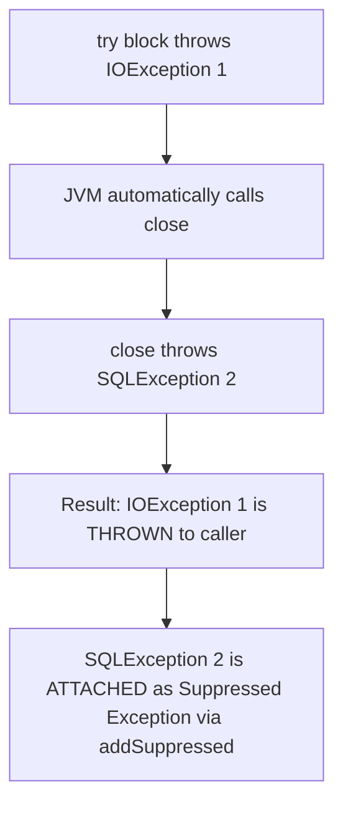

# Exception Handling - Architecture, Internals & Best Practices (In-Depth Masterclass)

## 1. JVM Exception Architecture & Bytecode Internals

Exception handling in Java is not magic; it is implemented directly within the JVM specification via bytecode and the **Exception Table**.

### What Happens When an Exception Is Thrown?
```java
public void process() {
    throw new IllegalArgumentException("Invalid input");
}
```

```
Stack Frame 1 (process)                 Method Bytecode & Metadata
┌──────────────────────────────┐        ┌────────────────────────────────────┐
│ PC: 0x04                     │ ───►   │ 0: new #1 (IllegalArgumentException│
│ Local Variables: [ ... ]     │        │ 3: dup                             │
│ Operand Stack:   [ ... ]     │        │ 4: invokespecial #2 (init)         │
└──────────────────────────────┘        │ 7: athrow                          │
                                        └────────────────────────────────────┘
```

1. **Instantiation & `fillInStackTrace()`:**
   - When `new Exception()` is called, the constructor calls native JVM C++ method `Throwable.fillInStackTrace()`.
   - The JVM pauses execution and walks back through the execution stack frames, capturing the class, method, source file, and line number for every active stack frame.
   - **Performance Cost:** Over 90% of the CPU cost of exception handling comes from `fillInStackTrace()`, **not** the `throw` or `catch` itself!
2. **The `athrow` Instruction:**
   - The compiled bytecode executes `athrow`.
   - The JVM inspects the current method's **Exception Table**.

### The Exception Table (Bytecode Level)
Consider this Java code:
```java
public void readFile() {
    try {
        read();
    } catch (IOException e) {
        log(e);
    } finally {
        clean();
    }
}
```
The Java compiler compiles this into an **Exception Table** embedded in the `.class` file:
```
Exception table:
   from    to  target type
      0     4     7   Class java/io/IOException
      0     4    14   any
      7    11    14   any
```
- **`from` to `to`**: Bytecode instruction range covered by the `try` block.
- **`target`**: Bytecode offset to jump to if an exception matches.
- **`type`**: The exception class to match against. `any` represents the `finally` block!
- **Lookup Process:**
  - If an exception occurs between offset 0 and 4, the JVM scans the table from top to bottom.
  - If a matching handler is found, the program counter (PC) jumps to `target`.
  - If no handler matches in the current method, the JVM pops the current stack frame and repeats the search in the caller's stack frame (stack unwinding).
  - If the main thread's bottom frame is popped with no handler, `Thread.getUncaughtExceptionHandler()` is invoked.

### High-Throughput Optimization: Lightweight Exceptions
For high-frequency business validations where stack traces are unnecessary:
```java
public class ValidationException extends RuntimeException {
    public ValidationException(String message) {
        // Disables stack trace generation (writableStackTrace = false)
        // 100x faster than standard exception instantiation!
        super(message, null, false, false);
    }
}
```

---

## 2. Complete Exception Hierarchy Deep Dive

```
                                  java.lang.Throwable
                                           │
                    ┌──────────────────────┴──────────────────────┐
                    │                                             │
            java.lang.Error                            java.lang.Exception
          (Fatal System Failures)                                 │
                    │                           ┌─────────────────┴─────────────────┐
       ┌────────────┴────────────┐              │                                   │
OutOfMemoryError         StackOverflowError   Checked Exceptions         RuntimeException
NoClassDefFoundError     VirtualMachineError  (e.g., IOException,        (Unchecked Exceptions)
                                              SQLException)                         │
                                                                 ┌──────────────────┴──────────────────┐
                                                                 │                                     │
                                                      NullPointerException               IllegalArgumentException
                                                      ClassCastException                 IllegalStateException
```

### 1. `Throwable`: The Root
Superclass of all errors and exceptions. Implements `java.io.Serializable`. Holds the message, cause chain, and suppressed exception list.

### 2. `Error`: System-Level Catastrophes
- Represents irrecoverable conditions from which a typical application cannot recover.
- **Unchecked:** Does not need to be declared in `throws`.
- **Golden Rule:** **Never catch `Error` or `Throwable`!** If you catch `OutOfMemoryError`, the JVM heap is already compromised; attempting to continue running leaves data structures corrupted and threads stuck.

### 3. `Exception`: Recoverable Conditions
- **Checked Exceptions (Direct subclasses of `Exception`, except `RuntimeException`):**
  - Checked by the compiler at compile-time. Must be either handled via `try-catch` or declared via `throws`.
  - Intended for conditions outside program control that a well-written application should anticipate and recover from (e.g. `FileNotFoundException`, `SocketTimeoutException`).
- **Unchecked Exceptions (`RuntimeException` and its subclasses):**
  - Not enforced by the compiler.
  - Represent programmatic bugs, logic errors, or invalid API usage (e.g., `NullPointerException`, `IndexOutOfBoundsException`, `IllegalArgumentException`).

---

## 3. ClassNotFoundException vs NoClassDefFoundError

A perennial favorite in senior-level interviews:

| Criteria | `ClassNotFoundException` | `NoClassDefFoundError` |
| :--- | :--- | :--- |
| **Type** | Checked `Exception` | Unchecked `LinkageError` (`Error`) |
| **When it Occurs** | **Dynamic Loading at Runtime** | **Class Linking / Static Initialization** |
| **Trigger Mechanism** | Explicit reflective calls: `Class.forName("com.Foo")`, `ClassLoader.loadClass()`, `Class.findSystemClass()` when `.class` is missing on classpath. | A class was **present at compile-time**, but missing at runtime, OR its static initializer (`<clinit>`) failed! |
| **Typical Cause** | Missing dependency in runtime classpath or typo in dynamic class string. | 1. Missing JAR at runtime after compiling.<br/>2. A static variable or static block threw an exception during initialization, marking the class as failed! |

### Demonstrating the `NoClassDefFoundError` Static Initializer Trap
```java
public class BrokenClass {
    private static int value = 1 / 0; // Throws ExceptionInInitializerError
}

// First invocation:
try {
    new BrokenClass();
} catch (Throwable t) {
    System.out.println(t); // ExceptionInInitializerError
}

// Second invocation:
new BrokenClass(); // ❌ THROWS NoClassDefFoundError!
// The JVM refuses to load the class again because static initialization already failed!
```

---

## 4. `try-catch-finally` & `try-with-resources` Internals

### The `finally` Block Execution Guarantees
The `finally` block **always** executes, whether an exception is thrown, caught, or not thrown at all.

#### The ONLY 4 Scenarios Where `finally` Does NOT Execute:
1. `System.exit(0)` is invoked before `finally`.
2. The operating system forcefully kills the JVM process (`kill -9`, process crash).
3. The host machine loses power or hardware crashes.
4. The thread running the `try` block is a **Daemon Thread**, and all non-daemon user threads finish while the `try` block is running.

### ⚠️ The `finally` Return & Exception Swallowing Trap
```java
// ❌ DANGEROUS CODE:
public int compute() {
    try {
        throw new RuntimeException("Fatal Error");
    } finally {
        return 42; // SWALLOWS the exception and returns 42!
    }
}
```
**Under the Hood:** A `return` or `throw` instruction inside a `finally` block discards any pending exception or previous return value on the execution stack frame. The `RuntimeException` is **silently deleted**, leaving zero log traces!
> **Rule:** Never execute `return` or throw unhandled exceptions inside a `finally` block.

---

### `try-with-resources` & Suppressed Exceptions (Java 7+)

Before Java 7, resource closing required ugly, nested `try-catch` blocks in `finally`. Java 7 introduced `try-with-resources`:

```java
try (BufferedReader br = new BufferedReader(new FileReader("data.txt"));
     Connection conn = dataSource.getConnection()) {
    return br.readLine();
} // Automatically invokes .close() in REVERSE order of declaration!
```

### `AutoCloseable` vs `Closeable`

| Feature | `java.lang.AutoCloseable` (Java 7+) | `java.io.Closeable` (Java 5+) |
| :--- | :--- | :--- |
| **Package** | `java.lang` | `java.io` |
| **Method Signature** | `void close() throws Exception` | `void close() throws IOException` |
| **Idempotence** | Recommended, but not strictly required | **Strictly required** (calling close() multiple times must have no effect) |
| **Hierarchy** | Root interface | `Closeable extends AutoCloseable` |

### Suppressed Exceptions Mechanics
What happens if the `try` block throws an exception, AND the automatic `.close()` method ALSO throws an exception?



- In pre-Java 7 code, the exception in `finally` overwrote and lost the original exception.
- In `try-with-resources`, the **original exception from the `try` block is preserved and thrown**.
- The secondary exception from `close()` is appended to the primary exception via `Throwable.addSuppressed(Throwable exception)`.
- It can be inspected via:
```java
} catch (IOException e) {
    for (Throwable suppressed : e.getSuppressed()) {
        log.error("Suppressed during close: ", suppressed);
    }
}
```

---

## 5. Method Overriding Rules with Exceptions (Covariance)

When an overriding subclass method overrides a superclass method, Java enforces strict rules to preserve the **Liskov Substitution Principle**:

```
Superclass Method Declaration:
public void doWork() throws IOException { ... }
```

| Subclass Method Declaration | Valid? | Reason |
| :--- | :--- | :--- |
| `public void doWork() throws IOException` | ✅ Yes | Identical exception |
| `public void doWork() throws FileNotFoundException` | ✅ Yes | **Narrower (Subclass)** checked exception |
| `public void doWork()` | ✅ Yes | Declaring **fewer / no** checked exceptions is allowed |
| `public void doWork() throws Exception` | ❌ **NO** | Cannot declare a **broader (Superclass)** checked exception |
| `public void doWork() throws SQLException` | ❌ **NO** | Cannot declare a **new / unrelated** checked exception |
| `public void doWork() throws NullPointerException` | ✅ Yes | **Unchecked exceptions are completely exempt** from override rules |

---

## 6. Enterprise Exception Architecture & Design Patterns

### 1. Exception Chaining (Root Cause Preservation)
Always preserve the underlying cause when wrapping exceptions:
```java
// ❌ WRONG: Loses the root cause stack trace!
try {
    dao.save(user);
} catch (SQLException e) {
    throw new UserServiceException("Failed to save user");
}

// ✅ CORRECT: Chains the root cause
try {
    dao.save(user);
} catch (SQLException e) {
    throw new UserServiceException("Failed to save user", e);
}
```

### 2. Domain-Driven Hierarchy
Organize exceptions by architectural boundaries:
```
BaseApplicationException (abstract, RuntimeException)
├── BusinessException (e.g. InsufficientFundsException, UserAlreadyExistsException)
│   └── Holds errorCode, httpStatus, localizedMessageKey
└── TechnicalException (e.g. DatabaseConnectionException, ThirdPartyTimeoutException)
    └── Holds retryable flag, underlying system details
```

### 3. Centralized API Exception Handling (Spring Boot / RFC 7807)
```java
@RestControllerAdvice
public class GlobalExceptionHandler {

    @ExceptionHandler(BusinessException.class)
    public ResponseEntity<ProblemDetail> handleBusiness(BusinessException ex) {
        ProblemDetail problem = ProblemDetail.forStatusAndDetail(
            HttpStatus.BAD_REQUEST, ex.getMessage()
        );
        problem.setProperty("errorCode", ex.getErrorCode());
        return ResponseEntity.badRequest().body(problem);
    }
}
```

---

## 7. Common Traps & Antipatterns

### ❌ Trap 1: Log and Rethrow (Double Logging)
```java
// ❌ ANTI-PATTERN:
try {
    service.execute();
} catch (ServiceException e) {
    log.error("Service failed", e); // Logged here!
    throw e;                        // And logged again by the caller!
}
// Rule: Either log the exception, OR rethrow it. Never do both!
```

### ❌ Trap 2: Using Exceptions for Flow Control
```java
// ❌ SLOW & UGLY: Using exception as loop terminator
try {
    int i = 0;
    while (true) {
        process(array[i++]);
    }
} catch (ArrayIndexOutOfBoundsException e) {
    // End of array reached
}
// Walking the stack trace makes this 100x slower than a standard for-loop!
```

### ❌ Trap 3: Catching `Exception` or `Throwable` Prematurely
Catching generic `Exception` catches unintended runtime exceptions (e.g. `NullPointerException`, `ClassCastException`), masking bugs and returning corrupted default values.

---

## 8. Senior / FAANG Interview Questions & Answers

### Q1: Why is the modern Java ecosystem transitioning away from checked exceptions toward unchecked exceptions?
**Answer:**
1. **Coupling:** Checked exceptions leak implementation details across architectural layers. If a repository throws `SQLException`, the service and controller signatures must also declare `throws SQLException`, violating encapsulation.
2. **Clutter & Bad Practices:** Developers frequently catch and swallow checked exceptions (`catch (Exception e) {}`) just to appease the compiler.
3. **Lambdas and Streams:** Standard functional interfaces (`Function`, `Predicate`) do not declare checked exceptions, making checked exceptions cumbersome to use in functional programming.
Modern frameworks (Spring, Hibernate, Jackson) wrap checked errors into unchecked domain exceptions (`DataAccessException`).

### Q2: How does the JVM guarantee thread cleanup when a thread dies from an unhandled exception?
**Answer:**
When an unhandled exception bubbles up and exits the thread's `run()` method:
1. The JVM invokes the thread's `UncaughtExceptionHandler` (if configured) or the thread group's default handler.
2. The JVM automatically releases all intrinsic monitor locks held by that thread.
3. The thread terminates and transitions to the `TERMINATED` state.
4. Other threads in the process continue running unaffected, unless the dying thread was holding shared state in an inconsistent, non-thread-safe condition.

### Q3: What is the output of this code snippet?
```java
public static int test() {
    int x = 1;
    try {
        return x;
    } finally {
        x = 2;
    }
}
```
**Answer:**
It returns **`1`**, not `2`.
**Bytecode Rationale:** The `return x;` evaluates the local variable `x`, loads its primitive value (`1`) onto the operand stack, and saves it into a temporary return slot. The `finally` block then executes and updates local variable `x` to `2`. Because the `finally` block does not contain its own `return` statement, the method restores the previously saved value (`1`) and returns it.

---

## 9. Summary Cheat Sheet

```
┌────────────────────────────┬────────────────────────────────────────────────────────┐
│ Concept                    │ Golden Rule / Architecture                              │
├────────────────────────────┼────────────────────────────────────────────────────────┤
│ Performance Bottleneck     │ Throwable.fillInStackTrace() (stack-walking cost)      │
│ ClassNotFound vs NoClassDef│ ClassNotFound = dynamic lookup; NoClassDef = linking/<clinit> fail │
│ finally Execution          │ Always runs except System.exit(), crash, or daemon kill│
│ finally Return Trap        │ return in finally swallows exceptions and overrides results│
│ try-with-resources         │ Preserves primary exception; close() exceptions are suppressed │
│ Method Overriding          │ May declare narrower or fewer checked exceptions, never broader │
└────────────────────────────┴────────────────────────────────────────────────────────┘
```
