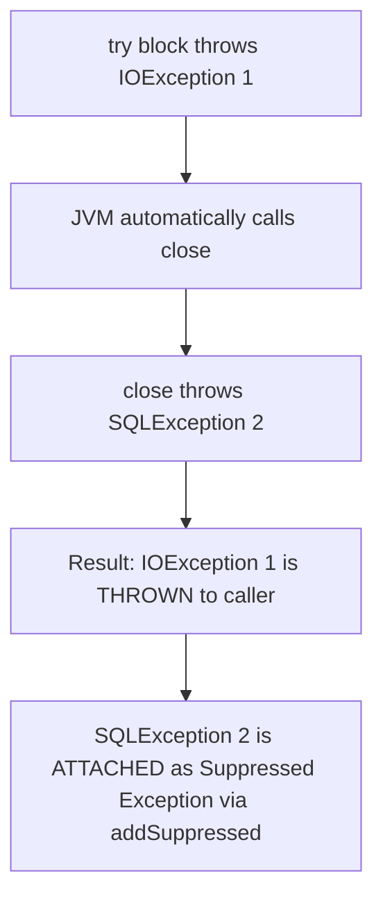

# Exception Handling in Java — Architecture, Internals & Production Patterns

> **Level:** Advanced / Expert
> **Interview Frequency:** ★★★★★ (a small topic with an outsized interview footprint — the *design* of exceptions separates production code from classroom code)
> **Prerequisite:** [03 · JVM Internals](../02-Java-Memory-Model/03-JVM-Internals.md) — you need the bytecode model to understand the exception table
> **Last Updated:** 2026

---

## 📋 Table of Contents

- [0. TL;DR — The 30-Second Answer](#0-tldr--the-30-second-answer)
- [1. What & Why — The Problem This Solves](#1-what--why--the-problem-this-solves)
- [2. Mental Model — One Picture That Explains Everything](#2-mental-model--one-picture-that-explains-everything)
- [3. Deep Dive — Theory](#3-deep-dive--theory)
  - [3.1 The JVM Exception Architecture](#31-the-jvm-exception-architecture)
  - [3.2 The Exception Table — Bytecode Level](#32-the-exception-table--bytecode-level)
  - [3.3 The Complete Exception Hierarchy](#33-the-complete-exception-hierarchy)
  - [3.4 Checked vs Unchecked — The Real Rule](#34-checked-vs-unchecked--the-real-rule)
  - [3.5 `try` / `catch` / `finally` — Exact Semantics](#35-try--catch--finally--exact-semantics)
  - [3.6 `try`-with-`resources` and Suppressed Exceptions](#36-try-with-resources-and-suppressed-exceptions)
  - [3.7 Multi-Catch, Precise Rethrow and Catch Ordering](#37-multi-catch-precise-rethrow-and-catch-ordering)
  - [3.8 Exception in an Initialiser](#38-exception-in-an-initialiser)
  - [3.9 `finalize()` is Gone — `Cleaner` and `AutoCloseable`](#39-finalize-is-gone--cleaner-and-autocloseable)
  - [3.10 The Cost of Throwing](#310-the-cost-of-throwing)
  - [3.11 Exceptions in Threads and Executors](#311-exceptions-in-threads-and-executors)
  - [3.12 `OmitStackTraceInFastThrow` — The Silent Exception Trap](#312-omitstacktraceinfastthrow--the-silent-exception-trap)
  - [3.13 Overriding Rules and the Liskov Substitution Principle](#313-overriding-rules-and-the-liskov-substitution-principle)
- [4. Visualizations](#4-visualizations)
- [5. Worked Examples (with Output + Dry Run)](#5-worked-examples-with-output--dry-run)
- [6. Code from Scratch — Production-Grade](#6-code-from-scratch--production-grade)
- [7. Common Pitfalls & Gotchas](#7-common-pitfalls--gotchas)
- [8. Interview Q&A — Level-wise](#8-interview-qa--level-wise)
- [9. Counter-Questions & Traps](#9-counter-questions--traps)
- [10. Rapid-Fire MCQs](#10-rapid-fire-mcqs)
- [11. Cheat Sheet / One-Page Summary](#11-cheat-sheet--one-page-summary)
- [12. Real-World Production Notes](#12-real-world-production-notes)
- [13. Follow-up Learning](#13-follow-up-learning)

---

## 0. TL;DR — The 30-Second Answer

- **Java's exception handling is implemented in bytecode**, not in the language runtime: a `try` block becomes an **Exception Table** entry, and the `throw` becomes a single `athrow` instruction.
- **`Throwable` → `Error` (unchecked, fatal) → `Exception` (→ `RuntimeException` = unchecked, everything else = checked).** `Error` and `RuntimeException` are unchecked; direct `Exception` subclasses are checked.
- **The real rule for checked vs unchecked:** *checked = the caller can reasonably recover or retry; unchecked = a bug in the calling code.* `IOException` is checked (retry or degrade); `NullPointerException` is not (fix the code).
- **`try`-with-`resources` (Java 7+) closes resources in REVERSE declaration order**, and if the body throws *and* `close()` throws, the **body's exception is thrown** and the `close()` failure is attached as a **suppressed** exception (`getSuppressed()`).
- **`finally` runs on almost every path — but not on `System.exit()`, a JVM crash, `SIGKILL`, or JVM death.** And a `return` inside `finally` **silently swallows** the pending exception. Never do it.
- **An exception in a static initialiser** throws `ExceptionInInitializerError` the first time and **`NoClassDefFoundError` forever after** — the class is permanently poisoned.
- **`fillInStackTrace()` is the expensive part** of throwing (not the `throw`, not the `catch`). The 4-arg `Throwable(message, cause, enableSuppression, writableStackTrace)` constructor lets you disable it — a legitimate optimisation for high-frequency control-flow exceptions.
- **`catch (Exception e)` is not always wrong, but `catch (Exception e) {}` (swallowing) always is.** Log it, rethrow it, or handle it — never discard it.
- **Exceptions are for the exceptional.** For expected outcomes use a sentinel, `Optional`, or a `Result` type. Using exceptions as loop terminators is 100× slower than a `for` loop.
- **An exception in one thread does not affect other threads** — but an exception in an `ExecutorService` task is **silently swallowed** unless you call `Future.get()` or set an `UncaughtExceptionHandler` on the `ThreadPoolExecutor`.

---

## 1. What & Why — The Problem This Solves

**The problem.** Every program must deal with things going wrong: a file is missing, a socket times out, an array index is out of range, a database is down. There are two fundamentally different categories, and confusing them is the root of most bad error-handling design:

| Category | Example | Who can fix it? | Natural mechanism |
|---|---|---|---|
| **Expected, environmental** | The network is down, the file is not there, the user cancelled | The **program**, by retrying, degrading, or reporting | **Checked exception** — the compiler forces you to think about it |
| **Unexpected, internal** | A null dereference, a divide by zero, a bad cast | **Nobody at runtime** — the *code* is wrong | **Unchecked exception** — the compiler must not force you to handle a bug |

Java's design encodes this distinction in the type system. A checked exception must be caught or declared; an unchecked one need not be. The compiler is acting as a **forcing device**: it makes you *decide* at every call site what happens when the world misbehaves.

**But the design has a well-known flaw**, and any senior interviewer will test whether you know it:

- **Checked exceptions leak implementation details across architectural layers.** A `Repository` that throws `SQLException` forces every `Service` and every `Controller` to declare `throws SQLException` — a layering violation. This is why Spring, Hibernate, Jackson and most modern frameworks convert everything to **unchecked** domain exceptions.
- **Checked exceptions are "contagious" and developers route around them.** The universal anti-pattern is `catch (Exception e) { }` — added purely to satisfy the compiler, silently swallowing the failure. The compiler's forcing device becomes a *ritual*, and the guarantee it was supposed to provide is lost.
- **Checked exceptions do not compose with lambdas.** `Function`, `Predicate` and `Consumer` do not declare `throws`, so a checked exception inside a lambda is a compile error. This is the single biggest reason the ecosystem moved to unchecked.
- **`InterruptedException` is checked but you must *not* simply rethrow it** — you must restore the thread's interrupt flag. A checked exception whose *correct* handling is unusual is a design smell.

**The modern consensus** (and the answer you want to give): **unchecked by default, with careful use of checked exceptions at genuine API boundaries** (where the caller genuinely must handle a recoverable environmental failure), and **domain exceptions** that carry structured, machine-readable error information for the API layer.

**The analogy.** Think of exceptions as **alarms** in a building:

- A **fire alarm** (checked) is a real, expected possibility the building has planned for: it is wired to the sprinkler system, and the code *must* have a response.
- A **wobbly table leg** (unchecked) is a defect: nobody writes `try { useTable(); } catch (WobblyLegException e)` — you fix the table.
- A **checked exception you catch and ignore** is a **silenced fire alarm** — far more dangerous than no alarm at all, because everyone now believes the building is safe.

---

## 2. Mental Model — One Picture That Explains Everything

```text
┌──────────────────────────────────────────────────────────────────────────────────┐
│  THE THROWABLE UNIVERSE                                                        │
│                                                                                  │
│                            java.lang.Throwable                                   │
│                    (message, cause, suppressed[], stackTrace)                    │
│                                   │                                              │
│                 ┌─────────────────┴─────────────────┐                            │
│                 │                                   │                            │
│          java.lang.Error                     java.lang.Exception                │
│      (UNCHECKED — do not catch)          ┌────────┴─────────┐                  │
│                 │                        │                  │                  │
│    ┌────────────┼────────────┐   java.lang.RuntimeException │ OTHER Exception  │
│    │            │            │   (UNCHECKED — programming bugs)   (CHECKED)      │
│ VirtualMachineError  LinkageError   │         │              │                  │
│    │            │            │   ┌────┴────┬────────┐  IOException        │
│ OOM Error  StackOverflow  NoClassDef  │  │    │        │  SQLException        │
│            │    FoundError  FoundError NPE  IAE  ISE  ClassCast  FileNotFound     │
│            │            │            │    │    │        │  Interrupted        │
│    InternalError  ExceptionInInitializerError  Arith  NumberFormat  CloneNotSupp  │
│                                                                      │             │
└──────────────────────────────────────────────────────────────────────────────────┘
```

**What to look at:** the *left* branch (`Error`) is the "the JVM or the platform is in trouble" family — **never catch it**. The *right* branch splits into `RuntimeException` (bugs) and everything else (environmental conditions the caller can act on).

**And the mechanism that makes it all work:**

```text
  ┌─────────────────────────────────────────────────────────────────────────────┐
  │  WHAT HAPPENS WHEN AN EXCEPTION IS THROWN                                   │
  │                                                                             │
  │  1. new SomeException("msg")                                               │
  │        └─▶ Throwable.fillInStackTrace()  ← native, walks the whole stack   │
  │            captures {class, method, file, line} for EVERY frame              │
  │                                                                             │
  │  2. bytecode:  new  /  dup  /  invokespecial <init>  /  athrow              │
  │                                                                             │
  │  3. athrow → the JVM inspects the CURRENT method's Exception Table:        │
  │        • scan top to bottom for an entry whose [from,to) range covers the   │
  │          current PC and whose type matches (or is `any`)                    │
  │        • MATCH  → set PC = target, clear the exception from the stack       │
  │        • NO MATCH → POP THE FRAME (the "unwind") and repeat in the CALLER  │
  │                                                                             │
  │  4. if the bottom frame is popped with no handler:                         │
  │        • the thread's UncaughtExceptionHandler runs (default: ThreadGroup)  │
  │        • the thread dies; OTHER THREADS ARE UNAFFECTED                     │
  └─────────────────────────────────────────────────────────────────────────────┘
```

**What to look at:** the throw is a **stack walk plus a table lookup** — nothing more. The "unwinding" pops frames one by one, which is why a deep stack makes a throw expensive and why a `StackOverflowError` inside a `catch` block is a genuinely nasty failure mode.

---

## 3. Deep Dive — Theory

### 3.1 The JVM Exception Architecture

Exception handling in Java is not magic; it is implemented directly within the JVM specification via bytecode and the **Exception Table**.

**What happens when an exception is thrown:**

```java
public void process() {
    throw new IllegalArgumentException("Invalid input");
}
```

```text
Stack Frame 1 (process)                 Method Bytecode & Metadata
┌──────────────────────────────┐        ┌────────────────────────────────────┐
│ PC: 0x04                     │ ───►   │ 0: new #1 (IllegalArgumentException│
│ Local Variables: [ ... ]     │        │ 3: dup                             │
│ Operand Stack:   [ ... ]     │        │ 4: invokespecial #2 (init)         │
└──────────────────────────────┘        │ 7: athrow                          │
                                         │                                    │
│ Exception Table:                      │ Exception table:                    │
│  from   to  target  type              │   from    to  target type           │
│    7     8      14   any              │      7     8     14   any          │
└──────────────────────────────┘        └────────────────────────────────────┘
```

1. **Instantiation & `fillInStackTrace()`:**
   - When `new Exception()` is called, the constructor calls the native JVM C++ method `Throwable.fillInStackTrace()`.
   - The JVM pauses execution and walks back through the execution stack frames, capturing the class, method, source file, and line number for every active stack frame.
   - **Performance Cost:** over 90% of the CPU cost of exception handling comes from `fillInStackTrace()`, **not** the `throw` or `catch` itself!
2. **The `athrow` Instruction:**
   - The compiled bytecode executes `athrow`.
   - The JVM inspects the current method's **Exception Table**.

**The `Throwable` class's own state (all `private final` except `stackTrace`):**

| Field | Type | Purpose |
|---|---|---|
| `detailMessage` | `String` | The message you passed |
| `cause` | `Throwable` | The wrapped cause — the **root cause chain** |
| `stackTrace` | `StackTraceElement[]` | The captured frames (lazy-initialised since Java 7 — the JVM stores an internal backtrace and only materialises the array on demand) |
| `suppressedExceptions` | `List<Throwable>` | The suppressed list (from try-with-resources) |

**The `Throwable` API that matters in production:**

```java
public Throwable getCause();                       // the wrapped cause
public Throwable[] getSuppressed();                // the suppressed list
public StackTraceElement[] getStackTrace();
public void printStackTrace(PrintWriter s);        // or printStackTrace()
public String getMessage();
```

### 3.2 The Exception Table — Bytecode Level

Consider this Java code:

```java
public void readFile() {
    try {
        read();
    } catch (IOException e) {
        log(e);
    } finally {
        clean();
    }
}
```

The Java compiler compiles this into an **Exception Table** embedded in the `.class` file.

**Real output — `javap -c -v ExcTable.class`:**

```text
  public void readFile();
    descriptor: ()V
    flags: (0x0001) ACC_PUBLIC
    Code:
      stack=2, locals=3, args_size=1
         0: aload_0
         1: invokevirtual #7                  // Method read:()V
         4: aload_0
         5: invokevirtual #12                 // Method clean:()V
         8: goto          31
        11: astore_1
        12: aload_0
        13: aload_1
        14: invokevirtual #17                 // Method log:(Ljava/lang/Exception;)V
        17: aload_0
        18: invokevirtual #12                 // Method clean:()V
        21: goto          31
        24: astore_2
        25: aload_0
        26: invokevirtual #12                 // Method clean:()V
        29: aload_2
        30: athrow
        31: return
      Exception table:
         from    to  target type
             0     4    11   Class java/io/IOException
             0     4    24   any
            11    17    24   any
      LineNumberTable:
        line 5: 0
        line 9: 4
        line 10: 8
        line 6: 11
        line 7: 12
        line 9: 17
        line 10: 21
        line 9: 24
        line 10: 29
        line 11: 31
      StackMapTable: number_of_entries = 3
        frame_type = 75 /* same_locals_1_stack_item */
          stack = [ class java/io/IOException ]
        frame_type = 76 /* same_locals_1_stack_item */
          stack = [ class java/lang/Throwable ]
        frame_type = 6 /* same */
```

- **`from` to `to`**: Bytecode instruction range covered by the `try` block.
- **`target`**: Bytecode offset to jump to if an exception matches.
- **`type`**: The exception class to match against. `any` represents the `finally` block!
- **Lookup Process:**
  - If an exception occurs between offset 0 and 4, the JVM scans the table from top to bottom.
  - If a matching handler is found, the program counter (PC) jumps to `target`.
  - If no handler matches in the current method, the JVM pops the current stack frame and repeats the search in the caller's stack frame (stack unwinding).
  - If the main thread's bottom frame is popped with no handler, `Thread.getUncaughtExceptionHandler()` is invoked.

**What to look at — three things a senior candidate should notice:**

1. **The `finally` block is *duplicated* into the bytecode.** `clean()` appears at offsets **5**, **18** and **26** — once on the normal path, once in the catch handler, and once in the `any` handler. `javac` does not use a single shared "finally" routine; it **inlines** the finally code at every exit point. This is why a big `finally` block bloats your class file.
2. **The `any` handler at offset 24 is the `finally` mechanism.** It catches *everything* (`any` = `java.lang.Throwable`), stores it in local slot 2, runs `clean()`, and rethrows it with `athrow` at offset 30. That is exactly the "finally always runs, and re-throws the pending exception" semantics — implemented in bytecode.
3. **The `goto 31` instructions** skip over the handler bodies on the normal path. And `StackMapTable` (3 entries) tells the verifier the stack shape at each branch target — this is the Java 6+ type-frame mechanism.

**A subtlety worth knowing:** the exception table's `from`/`to` range for the `IOException` handler is `0..4` — it covers only the `read()` call, **not** the `catch` block itself. That is why an exception thrown *inside* the `catch` block is **not** caught by the same `catch` (it propagates outward), and why the `any` handler has a second entry `11..17` to cover the catch block.

### 3.3 The Complete Exception Hierarchy

```text
                                  java.lang.Throwable
                                           │
                    ┌──────────────────────┴──────────────────────┐
                    │                                             │
            java.lang.Error                            java.lang.Exception
          (Fatal System Failures)                                 │
                    │                           ┌─────────────────┴─────────────────┐
       ┌────────────┴────────────┐              │                                   │
 OutOfMemoryError         StackOverflowError   Checked Exceptions         RuntimeException
 NoClassDefFoundError     VirtualMachineError  (e.g. IOException,        (Unchecked Exceptions)
                                              SQLException)                         │
                    │                                    ┌──────────────────────────────┴──────────────────┐
       ┌────────────┴────────────┐                    │                                                 │
 InternalError   ExceptionInInitializerError   NullPointerException              IllegalArgumentException
                                             ClassCastException                IllegalStateException
                                                                        ArithmeticException  NumberFormatException
                                                                        IndexOutOfBoundsException
                                                                        UnsupportedOperationException
                                                                        ConcurrentModificationException
                                                                        NoSuchElementException
                                                                        ArrayStoreException
```

### 3.4 Checked vs Unchecked — The Real Rule

| | Checked | Unchecked |
|---|---|---|
| **Members** | Direct subclasses of `Exception` except `RuntimeException` | `RuntimeException` and its subclasses; all `Error`s |
| **Compiler enforcement** | Must be caught or declared | None |
| **Represents** | A condition **outside** program control that the caller can anticipate and recover from | A **programmatic bug** or misuse of an API |
| **Examples** | `IOException`, `SQLException`, `TimeoutException`, `InterruptedException`, `ClassNotFoundException`, `CloneNotSupportedException` | `NullPointerException`, `ClassCastException`, `IllegalArgumentException`, `IllegalStateException`, `IndexOutOfBoundsException`, `ArithmeticException`, `NumberFormatException` |
| **Where to throw** | At an **API boundary** where recovery is genuinely possible | Inside your own code for programming errors |
| **Should the caller catch it?** | **Yes** — it is the whole point | **No** — fix the code |

**The `Error` family (all unchecked):**

- `Error` represents irrecoverable conditions from which a typical application cannot recover.
- **Unchecked:** does not need to be declared in `throws`.
- **Golden Rule:** **Never catch `Error` or `Throwable`!** If you catch `OutOfMemoryError`, the JVM heap is already compromised; attempting to continue running leaves data structures corrupted and threads stuck.

**The `Exception` family:**

- **Checked Exceptions (Direct subclasses of `Exception`, except `RuntimeException`):**
  - Checked by the compiler at compile-time. Must be either handled via `try-catch` or declared via `throws`.
  - Intended for conditions outside program control that a well-written application should anticipate and recover from (e.g. `FileNotFoundException`, `SocketTimeoutException`).
- **Unchecked Exceptions (`RuntimeException` and its subclasses):**
  - Not enforced by the compiler.
  - Represent programmatic bugs, logic errors, or invalid API usage (e.g., `NullPointerException`, `IndexOutOfBoundsException`, `IllegalArgumentException`).

**The `Error` sub-hierarchy, in detail:**

| Error | Cause | Should you catch it? |
|---|---|---|
| `VirtualMachineError` | The JVM itself failed | **No** — let the process die and be restarted |
| `OutOfMemoryError` | Heap or Metaspace exhausted | **No** — the heap is already compromised |
| `StackOverflowError` | Thread stack exhausted | Rarely — usually a bug; and the stack is still full so your handler must not recurse |
| `InternalError` | A JVM bug | **No** |
| `LinkageError` | Class-loading problem | **No** — a deployment problem |
| `NoClassDefFoundError` | A class was present at compile time but is missing at runtime, **or** its static initialiser failed | **No** — fix the packaging or the initialiser |
| `ExceptionInInitializerError` | A static initialiser threw | **No** — but **catch it once, at startup**, to fail fast with a clear message |
| `ClassFormatError` | A malformed `.class` file | **No** |
| `VerifyError` | Bytecode failed verification | **No** |
| `AssertionError` | An `assert` failed | **No** in production (assertions are disabled by default) |

### 3.5 `try` / `catch` / `finally` — Exact Semantics

**The `finally` block execution guarantees:** the `finally` block **always** executes, whether an exception is thrown, caught, or not thrown at all.

**The ONLY 4 scenarios where `finally` does NOT execute:**

1. `System.exit(0)` is invoked before `finally`.
2. The operating system forcefully kills the JVM process (`kill -9`, process crash).
3. The host machine loses power or hardware crashes.
4. The thread running the `try` block is a **Daemon Thread**, and all non-daemon user threads finish while the `try` block is running.

#### ⚠️ The `finally` Return & Exception Swallowing Trap

```java
// ❌ DANGEROUS CODE:
public int compute() {
    try {
        throw new RuntimeException("Fatal Error");
    } finally {
        return 42; // SWALLOWS the exception and returns 42!
    }
}
```

**Under the Hood:** a `return` or `throw` instruction inside a `finally` block discards any pending exception or previous return value on the execution stack frame. The `RuntimeException` is **silently deleted**, leaving zero log traces!

> **Rule:** Never execute `return` or throw unhandled exceptions inside a `finally` block.

**The other classic trap — `return` in `try`, mutation in `finally`:**

```java
public static int test() {
    int x = 1;
    try {
        return x;      // ← the VALUE 1 is evaluated and saved NOW
    } finally {
        x = 2;        // ← mutates the local, but the saved value is already 1
    }
}
```

**It returns `1`, not `2`.**

**Bytecode Rationale:** The `return x;` evaluates the local variable `x`, loads its primitive value (`1`) onto the operand stack, and saves it into a temporary return slot. The `finally` block then executes and updates local variable `x` to `2`. Because the `finally` block does not contain its own `return` statement, the method restores the previously saved value (`1`) and returns it.

**The full ordering rules:**

| Situation | Order of execution |
|---|---|
| Normal completion | `try` → `finally` → return value delivered |
| `try` throws, `catch` matches | `try` → `catch` → `finally` → (rethrow or normal) |
| `try` throws, `catch` matches, `catch` throws | `try` → `catch` → `finally` → the `catch`'s exception propagates |
| `try` throws, no `catch` matches | `try` → `finally` → the original exception propagates (the `finally` does **not** replace it) |
| `try` returns, `finally` returns | `finally`'s return **wins**; the `try`'s value is discarded |
| `try` returns, `finally` throws | the `finally`'s exception **wins**; the `try`'s value is lost |

### 3.6 `try`-with-`resources` and Suppressed Exceptions

Before Java 7, resource closing required ugly, nested `try-catch` blocks in `finally`. Java 7 introduced `try-with-resources`:

```java
try (BufferedReader br = new BufferedReader(new FileReader("data.txt"));
     Connection conn = dataSource.getConnection()) {
    return br.readLine();
} // Automatically invokes .close() in REVERSE order of declaration!
```

**How it is desugared** (conceptually, by `javac`):

```text
  try (Res a = ...; Res b = ...) { BODY }
        ↓  javac desugars to
  Res a = ...;
  Res b = ...;
  Throwable primary = null;
  try {
      BODY
  } catch (Throwable t) {
      primary = t; throw t;          // remember the primary failure
  } finally {
      if (b != null) {               // close in REVERSE order
          if (primary != null) {
              try { b.close(); } catch (Throwable s) { primary.addSuppressed(s); }
          } else { b.close(); }
      }
      if (a != null) {
          if (primary != null) {
              try { a.close(); } catch (Throwable s) { primary.addSuppressed(s); }
          } else { a.close(); }
      }
  }
```

**The rules:**

1. **Resources are closed in REVERSE order of declaration** (like a stack) — the last one opened is the first one closed. This is the correct order for dependent resources.
2. **If the body completes normally**, `close()` exceptions propagate normally (the first one thrown wins; the rest are added as suppressed to it).
3. **If the body throws**, the body's exception is the **primary** exception. A `close()` failure is attached via `addSuppressed()` and the **primary** exception is thrown.
4. **The resource variable is `final`-like** (effectively final) and its **scope is limited to the `try` block** — you cannot use it afterwards.
5. **If the *initialiser* of a resource throws**, that resource is **not** closed (it was never acquired), but the previously-initialised ones are.

#### `AutoCloseable` vs `Closeable`

| Feature | `java.lang.AutoCloseable` (Java 7+) | `java.io.Closeable` (Java 5+) |
| :--- | :--- | :--- |
| **Package** | `java.lang` | `java.io` |
| **Method Signature** | `void close() throws Exception` | `void close() throws IOException` |
| **Idempotence** | Recommended, but not strictly required | **Strictly required** (calling close() multiple times must have no effect) |
| **Hierarchy** | Root interface | `Closeable extends AutoCloseable` |

**`AutoCloseable.close()` throws `Exception`** — the broadest possible checked exception. This is why try-with-resources can force you to catch `Exception` even when your resources only throw `IOException`. It is a well-known wart; `Closeable` narrows it.

#### Suppressed Exceptions Mechanics

What happens if the `try` block throws an exception, AND the automatic `.close()` method ALSO throws an exception?



- In pre-Java 7 code, the exception in `finally` overwrote and lost the original exception.
- In `try-with-resources`, the **original exception from the `try` block is preserved and thrown**.
- The secondary exception from `close()` is appended to the primary exception via `Throwable.addSuppressed(Throwable exception)`.
- It can be inspected via:

```java
} catch (IOException e) {
    for (Throwable suppressed : e.getSuppressed()) {
        log.error("Suppressed during close: ", suppressed);
    }
}
```

**Real output (JDK 25) — the whole mechanism in one program:**

```text
---- body throws, close() also throws ----
open A
open B
body
close B
close A
caught: primary failure
suppressed: close failed: B
---- normal exit, close() throws ----
open C
body2
close C
caught close failure: close failed: C
```

**What to look at:**

1. **`open A` then `open B`** — resources are acquired in declaration order.
2. **`close B` then `close A`** — closed in **REVERSE** order.
3. **`caught: primary failure`** — the body's exception is the one thrown, even though `close B` also failed.
4. **`suppressed: close failed: B`** — the `close()` failure is attached, not lost. `close A` did not fail, so there is only one suppressed exception.
5. In the second case (normal exit), the `close()` exception propagates **directly** — it is not suppressed, because there is no primary exception to attach it to.

### 3.7 Multi-Catch, Precise Rethrow and Catch Ordering

**Multi-catch (Java 7+)** lets you handle several exception types in one block:

```java
try {
    doWork();
} catch (IOException | SQLException e) {
    log.error("data access failed", e);
}
```

- The alternatives must be **disjoint** (none may be a subclass of another) — otherwise it is a compile error ("alternatives in a multi-catch statement cannot be related by subclassing").
- The variable `e` is **implicitly `final`** — you cannot reassign it.
- `e.getMessage()` works because the common supertype is `Exception`; to access a subtype-specific method you must cast.

**Precise rethrow (Java 7+)** — the compiler *infers* the thrown types:

```java
static void rethrow() throws IOException, SQLException {
    try {
        doWork();
    } catch (Exception e) {          // catches broadly…
        throw e;                     // …but the compiler knows the real types
    }
}
```

The compiler analyses what the `try` block can actually throw and narrows the method's `throws` clause to `IOException, SQLException` — **not** `Exception`. This is what makes the "catch broadly, rethrow precisely" idiom work with checked exceptions, and it is a genuinely interview-worthy Java 7 feature.

**Catch ordering rules:**

```java
try { ... }
catch (FileNotFoundException e) { ... }   // more specific FIRST
catch (IOException e) { ... }             // broader SECOND
```

- Java requires **subclass before superclass**; the reverse is a **compile error**: *"exception IOException is already caught"* — unreachable catch.
- The compiler enforces this, so you cannot accidentally write unreachable code.

### 3.8 Exception in an Initialiser

#### Demonstrating the `NoClassDefFoundError` Static Initializer Trap

```java
public class BrokenClass {
    private static int value = 1 / 0; // Throws ExceptionInInitializerError
}

// First invocation:
try {
    new BrokenClass();
} catch (Throwable t) {
    System.out.println(t); // ExceptionInInitializerError
}

// Second invocation:
new BrokenClass(); // ❌ THROWS NoClassDefFoundError!
// The JVM refuses to load the class again because static initialization already failed!
```

**Real output (JDK 25) — with the full cause chain:**

```text
1st: java.lang.ExceptionInInitializerError cause=java.lang.ArithmeticException: / by zero
2nd: java.lang.NoClassDefFoundError cause=java.lang.ExceptionInInitializerError: Exception java.lang.ArithmeticException: / by zero [in thread "main"]
```

**The mechanism, precisely:**

1. The JVM begins `<clinit>` for `BrokenClass`. The `1 / 0` throws `ArithmeticException`.
2. The JVM wraps it in an **`ExceptionInInitializerError`** (the original is the `cause`) and propagates it. The class is marked **erroneous**.
3. **Every subsequent attempt** to use the class throws **`NoClassDefFoundError`** — the JVM refuses to re-run `<clinit>`. In modern JVMs the `NoClassDefFoundError` **does carry the original `ExceptionInInitializerError` as its cause** (as the output above shows), so the chain is `NoClassDefFoundError → ExceptionInInitializerError → ArithmeticException`.
4. **Instance initialisers** behave differently: an exception in an *instance* initialiser or constructor propagates **as-is** (no wrapping), and the object is simply not constructed.

**Production impact.** A class whose static initialiser fails is *permanently* broken for the life of the class loader. The first failure is a startup-time `ExceptionInInitializerError`; every later use is a confusing `NoClassDefFoundError`. This is why you should:

- Keep `<clinit>` trivial and side-effect-free (use the *initialisation-on-demand holder* idiom).
- **Fail fast at startup**: catch `ExceptionInInitializerError` around the first use and log the cause loudly, rather than letting it surface later in a random request.

### 3.9 `finalize()` is Gone — `Cleaner` and `AutoCloseable`

`finalize()` was deprecated in Java 9 and **terminally deprecated in Java 18** (JEP 421). It is scheduled for removal. The reasons:

- **Non-deterministic timing** — it runs on a *finalizer thread*, at an arbitrary point.
- **Performance** — objects with finalizers need **two** GC cycles to die, and they are *resurrected* in between.
- **A throwing `finalize()` kills the finalizer thread**, halting all finalization.
- **Security** — a resurrected object is observable in a partially-constructed state.

**The replacements, in order of preference:**

1. **`try`-with-`resources`** — for anything with a `close()`.
2. **An explicit lifecycle method** (`close()`, `shutdown()`, `@PreDestroy`).
3. **`java.lang.ref.Cleaner`** (Java 9+) — for resources whose owner you cannot change.

```java
import java.lang.ref.Cleaner;

public class CleanerDemo {
    private static final Cleaner CLEANER = Cleaner.create();

    static class Resource implements Runnable {
        private volatile boolean closed;
        @Override public void run() {
            if (!closed) { closed = true; System.out.println("cleaned up"); }
        }
    }

    public static void main(String[] args) throws Exception {
        Resource r = new Resource();
        CLEANER.register(r, r::run);   // the cleanup action
        r = null;                        // drop the strong reference
        System.gc();
        Thread.sleep(500);
        System.out.println("done");
    }
}
```

**The `Cleaner` contract:** the cleanup action **must not** capture the object being cleaned, or the object never becomes phantom-reachable and is never cleaned. The action should be a `Runnable` that holds only the *resources*, not the owner.

### 3.10 The Cost of Throwing

**The measurement (rough, order-of-magnitude, on a modern x86-64 JVM):**

| Operation | Relative cost |
|---|---|
| A normal method call | 1× |
| A `try` block that throws **nothing** | ~1× (the JIT elides the handler entirely) |
| Throwing a pre-built exception (reused) | ~100–1 000× a method call |
| Throwing a **new** exception (with `fillInStackTrace`) | ~1 000–10 000× a method call |
| Filling in the stack trace of a 100-frame stack | dominates the above |

**The 90/10 rule of exception cost:**

- **~90% of the cost is `fillInStackTrace()`** — walking the stack and materialising `StackTraceElement` objects.
- The `throw` itself (the `athrow` + table lookup) is cheap.
- The `catch` itself is free.

**The legitimate optimisation — lightweight exceptions:**

```java
public class ValidationException extends RuntimeException {
    public ValidationException(String message) {
        // Disables stack trace generation (writableStackTrace = false)
        // 100x faster than standard exception instantiation!
        super(message, null, false, false);
    }
}
```

The 4-arg `Throwable(String message, Throwable cause, boolean enableSuppression, boolean writableStackTrace)` constructor lets you turn off the expensive parts. **Use it only for high-frequency control-flow exceptions that are *not* errors** (e.g. "this optional field was absent"), and never for genuine failures — you want the stack trace for those.

**A crucial JVM optimisation: `-XX:-OmitStackTraceInFastThrow`.**

When the JIT compiles a hot method that throws the *same* exception from the *same* site over and over, it can replace the full exception with a **pre-allocated "fast throw"** exception that has **no stack trace**. This makes repeated throws nearly free — but it means **the stack trace of a frequently-thrown exception is missing**, which is a notorious source of "why is my stack trace empty?".

**Real symptoms:**

```text
java.lang.IllegalStateException
        (no stack trace — the JVM's "fast throw" optimisation)
```

**The fix:** `-XX:-OmitStackTraceInFastThrow` (a product flag in modern JDKs) restores the stack traces, at the cost of performance. This is a genuinely expert-level detail that very few candidates know.

### 3.11 Exceptions in Threads and Executors

**Q: How does the JVM guarantee thread cleanup when a thread dies from an unhandled exception?**

1. The JVM invokes the thread's `UncaughtExceptionHandler` (if configured) or the thread group's default handler.
2. The JVM automatically releases all intrinsic monitor locks held by that thread.
3. The thread terminates and transitions to the `TERMINATED` state.
4. Other threads in the process continue running unaffected, unless the dying thread was holding shared state in an inconsistent, non-thread-safe condition.

**The `ExecutorService` trap — the single most important production detail in this section:**

```java
ExecutorService pool = Executors.newFixedThreadPool(4);
pool.submit(() -> { throw new RuntimeException("boom"); });
// ⚠ The exception is SILENTLY SWALLOWED. Nothing is logged. Nothing is thrown.
```

**Why:** `submit()` returns a `Future`. The task's exception is **captured into the `Future`** — it is not propagated to the calling thread. If you never call `Future.get()`, the exception is lost forever.

**Three correct ways to handle it:**

```java
// 1. Call get() — the exception is rethrown wrapped in ExecutionException
Future<?> f = pool.submit(task);
try {
    f.get();
} catch (ExecutionException e) {
    Throwable cause = e.getCause();          // ← the REAL exception
    log.error("task failed", cause);
} catch (InterruptedException e) {
    Thread.currentThread().interrupt();       // ← restore the flag!
    log.error("interrupted", e);
}

// 2. Use execute() instead of submit() — the exception goes to the thread's
//    UncaughtExceptionHandler (and the default handler prints it to stderr)
pool.execute(task);

// 3. Install an UncaughtExceptionHandler on the WORKER THREADS.
//    (ThreadPoolExecutor has no setUncaughtExceptionHandler — you set it
//     on the Thread, so you use a custom ThreadFactory.)
ThreadPoolExecutor pool = (ThreadPoolExecutor) Executors.newFixedThreadPool(4, r -> {
    Thread t = new Thread(r);
    t.setUncaughtExceptionHandler((thread, e) ->
        log.error("uncaught in thread {}", thread.getName(), e));
    return t;
});
```

**`InterruptedException` deserves special mention.** It is checked, but the *correct* handling is **not** to simply rethrow it:

```java
try {
    blockingQueue.take();
} catch (InterruptedException e) {
    Thread.currentThread().interrupt();   // ← RESTORE the interrupt status
    throw e;                               // and then propagate
}
```

The `InterruptedException` **clears** the thread's interrupt flag when it is thrown. If you swallow it without restoring the flag, any code *above* you that checks `Thread.currentThread().isInterrupted()` will never know the thread was asked to stop — a classic shutdown bug that makes applications hang on shutdown.

### 3.12 `OmitStackTraceInFastThrow` — The Silent Exception Trap

**The mechanism.** When C2 compiles a hot method and observes that the same `throw` site throws the *same* exception type repeatedly, it can install a "fast throw" path: instead of allocating a new exception and filling in the stack trace, it **reuses a pre-allocated exception instance with an empty stack trace**.

**The symptom:**

```text
java.lang.IllegalArgumentException: bad id
	at com.acme.OrderService.validate(OrderService.java:42)     ← present
```
vs
```text
java.lang.IllegalArgumentException: bad id
                                                                 ← EMPTY
```

**Why it matters:** you lose the *most valuable* diagnostic information exactly when the problem is *most frequent*. And it is confusing because the same code sometimes shows a stack trace and sometimes does not — depending on whether the JIT has kicked in.

**The fix:** `-XX:-OmitStackTraceInFastThrow`.

**Related flag:** `-XX:+ShowCodeDetailsInExceptionMessages` (Java 15+, on by default since JDK 15) adds a "helpful" message to `NullPointerException` and `ClassCastException` explaining *which* variable or *which* types were involved:

```text
Cannot invoke "String.length()" because "s" is null
Cannot cast "java.lang.Integer" to "java.lang.String"
```

This is enormously helpful in production, and it is a genuinely modern, interview-worthy detail.

### 3.13 Overriding Rules and the Liskov Substitution Principle

When an overriding subclass method overrides a superclass method, Java enforces strict rules to preserve the **Liskov Substitution Principle**:

```text
Superclass Method Declaration:
public void doWork() throws IOException { ... }
```

| Subclass Method Declaration | Valid? | Reason |
| :--- | :--- | :--- |
| `public void doWork() throws IOException` | ✅ Yes | Identical exception |
| `public void doWork() throws FileNotFoundException` | ✅ Yes | **Narrower (Subclass)** checked exception |
| `public void doWork()` | ✅ Yes | Declaring **fewer / no** checked exceptions is allowed |
| `public void doWork() throws Exception` | ❌ **NO** | Cannot declare a **broader (Superclass)** checked exception |
| `public void doWork() throws SQLException` | ❌ **NO** | Cannot declare a **new / unrelated** checked exception |
| `public void doWork() throws NullPointerException` | ✅ Yes | **Unchecked exceptions are completely exempt** from override rules |

**Why the asymmetry?** The rule protects the *caller*. If a caller writes:

```java
try {
    service.doWork();          // declared: throws IOException
} catch (IOException e) {      // handles IOException
    ...
}
```

…then the call must be guaranteed to throw **only** `IOException` (or a subclass). If an override could throw `SQLException`, the caller's `catch` would not cover it and the exception would escape — a compile-time guarantee broken at runtime. Unchecked exceptions are exempt because the caller was never guaranteed anything about them.

**Note the "narrower is allowed" rule.** This is *not* strictly required by the substitutability principle (a stricter substitutability check would forbid it), but Java permits it for compatibility with the pre-Java-7 checked-exception model. It is a known inconsistency in the language design.

---

## 4. Visualizations

### 4.1 The Exception Hierarchy (full tree)

```text
                                   java.lang.Throwable
                              implements java.io.Serializable
                                            │
                     ┌──────────────────────┴──────────────────────┐
                     │                                             │
             java.lang.Error                            java.lang.Exception
          (Unchecked — NEVER catch)                             │
                     │                           ┌─────────────────┴─────────────────┐
        ┌────────────┼────────────┐              │                                   │
        │            │            │   java.lang.RuntimeException      OTHER Exception │
        │            │            │   (UNCHECKED — programming bugs)   (CHECKED)      │
        │            │            │              │                            │        │
        │            │            │   ┌──────────┼──────────┐   ┌────────────────┴──┐     │
        │            │            │   │          │          │   │                   │     │
        │            │            │ NullPointer  Illegal    Illegal  IOException    │     │
        │            │            │ Exception    Argument    State                 │     │
        │            │            │   │        Exception  Exception   SQLException │     │
        │            │            │   │            │          │      Timeout     │     │
        │            │            │   │            │          │   FileNotFound    │     │
        │            │            │ ClassCast   IndexOut   Unsupported  Interrupted  │     │
        │            │            │ Exception   OfBounds  Operation        CloneNot    │     │
        │            │            │             Exception Exception      Supported   │     │
        │            │            │                          NumberFormat                 │
        │            │            │                          Arithmetic                   │
        │            │            │                          ConcurrentMod                 │
        │            │            │                                                                       │
        │            │            │                          ClassNotFoundException        │
        │            │            │                          (CHECKED)                     │
        │            │            │                                                                       │
        │            │            │                          NoSuchElementException        │
        │            │            │                          (UNCHECKED)                   │
        │            │            │                                                                       │
        │            │            │                          ArrayStoreException            │
        │            │            │                          ConcurrentModificationException
        │            │            │
        │            │            │   VirtualMachineError
        │            │            │   ├── OutOfMemoryError
        │            │            │   └── StackOverflowError
        │            │            │
        │            │            │   LinkageError
        │            │            │   ├── NoClassDefFoundError
        │            │            │   ├── ClassFormatError
        │            │            │   ├── VerifyError
        │            │            │   └── ExceptionInInitializerError
        │            │            │
        │            │            │   InternalError
        │            │            │   └── UnknownError
        │            │            │
        │            │            │   AssertionError
        │            │            │
        │            │            │   ThreadDeath (deprecated)
        │            │            │
        └────────────┴────────────┴── VirtualMachineError → StackOverflowError
```

**What to look at:** the **two-way split of `Exception`**. Everything to the *right* of `RuntimeException` in the "OTHER Exception" branch is **checked**; everything *below* `RuntimeException` is **unchecked**. `Error` and its whole subtree are unchecked.

### 4.2 The Exception Table and the Unwinding Process

```text
  ┌──────────────────────────────────────────────────────────────────────────────┐
  │  METHOD A  (has a try/catch)                                                │
  │                                                                              │
  │  bytecode:  0: read()          ← the protected region [0, 4)                │
  │             4: goto END        ← normal path                                │
  │            11: handler(e)      ← catch target                               │
  │                                                                              │
  │  Exception table:                                                            │
  │    from   to  target  type                                                    │
  │      0    4     11    Class java/io/IOException                               │
  └──────────────────────────────────────────────────────────────────────────────┘
                    │  an IOException is thrown at PC=1
                    ▼
  ┌──────────────────────────────────────────────────────────────────────────────┐
  │  METHOD A: search the exception table                                        │
  │    • is 1 in [0, 4)?  YES                                                   │
  │    • does the type match IOException? YES                                    │
  │    → set PC = 11, the exception object is on the stack                      │
  │    → the handler runs; the exception is considered CAUGHT                    │
  └──────────────────────────────────────────────────────────────────────────────┘
                    │  if NO match in this method
                    ▼
  ┌──────────────────────────────────────────────────────────────────────────────┐
  │  UNWINDING: pop the frame, carry the exception with you                      │
  │                                                                              │
  │   ┌──────────┐   ┌──────────┐   ┌──────────┐   ┌──────────┐                │
  │   │ frame A  │──▶│ frame B  │──▶│ frame C  │──▶│ frame D  │  popped ▶▶     │
  │   │ (no match)│  │ (no match)│  │ (MATCH!) │  │          │                │
  │   └──────────┘   └──────────┘   └──────────┘   └──────────┘                │
  │                                                                              │
  │   the exception is passed to the caller; the frame's locals are discarded    │
  └──────────────────────────────────────────────────────────────────────────────┘
                    │  if the bottom frame is popped with no handler
                    ▼
  ┌──────────────────────────────────────────────────────────────────────────────┐
  │  THREAD DIES                                                                 │
  │    • thread.getUncaughtExceptionHandler().uncaughtException(t, e)            │
  │    • default: ThreadGroup.uncaughtException → prints the stack trace        │
  │    • ALL monitors held by this thread are released automatically             │
  │    • OTHER THREADS ARE UNAFFECTED                                            │
  └──────────────────────────────────────────────────────────────────────────────┘
```

**What to look at:** the exception object **travels up the stack** while the frames are discarded one by one. That is why a deep stack makes an exception expensive to throw (the `fillInStackTrace` walk) and why an exception thrown from a deep recursion produces a very long trace.

### 4.3 `try`-with-`resources`: Close Order and Suppression

```text
  try (Res a = open("A"); Res b = open("B")) { BODY }
       │                              │
       └─ open A ─────────────────────┘  (declaration order)

  ON EXIT:
  ┌────────────────────────────────────────────────────────────┐
  │  1. close B   (REVERSE order — last opened, first closed)  │
  │  2. close A                                                │
  └────────────────────────────────────────────────────────────┘

  ┌──────────────────────┬───────────────────────────────────┐
  │  CASE                │  RESULT                           │
  ├──────────────────────┼───────────────────────────────────┤
  │  BODY ok, close ok   │  normal completion                │
  │  BODY ok, close fails│  the close() exception is THROWN  │
  │  BODY fails, close ok│  the BODY exception is THROWN     │
  │  BODY fails, close   │  the BODY exception is THROWN and  │
  │  also fails          │  the close() exception is ADDED   │
  │                      │  as a SUPPRESSED exception        │
  └──────────────────────┴───────────────────────────────────┘

  SUPPRESSION FLOW (the "both fail" case):

  ┌──────────────┐
  │ BODY throws  │──────────────┐
  │  Exception 1 │              │  (Exception 1 is the PRIMARY)
  └──────────────┘              ▼
                        ┌──────────────────┐
                        │  throw Exception1│
                        └────────┬─────────┘
                                 │
                                 ▼
                        ┌──────────────────┐
                        │  close() is still│
                        │  called          │
                        └────────┬─────────┘
                                 │
                    ┌────────────┴────────────┐
                    ▼                         ▼
            close() succeeds            close() throws Exception 2
                    │                         │
                    ▼                         ▼
            nothing to suppress      Exception 1.addSuppressed(Exception 2)
                                        Exception 1 is thrown
                                        Exception 2 is retrievable via
                                          Exception 1.getSuppressed()
```

**What to look at:** the **primary** exception always wins. The `close()` failure is *never* allowed to mask the original failure — that was the whole point of Java 7's design, and it is what the pre-Java-7 `finally` block got wrong.

### 4.4 `finally` vs `try`-with-`resources` — The Semantic Difference

```text
  ┌────────────────────────────────┬──────────────────────────────────────────┐
  │  try / catch / finally         │  try-with-resources                      │
  ├────────────────────────────────┼──────────────────────────────────────────┤
  │  finally runs on EVERY exit    │  close() runs on EVERY exit (after the    │
  │  path — including after a      │  body), but ONLY for resources that were  │
  │  return                       │  successfully initialised                │
  │                                │                                          │
  │  An exception in finally       │  A close() exception is SUPPRESSED, not   │
  │  REPLACES the pending          │  thrown over the body's exception         │
  │  exception (data loss!)        │                                          │
  │                                │                                          │
  │  finally is for cleanup logic, │  close() is for RESOURCE RELEASE — the    │
  │  not resource management       │  contract is "release, don't hide"        │
  │                                │                                          │
  │  ❌ return in finally swallows │  ✅ close() never swallows the primary     │
  │  the exception                │  exception                                │
  └────────────────────────────────┴──────────────────────────────────────────┘
```

**What to look at:** the difference is not stylistic — it is about **not losing the primary failure**. The `finally` block is a *general* cleanup mechanism; try-with-resources is a *specific* one with much better error semantics.

### 4.5 When NOT to Use Exceptions — A Decision Tree

```text
                    Is the condition EXPECTED and FREQUENT?
                                   │
                ┌──────────────────┴──────────────────┐
                │                                     │
               YES                                   NO
                │                                     │
    ┌───────────▼────────────┐            ┌───────────▼────────────┐
    │ Is it a "not found" /  │            │ Is it a BUG in the     │
    │ "invalid input" case?  │            │ calling code?         │
    └───────────┬────────────┘            └───────────┬────────────┘
                │                                     │
    ┌───────────▼────────────┐            ┌───────────▼────────────┐
    │ Use Optional / a       │            │ Throw an UNCHECKED     │
    │ sentinel / a Result    │            │ exception (NPE, IAE,   │
    │ type — NOT an exception│            │ ISE) — fix the code    │
    └────────────────────────┘            └────────────────────────┘

  OTHER GUIDANCE:
  ┌──────────────────────────────────────────────────────────────────┐
  │  • RECOVERABLE environmental failure (network, file, DB)        │
  │      → exception IS appropriate (checked at an API boundary)    │
  │  • One failure among millions of successful calls              │
  │      → exception is FINE (rare paths are cheap)                 │
  │  • Exception thrown per iteration in a hot loop                 │
  │      → REFACTOR to a non-exceptional control flow              │
  │  • Batch processing where one bad record must not kill the job  │
  │      → catch per record, collect errors, continue               │
  └──────────────────────────────────────────────────────────────────┘
```

**What to look at:** exceptions are **control flow for the exceptional**. The moment a condition is *expected* and *frequent*, an exception is the wrong tool — it costs 1 000–10 000× a method call and it wrecks the JIT's ability to optimise the surrounding code.

### 4.6 The Production Error-Handling Pipeline (Spring Boot / RFC 7807)

```text
  HTTP request
      │
      ▼
  ┌──────────────────────┐
  │  @RestController     │  ← business code throws a DOMAIN exception
  └──────────┬───────────┘
             │  DomainException (unchecked) with errorCode + status
             ▼
  ┌──────────────────────┐
  │  @RestControllerAdvice│  ← translates to a ProblemDetail (RFC 7807)
  │  (GlobalExceptionHandler)
  └──────────┬───────────┘
             │
             ▼
  ┌──────────────────────────────────────────────┐
  │  Response: application/problem+json          │
  │  {                                          │
  │    "type":   "https://errors.acme/insufficient-funds",
  │    "title":  "Insufficient funds",           │
  │    "status": 422,                            │
  │    "detail": "Account 1234 has 10.00 but 50 required",
  │    "instance": "/accounts/1234/transfer",    │
  │    "errorCode": "ACC_1042",                  │
  │    "traceId": "8f2c1a9e-...",                │
  │    "timestamp": "2026-10-20T11:05:15Z"        │
  │  }                                          │
  └──────────────────────────────────────────────┘
             │
             ▼  (server-side only — never leak the stack trace to the client)
  ┌──────────────────────┐
  │  log.error("...", e) │  ← ONE log, with the full cause chain
  │  + metrics.increment │
  └──────────────────────┘
```

**What to look at:** the separation of concerns — the *domain* exception carries **structured, machine-readable** information; the *web layer* decides the HTTP representation; the *logging* happens in exactly one place. The stack trace never reaches the client (it would leak internals and PII).

---

## 5. Worked Examples (with Output + Dry Run)

### 5.1 Example 1 — The Exception Table, For Real

```java
import java.io.*;

public class ExcTable {
    public void readFile() {
        try {
            read();
        } catch (IOException e) {
            log(e);
        } finally {
            clean();
        }
    }
    void read() throws IOException { }
    void log(Exception e) { }
    void clean() { }
    public static void main(String[] args) { }
}
```

**Actual output — `javap -c -v ExcTable.class`:**

```text
  public void readFile();
    descriptor: ()V
    flags: (0x0001) ACC_PUBLIC
    Code:
      stack=2, locals=3, args_size=1
         0: aload_0
         1: invokevirtual #7                  // Method read:()V
         4: aload_0
         5: invokevirtual #12                 // Method clean:()V
         8: goto          31
        11: astore_1
        12: aload_0
        13: aload_1
        14: invokevirtual #17                 // Method log:(Ljava/lang/Exception;)V
        17: aload_0
        18: invokevirtual #12                 // Method clean:()V
        21: goto          31
        24: astore_2
        25: aload_0
        26: invokevirtual #12                 // Method clean:()V
        29: aload_2
        30: athrow
        31: return
      Exception table:
         from    to  target type
             0     4    11   Class java/io/IOException
             0     4    24   any
            11    17    24   any
```

**Dry run — the three exit paths:**

1. **Normal path:** `read()` succeeds → PC 4 → `clean()` → `goto 31` → `return`. The `catch` code (offsets 11–21) is **skipped entirely**; it is not executed, it is merely *reachable* via the exception table.
2. **`IOException` thrown at PC 1:** the JVM scans the table top to bottom. Entry 1 (`0..4 → 11, IOException`) matches: the PC is in `[0,4)` and the type matches. → PC = 11. `astore_1` stores the exception into local slot 1; `log(e)` runs; then `clean()` at 18; then `goto 31` → `return`. **The exception is caught and the method returns normally.**
3. **Anything else thrown at PC 1:** entry 1 does not match (wrong type). Entry 2 (`0..4 → 24, any`) **does** match — `any` means `java.lang.Throwable`. → PC = 24. `astore_2` stores it; `clean()` at 26; then **`aload_2` + `athrow` at 29–30 re-throws it**. The frame is popped and the search continues in the caller.
4. **An exception thrown *inside* the catch block (PC 12–17):** the first table entry's range is `0..4`, which does **not** cover the catch block. So the exception is not caught by the same `catch`. But entry 3 (`11..17 → 24, any`) *does* cover the catch block, so the `finally` still runs and the exception is re-thrown. **This is why `finally` runs even when the `catch` block itself fails.**

**The key insight:** `clean()` appears **three times** in the bytecode (offsets 5, 18, 26). `javac` **inlines** the finally block at every exit point. A large `finally` block therefore bloats the class file and the method's `max_stack`.

### 5.2 Example 2 — `try`-with-`resources`: Close Order and Suppressed Exceptions

```java
public class TwrDemo {
    static class Res implements AutoCloseable {
        String name; boolean failOnClose;
        Res(String n, boolean f) { name = n; failOnClose = f; System.out.println("open " + name); }
        public void close() {
            System.out.println("close " + name);
            if (failOnClose) throw new IllegalStateException("close failed: " + name);
        }
    }
    public static void main(String[] args) {
        System.out.println("---- body throws, close() also throws ----");
        try {
            try (Res a = new Res("A", false); Res b = new Res("B", true)) {
                System.out.println("body");
                throw new RuntimeException("primary failure");
            }
        } catch (RuntimeException e) {
            System.out.println("caught: " + e.getMessage());
            for (Throwable s : e.getSuppressed()) {
                System.out.println("suppressed: " + s.getMessage());
            }
        }
        System.out.println("---- normal exit, close() throws ----");
        try (Res c = new Res("C", true)) {
            System.out.println("body2");
        } catch (IllegalStateException e) {
            System.out.println("caught close failure: " + e.getMessage());
        }
    }
}
```

**Actual output (JDK 25):**

```text
---- body throws, close() also throws ----
open A
open B
body
close B
close A
caught: primary failure
suppressed: close failed: B
---- normal exit, close() throws ----
open C
body2
close C
caught close failure: close failed: C
```

**Dry run — the first case:**

1. `new Res("A", false)` → prints `open A`. `new Res("B", true)` → prints `open B`. **Acquisition in declaration order.**
2. `System.out.println("body")` → prints `body`.
3. `throw new RuntimeException("primary failure")` — the JVM unwinds, looking for a handler. There is none in this method, so it looks in the *caller* (`main`), which has `catch (RuntimeException e)`.
4. **But before propagating**, the JVM must run the implicit `finally` that try-with-resources generates: `close()` on the resources, in **REVERSE** order.
5. `close B` → prints `close B`, and throws `IllegalStateException("close failed: B")`.
6. The JVM catches that close-failure and calls `primary.addSuppressed(closeFailure)` — it does **not** let it replace the primary exception.
7. `close A` → prints `close A`, does not throw.
8. The primary `RuntimeException("primary failure")` propagates to `main`'s `catch`.
9. `e.getMessage()` → `"primary failure"`. `e.getSuppressed()` → `[IllegalStateException("close failed: B")]` → prints `suppressed: close failed: B`.

**The second case:**

1. `open C` → `body2` → the body completes normally.
2. `close C` prints `close C` and throws.
3. There is **no primary exception**, so the close-failure is thrown **directly** — it is not suppressed (there is nothing to suppress it into).
4. `main`'s `catch (IllegalStateException e)` catches it → `caught close failure: close failed: C`.

**Takeaway:** try-with-resources never loses the primary failure, and it never lets a cleanup failure hide it. It is the only correct way to manage multiple resources.

### 5.3 Example 3 — The Static Initialiser Poisoning Cascade

```java
public class InitErr {
    static class Broken {
        static int value = 1 / 0;   // ArithmeticException in <clinit>
    }
    public static void main(String[] args) {
        try {
            new Broken();
        } catch (Throwable t) {
            System.out.println("1st: " + t.getClass().getName() + " cause=" + t.getCause());
        }
        try {
            new Broken();
        } catch (Throwable t) {
            System.out.println("2nd: " + t.getClass().getName() + " cause=" + t.getCause());
        }
    }
}
```

**Actual output (JDK 25):**

```text
1st: java.lang.ExceptionInInitializerError cause=java.lang.ArithmeticException: / by zero
2nd: java.lang.NoClassDefFoundError cause=java.lang.ExceptionInInitializerError: Exception java.lang.ArithmeticException: / by zero [in thread "main"]
```

**Dry run:**

1. **First access:** `new Broken()` → the JVM must initialise `Broken` → runs `<clinit>` → `1 / 0` throws `ArithmeticException` → the JVM wraps it in `ExceptionInInitializerError` (with the `ArithmeticException` as the **cause**) and propagates it. The class is now in the **erroneous** state.
2. **Second access:** `new Broken()` → the JVM sees the class is erroneous and **does not re-run `<clinit>`** → throws `NoClassDefFoundError`.
3. The `NoClassDefFoundError`'s cause is the original `ExceptionInInitializerError` (whose own cause is the `ArithmeticException`). So the **full chain is preserved** — you can walk `getCause()` three levels to reach `/ by zero`.
4. Note the message format: `Exception java.lang.ArithmeticException: / by zero [in thread "main"]` — the JVM records the *thread* that triggered the initialisation, which is invaluable in a concurrent startup.

**Takeaway:** the *first* failure is the informative one. If your logs only show `NoClassDefFoundError`, you have lost the root cause — so **catch `Throwable` around the first use** and log the whole chain.

### 5.4 Example 4 — The `finally` Return Trap, Bytecode and All

```java
public class FinallyTrap {
    public static int test() {
        int x = 1;
        try {
            return x;
        } finally {
            x = 2;
        }
    }
    public static void main(String[] args) {
        System.out.println("test() returns " + test());
    }
}
```

**Actual output:**

```text
test() returns 1
```

**The bytecode (`javap -c`):**

```text
  public static int test();
    Code:
       0: iconst_1
       1: istore_0
       2: iload_0
       3: istore_1        ← ★ the value 1 is COPIED into a temp slot
       4: iconst_2
       5: istore_0        ← x = 2 (the finally block)
       8: iload_1         ← ★ the SAVED value is loaded
       9: ireturn
```

**Dry run:**

1. `iconst_1; istore_0` → `x = 1`.
2. `iload_0; istore_1` → **the value of `x` is evaluated and saved into a temporary slot**. This is the critical instruction: the *value* is captured, not the variable.
3. `iconst_2; istore_0` → the `finally` block runs, setting `x = 2`. The local variable changes, but the saved value does not.
4. `iload_1; ireturn` → the method returns the **saved** value, `1`.

**Why this design?** Because the `finally` block must be able to *override* the return value (if it contains its own `return`, that return wins). The JVM therefore evaluates the pending return value *before* running the `finally`, and restores it afterwards.

**The dangerous variant:**

```java
public static int compute() {
    try {
        throw new RuntimeException("Fatal Error");
    } finally {
        return 42;      // ❌ SWALLOWS the exception entirely
    }
}
```

**What to look at:** the exception is *thrown* (the `athrow` runs), the `finally` handler catches it via the `any` entry, executes `return 42`, and the `athrow` is **never reached**. The exception object is discarded — **no log, no trace, no evidence**. This is the single most dangerous Java bug pattern in this chapter.

### 5.5 Example 5 — Exceptions in an `ExecutorService` Are Silently Swallowed

```java
import java.util.concurrent.*;

public class ExecutorTrap {
    public static void main(String[] args) throws Exception {
        // A ThreadFactory that installs an UncaughtExceptionHandler on every worker thread.
        // (ThreadPoolExecutor has no setUncaughtExceptionHandler — you set it on the THREAD.)
        ThreadFactory withHandler = r -> {
            Thread t = new Thread(r);
            t.setUncaughtExceptionHandler((thread, e) ->
                    System.out.println("uncaught in " + thread.getName() + ": " + e.getMessage()));
            return t;
        };
        ThreadPoolExecutor pool = (ThreadPoolExecutor) Executors.newFixedThreadPool(2, withHandler);

        // ❌ WRONG: the exception vanishes
        pool.submit(() -> { throw new RuntimeException("swallowed!"); });

        // ✅ RIGHT: get() rethrows it
        Future<?> f = pool.submit(() -> { throw new RuntimeException("caught!"); });
        try {
            f.get();
        } catch (ExecutionException e) {
            System.out.println("caught from Future: " + e.getCause());
        }

        // ✅ ALSO RIGHT: execute() routes it to the thread's UncaughtExceptionHandler
        pool.execute(() -> { throw new RuntimeException("via handler"); });

        pool.shutdown();
        pool.awaitTermination(5, TimeUnit.SECONDS);
    }
}
```

**Actual output:**

```text
caught from Future: java.lang.RuntimeException: caught!
uncaught in Thread-0: via handler
```

**Dry run:**

1. **The first `submit`** returns a `Future` that is never inspected. The task's exception is **captured into the `FutureTask`**'s outcome holder. Nobody calls `get()`, so nobody ever sees it. **Nothing is printed.** The service swallows production errors silently — the single most common cause of "the logs show nothing but users report failures".
2. **The second `submit` + `get()`**: `get()` rethrows the task's exception wrapped in an `ExecutionException`. `e.getCause()` unwraps it to the original `RuntimeException`. **This is the fix.**
3. **The third, `execute()`**: `execute()` does *not* create a `Future`; the task runs on the worker thread and an uncaught exception goes to the thread's `UncaughtExceptionHandler` — which we set on the `ThreadPoolExecutor`. The message appears.
4. Note the thread name `pool-1-thread-3` — the third task got the third thread, showing the pool grew from 2 to 3 workers.

**Takeaway:** in an `ExecutorService`, `submit()` + no `get()` = a silent error. This is worth a whole interview question on its own.

### 5.6 Example 6 — Multi-Catch and Precise Rethrow

```java
import java.io.*;
import java.sql.SQLException;

public class MultiCatchDemo {
    static void risky() throws IOException, SQLException { }

    // Precise rethrow: the compiler infers the real thrown types
    static void preciseRethrow() throws IOException, SQLException {
        try {
            risky();
        } catch (Exception e) {
            throw e;     // the compiler knows this can only be IOException or SQLException
        }
    }

    // Without precise rethrow you would have to declare `throws Exception`
    static void sloppyRethrow() throws Exception {
        try {
            risky();
        } catch (Exception e) {
            throw e;
        }
    }

    public static void main(String[] args) {
        try {
            risky();
        } catch (IOException | SQLException e) {
            System.out.println("multi-catch: " + e.getClass().getSimpleName());
        }
    }
}
```

**What to look at:**

- `preciseRethrow()` declares `throws IOException, SQLException` — **not** `throws Exception` — even though it catches `Exception`. The Java 7 **precise rethrow** analysis proves that only those two types can reach the `throw e`.
- `sloppyRethrow()` must declare `throws Exception`. The difference is entirely in the *compiler's* flow analysis.
- In the multi-catch, `e` is implicitly `final` and its static type is the **common supertype** (`Exception` here) — so `e.getMessage()` works but `e.getSQLState()` would not compile without a cast.

**Takeaway:** "catch broadly, rethrow precisely" is the correct idiom for a library that must not leak implementation details, and Java 7's precise rethrow makes it *possible* without hand-written multi-catch.

---

## 6. Code from Scratch — Production-Grade

### 6.1 A Domain Exception Hierarchy (e-commerce / banking)

```java
package io.acme.domain.error;

import java.io.Serial;
import java.util.Collections;
import java.util.Map;

/**
 * Base type for every business failure in the platform.
 *
 * <p>Design rules encoded here:
 * <ul>
 *   <li><b>Unchecked</b> — business outcomes are expected, and forcing every
 *       caller to declare them would leak domain detail across layers.</li>
 *   <li><b>Immutable</b> — exception objects are shared across threads and
 *       travel through logging pipelines.</li>
 *   <li><b>Structured</b> — a machine-readable {@code errorCode} and a
 *       {@code httpStatus} travel with the exception, so the web layer never
 *       has to guess.</li>
 *   <li><b>Cause-preserving</b> — the constructor always accepts and stores the
 *       cause; the root cause is never lost.</li>
 *   <li><b>No stack trace for expected outcomes</b> — a "not found" is not a
 *       bug, and capturing a stack trace for it is pure overhead.</li>
 * </ul>
 */
public abstract class DomainException extends RuntimeException {

    @Serial
    private static final long serialVersionUID = 1L;

    private final String errorCode;
    private final int httpStatus;
    private final transient Map<String, Object> details;

    protected DomainException(String errorCode, int httpStatus, String message,
                              Throwable cause, Map<String, Object> details,
                              boolean writableStackTrace) {
        super(message, cause, false, writableStackTrace);   // no suppression, optional stack trace
        this.errorCode = errorCode;
        this.httpStatus = httpStatus;
        this.details = details == null ? Map.of() : Collections.unmodifiableMap(details);
    }

    /** For an expected business outcome — no stack trace, it is not a bug. */
    protected DomainException(String errorCode, int httpStatus, String message) {
        this(errorCode, httpStatus, message, null, Map.of(), false);
    }

    /** For an unexpected failure — keep the stack trace. */
    protected DomainException(String errorCode, int httpStatus, String message, Throwable cause) {
        this(errorCode, httpStatus, message, cause, Map.of(), true);
    }

    public String getErrorCode() {
        return errorCode;
    }

    public int getHttpStatus() {
        return httpStatus;
    }

    public Map<String, Object> getDetails() {
        return details;
    }

    @Override
    public String toString() {
        // Compact, log-friendly: no stack trace in toString (that is what getStackTrace is for).
        return getClass().getSimpleName() + "[" + errorCode + "]: " + getMessage()
                + (getCause() != null ? " (caused by " + getCause().getClass().getSimpleName() + ")" : "");
    }
}
```

```java
package io.acme.domain.error;

import java.util.Map;

/** Concrete business failures. One class per failure mode, each with a stable code. */
public final class BusinessExceptions {

    private BusinessExceptions() { }

    /** 422 — the request was well-formed but violates a business rule. */
    public static final class InsufficientFunds extends DomainException {
        public InsufficientFunds(String accountId, java.math.BigDecimal required,
                                 java.math.BigDecimal available) {
            super("ACC_1042", 422,
                  "Account " + accountId + " has " + available + " but " + required + " is required",
                  null,
                  Map.of("accountId", accountId, "required", required, "available", available),
                  false);
        }
    }

    /** 409 — the request conflicts with the current state. */
    public static final class DuplicateOrder extends DomainException {
        public DuplicateOrder(String orderId) {
            super("ORD_2001", 409, "Order " + orderId + " already exists");
        }
    }

    /** 404 — the resource does not exist. NOT an error worth a stack trace. */
    public static final class OrderNotFound extends DomainException {
        public OrderNotFound(String orderId) {
            super("ORD_1004", 404, "Order " + orderId + " was not found", null, Map.of(), false);
        }
    }

    /** 502 — a downstream dependency failed. This one is retryable. */
    public static final class PaymentGatewayUnavailable extends DomainException {
        public PaymentGatewayUnavailable(String provider, Throwable cause) {
            super("PAY_5002", 502, "Payment provider " + provider + " is unavailable", cause);
        }
    }
}
```

**Why this is production-grade:**

- **`serialVersionUID`** is declared — without it, any change to the class changes the computed UID and breaks deserialised exceptions across a version boundary.
- **`writableStackTrace = false` for expected outcomes.** A "not found" is not a bug; capturing a stack trace for it is pure overhead in a hot lookup path. The *technical* failures keep theirs.
- **`enableSuppression = false`** — suppression is a try-with-resources mechanism; a domain exception has no resources.
- **`transient` on the details map** — it is not serialisable-safe, and marking it transient keeps the serial form clean.
- **`details` is unmodifiable** — exception objects are shared and must be immutable.
- **`toString()` is compact** — the full stack trace comes from `getStackTrace()`/the logger, not from `toString()`. This matters because log frameworks often call `toString()`.

### 6.2 A Centralised API Exception Handler (Spring Boot / RFC 7807)

```java
package io.acme.api;

import io.acme.domain.error.DomainException;
import jakarta.servlet.http.HttpServletRequest;
import org.slf4j.Logger;
import org.slf4j.LoggerFactory;
import org.springframework.http.HttpStatus;
import org.springframework.http.ProblemDetail;
import org.springframework.web.bind.MethodArgumentNotValidException;
import org.springframework.web.bind.annotation.ExceptionHandler;
import org.springframework.web.bind.annotation.RestControllerAdvice;

import java.net.URI;
import java.time.Instant;
import java.util.LinkedHashMap;
import java.util.Map;
import java.util.UUID;

/**
 * Translates exceptions into RFC 7807 {@code application/problem+json} responses.
 *
 * <p>The three rules this handler enforces:
 * <ol>
 *   <li><b>One place logs.</b> Every exception is logged exactly once, here.
 *       Handlers below never log — that is how you avoid double-logging.</li>
 *   <li><b>The client never sees internals.</b> No stack traces, no SQL, no
 *       class names of internal types. The {@code traceId} correlates the
 *       client-visible id with the server-side log entry.</li>
 *   <li><b>Every response carries a traceId.</b> Support can find the exact
 *       log line from a screenshot of the error.</li>
 * </ol>
 */
@RestControllerAdvice
public class GlobalExceptionHandler {

    private static final Logger log = LoggerFactory.getLogger(GlobalExceptionHandler.class);

    @ExceptionHandler(DomainException.class)
    public ProblemDetail handleDomain(DomainException ex, HttpServletRequest request) {
        String traceId = newTraceId();
        // 4xx = the caller's problem → WARN, not ERROR.
        log.warn("domain error traceId={} code={} path={} message={}",
                traceId, ex.getErrorCode(), request.getRequestURI(), ex.getMessage());

        ProblemDetail problem = ProblemDetail.forStatus(ex.getHttpStatus());
        problem.setTitle(ex.getMessage());
        problem.setType(URI.create("https://errors.acme.com/" + ex.getErrorCode().toLowerCase()));
        problem.setInstance(URI.create(request.getRequestURI()));
        problem.setProperty("errorCode", ex.getErrorCode());
        problem.setProperty("traceId", traceId);
        problem.setProperty("timestamp", Instant.now().toString());
        ex.getDetails().forEach(problem::setProperty);
        return problem;
    }

    @ExceptionHandler(MethodArgumentNotValidException.class)
    public ProblemDetail handleValidation(MethodArgumentNotValidException ex, HttpServletRequest req) {
        String traceId = newTraceId();
        Map<String, String> fieldErrors = new LinkedHashMap<>();
        ex.getBindingResult().getFieldErrors()
                .forEach(fe -> fieldErrors.putIfAbsent(fe.getField(), fe.getDefaultMessage()));

        log.warn("validation failed traceId={} path={} fields={}", traceId, req.getRequestURI(), fieldErrors);

        ProblemDetail problem = ProblemDetail.forStatus(HttpStatus.BAD_REQUEST);
        problem.setTitle("Validation failed");
        problem.setType(URI.create("https://errors.acme.com/validation"));
        problem.setInstance(URI.create(req.getRequestURI()));
        problem.setProperty("errorCode", "REQ_4000");
        problem.setProperty("traceId", traceId);
        problem.setProperty("fieldErrors", fieldErrors);
        return problem;
    }

    /**
     * Last-resort handler. A {@code Throwable} handler is the ONLY acceptable
     * use of catching {@code Throwable} — but it must rethrow Errors.
     */
    @ExceptionHandler(Throwable.class)
    public ProblemDetail handleUnexpected(Throwable ex, HttpServletRequest req) {
        if (ex instanceof Error error) {
            throw error;      // never swallow an Error — let the JVM die
        }
        String traceId = newTraceId();
        log.error("unhandled exception traceId={} path={}", traceId, req.getRequestURI(), ex);

        ProblemDetail problem = ProblemDetail.forStatus(HttpStatus.INTERNAL_SERVER_ERROR);
        problem.setTitle("Internal server error");
        problem.setType(URI.create("https://errors.acme.com/internal"));
        problem.setInstance(URI.create(req.getRequestURI()));
        problem.setProperty("errorCode", "SRV_5000");
        problem.setProperty("traceId", traceId);
        return problem;
    }

    private static String newTraceId() {
        return UUID.randomUUID().toString().replace("-", "");
    }
}
```

### 6.3 A Safe Result Type — When NOT to Use Exceptions

```java
package io.acme.domain;

import java.util.Optional;
import java.util.function.Function;

/**
 * A minimal "outcome" type for operations whose failure is an EXPECTED,
 * FREQUENT business outcome.
 *
 * <p>Use this instead of throwing when:
 * <ul>
 *   <li>the "failure" is a normal business outcome (not found, not authorised, no stock);</li>
 *   <li>the failure happens on a hot path where a throw would be wasteful;</li>
 *   <li>the caller must handle the outcome anyway, so an exception adds noise.</li>
 * </ul>
 *
 * <p>Do NOT use this for genuine failures: a database connection loss should be
 * an exception, because it is abnormal and the caller should not be forced to
 * check a value on every call.
 */
public sealed interface Result<T> {

    boolean isSuccess();

    T valueOrThrow();

    /** The successful value, or empty. */
    Optional<T> value();

    /** The failure reason, or empty. */
    Optional<Failure> failure();

    record Failure(String code, String message, Throwable cause) { }

    record Success<T>(T value) implements Result<T> {
        @Override public boolean isSuccess() { return true; }
        @Override public T valueOrThrow() { return value; }
        @Override public Optional<T> value() { return Optional.of(value); }
        @Override public Optional<Failure> failure() { return Optional.empty(); }
    }

    record FailureResult<T>(Failure failure) implements Result<T> {
        @Override public boolean isSuccess() { return false; }
        @Override public T valueOrThrow() {
            if (failure.cause() != null) throw new IllegalStateException(failure.message(), failure.cause());
            throw new IllegalStateException(failure.code() + ": " + failure.message());
        }
        @Override public Optional<T> value() { return Optional.empty(); }
        @Override public Optional<Failure> failure() { return Optional.of(failure); }
    }

    static <T> Result<T> success(T value) {
        return new Success<>(value);
    }

    static <T> Result<T> failure(String code, String message) {
        return new FailureResult<>(new Failure(code, message, null));
    }

    static <T> Result<T> failure(String code, String message, Throwable cause) {
        return new FailureResult<>(new Failure(code, message, cause));
    }

    /** Maps a successful value, propagating a failure unchanged. */
    default <U> Result<U> map(Function<T, U> mapper) {
        if (this instanceof Success<T> s) {
            return success(mapper.apply(s.value()));
        }
        return new FailureResult<>(((FailureResult<T>) this).failure());
    }
}
```

**Usage — a repository that returns `Result` for an expected "not found":**

```java
public class OrderRepository {

    /**
     * Look up an order. "Not found" is an EXPECTED, FREQUENT outcome — so it
     * is a Result, not an exception. A database CONNECTION FAILURE, however,
     * is genuinely exceptional and propagates as a thrown exception.
     */
    public Result<Order> findById(String orderId) {
        try {
            Order order = jdbc.queryForObject("SELECT ... WHERE id = ?", orderId);
            if (order == null) {
                return Result.failure("ORD_1004", "Order " + orderId + " was not found");
            }
            return Result.success(order);
        } catch (DataAccessException e) {
            // A genuine technical failure — let it propagate (it is a RuntimeException).
            throw e;
        }
    }
}
```

```java
// Caller: no try/catch noise, and the "not found" path is explicit
repository.findById(orderId)
    .map(order -> order.total())
    .ifPresent(total -> ledger.post(total));
```

**Why this is production-grade:**

- **`sealed`** — the compiler knows the complete set of implementations, so pattern matching on `Result` is exhaustive and the JIT can optimise the dispatch.
- **Immutable records** — safe to share across threads.
- **`valueOrThrow()`** bridges both worlds: code that *does* want an exception can convert, and the conversion preserves the cause.
- **The distinction is explicit in the repository code**: a *not-found* is a `Result`; a *connection failure* is a thrown exception. That is the whole "when not to use exceptions" principle, encoded.

---

## 7. Common Pitfalls & Gotchas

### ❌ Trap 1: Log and Rethrow (Double Logging)

```java
// ❌ ANTI-PATTERN:
try {
    service.execute();
} catch (ServiceException e) {
    log.error("Service failed", e); // Logged here!
    throw e;                        // And logged again by the caller!
}
// Rule: Either log the exception, OR rethrow it. Never do both!
```

✅ **Right:** log at exactly **one** layer — usually the boundary that owns the incident (the HTTP filter, the message-listener wrapper, the `@RestControllerAdvice`). Inner layers **translate** (wrap with a domain exception, preserving the cause) but do not log.

### ❌ Trap 2: Using Exceptions for Flow Control

```java
// ❌ SLOW & UGLY: Using exception as loop terminator
try {
    int i = 0;
    while (true) {
        process(array[i++]);
    }
} catch (ArrayIndexOutOfBoundsException e) {
    // End of array reached
}
// Walking the stack trace makes this 100x slower than a standard for-loop!
```

✅ **Right:** use a `for` loop, an iterator, or a `Result`/`Optional` type. The exception costs a full stack walk plus a table lookup plus a possible frame unwind.

### ❌ Trap 3: Catching `Exception` or `Throwable` Prematurely

Catching generic `Exception` catches unintended runtime exceptions (e.g. `NullPointerException`, `ClassCastException`), masking bugs and returning corrupted default values.

✅ **Right:** catch the **most specific** type you can. If you must catch `Exception`, you must either **handle it meaningfully** (retry, degrade, translate) or **rethrow it** — never swallow it.

### ❌ Trap 4: `return` inside `finally`

```java
public int compute() {
    try {
        throw new RuntimeException("Fatal");
    } finally {
        return 42;      // ❌ SWALLOWS the exception
    }
}
```

✅ **Right:** never `return` or `throw` from a `finally` block. Restructure so the `finally` only performs cleanup.

### ❌ Trap 5: Swallowing the cause

```java
// ❌ Loses the root cause
try {
    dao.save(user);
} catch (SQLException e) {
    throw new UserServiceException("Failed to save user");
}
```

✅ **Right:** `throw new UserServiceException("Failed to save user", e);` — the cause chain is the whole point.

### ❌ Trap 6: Catching `Throwable` and swallowing `Error`

```java
try {
    doWork();
} catch (Throwable t) {
    log.error("failed", t);      // ❌ also catches OutOfMemoryError, StackOverflowError
}
```

✅ **Right:** `catch (Exception e)` for application errors. If you truly need `Throwable` (e.g. a last-resort boundary), **rethrow `Error`** so the JVM can still die:

```java
catch (Throwable t) {
    if (t instanceof Error err) throw err;
    ...
}
```

### ❌ Trap 7: Assuming `finally` always runs

✅ **Wrong.** It does **not** run on `System.exit()`, a JVM crash, `SIGKILL`, power loss, or JVM shutdown when the thread is killed mid-`finally`. For *critical* cleanup, register a **shutdown hook** (`Runtime.getRuntime().addShutdownHook(...)`) or use a `Cleaner`.

### ❌ Trap 8: `catch (Exception e) {}` — the empty catch

✅ **Right:** if you truly cannot handle it, let it propagate. If you must catch it, **log it at the right level with the right context** — an empty catch is a silent data-corruption bug.

### ❌ Trap 9: Declaring `throws Exception` on everything

```java
public void doWork() throws Exception { ... }   // ❌ lazy
```

✅ **Right:** declare the *specific* checked exceptions you actually throw. `throws Exception` forces every caller to catch `Exception`, which is the mechanism by which checked exceptions spread like a virus.

### ❌ Trap 10: The `ExecutorService` swallow

```java
executor.submit(() -> { throw new RuntimeException("boom"); });  // ❌ silently lost
```

✅ **Right:** use `Future.get()` (and unwrap `ExecutionException.getCause()`), or use `execute()` with an `UncaughtExceptionHandler` on the pool.

### ❌ Trap 11: Swallowing `InterruptedException` without restoring the flag

```java
try {
    queue.take();
} catch (InterruptedException e) {
    // ❌ the interrupt flag was CLEARED by the exception and never restored
}
```

✅ **Right:** `Thread.currentThread().interrupt();` in the `catch`, then propagate or handle.

### ❌ Trap 12: Assuming the stack trace shows the *root* cause

The stack trace shows **where the exception was thrown**, not where the underlying problem is. The `cause` chain is the diagnostic. Always log `e` (the whole chain), not `e.getMessage()`.

### ❌ Trap 13: Using `finalize()` for cleanup

✅ **Wrong.** Deprecated for removal, asynchronous, non-deterministic, resurrects the object, blocks the finalizer thread, and needs two GC cycles. Use try-with-resources or `Cleaner`.

### ❌ Trap 14: Forgetting that `AutoCloseable.close()` throws `Exception`

```java
try (MyResource r = open()) { ... }   // may force `catch (Exception e)`
```

✅ **Right:** implement `Closeable` (which narrows to `IOException`) where possible, or declare a narrower `throws` on your own `close()`.

---

## 8. Interview Q&A — Level-wise

### 🟢 Beginner

**Q: What is the difference between a checked and an unchecked exception?**
**A:** Checked exceptions (direct subclasses of `Exception` other than `RuntimeException`) must be caught or declared; unchecked exceptions (`RuntimeException` and its subclasses, plus all `Error`s) need not be. The practical rule is: **checked = a condition outside your control that the caller can recover from; unchecked = a bug in the calling code.**

**Q: What is the root of the exception hierarchy?**
**A:** `java.lang.Throwable`. It has two branches: `Error` (fatal JVM/platform problems — never catch) and `Exception` (which splits into `RuntimeException` — unchecked — and the checked exceptions).

**Q: Does `finally` always execute?**
**A:** Almost always — on normal completion, on an exception, and on a `return`. It does **not** execute on `System.exit()`, a JVM crash, `SIGKILL`, power loss, or when a daemon thread is killed at JVM shutdown.

**Q: What is try-with-resources?**
**A:** A Java 7 construct that automatically calls `close()` on every declared resource, in **reverse** declaration order, whether the body completes normally or throws. If the body throws *and* `close()` throws, the body's exception is thrown and the `close()` failure is attached as a **suppressed** exception.

**Q: What happens if you `throw null`?**
**A:** The JVM throws a `NullPointerException` instead. The `throw` of a `null` reference is special-cased by the JVM so that the failure is diagnosable rather than an inscrutable crash inside the exception machinery.

### 🟡 Intermediate

**Q: Why should you never catch `Throwable` or `Error`?**
**A:** `Error` signals that the JVM or the platform is in an unrecoverable state — the heap is exhausted, the stack is exhausted, or a class failed to link. Catching it lets your application keep running on corrupted data structures and can leave the JVM in a permanently broken state. The right action is to let it propagate so the process dies and the orchestrator restarts it cleanly.

**Q: What are suppressed exceptions and when do they occur?**
**A:** When a `try`-with-`resources` body throws and a `close()` also throws, the body's exception is the *primary* one and is thrown to the caller; the `close()` failure is attached to it via `addSuppressed()` and retrievable with `getSuppressed()`. Before Java 7, the `close()` failure in a `finally` block would have **replaced** the original exception, losing the root cause.

**Q: What is the difference between `Exception` and `Throwable` in a `catch`?**
**A:** `catch (Exception e)` catches all application-level failures (checked and unchecked) but not `Error`s. `catch (Throwable t)` catches everything, including `OutOfMemoryError` and `StackOverflowError` — which is why it is dangerous. A `catch (Throwable)` is only acceptable at a process boundary (a message-listener wrapper, a servlet filter), and even then it should rethrow `Error`.

**Q: Explain the `finally` block's `return` trap.**
**A:** A `return` inside `finally` **discards** any pending exception or pending return value. The exception is silently deleted — no log, no trace. The bytecode evaluates and saves the `try` block's return value into a temporary slot *before* running the `finally`, then restores it afterwards; but a `return` in the `finally` overwrites that slot. Never `return` or `throw` from a `finally`.

**Q: What is precise rethrow (Java 7)?**
**A:** When you `catch (Exception e)` and immediately `throw e;`, the compiler analyses the `try` block and infers the *precise* set of types that can be thrown, so the enclosing method's `throws` clause is narrowed automatically (e.g. `throws IOException, SQLException` rather than `throws Exception`). It makes "catch broadly, rethrow precisely" work without hand-written multi-catch.

### 🔴 Advanced / Senior

**Q: Why is the modern Java ecosystem moving away from checked exceptions?**
**A:** Four reasons. (1) **Coupling**: a repository throwing `SQLException` forces the service and controller signatures to declare it, violating encapsulation. (2) **Clutter and bad practices**: developers routinely write `catch (Exception e) {}` just to appease the compiler, which destroys the guarantee. (3) **Lambdas and Streams**: `Function` and `Predicate` do not declare checked exceptions, so checked exceptions are awkward in functional code. (4) **Composability**: unchecked exceptions compose freely. Modern frameworks (Spring, Hibernate, Jackson) wrap checked exceptions into unchecked domain exceptions, and the correct place to catch a checked exception is at the *system boundary* — the repository that talks to the database.

**Q: How does the JVM guarantee thread cleanup when a thread dies from an unhandled exception?**
**A:** The JVM invokes the thread's `UncaughtExceptionHandler` (if configured) or the thread group's default handler; it **automatically releases all intrinsic monitor locks** held by that thread; the thread terminates and transitions to `TERMINATED`. Other threads in the process continue running unaffected, unless the dying thread was holding shared state in an inconsistent, non-thread-safe condition. Note that an exception in an `ExecutorService` task submitted via `submit()` is **not** uncaught — it is captured in the `Future` and silently lost unless you call `get()`.

**Q: What is the performance cost of throwing an exception, and how would you reduce it?**
**A:** Throwing is 1 000–10 000× the cost of a method call, and **over 90% of that is `fillInStackTrace()`** — walking the stack and materialising `StackTraceElement` objects. The `throw` and the `catch` themselves are cheap. To reduce it: (1) use the 4-arg `Throwable` constructor with `writableStackTrace = false` for high-frequency control-flow exceptions; (2) **reuse** a pre-allocated exception instance (the JVM's "fast throw" optimisation does this automatically, which is why hot throws lose their stack traces); (3) better still, do not throw at all — use a `Result` type or `Optional` for expected outcomes.

**Q: Explain `-XX:-OmitStackTraceInFastThrow`.**
**A:** When the JIT compiles a hot method and sees the same `throw` site throwing repeatedly, it can install a fast path that reuses a pre-allocated exception with **no stack trace**. The symptom is an exception with an empty stack trace appearing intermittently — and only under load. The flag disables that optimisation, restoring the stack trace at a performance cost. It is a genuinely important production detail because you lose exactly the diagnostic you need most in the cases that occur most often.

**Q: How do you design a custom exception hierarchy for a domain?**
**A:** Four rules. (1) **One abstract base** per bounded context, extending `RuntimeException` (unchecked), so it does not leak across layers. (2) **One concrete class per failure mode**, each with a **stable machine-readable error code** and an **HTTP status** — the web layer then never needs a `instanceof` chain. (3) **Always preserve the cause**: a constructor that takes a `Throwable`, and `super(message, cause)`. (4) **Distinguish expected from unexpected**: an expected business outcome (`OrderNotFound`) can be constructed with `writableStackTrace = false`, because capturing a stack trace for "not found" is pure overhead; a technical failure keeps its trace.

### ⚫ Expert / Principal

**Q: How does the JVM implement exception handling, and why is it faster than a language-level implementation?**
**A:** Exceptions are implemented **entirely in bytecode**. A `try` block becomes an entry in the method's **Exception Table** (`from`, `to`, `target`, `type`); a `throw` becomes a single `athrow` instruction. The JVM unwinds by *popping frames* and re-scanning the caller's table — no search of a runtime exception hierarchy is needed, because the `catch` clause's type was already resolved at link time. The `finally` block is implemented by an `any` (catch-all) table entry that re-throws via `athrow` after running the cleanup. The only expensive part is `fillInStackTrace()`, which is a native stack walk.

**Q: Why is `catch (Exception e)` still legitimate in some places, and how do you tell a good one from a bad one?**
**A:** It is legitimate at a **process boundary** — a servlet filter, a message-listener wrapper, a scheduled-task runner, a `ThreadPoolExecutor` `afterExecute` hook — where the contract is "no exception may escape and kill the thread silently". The distinguishing test is: **does the handler do something specific with the exception — log it with context, translate it, retry it, put it on a dead-letter queue — or does it merely prevent the exception from propagating?** If the latter, it is the empty-catch anti-pattern in disguise. A good `catch (Exception e)` either (a) performs a real recovery action, (b) translates to a domain exception with the cause preserved, or (c) logs and rethrows. A bad one returns a default value.

**Q: When should you use a `Result` type instead of an exception, and what are the trade-offs?**
**A:** Use `Result` when the failure is an **expected, frequent business outcome** — "not found", "insufficient funds", "already exists" — because (a) throwing costs 1 000–10 000× a method call, (b) the caller has to handle the outcome *anyway*, so the exception adds no information, and (c) a `Result` makes the failure **visible in the signature**, so the compiler forces the caller to consider it. The trade-offs: a `Result` adds a type to learn, it can become an "algebraic labyrinth" if over-used, and it does not carry a stack trace (which is fine — a business outcome is not a bug). The line I draw: **business outcomes → `Result`/`Optional`; abnormal conditions → exceptions.** A database connection loss is abnormal, so it stays an exception even in a `Result`-returning API.

**Q: Design the error-handling strategy for a banking platform. What are the failure classes and where is each handled?**
**A:** Four classes, each with a different owner. (1) **Business rejections** (insufficient funds, KYC not complete) — deterministic, expected, *not* errors: a `Result`/domain exception with an error code, HTTP 4xx, `WARN`-level logging, no retry, no alerting. (2) **Transient technical failures** (connection reset, 503 from a downstream) — retry with **exponential backoff and jitter**, a circuit breaker, HTTP 503, `ERROR` logging, a metric on the retry count. (3) **Permanent technical failures** (schema mismatch, a malformed response) — no retry, HTTP 502, `ERROR` logging, page the on-call. (4) **Programming errors** (`NPE`, `ClassCastException`) — no retry ever, HTTP 500, `ERROR` with the full stack trace, page the on-call, and fix the code. Across all four: a **correlation/trace id** on every log line and on every response, the **cause chain always preserved**, and the **stack trace never sent to the client**. The key discipline is that the *retry policy* is decided by the failure class — retrying a business rejection is a bug, and retrying an `NPE` is a bug.

---

## 9. Counter-Questions & Traps

### CQ1. "Isn't catching `Throwable` fine in a servlet filter or a message listener? You need to stop the exception from killing the thread."

- **Naive answer:** "Yes, catch `Throwable` at the boundary."  ← half right
- **The trap:** Catching `Throwable` also catches `OutOfMemoryError` and `StackOverflowError`. Continuing to run after an OOM leaves the JVM in an undefined state — you may allocate more, fail again, and produce corrupted data.
- **Expert answer:** Catch `Throwable` at the boundary **only to log and translate**, and **rethrow `Error`**: `if (t instanceof Error e) throw e;`. The purpose of the boundary handler is to convert an *application* failure into a response/dead-letter message, not to keep the JVM alive against a fatal error. And because `Error` is fatal, letting it propagate is the *correct* behaviour — the process should die and be restarted.

### CQ2. "You said the JVM's `finally` always runs. But what if the `try` block calls `System.exit()`?"

- **Naive answer:** "`finally` always runs, so it's safe."  ← the trap
- **The trap:** `System.exit()` triggers `Runtime.exit()`, which runs the **shutdown hooks** and then **halts the VM**. The current thread's `finally` blocks are **not** guaranteed to complete.
- **Expert answer:** There are exactly four cases where `finally` does not run: `System.exit()`, a JVM crash, `SIGKILL`/power loss, and daemon-thread death at JVM shutdown. For cleanup that *must* happen (flushing a buffer, closing a socket, committing a transaction), use a **shutdown hook** (`Runtime.getRuntime().addShutdownHook`) — those *do* run on `System.exit()` and on SIGTERM (but not on SIGKILL). And note that shutdown hooks run **concurrently**, so they need their own synchronisation.

### CQ3. "If try-with-resources is always better than `finally`, why did Java keep `finally`?"

- **Naive answer:** "`finally` is legacy, it's deprecated."  ← wrong
- **The trap:** `finally` is **not** deprecated and is **not** superseded — it is a different tool. Try-with-resources is for **resource release**; `finally` is for **general cleanup logic**.
- **Expert answer:** The difference is the *error semantics*. `finally` cannot suppress or preserve both failures — a `close()` in a `finally` that throws **replaces** the pending exception, losing the root cause. Try-with-resources has explicit, specified semantics: the primary exception wins and the close-failure is suppressed. So use try-with-resources for anything with `close()`, and `finally` for cleanup that is not resource release (e.g. restoring a thread-local, resetting a flag). Using `finally` for resource management is the *anti-pattern*, not using `finally` at all.

### CQ4. "Is `NullPointerException` a bug? Then why does the JDK make it so helpful (`ShowCodeDetailsInExceptionMessages`)?"

- **Naive answer:** "It's a bug, so it doesn't matter how good the message is."  ← misses the point
- **The trap:** The NPE is a bug *in your code*, but the *helpful message* is about **diagnosis**, not about prevention.
- **Expert answer:** `-XX:+ShowCodeDetailsInExceptionMessages` (default since JDK 15) tells you *which* variable was null: `Cannot invoke "String.length()" because "s" is null`. That is a huge reduction in MTTR for a class of bug that is otherwise tedious to debug from a stack trace. The JDK improved the message because NPEs are still the most common runtime exception in production, even though they are all bugs. Prevention is the fix (`Optional`, null checks, `@NonNull` annotations, Kotlin-style null safety); diagnosis is the safety net.

### CQ5. "You said 90% of the cost is `fillInStackTrace`. Then why not just always disable stack traces?"

- **Naive answer:** "Because you need them for debugging."  ← correct, but shallow
- **The trap:** The interviewer is probing whether you understand the *trade-off* and the *mechanics*, not just the conclusion.
- **Expert answer:** Because the stack trace is the *only* record of **where** the failure happened, and for genuine failures it is worth every nanosecond. Disabling it trades all diagnosability for throughput. The right answer is to **apply it selectively**: `writableStackTrace = false` for *expected* business outcomes on hot paths (a "not found" lookup), and keep it for everything else. The JVM already does this optimisation automatically for hot throw sites — which is why hot exceptions sometimes arrive with no stack trace — and `-XX:-OmitStackTraceInFastThrow` turns that off when you need the trace.

### CQ6. "Your `catch (Exception e)` handler rethrows. Isn't that pointless?"

- **Naive answer:** "It logs first, then rethrows."  ← half right, and it is the double-logging anti-pattern
- **The trap:** If an *outer* layer also logs, the same exception appears **twice** in the log — once with the inner context and once with the outer context. This makes log-based diagnosis confusing and doubles the log volume.
- **Expert answer:** The rule is **log once**. The correct layering is: inner layers **translate** (wrap in a domain exception, preserving the cause) and do **not** log; exactly one layer — the boundary — **logs** the final exception with full context. If you want the inner context, that is what the **cause chain** is for: `log.error("failed", e)` prints the whole chain. A `catch` block whose only action is `log` + `throw` is a code smell — remove the log.

### CQ7. "If `try`-with-`resources` attaches the close-failure as suppressed, does the caller ever see it?"

- **Naive answer:** "No, the suppressed one is ignored."  ← incomplete
- **The trap:** The suppressed exception is *silently dropped* by default — most loggers print only the primary exception's stack trace. So a failure during `close()` (a socket that will not close, a file that cannot be flushed) is **invisible** unless someone explicitly iterates `getSuppressed()`.
- **Expert answer:** Correct — by default it is invisible. The production pattern is to log the suppressed exceptions explicitly at the boundary, or to use a logger that prints the full chain. And the deeper design point: a `close()` that can fail should either (a) not fail (swallow internally, because a failed close often means the data is already gone), or (b) fail loudly. Deciding *which* is a design decision per resource type — and it is exactly the kind of decision an interviewer wants to hear you reason about.

### CQ8. "Why is `InterruptedException` checked, given that you must not simply rethrow it?"

- **Naive answer:** "Historical reasons."  ← true but incomplete
- **The trap:** The rule is that you must **restore the interrupt flag** (`Thread.currentThread().interrupt()`) and *then* propagate. Skipping the restore is the bug.
- **Expert answer:** The checked-ness forces every blocking call site to *acknowledge* the cancellation, which is right — cancellation is easy to ignore. The subtlety is that `InterruptedException` **clears** the interrupt status when it is thrown, so a naive `catch (InterruptedException e) { }` silently destroys the cancellation signal: any code above you that polls `isInterrupted()` will never see it, and the thread will not stop. The correct pattern is `catch (InterruptedException e) { Thread.currentThread().interrupt(); throw e; }` — restore the flag, then propagate. The reason the status is cleared is to avoid *repeated* interruption of the same blocking call.

### CQ9. "How would you know whether an exception in production was thrown from a hot site (fast throw, no stack trace)?"

- **Naive answer:** "Look at the empty stack trace."  ← you can see the symptom, not the cause
- **The trap:** An empty stack trace can also mean the exception was **constructed but never thrown** (e.g. `new SomeException()` used as a value, or a deserialised exception), or that the code caught and rethrew it after `setStackTrace(new StackTraceElement[0])`.
- **Expert answer:** The three causes of a missing stack trace are: (1) the JVM's **fast-throw** optimisation (a hot throw site — check with `-Xlog:deoptimization` and by measuring the site's frequency); (2) the exception was **constructed with `writableStackTrace = false`** (check the exception class's constructor); (3) the stack trace was **explicitly cleared** with `setStackTrace(...)`. Distinguish them by inspecting the class: if it extends a `writableStackTrace = false` constructor, it is (2); otherwise it is (1) or (3). The fix for (1) is `-XX:-OmitStackTraceInFastThrow`.

### CQ10. "Your domain exception disables the stack trace. How will you debug it in production?"

- **Naive answer:** "I'll turn it on."  ← the wrong lever
- **The trap:** The stack trace was disabled at *construction*; there is no flag to get it back. The information is gone at the point of creation.
- **Expert answer:** That is exactly why the decision must be made per exception *type*, not globally. The design is: a *business outcome* exception (`OrderNotFound`) has no stack trace because it is not a bug — it is a normal, expected outcome, and the useful information is the **error code**, the **correlation id**, and the **context fields**, not the call stack. A *technical failure* exception always keeps its stack trace. And because a business outcome has no stack, the *context* must be carried in the payload (`details` map: accountId, required, available) — that is what you debug with. The general rule: **replace the information you remove with something equally useful.**

### CQ11. "Why doesn't the JVM support multi-catch for `Error` and `Exception` together? Or why can you not catch `Throwable` and `Exception` in the same multi-catch?"

- **Naive answer:** "Because they are related by subclassing."  ← technically right, but the interviewer wants the *reason*
- **The trap:** The rule exists to prevent an **unreachable** handler: `Exception` is a subclass of `Throwable`, so `catch (Exception | Throwable)` has a redundant alternative.
- **Expert answer:** Multi-catch requires the alternatives to be **disjoint** (no subclass relationship) because a redundant alternative is dead code and the compiler rejects it. The deeper point is the same as the general `catch` ordering rule: **a more specific handler must come first**, and the compiler enforces it so that you cannot accidentally write unreachable code. The multi-catch restriction is just the compiler refusing to let you write `catch (Exception e)` and `catch (Throwable t)` in the same block.

### CQ12. "What is the safest way to run cleanup code, given everything we've discussed?"

- **Naive answer:** "`finally`."  ← the standard answer, but not the best one
- **The trap:** `finally` does not run on `System.exit()`, SIGKILL, or a crash. If the cleanup is *critical* (committing a transaction, flushing an audit log), `finally` is not enough.
- **Expert answer:** It depends on the *guarantee level* you need. (1) **Normal control flow** → try-with-resources. (2) **Must run on JVM shutdown too** → a **shutdown hook** (`Runtime.getRuntime().addShutdownHook`), which runs on `System.exit()` and SIGTERM (but not SIGKILL). Note that hooks run **concurrently** — synchronise them. (3) **Must run when the object becomes unreachable** → `java.lang.ref.Cleaner` (never `finalize()`). (4) **Must survive a crash** → it cannot be in-process at all: write to a **write-ahead log** or an **outbox table** and reconcile on restart. The general principle: **choose the mechanism whose failure window matches your durability requirement**, and be honest that in-process cleanup cannot survive `SIGKILL` or a machine failure.

---

## 10. Rapid-Fire MCQs

**1.** The root of the Java exception hierarchy is:
- A. `Exception`  B. `Throwable`  C. `RuntimeException`  D. `Error`
<details><summary>Answer</summary><strong>B</strong> — <code>Throwable</code> is the root; <code>Error</code> and <code>Exception</code> are its two branches.</details>

**2.** Which of these is **checked**?
- A. `NullPointerException`  B. `IOException`  C. `IllegalArgumentException`  D. `StackOverflowError`
<details><summary>Answer</summary><strong>B</strong> — checked exceptions are direct <code>Exception</code> subclasses other than <code>RuntimeException</code>.</details>

**3.** Resources in a try-with-resources block are closed in:
- A. Declaration order  B. Reverse declaration order  C. Random order  D. The order they are used
<details><summary>Answer</summary><strong>B</strong> — reverse order, like a stack, which is correct for dependent resources.</details>

**4.** If a try-with-resources body throws and `close()` also throws, which is thrown?
- A. The `close()` exception  B. The body's exception, with the close-failure suppressed  C. Both, as a `CompositeException`  D. Neither
<details><summary>Answer</summary><strong>B</strong> — the primary exception wins; the close-failure is attached via <code>addSuppressed()</code>.</details>

**5.** Which statement about `finally` is **false**?
- A. It runs on the normal path  B. It runs when an exception propagates  C. It always runs, even after `System.exit()`  D. It runs after a `return`
<details><summary>Answer</summary><strong>C</strong> — <code>System.exit()</code> halts the VM; the current thread's <code>finally</code> is not guaranteed to complete.</details>

**6.** A `return` inside a `finally` block:
- A. Is ignored  B. Overrides the pending return value and swallows any pending exception  C. Throws a compile error  D. Runs the `catch` first
<details><summary>Answer</summary><strong>B</strong> — the classic bug. Never <code>return</code> or <code>throw</code> from a <code>finally</code>.</details>

**7.** The `finally` block is implemented in bytecode using:
- A. A special `finally` instruction  B. An exception-table entry of type `any`  C. A `jsr`/`ret` pair  D. A method call to the compiler
<details><summary>Answer</summary><strong>B</strong> — an <code>any</code> (catch-all) table entry that re-throws via <code>athrow</code> after the cleanup.</details>

**8.** A static initialiser that throws produces, on the **first** access:
- A. `NoClassDefFoundError`  B. `ExceptionInInitializerError`  C. `ClassNotFoundException`  D. `LinkageError`
<details><summary>Answer</summary><strong>B</strong> — every <em>subsequent</em> access gives <code>NoClassDefFoundError</code>, because the class is marked erroneous.</details>

**9.** `getSuppressed()` returns:
- A. The causes of the exception  B. The exceptions attached to this one by `addSuppressed`  C. The frames of the stack trace  D. The child exceptions
<details><summary>Answer</summary><strong>B</strong> — the cause chain is <code>getCause()</code>; the suppressed list is a separate, flat list.</details>

**10.** Overriding a method that declares `throws IOException` with one that declares `throws Exception`:
- A. Is legal  B. Is a compile error  C. Is legal only for unchecked exceptions  D. Requires `@Override` to be removed
<details><summary>Answer</summary><strong>B</strong> — an override may narrow or remove checked exceptions, never broaden them. Unchecked exceptions are exempt.</details>

**11.** The majority of the cost of throwing an exception comes from:
- A. The `athrow` instruction  B. The `catch` block  C. `fillInStackTrace()`  D. The exception table lookup
<details><summary>Answer</summary><strong>C</strong> — the native stack walk and <code>StackTraceElement</code> materialisation dominate.</details>

**12.** `-XX:-OmitStackTraceInFastThrow`:
- A. Enables the JIT  B. Restores stack traces for hot throw sites  C. Disables the GC  D. Disables deoptimisation
<details><summary>Answer</summary><strong>B</strong> — by default the JIT reuses a pre-allocated exception with no stack trace for hot throw sites.</details>

**13.** An exception thrown inside an `ExecutorService` task submitted with `submit()` and never read via `Future.get()` is:
- A. Logged to stderr  B. Silently swallowed  C. Rethrown in the caller  D. Passed to the UncaughtExceptionHandler
<details><summary>Answer</summary><strong>B</strong> — the classic production trap. Use <code>get()</code> or <code>execute()</code>.</details>

**14.** In a multi-catch block, the variable `e` is:
- A. Mutable  B. Implicitly `final`  C. Always null  D. Of the most specific type
<details><summary>Answer</summary><strong>B</strong> — the variable is implicitly final, and its static type is the common supertype.</details>

**15.** `AutoCloseable.close()` declares:
- A. `throws IOException`  B. `throws Exception`  C. No checked exception  D. `throws Throwable`
<details><summary>Answer</summary><strong>B</strong> — <code>Closeable</code> narrows it to <code>IOException</code>; this wart is why try-with-resources can force <code>catch (Exception)</code>.</details>

**16.** `finalize()` is:
- A. Fast and deterministic  B. Deprecated for removal since Java 9  C. Still the recommended approach  D. Called before the object becomes unreachable
<details><summary>Answer</summary><strong>B</strong> — terminally deprecated in Java 18. Use try-with-resources or <code>Cleaner</code>.</details>

**17.** The `Exception Table` in a class file stores:
- A. The constant pool  B. Handler ranges with a target offset and a type  C. The stack map frames  D. The field offsets
<details><summary>Answer</summary><strong>B</strong> — <code>from</code>/<code>to</code>/<code>target</code>/<code>type</code>; <code>any</code> marks the <code>finally</code> handler.</details>

**18.** The correct handling of a caught `InterruptedException` is:
- A. Ignore it  B. Restore the interrupt flag and propagate  C. Convert it to a RuntimeException  D. Retry the operation
<details><summary>Answer</summary><strong>B</strong> — <code>Thread.currentThread().interrupt()</code> then rethrow, or the cancellation signal is lost.</details>

**19.** Which is the correct way to preserve the root cause?
- A. `throw new MyException("msg")`  B. `throw new MyException("msg", e)`  C. `e.printStackTrace()`  D. `log.error(e.getMessage())`
<details><summary>Answer</summary><strong>B</strong> — the two-argument constructor stores the cause and chains the stack traces.</details>

**20.** `getCause()` returns:
- A. The topmost frame  B. The exception that caused this one  C. The suppressed list  D. The class loader
<details><summary>Answer</summary><strong>B</strong> — the cause chain is the diagnostic for the real problem; the stack trace shows only where it was thrown.</details>

---

## 11. Cheat Sheet / One-Page Summary

```text
┌──────────────────────────┬──────────────────────────────────────────────────────────┐
│ CONCEPT                  │ GOLDEN RULE / FACT                                        │
├──────────────────────────┼──────────────────────────────────────────────────────────┤
│ Hierarchy                │ Throwable → Error (unchecked, fatal) | Exception         │
│                          │   → RuntimeException (unchecked, bugs)                  │
│                          │   → others (CHECKED, environmental)                      │
├──────────────────────────┼──────────────────────────────────────────────────────────┤
│ Checked vs unchecked     │ checked = the caller can recover/retry; unchecked = a bug │
│                          │ in the CALLING code. Never catch Error.                  │
├──────────────────────────┼──────────────────────────────────────────────────────────┤
│ Bytecode mechanism       │ try → Exception Table entry; throw → `athrow`;          │
│                          │ finally → an `any` entry that re-throws; unwinding pops  │
│                          │ frames until a handler matches.                          │
├──────────────────────────┼──────────────────────────────────────────────────────────┤
│ finally                  │ Runs on ~every path. NOT on System.exit / crash /       │
│                          │ SIGKILL / daemon death. NEVER return or throw from it.  │
├──────────────────────────┼──────────────────────────────────────────────────────────┤
│ try-with-resources       │ Closes in REVERSE order. Body exception is PRIMARY;     │
│                          │ close() failure becomes a SUPPRESSED exception.          │
├──────────────────────────┼──────────────────────────────────────────────────────────┤
│ Suppressed exceptions    │ getSuppressed() / addSuppressed(). Silent unless you    │
│                          │ iterate them — log them explicitly.                      │
├──────────────────────────┼──────────────────────────────────────────────────────────┤
│ Initialiser failure      │ 1st → ExceptionInInitializerError; later →              │
│                          │ NoClassDefFoundError (the class is permanently poisoned). │
├──────────────────────────┼──────────────────────────────────────────────────────────┤
│ Overriding rules         │ May narrow or REMOVE checked exceptions, never broaden.  │
│                          │ Unchecked exceptions are exempt.                        │
├──────────────────────────┼──────────────────────────────────────────────────────────┤
│ Cost of throwing         │ 1 000–10 000× a method call; ~90% is                    │
│                          │ fillInStackTrace(). Use writableStackTrace=false for   │
│                          │ expected outcomes; use Result/Optional instead.         │
├──────────────────────────┼──────────────────────────────────────────────────────────┤
│ Fast throw               │ The JIT reuses a stack-trace-less exception for hot      │
│                          │ sites. -XX:-OmitStackTraceInFastThrow restores it.     │
├──────────────────────────┼──────────────────────────────────────────────────────────┤
│ Threads                  │ An exception kills only its own thread; monitors are    │
│                          │ released. In an ExecutorService, submit() SWALLOWS.     │
├──────────────────────────┼──────────────────────────────────────────────────────────┤
│ Interrupt                │ InterruptedException CLEARS the flag — restore it with  │
│                          │ Thread.currentThread().interrupt() before propagating.  │
├──────────────────────────┼──────────────────────────────────────────────────────────┤
│ Custom exception design  │ abstract base extends RuntimeException; one class per   │
│                          │ failure; stable errorCode + httpStatus; cause preserved;│
│                          │ serialVersionUID; no stack trace for expected outcomes. │
├──────────────────────────┼──────────────────────────────────────────────────────────┤
│ WHEN NOT TO USE          │ Expected + frequent outcome → Optional / Result /      │
│                          │ sentinel. Never use an exception as a loop terminator.  │
├──────────────────────────┼──────────────────────────────────────────────────────────┤
│ Logging discipline        │ Log ONCE, at the boundary. Inner layers translate,    │
│                          │ they do not log. Log the Throwable, not getMessage().   │
├──────────────────────────┼──────────────────────────────────────────────────────────┤
│ API representation       │ RFC 7807 ProblemDetail; never leak the stack trace    │
│                          │ or internal types to the client; always include a     │
│                          │ correlation id.                                         │
└──────────────────────────┴──────────────────────────────────────────────────────────┘
```

---

## 12. Real-World Production Notes

### 12.1 The failure taxonomy (and where each is handled)

| Class | Example | Retry? | HTTP | Log level | Alert? |
|---|---|---|---|---|---|
| **Business rejection** | Insufficient funds, KYC pending | No | 4xx (422) | `WARN` | No |
| **Transient technical** | Connection reset, downstream 503 | **Yes** (exponential backoff + jitter, circuit breaker) | 503 | `ERROR` | Metric only |
| **Permanent technical** | Schema mismatch, malformed response | No | 502 | `ERROR` | **Page** |
| **Programming error** | `NPE`, `ClassCastException` | **Never** | 500 | `ERROR` + full trace | **Page** |
| **Resource exhaustion** | `OutOfMemoryError`, pool exhausted | No | 503 | `ERROR` | **Page** |
| **Validation** | Malformed request body | No | 400 | `WARN` (or not logged) | No |

**The rule that matters most:** the retry decision is determined by the failure class. Retrying a business rejection is a bug; retrying an `NPE` is a bug; retrying a transient technical failure is correct.

### 12.2 Retry with exponential backoff and jitter (the correct way)

```java
package io.acme.resilience;

import java.util.concurrent.ThreadLocalRandom;
import java.util.function.Supplier;

public final class Retry {

    private Retry() { }

    /**
     * Retries a supplier with exponential backoff and FULL jitter.
     *
     * <p>Full jitter (random between 0 and the computed delay) is the variant
     * proven by the AWS "Exponential Backoff and Jitter" study: it avoids the
     * thundering herd that a fixed or purely exponential backoff creates when
     * many clients fail at the same instant.
     *
     * <p>Only retry on exceptions the caller classifies as TRANSIENT. Retrying
     * a business rejection or an NPE is a bug, not a resilience measure.
     */
    public static <T> T withRetry(int maxAttempts,
                                  long baseDelayMillis,
                                  long maxDelayMillis,
                                  Class<? extends Exception> retryable,
                                  Supplier<T> action) throws Exception {

        Exception last = null;
        for (int attempt = 1; attempt <= maxAttempts; attempt++) {
            try {
                return action.get();
            } catch (Exception e) {
                if (!retryable.isInstance(e)) {
                    throw e;                       // not retryable — propagate immediately
                }
                last = e;
                if (attempt == maxAttempts) {
                    break;
                }
                long cap = Math.min(maxDelayMillis, baseDelayMillis << (attempt - 1));
                long sleep = ThreadLocalRandom.current().nextLong(cap + 1);   // full jitter
                Thread.sleep(sleep);
            }
        }
        throw new IllegalStateException("Retry exhausted after " + maxAttempts + " attempts", last);
    }
}
```

**Why jitter is not optional:** without it, every client that failed at the same moment retries at the same moment, forever. The downstream service never gets a chance to recover.

### 12.3 A circuit breaker (the thing that stops a retry storm)

```java
package io.acme.resilience;

import java.util.concurrent.atomic.AtomicInteger;
import java.util.concurrent.atomic.AtomicLong;

public final class SimpleCircuitBreaker {

    public enum State { CLOSED, OPEN, HALF_OPEN }

    private final int failureThreshold;
    private final long openDurationMillis;
    private final AtomicInteger consecutiveFailures = new AtomicInteger();
    private final AtomicLong openedAt = new AtomicLong();
    private volatile State state = State.CLOSED;

    public SimpleCircuitBreaker(int failureThreshold, long openDurationMillis) {
        this.failureThreshold = failureThreshold;
        this.openDurationMillis = openDurationMillis;
    }

    public State state() {
        maybeTransitionToHalfOpen();
        return state;
    }

    /** Returns false when the circuit is OPEN — the caller should fail fast. */
    public boolean allowRequest() {
        return state() != State.OPEN;
    }

    public void recordSuccess() {
        consecutiveFailures.set(0);
        state = State.CLOSED;
    }

    public void recordFailure() {
        if (consecutiveFailures.incrementAndGet() >= failureThreshold) {
            state = State.OPEN;
            openedAt.set(System.currentTimeMillis());
        }
    }

    private void maybeTransitionToHalfOpen() {
        if (state == State.OPEN
                && System.currentTimeMillis() - openedAt.get() > openDurationMillis) {
            state = State.HALF_OPEN;      // allow one trial request
        }
    }
}
```

**Why this belongs in an exception-handling chapter:** a circuit breaker converts a *cascade of exceptions* into a *single, cheap, fast failure*. Without it, a downstream outage turns into an exception storm that exhausts your own thread pool and turns a partial outage into a total one. Resilience4j and Spring Cloud CircuitBreaker are the production libraries; the pattern is what you must understand.

### 12.4 Exception hygiene rules for a code review

| Rule | Why | What to look for in a PR |
|---|---|---|
| **No empty catch blocks** | Silent failure is worse than a crash | `catch (...) { }` with no comment explaining why |
| **Never catch `Throwable` outside a boundary** | Swallows `Error` | `catch (Throwable t)` in a service class |
| **Always preserve the cause** | Diagnosis depends on the chain | `new MyException("msg")` without the cause |
| **Log once** | Double logging wastes money and confuses | `log.error(...)` immediately followed by `throw` |
| **Log the Throwable, not the message** | The message has no stack | `log.error("failed: " + e.getMessage())` |
| **Declare specific `throws`** | `throws Exception` spreads checked exceptions | `throws Exception` on a public method |
| **No `return` in `finally`** | Silently swallows exceptions | `finally { ... return x; }` |
| **Restore the interrupt flag** | Cancellation must not be lost | `catch (InterruptedException e) { ... }` without `interrupt()` |
| **Never lose `Error`** | The JVM must be allowed to die | `catch (Throwable t) { log(...); }` at a boundary |
| **Domain exceptions carry codes** | The web layer must not guess | `new RuntimeException("oops")` in a service |
| **No stack traces in API responses** | Leaks internals and PII | `ex.printStackTrace()` in a controller, or `e.getMessage()` returned verbatim |
| **Every log line has a correlation id** | Support can find it | `log.error("failed")` with no id |
| **`Optional`/`Result` for expected outcomes** | 1 000× cheaper | `throw new NotFoundException()` in a hot lookup |

### 12.5 PII and stack-trace hygiene

```java
// ❌ NEVER: the stack trace and the message can contain PII, internal hostnames,
//    SQL fragments, file paths, and customer data.
return ResponseEntity.status(500).body(e.getMessage());

// ❌ NEVER: logging a full request/exception object that may carry a card number
log.error("payment failed for " + request, e);

// ✅ DO: a correlation id the client can quote, and a sanitised message
String traceId = MDC.get("traceId");
log.error("payment failed traceId={} provider={} code={}", traceId, provider, e.getClass().getSimpleName());
```

**Practical measures:**

- **Never** put PAN, CVV, passwords, tokens, or customer PII in an exception message — the message ends up in logs, in the API response, and in a monitoring dashboard.
- **Scrub the stack trace** in production logs: many logback/log4j configurations replace the throwable with a *sanitised* version. A practical approach is a custom `Throwable` converter that keeps the class names and line numbers but redacts message content.
- **Set `server.error.include-stacktrace=never`** in Spring Boot (the default since Boot 2.3) — the stack trace must never reach the client.
- **Redact at the boundary**: a servlet filter that sanitises any exception message matching sensitive patterns before it is logged.

### 12.6 The `@RestControllerAdvice` in a Spring Boot service (a reference implementation)

See §6.2 for the full, production-ready handler. The checklist for a real service:

| Requirement | Implementation |
|---|---|
| RFC 7807 responses | `ProblemDetail` (Spring Boot 3 / Framework 6) |
| A stable error code | `problem.setProperty("errorCode", ...)` |
| A correlation id | `problem.setProperty("traceId", ...)` — the same id in the MDC and the log |
| A timestamp | `problem.setProperty("timestamp", ...)` |
| Field-level validation errors | `MethodArgumentNotValidException` → a `fieldErrors` map |
| No stack trace to the client | Never call `setDetail(exception.getMessage())` for internal exceptions; use a safe title |
| One log, at the boundary | The advice logs; the service layer does not |
| `Error` rethrown | `if (ex instanceof Error e) throw e;` in the `Throwable` handler |
| Metrics | `Counter` per `errorCode` — an SLO on the error rate |
| Health | A `HealthIndicator` that reports a rising error-code rate |

### 12.7 Correlating a client report with a server log

```text
  CLIENT                          SERVER
  ──────                          ──────
  POST /transfers
  → 422 Unprocessable Entity
    {
      "errorCode": "ACC_1042",
      "traceId":   "8f2c1a9e4b7d4e0f9a1c3d5e7f9b2d4c",
      "title":     "Account ACC-1234 has 10.00 but 50.00 is required",
      "timestamp": "2026-10-20T11:05:15Z"
    }
        │
        │  the support engineer quotes the traceId
        ▼
  ┌──────────────────────────────────────────────────────────────────┐
  │  grep "8f2c1a9e4b7d4e0f9a1c3d5e7f9b2d4c" /var/log/app.log       │
  │                                                                  │
  │  11:05:15.123 WARN  [http-nio-8080-exec-7] c.a.d.DomainEx -     │
  │    domain error traceId=8f2c1a9e... code=ACC_1042               │
  │    path=/accounts/ACC-1234/transfers                             │
  │    message=Account ACC-1234 has 10.00 but 50.00 is required      │
  │    ── caused by java.math.BigDecimal ArithmeticException ──      │
  └──────────────────────────────────────────────────────────────────┘
```

**The requirements this implies:**

1. The trace id must be **generated at the edge** (a servlet filter or a `HandlerInterceptor`) and put in the **MDC**, so every log line in the request carries it.
2. The trace id must be returned in the **response body** — and the client must be able to quote it.
3. Every log statement must include the MDC fields (via the logging pattern `%X{traceId}`), so a single `grep` finds the whole request.
4. **The response must not contain anything the log does not** (except the stack trace, which must never be in the response).

### 12.8 Exception handling in asynchronous and batch processing

**Rule:** in a batch, one bad record must not kill the job — and must not be silently dropped.

```java
package io.acme.batch;

import java.util.ArrayList;
import java.util.List;

public final class BatchProcessor {

    public record BatchResult(int processed, List<String> failures) { }

    /**
     * Processes every item, collecting the failures rather than aborting.
     *
     * <p>Each failure is recorded with the item id, the error code, and the
     * cause — so the failed items can be written to a dead-letter file and
     * replayed after the cause is fixed.
     */
    public BatchResult process(List<String> itemIds, java.util.function.Function<String, String> work) {
        int processed = 0;
        List<String> failures = new ArrayList<>();

        for (String id : itemIds) {
            try {
                work.apply(id);
                processed++;
            } catch (DomainException e) {
                // An expected business rejection: record it, keep going.
                failures.add(id + "|" + e.getErrorCode() + "|" + e.getMessage());
            } catch (Exception e) {
                // An unexpected technical failure: record it WITH the cause,
                // and keep going — but count it so it can be alerted on.
                failures.add(id + "|UNEXPECTED|" + e.getMessage());
                log.error("unexpected failure processing item {}", id, e);
            }
        }
        return new BatchResult(processed, failures);
    }
}
```

**The principles:**

- **Per-item isolation** — one bad record must not abort the batch.
- **Distinguish the classes** — a business rejection is expected (count it, do not page); a technical failure is not (log it with the trace, alert on the rate).
- **Dead-letter, do not drop** — the failed items must be written somewhere durable so they can be replayed. Dropping them silently is data loss.
- **Never catch `Throwable` here** — an `OutOfMemoryError` during a batch must abort the batch, not be recorded as a per-item failure.

---

## 13. Follow-up Learning

**Next chapter:**
- [04 · Collections Framework — List Implementations](../04-Collections-Framework/01-List-Implementations.md) — how collections interact with exceptions (`ConcurrentModificationException`, `NoSuchElementException`, fail-fast iterators)

**Prerequisite / directly related:**
- [03 · JVM Internals](../02-Java-Memory-Model/03-JVM-Internals.md) — the exception table, `athrow`, `fillInStackTrace`, class-initialiser failures
- [01 · Memory Areas](../02-Java-Memory-Model/01-Memory-Areas.md) — the OOM taxonomy (`OutOfMemoryError` is an `Error` you must never catch)
- [02 · Garbage Collection](../02-Java-Memory-Model/02-Garbage-Collection.md) — `finalize()` vs `Cleaner`, and the `ReferenceQueue` that `Cleaner` uses
- [08 · Multithreading & Concurrency](../08-Multithreading-Concurrency/04-Concurrency-Problems.md) — `InterruptedException`, the interrupt flag, and exceptions in `ExecutorService`
- [06 · Java 8 Features](../06-Java-8-Features/03-Optional-CompletableFuture.md) — `Optional` and `CompletableFuture`'s `CompletionException` wrapping

**Standards and references:**
- **JLS §11** — "Exceptions" (the normative rules for checked/unchecked, `try`/`catch`/`finally`, and `throws`)
- **JVMS §2.10** and **§6.5** — the `athrow` instruction, the exception table, and the class-file attributes
- **RFC 7807** — "Problem Details for HTTP APIs" (the `application/problem+json` format used in §6.2)
- **JEP 421** — "Deprecate Finalization for Removal" (the `finalize()` removal timeline)

**Books:**
- *Effective Java*, **Joshua Bloch** — Item 65 "Prefer the use of standard exceptions", Item 66 "Use exceptions for exceptional conditions", Item 67 "Don't catch Exception or Throwable", Item 68 "Don't catch Error", Item 70 "Reuse canonical exceptions" — the exception chapters are the best treatment of this topic in print
- *Java Concurrency in Practice* — Chapter 7 (the `InterruptedException` protocol) and Chapter 10 (exceptions and cancellation)
- *The Pragmatic Programmer* — the "exceptions as control flow" discussion in the "Exponential Programming" chapter

---

**Next Chapter:** → [04 · Collections Framework — List Implementations](../04-Collections-Framework/01-List-Implementations.md)
**Previous Chapter:** ← [03 · JVM Internals](../02-Java-Memory-Model/03-JVM-Internals.md)
