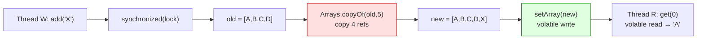

# Collections Framework — List Implementations (ArrayList, LinkedList, COW & the Copy-On-Write Trade-off)

> **Level:** Intermediate → Expert
> **Interview Frequency:** ★★★★★ (the most-asked collections question; `ArrayList` vs `LinkedList` is a rite of passage, but the *why* behind growth factor, fail-fast and copy-on-write is where candidates separate)
> **Prerequisite:** [03 · Exception Handling](../03-Exception-Handling/01-Exception-Handling.md)
> **Last Updated:** 2026

---

## 📋 Table of Contents

- [0. TL;DR — The 30-Second Answer](#0-tldr--the-30-second-answer)
- [1. What & Why — The Problem This Solves](#1-what--why--the-problem-this-solves)
- [2. Mental Model — The One Picture](#2-mental-model--the-one-picture)
- [3. Deep Dive — Theory](#3-deep-dive--theory)
  - [3.1 The `List` Contract](#31-the-list-contract)
  - [3.2 `ArrayList` Internals — The Three Fields That Matter](#32-arraylist-internals--the-three-fields-that-matter)
  - [3.3 Lazy Initialisation and the Two Empty Arrays](#33-lazy-initialisation-and-the-two-empty-arrays)
  - [3.4 The Growth Algorithm — 1.5× and the Amortised Cost Proof](#34-the-growth-algorithm--15-and-the-amortised-cost-proof)
  - [3.5 Insertion & Deletion — `arraycopy` and the `null` That Frees Memory](#35-insertion--deletion--arraycopy-and-the-null-that-frees-memory)
  - [3.6 `LinkedList` Internals — Doubly-Linked Nodes and the $n/2$ Optimisation](#36-linkedlist-internals--doubly-linked-nodes-and-the-n2-optimisation)
  - [3.7 `Vector` and `Stack` — The Legacy Costs](#37-vector-and-stack--the-legacy-costs)
  - [3.8 `CopyOnWriteArrayList` — The Cost Model That Decides Everything](#38-copyonwritearraylist--the-cost-model-that-decides-everything)
  - [3.9 Fail-Fast Iterators — `modCount`, `expectedModCount` and the CME](#39-fail-fast-iterators--modcount-expectedmodcount-and-the-cme)
  - [3.10 `subList` — Views, Not Copies](#310-sublist--views-not-copies)
  - [3.11 The Five Ways to Make a List — and Their Contracts](#311-the-five-ways-to-make-a-list--and-their-contracts)
- [4. Visualizations](#4-visualizations)
- [5. Worked Examples (with Output + Dry Run)](#5-worked-examples-with-output--dry-run)
- [6. Code from Scratch — Production-Grade](#6-code-from-scratch--production-grade)
- [7. Common Pitfalls & Gotchas](#7-common-pitfalls--gotchas)
- [8. Interview Q&A — Level-wise](#8-interview-qa--level-wise)
- [9. Counter-Questions & Traps](#9-counter-questions--traps)
- [10. Rapid-Fire MCQs](#10-rapid-fire-mcqs)
- [11. Cheat Sheet / One-Page Summary](#11-cheat-sheet--one-page-summary)
- [12. Real-World Production Notes](#12-real-world-production-notes)
- [13. Follow-up Learning](#13-follow-up-learning)

---

## 0. TL;DR — The 30-Second Answer

- **`ArrayList` is a resizable array.** `get(i)`/`set(i, e)` are **$O(1)$**; `add`/`remove` in the
  middle are **$O(n)$** because elements must be *shifted*.
- **`ArrayList` grows by 1.5×**, not 2×: `10 → 15 → 22 → 33 → 49 → 73 …` The reason is **memory
  fragmentation** — a 1.5× growth lets the allocator reuse previously-freed chunks, whereas 2×
  guarantees every past allocation is permanently stranded.
- **`add` at the tail is amortised $O(1)$, not $O(1)$.** One add can cost $O(n)$ (the copy), but
  the *total* cost of $n$ adds is $O(n)$ — the amortised proof is a geometric series.
- **`LinkedList` is almost never the right answer.** Its theoretical $O(1)$ insertion is destroyed by
  a node allocation per element (~24–32 bytes) and pointer-chasing cache misses. Use `ArrayDeque`
  for a stack or a FIFO queue.
- **`CopyOnWriteArrayList` trades memory and write speed for lock-free reads.** Every mutation copies
  the whole backing array ($O(n)$ per write); every read is a volatile read with **zero locking**.
  Its iterator is a **snapshot** — it never throws `ConcurrentModificationException`.
- **Fail-fast is *best-effort*, not a guarantee.** It is a **bug detector**, not a concurrency
  mechanism: `modCount` is not `volatile`, so a concurrent mutation may be entirely invisible.
- **`subList` returns a *view*, not a copy.** It holds a strong reference to the parent — the classic
  memory-leak trap in a method that returns `list.subList(0, 10)`.
- **`Arrays.asList` is fixed-size but *mutable*, and backed by your array.** `List.of` /
  `List.copyOf` are **truly immutable** and **reject `null`**.
- **The `remove(int)` vs `remove(Object)` trap** is the most common compile-time surprise in
  production Java: `list.remove(1)` removes the **index**, `list.remove(Integer.valueOf(1))` the
  **value**.
- **Rule of thumb:** `ArrayList` for everything; `ArrayDeque` for stack/queue; `LinkedList` almost
  never; `CopyOnWriteArrayList` only for read-heavy listener registries.

---

## 1. What & Why — The Problem This Solves

### The problem

A program that processes a batch of records — an order file, a CSV of transactions, a query result
set — needs an ordered, resizable container. Java's primitive `array` is the obvious first choice
and it is exactly the wrong one: **its length is fixed at allocation time** (growing it means
allocating a bigger array and copying every element by hand), **it cannot hold primitives
generically** (`int[]` is not `Object[]`), and **inserting in the middle is manual**
(`System.arraycopy` is a low-level call most developers will not write correctly first time).

### The solution

`java.util.List` is an *interface* with a contract (ordered, indexable, duplicates allowed, `null`
permitted) and several *implementations* that satisfy it with different internal structures and
costs. You program to the interface and pick the implementation from the access pattern.

### The analogy

Think of a **train**:

- `ArrayList` is one train with $n$ carriages in a rigid line. Reaching carriage 7 is instant, but
  inserting one in the middle means uncoupling and re-coupling the whole train.
- `LinkedList` is a train where carriages are chained. Splicing one in the middle is easy, but to
  reach carriage 7 you must walk the train, and each carriage is a separate heap object the CPU
  cannot prefetch.
- `CopyOnWriteArrayList` is a train where every new departure builds a *complete new train* —
  passengers already aboard never notice, and boarding is instantaneous.

---

## 2. Mental Model — The One Picture

```text
              List<E>  (ordered · indexable · duplicates · null OK)
                 │
     ┌───────────┼──────────────────┬─────────────────────┐
 ArrayList    LinkedList         Vector          CopyOnWriteArrayList
 Object[]     Node<E> chain      Object[]        volatile Object[]
 + size       prev/next/item     + size          + write lock
 + modCount   (per-element obj)  + modCount      (every method synchronized)
              1.5× growth is ArrayList-only     copy on write

  get(i) ─────────► O(1)         O(n)              O(1)             O(1)
  add(tail) ──────► amort O(1)   O(1)              amort O(1)       O(n) COPY
  remove(mid) ────► O(n) shift   O(n) find + O(1)  O(n) shift       O(n) COPY
  memory/elem ────► ~4B ref      ~24-32B node      ~4B ref         4B ref × 2 (during write)
  iteration ──────► cache-hot    cache-cold       cache-hot       cache-hot (snapshot)
```

**What to look at:** one structural difference explains *every* complexity number in the table —
`ArrayList`/`Vector`/`CopyOnWriteArrayList` keep elements in **one contiguous array** ($O(1)$ index,
$O(n)$ shift), `LinkedList` keeps them in **one object per element** ($O(n)$ index, $O(1)$ link).

Note that `size` (logical length) and `elementData.length` (physical capacity) are **different
numbers**. That gap is the memory you pay to avoid copying on every add, and `trimToSize()` is how
you give it back.

---
## 3. Deep Dive — Theory

### 3.1 The `List` Contract

`List` extends `Collection` and adds *positional* access. The contract that matters:

- **Ordered** — iteration order matches insertion order (true for `ArrayList`/`LinkedList`/`Vector`).
- **Indexed** — `get(i)`, `set(i, e)`, `add(i, e)`, `remove(i)`; only meaningful if the
  implementation is `RandomAccess`.
- **Duplicates allowed**, unlike `Set`.
- **`null` permitted** — *except* `List.of` / `List.copyOf` and `ArrayDeque`.
- **`equals`/`hashCode`** — list equality is **order-sensitive**: `List.of(1,2).equals(List.of(2,1))`
  is `false`, while `Set.of(1,2).equals(Set.of(2,1))` is `true`.

> **Expert note:** `List.equals` is *list equality* — same size, same elements, same order. It is
> stricter than `Set.equals` (order-**in**sensitive), and different from `AbstractList`, which
> implements it element-wise.

### 3.2 `ArrayList` Internals — The Three Fields That Matter

```java
public class ArrayList<E> extends AbstractList<E> implements List<E>, RandomAccess, Cloneable {
    transient Object[] elementData;        // the backing array — its length is the CAPACITY
    private int size;                      // logical element count
    protected transient int modCount = 0;  // fail-fast counter
}
```

- **`elementData`** — physical storage; `elementData.length` is the *capacity*.
- **`size`** — logical length. Always `size <= elementData.length`.
- **`modCount`** — incremented on every **structural** modification (`add`, `remove`, `clear`,
  `trimToSize`). `set(i, e)` is **not** structural and does not touch it.

### 3.3 Lazy Initialisation and the Two Empty Arrays

`new ArrayList()` stores the shared `DEFAULTCAPACITY_EMPTY_ELEMENTDATA` (length 0);
`new ArrayList(cap)` allocates `new Object[cap]` eagerly for `cap > 0`, else the shared
`EMPTY_ELEMENTDATA` (length 0). Why **two** constants? They encode a *promise*:
`DEFAULTCAPACITY_EMPTY_ELEMENTDATA` means *"I owe you a capacity-10 array"*;
`EMPTY_ELEMENTDATA` means *"I owe you exactly what you asked for — nothing"*. The first `add`
resolves the promise:

`grow()` then computes
`ArraysSupport.newLength(oldCapacity, minCapacity - oldCapacity, oldCapacity >> 1)` — a *preferred
growth* of `old + old/2` — and copies into it.

So `new ArrayList<>()` allocates **nothing** until the first `add`, then jumps to capacity 10. In a
service holding a million mostly-empty lists, a shared zero-length constant costs 0 bytes per list,
whereas an eagerly allocated `Object[10]` costs 56 bytes per list.

### 3.4 The Growth Algorithm — 1.5× and the Amortised Cost Proof

```java
int newCapacity = oldCapacity + (oldCapacity >> 1);   // 1.5 × oldCapacity
```

Observed sequence: `10 → 15 → 22 → 33 → 49 → 73 → 109 …` (each is `old + old/2`).

**Why 1.5× and not 2×? — the fragmentation argument.** With a **2×** factor the new block is always
strictly larger than the *sum* of all blocks allocated so far, so the allocator can **never** reuse
a previously-freed block — every past array becomes unreclaimable fragmentation (16+32+64 = 112
bytes stranded). With **1.5×** the allocator *can* recycle freed chunks. The golden ratio (φ ≈ 1.618)
is the theoretical optimum for the same reason.

**The amortised proof.** Adding $n$ elements costs

$$T(n) = 1 + 2 + 4 + 8 + \dots + n = 2n - 1 = O(n)$$

so the **total** cost of $n$ adds is $O(n)$ and the **amortised** cost per add is $O(1)$ — even
though *individual* adds trigger an $O(n)$ copy. Over 23 adds the total copy work is ~70
element-moves — about **3 per add**.

**What to look at:** the *spikes* are rare and geometrically spaced. Amortised $O(1)$ does **not**
mean "every operation is $O(1)$" — it means the average over any prefix of operations is $O(1)$. A
latency-sensitive system still sees those spikes; that is why you pre-size when you know the count.

```java
List<Order> orders = new ArrayList<>(expectedCount);   // ✅ one allocation, zero resizes
List<Order> orders = new ArrayList<>();                 // ❌ 10 → 15 → 22 → …, four copies
```

`new ArrayList<>(n)` allocates exactly capacity `n` (it does **not** apply a load factor).

### 3.5 Insertion & Deletion — `arraycopy` and the `null` That Frees Memory

The two critical lines are `System.arraycopy(elementData, index, elementData, index + 1, s - index)`
(to shift the tail right) and `elementData[--size] = null` (to shift left *and* clear the slot).

Two details asked in senior rounds:

1. **`System.arraycopy` is intrinsified.** The JIT replaces it with a native, vectorised memory move
   — it is *not* a Java loop. That is why `ArrayList.remove(0)` on a million-element list takes
   hundreds of microseconds, not milliseconds. It is still $O(n)$, but with a tiny constant.
2. **`elementData[--size] = null` is a memory-management operation, not a cosmetic one.** The backing
   array is longer than `size`, so the stale slot retains a **strong reference** to the removed
   object. As long as the `ArrayList` is reachable, that object can never be collected — a
   *loitering object* leak, worst when the removed element is large (a loaded entity, a byte array).

### 3.6 `LinkedList` Internals — Doubly-Linked Nodes and the $n/2$ Optimisation

`LinkedList` stores `first`/`last` nodes and a `size`; each `Node<E>` holds `item`, `next` and
`prev`. `get(int index)` picks the cheaper half — if `index < (size >> 1)` it walks forward from
`first`, otherwise backward from `last`.

Worst case is still $\lceil n/2 \rceil$ hops — asymptotically **$O(n)$** with half the constant.

Per element: `ArrayList` ≈ **4 B** (one compressed oop) versus `LinkedList` ≈ **24–32 B** (object
header + 3 references + padding). `get(i)` is 1 array read versus ~$n/2$ pointer dereferences. `add`
at the tail is an amortised-$O(1)$ `arraycopy` versus an $O(1)$ link that **allocates a node**.
Iteration is prefetch-friendly versus a likely **cache miss per node** — a 1 M-element `LinkedList`
burns ~**32 MB** on node overhead versus ~4 MB of references, and its cache hit rate can drop below
**5%**.

> **Where `LinkedList` genuinely wins:** when you hold a reference to an *interior* node and need to
> remove it in $O(1)$ — something an `ArrayList` cannot do without an index scan — or when you need
> `ListIterator` bidirectional traversal with cheap `previous()`. In practice `ArrayDeque` beats it
> on both axes.

### 3.7 `Vector` and `Stack` — The Legacy Costs

`Vector` is `ArrayList`'s ancestor: same array, but **every public method is `synchronized`**, and it
grows by **2×**. `Stack` extends `Vector` and adds `push`/`pop`/`peek`, but also inherits
`Vector`'s index-based methods (`get(0)`, `set(0, x)`) which are **not** stack operations and break
the LIFO abstraction.

**The `synchronized` on every method is the killer.** A `Stack` under contention serialises *all*
operations — reads included — on a single monitor, so it scales to exactly one core. Modern code uses
`ArrayDeque` (`push`/`pop`/`peek` map 1:1 — no locking, no node overhead).

> **Interview trap:** "Is `Stack` thread-safe?" — Technically yes, but compound operations
> `stack.push(); stack.pop();` are **not** atomic, and its lock is global to the stack. Use
> `ArrayDeque` + external synchronisation, or `ConcurrentLinkedDeque`.

### 3.8 `CopyOnWriteArrayList` — The Cost Model That Decides Everything

The whole class is two fields — `final transient Object lock` (synchronises writes) and
`private transient volatile Object[] array` (a volatile reference that publishes each new array) —
plus a `get` that reads the array with **no locking at all** and an `add` that copies the array
inside `synchronized (lock)` and then does a **volatile write** to publish the swap.

| Operation | Cost | Why |
| :--- | :--- | :--- |
| `get(i)`, `size()`, `contains` | **$O(1)$, zero locking** | volatile read of the array reference + array index |
| `add`, `remove`, `set` | **$O(n)$** | copy the entire backing array under the write lock |
| `iterator()` | **$O(1)** to create | the iterator holds a reference to the *snapshot* array |
| iteration | $O(n)$ but **never blocks a writer** | it walks the frozen snapshot |
| memory | 2× array during a write | old and new arrays coexist until the volatile write |

The **total** cost of $m$ adds is $O(m^2)$ — 1 + 2 + 3 + … + $m$ element copies. For
$m = 10{,}000$ that is **50 million** copies.

**Snapshot iterators (fail-safe).** The iterator captures `Object[] snapshot = getArray()` at
creation and walks *that*: it **never** throws `ConcurrentModificationException`, it sees the state
at creation rather than at `next()` time, and `it.remove()` throws `UnsupportedOperationException`.
At creation time the iterator holds the old array object; a writer that adds an element installs a
*different* array object via a volatile write — so the reader's view stays immutable and consistent.

**Right choice for:** listener/observer registries (write once at startup, read on every event);
read-heavy caches where writes are rare (99.9% reads); iterating while another thread mutates and
you *want* a consistent snapshot.

**Catastrophically wrong for:** a list that receives one `add` per request → $O(n^2)$ copying and a
global write lock; large lists (100 k+) → each `add` copies 400 KB → GC churn.

### 3.9 Fail-Fast Iterators — `modCount`, `expectedModCount` and the CME

Inside `ArrayList.Itr` the check is literally
`if (modCount != expectedModCount) throw new ConcurrentModificationException();`.

1. Every **structural** modification does `modCount++`.
2. `iterator()` snapshots `expectedModCount = modCount`.
3. `next()` and `remove()` call `checkForComodification()`.
4. If the collection was modified by anything other than this iterator's own `remove()`, the counters
   diverge and the next `next()` throws.

`Iterator.remove()` updates **both** `modCount` and `expectedModCount`, so iterator-driven removal
never trips the check.

> **The critical interview point:** fail-fast is **best-effort**. `modCount` is **not** `volatile`
> and there is **no** synchronisation, so in a genuinely concurrent setting the mutation may not be
> **visible** at all (no memory barrier) — **no CME is thrown** and the iteration may silently miss
> or duplicate elements; or the CME **is** thrown for a mutation that is perfectly legal.
> Fail-fast is a **single-threaded bug detector**, nothing more.

**Why `removeIf` is the correct way to bulk-remove.** `Collection.removeIf` (Java 8+) is *specified*
to remove elements without raising a CME, and the default implementation is a **single pass** —
faster than the classic "collect then remove" two-pass pattern.

### 3.10 `subList` — Views, Not Copies

`list.subList(from, to)` returns a **`SubList` view** backed by the parent.

`sub.add("X")` writes **through** to the parent (`original` becomes `[A, B, C, X, D, E]`), and a
later `original.add("Z")` makes the next `sub.get(0)` throw `ConcurrentModificationException`.

Three consequences: **writes propagate both ways** (`sub.set(0, "Q")` changes `original`);
**structural changes to the parent invalidate the view** → `ConcurrentModificationException`; and
**the memory leak** — `SubList` holds a strong reference to the parent (`ArrayList.this`), so a
method returning `bigList.subList(0, 10)` keeps the **entire** backing array alive.

The fix is to copy: `return new ArrayList<>(largeList.subList(0, 10));`.

### 3.11 The Five Ways to Make a List — and Their Contracts

`new ArrayList<>()` is fully mutable and owns its array. `Arrays.asList(T...)` is **fixed-size**
but *mutable* and **aliases your array**. `Collections.unmodifiableList(l)` is a read-only **view**
that still reflects later changes to `l`. `List.of(...)` and `List.copyOf(...)` are **truly
immutable** and **reject `null` with an NPE** (see §5 Example 2 and §11 for the full matrix).

> **Rule:** `List.of`/`List.copyOf` give you a *value* — safe to share across threads, impossible to
> corrupt. `Collections.unmodifiableList` gives you a *lock on a live object* — the underlying list
> can still change under it through another reference.

---
## 4. Visualizations

### 4.1 `ArrayList` vs `LinkedList` — heap layout

```text
  ArrayList<Integer> (1 000 000 elements)              LinkedList<Integer> (1 000 000 elements)

  ┌────────────┐                                     ┌────────────┐
  │ ArrayList  │                                     │ LinkedList │
  │ elementData┼──┐                                  │ first ─────┼──┐
  │ size: 1M   │  │                                  │ last  ─────┼──┼──┐
  └────────────┘  │                                  │ size: 1M   │  │  │
                  ▼                                  └────────────┘  │  │
  ┌───────────────────────────────────┐                             ▼  ▼
  │[0]   [1]   [2]   ...   [999999]   │              ┌──────┐ ┌──────┐ ┌──────┐
  └───────────────────────────────────┘              │Node  │→│Node  │→│Node  │→ …
  one contiguous block, ~4 MB of refs                  │ item  │ │ item  │ │ item  │
  CPU: sequential prefetch ✔                         │ prev  │◄─│ prev  │◄─│ prev  │
                                                   │ next  │ │ next  │ │ next  │
                                                   └──────┘ └──────┘ └──────┘
                                                   1M separate objects, ~32 MB overhead
                                                   CPU: a cache miss per hop ✘
```

**What to look at:** the `ArrayList` block is **one** allocation of contiguous memory, so the CPU
prefetcher streams it into L1/L2 cache. The `LinkedList` is a million *separate* heap objects at
effectively random addresses, so every `next()` is a potential **cache miss (~100 ns)**.

### 4.2 The `CopyOnWriteArrayList` write — why it is $O(n)$



**What to look at:** the red box is the cost — the *entire* array is copied on **every** write. The
green box is the benefit — the volatile write publishes the new array atomically, so readers never
see a half-updated list and never block.

### 4.3 Choosing a `List` — decision tree

```text
                    Need a List
                         │
        ┌────────────────┼───────────────────────┐
   Needs O(1) index?  Needs stack/queue      Shared across threads?
        │                │                       │
   ArrayList       ArrayDeque                 │
        │         (never LinkedList)     ┌──────┴────────┐
        │                                │               │
   Mutated a lot  │  Read-mostly,         Read-mostly,
   while iterating │  iterated a lot        mutated a lot
        │          │                       │               │
   removeIf /     CopyOnWriteArrayList   ConcurrentLinkedList
   Iterator.remove                       (or a bounded queue)
```

**What to look at:** the two questions that actually decide the choice are **"random access or
FIFO?"** and **"is the mutation rate high relative to the read rate?"**. Everything else is noise.

---

## 5. Worked Examples (with Output + Dry Run)

### Example 1 — Growth, lazy initialisation, and the 1.5× factor

**Problem:** *"Prove that `ArrayList` allocates lazily and grows by 1.5×."*

```java
import java.lang.reflect.Field;
import java.util.*;

public class Ex1Growth {
    static int cap(List<?> list) throws Exception {
        Field f = ArrayList.class.getDeclaredField("elementData");
        f.setAccessible(true);
        return ((Object[]) f.get(list)).length;
    }

    public static void main(String[] a) throws Exception {
        System.out.println("empty new ArrayList<>() capacity = " + cap(new ArrayList<>()));
        System.out.println("new ArrayList<>(0) capacity  = " + cap(new ArrayList<>(0)));
        List<Integer> l = new ArrayList<>();
        int prev = -1;
        for (int i = 1; i <= 25; i++) {
            l.add(i);
            int c = cap(l);
            if (c != prev) { System.out.println("size=" + l.size() + " -> capacity=" + c); prev = c; }
        }
    }
}

```

**Actual output** (JDK 25, run with `--add-opens java.base/java.util=ALL-UNNAMED`):

```text
empty new ArrayList<>() capacity = 0
new ArrayList<>(0) capacity  = 0
size=1 -> capacity=10
size=11 -> capacity=15
size=16 -> capacity=22
size=23 -> capacity=33
```

**Dry run:**

| # | Statement | Result | Why |
|---|-----------|--------|-----|
| 1 | `new ArrayList<>()` / `new ArrayList<>(0)` | capacity **0** both | They store *different* shared empty-array constants, but both have length 0 — nothing is allocated |
| 2 | first `add` | capacity **10** | `grow()` sees the `DEFAULTCAPACITY` constant → `new Object[max(10, 1)]` |
| 3 | 11th `add` | capacity **15** | `10 + (10 >> 1)` = `10 + 5` = 15 |
| 4 | 16th / 23rd `add` | capacity **22** / **33** | `15 + 7` = 22, then `22 + 11` = 33 |

**Takeaway:** both "empty" constructors allocate **zero** bytes; the first `add` jumps straight to
10; each subsequent growth is `old + old/2` — the 1.5× factor confirmed empirically.

---

---

### Example 2 — The three "remove" traps in one program

**Problem:** *"Explain `remove(int)` vs `remove(Object)`, `Arrays.asList` aliasing, and the `subList`
invalidation — with output."*

```java
import java.util.*;

public class Ex2RemoveTraps {
    public static void main(String[] args) {
        List<Integer> numbers = new ArrayList<>(List.of(10, 20, 30, 40));
        System.out.println("before      : " + numbers);
        numbers.remove(1);
        System.out.println("remove(1)   : " + numbers + "  <- removed INDEX 1 (value 20)");
        numbers.remove(Integer.valueOf(30));
        System.out.println("remove(30)  : " + numbers + "  <- removed VALUE 30");

        String[] arr = { "One", "Two" };
        List<String> fixed = Arrays.asList(arr);
        arr[0] = "Modified";
        System.out.println("asList view : " + fixed);
        try { fixed.add("Three"); }
        catch (UnsupportedOperationException e) { System.out.println("asList add  : " + e.getClass().getSimpleName()); }

        List<String> orig = new ArrayList<>(List.of("A", "B", "C", "D", "E"));
        List<String> sub = orig.subList(1, 3);
        System.out.println("sub         : " + sub);
        sub.add("X");
        System.out.println("after sub.add -> orig=" + orig);
        orig.add("Z");
        try { sub.get(0); }
        catch (ConcurrentModificationException e) { System.out.println("sub after orig.add -> " + e.getClass().getSimpleName()); }
    }
}
```

**Actual output:**

```text
before      : [10, 20, 30, 40]
remove(1)   : [10, 30, 40]  <- removed INDEX 1 (value 20)
remove(30)  : [10, 40]  <- removed VALUE 30
asList view : [Modified, Two]
asList add  : UnsupportedOperationException
sub         : [B, C]
after sub.add -> orig=[A, B, C, X, D, E]
sub after orig.add -> ConcurrentModificationException
```

**Dry run:**

| # | Statement | Result | Why |
|---|-----------|--------|-----|
| 1 | `numbers.remove(1)` | `[10, 30, 40]` | The literal `1` is an `int`, so the compiler picks **`remove(int index)`** → removes the element at index 1 (`20`) |
| 2 | `numbers.remove(Integer.valueOf(30))` | `[10, 40]` | A boxed `Integer` selects **`remove(Object o)`** → removes the element *equal to* `30` |
| 3 | `arr[0] = "Modified"` | `[Modified, Two]` | `Arrays.asList` wraps the *same* array — no copy was made; `add` then throws because the list is **fixed-size** |
| 4 | `sub.add("X")` | `orig = [A, B, C, X, D, E]` | `SubList` writes **through** to the parent's `elementData` |
| 5 | `orig.add("Z")` then `sub.get(0)` | `ConcurrentModificationException` | The parent's `modCount` changed → the sublist's `expectedModCount` no longer matches |

**Takeaway:** three *different* Java behaviours — overload resolution by static type, view semantics,
and structural-change detection — all from three one-liners.

---

### Example 3 — Fail-fast vs snapshot: the same bug, two outcomes

**Problem:** *"Show what `ConcurrentModificationException` really detects — and why it is not a
concurrency guarantee."*

```java
import java.util.*;
import java.util.concurrent.*;

public class Ex3FailFast {
    public static void main(String[] args) {
        // (a) Structural change to an EARLIER element → CME on the next next()
        List<String> list = new ArrayList<>(List.of("A", "B", "C"));
        try { for (String s : list) if (s.equals("A")) list.remove(s); }
        catch (ConcurrentModificationException e) { System.out.println("(a) ArrayList loop     -> " + e.getClass().getSimpleName()); }

        // (b) Removing the element we are CURRENTLY on → no CME at all (the loop just ends)
        List<String> list2 = new ArrayList<>(List.of("A", "B"));
        for (String s : list2) if (s.equals("A")) list2.remove(s);
        System.out.println("(b) no CME thrown, list now = " + list2);

        // (c) The correct way
        List<String> list3 = new ArrayList<>(List.of("A", "B", "C"));
        list3.removeIf(s -> s.equals("B"));
        System.out.println("(c) removeIf            -> " + list3);

        // (d) CopyOnWriteArrayList — snapshot iterator, never throws
        CopyOnWriteArrayList<String> cow = new CopyOnWriteArrayList<>(List.of("A", "B"));
        Iterator<String> it = cow.iterator();
        cow.add("C");
        List<String> seen = new ArrayList<>();
        while (it.hasNext()) seen.add(it.next());
        System.out.println("(d) COW iterator saw    : " + seen + " | list now: " + cow);
    }
}
```

**Actual output:**

```text
(a) ArrayList loop     -> ConcurrentModificationException
(b) no CME thrown, list now = [B]
(c) removeIf            -> [A, C]
(d) COW iterator saw    : [A, B] | list now: [A, B, C]
```

**Dry run:**

| # | Statement | Result | Why |
|---|-----------|--------|-----|
| 1 | (a) remove `"A"` during iteration | `ConcurrentModificationException` | `modCount` 1 → 2; the iterator's `expectedModCount` is still 1; the next `next()` sees the mismatch and throws |
| 2 | (b) remove `"A"` (the *current* element) from a 2-element list | **no CME**, list = `[B]` | After the removal `hasNext()` is `cursor(1) != size(1)` → `false`, so the loop **ends** before `next()` is called again. The mismatch is never *checked* |
| 3 | (c) `removeIf` | `[A, C]` | `removeIf` is specified never to raise CME and does a single pass |
| 4 | (d) `cow.add("C")` then iterate | iterator saw `[A, B]`, list is `[A, B, C]` | The COW iterator captured the **old array** at construction; the writer installed a *different* array object |

**Takeaway:** case (b) proves fail-fast is **best-effort** — the CME is thrown only if the iterator
happens to call `next()` *after* the mutation, a timing accident rather than a guarantee. In a truly
concurrent program the mutation may not even be *visible* (no `volatile` on `modCount`).

---
## 6. Code from Scratch — Production-Grade

A bounded, thread-safe, insertion-ordered **event registry** with an explicit eviction policy — plus
the safe batch-removal idiom that never trips the fail-fast trap.

```java
import java.util.*;
import java.util.concurrent.CopyOnWriteArrayList;

/**
 * A production-grade, bounded listener registry.
 *
 * Design decisions (and why):
 *  - CopyOnWriteArrayList: listeners are registered rarely and notified constantly, so
 *    copy-on-write is the cheapest correct choice.
 *  - Bounded: an unbounded registry is a memory leak waiting to happen.
 *  - Listener exceptions are isolated: one broken listener must not stop the others.
 */
public final class ListenerRegistry<E> implements AutoCloseable {

    @FunctionalInterface
    public interface Listener<E> { void onEvent(E event); }

    private final CopyOnWriteArrayList<Listener<E>> listeners = new CopyOnWriteArrayList<>();
    private final int maxListeners;

    public ListenerRegistry(int maxListeners) {
        if (maxListeners <= 0) throw new IllegalArgumentException("maxListeners must be > 0");
        this.maxListeners = maxListeners;
    }

    /** @return false if the registry is full. Register in bulk at startup, never per request. */
    public boolean register(Listener<E> listener) {
        Objects.requireNonNull(listener, "listener");
        if (listeners.size() >= maxListeners) return false;
        listeners.add(listener);
        return true;
    }

    /**
     * Notifies every listener. The iterator is a snapshot, so a listener that registers or
     * unregisters during the callback cannot cause a ConcurrentModificationException.
     * @return the number of SUCCESSFUL deliveries (a metric you can alert on).
     */
    public int dispatch(E event) {
        int delivered = 0;
        for (Listener<E> listener : listeners) {
            try { listener.onEvent(event); delivered++; }
            catch (RuntimeException ex) {
                // Isolate the failure — one bad listener must not break the fan-out.
                System.err.println("Listener failed for event " + event + ": " + ex);
            }
        }
        return delivered;
    }

    public int size() { return listeners.size(); }

    /** Removes all matching elements in a SINGLE pass (removeIf never throws CME). */
    public static <T> void removeMatching(Collection<T> c, java.util.function.Predicate<T> p) {
        Objects.requireNonNull(c, "collection");
        Objects.requireNonNull(p, "predicate");
        c.removeIf(p);
    }

    /** Returns a defensive, fully immutable copy — the right thing to return from a public API. */
    public static <T> List<T> immutableCopyOf(Collection<T> source) {
        Objects.requireNonNull(source, "source");
        return List.copyOf(new ArrayList<>(source));
    }
    public static void main(String[] args) {
        ListenerRegistry<String> registry = new ListenerRegistry<>(3);
        registry.register(e -> System.out.println("  listener-1 got " + e));
        registry.register(e -> { throw new IllegalStateException("boom"); });
        registry.register(e -> System.out.println("  listener-3 got " + e));
        System.out.println("register 4th (capacity 3) -> " + registry.register(e -> { }));

        System.out.println("dispatch \"order-created\":");
        int delivered = registry.dispatch("order-created");
        System.out.println("delivered = " + delivered + " (throwing listener skipped, others survive)");

        List<String> orders = new ArrayList<>(List.of("A", "B", "C", "D"));
        removeMatching(orders, s -> s.compareTo("B") <= 0);
        System.out.println("after removeMatching     = " + orders);

        List<String> snapshot = immutableCopyOf(orders);
        try { ((List<String>) snapshot).add("X"); }
        catch (UnsupportedOperationException e) { System.out.println("snapshot add             -> " + e.getClass().getSimpleName()); }
        System.out.println("snapshot                 = " + snapshot);
    }

}
```

**Actual output:**

```text
register 4th (capacity 3) -> false
dispatch "order-created":
  listener-1 got order-created
  listener-3 got order-created
delivered = 2 (throwing listener skipped, others survive)
after removeMatching     = [C, D]
snapshot add             -> UnsupportedOperationException
snapshot                 = [C, D]
```

**Production notes:** `dispatch` returns the count of *successful* deliveries — a metric worth
alerting on. The `catch (RuntimeException)` is deliberate: in a banking system you would log it with
a correlation id and push it to a dead-letter queue. `CopyOnWriteArrayList` is safe here **only**
because the registry is bounded and written rarely; if registration were per-request, use a
`ConcurrentHashMap` of listeners instead.

---

## 7. Common Pitfalls & Gotchas

### ❌ Pitfall 1 — Removing inside an enhanced for-loop

**Why it's wrong:** the iterator's `expectedModCount` no longer matches `modCount`, so the next
`next()` throws `ConcurrentModificationException` — *if* it is called at all (see Example 3(b):
it may not be, which is why the bug is intermittent and maddening).

```java
// ❌ WRONG
for (String item : list) if (item.equals("deleteMe")) list.remove(item);

// ✅ RIGHT — Option 1: removeIf (single pass, no CME, fastest)
list.removeIf(item -> item.equals("deleteMe"));

// ✅ RIGHT — Option 2: Iterator.remove (updates modCount AND expectedModCount)
Iterator<String> it = list.iterator();
while (it.hasNext()) if (it.next().equals("deleteMe")) it.remove();
```

### ❌ Pitfall 2 — `remove(int)` vs `remove(Object)` with `Integer`

```java
List<Integer> numbers = new ArrayList<>(List.of(10, 20, 30, 40));
numbers.remove(1);                  // ❌ removes the element at INDEX 1 (value 20)
numbers.remove(Integer.valueOf(1)); // ✅ removes the VALUE 1
```

**Why:** the literal `1` widens to `int`, so the compiler binds to `remove(int index)`. Only a
*boxed* `Integer` selects `remove(Object)`. In older code `numbers.remove(new Integer(1))` was the
idiom — deprecated in Java 9, removed in Java 21.

### ❌ Pitfall 3 — `Arrays.asList` on a primitive array

```java
int[] nums = {1, 2, 3};
List<int[]> list = Arrays.asList(nums);  // ❌ a list of ONE int[] — size is 1, not 3!
```

**Why:** `Arrays.asList(T...)` takes `T[]`, a **reference** type. `int[]` is not `Object[]`, so `T`
is inferred as `int[]` and the whole array becomes a single element.

```java
// ✅
List<Integer> boxed = Arrays.stream(nums).boxed().toList();     // Java 16+
List<Integer> boxed2 = new ArrayList<>(Arrays.asList(1, 2, 3));
```

And `Arrays.asList` is **fixed-size**: `l.set(0, "z")` works, but `l.add("c")` and `l.remove("a")`
throw `UnsupportedOperationException`. Fix: `new ArrayList<>(Arrays.asList(...))` — or `List.of(...)`
if you want immutability (and can accept the `null` rejection).

### ❌ Pitfall 5 — Returning a `subList` from a method (the memory leak)

```java
public List<String> firstTen(List<String> huge) {
    return huge.subList(0, 10);   // ❌ holds 'huge' alive
}
```

**Fix:** `return new ArrayList<>(huge.subList(0, 10));` — or `List.copyOf(huge.subList(0, 10))`.

### ❌ Pitfall 6 — Assuming `ArrayList` is thread-safe

It is not. Two threads calling `add` concurrently can lose elements and corrupt `size`, and one
thread can resize the backing array while another reads a stale one — the classic
`ArrayIndexOutOfBoundsException` under concurrency. Use `Collections.synchronizedList` (with manual
synchronisation around iteration), `CopyOnWriteArrayList` (read-heavy), or `ConcurrentLinkedQueue`.

### ❌ Pitfall 7 — Using `LinkedList` for performance

```java
// ❌ "LinkedList is O(1) to insert at the head, so it's faster!"
List<String> l = new LinkedList<>();
l.add(0, "x");   // O(1) link — but you also allocated a Node (24-32 B) and paid a cache miss
```

The $O(1)$ is real, but the *constant* is terrible: a node allocation, a GC write barrier, and a
pointer write. `ArrayList.add(0, x)` is `System.arraycopy` — a vectorised memory move — which for
lists up to tens of thousands of elements wins handily. **Benchmark, do not assume.**

### ❌ Pitfall 8 — `List.of` / `List.copyOf` with `null`

```java
List<String> l = List.of("A", null);                 // ❌ NullPointerException at construction
List<String> m = List.copyOf(Arrays.asList("A", null)); // ❌ NPE — copyOf propagates the null
```

**Why:** `List.of` and `List.copyOf` are specified to **reject nulls** so the immutable collections
can use `null` internally as "absent" without ambiguity. If your data may contain `null`, use
`Collections.unmodifiableList(new ArrayList<>(src))` instead.

### ❌ Pitfall 9 — `equals` between a `List` and a `Set`, and cross-thread iteration

```java
List.of(1, 2).equals(Set.of(2, 1));   // ❌ false — different collection types
List.of(1, 2).equals(List.of(2, 1));  // ❌ false — List equality is ORDER-SENSITIVE
Set.of(1, 2).equals(Set.of(2, 1));    // ✅ true  — Set equality is order-INSENSITIVE
```

Even with `synchronizedList`, iteration is **not** covered by the wrapper's lock — you must write
`synchronized (sync) { for (String s : sync) { ... } }` yourself.

---

## 8. Interview Q&A — Level-wise

### 🟢 Beginner

**Q: What is the difference between `ArrayList` and `LinkedList`?**
**A:** `ArrayList` stores elements in a contiguous array — `get(i)` is $O(1)$, but inserting or
removing in the middle is $O(n)$ because elements must shift. `LinkedList` stores each element in a
separate node with `next`/`prev` pointers — inserting or removing at a known node is $O(1)$, but
`get(i)` is $O(n)$ and each element costs ~24–32 bytes of node overhead. In practice `ArrayList`
wins because of cache locality.

**Q: Is `ArrayList` thread-safe?**
**A:** No — it has no synchronisation at all. Concurrent `add` calls can lose elements and corrupt
`size`, and one thread's resize can invalidate another thread's view. Use `CopyOnWriteArrayList`
(read-heavy), `Collections.synchronizedList` (lock iteration manually), or a concurrent queue.

**Q: What is the difference between `List.of()` and `Arrays.asList()`?**
**A:** `Arrays.asList` returns a fixed-size list **backed by the array you pass** — you can `set` but
not `add`, and it reflects later changes to that array. `List.of` returns a truly immutable list that
rejects `null` and cannot be changed at all.

### 🟡 Intermediate

**Q: Why does `ArrayList` grow by 1.5× rather than 2×?**
**A:** Memory fragmentation. With a 2× factor, each new allocation is larger than the *sum* of all
previous ones, so the allocator can never reuse any freed block — every past array becomes permanent
garbage. With 1.5×, freed chunks can be recycled. It also makes the amortised cost of $n$ adds
$O(n)$ (a geometric series) and keeps peak wasted memory a smaller fraction of the live set.

**Q: What is the amortised cost of `add` at the end of an `ArrayList`, and why?**
**A:** Amortised $O(1)$. Individual adds are $O(1)$ except when a resize happens, which is $O(n)$.
Because capacity grows geometrically, the total copy cost over $n$ adds is $1 + 2 + 4 + \dots = O(n)$,
so the average per add is $O(1)$. Amortised does **not** mean every operation is constant.

**Q: What causes `ConcurrentModificationException` and how do you avoid it?**
**A:** `ArrayList` tracks a `modCount` incremented on every structural change; an iterator snapshots
it and compares on each `next()`. Avoid it with `Iterator.remove()`, `Collection.removeIf()`, or by
iterating a copy. Important nuance: the check is **best-effort** — not a concurrency guarantee,
because `modCount` is not `volatile`.

**Q: Explain the `remove(int)` vs `remove(Object)` overload trap.**
**A:** With `List<Integer>`, `remove(1)` binds to `remove(int index)` because the literal `1` is an
`int` — it removes the *position*, not the value. `remove(Integer.valueOf(1))` binds to
`remove(Object)` and removes the *value*. This has caused real production bugs, especially when
refactoring `List<Integer>` to `List<Long>`.

**Q: What is the difference between fail-fast and fail-safe iterators?**
**A:** Fail-fast iterators (`ArrayList`, `HashMap`, `HashSet`) hold a snapshot of the modification
count and throw `ConcurrentModificationException` when it changes mid-iteration — they read the
*live* data. Fail-safe iterators (`CopyOnWriteArrayList`, `ConcurrentHashMap`'s weakly-consistent
iterators) never throw: they either walk a snapshot (COW) or tolerate concurrent modification.

### 🔴 Advanced / Senior

**Q: `CopyOnWriteArrayList` is "thread-safe". Why might it be wrong in a high-write service?**
**A:** Every mutation copies the entire backing array, so a write is $O(n)$ and holds a **global**
write lock — $m$ writes cost $O(m^2)$ and all writers serialise. A service appending one item per
request to a 50 000-item list copies 50 000 references (200 KB) per request: a GC storm and a
memory-bandwidth wall. Use it for listener registries and read-mostly caches; switch to
`ConcurrentLinkedQueue` or a sharded structure when writes are frequent.

**Q: Why does `ArrayList.remove` null out the slot at `elementData[--size]`?**
**A:** To avoid a memory leak. The backing array is longer than `size`, so the stale slot retains a
strong reference to the removed element. As long as the `ArrayList` is reachable, that element is
unreachable-for-GC — a classic loitering-object leak, painful when the removed object is large (a
loaded Hibernate entity, a byte array).

**Q: Why is `RandomAccess` a marker interface?**
**A:** It is a *hint* to generic algorithms that positional access is $O(1)$ for this list.
`Collections.binarySearch` and `Collections.swap` check `instanceof RandomAccess` and switch between
an indexed loop and an iterator. `LinkedList` does not implement it because `get(i)` is $O(n)$.

**Q: How would you pick between `ArrayList`, `ArrayDeque`, `LinkedList` and
`CopyOnWriteArrayList` for a job queue?**
**A:** By access pattern. FIFO queue → `ArrayDeque` (contiguous array, no per-node allocation, `null`
rejected so `poll() == null` unambiguously means empty). LIFO stack → `ArrayDeque`; never `Stack`,
which is a `Vector` with a global lock. Read-mostly listener list → `CopyOnWriteArrayList`.
`LinkedList` only if you hold interior node references or need a bidirectional `ListIterator`.

### ⚫ Expert / Principal

**Q: "Fail-fast is best-effort." Prove it and explain the memory-model consequence.**
**A:** `modCount` is a plain `int` — not `volatile` — and so is the iterator's `expectedModCount`.
Under the JMM there is no happens-before edge between a writer's `modCount++` and the reader's
comparison. The reader may (a) see the update and throw CME for a perfectly legal concurrent write,
or (b) see a stale count and **not** throw, silently missing or re-visiting elements. So the CME is
neither a safety guarantee nor a race detector — it is a heuristic single-threaded bug detector.
Within a thread the check *is* reliable (program order ⇒ the writer sees its own writes), which is
exactly the case it was designed for.

**Q: You claim `ArrayList` beats `LinkedList` almost always. When would you be wrong?**
**A:** When you hold a direct reference to an *interior* node and repeatedly splice it out — an
`ArrayList` needs an $O(n)$ index scan and an $O(n)$ shift per removal, while a `LinkedList` removes
the known node in $O(1)$. Ditto heavy `ListIterator.previous()` usage ($O(1)$ per step versus
$O(n)$), and very large lists where a single multi-megabyte contiguous allocation risks humongous
object allocation and GC pressure.

**Q: How would you make an `ArrayList` safe for concurrent reads with occasional writes, without
paying the copy-on-write cost?**
**A:** In order of preference: (1) shard the data into N `ArrayList`s keyed by a hash (lock
striping) with one lock per shard; (2) use a `ConcurrentHashMap` if the data is key-value;
(3) `ConcurrentLinkedQueue` for FIFO; (4) adopt an immutable-snapshot swap at the application level
(build a new list, publish it to a `volatile` field). `CopyOnWriteArrayList` is only right when
writes are genuinely rare.

**Q: What is the real cost of `List.copyOf` vs `Collections.unmodifiableList`?**
**A:** `List.copyOf` is $O(n)$ in time *and* space — it copies the reference array — and it **rejects
`null`** with an NPE. `Collections.unmodifiableList` is $O(1)$ but keeps a strong reference to the
source, so the source stays alive and its later mutations are visible through the "unmodifiable"
view. Choosing `unmodifiableList` for a public API boundary is a bug: the caller can mutate your
data via the original reference.

---

## 9. Counter-Questions & Traps

### CQ1. "Isn't `ArrayList` enough? Why would you ever use `LinkedList`?"

- **Naive answer:** "Because `LinkedList` inserts faster in the middle."  ← *incomplete*
- **The trap:** The *theoretical* complexity of inserting at a known position is $O(1)$ for
  `LinkedList` versus $O(n)$ for `ArrayList`, but the $O(n)$ in `ArrayList` is a single
  `System.arraycopy` — a vectorised memory move — while the $O(1)$ in `LinkedList` is a **node
  allocation** (~24–32 bytes) plus a GC write barrier plus a cache miss on the next traversal. The
  asymptotic win is dwarfed by the constant-factor loss.
- **Expert answer:** `LinkedList` wins in exactly two situations: (1) you already hold a reference to
  an **interior node** and need to unlink it in $O(1)$; (2) you use `ListIterator` heavily and need
  `previous()`/bidirectional traversal in $O(1)$ per step. In everything else — including "insert at
  index 0 in a loop", the canonical interview example — `ArrayList` wins on cache locality and
  allocation cost. If you need a stack or queue, `ArrayDeque` dominates `LinkedList` on both axes.

### CQ2. "If `ArrayList.add` is amortised $O(1)$, why would you ever pre-size it?"

- **Naive answer:** "You wouldn't — amortised $O(1)$ is fast enough."  ← *incomplete*
- **The trap:** Amortised $O(1)$ is an **average over a sequence of operations**, not a bound on any
  single one. Each resize is an $O(n)$ copy, and in a latency-sensitive path (a request handler, a
  message consumer) that copy lands in a single request — a GC pause and a p99 spike. There is also
  the *memory* dimension: un-sized, the backing array grows to the next 1.5× multiple, so 1 000
  elements occupy capacity 1 097 — wasted references the GC must still trace.
- **Expert answer:** Pre-size when you know the cardinality in advance — `new ArrayList<>(expected)`
  performs exactly one allocation and zero copies. It also reduces *peak* memory, because you never
  hold an old and a new array simultaneously. The classic counter-argument ("just let it grow, it's
  amortised") ignores tail latency and memory footprint, both of which matter under p99 SLOs.

### CQ3. "`CopyOnWriteArrayList` is thread-safe — so why not use it everywhere?"

- **Naive answer:** "Because it's slower."  ← *incomplete*
- **The trap:** "Slower" hides the real problem. Every write is $O(n)$ and holds a **global** write
  lock, so $m$ writes cost $O(m^2)$ and **all writers serialise**. A service appending one item per
  request to a 50 000-item list copies 200 KB per request — a garbage-collection storm and a
  memory-bandwidth wall, not merely "a bit slower".
- **Expert answer:** `CopyOnWriteArrayList` is right when the write rate is orders of magnitude below
  the read rate (listener registries, feature-flag lists, configuration snapshots). The moment writes
  become frequent, switch to a lock-free queue (`ConcurrentLinkedQueue`) or a sharded structure. The
  pattern to remember: *the cost model decides the collection, not the thread-safety label*.

### CQ4. "What happens if you modify a `HashMap` while iterating it? Is the CME a safety mechanism?"

- **Naive answer:** "It throws `ConcurrentModificationException` so you know the map was modified
  concurrently."  ← *incomplete*
- **The trap:** The exception is not about *concurrency* at all. It fires for a purely
  **single-threaded** modification through another reference. And in a genuinely concurrent program
  it is **unreliable**: `modCount` is not `volatile`, so the reading thread may not even see the
  mutation — the loop can silently skip or duplicate entries.
- **Expert answer:** The CME is a **best-effort single-threaded bug detector**, nothing more. It
  compares the iterator's snapshot `expectedModCount` against the collection's live `modCount` at
  each `next()`. In concurrent code, rely on the concurrent collection's own contract:
  `ConcurrentHashMap`'s iterators are *weakly consistent* (they reflect some state between iterator
  creation and the last `next()`, and never throw), and `CopyOnWriteArrayList`'s are strict
  *snapshots*.

### CQ5. "You said `modCount` isn't `volatile`. Doesn't that make the CME fundamentally broken?"

- **Naive answer:** "Yes, so it's useless."  ← *incomplete*
- **The trap:** It is not useless — it is *exactly as useful as it is meant to be*. It catches the
  common single-threaded bug of removing from a collection while iterating it, in the same thread,
  where the mutation is guaranteed to be visible (same thread ⇒ program order ⇒ no data race).
- **Expert answer:** The CME's design intent is a **same-thread** heuristic. Across threads there is
  no guarantee *in either direction*: you may get a spurious CME for a legal concurrent write, or
  miss an illegal one. The correct mental model: "the CME means *the collection's structure changed
  since my iterator was created*" — full stop. It is not a statement about threads, and it is not
  a lock.

### CQ6. "Why doesn't `ArrayList` shrink its capacity when you remove elements?"

- **Naive answer:** "Because it's lazy."  ← *incomplete*
- **The trap:** The real reason is **capacity thrashing**. If `remove` shrank the array, an
  add/remove workload would reallocate and copy on *every* operation — turning the amortised $O(1)$
  add into $O(n)$. Shrinking would also make memory usage oscillate, which is exactly what the GC
  hates.
- **Expert answer:** `ArrayList` deliberately never shrinks. Reclaiming memory is the developer's
  explicit decision via `trimToSize()` (which allocates a fresh, exactly-sized array and copies) or
  by replacing the list. The philosophy: the *collection* optimises the amortised add path; the
  *application* decides when memory matters — typically at a batch boundary, not inside a hot loop.

### CQ7. "Is `Arrays.asList` immutable?"

- **Naive answer:** "No, but you can't add to it."  ← *partially right*
- **The trap:** It is neither immutable nor a copy. It is a **fixed-size view over the array you
  passed in**. You can `set` elements, and if anyone mutates the original array the list changes
  underneath you. (It *does* accept `null`, unlike `List.of`.)
- **Expert answer:** `Arrays.asList` gives you a *window* onto an existing array: fixed size, mutable
  content, aliased storage. It is right when you want to pass an array to an API that takes a `List`
  without copying; wrong when you need mutability of size, isolation from the array, or `null`-safety.
  The modern answer for constants is `List.of(...)`; for a defensive copy, `List.copyOf(...)`.

### CQ8. "How would you find out that a `LinkedList` is hurting your service?"

- **Naive answer:** "Run a profiler."  ← *incomplete*
- **The trap:** Most profilers show the *method* but not the *reason*. You need to distinguish "this
  list is hot" from "this list is slow *because* it is a `LinkedList`".
- **Expert answer:** Three concrete steps. (1) **Allocation profile**: JFR
  (`-XX:StartFlightRecording`) or async-profiler in *allocation* mode — a `LinkedList` shows a huge
  volume of `java.util.LinkedList$Node` allocations, the smoking gun. (2) **Memory**: compare the
  retained size of the list against its `size()` — a 1 M-element `LinkedList` retains ~32 MB of pure
  node overhead. (3) **Micro-benchmark the swap**: replace it with an `ArrayList` and measure the
  *same* workload — `perf stat -e cache-misses` typically drops by an order of magnitude, proving it
  was pointer chasing rather than algorithmic work.

## 10. Rapid-Fire MCQs

**Q1.** `ArrayList`'s default growth factor is: **A)** 2× **B)** 1.5× **C)** 1.25× **D)** 2× + 1
**Q2.** `new ArrayList<>()` allocates its backing array: **A)** Immediately with capacity 10 **B)** Lazily, on the first `add` **C)** Lazily, on the first `get` **D)** Never — a shared static array
**Q3.** `LinkedList.get(index)` is: **A)** $O(1)$ **B)** $O(\log n)$ **C)** $O(n)$ — at best traversing $n/2$ nodes **D)** $O(n/2)$, which is $O(1)$ amortised
**Q4.** `modCount` is incremented when you call: **A)** `set(i, e)` **B)** `get(i)` **C)** `add(e)` **D)** `contains(e)`
**Q5.** `CopyOnWriteArrayList.add(e)` costs: **A)** $O(1)$ amortised **B)** $O(n)$ — the whole array is copied **C)** $O(\log n)$ **D)** $O(1)$ but with a global lock forever
**Q6.** The iterator of `CopyOnWriteArrayList` is: **A)** Fail-fast **B)** A snapshot — it never sees later modifications **C)** Weakly consistent **D)** Random access
**Q7.** `list.remove(1)` on a `List<Integer>`: **A)** Removes the element with value 1 **B)** Removes the element at index 1 **C)** Throws `UnsupportedOperationException` **D)** Removes the first occurrence of `1`
**Q8.** `Arrays.asList("a", "b").add("c")`: **A)** Works **B)** Throws `UnsupportedOperationException` **C)** Throws `NullPointerException` **D)** Silently does nothing
**Q9.** `List.of("A", null)`: **A)** Creates a list containing null **B)** Throws `NullPointerException` **C)** Creates an empty list **D)** Throws `IllegalArgumentException`
**Q10.** `Collections.unmodifiableList(list)` returns: **A)** An immutable copy **B)** A read-only *view* over `list` **C)** A list that throws on `equals` **D)** An unmodifiable `LinkedHashSet`
**Q11.** After `subList.add("X")`, the parent list: **A)** Is unchanged — sublists are copies **B)** Contains `X` — sublists are views **C)** Throws `ConcurrentModificationException` **D)** Is cleared
**Q12.** The capacity sequence of a default `ArrayList` is: **A)** 10, 20, 40, 80 **B)** 10, 15, 22, 33 **C)** 10, 16, 32, 64 **D)** 8, 16, 32, 64
**Q13.** `ArrayDeque` rejects `null` because: **A)** It is not thread-safe **B)** `null` is the sentinel returned by `poll()`/`peek()` for "empty" **C)** Arrays cannot hold nulls **D)** Legacy restriction
**Q14.** `java.util.Stack` is a subclass of: **A)** `ArrayList` **B)** `Vector` **C)** `ArrayDeque` **D)** `AbstractList`
**Q15.** `List.of(1,2).equals(List.of(2,1))` is: **A)** `true` — order-insensitive **B)** `false` — order-sensitive **C)** `true` — same elements **D)** A compile error
**Q16.** The `RandomAccess` marker interface tells algorithms that: **A)** The list is thread-safe **B)** `get(i)` is $O(1)$ so they can use an indexed loop **C)** The list is cloneable **D)** The list is serialisable

### Answer Key

| # | Answer | Explanation |
|---|--------|-------------|
| 1 | **B** | `old + (old >> 1)` = 1.5×, to reduce allocator fragmentation versus `Vector`'s 2×. |
| 2 | **B** | The backing array is allocated on the first `add`; the constructor stores a shared empty-array constant. |
| 3 | **C** | It walks from the nearer end, so at best $\lceil n/2 \rceil$ hops — still $O(n)$. |
| 4 | **C** | `add` is a *structural* modification; `set` and `get` are not and do not touch `modCount`. |
| 5 | **B** | Copy-on-write: the entire backing array is copied and the reference swapped under a write lock. |
| 6 | **B** | The iterator captures the array at construction and walks that immutable snapshot. |
| 7 | **B** | The literal `1` is an `int`, so the compiler binds to `remove(int index)`. |
| 8 | **B** | `Arrays.asList` is fixed-size — `set` works, `add` throws `UnsupportedOperationException`. |
| 9 | **B** | `List.of` rejects `null` with an NPE so its internal "absent" marker stays unambiguous. |
| 10 | **B** | It is a read-only *view* that delegates to the backing list; the source can still change it. |
| 11 | **B** | `subList` returns a view — writes go through to the parent's backing array. |
| 12 | **B** | `10 → 15 → 22 → 33 → 49 …` — each is `old + old/2`. |
| 13 | **B** | `null` is reserved as the "empty" sentinel for `poll()`/`peek()`, so it cannot be a stored element. |
| 14 | **B** | `Stack extends Vector` — hence the inherited global lock and index-based methods. |
| 15 | **B** | `List.equals` is order-sensitive; `Set.equals` is the order-insensitive one. |
| 16 | **B** | It is an optimisation hint for algorithms like `Collections.binarySearch` and `Collections.swap`. |

---

## 11. Cheat Sheet / One-Page Summary

### The `List` implementations at a glance

| Criteria | `ArrayList` | `LinkedList` | `Vector` | `CopyOnWriteArrayList` |
| :--- | :--- | :--- | :--- | :--- |
| Backing structure | `Object[]` | `Node<E>` chain | `Object[]` | `volatile Object[]` |
| Default capacity / growth | 10 (lazily), **1.5×** | N/A | 10, 2× | 0, copy on write |
| `get(i)` | **$O(1)$** | $O(n)$ | $O(1)$ | $O(1)$ |
| `add` at tail / head | amortised $O(1)$ / $O(n)$ | $O(1)$ / $O(1)$ | amortised $O(1)$ / $O(n)$ | **$O(n)$** / $O(n)$ |
| `remove` mid | $O(n)$ shift | $O(n)$ find + $O(1)$ link | $O(n)$ | $O(n)$ |
| Iterator | fail-fast | fail-fast | fail-fast | **snapshot** |
| Thread safety | ❌ | ❌ | ✅ (global lock) | ✅ (lock-free reads) |
| `null` allowed | ✅ | ✅ | ✅ | ✅ |
| Memory / element | ~4 B | ~24–32 B | ~4 B | ~4 B (×2 during write) |
| Cache friendliness | **High** | Low | High | High |
| `RandomAccess` | ✅ | ❌ | ✅ | ✅ |
| Use it for | **default** | almost never | legacy only | read-mostly registries |

### The five list factories

```text
  new ArrayList<>()               →  mutable, own array, nulls OK
  Arrays.asList(arr)              →  FIXED SIZE, aliases arr, nulls OK
  Collections.unmodifiableList(l) →  READ-ONLY VIEW of l, still changes if l changes
  List.of(a, b)                   →  TRULY IMMUTABLE, rejects null (Java 9+)
  List.copyOf(c)                  →  TRULY IMMUTABLE snapshot, rejects null (Java 10+)
```

### The ten rules

1. `ArrayList` by default; `ArrayDeque` for stack/queue; `LinkedList` almost never.
2. Pre-size with `new ArrayList<>(n)` when you know the count.
3. `add` at the tail is **amortised** $O(1)$ — the individual resize is $O(n)$.
4. Growth is **1.5×** (10 → 15 → 22 → 33) to limit fragmentation.
5. `remove(int)` is an index; `remove(Object)` is a value. Box it explicitly.
6. Never mutate a collection while iterating it — use `removeIf` or `Iterator.remove`.
7. Fail-fast is best-effort; it is not a concurrency guarantee.
8. `subList` is a view: it propagates writes, invalidates on parent change, and leaks the parent.
9. `CopyOnWriteArrayList` is $O(n)$ per write — reserve it for read-mostly data.
10. `List.of`/`List.copyOf` reject `null`; `Collections.unmodifiable*` is a view, not a copy.


---

## 12. Real-World Production Notes

### Where each implementation shows up in banking / e-commerce systems

| Scenario | Choice | Why |
| :--- | :--- | :--- |
| Building a batch of 50 000 order lines from a JDBC result set | `ArrayList<>(50_000)` | One allocation, zero resizes; avoids 12 array copies |
| Order pipeline stage buffers | `ArrayDeque` | Contiguous array, no node allocation; `poll() == null` is a reliable "drained" signal |
| Event-bus subscriber list | `CopyOnWriteArrayList` | Registration is rare, dispatch is constant; snapshot iteration lets a subscriber unsubscribe during dispatch without a CME |
| Rule / feature-flag configuration | `List.copyOf(...)` | Immutable snapshot; safe to publish to every request thread without synchronisation |
| Legacy `Stack` in a ported codebase | Migrate to `ArrayDeque` | Removes a global monitor; keeps LIFO semantics |

### Tuning knobs & metrics

- **Pre-size lists** from a known row count (`ResultSet` metadata, a batch API's `size()` field).
- **Watch the CME rate** as a metric — a leading indicator of a bug-prone iteration pattern that
  usually surfaces as flaky production errors.
- **Track `CopyOnWriteArrayList` write counts.** A rising write rate on a COW list is a *performance
  incident waiting to happen*; alert on writes/minute per COW collection.
- **GC metrics that implicate collections**: JFR `jdk.ObjectAllocationInNewTLAB` events showing
  `java.util.LinkedList$Node` at the top = a collection is being rebuilt in a hot loop. Hoist it out.
- **Retained size vs `size()`** for a suspect collection: a `LinkedList` retains ~8× the bytes of an
  `ArrayList` of the same `size()` — the fastest way to spot the misuse in a heap dump.

### Code-review rules we enforce

1. **No `LinkedList`** without a comment explaining why. Default is `ArrayList`.
2. **No `java.util.Stack`** — use `ArrayDeque`/`Deque`.
3. **No `Arrays.asList` on a primitive array** (`List<int[]>`).
4. **No `remove(int)` on a `List<Integer>`** without a comment — it is almost always a bug.
5. **Never return a `subList`** from a public method — copy it.
6. **Pre-size `new ArrayList<>()`** when the expected size is known or bounded.
7. **`CopyOnWriteArrayList` only with a documented reason** and a bounded size.

### Operational gotchas

- **Serialization**: `ArrayList` is `Serializable` and its `elementData` is `transient` — custom
  `writeObject`/`readObject` handle the array. A `LinkedList` serialises every node.
- **Memory pressure in microservices**: a list retained by a long-lived context (e.g. a
  `ThreadLocal`) pins every element it holds. Clear it in a `finally` block, and call
  `trimToSize()` after a bulk-delete phase.

---

## 13. Follow-up Learning

### Next in this folder

- [02 · Map Implementations](./02-Map-Implementations.md) — `HashMap` buckets, treeification, `LinkedHashMap` LRU, `TreeMap`
- [03 · Sets, Queues & Utilities](./03-Set-Queue-Utilities.md) — `HashSet`, `EnumSet`, `PriorityQueue`, `ArrayDeque`, `Collections`

### Related topics elsewhere

- [Generics](../05-Generics/01-Generics.md) — why `List<?>` is read-only and how PECS protects your API
- [Java 8 Features — Stream API](../06-Java-8-Features/02-Stream-API.md) — `Collectors.toList()` vs `.toList()` and their mutability contracts
- [Concurrency — Executor Framework](../08-Multithreading-Concurrency/02-Executor-Framework.md) — `BlockingQueue`, the work-queue model
- [OOP — equals, hashCode, toString](../01-Core-Java-OOP/08-OOP-equals-hashCode-toString.md) — the contract `contains`/`remove` rely on
- [DSA — Complexity reference](../11-DSA/01-DSA-Quick-Reference.md) — amortised analysis in general

### Specifications and books

- **`java.util.List` javadoc** — the normative contract: optional operations, `equals`/`hashCode`,
  `ListIterator`, and the `RandomAccess` guidance.
- **Effective Java, Item 45** — "Use streams instead of loops".
- **Brian Goetz, *Java Concurrency in Practice*, Ch. 5** — the CME and weak-consistency contract.

---

**Next Chapter:** → [02 · Map Implementations — HashMap, LinkedHashMap, TreeMap](./02-Map-Implementations.md)
**Previous Chapter:** ← [03 · Exception Handling](../03-Exception-Handling/01-Exception-Handling.md)

*Last Updated: 2026 · Java 17+ (verified on JDK 25) · All outputs in this chapter were produced by running the code*
