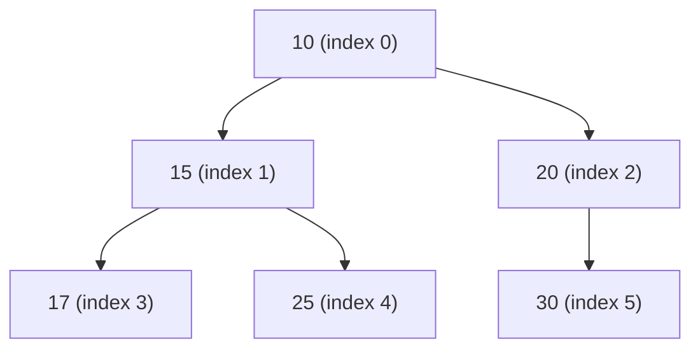

# Collections Framework - Sets, Queues & Utilities (In-Depth Masterclass)

## 1. Set Hierarchy & Implementations

A `Set` is a collection that models the mathematical set abstraction: **no duplicate elements** and at most **one null element** (implementation permitting).

```
                         Collection<E>
                              │
                           Set<E>
        ┌─────────────────────┼─────────────────────┐
        │                     │                     │
    HashSet<E>         LinkedHashSet<E>       SortedSet<E>
   (HashMap-backed)    (Insertion Order)            │
        │                                     NavigableSet<E>
    EnumSet<E>                                      │
   (Bit Vector)                                 TreeSet<E>
                                             (Red-Black Tree)
```

### Comprehensive Comparison Matrix

| Feature | `HashSet` | `LinkedHashSet` | `TreeSet` | `EnumSet` |
| :--- | :--- | :--- | :--- | :--- |
| **Backing Structure** | `HashMap` | `LinkedHashMap` | `TreeMap` (Red-Black Tree) | Bit-vector (`long` primitive or `long[]`) |
| **Ordering** | None (unpredictable) | Insertion Order | Sorted (Natural or `Comparator`) | Natural Enum declaration order |
| **Add / Remove / Contains** | **$O(1)$** average | **$O(1)$** average | **$O(\log n)$** | **$O(1)$** (single CPU bitwise op) |
| **Iteration Performance** | $O(\text{capacity} + \text{size})$ | **$O(\text{size})$** (via linked list) | $O(\text{size})$ | $O(\text{size})$ |
| **Null Allowed?** | ✅ Yes (max 1 null) | ✅ Yes (max 1 null) | ❌ No (with natural order, throws NPE) | ❌ No (throws NPE) |
| **Duplicate Determination** | `hashCode()` & `equals()` | `hashCode()` & `equals()` | `compareTo()` or `compare() == 0` | Bit index comparison |
| **Memory Consumption** | Moderate | Higher (extra doubly-linked nodes) | High (Tree nodes with 3 refs + color) | **Minimal** (single 64-bit primitive) |

---

## 2. Set Internals Deep Dive

### HashSet Internals
How does `HashSet` achieve uniqueness without re-implementing hashing? It delegates completely to a private `HashMap`:

```java
public class HashSet<E> extends AbstractSet<E> implements Set<E>, Cloneable, Serializable {
    private transient HashMap<E, Object> map;

    // Dummy value associated with every key in the backing Map
    private static final Object PRESENT = new Object();

    public HashSet() {
        map = new HashMap<>();
    }

    public boolean add(E e) {
        // If map already contained e, put() returns old value (PRESENT != null) -> returns false
        // If e is new, put() returns null -> returns true
        return map.put(e, PRESENT) == null;
    }

    public boolean contains(Object o) {
        return map.containsKey(o);
    }

    public boolean remove(Object o) {
        return map.remove(o) == PRESENT;
    }
}
```

### LinkedHashSet: Why Iteration is Faster than HashSet
`LinkedHashSet` extends `HashSet` and maintains a doubly-linked list running through all its entries.
- In `HashSet`, iterating requires traversing every single bucket in the array: $\text{Time} = O(\text{capacity} + \text{size})$. If initial capacity is 1,000,000 and size is 10, iterating visits 1,000,000 buckets!
- In `LinkedHashSet`, iteration traverses only the linked list pointers: $\text{Time} = O(\text{size})$.

### TreeSet & NavigableSet Internals
`TreeSet` delegates to a `NavigableMap` (specifically `TreeMap`).
- Elements are maintained in a self-balancing Red-Black binary search tree.
- **The Duplication Trap in TreeSet:** `TreeSet` does **NOT** use `equals()` to check for uniqueness. It uses `compareTo()` or `Comparator.compare()`.
  $$\text{If } compare(a, b) == 0\text{, then } a \text{ is considered equal to } b \text{ and will NOT be added!}$$
  If `compareTo` is inconsistent with `equals`, the set violates the general contract of `Set`.

#### NavigableSet API Methods
```java
NavigableSet<Integer> set = new TreeSet<>(List.of(10, 20, 30, 40, 50));

// Boundary Queries
set.first();          // 10
set.last();           // 50

// Proximity Queries
set.lower(30);        // 20 (strictly less than <)
set.floor(30);        // 30 (less than or equal <=)
set.ceiling(30);      // 30 (greater than or equal >=)
set.higher(30);       // 40 (strictly greater than >)

// Sub-range Views
set.subSet(20, true, 40, false); // [20, 30] (inclusive from, exclusive to)
set.headSet(30, true);           // [10, 20, 30]
set.tailSet(30, false);          // [40, 50]
set.descendingSet();             // Reverse-order view
```

### EnumSet: The Secret Weapon for Enums
When dealing with `enum` types, `EnumSet` is drastically superior to `HashSet`:
- **Under the hood:** Represented internally as a **bit-vector** (bit mask).
- **Two Implementations:**
  - `RegularEnumSet`: Used when the enum has $\le 64$ elements. The entire set is stored in a **single `long` primitive variable** (`long elements;`). An `add(e)` is literally `elements |= (1L << e.ordinal())`.
  - `JumboEnumSet`: Used when the enum has $> 64$ elements. Backed by a `long[]` array.
- Extremely cache-friendly, uses virtually zero memory, and bulk operations (`containsAll`, `retainAll`) run via single-cycle bitwise CPU instructions (`&`, `|`, `~`).
- Must be created via static factory methods:
```java
enum Day { MON, TUE, WED, THU, FRI, SAT, SUN }

EnumSet<Day> weekend = EnumSet.of(Day.SAT, Day.SUN);
EnumSet<Day> weekdays = EnumSet.complementOf(weekend);
EnumSet<Day> allDays = EnumSet.allOf(Day.class);
```

---

## 3. Queue & Deque Hierarchy & Mechanics

```
                         Collection<E>
                              │
                           Queue<E>
        ┌─────────────────────┼─────────────────────┐
        │                     │                     │
  PriorityQueue<E>        Deque<E>            BlockingQueue<E>
   (Binary Heap)              │               (Thread-Safe)
                     ┌────────┴────────┐
                     │                 │
                ArrayDeque<E>     LinkedList<E>
               (Circular Array)  (Doubly-Linked)
```

### Queue Method Dualities

The `Queue` interface provides two forms for every operation: one that throws an exception when the operation fails, and one that returns a special sentinel value (`null` or `false`).

| Operation | Throws Exception on Failure | Returns Sentinel on Failure | Description |
| :--- | :--- | :--- | :--- |
| **Insert** | `add(e)` (throws `IllegalStateException`) | `offer(e)` (returns `false`) | Insert at tail |
| **Remove** | `remove()` (throws `NoSuchElementException`) | `poll()` (returns `null`) | Retrieve and remove head |
| **Examine** | `element()` (throws `NoSuchElementException`) | `peek()` (returns `null`) | Retrieve without removing head |

---

## 4. PriorityQueue Internals: Binary Heap

`PriorityQueue` is an **unbounded priority queue** based on a **min-heap** by default (or custom `Comparator`).

### Array-Based Binary Heap Structure
```
Array representation: [10, 15, 20, 17, 25, 30]

For an element at index k:
- Left child:   2k + 1
- Right child:  2k + 2
- Parent:       (k - 1) >>> 1
```



### Key Operations & Time Complexity
- **`peek()`**: **$O(1)$** — always reads `queue[0]`.
- **`offer(e)`**: **$O(\log n)$** — appends to end of array and runs `siftUp(size, e)`.
- **`poll()`**: **$O(\log n)$** — removes `queue[0]`, moves the last element to `queue[0]`, and runs `siftDown(0, x)`.
- **`remove(Object o)`**: **$O(n)$** — linear scan to locate element, then $O(\log n)$ sift.
- **Heapify Construction (`new PriorityQueue<>(collection)`)**: **$O(n)$** (Floyd’s linear heap construction, not $O(n \log n)$!).

```java
// Sift-Up Implementation Snippet:
private void siftUpComparable(int k, E x) {
    Comparable<? super E> key = (Comparable<? super E>) x;
    while (k > 0) {
        int parent = (k - 1) >>> 1;
        Object e = queue[parent];
        if (key.compareTo((E) e) >= 0)
            break;
        queue[k] = e; // Push parent down
        k = parent;
    }
    queue[k] = key;
}
```

> **Warning:** Iterating over a `PriorityQueue` using an enhanced for-loop or `iterator()` does **NOT** guarantee sorted order! It yields elements in internal array heap order. To consume in priority order, you must repeatedly call `poll()`.

---

## 5. ArrayDeque Internals: Circular Array Buffer

`ArrayDeque` is a resizable-array implementation of the `Deque` (Double-Ended Queue) interface.

### Why ArrayDeque Beats Stack and LinkedList
1. **Vs `Stack`:** `java.util.Stack` extends `Vector`. Every method is `synchronized` (heavy lock contention), and it inherits array-index methods that violate strict LIFO stack semantics.
2. **Vs `LinkedList`:** `ArrayDeque` uses contiguous memory without allocating node objects. Zero pointer overhead, superior CPU cache line pre-fetching, and significantly lower garbage collection pressure.

### Circular Buffer Mechanics
```java
public class ArrayDeque<E> extends AbstractCollection<E>
        implements Deque<E>, Cloneable, Serializable {
    transient Object[] elements;
    transient int head;
    transient int tail;
}
```

- Capacity is **always a power of 2** (minimum default is 16).
- Wrapping around the boundaries uses lightning-fast bitwise masking:
  $$\text{nextTail} = (\text{tail} + 1) \ \& \ (\text{elements.length} - 1)$$
  $$\text{prevHead} = (\text{head} - 1) \ \& \ (\text{elements.length} - 1)$$
- When `head == tail`, the buffer is full. It resizes by doubling its capacity ($2x$) and copying elements so that `head` resets to index 0.
- **Strictly forbids `null` elements:** If you attempt `deque.add(null)`, it immediately throws `NullPointerException` (because `null` is the sentinel return value for `poll()` and `peek()`).

---

## 6. Comparable vs Comparator Deep Dive

### Contract & Rules

```
                Comparable<T>                              Comparator<T>
       ┌──────────────────────────────┐           ┌──────────────────────────────┐
       │ int compareTo(T o)           │           │ int compare(T o1, T o2)      │
       │ Implemented by domain entity │           │ Strategy pattern (decoupled) │
       │ Defines natural ordering     │           │ Multiple custom orderings    │
       └──────────────────────────────┘           └──────────────────────────────┘
```

### Mathematical Contract Requirements
1. **Antisymmetry:** $\text{sgn}(x.compareTo(y)) == -\text{sgn}(y.compareTo(x))$
2. **Transitivity:** If $x.compareTo(y) > 0$ and $y.compareTo(z) > 0$, then $x.compareTo(z) > 0$.
3. **Congruence:** If $x.compareTo(y) == 0$, then $\text{sgn}(x.compareTo(z)) == \text{sgn}(y.compareTo(z))$ for all $z$.
4. **Consistency with equals:** Strongly recommended that $(x.compareTo(y) == 0) == (x.equals(y))$.

### Modern Java 8+ Comparator Composition
```java
public class Employee {
    private String department;
    private String name;
    private int salary;
    // getters...
}

// Fluent Comparator Chaining:
Comparator<Employee> comparator = Comparator
    .comparing(Employee::getDepartment)                     // Primary sort
    .thenComparing(Employee::getSalary, Comparator.reverseOrder()) // Secondary: salary desc
    .thenComparing(Employee::getName, Comparator.nullsLast(String.CASE_INSENSITIVE_ORDER));

// Primitive Specializations (Avoid Autoboxing Overhead!):
Comparator<Employee> salaryComparator = Comparator.comparingInt(Employee::getSalary);
```

---

## 7. Collections Utility Class Master Guide

`java.util.Collections` consists exclusively of static methods that operate on or return collections.

### 1. View Wrappers vs True Immutables
- `Collections.unmodifiableList(originalList)` returns an unmodifiable **view**. If `originalList` is modified directly elsewhere, the change is reflected in the unmodifiable view!
- `List.of()` or `List.copyOf()` (Java 10+) creates a **deep, completely immutable snapshot**.

### 2. Synchronized Wrappers & Iteration Pitfall
```java
List<String> syncList = Collections.synchronizedList(new ArrayList<>());

// Single operations are thread-safe:
syncList.add("Item"); // Thread-safe (guarded by mutex)

// Compound operations & iteration are NOT atomic!
// ❌ FAILS with ConcurrentModificationException if another thread modifies:
for (String s : syncList) { ... } 

// ✅ MUST manually synchronize on the wrapper:
synchronized (syncList) {
    for (String s : syncList) {
        System.out.println(s);
    }
}
```

### 3. Binary Search Rules
```java
int index = Collections.binarySearch(list, key);
```
- List **MUST** be sorted beforehand according to the natural ordering (or supplied comparator).
- If the element is found, returns index $\ge 0$.
- If not found, returns $(-\text{insertionPoint} - 1)$ (a negative number).
  $$\text{insertionPoint} = -(\text{returnedIndex} + 1)$$
- Performance: $O(\log n)$ for `RandomAccess` lists (`ArrayList`), but $O(n)$ for `LinkedList` (due to sequential traversal).

---

## 8. Common Traps & Antipatterns

### ❌ Trap 1: Subtraction in `compareTo` / `compare` (Integer Overflow)
```java
// ❌ WRONG: Can overflow and invert the sign!
public int compare(Integer a, Integer b) {
    return a - b; 
    // If a = Integer.MIN_VALUE (-2,147,483,648) and b = 1
    // a - b = 2,147,483,647 (positive!), claiming MIN_VALUE > 1!
}

// ✅ CORRECT:
public int compare(Integer a, Integer b) {
    return Integer.compare(a, b);
}
```

### ❌ Trap 2: Mutating Objects Stored in a `HashSet` / `TreeSet`
```java
class User {
    String id;
    User(String id) { this.id = id; }
    // equals and hashCode based on id
}

Set<User> set = new HashSet<>();
User u = new User("101");
set.add(u);

u.id = "999"; // Mutated key field!

set.contains(u); // ❌ Returns FALSE! Looked up in bucket based on new hashCode!
set.remove(u);   // ❌ Cannot remove! Object is now a "ghost" leaked in the set!
```
> **Rule:** Never mutate fields that are used in `hashCode()`, `equals()`, or `compareTo()` after adding to a hashed or sorted collection. Make keys immutable!

### ❌ Trap 3: Inconsistent `compareTo` with `equals` in `TreeSet`
```java
class Product implements Comparable<Product> {
    int id;
    String name;
    public int compareTo(Product o) {
        return Integer.compare(this.id, o.id); // compares ONLY id
    }
    public boolean equals(Object o) { ... } // compares id AND name
}

Set<Product> set = new TreeSet<>();
set.add(new Product(1, "Laptop"));
set.add(new Product(1, "Phone")); // ❌ SILENTLY DROPPED! compareTo returns 0!
```

---

## 9. Senior / FAANG Interview Questions & Answers

### Q1: Why is `EnumSet` fundamentally faster and more memory-efficient than `HashSet`?
**Answer:**
`EnumSet` exploits the fact that the universe of keys is fixed and numbered ($0$ to $N-1$ via `ordinal()`). It stores set membership as bit flags inside a single 64-bit primitive `long` (`RegularEnumSet`) or an array of longs (`JumboEnumSet`).
- A `contains()` check is a single CPU bitwise AND operation: `(elements & (1L << ordinal)) != 0`.
- Memory is 8 bytes for the bitmask instead of hundreds of bytes for `HashMap` buckets and `Node` objects.
- It never undergoes rehashing, collisions, or linked-list / tree traversals.

### Q2: Why does `PriorityQueue` not preserve FIFO order for elements with equal priority?
**Answer:**
The binary heap algorithm only guarantees that parent nodes are $\le$ children nodes. When two elements have equal priority, their relative position depends purely on heap insertion and shifting order. To guarantee FIFO ordering among equal-priority items, you must attach a monotonic sequence counter to each item and break ties using that counter.

### Q3: What is the time complexity of building a `PriorityQueue` from an unsorted list of $N$ elements?
**Answer:**
It is **$O(N)$**, not $O(N \log N)$, when using the collection constructor `new PriorityQueue<>(list)`. It uses Floyd’s heap construction algorithm (`heapify()`), which calls `siftDown` starting from the lowest internal nodes $\lfloor N/2 \rfloor - 1$ up to index 0. The sum of heights across all nodes forms a convergent geometric series bounded by $2N$.

### Q4: Why does `ArrayDeque` prohibit `null` elements while `LinkedList` allows them?
**Answer:**
`Deque` methods like `poll()`, `pollFirst()`, `peek()`, and `peekFirst()` return `null` as a sentinel value to indicate that the deque is empty. If `null` were allowed as a legitimate element, `deque.poll()` returning `null` would be ambiguous: did it remove an actual `null` item, or was the queue empty? `LinkedList` permits `null` only for legacy backward compatibility.

### Q5: What is the difference between fail-fast and fail-safe iterators in Sets and Queues?
**Answer:**
- **Fail-Fast (`HashSet`, `TreeSet`, `ArrayDeque`, `PriorityQueue`):** Reads the collection directly. Maintains a `modCount`. Any structural modification during traversal causes the iterator to immediately throw `ConcurrentModificationException`.
- **Fail-Safe / Weakly Consistent (`ConcurrentSkipListSet`, `ConcurrentLinkedQueue`):** Operates on a snapshot or traverses the live structure safely using lock-free CAS operations. It never throws `ConcurrentModificationException`, reflects some or all modifications made after iterator construction, and does not clone the entire collection.

---

## 10. Quick Reference Summary Table

```
┌──────────────────┬─────────────────┬──────────┬──────────────┬────────────────────────┐
│ Collection Class │ Under-the-hood  │ Ordering │ Duplicates?  │ Typical Best Use Case  │
├──────────────────┼─────────────────┼──────────┼──────────────┼────────────────────────┤
│ HashSet          │ HashMap         │ None     │ No           │ General fast lookup    │
│ LinkedHashSet    │ LinkedHashMap   │ Insertion│ No           │ Predictable iteration  │
│ TreeSet          │ TreeMap (R-B)   │ Sorted   │ No           │ Range/ceiling queries  │
│ EnumSet          │ Bitmask (long)  │ Enum decl│ No           │ Sets of Enum constants │
│ PriorityQueue    │ Binary Min-Heap │ Priority │ Yes          │ Task scheduling, Top-K │
│ ArrayDeque       │ Circular Array  │ FIFO/LIFO│ Yes          │ High-speed Stack/Queue │
│ LinkedList       │ Doubly-Linked   │ FIFO/LIFO│ Yes          │ Heavy middle splices   │
└──────────────────┴─────────────────┴──────────┴──────────────┴────────────────────────┘
```
