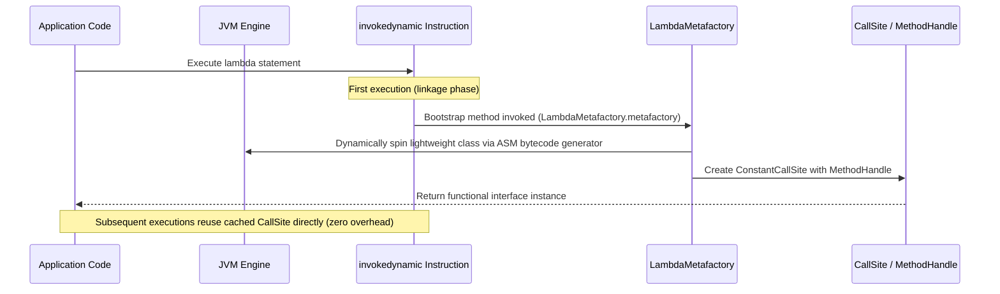

# Java 8 Features - Lambda & Functional Interfaces (In-Depth Masterclass)

## 1. Lambda Expressions: Philosophy & Syntax

A **Lambda Expression** represents an anonymous function: a concise block of executable logic that can be passed around as data and executed on demand.

### Syntax Rules
```java
// 1. Full syntax (explicit types, braces, return statement)
(int a, int b) -> { return a + b; }

// 2. Type inference (compiler infers types from target type context)
(a, b) -> a + b

// 3. Single parameter (parentheses are optional)
x -> x * x

// 4. Zero parameters (empty parentheses required)
() -> System.out.println("No arguments")

// 5. Multiple statements (curly braces and return statement required)
(str, threshold) -> {
    String cleaned = str.trim().toLowerCase();
    return cleaned.length() > threshold;
}
```

---

## 2. JVM Architecture: How Lambdas Actually Work (`invokedynamic`)

A foundational interview question is: **"Are Java lambdas just syntactic sugar for anonymous inner classes?"**
The answer is **NO**.

### Anonymous Inner Class vs Lambda Compilation

| Aspect | Anonymous Inner Class | Lambda Expression |
| :--- | :--- | :--- |
| **Bytecode Generation** | Generates a distinct `.class` file at compile-time (e.g., `Outer$1.class`) | **Zero extra `.class` files** generated |
| **Class Loading Cost** | Every class must be loaded, verified, and linked at startup | Lazily linked via `invokedynamic` at first execution |
| **Memory Allocation** | Creates a new object instance on heap every single time | JVM can optimize and reuse a singleton instance if no variables are captured |
| **`this` Reference Scope** | `this` refers to the **anonymous inner class instance** | `this` refers to the **enclosing class instance** (lexical scoping) |
| **Bytecode Opcode** | `new`, `dup`, `invokespecial` | **`invokedynamic`** (Indy) |

### The `invokedynamic` & `LambdaMetafactory` Pipeline



1. **Compile Time:** The Java compiler translates the lambda body into a `private static` (or `private instance` if capturing instance state) synthetic method inside the enclosing class (e.g., `lambda$process$0(...)`). It inserts an `invokedynamic` bytecode instruction pointing to `java.lang.invoke.LambdaMetafactory`.
2. **Runtime Linkage (Bootstrap):** The first time that code path runs, the JVM executes the bootstrap method. `LambdaMetafactory.metafactory` dynamically constructs an in-memory class implementing the functional interface via bytecode emission.
3. **Linkage Caching:** It binds this implementation to a `CallSite`. Future invocations bypass the bootstrap completely, executing as fast as a direct method invocation.

---

## 3. Variable Capture & Effectively Final Mechanics

A lambda can access variables from its enclosing scope under strict rules:
1. **Instance Variables & Static Fields:** Free read and write access (bound to heap).
2. **Local Variables (Method parameters or local declarations):** Must be **`final`** or **effectively final**.

### What Does "Effectively Final" Mean?
A variable is effectively final if its value is **never modified after initialization**, even if it lacks the explicit `final` keyword.

```java
int threshold = 10; // Not explicitly declared final
Runnable r = () -> System.out.println(threshold); // ✅ OK: effectively final

threshold = 20; // Mutated!
Runnable r2 = () -> System.out.println(threshold); 
// ❌ COMPILE ERROR: Variable used in lambda expression should be final or effectively final
```

### Why Does the JVM Forbid Mutating Local Variables?
**The Memory Lifecycle Dilemma (Stack vs Heap):**
- Local variables reside on the thread's **execution stack frame**. When the method returns, its stack frame is popped and destroyed.
- A lambda instance can escape the method (e.g., passed to another thread or stored in a field) and live on the **heap** indefinitely.
- If a lambda could modify a local variable, what would it modify after the stack frame is gone?
- Java resolves this by **copying the value** of the primitive or the reference pointer into the lambda instance at capture time. If the original local variable were allowed to mutate, the captured copy and the stack variable would diverge, creating catastrophic concurrency and consistency bugs.

```
Stack Frame (Destroyed on method return)       Heap (Survives indefinitely)
┌───────────────────────────────────────┐      ┌─────────────────────────────┐
│ local int x = 42;                    │ ───► │ Lambda Instance             │
│ (Popped when method exits)            │ copy │   captured_x = 42;          │
└───────────────────────────────────────┘      └─────────────────────────────┘
```

---

## 4. Standard Functional Interface Catalog (`java.util.function`)

A **Functional Interface** is an interface that declares **exactly one abstract method (SAM)**. It may contain any number of `default` or `static` methods.

### Core 4 Fundamental Interfaces

| Interface | Method Signature | Conceptual Role | Example Real-World Usage |
| :--- | :--- | :--- | :--- |
| **`Predicate<T>`** | `boolean test(T t)` | Evaluates a condition / filter | `list.removeIf(p)` |
| **`Function<T, R>`** | `R apply(T t)` | Transforms input of type T to type R | `stream.map(f)` |
| **`Consumer<T>`** | `void accept(T t)` | Consumes input, produces side effects | `list.forEach(c)` |
| **`Supplier<T>`** | `T get()` | Produces a value, takes zero inputs | `Optional.orElseGet(s)` |

### Bi-Specializations (Two Arguments)

| Interface | Method Signature | Equivalent To |
| :--- | :--- | :--- |
| `BiPredicate<T, U>` | `boolean test(T t, U u)` | Two-argument condition |
| `BiFunction<T, U, R>` | `R apply(T t, U u)` | Two-argument transformer |
| `BiConsumer<T, U>` | `void accept(T t, U u)` | Two-argument consumer (e.g. `Map.forEach`) |
| `UnaryOperator<T>` | `T apply(T t)` | Specialization of `Function<T, T>` (same input & output) |
| `BinaryOperator<T>` | `T apply(T t1, T t2)` | Specialization of `BiFunction<T, T, T>` |

### Primitive Specializations: Crucial for High Performance
Using `Function<Integer, Integer>` causes boxing of `int` $\to$ `Integer` on input and unboxing on output. In a stream of 10,000,000 numbers, this creates **10 million temporary objects**, triggering severe GC pauses.

```java
// ❌ BAD: Autoboxing overhead on every iteration
Function<Integer, Integer> square = x -> x * x;

// ✅ GOOD: Zero object allocations, operates directly on CPU registers
IntUnaryOperator squarePrimitive = x -> x * x;
```

#### Complete Primitive Interface Matrix
- **Predicates:** `IntPredicate`, `LongPredicate`, `DoublePredicate`
- **Consumers:** `IntConsumer`, `LongConsumer`, `DoubleConsumer`, `ObjIntConsumer<T>`, `ObjLongConsumer<T>`, `ObjDoubleConsumer<T>`
- **Suppliers:** `IntSupplier`, `LongSupplier`, `DoubleSupplier`, `BooleanSupplier`
- **Functions:**
  - Primitive to Object: `IntFunction<R>`, `LongFunction<R>`, `DoubleFunction<R>`
  - Object to Primitive: `ToIntFunction<T>`, `ToLongFunction<T>`, `ToDoubleFunction<T>`
  - Primitive to Primitive: `IntToLongFunction`, `IntToDoubleFunction`, `LongToIntFunction`, `LongToDoubleFunction`, `DoubleToIntFunction`, `DoubleToLongFunction`

---

## 5. Method References Deep Dive

Method references are compact, readable shorthands for lambdas that do nothing other than call an existing method.

### The 4 Distinct Forms

| Kind | Syntax | Lambda Equivalent | Example |
| :--- | :--- | :--- | :--- |
| **Reference to a static method** | `ContainingClass::staticMethodName` | `(args) -> ContainingClass.staticMethodName(args)` | `Math::abs` $\to$ `x -> Math.abs(x)` |
| **Reference to an instance method of a particular object** | `containingObject::instanceMethodName` | `(args) -> containingObject.instanceMethodName(args)` | `System.out::println` $\to$ `x -> System.out.println(x)` |
| **Reference to an instance method of an arbitrary object of a particular type** | `ContainingType::methodName` | `(target, args) -> target.methodName(args)` | `String::compareToIgnoreCase` $\to$ `(s1, s2) -> s1.compareToIgnoreCase(s2)` |
| **Reference to a constructor** | `ClassName::new` | `(args) -> new ClassName(args)` | `ArrayList::new` $\to$ `() -> new ArrayList<>()` |

> **Interview Trick Question:** How does the compiler distinguish between kind 1 (`ClassName::staticMethod`) and kind 3 (`ClassName::instanceMethod`)?
> **Answer:** It checks whether the target method is declared `static` or instance in `ClassName`. If instance, the first parameter of the functional interface becomes the **receiver (`this`)** on which the method is called.

---

## 6. Interface Evolution: Default & Static Methods

Java 8 introduced `default` and `static` methods to allow existing interfaces (like `Collection` and `List`) to be enhanced with new methods (like `stream()`, `removeIf()`, `sort()`) **without breaking binary backward compatibility** with legacy implementations.

### The Diamond Problem Resolution Rules
When a class implements multiple interfaces that provide conflicting `default` method signatures, Java resolves conflicts using three strict rules:

1. **Rule 1: Class always wins:** A method declaration in a class or a superclass takes priority over ANY default method declared in any interface.
2. **Rule 2: Most specific interface wins:** If interface `B` extends interface `A`, and both provide a default method `hello()`, then `B` is more specific, so `B.hello()` is chosen.
3. **Rule 3: Explicit conflict resolution:** If neither interface is more specific (disjoint interfaces), the code **fails to compile**. The implementing class must explicitly override the method and resolve the ambiguity:

```java
interface Left {
    default void greet() { System.out.println("Left"); }
}

interface Right {
    default void greet() { System.out.println("Right"); }
}

class ConflictResolver implements Left, Right {
    @Override
    public void greet() {
        // Explicitly disambiguate using InterfaceName.super:
        Left.super.greet(); 
    }
}
```

### Static Methods in Interfaces
- Static methods in interfaces are **not inherited** by implementing classes or sub-interfaces!
- Must be invoked explicitly via the interface name: `InterfaceName.staticMethod()`.

---

## 7. Handling Checked Exceptions in Lambdas

Standard functional interfaces (`Function`, `Consumer`, etc.) **do not declare checked exceptions** in their method signatures.

```java
// ❌ FAILS TO COMPILE: unhandled IOException
List<String> lines = filePaths.stream()
    .map(path -> Files.readString(Path.of(path))) 
    .toList();
```

### 3 Production Strategies

#### Strategy 1: Explicit Try-Catch Wrapper (Standard)
```java
List<String> lines = filePaths.stream()
    .map(path -> {
        try {
            return Files.readString(Path.of(path));
        } catch (IOException e) {
            throw new UncheckedIOException(e);
        }
    })
    .toList();
```

#### Strategy 2: Generic Throwing Function Utility
```java
@FunctionalInterface
public interface ThrowingFunction<T, R, E extends Throwable> {
    R apply(T t) throws E;

    static <T, R> Function<T, R> unchecked(ThrowingFunction<T, R, ?> f) {
        return t -> {
            try {
                return f.apply(t);
            } catch (Throwable e) {
                throw new RuntimeException(e);
            }
        };
    }
}

// Usage:
List<String> lines = filePaths.stream()
    .map(ThrowingFunction.unchecked(path -> Files.readString(Path.of(path))))
    .toList();
```

#### Strategy 3: Sneaky Throws (Type Erasure Bypass)
```java
public class SneakyThrows {
    @SuppressWarnings("unchecked")
    public static <E extends Throwable> void sneakyThrow(Throwable e) throws E {
        throw (E) e; // Erased to RuntimeException at compile time!
    }
}
```

---

## 8. Common Traps & Antipatterns

### ❌ Trap 1: Mutating Shared State Inside Lambdas (Concurrency Hazard)
```java
// ❌ DANGEROUS: Race condition when executed in parallel
List<Integer> result = new ArrayList<>();
numbers.parallelStream().forEach(n -> result.add(n)); // ArrayList is not thread-safe!

// ✅ CORRECT: Use functional collection
List<Integer> result = numbers.parallelStream().toList();
```

### ❌ Trap 2: Using Lambdas for Heavy Reusable Business Logic
Lambdas lack descriptive method names and cannot be easily unit tested in isolation. For complex logic, extract to a well-tested, named helper method and reference it via `Class::methodName`.

### ❌ Trap 3: Capturing Mutated Reference Fields
```java
class Counter { int val = 0; }
Counter c = new Counter();
Runnable r = () -> System.out.println(c.val);
c.val = 10;
r.run(); // Prints 10, NOT 0! The reference `c` was final, but the referenced object was mutated!
```

---

## 9. Senior / FAANG Interview Questions & Answers

### Q1: Why can't a lambda expression implement multiple interfaces directly?
**Answer:**
A lambda expression relies on **target-typing context**; the compiler must determine the exact functional interface type from the assignment target, parameter type, or return type. A lambda does not declare a type name. If you need an instance that implements multiple interfaces, use an explicit class, an anonymous class, or an intersection cast:
```java
Runnable r = (Runnable & Serializable) () -> System.out.println("Serializable lambda");
```

### Q2: What is the exact difference between `this` in a lambda vs `this` in an anonymous class?
**Answer:**
- In an anonymous inner class, `this` refers to the **instance of the anonymous class itself**. Any reference to enclosing fields requires `EnclosingClass.this.field`.
- In a lambda expression, `this` is **lexically scoped**; it refers to the instance of the enclosing class where the lambda is defined. Lambdas introduce no new scope for `this`.

### Q3: How does `LambdaMetafactory` optimize stateless lambdas?
**Answer:**
If a lambda expression captures no local variables and no instance fields (`this`), the synthetic class generated by `LambdaMetafactory` initializes a `private static final` singleton instance of itself. Subsequent invocations reuse this identical instance from the static constant pool, resulting in **zero heap allocations** per call.

### Q4: Can a functional interface extend another interface with abstract methods?
**Answer:**
Only if the child interface inherits or declares exactly **one non-Object abstract method**. If the parent has one abstract method and the child declares a second distinct abstract method, it is no longer a functional interface. However, declaring abstract methods that override public methods of `java.lang.Object` (such as `boolean equals(Object obj)`) does **not** count toward the single abstract method total.

---

## 10. Summary Cheat Sheet

```
┌─────────────────────────────────┬────────────────────────────────────────────┐
│ Concept                         │ Key Rule / Detail                          │
├─────────────────────────────────┼────────────────────────────────────────────┤
│ Under the Hood Bytecode         │ invokedynamic + LambdaMetafactory          │
│ Scoping of `this`               │ Lexical (refers to enclosing class)        │
│ Captured Local Variables        │ Must be final or effectively final         │
│ Core Functional Interfaces      │ Predicate, Function, Consumer, Supplier    │
│ Diamond Inheritance Rule        │ 1. Class wins 2. Sub-interface wins 3. Manual override │
│ Performance Trap                │ Boxing overhead with generic Function<T,R> │
└─────────────────────────────────┴────────────────────────────────────────────┘
```
