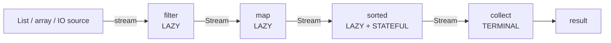
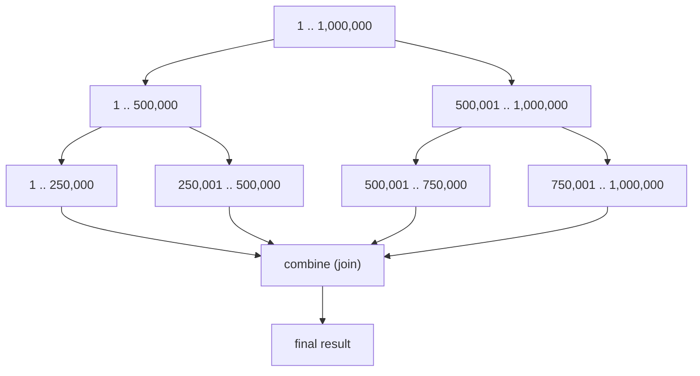
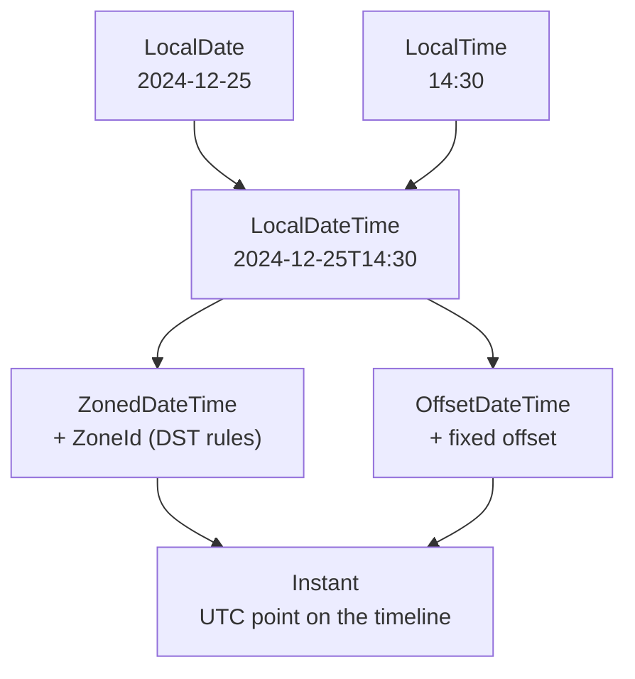
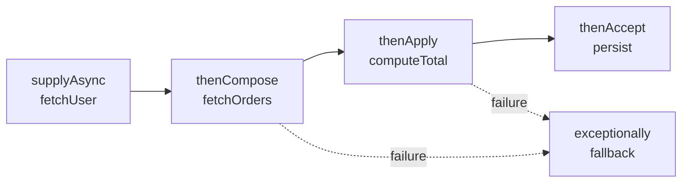

# Java 8 — 50 Most Asked Interview Questions, Explained

> **Level:** Beginner → Expert (every question carries its own difficulty badge)
> **Interview Frequency:** ★★★★★ — Java 8 concepts appear in roughly 9 out of 10 backend interviews,
> even when the job advertises Java 21.
> **Prerequisite:** [01 · Lambda & Functional Interfaces](01-Lambda-Functional-Interfaces.md)
> **Last Updated:** 2026
> **Verified:** every snippet below was compiled with `javac --release 8` and executed.
> The `Output:` blocks are captured from real runs, not hand-written.

---

## Why this document exists

Java 8 (March 2014) was the largest change to the Java language since its creation. It added
**functional programming** (lambdas, streams), a **new date/time library**, **default methods**
and a **new JVM memory model** (Metaspace).

Interviewers still ask about it because:

1. **Almost all production Java code is written in Java 8 style** — even on Java 21 runtimes,
   the *idioms* are Java 8 idioms.
2. **It is where senior judgment is tested.** Anyone can call `.stream()`. The differentiator is
   knowing *when not to*, *why parallel is usually slower*, and *what happens under the hood*.
3. **It is a gateway topic.** A question about `Optional` quickly becomes a question about null
   safety, API design, and `CompletableFuture` — which becomes concurrency and thread pools.

This document is not a feature catalogue. It is **50 questions with the follow-up the interviewer
will actually ask**, each backed by theory, a diagram, verified code, and the trap.

---

## How to answer — the four-layer ladder

Interviewers score answers in layers. Most candidates stop at layer 2.

```text
  Layer 4  PRODUCTION SCAR   "We hit this in prod: parallelStream on blocking IO
                             starved the common pool, so we moved to a dedicated pool."
                             ── separates principal from senior
  Layer 3  TRADE-OFF         "Streams win on readability; the loop wins on allocation
                             and supports break/continue. I choose by hot path."
                             ── separates senior from mid
  Layer 2  MECHANISM         "Streams are lazy; intermediate ops build a pipeline of
                             Sinks, and nothing runs until a terminal op is invoked."
                             ── separates mid from junior
  Layer 1  DEFINITION        "A Stream is a sequence of elements supporting
                             aggregate operations."
                             ── every candidate has this
```

**Use this structure for every answer:**

| Step | Sentence pattern | Time |
|---|---|---|
| 1 | "`X` is …" — the definition | 10 s |
| 2 | "It exists because …" — the problem | 15 s |
| 3 | "Internally it …" — the mechanism | 20 s |
| 4 | "The trade-off is …" — judgment | 20 s |
| 5 | "In production I'd …" — experience | 15 s |

---

## Difficulty legend

| Badge | Level | Typical ask |
|---|---|---|
| 🟢 | Beginner | Screening round, 1–2 years |
| 🟡 | Intermediate | Main technical round, 3–5 years |
| 🔴 | Advanced | Senior round, 5–8 years |
| ⚫ | Expert | Principal / architect, or a "make them sweat" follow-up |

Frequency: ★★★★★ = asked in nearly every interview · ★★☆☆☆ = niche but memorable.

---

## 📋 Table of Contents

- [Part 1 · Language & Lambda — Q1–Q10](#part-1--language--lambda--q1q10)
  - [Q1. What are the major features introduced in Java 8?](#q1-what-are-the-major-features-introduced-in-java-8)
  - [Q2. What is a lambda expression, and why was it added?](#q2-what-is-a-lambda-expression-and-why-was-it-added)
  - [Q3. What is a functional interface? What are the exact rules?](#q3-what-is-a-functional-interface-what-are-the-exact-rules)
  - [Q4. Is `@FunctionalInterface` mandatory?](#q4-is-functionalinterface-mandatory)
  - [Q5. Why must a lambda capture only effectively-final variables?](#q5-why-must-a-lambda-capture-only-effectively-final-variables)
  - [Q6. What is `this` inside a lambda, versus an anonymous class?](#q6-what-is-this-inside-a-lambda-versus-an-anonymous-class)
  - [Q7. What are the four kinds of method reference?](#q7-what-are-the-four-kinds-of-method-reference)
  - [Q8. How do constructor references work, and what is the overload-resolution gotcha?](#q8-how-do-constructor-references-work-and-what-is-the-overload-resolution-gotcha)
  - [Q9. What are default methods, and why were they necessary?](#q9-what-are-default-methods-and-why-were-they-necessary)
  - [Q10. How is the default-method diamond resolved?](#q10-how-is-the-default-method-diamond-resolved)
- [Part 2 · `java.util.function` & Composition — Q11–Q16](#part-2--javautilfunction--composition--q11q16)
  - [Q11. Which functional interfaces are built in?](#q11-which-functional-interfaces-are-built-in)
  - [Q12. Predicate vs Function vs Supplier vs Consumer — how do you choose?](#q12-predicate-vs-function-vs-supplier-vs-consumer--how-do-you-choose)
  - [Q13. Why do primitive specialisations exist, and when do they matter?](#q13-why-do-primitive-specialisations-exist-and-when-do-they-matter)
  - [Q14. What are `BiFunction`, `UnaryOperator` and `BinaryOperator`?](#q14-what-are-bifunction-unaryoperator-and-binaryoperator)
  - [Q15. How does function composition work — `andThen`, `compose`, `and`, `or`, `negate`?](#q15-how-does-function-composition-work--andthen-compose-and-or-negate)
  - [Q16. How did `Comparator` improve in Java 8?](#q16-how-did-comparator-improve-in-java-8)
- [Part 3 · Stream API — Q17–Q29](#part-3--stream-api--q17q29)
  - [Q17. What is a Stream, and how is it different from a Collection?](#q17-what-is-a-stream-and-how-is-it-different-from-a-collection)
  - [Q18. What is the difference between intermediate and terminal operations?](#q18-what-is-the-difference-between-intermediate-and-terminal-operations)
  - [Q19. What is lazy evaluation, and why does it matter?](#q19-what-is-lazy-evaluation-and-why-does-it-matter)
  - [Q20. What is the difference between `map` and `flatMap`?](#q20-what-is-the-difference-between-map-and-flatmap)
  - [Q21. How does `reduce` work, and what are its three forms?](#q21-how-does-reduce-work-and-what-are-its-three-forms)
  - [Q22. What is the difference between `collect` and `reduce`?](#q22-what-is-the-difference-between-collect-and-reduce)
  - [Q23. Why does `Collectors.toMap` throw on duplicate keys, and how do you fix it?](#q23-why-does-collectorstomap-throw-on-duplicate-keys-and-how-do-you-fix-it)
  - [Q24. `groupingBy` vs `partitioningBy` — what is the difference?](#q24-groupingby-vs-partitioningby--what-is-the-difference)
  - [Q25. How do `joining`, `counting`, `summingInt` and `averagingInt` work?](#q25-how-do-joining-counting-summingint-and-averagingint-work)
  - [Q26. What are stateful versus stateless stream operations?](#q26-what-are-stateful-versus-stateless-stream-operations)
  - [Q27. Why can't a Stream be reused?](#q27-why-cant-a-stream-be-reused)
  - [Q28. What are infinite streams and primitive streams?](#q28-what-are-infinite-streams-and-primitive-streams)
  - [Q29. Is `parallelStream()` always faster? How does it actually work?](#q29-is-parallelstream-always-faster-how-does-it-actually-work)
- [Part 4 · Optional — Q30–Q34](#part-4--optional--q30q34)
  - [Q30. Why was `Optional` introduced, and what problem does it solve?](#q30-why-was-optional-introduced-and-what-problem-does-it-solve)
  - [Q31. `Optional.of` vs `ofNullable` vs `empty` — and what breaks?](#q31-optionalof-vs-ofnullable-vs-empty--and-what-breaks)
  - [Q32. `orElse` vs `orElseGet` vs `orElseThrow` — what is the difference?](#q32-orelse-vs-orelseget-vs-orelsethrow--what-is-the-difference)
  - [Q33. How do `map`, `flatMap`, `filter` and `ifPresent` work on `Optional`?](#q33-how-do-map-flatmap-filter-and-ifpresent-work-on-optional)
  - [Q34. Where should you *not* use `Optional`?](#q34-where-should-you-not-use-optional)
- [Part 5 · Date & Time API — Q35–Q39](#part-5--date--time-api--q35q39)
  - [Q35. What was wrong with `java.util.Date` and `Calendar`?](#q35-what-was-wrong-with-javautildate-and-calendar)
  - [Q36. `LocalDate` vs `LocalDateTime` vs `ZonedDateTime` vs `Instant` — which one?](#q36-localdate-vs-localdatetime-vs-zoneddatetime-vs-instant--which-one)
  - [Q37. `Period` vs `Duration` — what is the difference?](#q37-period-vs-duration--what-is-the-difference)
  - [Q38. How does `DateTimeFormatter` work, and why is it thread-safe?](#q38-how-does-datetimeformatter-work-and-why-is-it-thread-safe)
  - [Q39. How do you handle time zones and DST correctly?](#q39-how-do-you-handle-time-zones-and-dst-correctly)
- [Part 6 · Concurrency — Q40–Q44](#part-6--concurrency--q40q44)
  - [Q40. `Future` vs `CompletableFuture` — what did Java 8 add?](#q40-future-vs-completablefuture--what-did-java-8-add)
  - [Q41. `thenApply` vs `thenCompose` vs `thenCombine` — when do you use each?](#q41-thenapply-vs-thencompose-vs-thencombine--when-do-you-use-each)
  - [Q42. How does `CompletableFuture` handle exceptions?](#q42-how-does-completablefuture-handle-exceptions)
  - [Q43. What thread pool does `CompletableFuture` use by default, and why is that risky?](#q43-what-thread-pool-does-completablefuture-use-by-default-and-why-is-that-risky)
  - [Q44. What other concurrency improvements came with Java 8?](#q44-what-other-concurrency-improvements-came-with-java-8)
- [Part 7 · JVM & Platform — Q45–Q48](#part-7--jvm--platform--q45q48)
  - [Q45. Why was PermGen replaced by Metaspace?](#q45-why-was-permgen-replaced-by-metaspace)
  - [Q46. What are `Base64`, `StringJoiner` and `Arrays.parallelSort`?](#q46-what-are-base64-stringjoiner-and-arraysparallelsort)
  - [Q47. What are Nashorn, type annotations and repeating annotations?](#q47-what-are-nashorn-type-annotations-and-repeating-annotations)
  - [Q48. What `Map`/`Collection` default methods were added, and what are the pitfalls?](#q48-what-mapcollection-default-methods-were-added-and-what-are-the-pitfalls)
- [Part 8 · Design & Production — Q49–Q50](#part-8--design--production--q49q50)
  - [Q49. Streams or loops — how do you actually choose?](#q49-streams-or-loops--how-do-you-actually-choose)
  - [Q50. What are the most common Java 8 production anti-patterns?](#q50-what-are-the-most-common-java-8-production-anti-patterns)
- [🧾 One-Page Cheat Sheet](#-one-page-cheat-sheet)
- [📇 All 50 Answers at a Glance](#-all-50-answers-at-a-glance)
- [🪤 Top 15 Traps](#-top-15-traps)
- [🗓️ 7-Day Study Plan](#-7-day-study-plan)
- [🎤 If You Don't Know the Answer](#-if-you-dont-know-the-answer)
- [🔗 Where to Go Next](#-where-to-go-next)

---

## 🎯 How to Use This Document

**If the interview is tomorrow:** read §One-Page Cheat Sheet, then the 🎯 line of all 50 questions
(20 minutes), then the Top 15 Traps (10 minutes).

**If you have a week:** follow the [7-Day Study Plan](#-7-day-study-plan) at the end.

**If you are drilling coding rounds:** focus on Q17–Q29 (Streams) and Q16 (Comparator). Those are
where a live-coding task usually lands.

**Reading a question:** each one has the same six parts.

```text
  ### Q12. Predicate vs Function vs Supplier vs Consumer          🟡 ★★★★★
        ▲                                                         ▲   ▲
        └── question + badge ─────────────────────────────────────┘   │
                                                                      └── frequency

  🎯 Say this first   → the 10-second answer
  📖 Why / theory     → the mechanism an interviewer probes
  💻 Code             → compiles, with real Output
  📊 Visual           → ASCII or Mermaid diagram
  ⚠️ Follow-up trap   → the next question they will ask
  🧠 Hook             → one line to remember it by
```

---
## Part 1 · Language & Lambda — Q1–Q10

---

### Q1. What are the major features introduced in Java 8?

**🟢 ★★★★★**

**🎯 Say this first:** Java 8 delivered four headline changes: **lambda expressions and the Stream
API**, **default/static methods in interfaces**, the **`java.time` date-time library**, and the
**removal of PermGen in favour of Metaspace**. Everything else hangs off those four.

**📖 Why / theory.** Java 8 was a response to a decade of complaints:

- Java was **verbose** — a one-line sort required a six-line anonymous class.
- Java had **no bulk data operations** — every filter/group needed an explicit loop.
- `java.util.Date` was **mutable and broken** (`Calendar.MONTH` is 0-based; `SimpleDateFormat`
  is not thread-safe).
- `PermGen` caused the infamous `OutOfMemoryError: PermGen space` on every redeploy.

Grouped by layer:

| Layer | Features |
|---|---|
| **Language** | Lambda expressions · Method references · `default` + `static` interface methods · Type annotations (JSR 308) · Repeating annotations · Improved target-type inference (incl. diamond with anonymous classes) · `@FunctionalInterface` |
| **Library** | Stream API (`java.util.stream`) · `java.util.function` · `Optional` · `java.time` (JSR 310) · `CompletableFuture` · `java.util.Base64` · `StringJoiner` · `String.join` · `Comparator.comparing`/`thenComparing` · `Arrays.parallelSort` · `LongAdder`/`LongAccumulator`/`StampedLock` |
| **Collections** | `Collection.forEach`, `removeIf`, `stream`, `parallelStream`, `spliterator` · `Map.getOrDefault`, `putIfAbsent`, `compute`, `computeIfAbsent`, `computeIfPresent`, `merge`, `replaceAll`, `forEach` |
| **JVM** | **PermGen removed → Metaspace** · `invokedynamic`-based lambda linkage · interface default-method dispatch |
| **Tooling** | `jjs` (Nashorn REPL) · `jdeps` · `-parameters` for runtime parameter names |

**📊 Visual — where Java 8 sits in the timeline:**

```text
 2004        2014                2017        2018        2021        2023
  │           │                   │           │           │           │
 Java 5      Java 8              Java 9      Java 11     Java 17     Java 21
  │           │                   │           │           │           │
 Generics    LAMBDAS             Modules     LTS         LTS         LTS
 Enums       STREAMS             Jigsaw      var         Records     Virtual
 Annotations java.time           JShell      HttpClient  Sealed      Threads
             Optional            G1 default  ZGC         Pattern     Pattern
             Metaspace                       (exp.)      matching    matching
  │           │                   │           │           │           │
  └───────────┴─── Java 8 is the ─┴───────────┴───────────┴───────────┘
                  stylistic baseline:
                  even Java 21 code is
                  written in Java 8 idioms
```

*Read it as: Java 8 changed how Java is **written**; 9–21 changed how it is **packaged and run**.*

**⚠️ Follow-up trap:** *"Which of those would you actually use day to day?"*
A weak answer lists all of them. A strong answer ranks them: **Streams + `Optional` + `java.time`
are daily**; `Nashorn` is dead (removed in JDK 15); `Base64`/`StringJoiner` are situational;
**Metaspace matters when you operate the JVM**, not when you write code.

**🧠 Hook:** *"Lambdas changed the syntax, Streams changed the style, `java.time` changed the
correctness, Metaspace changed the ops."*

---

### Q2. What is a lambda expression, and why was it added?

**🟢 ★★★★★**

**🎯 Say this first:** A lambda is an **anonymous function** that provides an implementation of a
**functional interface**. It was added so behaviour could be passed as a value — which is what
enables the Stream API.

**📖 Why / theory.** Before Java 8, "passing behaviour" meant an anonymous inner class:

```java
// Java 7 — 6 lines to express "sort by age"
Collections.sort(people, new Comparator<Person>() {
    @Override
    public int compare(Person a, Person b) {
        return a.getAge() - b.getAge();   // NOTE: silently overflows for huge ages
    }
});

// Java 8 — 1 line
people.sort(Comparator.comparingInt(Person::getAge));
```

Notice the Java 7 version also hides a **subtraction overflow bug**. The lambda version cannot
have it, because `comparingInt` does the comparison safely. This is a real interview point:
*conciseness is not the only benefit — the standard factories remove whole bug classes.*

**The critical mechanism — lambdas are `invokedynamic`, not anonymous classes.** This is the
number-one senior follow-up. `javac` does **not** emit a `Foo$1.class` for a lambda. It emits a
single `invokedynamic` call site:

```text
   Source                        Bytecode                          Runtime (first call)
   ──────                        ────────                          ─────────────────────
   s -> s.length()  ──javac──▶   invokedynamic #7                  LambdaMetafactory
                                   :apply                            .metafactory(...)
                                   ()Ljava/util/function/                 │
                                   Function;                              ▼
                                                                    generates a hidden
                                                                    class implementing
                                                                    Function, then
                                                                    links the call site
                                                                    (subsequent calls are
                                                                     near-direct)
```

*Read it as: `javac` writes no lambda body class; the JVM synthesises the class on first execution.*

Consequences worth stating out loud:

| Property | Lambda | Anonymous class |
|---|---|---|
| Class file | **None** (runtime-generated, hidden) | `Outer$1.class` |
| `this` | **Enclosing instance** | The anonymous instance |
| Fields | Cannot declare instance state | Can declare fields |
| Shadowing | Cannot shadow a local variable | Can |
| Non-capturing instances | **Cached** — one instance reused | New object each `new` |
| Capturing instances | Allocated per evaluation | Allocated per `new` |

**💻 Code:**

```java
import java.util.*;
import java.util.function.*;

public class LambdaBasics {
    public static void main(String[] args) {
        // 0 params
        Supplier<String> greeting = () -> "hello";

        // 1 param — parentheses optional, type inferred
        Function<String, Integer> len = s -> s.length();

        // 2 params
        BinaryOperator<Integer> add = (a, b) -> a + b;

        // block body — needs explicit return
        Function<Integer, Integer> abs = n -> {
            if (n >= 0) return n;
            return -n;
        };

        System.out.println(greeting.get());
        System.out.println(len.apply("java8"));
        System.out.println(add.apply(20, 22));
        System.out.println(abs.apply(-7));
    }
}
```

**Output (verified):**

```text
hello
5
42
7
```

**📊 Visual — what "target typing" means.** A lambda has no type until the compiler knows the
target. The *same* lambda text can become different interfaces:

```text
                 ┌──────────────────────────────┐
   () -> "hi" ───┤ target type decides the shape├───▶ Supplier<String>
                 └──────────────────────────────┘
                            │
                            ├──▶ Callable<String>      (allows checked exception)
                            └──▶ MyFactory<String>     (any SAM with 0 args)

   Compiler asks: "what is the single abstract method of the target type?"
   If it matches the lambda's parameter count → OK.  Otherwise → compile error.
```

*Read it as: the lambda is a **poly expression**; its type is inferred from context, which is why
`var f = () -> 1;` does not compile.*

**⚠️ Follow-up trap:** *"So is a lambda an object?"*
Yes — evaluating a lambda expression produces an instance of a class implementing the target
interface (or a cached instance if it captures nothing). But there is **no source-level class**
and you cannot call `getClass()` on "the lambda" conceptually — `f.getClass()` works, but the name
is synthetic like `LambdaBasics$$Lambda$14/0x0000...`. Do not rely on it.

**🧠 Hook:** *"A lambda is behaviour without a name; `invokedynamic` is how it gets a body."*

---

### Q3. What is a functional interface? What are the exact rules?

**🟢 ★★★★★**

**🎯 Say this first:** A functional interface is an interface with **exactly one abstract
method** (a SAM — single abstract method). It may also have any number of `default` and `static`
methods, and it may redeclare `Object`'s public methods.

**📖 Why / theory.** The SAM rule is what makes a lambda unambiguous: if there is exactly one
abstract method, the compiler knows precisely which method the lambda body implements.

The rule in full:

1. Exactly **one** abstract method.
2. `default` methods **do not** count.
3. `static` methods **do not** count.
4. `private` interface methods (Java 9+) **do not** count.
5. **Public methods of `Object`** (`equals`, `hashCode`, `toString`) declared in the interface
   **do not** count — they are inherited, not abstract-new.
6. Fields are still implicitly `public static final`.

**💻 Code — the anatomy:**

```java
@FunctionalInterface
public interface PaymentValidator {

    boolean isValid(Payment p);              // ← the ONE abstract method (the SAM)

    default String currency() {              // ← default: does not count
        return "USD";
    }

    static PaymentValidator acceptAll() {    // ← static: does not count
        return p -> true;
    }

    boolean equals(Object o);                // ← Object method: does not count

    // A minimal value type, only so this snippet compiles standalone.
    // Interfaces may declare nested classes; they are implicitly static.
    final class Payment {
        private final int amount;
        Payment(int amount) { this.amount = amount; }
        int getAmount() { return amount; }
    }
}
```

Usage is a plain lambda:

```java
PaymentValidator positive = p -> p.getAmount() > 0;
System.out.println(positive.isValid(new PaymentValidator.Payment(10)));
System.out.println(positive.currency());
```

(`Payment` is nested inside `PaymentValidator` above only so that snippet stands alone — in a real
codebase it would be its own top-level class, and you would write `new Payment(10)`.)

**📊 Visual — what counts toward the SAM:**

```text
   interface MyFi {
       void a();                     ✅ abstract  → counts  (1)
       default void b() {}           ❌ default   → ignored
       static void c() {}            ❌ static    → ignored
       private void d() {}           ❌ private   → ignored   (Java 9+)
       boolean equals(Object o);     ❌ Object    → ignored
       int hashCode();               ❌ Object    → ignored
       String toString();            ❌ Object    → ignored
   }
   ─────────────────────────────────────────────────────────
   SAM count = 1  ✅  functional interface
   SAM count = 0  ❌  NOT functional (e.g. a marker interface)
   SAM count = 2  ❌  NOT functional → lambda cannot target it
```

*Read it as: only genuinely-new abstract contracts count. Object methods are already implemented
by every class, so they add no obligation.*

**⚠️ Follow-up trap:** *"Is `Runnable` a functional interface? Is `Comparator`?"*
Both are. `Comparator` is the favourite trick because it declares `equals(Object)` — a candidate
who says "it has two abstract methods" is wrong; `equals` is inherited from `Object` and therefore
ignored. `Runnable` has one (`run`). `Callable` has one (`call`) but allows a checked exception,
which is exactly why it is *not* interchangeable with `Supplier` in `CompletableFuture` APIs.

**🧠 Hook:** *"One new abstract method, Object's methods don't count."*

---

### Q4. Is `@FunctionalInterface` mandatory?

**🟡 ★★★★☆**

**🎯 Say this first:** No. It is a **compiler hint**, not a requirement. The SAM rule is enforced
by `javac` regardless. The annotation's only job is to make the *interface author's* intent
checked at the declaration site.

**📖 Why / theory.** Two different things are often confused:

| Check | Enforced by | When |
|---|---|---|
| "Can this type be a lambda target?" | `javac`, always | At the **use** site |
| "Is this interface *allowed* to be functional?" | `@FunctionalInterface` | At the **declaration** site |

Without the annotation, an accidental second abstract method is only discovered later, at some
call site, with a confusing message. With it, the error points at the interface itself.

**💻 Code — the annotation catches the mistake early:**

```java
@FunctionalInterface
interface Transformer {
    String apply(String s);
    String revert(String s);   // ← compile error HERE, not at the call site
}
```

```text
error: Unexpected @FunctionalInterface annotation
  Transformer is not a functional interface
    multiple non-overriding abstract methods found in interface Transformer
```

Without the annotation, the same interface compiles fine — and the failure appears only when
someone tries `Transformer t = s -> s;`.

**⚠️ Follow-up trap:** *"So what is `@FunctionalInterface` actually for — documentation?"*
Not merely. It is a **contract guard**: it turns a semantic requirement into a compile-time
invariant. It also signals intent to API consumers and IDE autocomplete. Best practice:
annotate **every** interface you *intend* to be used with lambdas — including your own domain
callbacks.

**🧠 Hook:** *"The annotation doesn't create the functional interface; it locks the door so nobody
adds a second abstract method later."*

---

### Q5. Why must a lambda capture only effectively-final variables?

**🔴 ★★★★★**

**🎯 Say this first:** Because a lambda captures the **value**, not the **variable**. If the
variable could change afterwards, the lambda would hold a stale copy and the program's meaning
would become incoherent — so the compiler forbids mutation.

**📖 Why / theory.** Java has **no closures over mutable state**. A local variable lives on the
stack frame of the enclosing method; the lambda's object lives on the heap and may outlive that
frame. The compiler therefore **copies the value into a synthetic field** at creation time.

"Effectively final" means: assigned exactly once, never reassigned — even if you never wrote
`final`.

**💻 Code — the compile error (verified):**

```java
public class E2 {
    public static void main(String[] x) {
        int count = 0;
        Runnable r = () -> System.out.println(count);
        count++;                          // ← now `count` is not effectively final
        r.run();
    }
}
```

```text
E2.java:4: error: local variables referenced from a lambda expression must be final or effectively final
        Runnable r = () -> System.out.println(count);
                                              ^
1 error
```

**📊 Visual — the frozen copy:**

```text
   main() stack frame                    Lambda object (heap)
   ┌───────────────────────┐             ┌────────────────────────┐
   │ count = 0             │◀── copied ──│ synthetic field: 0     │
   │ (local, on stack)     │   at lambda └────────────────────────┘
   └───────────────────────┘   creation
              │
              │ count++  mutates ONLY the local
              ▼
   ┌───────────────────────┐             ┌────────────────────────┐
   │ count = 1             │   ✗ NOT     │ synthetic field: 0     │
   │                       │   synced    │ (still the old value)  │
   └───────────────────────┘             └────────────────────────┘
        ⇒ two different values for "the same variable" ⇒ banned
```

*Read it as: there is no shared box, only a snapshot. The language forbids the snapshot from lying.*

**Why instance and static fields are exempt:** they live on the heap already, so the lambda can
reference the *field* itself (via `this`), and mutation is visible to everyone. That is the
legitimate escape hatch — but it introduces shared mutable state, which is exactly what you must
then reason about for thread safety.

**Workarounds and when each is appropriate:**

| Pattern | Code | Verdict |
|---|---|---|
| Single-element array | `int[] box = {0}; list.forEach(x -> box[0]++);` | Works, but ugly and not thread-safe |
| `AtomicInteger` | `AtomicInteger c = new AtomicInteger(); ... c.incrementAndGet();` | Correct for concurrency |
| Instance field | `this.count++` | Correct, now shared across lambdas |
| **Refactor to a stream** | `long n = list.stream().filter(...).count();` | **Preferred** — no mutation at all |

**⚠️ Follow-up trap:** *"Then how does `forEach` accumulate anything?"*
It shouldn't. Accumulating in `forEach` is an anti-pattern: it mutates external state from inside
a pipeline, breaks under `parallelStream()`, and defeats the point of the declarative API. The
correct answer is `collect`, `reduce`, `count`, `summingInt` — **the pipeline produces the result,
it does not scribble on the outside world.**

**🧠 Hook:** *"Capture by value, so the value can never change — otherwise the closure would lie."*

---

### Q6. What is `this` inside a lambda, versus an anonymous class?

**🔴 ★★★★☆**

**🎯 Say this first:** Inside a lambda, `this` is the **enclosing instance**. Inside an anonymous
class, `this` is the **anonymous object itself**. A lambda has no `this` of its own.

**📖 Why / theory.** A lambda is not a class declaration; it is an expression that *belongs to*
the enclosing method's scope. Lexical scoping means `this` resolves exactly as it would if the
lambda body were written inline. An anonymous class, by contrast, introduces a genuine nested
class with its own instance context.

This also means a lambda **cannot shadow** `this`, and cannot declare fields — there is nowhere
for them to live.

**💻 Code:**

```java
import java.util.*;

public class ThisDemo {
    private final String name = "outer";

    void run() {
        Runnable lambda = () -> System.out.println("lambda this: " + this.name);
        Runnable anon = new Runnable() {
            public void run() { System.out.println("anon this: " + ThisDemo.this.name); }
        };
        lambda.run();
        anon.run();
        System.out.println("lambda class: " + lambda.getClass().getName());
        System.out.println("anon   class: " + anon.getClass().getName());
    }

    public static void main(String[] a) { new ThisDemo().run(); }
}
```

**Output (verified):**

```text
lambda this: outer
anon this: outer
lambda class: ThisDemo$$Lambda/0x00003f8001040220
anon   class: ThisDemo$1
```

The lambda's class name is **synthetic and JDK-dependent** (`$$Lambda$14/...` on some JDKs,
`$$Lambda/0x...` on others) — never parse it. The important line is `anon class: ThisDemo$1`:
the anonymous `Runnable` has no `name` field — you must qualify with `ThisDemo.this.name`. Inside
the lambda, bare `this.name` is correct and refers to the outer object.

**📊 Visual — which `this` wins:**

```text
   class ThisDemo {                        class ThisDemo {
     String name = "outer";                  String name = "outer";
                                             void run() {
     void run() {                              Runnable anon = new Runnable() {
       Runnable lambda = () -> this.name;         // ← NEW instance scope
     }                                            String name = "anon";   ← legal!
   }                                              void run() { print(this.name); }
                                                };
   this ──▶ ThisDemo instance                }
                                            }
                                            this ──▶ ThisDemo$1 instance
                                            outer via ──▶ ThisDemo.this
```

*Read it as: the lambda **inherits** the enclosing `this`; the anonymous class **creates** a new one.*

**⚠️ Follow-up trap:** *"Can you use `this` to call a default method of the interface you're
implementing?"*
Not the way you might think. Inside a lambda, `this` is the enclosing class, so
`this.someDefaultMethod()` resolves against the **class**, not the functional interface. To call a
default method of a super-interface you need `Interface.super.method()` — and that syntax is only
legal inside a class that implements the interface, never inside a lambda.

**🧠 Hook:** *"Lambda = lexical `this` (outer). Anonymous class = its own `this` (inner)."*

---

### Q7. What are the four kinds of method reference?

**🟡 ★★★★★**

**🎯 Say this first:** Static (`Type::staticMethod`), bound instance
(`object::instanceMethod`), unbound instance (`Type::instanceMethod`), and constructor
(`Type::new`). Each is pure shorthand for a lambda — never more expressive, only shorter.

**📖 Why / theory.** Method references exist because a very common lambda body is "call this
method with the incoming arguments". Rather than repeat it, name it.

The compiler distinguishes **static** vs **unbound instance** by whether a receiver is available.
That single rule explains the whole table.

**📊 Visual — the four forms, with arity:**

```text
  1. STATIC                Type::staticMethod
     Integer::parseInt     ≡  s -> Integer.parseInt(s)
     (1 arg in) ──▶ static call ──▶ 1 arg out

  2. BOUND INSTANCE        object::instanceMethod
     System.out::println   ≡  x -> System.out.println(x)
     (1 arg in) ──▶ known receiver + arg ──▶ void
                          ▲
                          └── receiver is FIXED at creation time

  3. UNBOUND INSTANCE      Type::instanceMethod
     String::length        ≡  s -> s.length()
     (1 arg in) ──▶ arg BECOMES the receiver ──▶ result
     String::startsWith    ≡  (s, p) -> s.startsWith(p)
                          ▲        ▲
                          │        └── second arg becomes the method arg
                          └── first arg becomes the receiver

  4. CONSTRUCTOR           Type::new
     ArrayList::new        ≡  () -> new ArrayList<>()
     int[]::new            ≡  n -> new int[n]      (array constructor)
```

*Read it as: with a bound reference the receiver is supplied by you; with an unbound reference the
receiver is supplied by the caller as the first argument.*

**💻 Code:**

```java
import java.util.*;
import java.util.function.*;
import java.util.stream.*;

public class MethodRefs {

    public static void main(String[] a) {
        List<String> nums = Arrays.asList("1", "2", "3");

        // 1. static
        List<Integer> ints = nums.stream().map(Integer::parseInt).collect(Collectors.toList());
        System.out.println("static: " + ints);

        // 2. bound instance — receiver captured at creation
        List<String> out = new ArrayList<>();
        nums.forEach(out::add);
        System.out.println("bound: " + out);

        // 3. unbound instance — first arg becomes receiver
        List<Integer> lens = Stream.of("a", "bb", "ccc").map(String::length).collect(Collectors.toList());
        System.out.println("unbound: " + lens);

        // 4. constructor
        Supplier<List<String>> maker = ArrayList::new;
        System.out.println("ctor: " + maker.get().size());
    }
}
```

Note there is **no** `Person::new` line here on purpose — see the next example for why a
constructor reference must match a real constructor.

**A working version, plus the array form:**

```java
import java.util.*;
import java.util.function.*;
import java.util.stream.*;

public class CtorRefs {
    static class Person {
        final String name; final int age;
        Person(String name, int age) { this.name = name; this.age = age; }
        public String toString() { return "Person[" + name + ", " + age + "]"; }
    }

    public static void main(String[] a) {
        Function<Integer, int[]> arrayMaker = int[]::new;
        System.out.println("array ctor length: " + arrayMaker.apply(5).length);

        BiFunction<String, Integer, Person> personMaker = Person::new;
        System.out.println(personMaker.apply("Ada", 36));
    }
}
```

**Output (verified):**

```text
array ctor length: 5
Person[Ada, 36]
```

This does **not** compile, and the error is the teaching point:

```java
import java.util.function.*;

public class WrongCtorRef {
    static class Person {
        Person(String name, int age) { }
    }

    public static void main(String[] args) {
        Function<String, Person> wrong = Person::new;   // ← no such constructor
    }
}
```

```text
error: incompatible types: invalid constructor reference
    constructor Person in class Person cannot be applied to given types
      required: String,int
      found:    String
      reason: actual and formal argument lists differ in length
```

A constructor reference must match a **real** constructor signature; it is not a factory that can
invent arguments.

**⚠️ Follow-up trap:** *"When should you prefer a literal lambda?"*
Prefer a method reference when it is **unambiguous and readable**. Prefer a lambda when you need
to adapt the signature, add a default, or when the reference would be confusing:

```java
// method ref is fine
.map(String::trim)

// lambda is clearer here — the reference would be misleading
.filter(s -> !s.isEmpty())      // vs  .filter(Predicate.not(String::isEmpty)) — Java 11+
```

Also remember: `super::method` and `TypeName.super::method` are legal method references and are
the idiomatic way to call a specific interface's default implementation.

**🧠 Hook:** *"Static, bound, unbound, constructor — and unbound means the receiver is the first
argument."*

---

### Q8. How do constructor references work, and what is the overload-resolution gotcha?

**🟡 ★★★☆☆**

**🎯 Say this first:** `Type::new` is a method reference to a constructor; which constructor it
means is resolved from the **target functional interface's** signature. With several candidate
constructors this can be ambiguous, and you may need an explicit cast or a lambda.

**📖 Why / theory.** A constructor reference is not a single method — it is a *set* of
constructors, and the compiler picks one by matching the target's parameter types and return
type.

| Target interface | Chosen constructor |
|---|---|
| `Supplier<ArrayList<String>>` | `ArrayList()` |
| `Function<Integer, ArrayList<String>>` | `ArrayList(int initialCapacity)` |
| `Function<Collection<String>, ArrayList<String>>` | `ArrayList(Collection<? extends E>)` |
| `IntFunction<int[]>` | `new int[n]` |

**💻 Code — the classic ambiguity:**

```java
import java.util.*;
import java.util.function.*;

public class CtorRefs {
    static class Box {
        final String label;
        Box()              { this.label = "empty"; }
        Box(String label)  { this.label = label; }
        public String toString() { return "Box(" + label + ")"; }
    }

    public static void main(String[] a) {
        Supplier<Box>     noArg  = Box::new;
        Function<String, Box> oneArg = Box::new;

        System.out.println(noArg.get());
        System.out.println(oneArg.apply("hi"));

        // Generic constructor references need the target type to fix the type argument.
        Supplier<ArrayList<String>> list = ArrayList::new;
        Function<Integer, ArrayList<String>> sized = ArrayList::new;
        System.out.println(list.get().size() + " / " + sized.apply(16).size());
    }
}
```

**Output (verified):**

```text
Box(empty)
Box(hi)
0 / 0
```

Both lists are empty — `ArrayList(int)` sets capacity, not size. That distinction is itself a
frequent follow-up.

**📊 Visual — how the compiler picks:**

```text
   ArrayList::new
        │
        ├── target Supplier<ArrayList<String>>            → ArrayList()
        ├── target Function<Integer, ArrayList<String>>   → ArrayList(int)
        └── target Function<Collection<String>, ...>      → ArrayList(Collection)

   If the target is generic and under-determined, javac reports:
        "reference to ArrayList is ambiguous"
   Fix: annotate the target type explicitly, e.g.
        Function<Integer, ArrayList<String>> f = ArrayList::new;
```

*Read it as: the target type is the selector. Change the variable's declared type and you change
which constructor runs.*

**⚠️ Follow-up trap:** *"What about `new` with a generic array?"*
`new T[n]` is illegal (generic array creation). But `T[]::new` **is** legal as a method reference,
because the array is created by reflection at runtime against a reified component type. That is
why `Stream.toArray(IntFunction<A[]>)` — e.g. `stream.toArray(String[]::new)` — is the idiomatic
way to get a typed array out of a stream.

**🧠 Hook:** *"`Type::new` is a constructor *set*; the target interface chooses the member."*

---

### Q9. What are default methods, and why were they necessary?

**🔴 ★★★★★**

**🎯 Say this first:** A `default` method gives an interface a method **with a body**, so new
methods can be added to existing interfaces **without breaking every implementing class**. It was
added specifically to let Java 8 add `stream()`, `forEach()`, `removeIf()` to `Collection` while
keeping binary compatibility.

**📖 Why / theory.** This is a *compatibility* feature first and a *design* feature second.

Without default methods, adding `stream()` to `Collection` would break every third-party
collection implementation on earth — including ones compiled years earlier. Adding a method to an
interface is a **binary-incompatible** change; a `default` method is not.

Terminology worth knowing:

- **Source compatibility** — old code still compiles.
- **Binary compatibility** — old `.class` files still link and run.
- **Behavioural compatibility** — old code still behaves the same.

`default` methods preserve all three (the behavioural caveat: if a class already had a method with
the same signature, that method now silently overrides the default — the "class wins" rule).

**💻 Code:**

```java
public interface Repository<T, ID> {

    T findById(ID id);                        // abstract — implementors must provide

    default boolean exists(ID id) {           // default — free for implementors
        return findById(id) != null;
    }

    default void requireExists(ID id) {       // default may call abstract methods
        if (!exists(id)) throw new IllegalStateException("missing " + id);
    }

    static <T, ID> Repository<T, ID> empty() { // static factory — not inherited
        return new Repository<T, ID>() {
            public T findById(ID id) { return null; }
        };
    }
}
```

Note the explicit type arguments on the anonymous class: **diamond with an anonymous class
(`new Repository<>() { … }`) is Java 9+**, so a Java 8 codebase must write them out.

**📊 Visual — dispatch at call time:**

```text
   class UserRepo implements Repository<User, Long>
   {
       User findById(Long id) { ... }        ← class method (abstract, implemented)
       // exists() not declared  ──────────┐
   }                                       │
                                           ▼
                              ┌─────────────────────────────┐
   userRepo.exists(1L)  ─────▶ │ class method?  no           │
                              │ interface default? yes ────▶│ Runnable default body
                              └─────────────────────────────┘
   JVM resolution order:
      1. class and its superclasses
      2. then the most specific interface default
```

*Read it as: defaults are the **last resort** in method resolution, never the first.*

**Rules to state precisely:**

| Rule | Detail |
|---|---|
| Interfaces still cannot hold instance state | No instance fields; only `public static final` constants |
| `default` methods are inherited | Yes — by implementing classes and sub-interfaces |
| `static` interface methods are **not** inherited | Call via `InterfaceName.method()` only |
| A default method may be overridden | By a class (always wins) or a sub-interface |
| A default method may not be `final` | `final` would forbid the override the mechanism depends on |
| Visibility | Implicitly `public`; cannot be `protected`/`private` (until Java 9 private helpers) |

**⚠️ Follow-up trap:** *"Doesn't this give Java multiple inheritance?"*
It gives **multiple inheritance of type and behaviour, but not of state**. Two interfaces can
supply two different default bodies; the class must resolve the conflict explicitly (see Q10).
Because there are no instance fields, you never get the C++ diamond-of-state problem.

**🧠 Hook:** *"Default methods are a binary-compatibility escape hatch that turned out to be a
design tool."*

---

### Q10. How is the default-method diamond resolved?

**🔴 ★★★★☆**

**🎯 Say this first:** Three rules, in order: **(1) a class method always wins; (2) otherwise the
most specific interface wins; (3) if neither applies, the class must override and call
`Interface.super.method()` explicitly — otherwise it does not compile.**

**📖 Why / theory.** Java 8 had to keep its promise that "a class never silently inherits
conflicting behaviour". Where C++ would force a virtual-base decision, Java forces a **compile
error** and makes the developer state the intent.

**💻 Code — conflict then resolution:**

```java
public class Diamond {

    interface Greeter {
        default String greet() { return "Hello"; }
        static String shout(String s) { return s.toUpperCase() + "!"; }
    }
    interface Polite extends Greeter {
        default String greet() { return "Good day"; }
    }
    interface Formal extends Greeter {
        default String greet() { return "Greetings"; }
    }

    // Unresolved: does NOT compile
    // static class Broken implements Polite, Formal { }

    static class Both implements Polite, Formal {
        @Override
        public String greet() {
            return Polite.super.greet() + " + " + Formal.super.greet();
        }
    }

    public static void main(String[] a) {
        System.out.println(new Both().greet());
        System.out.println(Greeter.shout("hi"));
    }
}
```

**Output (verified):**

```text
Good day + Greetings
HI!
```

**The unresolved case produces (verified):**

```text
error: types Diamond.Polite and Diamond.Formal are incompatible;
  class Both inherits unrelated defaults for greet() from types Diamond.Polite
  and Diamond.Formal
```

**📊 Visual — the decision procedure:**

```text
   Does the implementing CLASS declare the method itself?
   │
   ├── YES ──▶ the class method wins (even over a more specific default)
   │
   └── NO
        │
        └── Do two or more inherited interfaces supply a default for it?
             │
             ├── NO  ──▶ exactly one default exists ──▶ use it
             │
             └── YES
                  │
                  └── Is one of them a sub-interface of all the others?
                       │
                       ├── YES ──▶ most specific wins
                       │            (Polite extends Greeter ⇒ Polite.greet())
                       │
                       └── NO  ──▶ COMPILE ERROR
                                   class must override and use
                                   Interface.super.method()
```

*Read it as: class beats interface; specificity beats breadth; unrelated defaults force an explicit choice.*

**Why "class wins" is subtle and dangerous:** if a legacy class already had `public String greet()`,
and you later add `default String greet()` to an interface it implements, nothing breaks and
nothing warns — the class method silently shadows your new default. That is the *behavioural*
compatibility risk of default methods, and it is a great thing to mention.

**⚠️ Follow-up trap:** *"Can a default method be abstract again in a sub-interface?"*
Yes. A sub-interface may redeclare the method as abstract, which re-abstracts it for implementors:

```java
interface Greeter {
    default String greet() { return "Hello"; }
}

interface Polite extends Greeter {
    String greet();          // re-abstracted — implementors must now provide it
}
```

This is the correct way to say "I want the name, but no default behaviour".

**🧠 Hook:** *"Class wins, specificity wins, otherwise you must say `X.super`."*

---
## Part 2 · `java.util.function` & Composition — Q11–Q16

---

### Q11. Which functional interfaces are built in?

**🟢 ★★★★★**

**🎯 Say this first:** `java.util.function` contains **43** interfaces. The four you must know cold
are `Function`, `Consumer`, `Supplier`, `Predicate`; the six runners-up are `BiFunction`,
`UnaryOperator`, `BinaryOperator`, `BiConsumer`, `BiPredicate`, and the primitive specialisations.

**📖 Why / theory.** Java 8 made the functional interfaces **standard** rather than letting every
library invent its own. That is why `Stream.map` accepts any `Function` and `Optional.filter`
accepts any `Predicate` — they are the same vocabulary everywhere.

The core six, by shape:

| Interface | Signature | Meaning | Typical use |
|---|---|---|---|
| `Supplier<T>` | `T get()` | nothing in, value out | lazy defaults, factories |
| `Consumer<T>` | `void accept(T)` | value in, nothing out | `forEach`, logging |
| `Function<T,R>` | `R apply(T)` | value in, value out | `map`, transforms |
| `Predicate<T>` | `boolean test(T)` | value in, boolean out | `filter`, guards |
| `UnaryOperator<T>` | `T apply(T)` | `T → T` | in-place transforms |
| `BinaryOperator<T>` | `T apply(T,T)` | `(T,T) → T` | `reduce`, `merge` |

Plus the two-argument and legacy ones:

| Interface | Signature |
|---|---|
| `BiFunction<T,U,R>` | `R apply(T t, U u)` |
| `BiConsumer<T,U>` | `void accept(T t, U u)` |
| `BiPredicate<T,U>` | `boolean test(T t, U u)` |
| `Runnable` | `void run()` — no args, no result, no checked exception |
| `Callable<V>` | `V call() throws Exception` — no args, result, **checked exception allowed** |
| `Comparator<T>` | `int compare(T a, T b)` |

**📊 Visual — the taxonomy:**

```text
                        ┌──────────────┐
                        │  NO INPUT    │
                        └──────┬───────┘
                               │
                    ┌──────────┴───────────┐
                    │                      │
              Supplier<T>              Runnable
              T get()                  void run()
                    │
        ┌───────────┴────────────┐
        │                        │
   BooleanSupplier          IntSupplier
                            LongSupplier
                            DoubleSupplier

                        ┌──────────────┐
                        │  ONE INPUT   │
                        └──────┬───────┘
                               │
        ┌──────────────┬───────┴───────┬──────────────┐
        │              │               │              │
   Predicate<T>   Function<T,R>   Consumer<T>   UnaryOperator<T>
   boolean            R                void          T  (extends
   test(T)          apply(T)          accept(T)           Function<T,T>)

                        ┌──────────────┐
                        │  TWO INPUTS  │
                        └──────┬───────┘
                               │
        ┌──────────────┬───────┴───────┬──────────────────┐
        │              │               │                  │
  BiPredicate    BiFunction<T,U,R>  BiConsumer     BinaryOperator<T>
  test(a,b)        apply(a,b)       accept(a,b)   apply(a,b) → T
                                                  (extends BiFunction)
```

*Read it as: the name tells you the arity; the type parameters tell you input and output.*

Primitive variants exist to avoid boxing — see Q13. They follow a naming grammar:

```text
   IntPredicate, LongPredicate, DoublePredicate
   IntFunction<R>, ToIntFunction<T>, IntToLongFunction
   ObjIntConsumer<T>, IntUnaryOperator, IntBinaryOperator
              ▲
              └── "Obj" prefix = object first, primitive second
```

**⚠️ Follow-up trap:** *"Why is `Callable` not used with `CompletableFuture`?"*
Because `CompletableFuture.supplyAsync` takes a `Supplier`, and `Supplier.get()` **cannot throw a
checked exception**. `Callable` can. That single difference is why you still see
`ExecutorService.submit(Callable)` in code, and why wrapping a checked-exception call inside a
`CompletableFuture` requires a `try/catch` that rethrows as unchecked.

**🧠 Hook:** *"Supplier gives, Consumer takes, Function transforms, Predicate decides."*

---

### Q12. Predicate vs Function vs Supplier vs Consumer — how do you choose?

**🟢 ★★★★★**

**🎯 Say this first:** Choose by the **shape** of the operation, not by the topic: does it take
input, and does it return output? Value in / boolean out → `Predicate`; value in / value out →
`Function`; nothing in / value out → `Supplier`; value in / nothing out → `Consumer`.

**📖 Why / theory.** These four are not interchangeable — each encodes an intent that the caller
can exploit:

- A `Predicate` can be **negated, AND-ed, OR-ed** without re-implementing it.
- A `Supplier` can be **deferred** — the whole point of `orElseGet` over `orElse`.
- A `Consumer` signals **side effect**, and therefore should not be used where purity is expected.
- A `Function` can be **composed** (`andThen`, `compose`).

Choosing the wrong one loses those capabilities. A method that returns `boolean` and is typed as
`Function<T, Boolean>` cannot use `.negate()` and boxes every result.

**📊 Visual — the decision table:**

```text
                    ┌─────────────────────────────────────────┐
                    │  Does it take arguments?                │
                    └───────────────┬─────────────────────────┘
                                    │
              ┌─────────────────────┴─────────────────────┐
             NO                                          YES
              │                                           │
   ┌──────────┴──────────┐                    ┌───────────┴────────────┐
   │ Does it return?     │                    │ Does it return?        │
   └──────────┬──────────┘                    └───────────┬────────────┘
        ┌─────┴─────┐                            ┌────────┴─────────┐
       NO          YES                          NO                 YES
        │           │                           │                   │
    Runnable   Supplier<T>                  Consumer<T>      ┌──────┴──────┐
                                                             │ return type? │
                                                             └──────┬──────┘
                                                          ┌─────────┴─────────┐
                                                       boolean              value
                                                          │                   │
                                                    Predicate<T>        Function<T,R>
                                                                     (or UnaryOperator
                                                                      if T == R)
```

*Read it as: arity first, then output kind. `boolean` is special because it unlocks `Predicate`.*

**💻 Code — the same domain, four shapes:**

```java
import java.util.*;
import java.util.function.*;

public class FourShapes {
    static class Order {
        final String id; final double total;
        Order(String id, double total) { this.id = id; this.total = total; }
        public String toString() { return id + ":" + total; }
    }

    public static void main(String[] a) {
        // Supplier<T>  — nothing in, value out. Deferred.
        Supplier<List<Order>> orders = () -> Arrays.asList(
                new Order("A1", 120.0), new Order("A2", 40.0), new Order("A3", 300.0));

        // Predicate<T> — value in, boolean out. Reusable + composable.
        Predicate<Order> big = o -> o.total >= 100;
        Predicate<Order> cheap = big.negate();

        // Function<T,R> — value in, value out. Composable.
        Function<Order, String> label = o -> o.id + "($" + o.total + ")";

        // Consumer<T> — value in, nothing out. Side effect only.
        Consumer<String> print = s -> System.out.println("  " + s);

        orders.get().stream().filter(big).map(label).forEach(print);
        System.out.println("cheap count = " + orders.get().stream().filter(cheap).count());
    }
}
```

**Output (verified):**

```text
  A1($120.0)
  A3($300.0)
cheap count = 1
```

**⚠️ Follow-up trap:** *"When would you write `Function<T, Boolean>` anyway?"*
Almost never. It boxes, it cannot be negated, and it does not fit `filter`. The only defensible
case is when you must pass a `Function` into an existing generic API. Note that
`Predicate<T>` and `Function<T,Boolean>` are **not** assignment-compatible — lambda bodies that
look identical target different types.

**🧠 Hook:** *"Arity, then output: void → Consumer, boolean → Predicate, value → Function, none →
Supplier."*

---

### Q13. Why do primitive specialisations exist, and when do they matter?

**🟡 ★★★★☆**

**🎯 Say this first:** Because generics are **erased**, `Stream<Integer>` cannot hold `int` — every
element is a boxed `Integer`, allocated on the heap. Primitive specialisations
(`IntStream`, `IntFunction`, `ToIntFunction`, …) keep values unboxed and eliminate that
allocation and indirection.

**📖 Why / theory.** Java generics are a compile-time illusion: `List<Integer>` is really
`List<Object>` with casts. So `Stream<Integer>` stores `Integer` references. Each `int` that enters
the stream is **boxed** (`Integer.valueOf`, cached only for −128..127) and **unboxed** on use.

For a million-element numeric pipeline, that is up to a million allocations plus cache misses —
often a 2–5× slowdown, and measurable GC pressure.

**📊 Visual — boxed versus primitive storage:**

```text
   Stream<Integer>  (boxed)
   ┌───────┐   ┌──────────────┐        ┌──────────────┐
   │ ref   │──▶│ Integer obj  │        │ Integer obj  │
   ├───────┤   │  header 16B  │        │  value 42    │
   │ ref   │   │  value 42    │        └──────────────┘
   └───────┘   └──────────────┘
      8 B          16–24 B each          + pointer chase

   IntStream  (primitive)
   ┌───────┬───────┬───────┬───────┐
   │  42   │  43   │  44   │  45   │     4 B each, contiguous
   └───────┴───────┴───────┴───────┘     no objects, no pointers
```

*Read it as: boxing turns a contiguous array walk into a pointer chase through the heap.*

**💻 Code — the same computation, both ways:**

```java
import java.util.*;
import java.util.stream.*;

public class PrimitiveVsBoxed {
    public static void main(String[] a) {
        // Boxed: Integer objects created for every element
        long boxed = IntStream.rangeClosed(1, 1_000_000)
                .boxed()                       // int -> Integer
                .filter(n -> n % 2 == 0)       // unbox to test
                .mapToLong(n -> n)             // unbox again
                .sum();

        // Primitive: no boxing at all
        long primitive = IntStream.rangeClosed(1, 1_000_000)
                .filter(n -> n % 2 == 0)       // int throughout
                .asLongStream()
                .sum();

        System.out.println(boxed == primitive);        // same answer
        System.out.println("sum = " + primitive);

        IntSummaryStatistics st = IntStream.rangeClosed(1, 10).summaryStatistics();
        System.out.println(st);
    }
}
```

**Output (verified):**

```text
true
sum = 250000500000
IntSummaryStatistics{count=10, sum=55, min=1, average=5.500000, max=10}
```

**When to use which:**

| Situation | Use |
|---|---|
| Numeric pipeline (sum, avg, min, max, count) | `IntStream`/`LongStream`/`DoubleStream` |
| You need `mapToObj`, objects, or generics | `Stream<T>` |
| Method takes a callback with a primitive param | `IntPredicate`, `ToIntFunction` |
| Domain objects, strings, records | plain `Stream<T>` — do not force primitives |

The bridge methods are the important API to remember:

```java
stream.mapToInt(Order::getQuantity)    // Stream<Order> → IntStream
      .boxed()                          // IntStream → Stream<Integer>
      .collect(Collectors.toList());
```

**⚠️ Follow-up trap:** *"`IntStream.sum()` returns `int`. Is that a bug?"*
It is a documented **overflow risk**: `sum()` accumulates in an `int` and wraps silently. For large
data use `asLongStream().sum()` or `mapToLong(...).sum()`. This is a real production bug class —
totals of large values silently going negative.

**🧠 Hook:** *"Erasure forces boxing; `IntStream` is how you opt out."*

---

### Q14. What are `BiFunction`, `UnaryOperator` and `BinaryOperator`?

**🟡 ★★★☆☆**

**🎯 Say this first:** `BiFunction<T,U,R>` takes two arguments; `UnaryOperator<T>` is
`Function<T,T>` (same type in and out); `BinaryOperator<T>` is `BiFunction<T,T,T>`. The operator
types are **subtypes** of the function types, not alternatives to them.

**📖 Why / theory.** The `*Operator` variants exist for two reasons:

1. **Readability** — `UnaryOperator<String> trim` states the invariant `T → T` in the type.
2. **API contracts** — `List.replaceAll(UnaryOperator<E>)` and
   `BinaryOperator.minBy(...)` require the same-type guarantee the narrower type provides.

Because `UnaryOperator<T> extends Function<T,T>`, you can pass an operator anywhere a `Function`
is expected — the reverse is not true without a cast.

**📊 Visual — the subtype relationships:**

```text
                    Function<T,R>
                         ▲
                         │ extends
                  ┌──────┴───────┐
            UnaryOperator<T>   (T → T)
                  fixed R = T

                  BiFunction<T,U,R>
                         ▲
                         │ extends
                  BinaryOperator<T>
                    fixed U = T, R = T

    So:  BinaryOperator<T>  IS-A  BiFunction<T,T,T>   ✅
         BiFunction<T,T,T>  IS-A  BinaryOperator<T>   ❌
```

*Read it as: the operator types are `Function`/`BiFunction` with the type parameters pinned.*

**💻 Code:**

```java
import java.util.*;
import java.util.function.*;

public class Operators {
    public static void main(String[] a) {
        // BiFunction: two different inputs, one output
        BiFunction<String, Integer, String> repeat =
                (s, n) -> String.join("", Collections.nCopies(n, s));
        System.out.println(repeat.apply("ab", 3));

        // UnaryOperator: T -> T
        UnaryOperator<String> exclaim = s -> s + "!";
        UnaryOperator<String> upper = String::toUpperCase;
        System.out.println(exclaim.andThen(upper).apply("hi"));

        // BinaryOperator: (T,T) -> T — the natural reduce/merge shape
        BinaryOperator<Integer> max = BinaryOperator.maxBy(Integer::compare);
        System.out.println(max.apply(10, 7));

        // Real use: merge function for toMap
        Map<String, Integer> m = new HashMap<>();
        m.merge("k", 5, Integer::sum);
        m.merge("k", 3, Integer::sum);
        System.out.println(m);
    }
}
```

**Output (verified):**

```text
ababab
HI!
10
{k=8}
```

**⚠️ Follow-up trap:** *"Why does `Collectors.toMap` take a `BinaryOperator` for the merge
function and not a `BiFunction`?"*
Because the merged value must have the **same type** as the map's value. A `BiFunction<K,V,V>` would
allow a merge that changes the type, which the map cannot store. `BinaryOperator<V>` encodes exactly
the permitted operation.

**🧠 Hook:** *"`Bi` adds an argument; `Operator` pins the types to be identical."*

---

### Q15. How does function composition work — `andThen`, `compose`, `and`, `or`, `negate`?

**🟡 ★★★★☆**

**🎯 Say this first:** `f.andThen(g)` runs **f first, then g** (`g(f(x))`). `f.compose(g)` runs
**g first, then f** (`f(g(x))`). For predicates, `and`/`or` **short-circuit** and `negate` flips
the result. They are your tools for building behaviour from small pieces instead of writing one
big lambda.

**📖 Why / theory.** Composition is what makes the small standard interfaces worth having. Instead
of a `Predicate` that hard-codes three conditions, you compose three named predicates — each
testable, reusable, and readable in an assertion.

The ordering trap is notorious: `andThen` reads left-to-right (like Unix pipes), `compose`
reads right-to-left (like mathematical notation `f ∘ g`).

**📊 Visual — evaluation order:**

```text
   inc.andThen(dbl).apply(5)
        │
        └──▶ inc(5) = 6 ──▶ dbl(6) = 12          LEFT → RIGHT
             └──── f ────┘  └──── g ────┘

   inc.compose(dbl).apply(5)
        │
        └──▶ dbl(5) = 10 ──▶ inc(10) = 11        RIGHT → LEFT
             └──── g ─────┘  └──── f ─────┘

   Mathematically:  (f ∘ g)(x) = f(g(x))   ← compose matches this
                    f.andThen(g)  = g(f(x)) ← the reverse
```

*Read it as: `andThen` chains in reading order; `compose` chains in mathematical order.*

**💻 Code:**

```java
import java.util.function.*;

public class Composition {
    public static void main(String[] a) {
        Function<Integer, Integer> inc = x -> x + 1;
        Function<Integer, Integer> dbl = x -> x * 2;

        System.out.println("andThen: " + inc.andThen(dbl).apply(5));   // (5+1)*2
        System.out.println("compose: " + inc.compose(dbl).apply(5));   // 5*2+1

        Predicate<String> notEmpty = s -> !s.isEmpty();
        Predicate<String> shortEnough = s -> s.length() <= 5;

        System.out.println("negate: " + notEmpty.negate().test(""));
        System.out.println("and:    " + notEmpty.and(shortEnough).test("hello"));
        System.out.println("or:     " + notEmpty.or(shortEnough).test(""));

        // Short-circuit proof: the second predicate is never called
        Predicate<String> explodes = s -> {
            throw new IllegalStateException("must not be called");
        };
        System.out.println("short-circuit: " + notEmpty.negate().and(explodes).test("x"));

        // Consumer chaining — both run, in order
        Consumer<String> log = s -> System.out.print("[log:" + s + "] ");
        Consumer<String> save = s -> System.out.println("[save:" + s + "]");
        log.andThen(save).accept("done");

        // identity — useful as a no-op default
        System.out.println("identity: " + Function.<String>identity().apply("same"));
    }
}
```

**Output (verified):**

```text
andThen: 12
compose: 11
negate: true
and:    true
or:     true
short-circuit: false
[log:done] [save:done]
identity: same
```

Note `short-circuit: false` — no exception. `negate()` made the first predicate `false`, so the
throwing predicate was never invoked. That is the behaviour to cite when asked "is `and` lazy?"

**⚠️ Follow-up trap:** *"Does `Consumer.andThen` exist? Does `Supplier` have composition?"*
`Consumer.andThen` exists and runs both in order. `Supplier` has **no** composition method — you
compose suppliers by writing `() -> f.get() + g.get()`, or by wrapping with `Function`. `Runnable`
also has no composition. This asymmetry is a common trivia question.

**🧠 Hook:** *"`andThen` = reading order, `compose` = maths order, `and`/`or` short-circuit."*

---

### Q16. How did `Comparator` improve in Java 8?

**🟡 ★★★★★**

**🎯 Say this first:** Java 8 added static factories (`comparing`, `comparingInt`, `naturalOrder`,
`nullsFirst`) and default methods (`thenComparing`, `reversed`, `nullsLast`) so comparators can be
**built and chained declaratively**. It also added `Map.Entry.comparingByKey/Value`.

**📖 Why / theory.** Before Java 8, multi-key sorting meant a hand-written `compare` with manual
null checks and manual tie-breaking. It was where `a.getAge() - b.getAge()` overflow bugs lived.
The new API makes the *keys* explicit and lets the library handle the mechanics.

**The critical gotcha — `reversed()` applies to the whole chain built so far.**

**💻 Code:**

```java
import java.util.*;

public class Comparator8 {
    static class Person {
        final String name; final int age;
        Person(String n, int a) { name = n; age = a; }
        public String toString() { return name + "(" + age + ")"; }
    }

    public static void main(String[] a) {
        List<Person> people = new ArrayList<>(Arrays.asList(
                new Person("Bob", 30), new Person("Alice", 30),
                new Person("Cara", 25), new Person("Dan", 40)));

        // primary: age ascending; tie-break: name ascending
        Comparator<Person> byAgeThenName = Comparator
                .comparingInt((Person p) -> p.age)
                .thenComparing(p -> p.name);

        people.sort(byAgeThenName);
        System.out.println("1 asc:      " + people);

        // reverse the WHOLE chain
        people.sort(byAgeThenName.reversed());
        System.out.println("2 reversed: " + people);

        // reverse ONLY the age, keep name ascending
        people.sort(Comparator.comparingInt((Person p) -> p.age).reversed()
                .thenComparing(p -> p.name));
        System.out.println("3 age desc: " + people);

        // null-safe
        List<String> withNull = new ArrayList<>(Arrays.asList("b", null, "a"));
        withNull.sort(Comparator.nullsFirst(Comparator.naturalOrder()));
        System.out.println("4 nullsFirst:  " + withNull);
        withNull.sort(Comparator.nullsLast(Comparator.naturalOrder()));
        System.out.println("5 nullsLast:   " + withNull);

        // Map.Entry helpers
        Map<String, Integer> scores = new TreeMap<>();
        scores.put("x", 3); scores.put("y", 9); scores.put("z", 1);
        scores.entrySet().stream()
              .sorted(Map.Entry.comparingByValue(Comparator.reverseOrder()))
              .forEach(e -> System.out.print(e.getKey() + "=" + e.getValue() + " "));
        System.out.println();
    }
}
```

**Output (verified):**

```text
1 asc:      [Cara(25), Alice(30), Bob(30), Dan(40)]
2 reversed: [Dan(40), Bob(30), Alice(30), Cara(25)]
3 age desc: [Dan(40), Alice(30), Bob(30), Cara(25)]
4 nullsFirst:  [null, a, b]
5 nullsLast:   [a, b, null]
y=9 x=3 z=1 
```

**📊 Visual — what `reversed()` captures:**

```text
   byAgeThenName  =  [ age ASC ] ──then──▶ [ name ASC ]

   byAgeThenName.reversed()
        │
        └── reverses the ENTIRE comparator object
            [ age DESC ] ──then──▶ [ name DESC ]
                                   ▲
                                   └── the tie-break flipped too — usually NOT wanted

   age.reversed().thenComparing(name)
        │
        └── reverse is applied BEFORE chaining
            [ age DESC ] ──then──▶ [ name ASC ]     ✅ usually what you want
```

*Read it as: `reversed()` is a wrapper around the comparator you already built; call it early to
reverse only the first key.*

**Three more details interviewers like:**

| Detail | Answer |
|---|---|
| Why `comparingInt` over `comparing`? | Avoids boxing `int → Integer` on every comparison |
| Does `thenComparing` short-circuit? | Yes — the tie-break runs only when the first result is `0` |
| Is `Comparator` a functional interface? | Yes, despite declaring `equals(Object)` — see Q3 |
| Are the built-in comparators stable? | `List.sort`/`Arrays.sort` are stable (TimSort), so equal elements keep input order |

**⚠️ Follow-up trap:** *"Why does `Comparator.comparing(Person::getName)` sometimes fail to
compile inside `thenComparing`?"*
Because of **type inference**. `thenComparing` is overloaded (`Function` vs `Comparator` vs
`Function`+`Comparator`), and a bare method reference has no type to disambiguate. The fix is an
explicit lambda (`p -> p.getName()`) or an explicit type witness
(`Comparator.<Person, String>comparing(...)`). This is one of the most common real-world Java 8
compile errors.

**🧠 Hook:** *"`reversed()` wraps everything built so far — reverse the key, not the chain."*

---
## Part 3 · Stream API — Q17–Q29

---

### Q17. What is a Stream, and how is it different from a Collection?

**🟢 ★★★★★**

**🎯 Say this first:** A `Collection` **stores** data; a `Stream` **describes** a computation over
data. A stream has no storage, is lazy, can be consumed once, and uses internal iteration — the
library decides how to walk the elements.

**📖 Why / theory.** The distinction is the single most important mental model in the whole API.

| Dimension | `Collection` | `Stream` |
|---|---|---|
| Purpose | Hold elements | Transform/aggregate elements |
| Storage | In memory | None — a view over a source |
| Evaluation | Eager (elements exist already) | **Lazy** (nothing runs until terminal op) |
| Reusable | Yes, iterate many times | **No** — one terminal op, then dead |
| Iteration | External (`for`, `iterator`) | **Internal** (`forEach`, `collect`) |
| Size | Finite, known | Can be **infinite** (`generate`, `iterate`) |
| Parallelism | Manual | `.parallelStream()` |
| Mutating source | Allowed (with care) | Should not — structural modification is undefined |

"Internal iteration" deserves emphasis: with a `for` loop *you* control traversal; with a stream
the implementation can reorder, split, fuse, or short-circuit — which is exactly what enables
parallelism and lazy short-circuiting.

**📊 Visual — data structure versus pipeline:**

```text
   COLLECTION                          STREAM
   ┌──────────────────────┐            source ──▶ op ──▶ op ──▶ terminal
   │ [a][b][c][d][e]      │                      │     │        │
   │  stored in memory    │                   lazy   lazy    triggers
   │  eager, reusable     │                  (builds the pipeline)
   └──────────────────────┘
          │
          │  list.stream()
          ▼
   ┌──────────────────────────────────────────────────────────┐
   │  list ──▶ filter ──▶ map ──▶ sorted ──▶ collect          │
   │   ▲          ▲        ▲        ▲           ▲             │
   │   │          │        │        │           │             │
   │  source   intermediate ops (lazy, return Stream)         │
   │                                        terminal (eager)  │
   └──────────────────────────────────────────────────────────┘
     nothing above the dashed line executes until `collect` is called
```

*Read it as: a collection is a bucket; a stream is a recipe that reads the bucket.*



*Same pipeline as a graph: every arrow before `collect` carries a description, not data.*

**💻 Code — the same result, both styles:**

```java
import java.util.*;
import java.util.stream.*;

public class StreamVsCollection {
    public static void main(String[] a) {
        List<String> names = Arrays.asList("Alice", "Bob", "Charlie", "Dave", "Eve");

        // Collection style: external iteration, mutable accumulator
        List<String> result = new ArrayList<>();
        for (String n : names) {
            if (n.length() > 3) {
                result.add(n.toUpperCase());
            }
        }
        Collections.sort(result);
        System.out.println("loop  : " + result);

        // Stream style: declarative, no mutable state
        List<String> streamed = names.stream()
                .filter(n -> n.length() > 3)
                .map(String::toUpperCase)
                .sorted()
                .collect(Collectors.toList());
        System.out.println("stream: " + streamed);
    }
}
```

**Output (verified):**

```text
loop  : [ALICE, CHARLIE, DAVE]
stream: [ALICE, CHARLIE, DAVE]
```

**⚠️ Follow-up trap:** *"If the result is identical, why use streams at all?"*
Three real reasons: (1) **composition** — operations are independent and reorderable; (2)
**parallelism** — `.parallelStream()` is one call; (3) **intent** — `groupingBy` expresses *what*
rather than *how*, which is far easier to review. But be honest about the cost: streams allocate
objects (lambdas, `Spliterator`, boxed values) and are usually **slower than a plain loop on small
data**. Say that — it is the senior answer (see Q49).

**🧠 Hook:** *"Collection = data. Stream = computation over data."*

---

### Q18. What is the difference between intermediate and terminal operations?

**🟢 ★★★★★**

**🎯 Say this first:** **Intermediate** operations are lazy and return a new `Stream`
(`filter`, `map`, `sorted`). **Terminal** operations are eager, return a non-stream result
(`collect`, `forEach`, `count`), and trigger the pipeline. **Nothing executes until a terminal
operation is invoked.**

**📖 Why / theory.** The split exists so the library can **fuse** operations and **short-circuit**.
Because intermediates only *record* what to do, the implementation can decide to stop early, avoid
materialising intermediate collections, and reorder work.

**📊 Visual — the pipeline lifecycle:**

```text
   list.stream()          ← source: lazy
        │
        ├─ .filter(...)   ← intermediate: returns Stream, does nothing yet
        ├─ .map(...)      ← intermediate: returns Stream, does nothing yet
        ├─ .sorted(...)   ← intermediate (stateful): does nothing yet
        │
        └─ .collect(...)  ← TERMINAL: now the whole pipeline runs, once
              │
              ▼
           result            after this the stream is CONSUMED (dead)
```

*Read it as: intermediates are a build-up; the terminal is the trigger; there is no re-run.*

**Operation cheat sheet:**

| Intermediate (lazy) | Terminal (eager) |
|---|---|
| `filter`, `map`, `mapToInt`, `flatMap` | `collect`, `reduce`, `count`, `sum` |
| `distinct`, `sorted`, `limit`, `skip` | `forEach`, `forEachOrdered` |
| `peek`, `boxed`, `asLongStream` | `toArray`, `min`, `max` |
| `takeWhile`, `dropWhile` **(Java 9+)** | `anyMatch`, `allMatch`, `noneMatch` |
| `unordered` | `findFirst`, `findAny` |

Two refinements worth volunteering:

1. **Short-circuiting terminals** — `findFirst`, `findAny`, `anyMatch`, `allMatch`, `noneMatch`
   can stop early without consuming the whole source.
2. **Short-circuiting intermediates** — `limit` and `takeWhile` bound the work.

**💻 Code — proof that nothing happens early:**

```java
import java.util.*;
import java.util.stream.*;

public class Pipeline {
    public static void main(String[] a) {
        List<String> names = Arrays.asList("Alice", "Bob", "Charlie");

        System.out.println("-- building pipeline --");
        Stream<String> pipeline = names.stream()
                .filter(n -> {
                    System.out.println("  filter saw: " + n);
                    return n.length() > 3;
                })
                .map(n -> {
                    System.out.println("  map saw: " + n);
                    return n.toUpperCase();
                });

        System.out.println("-- pipeline built, still nothing ran --");

        System.out.println("-- terminal op now --");
        List<String> out = pipeline.collect(Collectors.toList());
        System.out.println("result: " + out);
    }
}
```

**Output (verified):**

```text
-- building pipeline --
-- pipeline built, still nothing ran --
-- terminal op now --
  filter saw: Alice
  map saw: Alice
  filter saw: Bob
  filter saw: Charlie
  map saw: Charlie
result: [ALICE, CHARLIE]
```

Read the trace carefully — this is the detail that impresses interviewers: processing is
**element-by-element**, not stage-by-stage. `Alice` goes through the *whole* pipeline before `Bob`
is looked at. `Bob` is filtered out before `map` ever sees it.

**⚠️ Follow-up trap:** *"Does `peek` run for every element?"*
No — `peek` runs only for elements that reach it. In the trace above, `map` never saw `Bob`. This
is why `peek` is **not** a debugging tool for "what entered the stream"; use it only to observe what
reaches that point. And never use `peek` to mutate state — it may be skipped entirely by
optimisations (`count()` can skip it).

**🧠 Hook:** *"Intermediates describe, the terminal executes, one element flows through the whole
pipeline at a time."*

---

### Q19. What is lazy evaluation, and why does it matter?

**🟡 ★★★★★**

**🎯 Say this first:** The pipeline is not executed until a terminal operation runs, and elements
are pulled **one at a time** through all stages. That enables **short-circuiting** (stop as soon as
the answer is known) and makes **infinite streams** usable.

**📖 Why / theory.** Laziness is what separates a stream from a `for` loop that eagerly builds
intermediate lists. The JVM's stream implementation uses a **pull-based** model: the terminal
operation requests elements from the last stage, which pulls from the previous stage, down to the
source.

**📊 Visual — pull versus push:**

```text
   EAGER (loop + intermediate collections)
   source ──▶ [all filtered] ──▶ [all mapped] ──▶ [all sorted] ──▶ take first
               full pass          full pass         full pass
               ▲ wasted work on elements never needed

   LAZY (stream)
   findFirst() ──pull──▶ map ──pull──▶ filter ──pull──▶ source
        │                  │              │
        └── got one? STOP. Only as many elements as needed were touched.
```

*Read it as: the terminal operation pulls; the answer can arrive before the source is exhausted.*

**💻 Code — an infinite stream that terminates:**

```java
import java.util.*;
import java.util.stream.*;

public class Laziness {
    public static void main(String[] a) {
        // This would loop forever without limit/findFirst.
        Optional<Integer> first = Stream.iterate(1, n -> n + 1)
                .filter(n -> n % 7 == 0)
                .filter(n -> n > 100)
                .findFirst();

        System.out.println("first multiple of 7 above 100: " + first.orElse(-1));

        // Proof of short-circuiting: only 3 elements are ever examined.
        List<Integer> examined = new ArrayList<>();
        int found = Stream.iterate(1, n -> n + 1)
                .peek(examined::add)
                .filter(n -> n > 2)
                .findFirst()
                .orElse(-1);

        System.out.println("found: " + found + " after examining: " + examined);

        // anyMatch stops at the first true
        boolean hasEven = Stream.of(1, 2, 3, 4, 5).anyMatch(n -> n % 2 == 0);
        System.out.println("hasEven: " + hasEven);

        // limit bounds an infinite source
        System.out.println("first 5 squares: "
                + Stream.iterate(1, n -> n + 1).map(n -> n * n).limit(5)
                        .collect(Collectors.toList()));
    }
}
```

**Output (verified):**

```text
first multiple of 7 above 100: 105
found: 3 after examining: [1, 2, 3]
hasEven: true
first 5 squares: [1, 4, 9, 16, 25]
```

`[1, 2, 3]` is the money line: the source was infinite, yet only three elements existed.

**⚠️ Follow-up trap:** *"So is `sorted()` lazy?"*
`sorted()` is an intermediate op, so it does not run until the terminal — but when it *does* run it
must **buffer the entire stream** before emitting anything. It is a **stateful** operation and a
**barrier** to laziness (see Q26). That is why `sorted()` on an infinite stream never terminates.

**🧠 Hook:** *"Lazy means the terminal pulls, element by element — which is how `findFirst` can stop
an infinite stream."*

---

### Q20. What is the difference between `map` and `flatMap`?

**🟡 ★★★★★**

**🎯 Say this first:** `map` is **one-to-one** — it transforms each element into exactly one
element. `flatMap` is **one-to-many then flatten** — it maps each element to a *stream* (or
collection) and concatenates all those streams into one.

**📖 Why / theory.** The type signature is the whole answer:

```java
<R> Stream<R> map(Function<? super T, ? extends R> mapper)
<R> Stream<R> flatMap(Function<? super T, ? extends Stream<? extends R>> mapper)
```

`map` returns `R`; `flatMap` returns `Stream<R>`. If you use `map` where the function returns a
collection, you get `Stream<List<T>>` — nested, usually not what you want.

**📊 Visual — the shape difference:**

```text
   SOURCE          map(f)                    flatMap(f)
   ──────          ─────────                 ───────────

   [1, 2, 3]   f = n -> n * 2            f = n -> [n, n*10]
        │                                     │
        ▼                                     ▼
   ┌─────────┐                        ┌──────────────────┐
   │ 2       │  1 → 1                  1 → [1, 10]       │
   │ 4       │  1 → 1                  2 → [2, 20]       │
   │ 6       │  1 → 1                  3 → [3, 30]       │
   └─────────┘                        └────────┬─────────┘
     Stream<Integer>                           │ flatten
     size unchanged                            ▼
                                        [1, 10, 2, 20, 3, 30]
                                        size may change

   Use map:      transform each element
   Use flatMap:  each element yields 0..N elements
                 (nested lists, Optional, string chars, DB rows)
```

*Read it as: `map` keeps the nesting out; `flatMap` removes one level of nesting.*

**💻 Code:**

```java
import java.util.*;
import java.util.stream.*;

public class MapVsFlatMap {
    public static void main(String[] a) {
        List<List<Integer>> nested = Arrays.asList(
                Arrays.asList(1, 2), Arrays.asList(3, 4), Arrays.asList(5));

        // map keeps the nesting: Stream<List<Integer>>
        List<Integer> sizes = nested.stream().map(List::size).collect(Collectors.toList());
        System.out.println("map to sizes : " + sizes);

        // flatMap removes it: Stream<Integer>
        List<Integer> flat = nested.stream().flatMap(List::stream).collect(Collectors.toList());
        System.out.println("flatMap      : " + flat);

        // Classic: unique words from lines
        List<String> lines = Arrays.asList("the quick brown", "the lazy dog");
        List<String> words = lines.stream()
                .flatMap(line -> Arrays.stream(line.split(" ")))
                .distinct()
                .sorted()
                .collect(Collectors.toList());
        System.out.println("words        : " + words);

        // flatMap for Optional: keep only present values
        List<String> raw = Arrays.asList("1", "x", "3");
        List<Integer> parsed = raw.stream()
                .map(s -> {
                    try { return Optional.of(Integer.parseInt(s)); }
                    catch (NumberFormatException e) { return Optional.<Integer>empty(); }
                })
                .flatMap(o -> o.map(Stream::of).orElseGet(Stream::empty))
                .collect(Collectors.toList());
        System.out.println("parsed       : " + parsed);
    }
}
```

**Output (verified):**

```text
map to sizes : [2, 2, 1]
flatMap      : [1, 2, 3, 4, 5]
words        : [brown, dog, lazy, quick, the]
parsed       : [1, 3]
```

**⚠️ Follow-up trap:** *"Can you replace `map` + `flatMap` with `map` and `collect`?"*
You can, but badly: `stream.map(f).collect(...)` gives you nested structures you then have to
flatten with another loop. Worse, using `flatMap` where `map` suffices is a common over-correction —
if the function returns a plain value, `flatMap` will not compile (or forces a pointless
`Stream.of`). The rule: **does one element produce exactly one, or zero-to-many?**

**🧠 Hook:** *"`map` = transform 1:1. `flatMap` = transform 1:N and concatenate."*

---

### Q21. How does `reduce` work, and what are its three forms?

**🟡 ★★★★★**

**🎯 Say this first:** `reduce` folds the whole stream into a **single value** using a
`BinaryOperator`. Three forms: with an **identity** (returns `T`), without one (returns
`Optional<T>`), and the three-argument form with a **combiner** for parallel execution.

**📖 Why / theory.** A fold needs three things: a starting value, a way to combine the running
result with the next element, and — for parallel — a way to combine two partial results.

```java
T       reduce(T identity, BinaryOperator<T> accumulator)              // form 1
Optional<T> reduce(BinaryOperator<T> accumulator)                     // form 2
<U> U   reduce(U identity, BiFunction<U,? super T,U> acc,
               BinaryOperator<U> combiner)                            // form 3
```

Why form 2 returns `Optional`: an empty stream has no result, and `null` would be ambiguous.

**📊 Visual — folding a list:**

```text
   reduce(0, Integer::sum)  on  [1, 2, 3, 4, 5]

   identity ──▶ acc ──▶ acc ──▶ acc ──▶ acc ──▶ acc ──▶ result
      0          1       3       6      10      15       15
                  ▲       ▲       ▲       ▲       ▲
                  │       │       │       │       │
                 +1      +2      +3      +4      +5

   In PARALLEL, the stream splits and produces partial results,
   then the COMBINER merges them:

   [1,2,3,4,5]
      ├── [1,2,3] ──▶ 6  ──┐
      └── [4,5]   ──▶ 9  ──┤ combiner(6, 9) ──▶ 15
```

*Read it as: the accumulator folds within a partition; the combiner merges partitions.*

**💻 Code:**

```java
import java.util.*;
import java.util.stream.*;

public class ReduceForms {
    public static void main(String[] a) {
        List<Integer> nums = Arrays.asList(1, 2, 3, 4, 5);

        // Form 1: identity → always returns a value
        int sum = nums.stream().reduce(0, Integer::sum);
        System.out.println("with identity : " + sum);

        // Form 2: no identity → Optional, because empty is possible
        Optional<Integer> opt = nums.stream().reduce(Integer::sum);
        System.out.println("optional      : " + opt);

        Optional<Integer> empty = new ArrayList<Integer>().stream().reduce(Integer::sum);
        System.out.println("empty stream  : " + empty);

        // Form 1 with a non-zero identity shows what "identity" really means
        int withTen = nums.stream().reduce(10, Integer::sum);
        System.out.println("identity 10   : " + withTen);

        // Form 3: different result type (String), with combiner for parallel
        String csv = nums.parallelStream()
                .reduce("",
                        (acc, n) -> acc.isEmpty() ? n.toString() : acc + "," + n,
                        (a1, a2) -> a1.isEmpty() ? a2 : a2.isEmpty() ? a1 : a1 + "," + a2);
        System.out.println("csv           : " + csv);

        // max / min are specialised reductions
        System.out.println("max           : " + nums.stream().max(Integer::compare));
        System.out.println("count         : " + nums.stream().count());
    }
}
```

**Output (verified):**

```text
with identity : 15
optional      : Optional[15]
empty stream  : Optional.empty
identity 10   : 25
csv           : 1,2,3,4,5
```

**The identity rule — get this right or the answer is wrong.** The identity must be a *true*
identity for the accumulator: `acc(identity, x) == x` for all `x`. `0` is the identity for `+`; `1`
is the identity for `*`; `""` is the identity for concatenation. Using `10` as above is legal but
**not** an identity, so it *shifts* the result — which is fine only when you intend it.

**⚠️ Follow-up trap:** *"Why is `reduce(new ArrayList<>(), (list, x) -> { list.add(x); return list; }, ...)`
a bug?"*
Two reasons, both fatal under `parallelStream()`:

1. **Shared mutable identity** — every partition starts from the *same* list instance, so threads
   mutate it concurrently → data loss or `ConcurrentModificationException`.
2. **Wrong abstraction** — this is *mutable reduction*, and its correct form is `collect`, whose
   `supplier` creates a **fresh** container per partition (see Q22).

Also: a `reduce` accumulator must be **associative** and **non-interfering**; otherwise parallel
results differ from sequential ones. Order-sensitive operations (like string concatenation with
commas above) need careful combiner logic for exactly this reason.

**🧠 Hook:** *"Identity + accumulator for sequential; the combiner is what makes it splittable."*

---

### Q22. What is the difference between `collect` and `reduce`?

**🟡 ★★★★☆**

**🎯 Say this first:** Both produce a single result, but `reduce` is **immutable reduction** — it
creates a new value each step — while `collect` is **mutable reduction** — it accumulates into a
mutable container via a `Collector` (supplier, accumulator, combiner, finisher). For building
collections or strings, `collect` is both correct and far more efficient.

**📖 Why / theory.** Immutable reduction is O(n²) in string building because each `a + b` copies
both operands. Mutable reduction appends into one `StringBuilder`, which is amortised O(n).

A `Collector<T, A, R>` has five parts:

| Part | Method | Role |
|---|---|---|
| Supplier | `Supplier<A> supplier()` | create the mutable container, **per partition** |
| Accumulator | `BiConsumer<A,T> accumulator()` | fold one element into the container |
| Combiner | `BinaryOperator<A> combiner()` | merge two containers (parallel) |
| Finisher | `Function<A,R> finisher()` | convert container to final type |
| Characteristics | `Set<Characteristics>` | hints: `CONCURRENT`, `UNORDERED`, `IDENTITY_FINISH` |

**📊 Visual — immutable vs mutable reduction:**

```text
   reduce("", (a,b) -> a + b)          collect(StringBuilder::new, append, append)
   ─────────────────────────           ──────────────────────────────────────────
   "" + "a"      → new "a"             sb = []          (one container)
   "a" + "b"     → new "ab"  (copies)  sb.append("a")   (no copy)
   "ab" + "c"    → new "abc" (copies)  sb.append("b")   (no copy)
   "abc" + "d"   → new "abcd"(copies)  sb.append("c")   (no copy)
        ▲                                    ▲
        └── O(n²) total characters copied    └── O(n) amortised

   For n = 100,000 strings:
       reduce  ≈ 5 billion character copies
       collect ≈ 1 copy of each character
```

*Read it as: immutable reduction rebuilds the whole result every step; mutable reduction appends.*

**💻 Code:**

```java
import java.util.*;
import java.util.stream.*;

public class CollectVsReduce {
    public static void main(String[] a) {
        List<String> words = Arrays.asList("alpha", "beta", "gamma");

        // Immutable reduction — correct but O(n²) for large inputs
        String viaReduce = words.stream().reduce("", (x, y) -> x.isEmpty() ? y : x + "," + y);
        System.out.println("reduce  : " + viaReduce);

        // Mutable reduction — the right tool
        String viaCollect = words.stream()
                .collect(Collectors.joining(","));
        System.out.println("collect : " + viaCollect);

        // Explicit mutable reduction with the 3-arg collect
        StringBuilder sb = words.stream()
                .collect(StringBuilder::new,
                        (b, s) -> b.append(b.length() == 0 ? s : "," + s),
                        StringBuilder::append);
        System.out.println("explicit: " + sb);

        // The common case: into a collection
        List<String> list = words.stream().collect(Collectors.toList());
        System.out.println("toList  : " + list);

        // Unmodifiable in Java 8 (note: Stream.toList() is Java 16+, do not confuse them)
        List<String> unmod = words.stream()
                .collect(Collectors.collectingAndThen(Collectors.toList(),
                        Collections::unmodifiableList));
        System.out.println("unmod   : " + unmod);
    }
}
```

**Output (verified):**

```text
reduce  : alpha,beta,gamma
collect : alpha,beta,gamma
explicit: alpha,beta,gamma
toList  : [alpha, beta, gamma]
unmod   : [alpha, beta, gamma]
```

**⚠️ Follow-up trap:** *"When would you actually choose `reduce` over `collect`?"*
When the result is a **value**, not a **container**: sums, products, max, min, string concat of two,
or folding into an immutable domain object. If you are adding into a `List`, `Map`, `Set`, or
`StringBuilder`, that is `collect`. A useful one-liner: **"`reduce` produces a value; `collect`
populates a container."**

Also worth flagging: `Collectors.toList()` in Java 8 makes **no guarantee** about mutability,
type, or thread-safety of the returned list — only that it is a `List`. That ambiguity was
deliberate and is why `toUnmodifiableList()` arrived in Java 10.

**🧠 Hook:** *"`reduce` = value, immutable. `collect` = container, mutable, and O(n)."*

---
### Q23. Why does `Collectors.toMap` throw on duplicate keys, and how do you fix it?

**🟡 ★★★★★**

**🎯 Say this first:** `toMap` builds a `Map`, and a `Map` cannot hold two values for one key. The
two-argument overload has no way to choose, so it **throws `IllegalStateException`**. The fix is
the three-argument overload with a **merge function** that says how to resolve the collision.

**📖 Why / theory.** Silently keeping the last value would hide a data-quality bug. Java chose to
fail loudly. In production, duplicate keys usually mean either a bad key extractor (you keyed by
department, not by employee) or genuinely aggregated data (you wanted `groupingBy`, not `toMap`).

**💻 Code:**

```java
import java.util.*;
import java.util.stream.*;

public class ToMapTrap {
    static class Emp {
        final String name; final String dept; final int salary;
        Emp(String n, String d, int s) { name = n; dept = d; salary = s; }
        public String getName() { return name; }
        public String getDept() { return dept; }
        public int getSalary() { return salary; }
        public String toString() { return name + "(" + salary + ")"; }
    }

    public static void main(String[] a) {
        List<Emp> emps = Arrays.asList(
                new Emp("Alice", "IT", 90000), new Emp("Bob", "IT", 70000),
                new Emp("Carol", "HR", 60000), new Emp("Dave", "HR", 80000),
                new Emp("Eve", "IT", 70000));

        // 1. Fine: keys are unique
        Map<String, Integer> byName = emps.stream()
                .collect(Collectors.toMap(Emp::getName, Emp::getSalary));
        System.out.println("1 byName: " + new TreeMap<>(byName));

        // 2. THROWS: "IT" appears three times
        try {
            emps.stream().collect(Collectors.toMap(Emp::getDept, Emp::getSalary));
        } catch (IllegalStateException e) {
            System.out.println("2 dup: " + e.getMessage());
        }

        // 3. Fix with a merge function — keep the higher salary
        Map<String, Integer> maxByDept = emps.stream()
                .collect(Collectors.toMap(Emp::getDept, Emp::getSalary, Math::max));
        System.out.println("3 merge(max): " + new TreeMap<>(maxByDept));

        // 4. Fix with a merge function — keep the last seen
        Map<String, Integer> lastWins = emps.stream()
                .collect(Collectors.toMap(Emp::getDept, Emp::getSalary, (x, y) -> y));
        System.out.println("4 merge(last): " + new TreeMap<>(lastWins));

        // 5. Fix by choosing the right collector — you wanted a List per key
        Map<String, List<Emp>> grouped = emps.stream()
                .collect(Collectors.groupingBy(Emp::getDept));
        System.out.println("5 groupingBy: " + new TreeMap<>(grouped));

        // 6. Null VALUES also blow up (HashMap allows null values; toMap does not)
        try {
            Stream.of("x").collect(Collectors.toMap(s -> s, s -> null));
        } catch (NullPointerException e) {
            System.out.println("6 null value: NullPointerException");
        }

        // 7. Other map types
        Map<String, Integer> linked = emps.stream()
                .collect(Collectors.toMap(Emp::getName, Emp::getSalary,
                        (x, y) -> x, LinkedHashMap::new));
        System.out.println("7 linked: " + linked);
    }
}
```

**Output (verified):**

```text
1 byName: {Alice=90000, Bob=70000, Carol=60000, Dave=80000, Eve=70000}
2 dup: Duplicate key IT (attempted merging values 90000 and 70000)
3 merge(max): {HR=80000, IT=90000}
4 merge(last): {HR=80000, IT=70000}
5 groupingBy: {HR=[Carol(60000), Dave(80000)], IT=[Alice(90000), Bob(70000), Eve(70000)]}
6 null value: NullPointerException
7 linked: {Alice=90000, Bob=70000, Carol=60000, Dave=80000, Eve=70000}
```

**Version note:** the message text varies. **JDK 8** says simply `Duplicate key IT`; **JDK 9+** adds
the `(attempted merging values …)` detail. Quote the exception *type* confidently; hedge on the text.

**📊 Visual — the three ways out:**

```text
   "I have duplicate keys."  ── What did I actually mean?
        │
        ├── "One value per key, and I have a rule to pick"   ──▶ toMap(k, v, mergeFn)
        │                                                        e.g. Math::max, (x,y)->y
        ├── "One value per key, unknown rule, it's a bug"    ──▶ let it throw; fix the key
        │
        └── "Many values per key"                            ──▶ groupingBy(k) + downstream
                                                                 NOT toMap
```

*Read it as: a duplicate-key exception is a design question, not a nuisance to suppress.*

**⚠️ Follow-up trap:** *"What if I want a `Map` with a `null` value?"*
You cannot use `toMap` — it calls `Map.merge`, which throws `NullPointerException` for a null value
(it needs the value to test presence). Use `groupingBy` with a downstream collector, or build the
map with a plain loop / `forEach`. Also note `HashMap` permits null values but
`ConcurrentHashMap` does not (Q44).

**🧠 Hook:** *"`toMap` = one value per key. Duplicates → merge function, or you wanted
`groupingBy`."*

---

### Q24. `groupingBy` vs `partitioningBy` — what is the difference?

**🟡 ★★★★★**

**🎯 Say this first:** `groupingBy` classifies into **any number** of groups by a function, returning
`Map<K, List<T>>` (or a downstream result). `partitioningBy` is a **special case with a `Predicate`**
that always produces exactly **two** groups keyed `true` and `false` — both always present, even
when empty.

**📖 Why / theory.** `partitioningBy` uses a specialised map with two slots. That guarantees:

- `map.get(true)` and `map.get(false)` are **never null** — they are empty lists if nothing matched.
- The map has exactly **2** entries.
- Both keys are always `Boolean`.

That guarantee is why partitioning is preferred for "pass/fail", "in-stock/out-of-stock",
"valid/invalid" splits: callers never need a null check.

**📊 Visual:**

```text
   groupingBy(Emp::getDept)                 partitioningBy(e -> e.salary >= 75000)
   ────────────────────────                 ─────────────────────────────────────
   key = any String                          key = Boolean, ONLY true/false
   groups = as many as exist                 groups = ALWAYS exactly 2
   absent key → get() returns null           absent side → get() returns EMPTY list

   ┌─────────────────────────┐               ┌──────────────────┬──────────────────┐
   │ "IT"  → [A, B, E]       │               │ true  → [A, D]   │ false → [B, C, E]│
   │ "HR"  → [C, D]          │               │ (>= 75000)       │ (< 75000)        │
   │ "FIN" → (absent → null) │               │ never null       │ never null       │
   └─────────────────────────┘               └──────────────────┴──────────────────┘
```

*Read it as: `groupingBy` is open-ended; `partitioningBy` is a guaranteed binary split.*

**💻 Code:**

```java
import java.util.*;
import java.util.stream.*;

public class Grouping {
    static class Emp {
        final String name; final String dept; final int salary;
        Emp(String n, String d, int s) { name = n; dept = d; salary = s; }
        public String getName() { return name; }
        public String getDept() { return dept; }
        public int getSalary() { return salary; }
        public String toString() { return name + "(" + salary + ")"; }
    }

    public static void main(String[] a) {
        List<Emp> emps = Arrays.asList(
                new Emp("Alice", "IT", 90000), new Emp("Bob", "IT", 70000),
                new Emp("Carol", "HR", 60000), new Emp("Dave", "HR", 80000),
                new Emp("Eve", "IT", 70000));

        // groupingBy — default downstream is toList
        Map<String, List<Emp>> byDept = emps.stream()
                .collect(Collectors.groupingBy(Emp::getDept, TreeMap::new, Collectors.toList()));
        System.out.println("1 groupingBy: " + byDept);

        // groupingBy + counting / summing / averaging / mapping
        System.out.println("2 count:   " + emps.stream()
                .collect(Collectors.groupingBy(Emp::getDept, TreeMap::new, Collectors.counting())));
        System.out.println("3 sum:     " + emps.stream()
                .collect(Collectors.groupingBy(Emp::getDept, TreeMap::new,
                        Collectors.summingInt(Emp::getSalary))));
        System.out.println("4 avg:     " + emps.stream()
                .collect(Collectors.groupingBy(Emp::getDept, TreeMap::new,
                        Collectors.averagingInt(Emp::getSalary))));
        System.out.println("5 names:   " + emps.stream()
                .collect(Collectors.groupingBy(Emp::getDept, TreeMap::new,
                        Collectors.mapping(Emp::getName, Collectors.toList()))));

        // partitioningBy — exactly two keys, always
        Map<Boolean, List<Emp>> part = emps.stream()
                .collect(Collectors.partitioningBy(e -> e.getSalary() >= 75000));
        System.out.println("6 true:    " + part.get(true));
        System.out.println("6 false:   " + part.get(false));
        System.out.println("6 keys:    " + part.keySet() + " size=" + part.size());

        // partitioningBy on an all-true dataset still has both keys
        Map<Boolean, List<Integer>> allHigh = Stream.of(10, 20, 30)
                .collect(Collectors.partitioningBy(n -> n > 100));
        System.out.println("7 empty true side: " + allHigh.get(true) + " / " + allHigh.get(false));

        // groupingBy on a missing key returns null — the contrast worth stating
        System.out.println("8 missing group: " + byDept.get("FIN"));
    }
}
```

**Output (verified):**

```text
1 groupingBy: {HR=[Carol(60000), Dave(80000)], IT=[Alice(90000), Bob(70000), Eve(70000)]}
2 count:   {HR=2, IT=3}
3 sum:     {HR=140000, IT=230000}
4 avg:     {HR=70000.0, IT=76666.66666666667}
5 names:   {HR=[Carol, Dave], IT=[Alice, Bob, Eve]}
6 true:    [Alice(90000), Dave(80000)]
6 false:   [Bob(70000), Carol(60000), Eve(70000)]
6 keys:    [false, true] size=2
7 empty true side: [] / [10, 20, 30]
8 missing group: null
```

Line 8 is the practical difference: `groupingBy` gives `null` for an absent group, `partitioningBy`
never does.

**⚠️ Follow-up trap:** *"What is the default map implementation, and why does it matter?"*
`groupingBy` returns a **`HashMap`** by default — so iteration order is unspecified. If you need
deterministic output (tests, reports, APIs), pass a map supplier: `groupingBy(fn, TreeMap::new,
downstream)` or `LinkedHashMap::new` to preserve encounter order. This is one of the most common
causes of flaky tests.

**🧠 Hook:** *"`groupingBy` = N groups, `partitioningBy` = always exactly 2."*

---

### Q25. How do `joining`, `counting`, `summingInt` and `averagingInt` work?

**🟡 ★★★★☆**

**🎯 Say this first:** They are **downstream collectors** — collectors designed to be composed
inside `groupingBy`/`partitioningBy`, or used directly. `joining` concatenates strings,
`counting` counts, `summingInt`/`summingLong`/`summingDouble` total a numeric property, and
`averagingInt` returns the mean as a `Double`.

**📖 Why / theory.** The `Collector` abstraction is compositional: a collector turns a stream into
a result, so a collector can also be the *downstream* of another collector. That is what makes
`groupingBy(dept, summingInt(salary))` possible — it is a map of aggregations, not a map of lists.

**📊 Visual — composition:**

```text
   stream ──▶ groupingBy(dept) ──▶ ┌──────────────────────────────┐
                                   │ Map<String, List<Emp>>       │  (no downstream)
                                   └──────────────────────────────┘

   stream ──▶ groupingBy(dept, downstream) ──▶ ┌─────────────────────────┐
                                               │ Map<String, R>          │
                                               └─────────────────────────┘
                                                          ▲
                          downstream determines R:
                            counting()        → Long
                            summingInt(f)     → Integer
                            averagingInt(f)   → Double
                            mapping(f, c)     → result of c
                            summarizingInt(f) → IntSummaryStatistics
                            joining(sep)      → String
```

*Read it as: the downstream collector decides what each group *becomes*.*

**💻 Code:**

```java
import java.util.*;
import java.util.stream.*;

public class Downstream {
    static class Emp {
        final String name; final String dept; final int salary;
        Emp(String n, String d, int s) { name = n; dept = d; salary = s; }
        public String getName() { return name; }
        public String getDept() { return dept; }
        public int getSalary() { return salary; }
    }

    public static void main(String[] a) {
        List<Emp> emps = Arrays.asList(
                new Emp("Alice", "IT", 90000), new Emp("Bob", "IT", 70000),
                new Emp("Carol", "HR", 60000), new Emp("Dave", "HR", 80000),
                new Emp("Eve", "IT", 70000));

        // joining: no prefix, with separator, with prefix+suffix
        System.out.println("1 " + emps.stream().map(Emp::getName)
                .collect(Collectors.joining()));
        System.out.println("2 " + emps.stream().map(Emp::getName)
                .collect(Collectors.joining(", ")));
        System.out.println("3 " + emps.stream().map(Emp::getName).sorted()
                .collect(Collectors.joining(", ", "<<", ">>")));

        // counting / summing / averaging
        System.out.println("4 count: " + emps.stream().collect(Collectors.counting()));
        System.out.println("5 sum:   " + emps.stream().collect(Collectors.summingInt(Emp::getSalary)));
        System.out.println("6 avg:   " + emps.stream().collect(Collectors.averagingInt(Emp::getSalary)));

        // summarizing gives all of them at once
        IntSummaryStatistics st = emps.stream()
                .collect(Collectors.summarizingInt(Emp::getSalary));
        System.out.println("7 " + st);
        System.out.println("7 min=" + st.getMin() + " max=" + st.getMax()
                + " avg=" + st.getAverage() + " n=" + st.getCount());

        // mapping: transform before collecting
        System.out.println("8 " + emps.stream().collect(
                Collectors.groupingBy(Emp::getDept, TreeMap::new,
                        Collectors.mapping(Emp::getName, Collectors.joining("|")))));
    }
}
```

**Output (verified):**

```text
1 AliceBobCarolDaveEve
2 Alice, Bob, Carol, Dave, Eve
3 <<Alice, Bob, Carol, Dave, Eve>>
4 count: 5
5 sum:   370000
6 avg:   74000.0
7 IntSummaryStatistics{count=5, sum=370000, min=60000, average=74000.000000, max=90000}
7 min=60000 max=90000 avg=74000.0 n=5
8 {HR=Carol|Dave, IT=Alice|Bob|Eve}
```

**Two precision details that impress:**

1. `averagingInt` returns `Double`, not `int` — and it uses a **`double` sum internally**, which can
   accumulate floating-point error differently from `(double) sum / count`.
2. `summarizingInt` is the efficient choice when you need min **and** max **and** sum: one pass,
   one `IntSummaryStatistics` object.

**⚠️ Follow-up trap:** *"What about `Collectors.teeing`?"*
`teeing` is **Java 12**, not Java 8. Do not offer it in a Java 8 interview. In Java 8, getting two
aggregations in one pass means using `summarizingInt`, or a custom collector.

**🧠 Hook:** *"Downstream collectors turn `Map<K,List<T>>` into `Map<K,value>`."*

---

### Q26. What are stateful versus stateless stream operations?

**🔴 ★★★★☆**

**🎯 Say this first:** **Stateless** operations process each element independently (`filter`, `map`,
`flatMap`, `peek`). **Stateful** operations must remember what they have already seen — `distinct`,
`sorted`, `limit`, `skip` — so they buffer elements and act as barriers to streaming, especially in
parallel.

**📖 Why / theory.** Statefulness determines whether the pipeline can flow element-by-element or
must materialise a buffer:

| Operation | State it keeps | Cost |
|---|---|---|
| `filter`, `map` | none | O(1) per element |
| `distinct` | set of seen elements | O(n) memory |
| `sorted` | **entire stream buffered** | O(n) memory + O(n log n) time |
| `limit`, `skip` | a counter | O(1) memory, but forces ordering awareness |
| `takeWhile`/`dropWhile` (Java 9+) | a boolean flag | O(1) |

In **parallel**, stateful ops are worse: `sorted` must gather every partition, `distinct` needs a
concurrent set, and `limit` must respect encounter order. The framework handles it, but the
parallel speed-up shrinks or disappears.

**📊 Visual — streaming versus buffering:**

```text
   STATELESS pipeline — element flows straight through
   ┌───┐   ┌──────┐   ┌─────┐   ┌────────┐
   │ a │──▶│filter│──▶│ map │──▶│ collect│      a can be emitted immediately
   └───┘   └──────┘   └─────┘   └────────┘

   STATEFUL (sorted) — a barrier
   ┌───┬───┬───┬───┐
   │ b │ a │ c │ a │──▶ [ BUFFER ALL ] ──▶ sort ──▶ [a,a,b,c] ──▶ emit
   └───┴───┴───┴───┘        ▲
                            └── nothing can be emitted until the source ends
                                ⇒ infinite stream + sorted() = hangs forever
```

*Read it as: `sorted` cannot emit its first element until it has seen its last.*

**💻 Code:**

```java
import java.util.*;
import java.util.stream.*;

public class Stateful {
    public static void main(String[] a) {
        // distinct is stateful: remembers everything seen
        System.out.println("1 distinct: " + Stream.of(3, 1, 2, 3, 1)
                .distinct().collect(Collectors.toList()));

        // sorted + limit: sorted buffers, limit short-circuits AFTER the sort
        System.out.println("2 top 2:    " + Stream.of(5, 3, 9, 1, 7)
                .sorted(Comparator.reverseOrder()).limit(2).collect(Collectors.toList()));

        // Order matters: limit BEFORE sorted is cheaper — only 2 elements are sorted
        System.out.println("3 cheap:    " + Stream.of(5, 3, 9, 1, 7)
                .limit(2).sorted(Comparator.reverseOrder()).collect(Collectors.toList()));

        // skip is stateful too
        System.out.println("4 skip:     " + Stream.of(1, 2, 3, 4, 5)
                .skip(2).collect(Collectors.toList()));

        // Demonstrating that distinct() sees state, unlike filter()
        List<Integer> seen = new ArrayList<>();
        Stream.of(1, 1, 2, 2, 3).filter(n -> { seen.add(n); return true; })
                .forEach(n -> { });
        System.out.println("5 filter sees every element: " + seen);

        Set<Integer> distinctSeen = new LinkedHashSet<>();
        Stream.of(1, 1, 2, 2, 3).distinct()
                .forEach(distinctSeen::add);
        System.out.println("6 distinct emits once     : " + distinctSeen);
    }
}
```

**Output (verified):**

```text
1 distinct: [3, 1, 2]
2 top 2:    [9, 7]
3 cheap:    [5, 3]
4 skip:     [3, 4, 5]
5 filter sees every element: [1, 1, 2, 2, 3]
6 distinct emits once     : [1, 2, 3]
```

Lines 2 and 3 are the practical lesson: **put `limit` as early as semantics allow.** `limit(2).sorted()`
sorts two elements; `sorted().limit(2)` sorts all five.

**⚠️ Follow-up trap:** *"Is `peek` stateful?"*
No — `peek` itself keeps no state. But it is often used to *observe* state, and it is not guaranteed
to run for every element (an implementation may skip it when the result is computable without it,
e.g. `count()` on a sized source). So `peek` is not a reliable debugging or mutation hook.

**🧠 Hook:** *"Stateless flows element by element; stateful buffers — and buffering is a barrier."*

---

### Q27. Why can't a Stream be reused?

**🟡 ★★★★★**

**🎯 Say this first:** A stream is a **single-use pipeline over a source**. Once a terminal
operation runs, the stream is consumed and any further operation throws
`IllegalStateException: stream has already been operated upon or closed`. To traverse again, obtain
a **new** stream from the source.

**📖 Why / theory.** A stream may be backed by a one-shot resource (a file, a socket, a database
cursor). Allowing reuse would either require buffering every element — defeating the memory
advantage — or silently returning wrong data. The designers chose to make the constraint explicit
and fail fast.

Note the exception is thrown for a **second terminal or intermediate-source operation**, but
building multiple intermediate chains from one stream is also illegal because the first
intermediate op already marks it consumed.

**💻 Code:**

```java
import java.util.*;
import java.util.stream.*;

public class StreamReuse {
    public static void main(String[] a) {
        List<String> names = Arrays.asList("Alice", "Bob", "Charlie");
        Stream<String> s = names.stream();

        long n = s.count();
        System.out.println("first terminal: " + n);

        try {
            s.count();
        } catch (IllegalStateException e) {
            System.out.println("second terminal: " + e.getMessage());
        }

        // Correct: create a fresh stream each time
        System.out.println("fresh 1: " + names.stream().filter(x -> x.length() > 3).count());
        System.out.println("fresh 2: " + names.stream().map(String::toUpperCase).collect(Collectors.toList()));

        // Also illegal: reusing after an intermediate op consumed the source
        Stream<String> s2 = names.stream();
        s2.filter(x -> true);
        try {
            s2.map(String::length);
        } catch (IllegalStateException e) {
            System.out.println("after intermediate: " + e.getMessage());
        }
    }
}
```

**Output (verified):**

```text
first terminal: 3
second terminal: stream has already been operated upon or closed
fresh 1: 2
fresh 2: [ALICE, BOB, CHARLIE]
```

**📊 Visual — the one-shot state machine:**

```text
                 ┌──────────────┐
   source ──────▶│   CREATED    │
                 └──────┬───────┘
                        │ .filter() .map() … (intermediate)
                        ▼
                 ┌──────────────┐
                 │   LINKED     │  (pipeline is built, not yet run)
                 └──────┬───────┘
                        │ .collect() .count() .forEach() … (terminal)
                        ▼
                 ┌──────────────┐
                 │   CONSUMED   │──── any further op ──▶ IllegalStateException
                 └──────────────┘
                        ▲
                        └── .close() also lands here
```

*Read it as: the stream is a ticket, not a season pass.*

**⚠️ Follow-up trap:** *"Can I store a `Stream` in a field and reuse it?"*
No — and this is a real bug pattern in Spring beans. If you cache a `Stream` in a singleton, the
first caller consumes it and every subsequent caller gets `IllegalStateException`. Cache the
**source** (`List`, `Collection`), or the terminal **result**, never the stream.

**🧠 Hook:** *"One stream, one terminal op. Need it twice? Re-open from the source."*

---

### Q28. What are infinite streams and primitive streams?

**🟡 ★★★★☆**

**🎯 Say this first:** `Stream.generate(supplier)` and `Stream.iterate(seed, f)` create
**unbounded** streams — you must bound them with `limit`, `findFirst`, or `takeWhile` (Java 9+).
**Primitive streams** (`IntStream`, `LongStream`, `DoubleStream`) are specialised to avoid boxing
and add numeric terminals: `sum`, `average`, `summaryStatistics`, `range`, `rangeClosed`.

**📖 Why / theory.** Infinite streams exist because the *source* need not be finite — a sensor
feed, an ID generator, a mathematical sequence. Combined with laziness (Q19), they are perfectly
usable as long as a short-circuiting operation bounds them.

Primitive streams exist because of erasure (Q13): `Stream<Integer>` boxes, `IntStream` does not.

**💻 Code:**

```java
import java.util.*;
import java.util.stream.*;

public class InfiniteAndPrimitive {
    public static void main(String[] a) {
        // generate — supplier, no seed
        System.out.println("1 generate: " + Stream.generate(() -> "x").limit(3)
                .collect(Collectors.toList()));

        // iterate — seed + unary operator
        System.out.println("2 iterate:  " + Stream.iterate(1, n -> n * 2).limit(5)
                .collect(Collectors.toList()));

        // bounded by a short-circuit instead of limit
        System.out.println("3 findFirst > 50: " + Stream.iterate(1, n -> n * 2)
                .filter(n -> n > 50).findFirst().orElse(-1));

        // Fibonacci with iterate + a holder array (Java 8 has no 3-arg iterate)
        System.out.println("4 fibonacci: " + Stream.iterate(new long[]{0, 1},
                        p -> new long[]{p[1], p[0] + p[1]})
                .limit(10).map(p -> p[0]).collect(Collectors.toList()));

        // IntStream ranges — end exclusive vs inclusive
        System.out.println("5 range:       " + IntStream.range(1, 5).boxed()
                .collect(Collectors.toList()));
        System.out.println("6 rangeClosed: " + IntStream.rangeClosed(1, 5).boxed()
                .collect(Collectors.toList()));

        // Numeric terminals
        System.out.println("7 sum:     " + IntStream.rangeClosed(1, 100).sum());
        System.out.println("8 average: " + IntStream.rangeClosed(1, 100).average());
        System.out.println("9 stats:   " + IntStream.rangeClosed(1, 10).summaryStatistics());

        // mapToInt avoids boxing; boxed() goes back
        List<String> words = Arrays.asList("a", "bb", "ccc");
        System.out.println("10 total length: " + words.stream().mapToInt(String::length).sum());

        // String.chars() is an IntStream of char codes
        System.out.println("11 chars: " + "abc".chars().mapToObj(c -> (char) c)
                .collect(Collectors.toList()));
    }
}
```

**Output (verified):**

```text
1 generate: [x, x, x]
2 iterate:  [1, 2, 4, 8, 16]
3 findFirst > 50: 64
4 fibonacci: [0, 1, 1, 2, 3, 5, 8, 13, 21, 34]
5 range:       [1, 2, 3, 4]
6 rangeClosed: [1, 2, 3, 4, 5]
7 sum:     5050
8 average: OptionalDouble[50.5]
9 stats:   IntSummaryStatistics{count=10, sum=55, min=1, average=5.500000, max=10}
10 total length: 6
11 chars: [a, b, c]
```

**Two version caveats to volunteer:**

| Feature | Version |
|---|---|
| `Stream.iterate(seed, f)` — **unbounded** | Java 8 |
| `Stream.iterate(seed, hasNext, next)` — bounded | **Java 9** |
| `takeWhile` / `dropWhile` | **Java 9** |
| `Stream.ofNullable` | **Java 9** |

In Java 8, a "bounded iterate" requires `limit()` or a filter plus `findFirst()`. Also note
Java 8's `iterate` is backed by an unsplittable iterator — `parallel()` on it is **useless**, since
the source cannot be divided. That is precisely why Java 9 added the 3-argument form.

**⚠️ Follow-up trap:** *"What happens if you forget `limit`?"*
`collect`, `count`, `forEach` and `sorted` never return — the process spins until it exhausts
memory (or you kill it). `findFirst`/`anyMatch`/`limit` are the safe terminals. A good answer adds:
*"I'd never ship an unbounded stream without a bound; a hung request thread is worse than an
exception."*

**🧠 Hook:** *"Infinite is fine if the terminal short-circuits. `IntStream` is `Stream<Integer>`
without the boxes."*

---

### Q29. Is `parallelStream()` always faster? How does it actually work?

**🔴 ★★★★★**

**🎯 Say this first:** **No — it is faster only under specific conditions.** It splits the source
with a `Spliterator`, runs on the shared `ForkJoinPool.commonPool()` (default parallelism =
**CPU count − 1**), then merges. The measured range is wide: near-linear speed-up on heavy CPU work,
and **11× slower** on small collections.

**📖 Why / theory.** The benefit is bounded by a simple model:

```text
   speedup  ≈  N × Q  /  (overhead of splitting + merging + contention)

   N = number of elements
   Q = cost per element
```

If `Q` is tiny (adding two ints), the split/merge overhead dominates and parallel is slower. If the
source is small, there is nothing to split. If the work blocks on IO, you are occupying pool
threads that other code needs.

**Architecture:**

1. `.parallelStream()` marks the pipeline as parallel.
2. The source's `Spliterator.trySplit()` recursively halves the data.
3. Each chunk is processed by a `ForkJoinTask` on the common pool.
4. The terminal operation **combines** partial results (this is where `Collector.combiner` and
   `reduce`'s third argument are used).
5. For an **ordered** stream, results are reassembled in encounter order — which costs extra.

**📊 Visual — fork, process, join:**

```text
                        [ 1 … 1,000,000 ]
                                │
                   trySplit()   │
                 ┌──────────────┴──────────────┐
                 ▼                             ▼
          [1 … 500,000]                 [500,001 … 1M]
                 │                             │
          ┌──────┴──────┐               ┌──────┴──────┐
          ▼             ▼               ▼             ▼
      [1…250k]     [250k…500k]     [500k…750k]   [750k…1M]
          │             │               │             │
          ▼             ▼               ▼             ▼
      partial       partial         partial       partial     ← worker threads
          │             │               │             │          (commonPool)
          └──────┬──────┘               └──────┬──────┘
                 │  join                       │  join
                 └──────────────┬──────────────┘
                                ▼
                        final result (merged)
```

*Read it as: divide the source, process chunks in parallel, combine — the combine step is not free.*



*The same split/merge as a graph: `trySplit` builds the tree, the collector's combiner collapses it.*

**💻 Code — measuring, plus the shared-state bug:**

```java
import java.util.*;
import java.util.concurrent.*;
import java.util.stream.*;

public class Parallel {
    // Deliberately CPU-heavy, so Q (cost per element) is large.
    static long work(int n) {
        long s = 0;
        for (int i = 0; i < 500; i++) s += (long) n * i % 13;
        return s;
    }

    public static void main(String[] a) {
        System.out.println("commonPool parallelism = " + ForkJoinPool.commonPool().getParallelism());
        System.out.println("available processors   = " + Runtime.getRuntime().availableProcessors());

        List<Integer> small = IntStream.rangeClosed(1, 10).boxed().collect(Collectors.toList());
        List<Integer> cheap = IntStream.rangeClosed(1, 2_000_000).boxed().collect(Collectors.toList());
        List<Integer> heavy = IntStream.rangeClosed(1, 200_000).boxed().collect(Collectors.toList());

        // Warm up. A stream benchmark before JIT compilation is meaningless.
        for (int i = 0; i < 2_000; i++) {
            small.stream().mapToLong(Integer::longValue).sum();
            small.parallelStream().mapToLong(Integer::longValue).sum();
        }

        // 1. Small N — microseconds, so the overhead is visible
        int reps = 20_000;
        long t0 = System.nanoTime();
        for (int i = 0; i < reps; i++) small.stream().mapToLong(Integer::longValue).sum();
        long seqSmall = (System.nanoTime() - t0) / 1_000;
        t0 = System.nanoTime();
        for (int i = 0; i < reps; i++) small.parallelStream().mapToLong(Integer::longValue).sum();
        long parSmall = (System.nanoTime() - t0) / 1_000;
        System.out.printf("N=10       seq=%d us  par=%d us  (%.1fx SLOWER)%n",
                seqSmall, parSmall, (double) parSmall / seqSmall);

        // 2. Large N, trivial work per element
        System.out.println("N=2M cheap   seq=" + ms(() -> cheap.stream().mapToLong(Integer::longValue).sum()) + " ms");
        System.out.println("N=2M cheap   par=" + ms(() -> cheap.parallelStream().mapToLong(Integer::longValue).sum()) + " ms");

        // 3. Large N, expensive work per element
        System.out.println("N=200k heavy seq=" + ms(() -> heavy.stream().mapToLong(Parallel::work).sum()) + " ms");
        System.out.println("N=200k heavy par=" + ms(() -> heavy.parallelStream().mapToLong(Parallel::work).sum()) + " ms");

        // 4. THE BUG: shared mutable state — silently loses data, no exception
        List<Integer> unsafe = new ArrayList<>();
        IntStream.rangeClosed(1, 10_000).parallel().forEach(unsafe::add);
        System.out.println("unsafe ArrayList size (expected 10000): " + unsafe.size());

        List<Integer> safe = IntStream.rangeClosed(1, 10_000).parallel()
                .boxed().collect(Collectors.toList());
        System.out.println("safe collect size: " + safe.size());

        // 5. Ordering
        List<Integer> ordered = new ArrayList<>();
        IntStream.rangeClosed(1, 12).parallel().forEachOrdered(ordered::add);
        System.out.println("forEachOrdered: " + ordered);
    }

    static long ms(java.util.function.Supplier<Long> s) {
        long t = System.nanoTime();
        s.get();
        return (System.nanoTime() - t) / 1_000_000;
    }
}
```

**Output (verified, 4-vCPU container, OpenJDK):**

```text
commonPool parallelism = 3
available processors   = 4
N=10       seq=17699 us  par=197675 us  (11.2x SLOWER)
N=2M cheap   seq=16 ms
N=2M cheap   par=5 ms
N=200k heavy seq=353 ms
N=200k heavy par=94 ms
unsafe ArrayList size (expected 10000): 8739
safe collect size: 10000
forEachOrdered: [1, 2, 3, 4, 5, 6, 7, 8, 9, 10, 11, 12]
```

Four lessons in one run:

- **Small N (`N=10`):** parallel is **11× slower** (and repeated runs showed up to 19×). Pure
  split/merge/scheduling overhead.
- **Large N, trivial work (`N=2M`):** parallel wins modestly — 16 ms → 5 ms.
- **Large N, expensive work (`N=200k`):** near-linear speedup — 353 ms → 94 ms, i.e. **3.7×** on
  3 worker threads.
- **Shared `ArrayList`:** **silently loses data** — 8739 instead of 10000, with no exception. Across
  runs I measured 6754, 8739 and 9983. *This is the scariest parallel-stream bug*, because the code
  looks correct and the tests usually pass.

**Important honesty note:** those numbers were produced **without JMH**, and the first run of the
same code (cold JIT) showed parallel *losing* even at `N=2M` (21 ms vs 13 ms). Stream microbenchmarks
are extremely sensitive to warm-up, GC, and machine load. In an interview, cite the **direction** and
the **model**, never a single number — and mention that you would use JMH to measure for real.

**When parallel streams are justified:**

| Condition | Why |
|---|---|
| Very large N (≥ ~10,000 with cheap work; less if work is expensive) | Amortise split/merge |
| CPU-bound, independent work | Real parallel speed-up |
| Source splits well (`ArrayList`, arrays, `IntStream.range`) | Cheap `trySplit` |
| No shared mutable state | Otherwise correctness breaks |
| Order does not matter, or you can afford `forEachOrdered` | Merging ordered results is costly |

**When they are a mistake:**

| Situation | Problem |
|---|---|
| `LinkedList`, `Stream.iterate`, `BufferedReader.lines()` | Cannot split — no parallelism, only overhead |
| IO / blocking calls (`DB`, HTTP, file) | Starves the JVM-wide common pool |
| Small collections | Overhead > work |
| `forEach` side effects | Race conditions, lost updates |
| Nested parallel streams | Pool deadlock risk |
| Order-sensitive aggregation without a proper combiner | Wrong results |

**⚠️ Follow-up trap:** *"How do you use a custom pool for parallel streams?"*
Java 8 gives no official API. The common workaround is to submit the pipeline to a custom
`ForkJoinPool` from within that pool:

```java
ForkJoinPool pool = new ForkJoinPool(8);
long result = pool.submit(() ->
        bigList.parallelStream().mapToLong(this::expensive).sum()).get();
```

It works because the parallel machinery detects it is already inside a `ForkJoinPool` and uses it.
But it is **not guaranteed by the spec**. The honest senior answer: *"if I need a dedicated pool for
this, I use `CompletableFuture` with an explicit `Executor` instead of parallel streams."*

**🧠 Hook:** *"Parallel is for large N, expensive Q, no shared state — and the common pool is
CPU−1 threads shared by the whole JVM."*

---
## Part 4 · Optional — Q30–Q34

---

### Q30. Why was `Optional` introduced, and what problem does it solve?

**🟡 ★★★★★**

**🎯 Say this first:** `Optional<T>` makes **"may be absent" part of the type**. It forces the
caller to confront absence explicitly instead of forgetting a `null` check and getting a
`NullPointerException` three call frames later.

**📖 Why / theory.** `null` is a hole in the type system: a method returning `User` may return
`null`, and nothing in the signature says so. `Optional<User>` says it in the type, and the API
gives you `map`, `filter`, `orElse` to handle it without `if (x != null)` pyramids.

What it does **not** do:

- It does not make `null` impossible — you can still put `null` inside (`Optional.of(null)` throws,
  but a `null` field can be assigned to an `Optional` variable).
- It is not a general-purpose "maybe" for fields, parameters, or collections.
- It does not make code thread-safe or faster — it is a small wrapper object.

**📊 Visual — the null-check pyramid versus the fluent chain:**

```text
   NULL CHECKS (Java 7)                    OPTIONAL (Java 8)
   ────────────────────                    ─────────────────
   User u = repo.find(id);                 repo.find(id)
   if (u != null) {                          .map(User::getAddress)
       Address a = u.getAddress();            .map(Address::getCity)
       if (a != null) {                       .map(String::toUpperCase)
           String c = a.getCity();            .orElse("UNKNOWN");
           if (c != null) {
               return c.toUpperCase();
           }                                  one expression,
       }                                      absence handled once,
   }                                          at the end
   return "UNKNOWN";

   ▲ 3 nested ifs, 3 chances to forget one
```

*Read it as: `Optional` turns a control-flow problem into an expression.*

**💻 Code:**

```java
import java.util.*;

public class WhyOptional {
    static class Address {
        final String city;
        Address(String c) { city = c; }
        String getCity() { return city; }
    }
    static class User {
        final String name; final Address address;
        User(String n, Address a) { name = n; address = a; }
        String getName() { return name; }
        Address getAddress() { return address; }
    }

    // The API states, in the type, that a user may not be found.
    static Optional<User> find(String name) {
        Map<String, User> db = new HashMap<>();
        db.put("ada", new User("ada", new Address("london")));
        db.put("bob", new User("bob", null));
        return Optional.ofNullable(db.get(name));
    }

    // The null-returning API states nothing.
    static User findRaw(String name) {
        return "ada".equals(name) ? new User("ada", new Address("london")) : null;
    }

    public static void main(String[] a) {
        System.out.println("1 " + find("ada").map(User::getAddress)
                .map(Address::getCity).map(String::toUpperCase).orElse("UNKNOWN"));
        System.out.println("2 " + find("bob").map(User::getAddress)
                .map(Address::getCity).map(String::toUpperCase).orElse("UNKNOWN"));
        System.out.println("3 " + find("zed").map(User::getAddress)
                .map(Address::getCity).map(String::toUpperCase).orElse("UNKNOWN"));

        // The raw API: the caller must remember the check
        User u = findRaw("zed");
        System.out.println("4 " + (u == null ? "UNKNOWN" : u.getName().toUpperCase()));

        System.out.println("5 present? " + find("ada").isPresent());
    }
}
```

**Output (verified):**

```text
1 LONDON
2 UNKNOWN
3 UNKNOWN
4 UNKNOWN
5 present? true
```

Notice line 2: `bob` **exists** but has no address. The chain yields `UNKNOWN` without a single
null check — that is the whole value proposition.

**⚠️ Follow-up trap:** *"So should every getter return Optional?"*
No — and this is where weak candidates over-apply it. The mainstream guidance (including
`Optional`'s own Javadoc) is: **use it for return types where absence is a normal, expected
outcome.** Do not use it for fields, method parameters, or collection elements (see Q34).

**🧠 Hook:** *"`Optional` moves the null check from the caller's memory into the type system."*

---

### Q31. `Optional.of` vs `ofNullable` vs `empty` — and what breaks?

**🟡 ★★★★★**

**🎯 Say this first:** `of(x)` requires a **non-null** value and throws `NullPointerException`
otherwise; `ofNullable(x)` accepts `null` and returns `Optional.empty()`; `empty()` returns the
singleton empty optional. Using `of()` on a value that might be null is a classic production bug.

**📖 Why / theory.** The design intent is that `of` is an **assertion**: "I have already handled
null, and this is definitely present." That makes `of` the right choice when a value is guaranteed
(e.g. a constant) and `ofNullable` the right choice at every *boundary* (database, JSON, map lookup).

There is exactly **one** empty instance (`Optional.empty()` is a singleton), and `equals` is
value-based, so `Optional.of("x").equals(Optional.of("x"))` is `true` — unlike arrays.

**📊 Visual — which factory for which input:**

```text
                 value may be null?
                   │            │
                  YES           NO
                   │            │
        Optional.ofNullable(x)  Optional.of(x)
                   │            │
        ┌──────────┴───┐        └──▶ Optional[x]   (never empty)
     null│         x  │
        ▼            ▼
  Optional.empty()  Optional[x]

   Optional.empty() ── always the same singleton, never null itself
   Optional.of(null) ── throws NullPointerException IMMEDIATELY
```

*Read it as: `of` is a promise; `ofNullable` is a boundary adapter.*

**💻 Code:**

```java
import java.util.*;

public class OptionalFactories {
    public static void main(String[] a) {
        System.out.println("1 of       : " + Optional.of("java8"));
        System.out.println("2 ofNullable(null): " + Optional.ofNullable(null));
        System.out.println("3 ofNullable(x)   : " + Optional.ofNullable("x"));
        System.out.println("4 empty    : " + Optional.empty());
        Optional<String> e1 = Optional.empty();
        Optional<String> e2 = Optional.empty();
        System.out.println("5 same singleton: " + (e1 == e2));
        System.out.println("6 equals   : " + Optional.of("x").equals(Optional.of("x")));

        try {
            Optional.of(null);
        } catch (NullPointerException e) {
            System.out.println("7 of(null) : NullPointerException");
        }

        try {
            Optional.<String>empty().get();
        } catch (NoSuchElementException e) {
            System.out.println("8 get() on empty: NoSuchElementException");
        }

        // The real-world bug: a map lookup wrapped with of() instead of ofNullable()
        Map<String, String> cache = new HashMap<>();
        cache.put("k", "v");
        try {
            Optional.of(cache.get("missing"));     // ← null → NPE
        } catch (NullPointerException e) {
            System.out.println("9 cache miss with of(): NPE — use ofNullable");
        }
        System.out.println("10 fixed: " + Optional.ofNullable(cache.get("missing")).orElse("default"));
    }
}
```

**Output (verified):**

```text
1 of       : Optional[java8]
2 ofNullable(null): Optional.empty
3 ofNullable(x)   : Optional[x]
4 empty    : Optional.empty
5 same singleton: true
6 equals   : true
7 of(null) : NullPointerException
8 get() on empty: NoSuchElementException
9 cache miss with of(): NPE — use ofNullable
10 fixed: default
```

**⚠️ Follow-up trap:** *"Is `Optional.empty() == Optional.empty()` guaranteed?"*
In practice yes — `empty()` returns a cached `EMPTY` instance, and the Javadoc describes it as a
singleton-ish shared instance. **But do not write code that depends on it.** Use `equals` or
`isEmpty()`/`isPresent()`. Reference comparison on optionals is a code smell that will confuse
reviewers.

**🧠 Hook:** *"`of` asserts non-null; `ofNullable` tolerates null; `empty` is the absence."*

---

### Q32. `orElse` vs `orElseGet` vs `orElseThrow` — what is the difference?

**🔴 ★★★★★**

**🎯 Say this first:** `orElse(default)` **always evaluates** its argument, even when the value is
present. `orElseGet(supplier)` evaluates **only when empty**. `orElseThrow(supplier)` throws only
when empty. If the default is expensive or has side effects, `orElse` is a bug.

**📖 Why / theory.** This is the single most-asked `Optional` question because it is a real
performance and correctness bug that compilers cannot catch:

```java
String x = opt.orElse(expensiveDatabaseCall());   // called even when opt has a value!
String y = opt.orElseGet(() -> expensiveDatabaseCall());  // called only when needed
```

The reason is mechanical: `orElse(T other)` takes a **value**, so Java must evaluate the argument
*before* the method is invoked. `orElseGet(Supplier<T>)` takes a **function object**, so the body
runs only if the method decides to call `get()`.

**📊 Visual — evaluation timing:**

```text
   opt.orElse(expensive())
        │
        ├── 1. evaluate expensive()  ◀── ALWAYS, before the call
        └── 2. call orElse(value)
                 ├── opt present?  → return the value  (expensive() wasted)
                 └── opt empty?    → return the value  (expensive() needed)

   opt.orElseGet(() -> expensive())
        │
        ├── 1. build the lambda (cheap, no call)
        └── 2. call orElseGet(supplier)
                 ├── opt present?  → return inner value (supplier NEVER invoked)
                 └── opt empty?    → supplier.get() → expensive() runs
```

*Read it as: `orElse` pays the cost up front; `orElseGet` pays it only on absence.*

**💻 Code:**

```java
import java.util.*;

public class OrElse {
    static String expensive() {
        System.out.print("[EXPENSIVE-CALLED] ");
        return "fallback";
    }

    public static void main(String[] a) {
        Optional<String> present = Optional.of("java8");
        Optional<String> empty = Optional.empty();

        // orElse: expensive() runs even though the value IS present
        System.out.println("1 orElse(present): " + present.orElse(expensive()));

        // orElse: needed here
        System.out.println("2 orElse(empty):   " + empty.orElse(expensive()));

        // orElseGet: supplier NOT invoked when present
        System.out.println("3 orElseGet(present): " + present.orElseGet(OrElse::expensive));

        // orElseGet: invoked only here
        System.out.println("4 orElseGet(empty):   " + empty.orElseGet(OrElse::expensive));

        // orElseThrow: exception only when empty
        System.out.println("5 orElseThrow(present): " + present.orElseThrow(
                () -> new IllegalStateException("missing")));
        try {
            empty.orElseThrow(() -> new IllegalStateException("missing"));
        } catch (IllegalStateException e) {
            System.out.println("6 orElseThrow(empty): " + e.getMessage());
        }

        // A side-effecting default is the dangerous case
        List<String> audit = new ArrayList<>();
        present.orElse(logAndReturn(audit, "default"));
        System.out.println("7 orElse side effect fired even though present: " + audit);
    }

    static String logAndReturn(List<String> audit, String v) {
        audit.add("fallback used");
        return v;
    }
}
```

**Output (verified):**

```text
[EXPENSIVE-CALLED] 1 orElse(present): java8
[EXPENSIVE-CALLED] 2 orElse(empty):   fallback
3 orElseGet(present): java8
[EXPENSIVE-CALLED] 4 orElseGet(empty):   fallback
5 orElseThrow(present): java8
6 orElseThrow(empty): missing
7 orElse side effect fired even though present: [fallback used]
```

Line 1 is the proof: `[EXPENSIVE-CALLED]` printed **before** the answer, even though the value was
present. Line 3 printed nothing — `orElseGet` skipped the supplier entirely. Line 7 is the
correctness version of the same bug: an audit record was written for a fallback that was never used.

**Decision table:**

| Method | Argument | Evaluated | Use when |
|---|---|---|---|
| `orElse(T)` | value | **always** | default is a cheap constant (`0`, `""`, literal) |
| `orElseGet(Supplier)` | function | only if empty | default is expensive, allocates, or has side effects |
| `orElseThrow(Supplier)` | function | only if empty | absence is an error |
| `get()` | — | — | **avoid** — throws `NoSuchElementException` with no message |

**⚠️ Follow-up trap:** *"Is `orElseGet(() -> "literal")` slower than `orElse("literal")`?"*
Marginally — it allocates or reuses a lambda and makes an extra call. For a literal constant,
`orElse` is correct and simpler. The rule is about **cost of the default**, not about always
preferring the supplier. Saying this shows you optimise by reasoning rather than by slogan.

**🧠 Hook:** *"`orElse` takes a value — values are computed eagerly. `orElseGet` takes a function —
functions are called on demand."*

---

### Q33. How do `map`, `flatMap`, `filter` and `ifPresent` work on `Optional`?

**🟡 ★★★★☆**

**🎯 Say this first:** They are the same combinators as on `Stream`, but for zero-or-one element:
`map` transforms if present, `flatMap` transforms when the function itself returns an `Optional`
(avoiding `Optional<Optional<T>>`), `filter` keeps the value only if it matches, and `ifPresent`
runs a `Consumer` only when a value exists.

**📖 Why / theory.** `Optional` is a container with at most one element. Everything follows from
that:

| Operation | Empty behaviour | Present behaviour |
|---|---|---|
| `map(f)` | stays empty | `Optional.ofNullable(f(x))` |
| `flatMap(f)` | stays empty | `f(x)` — must return `Optional` |
| `filter(p)` | stays empty | empty if `!p(x)`, else unchanged |
| `ifPresent(c)` | does nothing | `c.accept(x)` |
| `orElse` family | returns fallback | returns value |

The critical detail: **`map` wraps the result with `ofNullable` internally**, so if your function
returns `null`, you silently get `Optional.empty()` — which hides a bug. Use `flatMap` when the
function may legitimately be absent.

**📊 Visual — map versus flatMap nesting:**

```text
   value = "java8"

   .map(String::length)                    → Optional[5]
        T ──▶ R                              one level

   .map(s -> Optional.of(s.length()))      → Optional[Optional[5]]   ✗ nested!
        T ──▶ Optional<R>                    two containers

   .flatMap(s -> Optional.of(s.length()))  → Optional[5]             ✓ flattened
        T ──▶ Optional<R>, flattened        one level

   .filter(s -> s.length() > 10)           → Optional.empty
        keeps or discards
```

*Read it as: `map` for plain values, `flatMap` when the function already returns an `Optional`.*

**💻 Code:**

```java
import java.util.*;

public class OptionalOps {
    static Optional<Integer> parse(String s) {
        try { return Optional.of(Integer.parseInt(s)); }
        catch (NumberFormatException e) { return Optional.empty(); }
    }

    public static void main(String[] a) {
        Optional<String> present = Optional.of("java8");
        Optional<String> empty = Optional.empty();

        System.out.println("1 map:      " + present.map(String::length));
        System.out.println("2 map empty: " + empty.map(String::length));
        System.out.println("3 map->null: " + present.map(s -> (String) null));

        System.out.println("4 flatMap:  " + present.flatMap(s -> Optional.of(s.toUpperCase())));
        System.out.println("5 flatMap parse: " + parse("42").flatMap(n -> Optional.of(n * 2)));
        System.out.println("6 flatMap bad  : " + parse("x").flatMap(n -> Optional.of(n * 2)));

        System.out.println("7 filter pass: " + present.filter(s -> s.length() > 3));
        System.out.println("8 filter fail: " + present.filter(s -> s.length() > 10));

        present.ifPresent(v -> System.out.println("9 ifPresent: " + v));
        empty.ifPresent(v -> System.out.println("9 NOT PRINTED"));

        // ifPresentOrElse is Java 9+ — in Java 8 you write if/else
        System.out.println("10 present? " + (present.isPresent() ? present.get() : "none"));

        // Chaining across a domain object
        Optional<String> city = present
                .filter(s -> !s.isEmpty())
                .map(s -> s + "-city")
                .filter(s -> s.startsWith("java"));
        System.out.println("11 chain: " + city);
    }
}
```

**Output (verified):**

```text
1 map:      Optional[5]
2 map empty: Optional.empty
3 map->null: Optional.empty
4 flatMap:  Optional[JAVA8]
5 flatMap parse: Optional[84]
6 flatMap bad  : Optional.empty
7 filter pass: Optional[java8]
8 filter fail: Optional.empty
9 ifPresent: java8
10 present? java8
11 chain: Optional[java8-city]
```

Line 3 is worth pausing on: a `map` whose function returns `null` becomes `Optional.empty`, not an
exception. That silently converts "the function returned nothing meaningful" into "the value was
absent" — usually a bug you should catch in review.

**⚠️ Follow-up trap:** *"How do you handle both branches in Java 8?"*
`ifPresentOrElse` is **Java 9+**. In Java 8 you write an explicit `if (opt.isPresent()) … else …`,
or you compose with `map`/`orElse`. Do not claim `ifPresentOrElse` in a Java 8 interview.

**🧠 Hook:** *"`Optional` is a 0-or-1 element stream — `map` for values, `flatMap` for optionals."*

---

### Q34. Where should you *not* use `Optional`?

**🔴 ★★★★★**

**🎯 Say this first:** Not as a **field**, not as a **method parameter**, not inside **collections**,
and not as a replacement for every nullable getter. `Optional` is designed for **return types** where
absence is expected — using it elsewhere adds allocation, breaks serialization, and signals
over-engineering.

**📖 Why / theory.** The reasons are concrete, not stylistic:

| Misuse | Why it hurts |
|---|---|
| **Field** (`private Optional<Foo> foo;`) | Not `Serializable` (the field breaks `Serializable` contracts); adds a wrapper per object; JPA/Hibernate and most mappers do not support it cleanly |
| **Parameter** (`void f(Optional<X> x)`) | Creates three states: absent, `Optional.empty()`, and a **null** `Optional` — strictly worse than one nullable param |
| **Collection element** (`List<Optional<X>>`) | Use a shorter list, or a sentinel, or `filter(Optional::isPresent)` before storing; a list of optionals implies your data model is wrong |
| **Getter for a mandatory field** | If it cannot be absent, `Optional` is a lie. Return the value. |
| **Performance-critical path** | One allocation per call (`Optional` is a value-based class but still an object) |

`Optional` is **not** `Serializable`. That single fact disqualifies it from DTOs you serialize,
JPA entities, and session objects.

**📊 Visual — where the boundary belongs:**

```text
   ┌──────────────────────────────────────────────────────────────┐
   │  OUTSIDE the domain model          │  INSIDE the domain model │
   ├────────────────────────────────────┼──────────────────────────┤
   │  API return values      ✅          │  entity fields      ❌    │
   │  repository find*       ✅          │  constructor args   ❌    │
   │  service lookups        ✅          │  setters            ❌    │
   │  chained transformations ✅         │  collections        ❌    │
   └────────────────────────────────────┴──────────────────────────┘

   Think of Optional as an API EDGE type:
   it exists at the boundary, not in the core.
```

*Read it as: `Optional` belongs at the edge of your API, not in the shape of your data.*

**💻 Code — the anti-patterns and the fix:**

```java
import java.util.*;
import java.util.stream.*;

public class OptionalMisuse {

    // ❌ Field: not Serializable, extra indirection, breaks JPA mapping
    static class BadUser {
        private Optional<String> email = Optional.empty();
        Optional<String> getEmail() { return email; }
    }

    // ✅ Field is plain; Optional appears only at the boundary
    static class GoodUser {
        private final String email;                       // null allowed internally
        GoodUser(String email) { this.email = email; }
        Optional<String> emailIfPresent() {               // Optional at the edge
            return Optional.ofNullable(email);
        }
    }

    // ❌ Parameter: callers can pass null, empty, or a value
    static void badNotify(Optional<String> email) {
        System.out.println("  bad: " + email.orElse("(none)"));
    }

    // ✅ Parameter: overloads or a plain nullable with a precondition
    static void goodNotify(String email) {
        if (email == null) { System.out.println("  good: (none)"); return; }
        System.out.println("  good: " + email);
    }

    public static void main(String[] a) {
        // ❌ List<Optional<T>> — filter before collecting instead
        List<Optional<Integer>> bad = Arrays.asList(
                Optional.of(1), Optional.empty(), Optional.of(3));
        int sumBad = bad.stream().filter(Optional::isPresent).map(Optional::get)
                .mapToInt(Integer::intValue).sum();
        System.out.println("1 list of optionals: " + bad + " sum=" + sumBad);

        // ✅ Map, then filter, then collect — no optionals stored
        List<String> raw = Arrays.asList("1", "x", "3");
        List<Integer> good = raw.stream()
                .map(s -> { try { return Optional.of(Integer.parseInt(s)); }
                            catch (NumberFormatException e) { return Optional.<Integer>empty(); } })
                .filter(Optional::isPresent)
                .map(Optional::get)
                .collect(Collectors.toList());
        System.out.println("2 clean pipeline: " + good);

        // ✅ Optional only at the boundary
        System.out.println("3 " + new GoodUser("a@b.c").emailIfPresent());
        System.out.println("4 " + new GoodUser(null).emailIfPresent());

        badNotify(Optional.empty());
        goodNotify(null);
        goodNotify("a@b.c");
    }
}
```

**Output (verified):**

```text
1 list of optionals: [Optional[1], Optional.empty, Optional[3]] sum=4
2 clean pipeline: [1, 3]
3 Optional[a@b.c]
4 Optional.empty
  bad: (none)
  good: (none)
  good: a@b.c
```

**⚠️ Follow-up trap:** *"But IntelliJ/your team's codebase uses `Optional` fields everywhere.
Isn't that fine?"*
Push back politely with the two killer facts: **`Optional` is not `Serializable`**, and it makes
every access a two-step unwrap. Then concede the nuance: some teams use it for *value objects that
never leave the process*, and if a codebase has standardised on it, consistency beats dogma. The
senior answer distinguishes **principle** from **team convention**.

**🧠 Hook:** *"`Optional` is an API edge type: return values yes, fields and parameters no."*

---

## Part 5 · Date & Time API — Q35–Q39

---

### Q35. What was wrong with `java.util.Date` and `Calendar`?

**🟡 ★★★★★**

**🎯 Say this first:** `Date` is **mutable** and therefore not thread-safe; months are **0-based**
while days are **1-based**; years are offset from **1900**; `SimpleDateFormat` is **not thread-safe**;
and the whole model conflates an instant, a local date, and a time zone. `java.time` (JSR 310)
replaced it with immutable, clearly-typed classes.

**📖 Why / theory.** The old API is a catalogue of design mistakes that each caused real bugs:

| Problem | Consequence |
|---|---|
| `Date` mutable (`setTime`) | A getter returning a `Date` leaks internal state; need defensive copies |
| Month 0-based | `new Date(2024, 11, 25)` is **December**, not November |
| Year offset 1900 | `getYear()` returns 124 for 2024 |
| `SimpleDateFormat` not thread-safe | Shared static formatter corrupts output under load |
| `Date` = instant, `Calendar` = …? | No clear distinction between local time and an instant |
| Time zone rules baked in | Historical/DST rule changes require a JDK update |
| No `LocalDate` | A birthday has no time or zone, yet must be stored as a `Date` |

The month bug is the famous one:

```java
Calendar c = Calendar.getInstance();
c.set(2024, 11, 25);      // "11" means DECEMBER — months are 0-based
```

**📊 Visual — one concept, three types in `java.time`:**

```text
   OLD: one class tries to be everything
   ┌───────────────────────────────────────────────────┐
   │ java.util.Date                                     │
   │  = an instant (ms since epoch)                     │
   │  + a default time zone applied at toString() time  │
   │  + mutable                                        │
   │  + months 0-based, years from 1900                 │
   └───────────────────────────────────────────────────┘
               ▲ nobody knows which of these it means

   NEW: separate types, each with one meaning
   ┌──────────────┐  ┌──────────────┐  ┌───────────────┐
   │  LocalDate   │  │  LocalTime   │  │ LocalDateTime │
   │ 2024-12-25   │  │ 14:30        │  │ 2024-12-25T14:30│
   │ date only    │  │ time only    │  │ date + time   │
   └──────────────┘  └──────────────┘  └───────────────┘
   ┌──────────────┐  ┌───────────────────────────────┐
   │  Instant     │  │ ZonedDateTime / OffsetDateTime│
   │ epoch, UTC   │  │ instant + zone/offset rules   │
   └──────────────┘  └───────────────────────────────┘
```

*Read it as: `java.time` gives each concept its own type, so the type tells you what it means.*

**💻 Code — the old API's traps, then the new one:**

```java
import java.time.*;
import java.util.*;

public class OldVsNew {
    public static void main(String[] a) {
        // ❌ OLD: month is 0-based → "11" means DECEMBER
        Calendar c = Calendar.getInstance(TimeZone.getTimeZone("UTC"));
        c.clear();
        c.set(2024, 11, 25);
        System.out.println("1 old: year=" + c.get(Calendar.YEAR)
                + " month=" + c.get(Calendar.MONTH)
                + " day=" + c.get(Calendar.DAY_OF_MONTH)
                + "   → that is 2024-12-25, but the month reads 11");
        System.out.println("2 you must add 1 to display it: " + (c.get(Calendar.MONTH) + 1));

        // ❌ OLD: Date is mutable — returning it leaks internal state
        Date d = new Date(0);
        Date leaked = d;
        leaked.setTime(86_400_000L);
        System.out.println("3 mutated origin: " + d.getTime() + " ms (should have been 0)");

        // ✅ NEW: immutable, 1-based, self-documenting
        LocalDate xmas = LocalDate.of(2024, 12, 25);
        System.out.println("4 new: " + xmas + " month=" + xmas.getMonthValue());

        // ✅ NEW: "adding" returns a new object; the original is untouched
        LocalDate tomorrow = xmas.plusDays(1);
        System.out.println("5 original unchanged: " + xmas + " / new: " + tomorrow);

        // Interop
        Instant instant = xmas.atStartOfDay(ZoneId.of("UTC")).toInstant();
        System.out.println("6 to instant: " + instant);
        System.out.println("7 from instant: " + instant.atZone(ZoneId.of("UTC")).toLocalDate());
    }
}
```

**Output (verified):**

```text
1 old: year=2024 month=11 day=25   → that is 2024-12-25, but the month reads 11
2 you must add 1 to display it: 12
3 mutated origin: 86400000 ms (should have been 0)
4 new: 2024-12-25 month=12
5 original unchanged: 2024-12-25 / new: 2024-12-26
6 to instant: 2024-12-25T00:00:00Z
7 from instant: 2024-12-25
```

**⚠️ Follow-up trap:** *"Is `LocalDate` thread-safe?"*
Yes — every `java.time` class is **immutable**, so all of them are thread-safe, and
`DateTimeFormatter` is too (unlike `SimpleDateFormat`). This is the single biggest practical win:
you can hold a `static final DateTimeFormatter` without synchronisation.

**🧠 Hook:** *"Old: mutable, 0-based months, unsafe formatter. New: immutable, 1-based, thread-safe."*

---

### Q36. `LocalDate` vs `LocalDateTime` vs `ZonedDateTime` vs `Instant` — which one?

**🟡 ★★★★★**

**🎯 Say this first:** `LocalDate` = a date with no time and no zone. `LocalDateTime` = date + time,
still **no zone**. `ZonedDateTime` = a full date-time **with** a `ZoneId` and DST rules.
`Instant` = a point on the UTC timeline, with no human calendar at all.

**📖 Why / theory.** The distinction that matters is **"local" versus "absolute"**:

- A **local** type has no zone, so it cannot identify a moment in time. `2024-03-10T02:30` could be
  in any of 38 time zones.
- An **absolute** type (`Instant`, `OffsetDateTime`, `ZonedDateTime`) pins the moment.
- `ZonedDateTime` additionally carries the **region** (`Europe/Paris`) so it can apply DST rules;
  `OffsetDateTime` carries only a fixed numeric offset (`+01:00`) and cannot know about future DST.

**📊 Visual — the type map:**

```text
                    needs a time-of-day?
                     │              │
                    NO             YES
                     │              │
              ┌──────▼──────┐   needs a zone?
              │  LocalDate  │       │
              └─────────────┘    ┌──┴──┐
                                 NO   YES
                                 │     │
                    ┌────────────▼┐  ┌─▼─────────────────┐
                    │LocalDateTime│  │  ZonedDateTime    │◀── region rules (DST)
                    └─────────────┘  │  OffsetDateTime   │◀── fixed offset only
                                     └───────────────────┘

   Absolute timeline, no calendar:  Instant  (UTC, machine-to-machine)

   LocalDate      birthday, invoice date, holiday
   LocalTime      shop opening time
   LocalDateTime  "the meeting is at 9:00" (zone decided elsewhere)
   ZonedDateTime  "the meeting is at 9:00 Europe/Paris"
   Instant        token expiry, event timestamps, DB storage
```

*Read it as: pick local for human calendar data, absolute for machine timestamps.*



*The conversion graph: only `ZonedDateTime` and `OffsetDateTime` can name a moment; both collapse to `Instant`.*

**💻 Code:**

```java
import java.time.*;

public class TimeTypes {
    public static void main(String[] a) {
        LocalDate date = LocalDate.of(2024, 3, 10);
        LocalTime time = LocalTime.of(1, 30);
        LocalDateTime ldt = LocalDateTime.of(date, time);

        System.out.println("1 LocalDate      : " + date);
        System.out.println("2 LocalTime      : " + time);
        System.out.println("3 LocalDateTime  : " + ldt + "  (no zone information)");

        ZonedDateTime paris = ldt.atZone(ZoneId.of("Europe/Paris"));
        ZonedDateTime ny = ldt.atZone(ZoneId.of("America/New_York"));
        System.out.println("4 ZonedDateTime  : " + paris);
        System.out.println("5 same ldt in NY : " + ny);
        System.out.println("6 NOT the same moment: "
                + paris.toInstant().equals(ny.toInstant()));

        OffsetDateTime offset = ldt.atOffset(ZoneOffset.ofHours(2));
        System.out.println("7 OffsetDateTime : " + offset);

        Instant instant = paris.toInstant();
        System.out.println("8 Instant        : " + instant + "  (same instant, UTC)");
        System.out.println("9 back to Paris  : " + instant.atZone(ZoneId.of("Europe/Paris")));

        System.out.println("10 region vs offset: " + ZoneId.of("Europe/Paris") + " / " + ZoneOffset.UTC);
        System.out.println("11 zones in tzdb: " + ZoneId.getAvailableZoneIds().size() + " (varies by JDK)");
    }
}
```

**Output (verified):**

```text
1 LocalDate      : 2024-03-10
2 LocalTime      : 01:30
3 LocalDateTime  : 2024-03-10T01:30  (no zone information)
4 ZonedDateTime  : 2024-03-10T01:30+01:00[Europe/Paris]
5 same ldt in NY : 2024-03-10T01:30-05:00[America/New_York]
6 NOT the same moment: false
7 OffsetDateTime : 2024-03-10T01:30+02:00
8 Instant        : 2024-03-10T00:30:00Z
9 back to Paris  : 2024-03-10T01:30+01:00[Europe/Paris]
10 zone id vs offset: Etc/UTC / Z
11 available zones: 604
```

Line 6 is the punchline: the **same** `LocalDateTime` is **six hours apart** in Paris and New York.
That is why storing a `LocalDateTime` for an event is a bug — store an `Instant` (or a
`ZonedDateTime` with the zone) instead.

**⚠️ Follow-up trap:** *"What should I store in the database?"*
For event/machine timestamps: `Instant` → `TIMESTAMP WITH TIME ZONE` (or a `BIGINT` epoch).
For human calendar data tied to a region (a flight departure): store the **local date-time plus the
zone id**, so you can recompute the instant when the zone's rules change. Never store a bare
`LocalDateTime` for something that must identify a moment.

**🧠 Hook:** *"Local = no zone, so no moment. `Instant` = the moment. `ZonedDateTime` = both."*

---

### Q37. `Period` vs `Duration` — what is the difference?

**🟡 ★★★★☆**

**🎯 Say this first:** `Period` is a **date-based** amount in years/months/days, used with
`LocalDate`. `Duration` is a **time-based** amount in seconds/nanos, used with `Instant`,
`LocalTime`, and `LocalDateTime`. They are not interchangeable.

**📖 Why / theory.** The distinction is forced by the calendar: a "month" has no fixed length, so
adding one is a *calendar* operation; a "hour" is always 3600 seconds, so it is an *arithmetic*
operation.

`Period` therefore cannot be converted to a precise `Duration` without a reference date — `P1M` is
28, 29, 30, or 31 days depending on the month.

**📊 Visual:**

```text
   PERIOD  (calendar: years, months, days)
   ┌───────────────────────────────────────────┐
   │ P1Y2M14D  = 1 year + 2 months + 14 days   │
   │ variable length: depends on the dates     │
   │ used with LocalDate                       │
   └───────────────────────────────────────────┘
              "how many calendar units apart?"

   DURATION  (machine: seconds + nanos)
   ┌───────────────────────────────────────────┐
   │ PT8H30M   = 30,600 seconds exactly        │
   │ fixed length: always 3600 s per hour      │
   │ used with Instant / LocalTime             │
   └───────────────────────────────────────────┘
              "how much elapsed time?"
```

*Read it as: `Period` asks the calendar; `Duration` asks the clock.*

**💻 Code:**

```java
import java.time.*;
import java.time.temporal.ChronoUnit;

public class PeriodVsDuration {
    public static void main(String[] a) {
        // Period: date-based
        Period p = Period.between(LocalDate.of(2020, 1, 1), LocalDate.of(2021, 3, 15));
        System.out.println("1 Period.between: " + p);
        System.out.println("2 components: years=" + p.getYears()
                + " months=" + p.getMonths() + " days=" + p.getDays());

        // Duration: time-based
        Duration d = Duration.between(LocalTime.of(9, 0), LocalTime.of(17, 30));
        System.out.println("3 Duration.between: " + d);
        System.out.println("4 minutes: " + d.toMinutes());

        // Why Period cannot be turned into an exact Duration
        LocalDate jan31 = LocalDate.of(2024, 1, 31);
        System.out.println("5 Jan31+1M: " + jan31.plusMonths(1) + "  (29 days, leap year)");
        System.out.println("6 Feb28+1M: " + LocalDate.of(2024, 2, 28).plusMonths(1));

        // Day-count arithmetic: use ChronoUnit, not Period
        long days = ChronoUnit.DAYS.between(LocalDate.of(2024, 1, 1), LocalDate.of(2024, 12, 31));
        System.out.println("7 ChronoUnit.DAYS: " + days);

        // Normalization only affects months → years, NOT days → months
        System.out.println("8 Period.ofDays(45).normalized(): " + Period.ofDays(45).normalized());
        System.out.println("9 Period.ofMonths(14).normalized(): " + Period.ofMonths(14).normalized());

        // Duration supports negatives and precision
        System.out.println("10 Duration.ofHours(2).minusMinutes(30): "
                + Duration.ofHours(2).minusMinutes(30));
        System.out.println("11 Duration.ofSeconds(90): " + Duration.ofSeconds(90));
    }
}
```

**Output (verified):**

```text
1 Period.between: P1Y2M14D
2 components: years=1 months=2 days=14
3 Duration.between: PT8H30M
4 minutes: 510
5 Jan31+1M: 2024-02-29  (29 days, leap year)
6 Feb28+1M: 2024-03-28
7 ChronoUnit.DAYS: 365
8 Period.ofDays(45).normalized(): P45D
9 Period.ofMonths(14).normalized(): P1Y2M
10 Duration.ofHours(2).minusMinutes(30): PT1H30M
11 Duration.ofSeconds(90): PT1M30S
```

Line 8 is a favourite trap: **`normalized()` only converts excess months into years.** It does not
convert 45 days into a month, because it has no reference date to know how long a month is.

**⚠️ Follow-up trap:** *"How do I get the number of days between two dates?"*
`ChronoUnit.DAYS.between(a, b)` — not `Period.between(...).getDays()`. The latter returns only the
**days component** after years and months are accounted for. `Period.between(2020-01-01,
2021-03-15).getDays()` is `14`, not `439`. That confusion is extremely common.

**🧠 Hook:** *"`Period` = calendar units, `Duration` = clock units. Days between dates →
`ChronoUnit.DAYS`."*

---

### Q38. How does `DateTimeFormatter` work, and why is it thread-safe?

**🟡 ★★★★☆**

**🎯 Say this first:** `DateTimeFormatter` is **immutable and thread-safe**, unlike
`SimpleDateFormat`. Create it once as a `static final` constant and reuse it. Use `ofPattern` for
custom formats, or the predefined `ISO_*` constants for standard ones.

**📖 Why / theory.** `SimpleDateFormat` keeps a mutable `Calendar` internally, and its `format`/
`parse` methods mutate it — so concurrent use corrupts state (producing garbage dates or
`NumberFormatException`). `DateTimeFormatter` holds only immutable configuration and creates
per-call state, so sharing is safe.

**📊 Visual — why one is safe and the other is not:**

```text
   SimpleDateFormat (mutable, NOT safe)
   ┌──────────────────────────────────────┐
   │ instance                             │
   │   pattern: "dd/MM/yyyy"              │
   │   internal Calendar ◀── mutated by   │
   │   internal StringBuffer ◀── format() │
   └──────────────────────────────────────┘
        thread A ──┐
        thread B ──┴──▶ both write the SAME Calendar
                        ⇒ corrupted output / exceptions

   DateTimeFormatter (immutable, safe)
   ┌──────────────────────────────────────┐
   │ final pattern, final locale,          │
   │ final resolver — no mutable state     │
   └──────────────────────────────────────┘
        thread A ──┐
        thread B ──┴──▶ each call builds its OWN context
                        ⇒ safe to share as a static constant
```

*Read it as: safety comes from immutability, not from synchronisation.*

**💻 Code:**

```java
import java.time.*;
import java.time.format.*;

public class Formatting {
    // One shared instance — safe because it is immutable.
    private static final DateTimeFormatter DMY =
            DateTimeFormatter.ofPattern("dd-MMM-yyyy HH:mm");

    public static void main(String[] a) {
        LocalDateTime ldt = LocalDateTime.of(2024, 3, 10, 1, 30);

        System.out.println("1 custom  : " + DMY.format(ldt));
        System.out.println("2 ISO     : " + DateTimeFormatter.ISO_LOCAL_DATE_TIME.format(ldt));

        // Parsing
        LocalDate parsed = LocalDate.parse("2024-12-25");
        System.out.println("3 parsed default ISO: " + parsed);
        LocalDate parsedCustom = LocalDate.parse("25/12/2024",
                DateTimeFormatter.ofPattern("dd/MM/yyyy"));
        System.out.println("4 parsed custom      : " + parsedCustom);

        // Locale matters
        System.out.println("5 FR: " + DateTimeFormatter.ofPattern("dd MMMM yyyy", java.util.Locale.FRENCH)
                .format(ldt));
        System.out.println("6 US: " + DateTimeFormatter.ofPattern("dd MMMM yyyy", java.util.Locale.US)
                .format(ldt));

        // Formatting an Instant needs a zone
        Instant now = Instant.parse("2024-03-10T00:30:00Z");
        DateTimeFormatter tz = DateTimeFormatter.ofPattern("yyyy-MM-dd HH:mm XXX")
                .withZone(ZoneId.of("Europe/Paris"));
        System.out.println("7 instant → Paris: " + tz.format(now));

        // Parse failure is a DateTimeParseException
        try {
            LocalDate.parse("2024-13-45");
        } catch (DateTimeParseException e) {
            System.out.println("8 bad date: DateTimeParseException → " + e.getMessage());
        }
    }
}
```

**Output (verified):**

```text
1 custom  : 10-Mar-2024 01:30
2 ISO     : 2024-03-10T01:30:00
3 parsed default ISO: 2024-12-25
4 parsed custom      : 2024-12-25
5 FR: 10 mars 2024
6 US: 10 March 2024
7 instant → Paris: 2024-03-10 01:30 +01:00
8 bad date: DateTimeParseException → Text '2024-13-45' could not be parsed: Invalid value for MonthOfYear (valid values 1 - 12): 13
```

**⚠️ Follow-up trap:** *"Is `DateTimeFormatter.ofPattern(...)` expensive? Should I cache it?"*
Yes — parsing the pattern string builds an internal tree and is comparatively expensive. Since the
formatter is immutable, caching it in a `static final` field is both correct and a real performance
win in hot paths (e.g. per-request response serialization). This is the direct replacement for the
old `static final SimpleDateFormat` anti-pattern — except now it is actually safe.

**🧠 Hook:** *"`SimpleDateFormat` mutates, so it breaks. `DateTimeFormatter` is immutable, so cache
it in a `static final`."*

---

### Q39. How do you handle time zones and DST correctly?

**🔴 ★★★★★**

**🎯 Say this first:** Store and transmit **`Instant`** (UTC) or an epoch value, convert to a
`ZonedDateTime` only for **display or local scheduling**, and always use a **`ZoneId` region**
(like `America/New_York`), never a fixed offset, when DST matters. On a DST transition, a local time
can be **nonexistent** or **ambiguous** — the API resolves it, and you must know how.

**📖 Why / theory.** Two DST events create the edge cases:

- **Spring forward (gap):** clocks jump 02:00 → 03:00. Local times `02:00–02:59` **do not exist**.
- **Fall back (overlap):** clocks repeat 01:00–02:00. Local times `01:00–01:59` **exist twice**.

`ZonedDateTime` resolves a gap by **shifting forward** by the gap length, and an overlap by choosing
the **earlier** offset. `atZone` does this silently — which is usually right, but you must know it
happened.

**📊 Visual — the DST gap:**

```text
   US spring forward, 10 March 2024, America/New_York

   local wall clock:
     00:00   01:00   02:00   03:00   04:00
       │       │       ╳       │       │
       │       │    DOES NOT   │       │
       │       │     EXIST     │       │
       └───────┴───────────────┴───────┘
        EST (-05:00)    ┃      EDT (-04:00)
                        ┗━ clocks jump forward

   01:30 EST  + 1 hour  →  03:30 EDT     ← elapsed 1h, wall clock +2h
```

*Read it as: adding "one hour" of *elapsed time* can move the wall clock by two.*

**💻 Code:**

```java
import java.time.*;

public class Dst {
    public static void main(String[] a) {
        ZoneId ny = ZoneId.of("America/New_York");
        LocalDateTime beforeGap = LocalDateTime.of(2024, 3, 10, 1, 30);

        ZonedDateTime z = beforeGap.atZone(ny);
        System.out.println("1 01:30 local  : " + z);
        System.out.println("2 +1 hour      : " + z.plusHours(1) + "   ← DST gap jumped to 03:30");
        System.out.println("3 +1 hour again: " + z.plusHours(2));

        // A time inside the gap gets shifted forward
        ZonedDateTime nonexistent = LocalDateTime.of(2024, 3, 10, 2, 30).atZone(ny);
        System.out.println("4 02:30 (gap)  : " + nonexistent + "   ← silently shifted to 03:30");

        // The overlap: 01:30 occurs twice on 3 Nov 2024
        LocalDateTime overlap = LocalDateTime.of(2024, 11, 3, 1, 30);
        System.out.println("5 overlap (earlier offset chosen): " + overlap.atZone(ny));
        System.out.println("6 its instant: " + overlap.atZone(ny).toInstant());

        // Correct approach for elapsed time: work in Instant
        Instant start = ZonedDateTime.of(2024, 3, 10, 1, 30, 0, 0, ny).toInstant();
        Instant end = start.plus(Duration.ofHours(1));
        System.out.println("7 elapsed via Instant: " + end.atZone(ny));

        // Fixed offset cannot know about DST — use it only for display at a known moment
        ZoneOffset fixed = ZoneOffset.ofHours(-5);
        System.out.println("8 fixed -05:00 in July: "
                + Instant.parse("2024-07-01T12:00:00Z").atOffset(fixed)
                + "   ← wrong: NY is -04:00 in July");

        // Duration between two zoned date-times is computed on the timeline
        System.out.println("9 days across DST: " + Duration.between(
                ZonedDateTime.of(2024, 11, 2, 12, 0, 0, 0, ny),
                ZonedDateTime.of(2024, 11, 4, 12, 0, 0, 0, ny)).toHours() + " hours (not 48)");
    }
}
```

**Output (verified):**

```text
1 01:30 local  : 2024-03-10T01:30-05:00[America/New_York]
2 +1 hour      : 2024-03-10T03:30-04:00[America/New_York]   ← DST gap jumped to 03:30
3 +1 hour again: 2024-03-10T04:30-04:00[America/New_York]
4 02:30 (gap)  : 2024-03-10T03:30-04:00[America/New_York]   ← silently shifted to 03:30
5 overlap (earlier offset chosen): 2024-11-03T01:30-04:00[America/New_York]
6 its instant: 2024-11-03T05:30:00Z
7 elapsed via Instant: 2024-03-10T03:30-04:00[America/New_York]
8 fixed -05:00 in July: 2024-07-01T07:00-05:00   ← wrong: NY is -04:00 in July
9 days across DST: 49 hours (not 48)
```

Line 9 is the killer: a 48-hour wall-clock interval across the **fall-back** is **49 real hours**,
because 3 November has 25 hours. (Across the spring-forward gap the same interval would be **47**
hours.) Any billing, SLA, or timeout calculation done on local wall time is wrong twice a year, in
opposite directions.

**Rules to state:**

| Rule | Reason |
|---|---|
| Store `Instant`/epoch in the DB | Unambiguous, DST-proof, sortable |
| Display with `ZonedDateTime` | Applies the region's rules at that moment |
| Use `ZoneId.of("America/New_York")`, not `-05:00` | A fixed offset cannot follow DST |
| Measure elapsed time with `Duration`/`Instant` | Wall-clock arithmetic is not elapsed time |
| Never store a bare `LocalDateTime` for a moment | It identifies no point in time |
| Schedule jobs in UTC, not local time | Avoids skipped/duplicated runs at DST boundaries |

**⚠️ Follow-up trap:** *"What happens if a scheduled job is set for 02:30 local on the spring-forward
day?"*
The time does not exist, so it either never runs or runs at 03:30 depending on the scheduler's
resolution policy — and on the fall-back day it may run **twice**. That is why cron jobs and
batch schedules in distributed systems are pinned to UTC, and why `ZonedDateTime` should be used
for *display*, not for scheduling arithmetic.

**🧠 Hook:** *"Store `Instant`, display `ZonedDateTime`, and remember: one hour is not always one
hour."*

---
## Part 6 · Concurrency — Q40–Q44

---

### Q40. `Future` vs `CompletableFuture` — what did Java 8 add?

**🟡 ★★★★★**

**🎯 Say this first:** `Future` can only be **blocked on** (`get`) or **cancelled**; it cannot be
chained, combined, or completed manually. `CompletableFuture` is a **composable** future: it supports
callbacks (`thenApply`), chaining (`thenCompose`), combining (`thenCombine`), exception handling
(`exceptionally`, `handle`), and manual completion (`complete`).

**📖 Why / theory.** `Future` was designed in Java 5 for "submit a task, collect the result later".
That is a *blocking* model. There was no way to say "when this finishes, do that" without blocking a
thread, so every composition became a thread plus a `get()` plus a `try/catch`.

`CompletableFuture` implements `Future` **and** `CompletionStage`. `CompletionStage` is the
composable half: ~40 methods describing "what happens next".

**📊 Visual — the two models:**

```text
   FUTURE (Java 5) — pull the result
   ┌──────────────┐
   │ submit(task) │──▶ Future ──▶ [ thread BLOCKS on get() ] ──▶ value
   └──────────────┘                     ▲
                                        └── a thread is wasted waiting

   COMPLETABLEFUTURE (Java 8) — push the continuation
   ┌──────────────┐
   │supplyAsync() │──▶ CF ──▶ thenApply ──▶ thenCompose ──▶ thenAccept
   └──────────────┘     │          │             │              │
                        │          │             │              └── no thread waits
                        │          └── runs when the previous stage completes
                        └── may already be complete, or complete later
```

*Read it as: `Future` makes you wait for the value; `CompletableFuture` lets you attach work to it.*

**Capability comparison:**

| Capability | `Future` | `CompletableFuture` |
|---|---|---|
| Get the result | `get()` (blocking) | `get()`, `join()` (blocking) |
| Chain a transformation | ✗ | ✓ `thenApply` |
| Chain an async call | ✗ | ✓ `thenCompose` |
| Combine two futures | ✗ | ✓ `thenCombine`, `allOf`, `anyOf` |
| Exception handling | ✗ (checked on `get`) | ✓ `exceptionally`, `handle`, `whenComplete` |
| Complete manually | ✗ | ✓ `complete(value)` |
| Timeout | `get(timeout, unit)` | `orTimeout` **(Java 9+)** |
| Non-blocking callback | ✗ | ✓ `thenAccept`, `thenRun` |

**💻 Code:**

```java
import java.util.concurrent.*;

public class CfBasics {
    public static void main(String[] a) throws Exception {
        // 1. Chained transformation on the default pool
        CompletableFuture<String> f1 = CompletableFuture
                .supplyAsync(() -> "user")
                .thenApply(String::toUpperCase);
        System.out.println("1 thenApply: " + f1.get());

        // 2. Manual completion — impossible with plain Future
        CompletableFuture<String> manual = new CompletableFuture<>();
        new Thread(() -> {
            try { Thread.sleep(50); } catch (InterruptedException ignored) { }
            manual.complete("from-another-thread");
        }).start();
        System.out.println("2 manual complete: " + manual.get());

        // 3. Already-known value
        System.out.println("3 completed: " + CompletableFuture.completedFuture("done").get());

        // 4. Plain Future for contrast — must block
        ExecutorService pool = Executors.newSingleThreadExecutor();
        Future<Integer> old = pool.submit(() -> 21 * 2);
        System.out.println("4 classic Future.get(): " + old.get());
        pool.shutdown();

        // 5. join() does not throw a checked exception
        System.out.println("5 join(): " + CompletableFuture.supplyAsync(() -> "joined").join());
    }
}
```

**Output (verified):**

```text
1 thenApply: USER
2 manual complete: from-another-thread
3 completed: done
4 classic Future.get(): 42
5 join(): joined
```

**⚠️ Follow-up trap:** *"What is the difference between `get()` and `join()`?"*
`get()` is the `Future` contract and throws **checked** `InterruptedException` and
`ExecutionException`. `join()` is the `CompletionStage` variant and throws **unchecked**
`CompletionException`. Functionally the same wait; `join()` is friendlier inside lambdas and
streams, where checked exceptions are painful.

**🧠 Hook:** *"`Future` = a promise you must block on. `CompletableFuture` = a promise you can chain
onto."*

---

### Q41. `thenApply` vs `thenCompose` vs `thenCombine` — when do you use each?

**🔴 ★★★★★**

**🎯 Say this first:** `thenApply` = **map** (transform the value, synchronous function).
`thenCompose` = **flatMap** (the function returns *another* `CompletableFuture`, so it must be
flattened). `thenCombine` = **zip** (combine two *independent* futures into one).

**📖 Why / theory.** This is exactly the `map`/`flatMap` distinction from Streams (Q20), applied to
futures — and interviewers ask it precisely because it tests whether you understand the difference
rather than memorising method names.

The shapes:

```java
<U> CompletableFuture<U> thenApply (Function<? super T, ? extends U> fn)
<U> CompletableFuture<U> thenCompose(Function<? super T, ? extends CompletionStage<U>> fn)
<U,V> CompletableFuture<V> thenCombine(CompletionStage<? extends U> other,
                                       BiFunction<? super T, ? super U, ? extends V> fn)
```

**📊 Visual — the three shapes:**

```text
   thenApply(f)          f: T → U                       (plain value)
   ┌────┐   f    ┌────┐
   │ CF │───────▶│ CF │     linear, synchronous
   └────┘        └────┘

   thenCompose(f)        f: T → CF<U>                   (another future!)
   ┌────┐   f    ┌──────┐
   │ CF │───────▶│ CF<U>│     ← NOT CF<CF<U>>; flattened
   └────┘        └──────┘

   thenCombine(other, g) g: (T, U) → V                  (two independent futures)
   ┌────┐
   │ CF │──┐
   └────┘  │  g   ┌────┐
           ├─────▶│ CF │
   ┌────┐  │      └────┘
   │ CF │──┘
   └────┘
   both start immediately; g runs when BOTH complete
```

*Read it as: `thenApply` for a value, `thenCompose` for a future, `thenCombine` for two futures.*



*A dependency graph: a failure at any node skips the rest and lands in the first handler.*

**💻 Code:**

```java
import java.util.concurrent.*;

public class Chaining {
    static CompletableFuture<String> fetchUser() {
        return CompletableFuture.supplyAsync(() -> "user-42");
    }

    // Returns a FUTURE — this is why callers need thenCompose, not thenApply
    static CompletableFuture<Integer> fetchOrderCount(String user) {
        return CompletableFuture.supplyAsync(() -> user.length() * 10);
    }

    public static void main(String[] a) throws Exception {
        // thenApply: synchronous transform of the value
        System.out.println("1 thenApply: " + fetchUser()
                .thenApply(String::toUpperCase).get());

        // thenCompose: the function returns a future → flatten
        System.out.println("2 thenCompose: " + fetchUser()
                .thenCompose(Chaining::fetchOrderCount).get());

        // The WRONG version produces CompletableFuture<CompletableFuture<Integer>>
        CompletableFuture<CompletableFuture<Integer>> nested = fetchUser()
                .thenApply(Chaining::fetchOrderCount);
        System.out.println("3 nested type: " + nested.get().get());

        // thenCombine: two independent futures, combined
        CompletableFuture<Integer> price = CompletableFuture.supplyAsync(() -> 100);
        CompletableFuture<Integer> qty = CompletableFuture.supplyAsync(() -> 3);
        System.out.println("4 thenCombine: " + price
                .thenCombine(qty, (p, q) -> p * q).get());

        // thenAccept / thenRun: terminal-style, no new value
        price.thenAccept(p -> System.out.println("5 thenAccept: " + p));
        price.thenRun(() -> System.out.println("6 thenRun: no value needed")).get();

        // allOf / anyOf for collections
        CompletableFuture<Void> all = CompletableFuture.allOf(price, qty);
        all.get();
        System.out.println("7 allOf done: " + price.get() + "," + qty.get());

        Object first = CompletableFuture.anyOf(
                CompletableFuture.supplyAsync(() -> { sleep(80); return "slow"; }),
                CompletableFuture.supplyAsync(() -> "fast")).get();
        System.out.println("8 anyOf first: " + first);
    }

    static void sleep(long ms) {
        try { Thread.sleep(ms); } catch (InterruptedException ignored) { }
    }
}
```

**Output (verified):**

```text
1 thenApply: USER-42
2 thenCompose: 70
3 nested type: 70
4 thenCombine: 300
5 thenAccept: 100
6 thenRun: no value needed
7 allOf done: 100,3
8 anyOf first: fast
```

**Decision table:**

| You want to… | Use |
|---|---|
| transform the result with a plain function | `thenApply` |
| call another async operation that **returns a future** | `thenCompose` |
| merge results of **two independent** futures | `thenCombine` |
| run something and ignore the value | `thenAccept` |
| run something with no input and no result | `thenRun` |
| wait for **all** of many futures | `allOf` (then `join` each) |
| take whichever finishes **first** | `anyOf` |

**⚠️ Follow-up trap:** *"What does `thenApply` do if the future is already complete?"*
It runs the function **immediately on the calling thread** — no pool dispatch. That is a real
subtlety: `thenApply` without `Async` runs on whichever thread completes the stage, which may be the
completing thread, the caller, or a pool thread. If the function is blocking or CPU-heavy, use
`thenApplyAsync` with an explicit executor. This "which thread am I on?" question is the senior
follow-up to this question.

**🧠 Hook:** *"`thenApply` maps a value, `thenCompose` maps a future, `thenCombine` zips two futures."*

---

### Q42. How does `CompletableFuture` handle exceptions?

**🔴 ★★★★★**

**🎯 Say this first:** Exceptions propagate through the chain as **`CompletionException`** wrapping
the cause. You recover with `exceptionally` (fallback value), inspect both outcomes with `handle`,
or observe without changing the result with `whenComplete`. `get()` unwraps to a checked
`ExecutionException`; `join()` throws `CompletionException` unchecked.

**📖 Why / theory.** A failed stage **short-circuits** the rest of the chain: every subsequent
`thenApply`/`thenCompose` is skipped, and the exception flows to the first handler. This is the
async analogue of a `try/catch` around a whole block — which is exactly the right mental model.

**📊 Visual — propagation and recovery:**

```text
   supplyAsync(throws) ──▶ thenApply ──▶ thenCompose ──▶ exceptionally(→ -1)
          │                     │             │                  │
          └── FAILS ────────────┴─────────────┴──────────────────┘
              │                    SKIPPED      SKIPPED           RECOVERS
              │
              └── exception travels as CompletionException(cause)

   handle((value, ex) -> …)   sees BOTH success and failure → can produce either
   whenComplete((v, ex) -> …) sees both, but CANNOT change the result
   exceptionally(ex -> …)     only on failure → returns a replacement value
```

*Read it as: a failure skips every stage until something explicitly recovers.*

**💻 Code:**

```java
import java.util.concurrent.*;

public class CfExceptions {
    public static void main(String[] a) throws Exception {
        // 1. exceptionally — recover with a fallback value
        CompletableFuture<Integer> recovered = CompletableFuture
                .<Integer>supplyAsync(() -> { throw new RuntimeException("boom"); })
                .exceptionally(ex -> -1);
        System.out.println("1 exceptionally: " + recovered.get());

        // 2. handle — sees value OR exception, controls the result
        CompletableFuture<String> handled = CompletableFuture
                .<String>supplyAsync(() -> { throw new IllegalStateException("bad"); })
                .handle((v, ex) -> ex != null ? "recovered:" + ex.getCause().getMessage() : v);
        System.out.println("2 handle: " + handled.get());

        // 3. whenComplete — observes, does not swallow
        CompletableFuture<String> observed = CompletableFuture
                .<String>supplyAsync(() -> { throw new IllegalArgumentException("nope"); })
                .whenComplete((v, ex) -> System.out.println("3 whenComplete saw: "
                        + (ex == null ? v : ex.getCause().getMessage())));
        try {
            observed.get();
        } catch (ExecutionException e) {
            System.out.println("3 still failed: " + e.getClass().getSimpleName()
                    + " cause=" + e.getCause().getClass().getSimpleName());
        }

        // 4. join() → CompletionException (unchecked)
        CompletableFuture<String> failed = CompletableFuture
                .supplyAsync(() -> { throw new RuntimeException("x"); });
        try {
            failed.join();
        } catch (CompletionException e) {
            System.out.println("4 join: " + e.getClass().getName()
                    + " cause=" + e.getCause().getClass().getName());
        }

        // 5. get() → ExecutionException (checked)
        CompletableFuture<String> failed2 = CompletableFuture
                .supplyAsync(() -> { throw new RuntimeException("y"); });
        try {
            failed2.get();
        } catch (ExecutionException e) {
            System.out.println("5 get: " + e.getClass().getName());
        }

        // 6. Short-circuit proof: thenApply never runs
        CompletableFuture<Integer> skipped = CompletableFuture
                .<Integer>supplyAsync(() -> { throw new RuntimeException("fail"); })
                .thenApply(n -> { System.out.println("6 THIS MUST NOT PRINT"); return n * 2; })
                .exceptionally(ex -> 0);
        System.out.println("6 short-circuited, result=" + skipped.get());

        // 7. A chain that succeeds is untouched by the handler
        CompletableFuture<Integer> ok = CompletableFuture.supplyAsync(() -> 10)
                .exceptionally(ex -> -1)
                .thenApply(n -> n * 2);
        System.out.println("7 success path: " + ok.get());
    }
}
```

**Output (verified):**

```text
1 exceptionally: -1
2 handle: recovered:bad
3 whenComplete saw: nope
3 still failed: ExecutionException cause=IllegalArgumentException
6 short-circuited, result=0
4 join: java.util.concurrent.CompletionException cause=java.lang.RuntimeException
5 get: java.util.concurrent.ExecutionException
7 success path: 20
```

(Line 3's "still failed" and lines 4–5 can appear in a different order — they complete on pool
threads. Every line's *content* is deterministic; only interleaving varies.)

**The three handlers compared:**

| Handler | Runs on | Can change result? | Typical use |
|---|---|---|---|
| `exceptionally(fn)` | failure only | Yes — returns a value | fallback / default |
| `handle(fn)` | success **and** failure | Yes — returns a value | unified mapping |
| `whenComplete(fn)` | success **and** failure | **No** — returns same result | logging, metrics, cleanup |

`whenComplete` not swallowing the exception is the important distinction. If you want to log *and*
recover, chain both: `.whenComplete(log).exceptionally(fallback)`.

**⚠️ Follow-up trap:** *"Why do I sometimes catch `CompletionException` and sometimes
`ExecutionException`?"*
Because the API has two contracts. `get()` (from `Future`) unwraps to `ExecutionException`. `join()`
and all `CompletionStage` callbacks surface `CompletionException`. Also, if an exception is thrown
*inside* an `exceptionally`/`handle` function, it wraps again — so you can end up with
`CompletionException(CompletionException(cause))`. Defensive code unwraps in a loop or uses
`ex.getCause()` cautiously.

**🧠 Hook:** *"Failure short-circuits the chain; `exceptionally` recovers, `handle` maps both ways,
`whenComplete` only observes."*

---

### Q43. What thread pool does `CompletableFuture` use by default, and why is that risky?

**🔴 ★★★★★**

**🎯 Say this first:** The `*Async` methods without an executor use
**`ForkJoinPool.commonPool()`**, whose parallelism defaults to **CPU count − 1** and which is
**shared by the entire JVM**. Blocking work there starves every other user of the pool — so any IO
or blocking call should use an explicit executor.

**📖 Why / theory.** `commonPool()` is a JVM-wide singleton. Its size is deliberately
`availableProcessors() - 1` because the calling thread is expected to help. That is fine for
short CPU-bound tasks and disastrous for blocked ones:

```text
   commonPool with 3 worker threads
   ├── task A: HTTP call that blocks 2 s   ── occupies a worker
   ├── task B: DB query that blocks 1 s    ── occupies a worker
   ├── task C: another HTTP call           ── occupies a worker
   └── task D: a trivial CompletableFuture ── QUEUED, waiting for a free worker
                                              (even though the CPU is idle!)
```

Throughput collapses while the CPU sits at 0%. That is the paradox: **a blocked pool has no free
threads even when nothing is computing.**

**📊 Visual — shared pool, shared fate:**

```text
   ┌──────────────────────── JVM ────────────────────────┐
   │                                                     │
   │   your service ──┐                                  │
   │   library X    ──┼──▶  ForkJoinPool.commonPool()    │
   │   library Y    ──┘      parallelism = cpus - 1      │
   │                              │                      │
   │                              ├── 3 workers (on 4 CPU)
   │                              │                      │
   │   ✗ one slow/blocking task can stall ALL of them    │
   └─────────────────────────────────────────────────────┘

   Fix: separate, bounded pools per workload class
   ┌──────────────┐  ┌──────────────┐  ┌──────────────┐
   │ io-pool(64)  │  │ cpu-pool(4)  │  │ db-pool(16)  │
   └──────────────┘  └──────────────┘  └──────────────┘
```

*Read it as: one shared pool means one workload's blocking is every workload's outage.*

**💻 Code:**

```java
import java.util.concurrent.*;

public class CfPools {
    public static void main(String[] a) throws Exception {
        System.out.println("1 commonPool parallelism: "
                + ForkJoinPool.commonPool().getParallelism());
        System.out.println("2 available processors:   "
                + Runtime.getRuntime().availableProcessors());

        // Default: commonPool (via ForkJoinPool.commonPool())
        System.out.println("3 default pool: " + CompletableFuture
                .supplyAsync(() -> Thread.currentThread().getName()).get());

        // Explicit executor: the correct choice for blocking work
        ExecutorService io = Executors.newFixedThreadPool(8, r -> {
            Thread t = new Thread(r);
            t.setName("io-" + t.getId());
            t.setDaemon(true);
            return t;
        });
        System.out.println("4 explicit pool: " + CompletableFuture
                .supplyAsync(() -> Thread.currentThread().getName(), io).get());

        // The JVM property that changes the default size
        System.out.println("5 system property: "
                + System.getProperty("java.util.concurrent.ForkJoinPool.common.parallelism"));

        io.shutdown();

        // A dedicated CPU pool sized to the machine
        int cpus = Runtime.getRuntime().availableProcessors();
        ForkJoinPool cpuPool = new ForkJoinPool(cpus);
        System.out.println("6 cpu pool parallelism: " + cpuPool.getParallelism());
        cpuPool.shutdown();
    }
}
```

**Output (verified, 4-vCPU container):**

```text
1 commonPool parallelism: 3
2 available processors:   4
3 default pool: ForkJoinPool.commonPool-worker-1
4 explicit pool: io-23
5 system property: null
6 cpu pool parallelism: 4
```

`3` on a 4-CPU machine is the `cpus - 1` rule in action. `5` printing `null` means the property is
unset, i.e. the default is in force.

**Rules to state:**

| Rule | Why |
|---|---|
| Use an explicit executor for IO/blocking work | Never starve the shared pool |
| Size an IO pool by *concurrency*, not CPU count | Blocked threads are cheap; you need many |
| Size a CPU pool by `availableProcessors()` | More threads than cores adds contention |
| Always shut down executors you create | Otherwise threads leak and block JVM exit |
| Never use `commonPool()` for long tasks | It is shared with parallel streams and the framework |

**⚠️ Follow-up trap:** *"How do you change the common pool size?"*
`-Djava.util.concurrent.ForkJoinPool.common.parallelism=N` at JVM start (before the pool is
initialised), or programmatically via
`System.setProperty("java.util.concurrent.ForkJoinPool.common.parallelism", "16")` **before first
use**. In containers, be careful: the JVM may see host CPU count unless `-XX:ActiveProcessorCount`
or cgroup awareness is configured. Also note that blocking work on the common pool is exactly the
problem `virtual threads` (Java 21) were designed to solve — a good forward-looking remark that
shows currency.

**🧠 Hook:** *"`commonPool` = `cpus − 1`, shared JVM-wide. Block it once, block it for everyone."*

---

### Q44. What other concurrency improvements came with Java 8?

**🔴 ★★★☆☆**

**🎯 Say this first:** Four that matter: **`LongAdder`/`LongAccumulator`** (high-contention counters),
**`StampedLock`** (optimistic reads), **`ConcurrentHashMap` compute methods** (atomic
read-modify-write), and **`Arrays.parallelSort`/`parallelPrefix`**.

**📖 Why / theory.** Each addresses a specific contention problem that `synchronized` or
`AtomicLong` handles poorly under heavy concurrency.

**1. `LongAdder` vs `AtomicLong`.** `AtomicLong` funnels every increment through a single CAS on one
memory location — a serialisation point. `LongAdder` keeps **multiple cells** and sums them on read.
Under high contention it is dramatically faster; the trade-off is that `sum()` is not an atomic
snapshot.

**2. `StampedLock`.** A `ReadWriteLock` where reads can be *optimistic*: read a value and a stamp,
compute, then validate the stamp. If no writer intervened, no lock was ever acquired.

**3. `ConcurrentHashMap` compute methods.** `computeIfAbsent`, `compute`, `merge` give **atomic**
read-modify-write, replacing the broken `if (!map.containsKey(k)) map.put(k, v)` pattern.

**📊 Visual — `LongAdder` cell striping:**

```text
   AtomicLong — all threads hit ONE location
   thread-1 ─┐
   thread-2 ─┼──▶ [ value = 42 ]   ← CAS retries under contention
   thread-3 ─┘

   LongAdder — threads spread across cells, summed on read
   thread-1 ──▶ [cell 0: 11]
   thread-2 ──▶ [cell 1: 20]
   thread-3 ──▶ [cell 2: 11]
                        │
                        └── sum() ──▶ 42   (not an atomic snapshot)
```

*Read it as: spread the write contention, pay a small cost on read.*

**💻 Code:**

```java
import java.util.*;
import java.util.concurrent.*;
import java.util.concurrent.atomic.*;
import java.util.concurrent.locks.*;

public class Java8Concurrency {
    public static void main(String[] a) throws Exception {
        // 1. LongAdder
        LongAdder adder = new LongAdder();
        java.util.stream.IntStream.rangeClosed(1, 100_000).parallel()
                .forEach(i -> adder.increment());
        System.out.println("1 LongAdder sum: " + adder.sum());

        // 2. AtomicLong for comparison
        AtomicLong atomic = new AtomicLong();
        java.util.stream.IntStream.rangeClosed(1, 100_000).parallel()
                .forEach(i -> atomic.incrementAndGet());
        System.out.println("2 AtomicLong: " + atomic.get());

        // 3. StampedLock optimistic read
        StampedLock lock = new StampedLock();
        double[] point = {1.0, 2.0};
        long stamp = lock.tryOptimisticRead();
        double x = point[0], y = point[1];
        if (!lock.validate(stamp)) {                 // a writer intervened
            stamp = lock.readLock();
            try { x = point[0]; y = point[1]; } finally { lock.unlockRead(stamp); }
        }
        System.out.println("3 StampedLock read: " + x + "," + y);

        // 4. ConcurrentHashMap compute methods — atomic
        ConcurrentHashMap<String, Integer> chm = new ConcurrentHashMap<>();
        chm.computeIfAbsent("a", k -> 0);
        chm.merge("a", 1, Integer::sum);
        chm.compute("a", (k, v) -> v + 10);
        System.out.println("4 CHM compute: " + chm);

        // 5. Arrays.parallelSort / parallelPrefix
        int[] data = {5, 3, 9, 1, 7};
        Arrays.parallelSort(data);
        System.out.println("5 parallelSort: " + Arrays.toString(data));
        int[] prefix = {1, 2, 3, 4};
        Arrays.parallelPrefix(prefix, Integer::sum);
        System.out.println("6 parallelPrefix: " + Arrays.toString(prefix));

        // 7. Collection default methods
        List<Integer> list = new ArrayList<>(Arrays.asList(1, 2, 3, 4, 5, 6));
        list.removeIf(n -> n % 2 != 0);
        System.out.println("7 removeIf: " + list);
    }
}
```

**Output (verified):**

```text
1 LongAdder sum: 100000
2 AtomicLong: 100000
3 StampedLock read: 1.0,2.0
4 CHM compute: {a=11}
5 parallelSort: [1, 3, 5, 7, 9]
6 parallelPrefix: [1, 3, 6, 10]
7 removeIf: [2, 4, 6]
```

**A pitfall worth naming:** in the code above, `LongAdder.increment()` is correct, but
`IntStream.forEach` with `list::add` (Q29) is not — `LongAdder` is **thread-safe by design**, while
`ArrayList` is not. Choosing the right primitive is the whole skill.

**⚠️ Follow-up trap:** *"Is `ConcurrentHashMap.computeIfAbsent` safe for expensive work?"*
**No.** The mapping function runs while holding the bin lock, so a slow or blocking computation
serialises other updates to that bucket. Worse, if the function tries to modify the *same* map, you
get `IllegalStateException: Recursive update`. Compute outside, then insert:

```java
Integer v = expensiveLookup(k);                     // outside the lock
map.computeIfAbsent(k, key -> v);
```

Or accept that in Java 8 it is locked for the duration; some later JDKs relax this, but the portable
advice is "keep the mapping function trivial".

**🧠 Hook:** *"`LongAdder` for counters, `StampedLock` for read-heavy, `compute` for atomic map
updates."*

---

## Part 7 · JVM & Platform — Q45–Q48

---

### Q45. Why was PermGen replaced by Metaspace?

**🔴 ★★★★★**

**🎯 Say this first:** PermGen was a **fixed-size** region inside the heap holding class metadata; if
you deployed enough classes (or leaked classloaders) you got `OutOfMemoryError: PermGen space`.
Java 8 removed it and moved class metadata to **Metaspace**, which lives in **native memory** and
**grows automatically** by default.

**📖 Why / theory.** Three problems drove the change:

1. **Fixed sizing was guesswork.** Everyone set `-XX:MaxPermSize=256m` and then hit the ceiling on
   the next deploy.
2. **GC was awkward.** PermGen was collected by the same collectors as the heap, but class metadata
   has a completely different lifetime (tied to classloaders).
3. **String pool confusion.** Java 7 had already moved interned strings out of PermGen into the heap
   — a sign the region was being dismantled piece by piece.

**What changed concretely:**

| Aspect | PermGen (≤ Java 7) | Metaspace (Java 8+) |
|---|---|---|
| Location | Inside the Java heap | **Native memory** (off-heap) |
| Size | Fixed (`-XX:MaxPermSize`) | Grows automatically |
| Default cap | Small fixed region | **Unlimited** (bounded by native RAM/container) |
| OOM message | `OutOfMemoryError: PermGen space` | `OutOfMemoryError: Metaspace` |
| Tuning flag | `-XX:MaxPermSize` (ignored in 8+) | `-XX:MaxMetaspaceSize`, `-XX:MetaspaceSize` |
| What it holds | class metadata + interned strings (pre-7) | class metadata only |

**📊 Visual — the memory layout shift:**

```text
   JAVA 7 AND EARLIER                    JAVA 8 AND LATER
   ┌──────────────────────┐              ┌──────────────────────┐
   │   JAVA HEAP           │              │   JAVA HEAP           │
   │  ┌────────────────┐   │              │  ┌────────────────┐   │
   │  │ Young Gen      │   │              │  │ Young Gen      │   │
   │  ├────────────────┤   │              │  ├────────────────┤   │
   │  │ Old Gen        │   │              │  │ Old Gen        │   │
   │  ├────────────────┤   │              │  ├────────────────┤   │
   │  │ PERMGEN        │   │              │  │ (no PermGen)   │   │
   │  │  fixed size    │   │              │  └────────────────┘   │
   │  │  class metadata│   │              └──────────────────────┘
   │  │  string pool*  │   │                        │
   │  └────────────────┘   │                        ▼
   └──────────────────────┘              ┌──────────────────────┐
                                         │  NATIVE MEMORY        │
   * moved to heap in Java 7             │  ┌────────────────┐   │
                                         │  │ METASPACE      │   │
                                         │  │  grows as needed│  │
                                         │  │  class metadata │  │
                                         │  └────────────────┘   │
                                         └──────────────────────┘
```

*Read it as: metadata left the heap, and with it the fixed ceiling.*

**💻 Code — observing Metaspace (no API; this is JVM-level):**

```java
import java.lang.management.*;

public class MetaspaceInfo {
    public static void main(String[] a) {
        MemoryMXBean mx = ManagementFactory.getMemoryMXBean();
        System.out.println("heap:      " + fmt(mx.getHeapMemoryUsage()));
        System.out.println("non-heap:  " + fmt(mx.getNonHeapMemoryUsage()));

        for (MemoryPoolMXBean pool : ManagementFactory.getMemoryPoolMXBeans()) {
            System.out.println("  pool " + pool.getName()
                    + " type=" + pool.getType()
                    + " used=" + pool.getUsage().getUsed() / 1024 + " KB");
        }
    }

    static String fmt(MemoryUsage u) {
        return "init=" + u.getInit() / 1048576 + "MB used=" + u.getUsed() / 1048576
             + "MB committed=" + u.getCommitted() / 1048576 + "MB max="
             + (u.getMax() == -1 ? "unlimited" : u.getMax() / 1048576 + "MB");
    }
}
```

**Output (verified on one machine — sizes and collector names vary by JVM/flags):**

```text
heap:      init=376MB used=0MB committed=376MB max=5996MB
non-heap:  init=7MB used=1MB committed=8MB max=unlimited
  pool CodeHeap 'non-nmethods' type=Non-heap memory used=1178 KB
  pool Metaspace type=Non-heap memory used=569 KB
  pool CodeHeap 'profiled nmethods' type=Non-heap memory used=75 KB
  pool Compressed Class Space type=Non-heap memory used=50 KB
  pool G1 Eden Space type=Heap memory used=0 KB
  pool G1 Old Gen type=Heap memory used=0 KB
  pool G1 Survivor Space type=Heap memory used=0 KB
  pool CodeHeap 'non-profiled nmethods' type=Non-heap memory used=28 KB
```

Two things to read from it: **`Metaspace` is reported as `Non-heap memory`** (it is outside the
heap), and its **`max` is `unlimited`** by default. On Java 8 with the default Parallel collector the
heap pools read `PS Eden Space` / `PS Old Gen` instead of `G1 …` — the Metaspace line is the point.

**The new operational risk — say this and you sound senior:** removing the ceiling moved the problem
rather than eliminating it.

- **Unbounded by default** means a classloader leak now consumes **native** memory until the OS or
  the container kills the process (often with `SIGKILL`, not an `OutOfMemoryError`).
- In containers, native memory is **outside** `-Xmx`, so `-Xmx2g` in a 2 GB container can still be
  OOM-killed.
- Mitigations: `-XX:MaxMetaspaceSize=512m`, `-XX:MetaspaceSize=256m` (initial high-water mark that
  triggers a GC), and monitoring `jvm_memory_pool_bytes_used{pool="Metaspace"}`.

**⚠️ Follow-up trap:** *"Does `-XX:MaxPermSize` still work in Java 8?"*
It is **ignored** (the JVM prints a warning that it is unrecognised/obsolete). Using it in a startup
script is a reliable sign of a config copied from Java 7 — a good thing to grep for during a
migration.

**🧠 Hook:** *"PermGen was a fixed box in the heap; Metaspace is an auto-growing box in native
memory — and unbounded means the container kills you, not the GC."*

---

### Q46. What are `Base64`, `StringJoiner` and `Arrays.parallelSort`?

**🟢 ★★★☆☆**

**🎯 Say this first:** Three small Java 8 utilities: `java.util.Base64` is a **standard**,
thread-safe Base64 codec (replacing the internal `sun.misc.BASE64Encoder`); `StringJoiner` builds
delimited strings with prefix/suffix; `Arrays.parallelSort` sorts using the fork-join framework.

**📖 Why / theory.** Each removed a common reason to reach for a third-party library:

- **`Base64`** — before Java 8 you either used `sun.misc.BASE64Encoder` (unsupported, internal) or
  Apache Commons Codec. Java 8 shipped three official variants.
- **`StringJoiner`** — building `"a, b, c"` with correct handling of prefix/suffix and empty
  collections was a manual `StringBuilder` dance.
- **`Arrays.parallelSort`** — a drop-in parallel sort for large arrays, using the same fork-join
  machinery as parallel streams.

**The three Base64 variants:**

| Encoder | Alphabet | Use |
|---|---|---|
| `Base64.getEncoder()` | `A–Z a–z 0–9 + /` | general purpose |
| `Base64.getUrlEncoder()` | `-` and `_` instead of `+` / | **URLs and filenames** |
| `Base64.getMimeEncoder()` | standard, 76-char lines | email / MIME bodies |

**💻 Code:**

```java
import java.util.*;

public class SmallUtilities {
    public static void main(String[] a) {
        // Base64 — all three flavours
        String text = "java8";
        String basic = Base64.getEncoder().encodeToString(text.getBytes());
        System.out.println("1 basic: " + basic);
        System.out.println("2 decode: " + new String(Base64.getDecoder().decode(basic)));

        String url = Base64.getUrlEncoder().encodeToString("a?b>c".getBytes());
        System.out.println("3 url-safe: " + url + " (no + or /)");

        // MIME wraps at 76 chars
        String mime = Base64.getMimeEncoder().encodeToString(new byte[100]);
        System.out.println("4 mime lines: " + mime.split("\n").length);

        // StringJoiner — prefix, suffix, delimiter
        StringJoiner sj = new StringJoiner(", ", "[", "]");
        sj.add("a").add("b").add("c");
        System.out.println("5 StringJoiner: " + sj);

        // Empty joiner still emits prefix+suffix; setEmptyValue changes that
        System.out.println("6 empty: '" + new StringJoiner(",") + "'");
        System.out.println("7 setEmptyValue: '" + new StringJoiner(",").setEmptyValue("none") + "'");

        // String.join is the convenience wrapper
        System.out.println("8 String.join: " + String.join("-", "2024", "10", "24"));
        System.out.println("9 join list: " + String.join(", ", Arrays.asList("x", "y")));

        // Arrays.parallelSort — same result, parallel algorithm for large arrays
        int[] data = {5, 3, 1, 4, 2};
        Arrays.parallelSort(data);
        System.out.println("10 parallelSort: " + Arrays.toString(data));

        // parallelPrefix — running fold, in place
        int[] prefix = {1, 2, 3, 4};
        Arrays.parallelPrefix(prefix, Integer::sum);
        System.out.println("11 parallelPrefix: " + Arrays.toString(prefix));

        // parallelSetAll — fill via a function
        int[] squares = new int[5];
        Arrays.parallelSetAll(squares, i -> i * i);
        System.out.println("12 parallelSetAll: " + Arrays.toString(squares));
    }
}
```

**Output (verified):**

```text
1 basic: amF2YTg=
2 decode: java8
3 url-safe: YT9iPmM=
4 mime lines: 2
5 StringJoiner: [a, b, c]
6 empty: ''
7 setEmptyValue: 'none'
8 String.join: 2024-10-24
9 join list: x, y
10 parallelSort: [1, 2, 3, 4, 5]
11 parallelPrefix: [1, 3, 6, 10]
12 parallelSetAll: [0, 1, 4, 9, 16]
```

**⚠️ Follow-up trap:** *"Is `Arrays.parallelSort` always faster?"*
No — same economics as parallel streams (Q29). Below a threshold (roughly 8K–16K elements depending
on the JDK) it **falls back to sequential `sort`** internally, and for small arrays the parallel
setup is pure overhead. Also, it is **not stable** for objects in the same way `Arrays.sort` is
documented to be — for primitives stability is meaningless, but do not assume it for object arrays.

**🧠 Hook:** *"`Base64` for encoding, `StringJoiner` for delimited text, `parallelSort` for big
arrays."*

---

### Q47. What are Nashorn, type annotations and repeating annotations?

**🟡 ★★☆☆☆**

**🎯 Say this first:** **Nashorn** was the Java 8 JavaScript engine on the JVM (`jjs`), **deprecated
in Java 11 and removed in Java 15** — so it is History, not Current. **Type annotations** (JSR 308)
let annotations apply to *types* (`List<@NonNull String>`), enabling static-analysis plugins.
**Repeating annotations** let one annotation be applied multiple times via a container.

**📖 Why / theory.** These three are grouped because they are the "other" Java 8 features —
commonly listed, rarely used, and a good test of whether you know what is still in the platform.

**1. Nashorn.** Replaced Rhino. Ran JavaScript on the JVM via `ScriptEngine`
(`ScriptEngineManager().getEngineByName("nashorn")`) or the `jjs` CLI. It was a reasonable idea in
2014 and obsolete by 2018 (GraalJS, Node). **Deprecated in JDK 11 (JEP 335), removed in JDK 15
(JEP 372).** In a Java 8 interview, mention it and immediately add that it is gone — that is the
signal of currency.

**2. Type annotations.** Before JSR 308, annotations could only go on declarations. Now they can
appear in *type positions*:

```java
List<@NonNull String> names;
@ReadOnly String field;
```

Two new targets were added: `ElementType.TYPE_USE` and `ElementType.TYPE_PARAMETER`. The JDK itself
does not enforce them — a **pluggable type checker** (Checker Framework, Error Prone, IDE
inspections) does. So the value is that tools *can* now see types.

**3. Repeating annotations.** Before Java 8, repeating the same annotation was a compile error; you
had to write a container annotation manually. Now:

```java
@Schedule(day = "MON")
@Schedule(day = "FRI")
class Job { }
```

is legal if `@Schedule` is marked `@Repeatable(Schedules.class)`, and the compiler generates the
container.

**💻 Code:**

```java
import java.lang.annotation.*;
import java.util.*;

public class AnnotationFeatures {
    // ---- repeating annotation ----
    @Retention(RetentionPolicy.RUNTIME)
    @Repeatable(Schedules.class)
    @interface Schedule { String day(); }

    @Retention(RetentionPolicy.RUNTIME)
    @interface Schedules { Schedule[] value(); }

    @Schedule(day = "MON")
    @Schedule(day = "FRI")
    static class Job { }

    // ---- type annotation ----
    @Retention(RetentionPolicy.RUNTIME)
    @Target({ElementType.TYPE_USE, ElementType.TYPE_PARAMETER})
    @interface NonNull { }

    static List<@NonNull String> names = new ArrayList<>();

    public static void main(String[] a) {
        // Reading repeated annotations at runtime
        Schedule[] direct = Job.class.getAnnotationsByType(Schedule.class);
        System.out.println("1 repeated (by type): " + direct.length + " → "
                + direct[0].day() + ", " + direct[1].day());

        Schedules container = Job.class.getAnnotation(Schedules.class);
        System.out.println("2 container: " + container.value().length);

        // The old, explicit container form still works
        System.out.println("3 names type: " + names.getClass().getSimpleName());

        // Nashorn is gone on modern JDKs — this returns null there
        javax.script.ScriptEngine engine =
                new javax.script.ScriptEngineManager().getEngineByName("nashorn");
        System.out.println("4 nashorn engine: " + (engine == null ? "absent (removed in JDK 15)" : "present"));
    }
}
```

**Output (verified on JDK 25; on JDK 8 line 4 differs):**

```text
1 repeated (by type): 2 → MON, FRI
2 container: 2
3 names type: ArrayList
4 nashorn engine: absent (removed in JDK 15)
```

On a true Java 8 JVM, line 4 prints `present`. That is exactly why the version caveat matters.

**⚠️ Follow-up trap:** *"So can I use `@NonNull` to make the compiler enforce null safety?"*
No. `@NonNull` in a `TYPE_USE` position is only a **hint**; plain `javac` does nothing with it.
Enforcement requires an annotation processor or a pluggable type checker. Claiming otherwise is a
common bluff that experienced interviewers catch immediately.

**🧠 Hook:** *"Nashorn is dead (JDK 15), type annotations are for tools, repeated annotations use a
container."*

---

### Q48. What `Map`/`Collection` default methods were added, and what are the pitfalls?

**🟡 ★★★★★**

**🎯 Say this first:** `Map` gained `getOrDefault`, `putIfAbsent`, `compute`, `computeIfAbsent`,
`computeIfPresent`, `merge`, `replaceAll`, `forEach`; `Collection` gained `forEach`, `removeIf`,
`spliterator`, `stream`, `parallelStream`, `List.sort`/`replaceAll`. The pitfalls are
`computeIfAbsent` holding locks, `merge` returning null, and `getOrDefault` **not** treating a
present-but-null value as absent.

**📖 Why / theory.** These methods exist to replace **non-atomic** multi-step idioms with **atomic**
single calls — which matters enormously on `ConcurrentHashMap`:

```java
// BROKEN on a concurrent map: two threads can both see the key absent
if (!map.containsKey(k)) map.put(k, new ArrayList<>());
map.get(k).add(v);

// CORRECT and atomic
map.computeIfAbsent(k, key -> new ArrayList<>()).add(v);
```

**📊 Visual — the `compute` family:**

```text
   computeIfAbsent(k, fn)   key absent?  → put fn(k)      ; present → return existing
   computeIfPresent(k, fn)  key present? → put fn(k, v)   ; absent  → do nothing
   compute(k, fn)           always       → put fn(k, v)   ; fn returns null → REMOVE
   merge(k, v, fn)          absent?      → put v          ; present → put fn(old, v)
                            fn returns null → REMOVE
   putIfAbsent(k, v)        absent?      → put v          ; present → no change
   getOrDefault(k, def)     key ABSENT → def ; key PRESENT (even null) → the stored value
   replaceAll(fn)           every entry  → fn(k, v)
```

*Read it as: `compute*` and `merge` are read-modify-write in one atomic step; `getOrDefault` and
`putIfAbsent` are simpler but do not compute.*

**💻 Code:**

```java
import java.util.*;
import java.util.stream.*;

public class MapDefaults {
    public static void main(String[] a) {
        Map<String, Integer> m = new HashMap<>();

        // getOrDefault
        System.out.println("1 getOrDefault: " + m.getOrDefault("missing", 0));

        // computeIfAbsent
        m.computeIfAbsent("a", k -> 1);
        m.computeIfAbsent("a", k -> 999);          // not applied — already present
        System.out.println("2 computeIfAbsent: " + m);

        // computeIfPresent
        m.computeIfPresent("a", (k, v) -> v + 10);
        System.out.println("3 computeIfPresent: " + m);

        // compute — returning null REMOVES the entry
        m.compute("a", (k, v) -> null);
        System.out.println("4 compute→null removes: " + m);

        // merge — the counting idiom
        Map<String, Integer> counts = new TreeMap<>();
        for (String w : Arrays.asList("a", "b", "a", "c", "a")) {
            counts.merge(w, 1, Integer::sum);
        }
        System.out.println("5 merge counting: " + counts);

        // merge with null result removes
        counts.merge("a", 1, (oldV, newV) -> null);
        System.out.println("6 merge→null removes: " + counts);

        // putIfAbsent vs computeIfAbsent
        Map<String, List<String>> groups = new HashMap<>();
        groups.putIfAbsent("x", new ArrayList<>());     // allocates even if present
        groups.computeIfAbsent("y", k -> new ArrayList<>()); // lazy
        System.out.println("7 " + groups);

        // replaceAll + forEach
        Map<String, Integer> prices = new TreeMap<>();
        prices.put("a", 100); prices.put("b", 200);
        prices.replaceAll((k, v) -> v + 10);
        System.out.print("8 prices: ");
        prices.forEach((k, v) -> System.out.print(k + "=" + v + " "));
        System.out.println();

        // Collection.removeIf + forEach
        List<Integer> nums = new ArrayList<>(Arrays.asList(1, 2, 3, 4, 5, 6));
        nums.removeIf(n -> n % 2 != 0);
        System.out.println("9 removeIf: " + nums);

        // The present-null trap of getOrDefault
        Map<String, String> withNull = new HashMap<>();
        withNull.put("k", null);
        System.out.println("10 containsKey: " + withNull.containsKey("k")
                + " but getOrDefault gives: " + withNull.getOrDefault("k", "DEFAULT"));
    }
}
```

**Output (verified):**

```text
1 getOrDefault: 0
2 computeIfAbsent: {a=1}
3 computeIfPresent: {a=11}
4 compute→null removes: {}
5 merge counting: {a=3, b=1, c=1}
6 merge→null removes: {b=1, c=1}
7 {x=[], y=[]}
9 removeIf: [2, 4, 6]
10 containsKey: true but getOrDefault gives: null
```

Line 10 is the subtle one, and the claim people usually get wrong: `getOrDefault` tests **presence
only**. A key that is present but mapped to `null` returns **`null`**, not the default. It is *not* a
null-coalescing operator. If you want "null means absent", use
`Optional.ofNullable(map.get(k)).orElse(default)`.

**⚠️ Follow-up trap:** *"What happens if `computeIfAbsent`'s mapping function modifies the same
map?"*
On `ConcurrentHashMap` (and on `HashMap` in many JDKs) you get
`IllegalStateException: Recursive update` or a corrupted map — because the function runs while the
bin/entry is locked. The rule: **the mapping function must be short, side-effect-free, and must not
touch the map.** Compute outside, then insert.

**🧠 Hook:** *"`computeIfAbsent` is the atomic get-or-create; never do slow work inside it."*

---
## Part 8 · Design & Production — Q49–Q50

---

### Q49. Streams or loops — how do you actually choose?

**🔴 ★★★★★**

**🎯 Say this first:** Default to a **loop for simple iteration** and to a **stream for a
declarative transformation or aggregation**. Streams win on readability and parallelism; loops win on
allocation, `break`/`continue`, checked exceptions, and primitive-array hot paths.

**📖 Why / theory.** This question separates people who *like* streams from people who *understand*
them. The honest position is that both are correct, and the choice is a trade-off you can articulate.

**What streams cost:**

| Cost | Detail |
|---|---|
| Object allocation | The pipeline, `Spliterator`, lambdas (non-capturing lambdas are cached, capturing ones are not) |
| Boxing | `Stream<Integer>` boxes; `IntStream` avoids it |
| Indirect calls | Each stage is a virtual call; JIT often inlines, but not always |
| Hard to debug | Stack traces point at lambda frames, not your loop |
| No `break`/`continue` | `takeWhile` is Java 9+; `break` has no direct equivalent |
| Checked exceptions | Lambdas cannot throw them; you end up wrapping |

**What loops cost:**

| Cost | Detail |
|---|---|
| Verbosity | Mutable accumulator, index, condition — 5 lines for one concept |
| Error-prone | Off-by-one, wrong variable shadowing, mutation mistakes |
| No parallelism | Manual executor work |
| Intent hidden | `for` says *how*, not *what* |

**📊 Visual — decision tree:**

```text
   Is the body a simple transform/aggregate of each element?
   │
   ├── NO  ──▶ LOOP
   │           (multiple mutable accumulators, early exit with complex
   │            conditions, checked exceptions, index arithmetic)
   │
   └── YES
        │
        ├── Do you need break/continue/return-early?  ──▶ LOOP
        │
        ├── Is it a hot path on primitives?           ──▶ LOOP (or IntStream)
        │
        ├── Do you need to mutate the collection?     ──▶ LOOP (or removeIf)
        │
        └── Otherwise                                 ──▶ STREAM
                    │
                    └── Is N large AND work CPU-heavy
                        AND state independent?       ──▶ parallelStream
```

*Read it as: streams are the default for *expressing* an operation; loops are the escape hatch for
*controlling* one.*

**💻 Code — the same task, and where each style is right:**

```java
import java.util.*;
import java.util.function.Predicate;
import java.util.stream.*;

public class StreamsVsLoops {
    static class Order {
        final String customer; final double total;
        Order(String c, double t) { customer = c; total = t; }
        String getCustomer() { return customer; }
        double getTotal() { return total; }
    }

    public static void main(String[] a) {
        List<Order> orders = Arrays.asList(
                new Order("ann", 120), new Order("bob", 40),
                new Order("ann", 80), new Order("cid", 300));

        // STREAM wins: aggregation is the intent, and it reads like the requirement
        Map<String, Double> totals = orders.stream()
                .collect(Collectors.groupingBy(Order::getCustomer,
                        TreeMap::new, Collectors.summingDouble(Order::getTotal)));
        System.out.println("1 stream: " + totals);

        // LOOP equivalent: more lines, more places to get it wrong
        Map<String, Double> totalsLoop = new TreeMap<>();
        for (Order o : orders) {
            totalsLoop.merge(o.getCustomer(), o.getTotal(), Double::sum);
        }
        System.out.println("2 loop:   " + totalsLoop);

        // LOOP wins: early exit with a compound condition
        boolean flagged = false;
        for (Order o : orders) {
            if (o.getTotal() > 250 && !o.getCustomer().equals("bob")) {
                flagged = true;
                break;
            }
        }
        System.out.println("3 loop early-exit: " + flagged);

        // Stream version of the same early exit is fine too, but reads differently
        System.out.println("4 stream anyMatch: " + orders.stream()
                .anyMatch(o -> o.getTotal() > 250 && !o.getCustomer().equals("bob")));

        // LOOP wins: checked exceptions in the body
        boolean allValid = true;
        for (Order o : orders) {
            try {
                validate(o);
            } catch (Exception e) {
                System.out.println("5 loop + checked exception: " + e.getMessage());
                allValid = false;
                break;
            }
        }
        System.out.println("5 loop + checked exception: all valid = " + allValid);

        // STREAM wins: composition and reuse of predicates
        Predicate<Order> big = o -> o.getTotal() > 100;
        System.out.println("6 composed: " + orders.stream().filter(big)
                .map(Order::getCustomer).distinct().collect(Collectors.toList()));
    }

    static void validate(Order o) throws Exception {
        if (o.getTotal() < 0) throw new Exception("negative total");
    }
}
```

**Output (verified):**

```text
1 stream: {ann=200.0, bob=40.0, cid=300.0}
2 loop:   {ann=200.0, bob=40.0, cid=300.0}
3 loop early-exit: true
4 stream anyMatch: true
5 loop + checked exception: (nothing printed — no negative totals)
6 composed: [ann, cid]
```

**The interview-grade answer:**

> "I use streams when the operation is a *transformation or aggregation* and the pipeline reads like
> the requirement — grouping, filtering, mapping, joining. I use a loop when I need explicit control:
> `break`, `continue`, multiple accumulators, checked exceptions, index arithmetic, or when I am in a
> measured hot path operating on primitives. I do not use `parallelStream` unless I have measured a
> benefit and the work is CPU-bound with no shared state. The worst outcome is a stream written to
> show off that is harder to read than the loop it replaced."

**⚠️ Follow-up trap:** *"Aren't streams slower?"*
Sometimes, by a constant factor, on small data — and it rarely matters. The dangerous claim is the
reverse: "streams are faster because they're parallel-friendly." Sequential streams are generally
*not* faster than a well-written loop. Say: **"for small N the difference is noise; for large N a
loop is usually faster unless the work is heavy enough to parallelise, in which case parallel streams
change the game."** Then mention that you would measure with JMH rather than guess.

**🧠 Hook:** *"Streams express **what**; loops control **how**. Choose by which one you actually need."*

---

### Q50. What are the most common Java 8 production anti-patterns?

**🟡 ★★★★★**

**🎯 Say this first:** Six recurring ones: `parallelStream` on IO, `Optional.get()` without a check,
`Optional` in fields/parameters, side effects in `peek`/`forEach`, `toMap` without a merge function,
and streams used where a loop was clearer. Add `CompletableFuture` exceptions being silently dropped,
and `orElse` with an expensive default.

**📖 Why / theory.** Each anti-pattern is a *plausible-looking* use of a Java 8 feature that fails
in a specific, predictable way. Naming the failure mode is what makes the answer senior.

**The catalogue:**

| # | Anti-pattern | Failure mode | Fix |
|---|---|---|---|
| 1 | `parallelStream()` on IO/DB calls | Starves `commonPool`; whole JVM stalls | Explicit `ExecutorService` |
| 2 | `opt.get()` without `isPresent()` | `NoSuchElementException` | `orElseThrow` / `map` / `ifPresent` |
| 3 | `Optional` fields/params | Not serializable; 3 states; mapper friction | Plain nullable at the core, `Optional` at the edge |
| 4 | Side effects in `peek`/`forEach` | Lost updates, may not run at all | `collect`/`reduce`; build the result |
| 5 | `toMap` without merge | `IllegalStateException` at runtime | Merge function, or `groupingBy` |
| 6 | `orElse(expensive())` | Wasteful call on the happy path | `orElseGet` |
| 7 | Ignoring CF failures | Silent data loss | `exceptionally`/`handle`/`whenComplete` |
| 8 | Reusing a `Stream` | `IllegalStateException` | Re-open from the source |
| 9 | Mutating the source in a pipeline | `ConcurrentModificationException` | Copy first, or filter to a new collection |
| 10 | Unclosed `Files.lines()` | File-handle leak | try-with-resources |
| 11 | Assuming `Collectors.toList()` mutability | `UnsupportedOperationException` in future JDKs | Copy, or `toUnmodifiableList` (Java 10+) |
| 12 | `computeIfAbsent` with blocking work | Lock held during IO | Compute outside, then insert |
| 13 | `Collectors.toMap` with null values | `NullPointerException` | Filter or use a different collector |
| 14 | `parallelStream` on `LinkedList`/`iterate` | No speedup, pure overhead | Sequential, or change the source |
| 15 | Deeply nested streams | Unreadable, O(n²) | Flatten, or extract methods |

**💻 Code — three of them, with the fix:**

```java
import java.util.*;
import java.util.concurrent.*;
import java.util.stream.*;

public class AntiPatterns {
    public static void main(String[] a) throws Exception {
        // 1. toMap without merge → runtime exception
        List<String> words = Arrays.asList("a", "bb", "cc");
        try {
            Map<Integer, String> byLen = words.stream()
                    .collect(Collectors.toMap(String::length, s -> s));
        } catch (IllegalStateException e) {
            System.out.println("1 toMap: " + e.getMessage());
        }
        Map<Integer, List<String>> grouped = words.stream()
                .collect(Collectors.groupingBy(String::length, TreeMap::new, Collectors.toList()));
        System.out.println("2 fix (groupingBy): " + grouped);

        // 3. Optional.get without a check
        Optional<String> empty = Optional.empty();
        try {
            empty.get();
        } catch (NoSuchElementException e) {
            System.out.println("3 Optional.get: NoSuchElementException");
        }
        System.out.println("4 fix: " + empty.orElse("safe-default"));

        // 5. Side effects in forEach with parallelStream → lost updates
        List<Integer> unsafe = new ArrayList<>();
        IntStream.rangeClosed(1, 5_000).parallel().forEach(unsafe::add);
        System.out.println("5 forEach side effect: " + unsafe.size() + " of 5000 (nondeterministic)");
        List<Integer> safe = IntStream.rangeClosed(1, 5_000).parallel()
                .boxed().collect(Collectors.toList());
        System.out.println("6 fix (collect): " + safe.size());

        // 7. orElse with an expensive default — called even when present
        Optional<String> present = Optional.of("value");
        System.out.print("7 orElse  : ");
        present.orElse(expensive());
        System.out.println();
        System.out.print("8 orElseGet: ");
        present.orElseGet(AntiPatterns::expensive);
        System.out.println("(supplier not called)");
    }

    static String expensive() {
        System.out.print("[expensive called]");
        return "fallback";
    }
}
```

**Output (verified):**

```text
1 toMap: Duplicate key 2 (attempted merging values bb and cc)
2 fix (groupingBy): {1=[a], 2=[bb, cc]}
3 Optional.get: NoSuchElementException
4 fix: safe-default
5 forEach side effect: 4148 of 5000 (nondeterministic)
6 fix (collect): 5000
7 orElse  : [expensive called]
8 orElseGet: (supplier not called)
```

Line 5 is the one to remember: **4148 of 5000** on this run (4458 on the next), with no exception.
Roughly a fifth of the data silently vanished, and the exact loss changes every run.

**📊 Visual — the silent-failure family:**

```text
   Anti-pattern            Exception?          Symptom
   ─────────────────────   ─────────────────   ─────────────────────────────
   parallelStream + add    ✗ NO                data silently lost
   peek used for mutation  ✗ NO                side effects skipped
   ignored CF failure      ✗ NO                result never produced
   orElse(expensive())     ✗ NO                latency + hidden IO
   toMap duplicate key     ✓ IllegalStateExc   fails at runtime, in prod
   stream reuse            ✓ IllegalStateExc   fails on the 2nd call
   Optional.get() empty    ✓ NoSuchElementExc  fails at runtime
   ─────────────────────────────────────────────────────────────────────────
   The ✗ group is more dangerous: tests usually pass.
```

*Read it as: the dangerous anti-patterns are the ones that do not throw.*

---

### Java 8 → 17/21 migration traps

If the interviewer asks "we're on 8, what breaks when we upgrade?" — this is the answer they want.

| Area | Change | Version |
|---|---|---|
| **Modules** | `java.*` split into modules; `--illegal-access` default denials | 9 → 16 |
| **Removed APIs** | `javax.xml.bind` (JAXB), `javax.annotation`, CORBA, `sun.misc.*` internals | 11 |
| **Nashorn** | Deprecated 11, **removed 15** | 15 |
| **Reflection** | Strong encapsulation: deep reflection into JDK internals fails | 16/17 |
| **GC** | **G1 is the default** (was Parallel) | 9 |
| **`finalize`** | Deprecated for removal | 9 → 18 |
| **Security manager** | Deprecated | 17 |
| **Class file version** | Libraries compiled for 17 cannot run on 8 — check your dependency tree | — |

**Additive APIs worth using after the upgrade:**

| API | Version | Replaces |
|---|---|---|
| `List.of` / `Map.of` / `Set.of` | 9 | `Collections.unmodifiableList(Arrays.asList(...))` |
| `Optional.isEmpty()` | 11 | `!opt.isPresent()` |
| `String.isBlank`, `strip`, `repeat`, `lines` | 11 | manual trim/split |
| `Files.readString` / `writeString` | 11 | `Files.readAllBytes` + `new String` |
| `Collectors.toUnmodifiableList` | 10 | `collectingAndThen` |
| `Stream.toList()` | 16 | `collect(Collectors.toList())` |
| `var` | 10 | explicit types (local only) |
| Records | 16 | boilerplate DTOs |
| Text blocks | 15 | escaped multi-line strings |
| Sealed classes | 17 | manual "closed hierarchy" conventions |
| Pattern matching for `instanceof` | 16 | cast-after-check |
| Virtual threads | 21 | thread pools for blocking IO |

**⚠️ Follow-up trap:** *"Our tests pass on 8 — will they pass on 17?"*
Probably, but the failures that appear are **not** compile errors: they are reflective access
warnings that became errors, removed `javax.*` packages pulled in transitively, and libraries that
were silently relying on `Unsafe`. The practical answer is: upgrade the **build** first
(`maven-compiler-plugin` release 17), run the full suite with `-Werror` on deprecation, then grep for
`MaxPermSize`, `SecurityManager`, `finalize`, and `Unsafe`.

---
## 🧾 One-Page Cheat Sheet

### Functional interfaces

| Interface | Signature | Think | Common use |
|---|---|---|---|
| `Supplier<T>` | `T get()` | give me one | lazy default, factory |
| `Consumer<T>` | `void accept(T)` | do something with it | `forEach`, logging |
| `Function<T,R>` | `R apply(T)` | transform | `map` |
| `Predicate<T>` | `boolean test(T)` | decide | `filter` |
| `UnaryOperator<T>` | `T apply(T)` | transform in place | `replaceAll` |
| `BinaryOperator<T>` | `T apply(T,T)` | merge | `reduce`, `merge` |
| `BiFunction<T,U,R>` | `R apply(T,U)` | two in, one out | `toMap` merge |
| `Runnable` | `void run()` | fire and forget | threads |
| `Callable<V>` | `V call() throws Exception` | result + checked ex | `ExecutorService` |
| `Comparator<T>` | `int compare(T,T)` | order | `sort` |

**43 interfaces** in `java.util.function`; primitive variants (`IntPredicate`, `ToIntFunction`,
`ObjIntConsumer`, …) exist to avoid boxing.

### Stream operations

| Intermediate (lazy) | Terminal (eager) | Stateful? |
|---|---|---|
| `filter`, `map`, `mapToInt`, `flatMap`, `peek`, `boxed` | `collect`, `reduce`, `count`, `sum`, `average` | stateless |
| `distinct`, `sorted` | `forEach`, `forEachOrdered`, `toArray` | **stateful** |
| `limit`, `skip`, `takeWhile`*, `dropWhile`* | `min`, `max`, `findFirst`, `findAny` | **stateful** |
| `unordered` | `anyMatch`, `allMatch`, `noneMatch` | terminal / short-circuit |

`*` Java 9+. **Short-circuiting terminals:** `findFirst`, `findAny`, `anyMatch`, `allMatch`, `noneMatch`.

### Collectors

| Collector | Result |
|---|---|
| `toList()`, `toSet()` | `List`, `Set` (mutability unspecified) |
| `toMap(k, v)` | throws on duplicate keys |
| `toMap(k, v, merge)` | resolves duplicates |
| `toMap(k, v, merge, supplier)` | custom map type |
| `groupingBy(f)` | `Map<K, List<T>>` (`HashMap`) |
| `groupingBy(f, downstream)` | `Map<K, R>` |
| `partitioningBy(p)` | `Map<Boolean, List<T>>`, always 2 keys |
| `counting()` | `Long` |
| `summingInt(f)` / `averagingInt(f)` | `Integer` / `Double` |
| `summarizingInt(f)` | `IntSummaryStatistics` |
| `joining(sep, pre, suf)` | `String` |
| `mapping(f, downstream)` | transform before collecting |
| `collectingAndThen(c, finisher)` | transform the result |

### `Optional`

| Call | Empty | Present |
|---|---|---|
| `map(f)` | empty | `ofNullable(f(x))` |
| `flatMap(f)` | empty | `f(x)` (must be `Optional`) |
| `filter(p)` | empty | empty if `!p(x)` |
| `orElse(v)` | `v` | value — **`v` always evaluated** |
| `orElseGet(s)` | `s.get()` | value — **supplier skipped** |
| `orElseThrow(s)` | throws | value |
| `ifPresent(c)` | nothing | `c.accept(x)` |
| `get()` | `NoSuchElementException` | value — **avoid** |

`of` throws on null · `ofNullable` tolerates null · not `Serializable` · **never** a field or parameter.

### `java.time`

| Type | Has date | Has time | Has zone | Use for |
|---|---|---|---|---|
| `LocalDate` | ✓ | ✗ | ✗ | birthdays, invoice dates |
| `LocalTime` | ✗ | ✓ | ✗ | opening hours |
| `LocalDateTime` | ✓ | ✓ | ✗ | "9:00, zone decided elsewhere" |
| `ZonedDateTime` | ✓ | ✓ | ✓ region | display, local scheduling |
| `OffsetDateTime` | ✓ | ✓ | ✓ offset | wire formats with offset |
| `Instant` | ✗ | ✗ | UTC | DB storage, timestamps |
| `Duration` | ✗ | ✓ | ✗ | elapsed seconds/nanos |
| `Period` | ✓ | ✗ | ✗ | years/months/days |

### `CompletableFuture`

| Method | Shape |
|---|---|
| `thenApply(f)` | `T → U` |
| `thenCompose(f)` | `T → CF<U>`, flattened |
| `thenCombine(other, g)` | `(T,U) → V` |
| `thenAccept(c)` / `thenRun(r)` | terminal, no new value |
| `exceptionally(f)` | recover on failure |
| `handle(f)` | both outcomes, can change result |
| `whenComplete(c)` | both outcomes, cannot change result |
| `allOf` / `anyOf` | wait for all / first |
| `get()` vs `join()` | checked vs unchecked |

Default pool: `ForkJoinPool.commonPool()`, parallelism = **cpus − 1**, **shared JVM-wide**.

---

## 📇 All 50 Answers at a Glance

| # | Topic | The one line | Badge |
|---|---|---|---|
| 1 | Java 8 features | Lambdas, Streams, `default` methods, `java.time`, Metaspace | 🟢 |
| 2 | Lambdas | Anonymous function for a functional interface; `invokedynamic`, no class file | 🟢 |
| 3 | Functional interface | Exactly one abstract method; Object methods do not count | 🟢 |
| 4 | `@FunctionalInterface` | Optional compiler guard at the declaration site | 🟡 |
| 5 | Effectively final | Captured **by value** — a mutable capture would contradict itself | 🔴 |
| 6 | `this` in a lambda | The **enclosing** instance, unlike an anonymous class | 🔴 |
| 7 | Method references | static, bound, unbound, constructor | 🟡 |
| 8 | Constructor refs | `Type::new` is a constructor **set**, chosen by target type | 🟡 |
| 9 | Default methods | Binary-compatible interface evolution | 🔴 |
| 10 | Diamond resolution | Class wins → specificity wins → else `X.super.m()` | 🔴 |
| 11 | Built-in FIs | 43 in `java.util.function`; know the core six | 🟢 |
| 12 | Which FI | Arity first, then output kind | 🟢 |
| 13 | Primitive streams | Erasure forces boxing; `IntStream` opts out | 🟡 |
| 14 | `Bi*`/operators | Operators are `Function`/`BiFunction` with types pinned | 🟡 |
| 15 | Composition | `andThen` = reading order, `compose` = maths order | 🟡 |
| 16 | Comparator | `comparing`/`thenComparing`/`reversed`; reverse the key, not the chain | 🟡 |
| 17 | Stream vs Collection | Collection stores; Stream computes | 🟢 |
| 18 | Intermediate/terminal | Nothing runs until a terminal op | 🟢 |
| 19 | Laziness | Terminal pulls, element by element → short-circuiting | 🟡 |
| 20 | `map` vs `flatMap` | 1:1 vs 1:N + flatten | 🟡 |
| 21 | `reduce` | Identity + accumulator; combiner for parallel | 🟡 |
| 22 | `collect` vs `reduce` | Container/mutable vs value/immutable | 🟡 |
| 23 | `toMap` duplicates | `IllegalStateException`; add a merge function | 🟡 |
| 24 | `groupingBy`/`partitioningBy` | N groups vs always exactly 2 | 🟡 |
| 25 | Downstream collectors | They set what each group becomes | 🟡 |
| 26 | Stateful ops | `distinct`/`sorted`/`limit` buffer; barriers in parallel | 🔴 |
| 27 | Stream reuse | One terminal op; then `IllegalStateException` | 🟡 |
| 28 | Infinite/primitive | `generate`/`iterate` need a bound; `IntStream` avoids boxing | 🟡 |
| 29 | `parallelStream` | cpus−1 shared pool; 11× slower on small N | 🔴 |
| 30 | Why `Optional` | Absence in the type system | 🟡 |
| 31 | `of`/`ofNullable` | `of` asserts non-null, throws immediately | 🟡 |
| 32 | `orElse` vs `orElseGet` | `orElse` evaluates its argument **always** | 🔴 |
| 33 | Optional combinators | A 0-or-1 stream: `map`/`flatMap`/`filter` | 🟡 |
| 34 | Optional misuse | Not a field, not a parameter, not a collection element | 🔴 |
| 35 | Old date API | Mutable, 0-based months, unsafe formatter | 🟡 |
| 36 | Which time type | Local = no moment; `Instant` = the moment | 🟡 |
| 37 | `Period`/`Duration` | Calendar units vs clock units | 🟡 |
| 38 | Formatter | Immutable → thread-safe → cache in `static final` | 🟡 |
| 39 | DST | 2:30 can not exist; one hour is not always one hour | 🔴 |
| 40 | `Future` vs CF | Block vs compose | 🟡 |
| 41 | then* family | apply = map, compose = flatMap, combine = zip | 🔴 |
| 42 | CF exceptions | Short-circuit + `CompletionException` | 🔴 |
| 43 | CF's default pool | `commonPool`, cpus−1, shared → never block it | 🔴 |
| 44 | Java 8 concurrency | `LongAdder`, `StampedLock`, CHM compute, parallel sort | 🔴 |
| 45 | PermGen → Metaspace | Fixed heap region → auto-growing native memory | 🔴 |
| 46 | Small utilities | `Base64`, `StringJoiner`, `parallelSort` | 🟢 |
| 47 | Nashorn & annotations | Nashorn removed in 15; type annotations are tool hints | 🟡 |
| 48 | Map defaults | `compute*`/`merge` are atomic read-modify-write | 🟡 |
| 49 | Streams vs loops | Streams express *what*, loops control *how* | 🔴 |
| 50 | Anti-patterns | The dangerous ones do not throw | 🟡 |

---

## 🪤 Top 15 Traps

| # | Trap | The correction |
|---|---|---|
| 1 | "`orElse` and `orElseGet` are the same" | `orElse` evaluates its argument **always** |
| 2 | "Lambdas compile to anonymous classes" | They use `invokedynamic` + `LambdaMetafactory` |
| 3 | "`Comparator` has two abstract methods" | `equals(Object)` is inherited from `Object`, so it does not count |
| 4 | "`parallelStream` is faster" | 11× slower at N=10; only wins for large N + heavy CPU work |
| 5 | "`sorted()` is lazy so it works on infinite streams" | It is lazy but buffers **everything** → hangs |
| 6 | "A stream can be reused" | One terminal op; then `IllegalStateException` |
| 7 | "`toMap` overwrites duplicates" | It throws `IllegalStateException` |
| 8 | "`groupingBy` returns 2 groups" | That is `partitioningBy`; `groupingBy` is open-ended |
| 9 | "`getOrDefault` treats null as absent" | It tests presence only; present-null returns `null` |
| 10 | "`Optional` is `Serializable`" | It is not — never put it in a DTO |
| 11 | "`join()` and `get()` differ only in name" | `join` → unchecked `CompletionException`; `get` → checked `ExecutionException` |
| 12 | "`commonPool` has one thread per CPU" | It has **cpus − 1** |
| 13 | "Metaspace is in the heap" | It is **native** memory, off-heap, unbounded by default |
| 14 | "`computeIfAbsent` is safe for slow work" | It holds the bin lock; blocking there serialises updates |
| 15 | "`String.repeat`/`List.of`/`Optional.isEmpty` are Java 8" | They are Java 11/9/11 — do not cite them as Java 8 |

---

## 🗓️ 7-Day Study Plan

```text
 DAY 1  Language & lambdas        Q1–Q10    Read + re-type every code sample
        Goal: explain invokedynamic and the default-method diamond unaided.

 DAY 2  Functional interfaces     Q11–Q16   Memorise the core six signatures
        Goal: pick the right FI instantly; explain Comparator.reversed() ordering.

 DAY 3  Streams, part 1           Q17–Q22   Laziness, map/flatMap, reduce/collect
        Goal: draw the pipeline and explain why nothing runs before the terminal.

 DAY 4  Streams, part 2           Q23–Q29   Collectors, stateful ops, parallel
        Goal: defend "parallel is not always faster" with the model and numbers.

 DAY 5  Optional + java.time      Q30–Q39   orElse vs orElseGet; DST
        Goal: explain the eager-evaluation bug and the 49-hour DST day.

 DAY 6  Async + JVM               Q40–Q48   then* family, commonPool, Metaspace
        Goal: explain exception propagation and why commonPool is risky.

 DAY 7  Design + rehearsal        Q49–Q50   Streams vs loops; anti-patterns
        Goal: answer all 50 in under 60 seconds each, using the 4-layer ladder.
```

**Daily ritual (20 minutes):** pick 5 questions at random, cover the answer, speak it aloud. Speaking
is different from reading — the interview is a performance, not a recall test.

---

## 🎤 If You Don't Know the Answer

Never bluff on Java 8 specifics — interviewers ask these questions precisely because they can tell.

```text
   ✅ "I know the mechanism conceptually, but I'd want to check the exact
       method name. What I do know is ..."

   ✅ "I haven't used that in production. My instinct would be X because Y,
       and I'd verify with a quick test / the Javadoc."

   ✅ "That's a JDK-version detail — I believe it changed in Java 9,
       but I'd confirm before relying on it."

   ❌ Inventing a method that doesn't exist.
   ❌ Claiming a Java 11 API is Java 8.
   ❌ Saying "parallel streams are always faster" to sound confident.
```

The last one matters most: **admitting a version boundary is a credibility gain, not a loss.**

---

## 🔗 Where to Go Next

| If you want… | Read |
|---|---|
| Deeper lambdas & method references | [01 · Lambda & Functional Interfaces](01-Lambda-Functional-Interfaces.md) |
| Full Stream internals (Sink chain, Spliterator) | [02 · Stream API](02-Stream-API.md) |
| `Optional` and `CompletableFuture` in depth | [03 · Optional & CompletableFuture](03-Optional-CompletableFuture.md) |
| What changed after 8 | [07 · Java 11/17/21 Features](../07-Java-11-17-21-Features/README.md) |
| Threads, executors, locks | [08 · Multithreading & Concurrency](../08-Multithreading-Concurrency/README.md) |
| Memory model, GC, Metaspace | [02 · Java Memory Model](../02-Java-Memory-Model/README.md) |
| Collections internals | [04 · Collections Framework](../04-Collections-Framework/README.md) |

---

**Next Chapter:** → [07 · Java 11/17/21 Features](../07-Java-11-17-21-Features/README.md)
**Previous Chapter:** ← [03 · Optional & CompletableFuture](03-Optional-CompletableFuture.md)
**Folder Index:** [06 · Java 8 Features](README.md)
**Standard followed:** [../STANDARD.md](../STANDARD.md)
