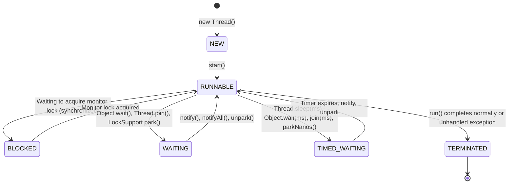
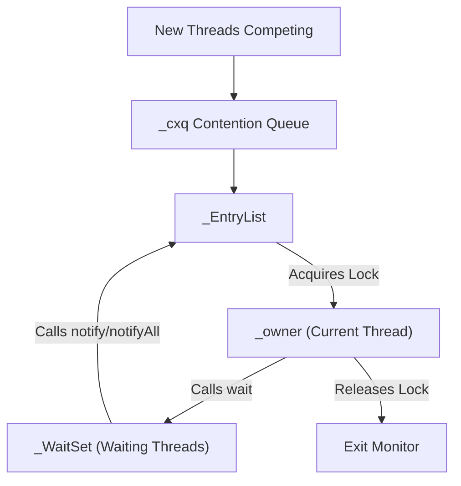

# Multithreading & Concurrency - Thread Basics (In-Depth Masterclass)

## 1. Operating System Threads vs Java Threads

Java's concurrency model historically maps threads directly to underlying operating system threads:

```
┌────────────────────────────────────────────────────────┐
│                      Java Application                  │
│   Thread A               Thread B           Thread C   │
└───────┼──────────────────────┼──────────────────┼──────┘
        │ 1:1                  │ 1:1              │ 1:1
┌───────▼──────────────────────▼──────────────────▼──────┐
│                   OS Kernel Threads                    │
│   kthread_1              kthread_2          kthread_3  │
└───────┼──────────────────────┼──────────────────┼──────┘
        │ Scheduled by OS Scheduler                      │
┌───────▼────────────────────────────────────────────────┐
│                   Hardware CPU Cores                   │
│       [ Core 0 ]              [ Core 1 ]               │
└────────────────────────────────────────────────────────┘
```

### The 1:1 Kernel Thread Model & Its Costs
1. **Memory Cost:** Each platform thread allocates a dedicated OS call stack (default `-Xss1024k` = 1 MB). 1,000 threads consume ~1 GB of RAM just for thread stacks, even when idle.
2. **Context Switching Overhead:** When switching between kernel threads, the OS must:
   - Save CPU registers and program counter.
   - Switch user/kernel mode boundaries.
   - Flush or invalidate CPU caches (L1/L2) and the Translation Lookaside Buffer (TLB).
3. **Scalability Limit:** An OS typically struggles past a few thousand active threads.

### Modern Evolution: Virtual Threads (Java 21 / Project Loom)
- **Platform Threads:** Heavyweight, 1:1 mapped to OS kernel threads.
- **Virtual Threads (`Thread.ofVirtual()`):** Lightweight, user-mode threads managed by the **JVM**, not the OS. Millions can run concurrently.
- **M:N Scheduling:** Many virtual threads run mounted on a small pool of platform "carrier threads" (default `ForkJoinPool`). When a virtual thread encounters blocking I/O (e.g. `socket.read()`, `Thread.sleep()`), the JVM **unmounts** the virtual thread, parks its continuation on the heap, and frees the carrier thread to execute another virtual thread.
- **Pinning Warning:** Avoid holding an intrinsic `synchronized` lock or executing native JNI code during blocking operations in virtual threads, as this "pins" the virtual thread to its carrier thread, preventing unmounting. Prefer `ReentrantLock`.

---

## 2. The 6 Thread States (`Thread.State` Enum)

The JVM defines exactly **6 lifecycle states** for a thread (independent of OS scheduling states):



### Detailed Transition Analysis

| State | Definition | Triggering Methods | Transition Back to `RUNNABLE` |
| :--- | :--- | :--- | :--- |
| **`NEW`** | Thread object instantiated, not yet started | `new Thread(r)` | Calling `.start()` |
| **`RUNNABLE`** | Executing in JVM or ready, waiting for OS CPU slice | `start()`, lock acquired, wakeup | Yield, preempted by OS scheduler |
| **`BLOCKED`** | Waiting to acquire an intrinsic monitor lock | Attempting to enter a `synchronized` block/method | Lock becomes available and thread wins contention |
| **`WAITING`** | Waiting indefinitely for another thread to perform an action | `Object.wait()`, `Thread.join()`, `LockSupport.park()` | `Object.notify()`, `notifyAll()`, `LockSupport.unpark()` |
| **`TIMED_WAITING`** | Waiting for a specified period of time | `Thread.sleep(t)`, `Object.wait(t)`, `join(t)`, `parkNanos(t)` | Timeout expires or notify/signal received |
| **`TERMINATED`** | Thread has completed execution | Execution of `run()` finishes or uncaught exception throws | Final state (cannot be restarted) |

> **Interview Distinction:** What is the difference between `BLOCKED` and `WAITING`?
> - `BLOCKED` is entered **only** when waiting to acquire an intrinsic `synchronized` monitor lock (or re-entering after `wait()`).
> - `WAITING` is entered when waiting voluntarily for a signal (`wait()`, `join()`, `LockSupport.park()`). Waiting for a `ReentrantLock` actually puts the thread into `WAITING` or `TIMED_WAITING` (via `LockSupport.park()`), **NOT** `BLOCKED`!

---

## 3. Creating & Running Threads: 4 Mechanisms

### 1. Extending `Thread` (Not Recommended)
```java
class WorkerThread extends Thread {
    @Override
    public void run() {
        System.out.println("Running in: " + getName());
    }
}
// Single inheritance limitation; couples task logic to thread lifecycle
```

### 2. Implementing `Runnable` (Standard Task Abstraction)
```java
Runnable task = () -> System.out.println("Executed by: " + Thread.currentThread().getName());
Thread t = new Thread(task, "Worker-1");
t.start(); // Spawns OS thread and invokes run()
```

### 3. Implementing `Callable<V>` (Returns Result & Throws Checked Exception)
```java
Callable<Integer> callableTask = () -> {
    TimeUnit.MILLISECONDS.sleep(500);
    return 42;
};
```

### 4. `FutureTask<V>`: Bridge Between Runnable and Callable
`FutureTask` implements `RunnableFuture<V>` (which extends both `Runnable` and `Future<V>`). It allows a `Callable` to be executed by a standard `Thread`:
```java
FutureTask<Integer> futureTask = new FutureTask<>(callableTask);
Thread t = new Thread(futureTask);
t.start();
Integer result = futureTask.get(); // Blocks until completed
```

---

## 4. Object Monitor Internals (`wait`, `notify`, `notifyAll`)

Every Java object header contains a **Mark Word** pointing to an Object Monitor structure in JVM C++ source (`ObjectMonitor.cpp`):

```
┌───────────────────────────────────────────────────────────────┐
│                    ObjectMonitor Structure                    │
├───────────────────────────────────────────────────────────────┤
│ _owner     : Pointer to thread currently holding the lock    │
│ _cxq       : Lock-free Contention Queue (LIFO stack)          │
│ _EntryList : Ready-to-acquire queue (threads blocked)         │
│ _WaitSet   : Wait queue (threads that called Object.wait())   │
└───────────────────────────────────────────────────────────────┘
```



### The Wait/Notify Execution Protocol
1. **Must own monitor:** Calling `wait()` or `notify()` without holding `synchronized(obj)` throws `IllegalMonitorStateException`.
2. **Calling `wait()`:**
   - Releases the monitor lock (`_owner = null`).
   - Moves current thread into `_WaitSet`.
   - Thread state changes from `RUNNABLE` to `WAITING`.
3. **Calling `notify()`:**
   - Picks **one** thread arbitrarily from `_WaitSet` and moves it to `_EntryList` (or `_cxq`).
   - The thread does **NOT** resume immediately! It moves to `BLOCKED` state, waiting for the notifying thread to release the monitor.
4. **Calling `notifyAll()`:**
   - Moves **all** threads from `_WaitSet` to `_EntryList`.

### Why `wait()` MUST Always Be Enclosed in a `while` Loop
```java
// ❌ WRONG: Vulnerable to spurious wakeups and race conditions
synchronized (lock) {
    if (!condition) {
        lock.wait();
    }
    consume();
}

// ✅ CORRECT: Always re-check condition upon waking up
synchronized (lock) {
    while (!condition) {
        lock.wait();
    }
    consume();
}
```
**Two Reasons:**
1. **Spurious Wakeup:** POSIX operating systems can wake threads without any explicit `notify()` signal.
2. **Condition Stealing:** If Thread A calls `notifyAll()`, Thread B and Thread C wake up. Thread B acquires the lock first and empties the queue. When Thread C finally gets the lock, the condition is no longer true!

---

## 5. Thread Interruption Protocol: Cooperative Cancellation

Java does **NOT** provide a safe way to forcefully kill a running thread (`Thread.stop()` is deprecated because it instantly unlocks all monitors, leaving objects in corrupted, inconsistent states). Thread termination is **strictly cooperative**.

### The 3 Core Interruption Methods

| Method | Role | Affects Flag? |
| :--- | :--- | :--- |
| `thread.interrupt()` | Sets the target thread's interrupt status flag to `true`. If the thread is blocked in `sleep()`, `wait()`, or `join()`, it wakes up and throws `InterruptedException`. | Sets flag to `true` (or resets to `false` if throwing IE) |
| `thread.isInterrupted()` | Instance method: returns `true` if target thread is interrupted. | **Does NOT clear** the flag |
| `Thread.interrupted()` | **Static** method: returns `true` if **current** thread is interrupted, **AND clears the flag** to `false`! | **CLEARS** flag to `false` |

### The `InterruptedException` Flag Clearing Trap
When `Thread.sleep()`, `wait()`, or `join()` throws `InterruptedException`, the JVM **automatically clears the interrupt flag** back to `false`!

```java
// ❌ WRONG: Swallows interruption; callers cannot know task was cancelled!
public void run() {
    try {
        Thread.sleep(2000);
    } catch (InterruptedException e) {
        // Flag is now FALSE! Loop continues running!
    }
}

// ✅ CORRECT Pattern 1: Propagate exception
public void runTask() throws InterruptedException {
    Thread.sleep(2000);
}

// ✅ CORRECT Pattern 2: Restore the interrupt flag!
public void run() {
    try {
        Thread.sleep(2000);
    } catch (InterruptedException e) {
        Thread.currentThread().interrupt(); // RESTORE FLAG!
        cleanup();
        return; // Exit thread execution cleanly
    }
}
```

---

## 6. ThreadLocal Deep Dive & Memory Leaks

`ThreadLocal<T>` provides thread-confined variables. Every thread accessing a `ThreadLocal` gets its own, completely isolated copy.

### Internal Architecture
```
Thread Object
┌────────────────────────────────────────────────────────┐
│ ThreadLocal.ThreadLocalMap threadLocals;               │
│                                                        │
│  table: Entry[]                                        │
│  ┌──────────────────────────────────────────────────┐  │
│  │ Entry (extends WeakReference<ThreadLocal<?>>)   │  │
│  │   key   : WeakReference(threadLocalInstance)    │  │
│  │   value : StrongReference(userObject)           │  │
│  └──────────────────────────────────────────────────┘  │
└────────────────────────────────────────────────────────┘
```

1. Data is **NOT** stored inside the `ThreadLocal` instance!
2. Data is stored inside a `ThreadLocalMap` located directly on the **`Thread` object**.
3. The Entry's key is a **`WeakReference`** to the `ThreadLocal` object.
4. The Entry's value is a **`StrongReference`** to the allocated value.

### The Catastrophic Thread Pool Memory Leak
When using application servers or thread pools (like Tomcat, `ForkJoinPool`, `Executors.newFixedThreadPool`):
1. The worker threads are **never terminated**; they live for the lifetime of the JVM.
2. If your code allocates a `ThreadLocal` and the `ThreadLocal` variable loses its strong reference, garbage collection reclaims the `ThreadLocal` key (because it's a `WeakReference`).
3. Now, the `Entry` in `threadLocals` has `key = null`, but **`value` is still strongly referenced**!
4. Because the `Thread` never terminates, `Thread.threadLocals` remains reachable, preventing GC of the large user value (e.g. `UserSession`, `ClassLoader`).
5. Over time, this leads to fatal `java.lang.OutOfMemoryError: Metaspace` or Heap OOM.

```java
// ✅ MANDATORY PRODUCTION PATTERN:
public void processRequest(Request req) {
    try {
        UserContextHolder.set(req.getUser());
        executeBusinessLogic();
    } finally {
        UserContextHolder.remove(); // CRITICAL: Always clean up in finally!
    }
}
```

---

## 7. Daemon Threads & UncaughtExceptionHandler

### Daemon Threads
- A daemon thread is a background service thread (e.g., JVM Garbage Collector, finalizer).
- Set via `thread.setDaemon(true)` **before** calling `start()`.
- **Critical JVM Shutdown Rule:** The JVM terminates when **all non-daemon (user) threads have finished**, regardless of running daemon threads.
- When the JVM exits, daemon threads are abandoned immediately: **`finally` blocks are NOT guaranteed to execute, and resources may not flush!**

### UncaughtExceptionHandler
If an unchecked exception escapes a thread's `run()` method, the thread terminates silently.
```java
Thread t = new Thread(task);
t.setUncaughtExceptionHandler((thread, throwable) -> {
    log.error("Uncaught exception in thread " + thread.getName(), throwable);
    alertOps(throwable);
});
```

---

## 8. Common Traps & Antipatterns

### ❌ Trap 1: Calling `run()` instead of `start()`
`t.run()` executes the method synchronously in the **current calling thread**. It does NOT spawn a new OS thread.

### ❌ Trap 2: Synchronizing on String Literals or Boxed Primitives
```java
synchronized ("MY_LOCK") { ... } // Reused globally via String intern pool!
synchronized (Integer.valueOf(1)) { ... } // Cached via IntegerCache!
```
Locks must always be private, final objects: `private final Object lock = new Object();`.

### ❌ Trap 3: Relying on `Thread.yield()` or Thread Priorities for Correctness
Thread priorities (1 to 10) and `Thread.yield()` are mere hints to the OS scheduler. Many OS kernels (including modern Linux CFS) ignore Java priorities completely. Never write concurrency logic that relies on priority ordering.

---

## 9. Senior / FAANG Interview Questions & Answers

### Q1: Why are `wait()`, `notify()`, and `notifyAll()` defined in `Object` instead of `Thread`?
**Answer:**
Because in Java's monitor architecture, the lock (intrinsic monitor) belongs to the **shared data object**, not the executing thread. A thread can hold locks on multiple objects simultaneously. If `wait()` were on `Thread`, which lock would it release? Putting `wait()` on `Object` binds waiting and notification directly to the specific shared monitor resource being synchronized.

### Q2: What happens if a thread throws an exception inside a `synchronized` block?
**Answer:**
The JVM automatically releases the intrinsic monitor lock via the generated `monitorexit` bytecode instruction inserted into the exception table handler block. The lock is never permanently held due to an unhandled exception.

### Q3: What is the difference between `Thread.sleep()` and `Object.wait()` regarding locks?
**Answer:**
- `Thread.sleep(millis)` pauses execution for the given duration **without releasing ANY locks** held by the thread.
- `Object.wait()` **releases the monitor lock** of the target object, allowing other waiting threads to enter synchronized blocks on that object.

### Q4: How does `InheritableThreadLocal` work, and why does it break in thread pools?
**Answer:**
`InheritableThreadLocal` copies parent thread variables to child threads **only at the exact moment a new `Thread` is instantiated**. In thread pools, threads are pre-created once and reused for many tasks. When a task submits work to a pooled thread, the pooled thread already exists, so it retains stale values from whatever previous task ran on it, corrupting data.

---

## 10. Summary Cheat Sheet

```
┌───────────────────────────┬────────────────────────────────────────────────────────┐
│ Concept                   │ Golden Rule / Architecture                              │
├───────────────────────────┼────────────────────────────────────────────────────────┤
│ Thread Mapping            │ 1:1 Kernel thread mapping (Java 21 Virtual Threads M:N)│
│ State Machine             │ NEW, RUNNABLE, BLOCKED, WAITING, TIMED_WAITING, TERMINATED │
│ Interruption Protocol     │ Cooperative cancellation; restore flag on InterruptedException │
│ Object Monitor            │ Mark Word points to ObjectMonitor (_owner, _cxq, _WaitSet) │
│ wait() Pattern            │ Always loop: while (!condition) wait();               │
│ ThreadLocal Leak          │ Keys are WeakRefs, values are StrongRefs; always .remove() in finally │
└───────────────────────────┴────────────────────────────────────────────────────────┘
```
