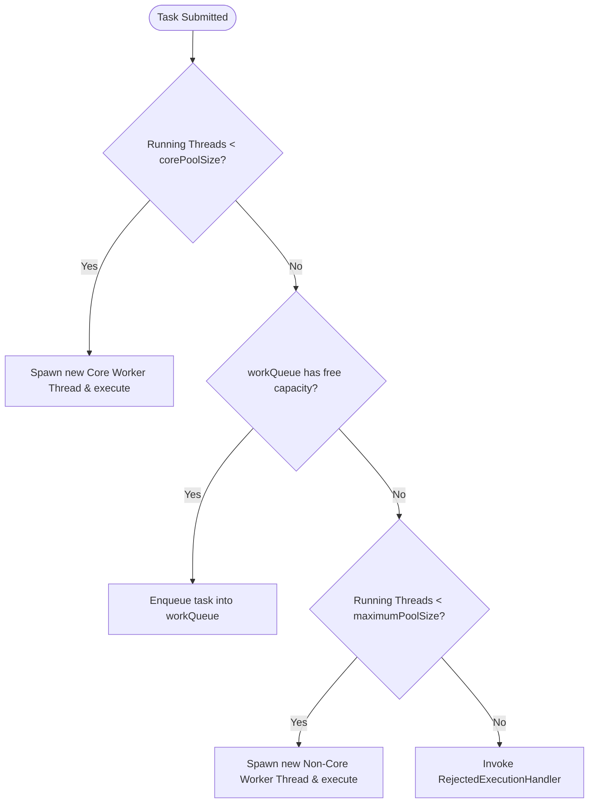

# Multithreading & Concurrency - Executor Framework (In-Depth Masterclass)

## 1. Executor Framework Architecture

The `java.util.concurrent` Executor framework decouples **task submission** from **thread allocation, scheduling, and execution mechanics**.

```
                           Executor (Interface)
                           [execute(Runnable)]
                                    │
                         ExecutorService (Interface)
                         [submit(), shutdown(), invokeAll()]
                                    │
           ┌────────────────────────┴────────────────────────┐
           │                                                 │
ScheduledExecutorService (Interface)           AbstractExecutorService
[schedule(), scheduleAtFixedRate()]                          │
           │                                                 │
           └────────────────────────┬────────────────────────┘
                                    │
                          ThreadPoolExecutor
                                    │
                    ScheduledThreadPoolExecutor
                                    │
                           ForkJoinPool
```

---

## 2. ThreadPoolExecutor Internals: The 7 Parameters

All standard thread pools in Java are powered by `ThreadPoolExecutor`. Understanding its 7-parameter constructor is essential for production operations and system design interviews:

```java
public ThreadPoolExecutor(
    int corePoolSize,                      // 1. Base number of threads to keep alive
    int maximumPoolSize,                   // 2. Upper ceiling of threads
    long keepAliveTime,                    // 3. Max idle time for non-core threads
    TimeUnit unit,                         // 4. Time unit for keepAliveTime
    BlockingQueue<Runnable> workQueue,     // 5. Holding queue for submitted tasks
    ThreadFactory threadFactory,           // 6. Custom thread creation factory
    RejectedExecutionHandler handler       // 7. Policy when pool and queue are saturated
)
```

### The Exact Task Submission Decision Pipeline

When a task is submitted via `executor.execute(task)`, the JVM follows a strict 4-step sequence:



> **Senior Interview Insight:** Notice that non-core threads (between `corePoolSize` and `maximumPoolSize`) are **ONLY** created if the `workQueue` is **100% full**! If your `workQueue` is unbounded (`LinkedBlockingQueue`), `maximumPoolSize` is completely ignored because step 2 never fails.

### Internal State & Worker Mechanics: The Atomic `ctl`
`ThreadPoolExecutor` packs both the **run state** and the **effective worker count** into a single 32-bit `AtomicInteger` called `ctl`:
- **Higher 3 bits:** Pool run state (`RUNNING`, `SHUTDOWN`, `STOP`, `TIDYING`, `TERMINATED`).
- **Lower 29 bits:** Worker count (supports up to $2^{29}-1 \approx 500$ million threads).
This bitwise packing allows state changes and thread count updates to occur simultaneously in a single atomic CAS operation without locking.

Each thread in the pool is wrapped in a private inner class `Worker` extending `AbstractQueuedSynchronizer` (AQS):
```java
// Simplified runWorker loop:
final void runWorker(Worker w) {
    Runnable task = w.firstTask;
    while (task != null || (task = getTask()) != null) { // getTask() blocks on workQueue!
        w.lock();
        try {
            task.run();
        } finally {
            w.unlock();
        }
    }
}
```
If a worker is non-core and `getTask()` times out after `keepAliveTime`, the thread exits and terminates.

---

## 3. Why `Executors` Factory Methods are Banned in Enterprise Standards

Both the **Alibaba Java Coding Guidelines** and **SonarQube** prohibit using the convenience static factory methods in `java.util.Executors`.

### The 2 Fatal Production Outages

#### 1. `Executors.newFixedThreadPool(n)` & `newSingleThreadExecutor()`
```java
public static ExecutorService newFixedThreadPool(int nThreads) {
    return new ThreadPoolExecutor(nThreads, nThreads,
                                  0L, TimeUnit.MILLISECONDS,
                                  new LinkedBlockingQueue<Runnable>()); // ❌ UNBOUNDED!
}
```
- **The Risk:** `new LinkedBlockingQueue<Runnable>()` has an default capacity of `Integer.MAX_VALUE` ($2,147,483,647$).
- Under sustained load or downstream service outages, tasks accumulate in memory without limit, triggering an inevitable `OutOfMemoryError: Java heap space`.

#### 2. `Executors.newCachedThreadPool()`
```java
public static ExecutorService newCachedThreadPool() {
    return new ThreadPoolExecutor(0, Integer.MAX_VALUE, // ❌ UNBOUNDED THREADS!
                                  60L, TimeUnit.SECONDS,
                                  new SynchronousQueue<Runnable>());
}
```
- **The Risk:** `maximumPoolSize` is `Integer.MAX_VALUE`.
- A spike of 10,000 incoming requests creates 10,000 OS kernel threads simultaneously. This exhausts OS process memory, consumes massive CPU time switching contexts, and crashes the JVM with `OutOfMemoryError: unable to create new native thread`.

### Enterprise-Grade Custom Configuration
```java
public static ThreadPoolExecutor createProductionPool(String poolName) {
    int cores = Runtime.getRuntime().availableProcessors();
    return new ThreadPoolExecutor(
        cores * 2,                                      // Core threads
        cores * 4,                                      // Max threads
        60L, TimeUnit.SECONDS,                          // Idle keep-alive
        new ArrayBlockingQueue<>(1000),                 // Bounded queue!
        new ThreadFactoryBuilder()
            .setNamePrefix(poolName + "-worker-")
            .setDaemon(false)
            .build(),
        new ThreadPoolExecutor.CallerRunsPolicy()       // Backpressure policy
    );
}
```

---

## 4. Rejection (Saturation) Policies

When both the bounded queue and `maximumPoolSize` are saturated, the pool invokes its `RejectedExecutionHandler`.

| Policy | Behavior | Production Impact |
| :--- | :--- | :--- |
| **`AbortPolicy`** (Default) | Throws `RejectedExecutionException` | Fail-fast; caller must handle the exception or fail the request. |
| **`CallerRunsPolicy`** | Executes the task directly in the **caller's thread** | **Provides natural backpressure!** The calling thread is busy running the task and cannot submit new tasks, slowing down the producer. |
| **`DiscardPolicy`** | Silently drops the task with no error | Silent data loss; use only for disposable telemetry/metrics. |
| **`DiscardOldestPolicy`** | Discards the oldest unhandled task from the queue head and retries submission | Evicts stale work in favor of newer requests. |

### Custom Production Handler
```java
public class AlertingRejectionHandler implements RejectedExecutionHandler {
    @Override
    public void rejectedExecution(Runnable r, ThreadPoolExecutor executor) {
        MetricsRegistry.counter("threadpool.rejected.tasks").increment();
        log.error("Task rejected! Pool active: {}, Queue remaining: {}", 
                  executor.getActiveCount(), executor.getQueue().remainingCapacity());
        // Fallback: write to dead-letter queue / Kafka topic
    }
}
```

---

## 5. Thread Pool Sizing Formulas

### Formula 1: CPU-Intensive Workloads
Workloads bound by computation (cryptography, mathematical transformations, compression, image encoding):
$$N_{\text{threads}} = N_{\text{cpu}} + 1$$
Adding more threads beyond CPU cores causes CPU cache thrashing and context switching overhead. The $+1$ thread compensates for occasional page faults.

### Formula 2: I/O-Intensive Workloads (Network, Database, File I/O)
Workloads spend significant time blocked waiting for external responses:
$$N_{\text{threads}} = N_{\text{cpu}} \times \left(1 + \frac{\text{Wait Time}}{\text{Compute Time}}\right) \times U_{\text{cpu}}$$
- $N_{\text{cpu}}$: Number of available CPU cores.
- $U_{\text{cpu}}$: Target CPU utilization ($0 < U_{\text{cpu}} \le 1.0$).
- $\frac{\text{Wait Time}}{\text{Compute Time}}$: Ratio of time waiting for I/O vs active CPU calculation.
*Example:* If a service takes 100ms total, spending 90ms on DB query and 10ms processing, ratio is $90/10 = 9$. On an 8-core CPU, optimal threads = $8 \times (1 + 9) = 80$ threads.

---

## 6. ForkJoinPool & Work-Stealing Algorithm

`ForkJoinPool` is designed for recursive, fine-grained tasks that divide and conquer (`ForkJoinTask`, `RecursiveTask`, `RecursiveAction`, and parallel streams).

```
                      ForkJoinPool Architecture
 Worker 1 Deque              Worker 2 Deque             Worker 3 Deque
┌──────────────┐            ┌──────────────┐           ┌──────────────┐
│  Task 1.1    │ (Head/LIFO)│  Task 2.1    │           │  Task 3.1    │
│  Task 1.2    │            │  Task 2.2    │           │  Task 3.2    │
│  Task 1.3    │ (Tail/FIFO)│              │           │              │
└──────┬───────┘            └──────────────┘           └──────────────┘
       │                                                      ▲
       └──────────────────── Work Stealing ───────────────────┘
```

1. **Dual-Ended Queues (Deques):** Each worker thread owns an independent double-ended task queue.
2. **Local Execution (LIFO):** The worker thread pushes subtasks to and pops subtasks from the **HEAD** of its own deque in LIFO order (exploiting CPU cache locality).
3. **Work Stealing (FIFO):** When a worker thread empties its own deque, it looks for other busy threads and **steals tasks from the TAIL** of their deques in FIFO order.
4. **Benefit:** Because the owner accesses the head and thieves steal from the tail, lock contention between threads is minimized.

---

## 7. ScheduledThreadPoolExecutor Deep Dive

`ScheduledThreadPoolExecutor` extends `ThreadPoolExecutor` and uses an internal `DelayedWorkQueue` (a min-heap of tasks ordered by execution time).

### Rate vs Delay Comparison

```
1. scheduleAtFixedRate(task, initialDelay=0, period=5s)
Task execution: [----- 3s -----]
Time line:      0s             3s    4s    5s ────────► Next execution starts at 5s!
Task takes 7s:  [----------- 7s -----------]
Time line:      0s                         7s ────────► Next starts immediately! (Never overlaps)

2. scheduleWithFixedDelay(task, initialDelay=0, delay=5s)
Task execution: [----- 3s -----]                    [----- 3s -----]
Time line:      0s             3s ─── Delay 5s ───► 8s
```

> **The Silent Suicide Exception Trap:**
> If a task scheduled via `scheduleAtFixedRate` throws an unhandled `RuntimeException`, the executor **silently suppresses subsequent executions of that task forever!** The task will never run again, without logging any error stack trace.
> **Rule:** Always wrap scheduled task logic in a top-level `try-catch (Throwable t)`.

---

## 8. CompletionService: In-Order-of-Completion Processing

When submitting 10 tasks to an `ExecutorService`, iterating over `List<Future<T>>` in submission order causes head-of-line blocking: if Task 1 takes 10 seconds and Task 2 finishes in 100ms, your loop blocks waiting for Task 1!

`ExecutorCompletionService` couples an `ExecutorService` with a `BlockingQueue<Future<V>>`, allowing you to consume results immediately as they finish:

```java
CompletionService<Report> service = new ExecutorCompletionService<>(executor);

for (Task task : tasks) {
    service.submit(task::generateReport);
}

// Consume reports in order of actual completion:
for (int i = 0; i < tasks.size(); i++) {
    Future<Report> completedFuture = service.take(); // Blocks until ANY task completes!
    Report report = completedFuture.get();
    process(report);
}
```

---

## 9. 2-Phase Graceful Shutdown Pattern

Failing to shut down thread pools prevents JVM termination and leaks file handles and sockets.

```java
public static void shutdownGracefully(ExecutorService pool, long timeoutSeconds) {
    pool.shutdown(); // Phase 1: Reject new tasks, allow running/queued tasks to finish
    try {
        if (!pool.awaitTermination(timeoutSeconds, TimeUnit.SECONDS)) {
            pool.shutdownNow(); // Phase 2: Force cancellation via thread.interrupt()
            if (!pool.awaitTermination(timeoutSeconds, TimeUnit.SECONDS)) {
                log.error("Thread pool failed to terminate within timeout!");
            }
        }
    } catch (InterruptedException ie) {
        pool.shutdownNow();
        Thread.currentThread().interrupt(); // Preserve interrupt status
    }
}
```

---

## 10. Senior / FAANG Interview Questions & Answers

### Q1: What happens if a core thread in a `ThreadPoolExecutor` throws an unhandled RuntimeException?
**Answer:**
If submitted via `execute()`: The exception is printed to `System.err`, the worker thread **dies and is terminated**, and the `ThreadPoolExecutor` dynamically instantiates a brand new replacement worker thread to preserve `corePoolSize`.
If submitted via `submit()`: The exception is caught internally by `FutureTask` and stored; the worker thread is **NOT destroyed** and returns to the pool to execute more tasks. The exception is only re-thrown when the caller invokes `future.get()`.

### Q2: Why does `SynchronousQueue` require `maximumPoolSize = Integer.MAX_VALUE`?
**Answer:**
`SynchronousQueue` has zero storage capacity. Each `put()` must wait for a corresponding `take()`, and each `offer()` succeeds only if a thread is already waiting to receive it. In `ThreadPoolExecutor`, if all existing threads are busy, `SynchronousQueue.offer()` returns `false`. If `maximumPoolSize` were limited, the task would immediately be rejected. Setting `maximumPoolSize` high forces the pool to spawn a new worker thread for every concurrent incoming task.

### Q3: How do you dynamically adjust thread pool parameters in a live production system?
**Answer:**
`ThreadPoolExecutor` provides thread-safe runtime mutation methods:
`setCorePoolSize(int)`, `setMaximumPoolSize(int)`, and `setKeepAliveTime(long, TimeUnit)`.
When adjusting sizes, always resize maximumPoolSize before corePoolSize if expanding, or corePoolSize before maximumPoolSize if shrinking, to avoid validation check exceptions.

---

## 11. Summary Cheat Sheet

```
┌───────────────────────────┬────────────────────────────────────────────────────────┐
│ Parameter / Feature       │ Crucial Production Insight                             │
├───────────────────────────┼────────────────────────────────────────────────────────┤
│ Submission Priority       │ Core Threads -> Queue -> Max Threads -> Rejection      │
│ Executors Factory Hazard  │ Unbounded queues cause OOM; unbounded threads cause OOM│
│ CallerRunsPolicy          │ Essential for graceful upstream backpressure           │
│ Scheduled Exceptions      │ Uncaught exceptions cancel future runs silently        │
│ CompletionService         │ Eliminates head-of-line blocking when gathering results │
│ Graceful Shutdown         │ shutdown() -> awaitTermination() -> shutdownNow()      │
└───────────────────────────┴────────────────────────────────────────────────────────┘
```
