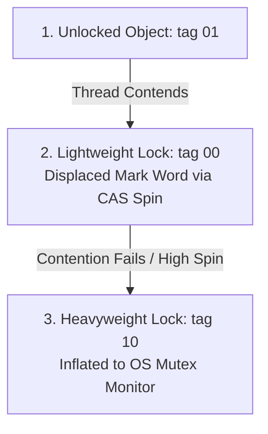

# Multithreading & Concurrency - Locks & Atomics (In-Depth Masterclass)

## 1. Intrinsic Locks: JVM Monitor Internals & Lock Escalation

In Java, every object can act as an intrinsic monitor lock. The synchronization state is stored directly inside the **Object Header Mark Word**.

```
                       64-bit JVM Mark Word State Transitions
┌────────────────────────────────────────────────────────┬─────────────┐
│ Mark Word Bits (Bits 0–61)                             │ Lock Tag    │
├────────────────────────────────────────────────────────┼─────────────┤
│ Unlocked: HashCode (31b) | Age (4b) | Biased=0         │ 01          │
│ Lightweight Lock: Pointer to Lock Record on thread stack│ 00          │
│ Heavyweight Lock: Pointer to native ObjectMonitor      │ 10          │
│ Marked for Garbage Collection (CMS / G1)               │ 11          │
└────────────────────────────────────────────────────────┴─────────────┘
```

### The 3 Stages of Lock Escalation (Inflation)

To minimize OS kernel context-switch penalties, the HotSpot JVM progressively escalates locks:



1. **Lightweight Locking (Thin Lock):**
   - When a thread enters a `synchronized` block, the JVM creates a **Lock Record** on the thread's execution stack.
   - It performs an atomic **CAS** to swap the object's Mark Word with a pointer to this stack Lock Record.
   - If successful, the thread owns the lock without any OS kernel involvement.
   - If another thread contends, it performs a brief **adaptive spin** (busy-waiting in user mode) expecting the lock to be released quickly.
2. **Heavyweight Locking (OS Mutex):**
   - If CAS spinning exceeds a threshold, the lock **inflates** into a heavyweight monitor.
   - An `ObjectMonitor` structure is allocated in C++ heap.
   - The Mark Word is rewritten to point to this `ObjectMonitor` (tag `10`).
   - Contending threads are suspended at the OS level via `pthread_mutex` or Windows Events, moving into the `BLOCKED` state.
   > **JVM Rule:** In standard HotSpot execution, lock inflation is **one-way (irreversible)**. Once heavyweight, it stays heavyweight until object garbage collection.

### JIT Lock Optimizations
- **Lock Elision (Escape Analysis):** If the JIT compiler proves via escape analysis that a locked object never escapes the allocating thread, it completely strips away the lock bytecode (`monitorenter` / `monitorexit`).
- **Lock Coarsening:** If the compiler detects adjacent synchronized blocks operating on the same lock object, it merges them into a single larger synchronized block, eliminating repeated lock/unlock overhead.

---

## 2. Java Memory Model (JMM) & `happens-before`

Modern multi-core CPUs feature separate L1/L2/L3 caches. Without coordination, threads on Core 0 and Core 1 see stale or inconsistent views of shared memory.

```
┌──────────────────┐               ┌──────────────────┐
│   CPU Core 0     │               │   CPU Core 1     │
│ [ L1/L2 Cache ]  │               │ [ L1/L2 Cache ]  │
└────────┬─────────┘               └────────┬─────────┘
         │                                  │
         └─────────────┬────────────────────┘
                       │ MESI Cache Coherence Bus
         ┌─────────────▼────────────────────┐
         │     Shared L3 Cache & RAM        │
         └──────────────────────────────────┘
```

### The 3 Concurrency Properties
1. **Visibility:** When one thread modifies a shared variable, other threads immediately observe the updated value.
2. **Atomicity:** An operation completes in an all-or-nothing manner without interruption from other threads.
3. **Ordering:** The sequence of program instructions is preserved across threads despite compiler and hardware optimizations.

### The `happens-before` Relationship Rules
If action $A$ `happens-before` action $B$, the memory changes made by $A$ are guaranteed to be visible to $B$.

1. **Program Order Rule:** Each action in a thread happens-before every subsequent action in that same thread.
2. **Monitor Lock Rule:** An unlock on a monitor lock happens-before every subsequent lock on that **same** monitor.
3. **Volatile Variable Rule:** A write to a `volatile` field happens-before every subsequent read of that **same** field.
4. **Thread Start Rule:** Calling `thread.start()` happens-before any action in the started thread.
5. **Thread Join Rule:** All actions in a thread happen-before any other thread successfully returns from `thread.join()`.
6. **Transitivity:** If $A$ happens-before $B$, and $B$ happens-before $C$, then $A$ happens-before $C$.

---

## 3. The `volatile` Keyword & The Double-Checked Locking Trap

### What `volatile` Guarantees
1. **Memory Visibility:** Reads and writes bypass CPU registers and L1/L2 caches, forcing direct synchronization with main memory via hardware cache coherence protocols.
2. **Instruction Ordering:** Inserts **Memory Barriers / Fences** (`StoreStore`, `StoreLoad`, `LoadLoad`, `LoadStore`) to prevent the JIT compiler and CPU out-of-order execution engine from reordering instructions across the volatile barrier.
3. **No Atomicity for Compound Operations:** `volatile int count; count++;` is NOT thread-safe! It compiles to 3 instructions (read $\to$ increment $\to$ write).

### The Double-Checked Locking (DCL) Singleton Bug
```java
public class Singleton {
    // ❌ WITHOUT volatile: Broken in multi-threaded environments!
    // private static Singleton instance; 

    // ✅ WITH volatile: Correct and thread-safe!
    private static volatile Singleton instance;

    public static Singleton getInstance() {
        if (instance == null) {                         // 1st Check (Lock-free)
            synchronized (Singleton.class) {
                if (instance == null) {                 // 2nd Check (Guarded)
                    instance = new Singleton();         // DANGER ZONE!
                }
            }
        }
        return instance;
    }
}
```

#### Why DCL Fails Without `volatile`:
`instance = new Singleton()` is **NOT** an atomic operation. The JVM bytecode executes 3 steps:
1. `memory = allocate()`: Allocate memory block for Singleton.
2. `ctorInstance(memory)`: Invoke `<init>` constructor to initialize fields.
3. `instance = memory`: Assign the memory address to the reference variable `instance`.

The CPU or JIT compiler may reorder step 2 and step 3:
$$\text{allocate()} \longrightarrow \text{assign reference (instance != null)} \longrightarrow \text{invoke constructor}$$
If Thread A reorders 2 and 3, Thread B arrives at the **1st Check (`instance == null`)**, sees that `instance` is non-null, and immediately consumes it—**while the constructor is still running on Thread A!** Thread B crashes with corrupted or half-initialized data.
Declaring `instance` as **`volatile`** inserts a `StoreStore` barrier, guaranteeing that constructor initialization finishes **before** the reference assignment is published.

---

## 4. AbstractQueuedSynchronizer (AQS) Deep Dive

`AbstractQueuedSynchronizer` (AQS) is the foundation of `ReentrantLock`, `Semaphore`, `CountDownLatch`, and `ReentrantReadWriteLock`.

```
                    AQS Architecture (CLH Queue)
           ┌──────────────────────────────────────────────┐
           │ volatile int state; (Synchronization State)  │
           └──────────────────────────────────────────────┘
                                  │
     Head Node                Node 1                   Tail Node
┌─────────────────┐     ┌─────────────────┐     ┌─────────────────┐
│ prev: null      │ ◄── │ prev            │ ◄── │ prev            │
│ next            │ ──► │ next            │ ──► │ next: null      │
│ thread: ThreadA │     │ thread: ThreadB │     │ thread: ThreadC │
│ waitStatus: -1  │     │ waitStatus: -1  │     │ waitStatus: 0   │
└─────────────────┘     └─────────────────┘     └─────────────────┘
```

### Core Architecture Components
1. **Volatile State (`state`):** A 32-bit `volatile int state` manipulated via CAS:
   - In `ReentrantLock`: `state = 0` means unlocked; `state > 0` represents the lock hold count (reentrancy depth).
   - In `Semaphore`: `state` represents the number of available permits.
   - In `CountDownLatch`: `state` represents the countdown latch count.
2. **CLH Wait Queue:** A variant of the Craig, Landin, and Hagersten doubly-linked FIFO queue.
   - Contending threads are encapsulated inside `Node` objects.
   - Blocked threads are suspended via `LockSupport.park(this)` and unparked via `LockSupport.unpark(thread)`.
3. **Exclusive vs Shared Mode:**
   - **Exclusive (e.g. `ReentrantLock`):** Only one thread can acquire at a time (`tryAcquire` / `tryRelease`).
   - **Shared (e.g. `CountDownLatch`, `Semaphore`):** Multiple threads can acquire concurrently (`tryAcquireShared` / `tryReleaseShared`).

---

## 5. ReentrantLock vs synchronized

| Feature | `synchronized` | `ReentrantLock` |
| :--- | :--- | :--- |
| **Implementation** | JVM Bytecode (`monitorenter` / `exit`) | Java API (AQS-based) |
| **Lock Release** | Automatic (guaranteed by JVM) | Manual (must release in `finally` block) |
| **Interruptible Lock** | ❌ No (blocks indefinitely) | ✅ Yes (`lockInterruptibly()`) |
| **Non-Blocking Try** | ❌ No | ✅ Yes (`tryLock()`, `tryLock(timeout, unit)`) |
| **Fairness Guarantee** | ❌ No (always unfair) | ✅ Optional (`new ReentrantLock(true)`) |
| **Multiple Conditions** | ❌ No (single wait-set per object) | ✅ Yes (`lock.newCondition()`) |

### Fair vs Non-Fair Locks: Why Non-Fair is Default
```java
Lock unfairLock = new ReentrantLock();     // Default: Unfair
Lock fairLock   = new ReentrantLock(true); // Fair: FIFO order
```
- **Fair Lock:** Threads acquire the lock in strict FIFO order based on queue arrival. A newly arriving thread checks `hasQueuedPredecessors()`; if threads are already queued, it must join the queue.
- **Non-Fair Lock:** When a lock is released, a newly arriving thread attempts a direct CAS acquisition before checking the queue.
- **Why Non-Fair has Higher Throughput:** Waking up a queued thread from OS sleep requires an expensive context switch (~1–5 microseconds). A non-fair lock allows an already-running thread that is already on the CPU to "barge in" and finish immediately, resulting in up to **10x higher throughput** under heavy contention.

---

## 6. ReadWriteLock & StampedLock (Optimistic Locking)

### ReentrantReadWriteLock
Separates read operations from write operations:
- Multiple readers can hold the `readLock()` simultaneously.
- Only one writer can hold the `writeLock()` exclusively.
- **Limitation:** Can lead to **writer starvation** if a continuous stream of readers prevents the writer from acquiring the lock.

### StampedLock (Java 8+): High-Throughput Optimistic Locking
`StampedLock` provides three locking modes: Write, Read, and **Optimistic Read**.

```java
public class Point {
    private double x, y;
    private final StampedLock sl = new StampedLock();

    // High-performance Optimistic Read (Zero Lock Contention!)
    public double distanceFromOrigin() {
        // 1. Acquire optimistic read stamp (Does NOT lock anything!)
        long stamp = sl.tryOptimisticRead();
        double currentX = x, currentY = y;

        // 2. Validate if a write occurred between stamp acquisition and read
        if (!sl.validate(stamp)) {
            // Validation failed! A writer intervened; upgrade to standard read lock
            stamp = sl.readLock();
            try {
                currentX = x;
                currentY = y;
            } finally {
                sl.unlockRead(stamp);
            }
        }
        return Math.sqrt(currentX * currentX + currentY * currentY);
    }

    public void move(double deltaX, double deltaY) {
        long stamp = sl.writeLock(); // Exclusive write lock
        try {
            x += deltaX;
            y += deltaY;
        } finally {
            sl.unlockWrite(stamp);
        }
    }
}
```

> **Warning:** `StampedLock` is **NOT reentrant**! Calling `sl.writeLock()` twice within the same thread results in an instant deadlock. It also does not support `Condition` variables.

---

## 7. CAS (Compare-And-Swap) & Lock-Free Atomics

### Hardware-Level CAS
CAS is a CPU-level atomic instruction (`cmpxchg` on x86 architectures):
$$\text{CAS}(V, E, N)$$
- $V$: Memory location.
- $E$: Expected old value.
- $N$: New value to write.
If $V == E$, write $N$ and return `true`; otherwise return `false` without modifying memory.

### The ABA Problem & Solution
- **The Problem:** Thread 1 reads value `A`. Thread 2 changes `A` $\to$ `B` $\to$ `A`. Thread 1 runs CAS; it sees `A` and succeeds, completely unaware that state was modified and reverted in the interim.
- **The Danger:** In lock-free stacks or memory reclamation schemes, ABA can cause head-pointer corruption and memory leaks.
- **The Solution:** Use **`AtomicStampedReference`** or **`AtomicMarkableReference`**, which pair the object pointer with an integer version stamp:

```java
AtomicStampedReference<String> asr = new AtomicStampedReference<>("A", 1);

int initialStamp = asr.getStamp();
// Update only succeeds if BOTH reference == "A" AND stamp == initialStamp
boolean success = asr.compareAndSet("A", "NewValue", initialStamp, initialStamp + 1);
```

---

## 8. High-Contention Counters: LongAdder vs AtomicLong

Under intense multi-threaded write contention (e.g. web traffic counters), `AtomicLong.incrementAndGet()` suffers severe performance degradation because dozens of threads continuously fail CAS and loop, causing **cache-line bouncing**.

```
                AtomicLong (Single Bottleneck)
 Thread 1 ──┐
 Thread 2 ──┼──► CAS on single volatile long (Heavy Contention!)
 Thread 3 ──┘

                LongAdder (Cell Striping)
 Thread 1 ──► [ Cell 0 ]
 Thread 2 ──► [ Cell 1 ]  ──► sum() aggregates cells when read!
 Thread 3 ──► [ Cell 2 ]
```

### How LongAdder Works
- Extends `Striped64`.
- Maintains a base value and an array of `Cell` objects.
- Each thread is hashed to a specific `Cell` in the array via thread-local probe hashes.
- Each `Cell` is annotated with **`@jdk.internal.vm.annotation.Contended`**, which adds 128 bytes of cache line padding to prevent **False Sharing** (where multiple cells share the same 64-byte CPU cache line).
- `sum()` adds the base value and all cells. Note: `sum()` is **not** an atomic snapshot, making `LongAdder` ideal for metrics and statistics where writes dominate reads.

---

## 9. Senior / FAANG Interview Questions & Answers

### Q1: Why must `unlock()` always be placed in a `finally` block, whereas `lock()` should be placed outside the `try` block?
**Answer:**
If `lock.lock()` is placed inside the `try` block and throws an exception (e.g., `OutOfMemoryError`), the `finally` block executes and attempts to call `lock.unlock()`. Since the lock was never acquired, it throws an `IllegalMonitorStateException`, masking the root exception! Always call `lock.lock()` immediately before `try`.

### Q2: What is the difference between Condition's `signal()` and `signalAll()`?
**Answer:**
`signal()` wakes the single longest-waiting thread from the Condition's wait queue and transfers it to the AQS sync queue. `signalAll()` moves all waiting threads to the AQS sync queue. If multiple threads wait on different predicates (e.g. buffer empty vs buffer full), using a single Condition with `signal()` can cause a signal to wake the wrong thread, resulting in a thread hang. With `ReentrantLock`, you should create separate Condition instances (`notFull`, `notEmpty`) and use `signal()`.

### Q3: Can a thread holding a read lock in `ReentrantReadWriteLock` upgrade to a write lock?
**Answer:**
**No.** Lock upgrading is not supported. If a thread holding a read lock attempts to acquire the write lock, it deadlocks itself because the write lock requires all read locks to be released first. However, **lock downgrading** IS supported: a thread holding a write lock can acquire a read lock and then release the write lock.

---

## 10. Summary Cheat Sheet

```
┌───────────────────────────┬────────────────────────────────────────────────────────┐
│ Mechanism                 │ Key Architecture / Distinction                         │
├───────────────────────────┼────────────────────────────────────────────────────────┤
│ Lock Escalation           │ Unlocked (01) -> Lightweight (00) -> Heavyweight (10)  │
│ volatile                  │ Visibility + Memory Barriers (No compound atomicity)   │
│ AQS                       │ volatile int state + CLH doubly-linked FIFO wait queue │
│ ReentrantLock Unfairness  │ Bypasses queue on arrival; up to 10x higher throughput │
│ StampedLock Optimistic    │ tryOptimisticRead() + validate(stamp) - zero lock wait │
│ LongAdder                 │ Cell striping + @Contended padding to beat false sharing│
└───────────────────────────┴────────────────────────────────────────────────────────┘
```
