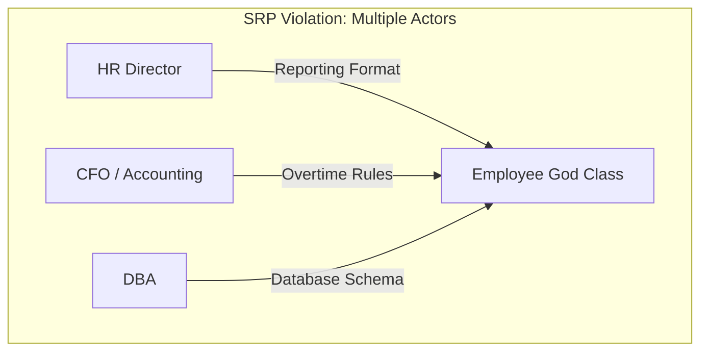
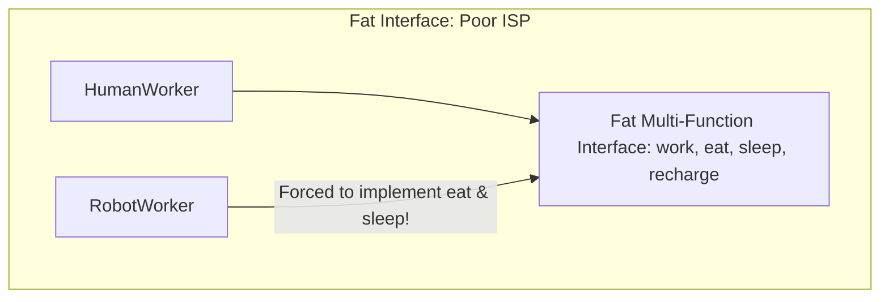
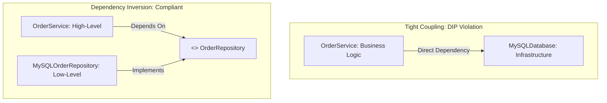

# SOLID Principles - Object-Oriented Architecture & System Design (In-Depth Masterclass)

## 1. Architectural Philosophy: The Cost of Fragile Software

The **SOLID Principles**, formalized by Robert C. Martin ("Uncle Bob"), represent five foundational object-oriented design principles to eradicate the four primary symptoms of rotting software:
1. **Rigidity:** Every change causes a cascade of subsequent changes in dependent modules.
2. **Fragility:** A modification breaks unrelated parts of the software in unexpected places.
3. **Immobility:** Code cannot be reused outside its original context because it is tangled with foreign dependencies.
4. **Viscosity:** Doing things right is harder than doing quick, hacky workarounds.

```
┌────────────────────────────────────────────────────────────────────────┐
│                        The SOLID Framework                             │
├───────┬──────────────────────────────────┬─────────────────────────────┤
│ **S** │ Single Responsibility Principle  │ Cohesion (One Actor)        │
│ **O** │ Open/Closed Principle            │ Extensibility via Contracts │
│ **L** │ Liskov Substitution Principle    │ Behavioral Subtyping        │
│ **I** │ Interface Segregation Principle  │ Client-Specific Interfaces  │
│ **D** │ Dependency Inversion Principle   │ Decoupling via Abstraction  │
└───────┴──────────────────────────────────┴─────────────────────────────┘
```

---

## 2. S - Single Responsibility Principle (SRP)

### The Formal Definition
> *"A module should have one, and only one, reason to change."*
> **Refined by Uncle Bob:** *"A module should be responsible to one, and only one, **actor**."*

An "actor" is a person, department, or business stakeholder who requests a change.

### The Divergent Change Smell
If class `Employee` is modified whenever:
- The **Accounting department** changes overtime calculation rules,
- The **HR department** changes reporting formats,
- The **DBA team** migrates the database schema,

Then `Employee` violates SRP. It couples three unrelated actors into a single compilation unit.



### Refactoring to SRP: Actor Separation

```java
// ❌ VIOLATION: God class serving multiple business stakeholders
public class Employee {
    private String id;
    private String name;
    private BigDecimal salary;

    // Reason 1: Accounting / Finance change
    public BigDecimal calculatePay() {
        return regularHours().multiply(hourlyRate()).add(calculateOvertime());
    }

    // Reason 2: HR / Management change
    public String generatePerformanceReport() {
        return "Performance summary for " + name;
    }

    // Reason 3: Database / Infrastructure change
    public void saveToDatabase() {
        String sql = "INSERT INTO employees VALUES (?, ?, ?)";
        database.execute(sql, id, name, salary);
    }
}
```

```java
// ✅ CORRECT: Separated by actor and responsibility

// 1. Core Domain Entity (Holds pure state and business invariants)
public class Employee {
    private final String id;
    private final String name;
    private final BigDecimal salary;

    public Employee(String id, String name, BigDecimal salary) {
        this.id = id;
        this.name = name;
        this.salary = salary;
    }
    // Pure getters...
}

// 2. Accounting Actor (Payroll logic)
public class PayrollService {
    public BigDecimal calculatePay(Employee employee) {
        // Financial calculation rules
        return ...;
    }
}

// 3. HR Actor (Reporting logic)
public class EmployeeReportingService {
    public String generatePerformanceReport(Employee employee) {
        // Formatting and presentation
        return ...;
    }
}

// 4. Persistence Actor (Data Access)
public class EmployeeRepository {
    public void save(Employee employee) {
        // Database queries
    }
}
```

---

## 3. O - Open/Closed Principle (OCP)

### The Formal Definition
> *"Software entities (classes, modules, functions) should be **open for extension**, but **closed for modification**."*

- **Open for Extension:** The behavior of the module can be extended to satisfy new business requirements.
- **Closed for Modification:** Extending the behavior does not require modifying existing, tested source code.

### The Shotgun Surgery Smell (Cascading `switch`/`if-else`)
When adding a new type requires finding and modifying every `switch` statement or `instanceof` check across the codebase:

```java
// ❌ VIOLATION: Adding a new payment type breaks OCP (requires modifying processPayment)
public class PaymentService {
    public void processPayment(PaymentType type, BigDecimal amount) {
        if (type == PaymentType.CREDIT_CARD) {
            executeCreditCard(amount);
        } else if (type == PaymentType.PAYPAL) {
            executePayPal(amount);
        } else if (type == PaymentType.CRYPTO) { // Modified every time a new type is added!
            executeCrypto(amount);
        }
    }
}
```

### OCP via Polymorphism & Strategy Pattern

```java
// ✅ CORRECT: Polymorphic Strategy Pattern

// The stable abstraction (Closed for modification)
public interface PaymentMethod {
    PaymentReceipt pay(BigDecimal amount);
}

// Independent extensions (Open for extension)
@Component
public class CreditCardPayment implements PaymentMethod {
    @Override
    public PaymentReceipt pay(BigDecimal amount) {
        // Charge credit card
        return new PaymentReceipt("CC-SUCCESS");
    }
}

@Component
public class PayPalPayment implements PaymentMethod {
    @Override
    public PaymentReceipt pay(BigDecimal amount) {
        // Authenticate PayPal OAuth and transfer
        return new PaymentReceipt("PAYPAL-SUCCESS");
    }
}

// Adding Crypto or ApplePay requires creating a NEW class.
// PaymentService is NEVER modified:
@Service
public class PaymentService {
    private final Map<String, PaymentMethod> paymentMethods;

    public PaymentService(Map<String, PaymentMethod> paymentMethods) {
        this.paymentMethods = paymentMethods;
    }

    public PaymentReceipt process(String paymentMethodKey, BigDecimal amount) {
        PaymentMethod method = paymentMethods.get(paymentMethodKey);
        if (method == null) throw new UnsupportedPaymentMethodException(paymentMethodKey);
        return method.pay(amount);
    }
}
```

---

## 4. L - Liskov Substitution Principle (LSP)

### The Formal Mathematical Definition (Barbara Liskov, 1988)
> *"Let $\phi(x)$ be a property provable about objects $x$ of type $T$. Then $\phi(y)$ should be true for objects $y$ of type $S$ where $S$ is a subtype of $T$."*

**Plain English:** Subclasses must be substitutable for their base types **without altering the correctness of the program**.

### The 4 Behavioral Subtyping Contract Rules

```
┌───────────────────────────────────┬────────────────────────────────────────────┐
│ Contract Rule                     │ Invariant Requirement                      │
├───────────────────────────────────┼────────────────────────────────────────────┤
│ 1. Preconditions                  │ Cannot be strengthened in a subtype        │
│ 2. Postconditions                 │ Cannot be weakened in a subtype            │
│ 3. Invariants                     │ All supertype invariants must be preserved │
│ 4. History Constraint             │ Cannot alter state in ways supertype bans  │
└───────────────────────────────────┴────────────────────────────────────────────┘
```

1. **Preconditions cannot be strengthened:** If a parent method accepts any integer $\ge 0$, a subclass method cannot require the integer to be $\ge 100$.
2. **Postconditions cannot be weakened:** If a parent guarantees returning a non-null object, the child cannot return `null`.
3. **Invariants must be preserved:** Base class internal rules must remain valid.

---

### Classic LSP Violations

#### Violation 1: The Square-Rectangle Problem
In mathematics, a Square is a Rectangle. In object-oriented programming, it is **not**:

```java
// ❌ CLASSIC LSP VIOLATION:
public class Rectangle {
    protected int width;
    protected int height;

    public void setWidth(int width) { this.width = width; }
    public void setHeight(int height) { this.height = height; }
    public int getArea() { return width * height; }
}

public class Square extends Rectangle {
    @Override
    public void setWidth(int width) {
        this.width = width;
        this.height = width; // Mutates height to keep square invariant!
    }

    @Override
    public void setHeight(int height) {
        this.width = height;
        this.height = height; // Mutates width to keep square invariant!
    }
}
```
**The Failure Test:**
```java
void clientMethod(Rectangle r) {
    r.setWidth(5);
    r.setHeight(4);
    // Invariant expectation: Area MUST be 5 * 4 = 20!
    assert r.getArea() == 20; 
    // ❌ If r is an instance of Square, r.getArea() returns 16! Test FAILS!
}
```
> **Core Lesson:** Subtyping is about **behavior**, not real-world taxonomy. A Square does not behave like a mutable Rectangle.

#### Violation 2: Throwing `UnsupportedOperationException`
```java
public interface Bird {
    void fly();
}

public class Ostrich implements Bird {
    @Override
    public void fly() {
        throw new UnsupportedOperationException("Ostriches cannot fly!"); // ❌ Violates LSP!
    }
}
```
> **JDK Example:** `Collections.unmodifiableList(list).add("item")` throws `UnsupportedOperationException`. The `List` interface postcondition (mutability) is violated by the unmodifiable view, representing a pragmatic compromise of pure LSP in the standard library.

---

## 5. I - Interface Segregation Principle (ISP)

### The Formal Definition
> *"Clients should not be forced to depend on methods they do not use."*

Many small, client-specific **role interfaces** are better than one general-purpose, bloated "fat interface".



### Refactoring to Segregated Role Interfaces

```java
// ❌ VIOLATION: "Fat" interface
public interface MultiFunctionDevice {
    void print(Document doc);
    void scan(Document doc);
    void fax(Document doc);
}

// Low-end economic printer cannot scan or fax:
public class BasicPrinter implements MultiFunctionDevice {
    public void print(Document doc) { /* Print logic */ }
    public void scan(Document doc) { throw new UnsupportedOperationException(); } // ❌ Polluted!
    public void fax(Document doc) { throw new UnsupportedOperationException(); }  // ❌ Polluted!
}
```

```java
// ✅ CORRECT: Segregated Role Interfaces
public interface Printer {
    void print(Document doc);
}

public interface Scanner {
    void scan(Document doc);
}

public interface Fax {
    void fax(Document doc);
}

// Basic printer implements ONLY what it can do:
public class BasicPrinter implements Printer {
    public void print(Document doc) { ... }
}

// All-in-one printer composes multiple interfaces:
public class EnterpriseCopier implements Printer, Scanner, Fax {
    public void print(Document doc) { ... }
    public void scan(Document doc) { ... }
    public void fax(Document doc) { ... }
}
```

> **JDK Masterclass Examples of ISP:**
> - `java.lang.Runnable` (1 method: `run()`)
> - `java.lang.Comparable` (1 method: `compareTo()`)
> - `java.lang.AutoCloseable` (1 method: `close()`)
> - `java.util.Iterator` (4 small methods: `hasNext()`, `next()`, `remove()`, `forEachRemaining()`)

---

## 6. D - Dependency Inversion Principle (DIP)

### The Two Foundational Rules
1. **High-level modules should not depend on low-level modules. Both should depend on abstractions.**
2. **Abstractions should not depend on details. Details should depend on abstractions.**

### Disambiguation: DIP vs IoC vs DI
- **DIP (Dependency Inversion Principle):** The high-level **architectural design principle** stating dependencies should point toward abstractions.
- **IoC (Inversion of Control):** The broad **architectural pattern** where execution flow is inverted (e.g. framework calls your code, not your code calling the framework).
- **DI (Dependency Injection):** The concrete **implementation technique** used to supply dependencies to an object from the outside (Constructor Injection, Setter Injection).



### Refactoring to DIP Compliant Architecture

```java
// ❌ VIOLATION: High-level business service creates low-level concrete implementations
public class OrderService {
    // Hardcoded dependencies: Cannot mock for tests, cannot swap implementations
    private final MySQLOrderRepository repository = new MySQLOrderRepository();
    private final TwilioSmsSender smsSender = new TwilioSmsSender();

    public void completeOrder(Order order) {
        repository.save(order);
        smsSender.send("Order completed!");
    }
}
```

```java
// ✅ CORRECT: Both layers depend on clean abstractions

// Domain Abstractions:
public interface OrderRepository {
    void save(Order order);
}

public interface NotificationGateway {
    void notifyUser(String message);
}

// High-level service depends solely on abstractions:
@Service
public class OrderService {
    private final OrderRepository repository;
    private final NotificationGateway notificationGateway;

    // Constructor Injection (DI): Injected by IoC container (Spring)
    public OrderService(OrderRepository repository, NotificationGateway notificationGateway) {
        this.repository = repository;
        this.notificationGateway = notificationGateway;
    }

    public void completeOrder(Order order) {
        repository.save(order);
        notificationGateway.notifyUser("Order completed!");
    }
}

// Low-level implementations plug in independently:
@Repository
public class PostgresOrderRepository implements OrderRepository { ... }

@Component
public class SnsNotificationGateway implements NotificationGateway { ... }
```

---

## 7. SOLID Principles Synthesis & System Design Matrix

| Principle | Primary Objective | Architectural Metric | Major Code Smell Addressed |
| :--- | :--- | :--- | :--- |
| **S**RP | Isolate changes per stakeholder | **High Cohesion** | God Class, Divergent Change |
| **O**CP | Add features without breaking existing code | **Extensibility** | Shotgun Surgery, Cascading `switch` / `instanceof` |
| **L**SP | Ensure safe polymorphism | **Behavioral Correctness** | `UnsupportedOperationException`, Broken Invariants |
| **I**SP | Decouple clients from unused dependencies | **Low Coupling** | Fat / Polluted Interfaces, Dummy Override Methods |
| **D**IP | Decouple business policies from infrastructure | **Testability & Invertibility** | Hardcoded `new` instantiation, Inflexible Wiring |

---

## 8. Common Traps & Over-Engineering Pitfalls

### ❌ Trap 1: Interface Explosion (Over-engineering ISP & DIP)
Creating a distinct interface for every single class even when there is only one implementation and zero polymorphic requirements.
*Rule:* Don't create an interface until you have **two implementations** or a strict need for unit-test mocking.

### ❌ Trap 2: Extreme Nano-Classes (Misinterpreting SRP)
Splitting a cohesive class into 20 single-method classes with names like `UserEmailFormatValidatorValidator`.
*Rule:* SRP is about **actors and reasons to change**, not restricting classes to a single method.

---

## 9. Senior / FAANG Interview Questions & Answers

### Q1: How does the Open/Closed Principle relate to the Strategy and Factory Design Patterns?
**Answer:**
The Strategy pattern provides the polymorphic abstraction (the interface and concrete implementations) that enables behavior to be extended without touching existing algorithms. The Factory pattern encapsulates the object creation logic, decoupling the consumer from knowing the concrete classes. Together, they achieve OCP: new business algorithms are introduced simply by creating a new Strategy implementation and registering it with the Factory.

### Q2: Why does `java.util.Stack` extending `java.util.Vector` violate the Liskov Substitution Principle?
**Answer:**
A Stack is conceptually a LIFO data structure supporting only `push`, `pop`, and `peek`. Because `Stack` extends `Vector`, it inherits positional indexed operations like `insertElementAt(item, index)`, `remove(index)`, and `get(index)`. A client accepting a `Vector` can arbitrarily mutate elements in the middle of a `Stack`, corrupting its LIFO invariant. `Stack` should have composed a `Deque` (like `ArrayDeque`) rather than inheriting `Vector`.

### Q3: What is the difference between Constructor Injection, Setter Injection, and Field Injection in the context of DIP?
**Answer:**
- **Constructor Injection (Recommended):** Dependencies are immutable (`final`), guaranteed to be non-null upon instantiation, and prevent half-initialized objects. Makes unit testing simple without reflection.
- **Setter Injection:** Used for optional or mutable dependencies. Risk: object can exist in an incomplete state before setter is called.
- **Field Injection (`@Autowired` on private field):** Strongly discouraged. Violates DIP by tightly coupling the class to the reflection mechanics of the DI framework. The class cannot be instantiated or tested in plain Java without starting a Spring container or using reflection hacks.

---

## 10. Summary Cheat Sheet

```
┌───────────────────────────┬────────────────────────────────────────────────────────┐
│ Principle                 │ Core Design Rule                                       │
├───────────────────────────┼────────────────────────────────────────────────────────┤
│ Single Responsibility     │ One class = One actor / reason to change               │
│ Open/Closed               │ Open for extension (interfaces), closed for edit       │
│ Liskov Substitution       │ Subtypes must honor base contracts without exceptions  │
│ Interface Segregation     │ Keep interfaces narrow and client-specific (Role APIs) │
│ Dependency Inversion      │ High-level and Low-level both depend on abstractions   │
└───────────────────────────┴────────────────────────────────────────────────────────┘
```
