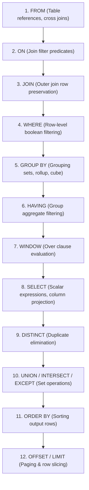

# 03 · Advanced SQL, Window Functions & CTEs

> **Level:** Intermediate → Expert  
> **Interview Frequency:** ★★★★★ (The standard live coding filter in senior backend loops)  
> **Target Databases:** PostgreSQL & MySQL 8.0+  
> **Last Updated:** 2026

---

## 📋 Table of Contents
- [0. TL;DR — The 30-Second Answer](#0-tldr--the-30-second-answer)
- [1. What & Why — Thinking in Sets vs Iterative Loops](#1-what--why--thinking-in-sets-vs-iterative-loops)
- [2. Mental Model — The SQL Logical Processing Pipeline](#2-mental-model--the-sql-logical-processing-pipeline)
- [3. Deep Dive — Advanced SQL Mechanics](#3-deep-dive--advanced-sql-mechanics)
  - [3.1 Window Functions: Partitions, Rankings & Frames](#31-window-functions-partitions-rankings--frames)
  - [3.2 The `ROWS` vs `RANGE` Window Frame Pitfall](#32-the-rows-vs-range-window-frame-pitfall)
  - [3.3 Common Table Expressions (CTEs) & Optimization Fences](#33-common-table-expressions-ctes--optimization-fences)
  - [3.4 Recursive CTEs: Mechanics, Hierarchies & Cycle Detection](#34-recursive-ctes-mechanics-hierarchies--cycle-detection)
  - [3.5 Multi-Dimensional Aggregations: `GROUPING SETS`, `ROLLUP` & `CUBE`](#35-multi-dimensional-aggregations-grouping-sets-rollup--cube)
  - [3.6 `LATERAL` Joins & Correlated Set Processing](#36-lateral-joins--correlated-set-processing)
- [4. Visualizations & Evaluation Timelines](#4-visualizations--evaluation-timelines)
- [5. Worked Examples: Complete Production Queries](#5-worked-examples-complete-production-queries)
- [6. Production Query Patterns & Anti-Patterns](#6-production-query-patterns--anti-patterns)
- [7. The 3 Classic SQL Traps (NULLs & Sets)](#7-the-3-classic-sql-traps-nulls--sets)
- [8. Level-Wise Interview Questions & Answers](#8-level-wise-interview-questions--answers)
- [9. Counter-Questions & Interviewer Traps](#9-counter-questions--interviewer-traps)
- [10. Rapid-Fire MCQs](#10-rapid-fire-mcqs)
- [11. One-Page Cheat Sheet](#11-one-page-cheat-sheet)
- [12. Real-World Production Post-Mortems](#12-real-world-production-post-mortems)
- [13. Follow-up Learning](#13-follow-up-learning)

---

## 0. TL;DR — The 30-Second Answer

1. **Logical Execution Order is NOT Lexical Order.** You write `SELECT` first, but the database evaluates it **eighth** (after `FROM`, `JOIN`, `WHERE`, `GROUP BY`, and `HAVING`). This is why you cannot reference a `SELECT` column alias inside `WHERE`.
2. **Window Functions preserve row cardinality.** Unlike `GROUP BY`, which collapses multiple rows into a single aggregate row, Window Functions compute an aggregation or ranking over an isolated frame of rows while **retaining every individual row**.
3. **The `RANGE` vs `ROWS` Default Trap:** When you add `ORDER BY` to an `OVER()` clause without specifying a frame, SQL defaults to `RANGE BETWEEN UNBOUNDED PRECEDING AND CURRENT ROW`. In PostgreSQL/MySQL, this can cause unintended duplicate row grouping and severe disk spills compared to `ROWS BETWEEN UNBOUNDED PRECEDING AND CURRENT ROW`.
4. **Recursive CTEs consist of two parts:** An Anchor Member (base case) and a Recursive Member (inductive step), combined via `UNION ALL`. Execution stops automatically when the recursive member yields zero rows.
5. **PostgreSQL 12+ CTE Inlining:** Historically, PostgreSQL treated CTEs as optimization fences (forcing materialization to temporary buffers). Modern Postgres inlines CTEs into the main query plan unless explicitly flagged with `WITH cte AS MATERIALIZED (...)`.
6. **`CROSS JOIN LATERAL` is a `foreach` loop in SQL:** It allows a subquery to reference columns from preceding tables in the `FROM` list, enabling correlated top-→N→ operations with index lookups.

---

## 1. What & Why — Thinking in Sets vs Iterative Loops

Junior backend engineers approach data problems with procedural loops:
> *"Fetch all records → loop in Java → maintain a hash map of running totals → filter out duplicates → send back."*

This anti-pattern saturates network bandwidth and exhausts JVM heap. An experienced backend developer pushes mathematical set operations down into the database engine:

→\text{Relational Algebra (CBO)} \gg \text{Network Transfer} + \text{JVM Object Allocation}→

Database engines execute window functions and groupings in C/C++ directly on memory pages, leveraging SIMD vectorized instructions and index-ordered streams.

---

## 2. Mental Model — The SQL Logical Processing Pipeline

Understanding the precise sequence in which the query engine evaluates clauses is the secret to debugging query syntax and performance:



> **Why this matters in interviews:**
> - Why can't you use `WHERE rank = 1` when `rank` is computed via `DENSE_RANK() OVER (...)`?  
>   *Answer:* `WHERE` (Step 4) runs **before** `WINDOW` (Step 7). You must wrap the window query in a CTE or subquery so the outer query's `WHERE` runs after.

---

## 3. Deep Dive — Advanced SQL Mechanics

### 3.1 Window Functions: Partitions, Rankings & Frames

A window function performs a calculation across a set of table rows that are related to the current row.

→\text{FUNCTION}() \ \mathbf{OVER} \ ([\mathbf{PARTITION \ BY} \ \text{col1}] \ [\mathbf{ORDER \ BY} \ \text{col2}] \ [\mathbf{FRAME \ SPEC}])→

#### 1. Ranking Functions Compared
Given salaries: `[1000, 1000, 800, 700]`

| Function | Output | Behavior on Ties |
|---|---|---|
| `ROW_NUMBER()` | `1, 2, 3, 4` | Always returns sequential unique integers; breaks ties arbitrarily. |
| `RANK()` | `1, 1, 3, 4` | Assigns identical rank to ties; leaves gaps in numbering. |
| `DENSE_RANK()` | `1, 1, 2, 3` | Assigns identical rank to ties; **never leaves gaps**. |
| `NTILE(2)` | `1, 1, 2, 2` | Divides ordered partition into →N→ equal buckets. |

```sql
SELECT 
    employee_id, department_id, salary,
    ROW_NUMBER() OVER (PARTITION BY department_id ORDER BY salary DESC) as row_num,
    RANK()       OVER (PARTITION BY department_id ORDER BY salary DESC) as rnk,
    DENSE_RANK() OVER (PARTITION BY department_id ORDER BY salary DESC) as dense_rnk
FROM employees;
```

#### 2. Value Navigation Functions
- `LAG(col, offset, default)`: Accesses a row prior to the current row without a self-join.
- `LEAD(col, offset, default)`: Accesses a row following the current row.
- `FIRST_VALUE(col)`: Returns the first value in the sliding frame.
- `LAST_VALUE(col)`: Returns the last value in the sliding frame.

---

### 3.2 The `ROWS` vs `RANGE` Window Frame Pitfall

This is one of the most common pitfalls in production SQL:

```sql
-- Query A:
SUM(amount) OVER (ORDER BY transaction_date)

-- Query B:
SUM(amount) OVER (ORDER BY transaction_date ROWS BETWEEN UNBOUNDED PRECEDING AND CURRENT ROW)
```

#### Why Query A can produce bugs and slow execution:
1. **The ANSI Default:** If you specify `ORDER BY` without a frame, SQL defaults to:
   ```sql
   RANGE BETWEEN UNBOUNDED PRECEDING AND CURRENT ROW
   ```
2. **The `RANGE` Semantic (Peer Rows):** `RANGE` evaluates duplicates in `ORDER BY` as identical peers. If 5 transactions have the exact same `transaction_date`, `RANGE` evaluates the sum across **all 5 duplicates simultaneously**, skipping intermediate rolling totals!
3. **The Performance Penalty:** `RANGE` requires sorting and checking value boundaries; `ROWS` simply counts physical rows. `ROWS` executes significantly faster and consumes less buffer memory.

```text
Row  Date        Amount   ROWS Cumulative   RANGE Cumulative (Default!)
1    2026-01-01  →100     →100              →100
2    2026-01-02  →200     →300              →500  <-- Peered with row 3!
3    2026-01-02  →300     →600              →500  <-- Jumped to →500!
4    2026-01-03  →150     →750              →750
```

---

### 3.3 Common Table Expressions (CTEs) & Optimization Fences

```sql
WITH regional_sales AS (
    SELECT region, SUM(amount) AS total_sales
    FROM orders
    GROUP BY region
)
SELECT region, total_sales
FROM regional_sales
WHERE total_sales > 100000;
```

#### Optimization Fencing (PostgreSQL Evolution)
- **Postgres 11 and older:** CTEs were strictly **optimization fences**. The engine wrote the CTE output to a temporary buffer (materialized it), preventing the optimizer from pushing outer `WHERE` predicates down into the CTE!
- **Postgres 12+:** CTEs are **inlined by default** if they are non-recursive and side-effect free.
- **Explicit Control:**
  ```sql
  -- Force separate evaluation (Materialized):
  WITH expensive_calc AS MATERIALIZED ( ... )
  
  -- Force inlining into parent query:
  WITH inline_calc AS NOT MATERIALIZED ( ... )
  ```

---

### 3.4 Recursive CTEs: Mechanics, Hierarchies & Cycle Detection

A recursive CTE iteratively builds a result set.

#### General Syntax:
```sql
WITH RECURSIVE cte_name AS (
    -- 1. ANCHOR MEMBER (Base Case)
    SELECT id, name, manager_id, 1 as depth
    FROM employees
    WHERE manager_id IS NULL

    UNION ALL

    -- 2. RECURSIVE MEMBER (Inductive Step)
    SELECT e.id, e.name, e.manager_id, c.depth + 1
    FROM employees e
    INNER JOIN cte_name c ON e.manager_id = c.id
)
SELECT * FROM cte_name;
```

#### Execution Mechanics:
1. Evaluate Anchor Member; place rows into **Working Table** and **Result Table**.
2. While Working Table is not empty:
   - Evaluate Recursive Member substituting Working Table for `cte_name`.
   - Place new intermediate rows into **Intermediate Table**.
   - Clear Working Table; move Intermediate Table rows to Working Table and append to Result Table.
3. Return Result Table.

#### Cycle Detection (Preventing Infinite Recursion)
In real-world data, circular references occur (e.g. Employee A reports to B, B reports to A).
```sql
WITH RECURSIVE org_tree AS (
    SELECT id, name, manager_id, ARRAY[id] AS path, FALSE AS is_cycle
    FROM employees
    WHERE manager_id IS NULL

    UNION ALL

    SELECT e.id, e.name, e.manager_id,
           path || e.id,
           e.id = ANY(path) -- Checks if ID was already visited!
    FROM employees e
    JOIN org_tree o ON e.manager_id = o.id
    WHERE NOT o.is_cycle
)
SELECT * FROM org_tree WHERE NOT is_cycle;
```

---

### 3.5 Multi-Dimensional Aggregations: `GROUPING SETS`, `ROLLUP` & `CUBE`

Instead of running 4 separate queries with `UNION ALL`, SQL provides multi-dimensional aggregations in a single pass over the table.

```sql
SELECT 
    COALESCE(brand, 'All Brands') AS brand,
    COALESCE(category, 'All Categories') AS category,
    SUM(revenue) AS total_revenue
FROM product_sales
GROUP BY CUBE (brand, category);
```

#### Differences at a Glance:
- **`GROUP BY (brand, category)`:** 1 grouping combination: `(brand, category)`.
- **`ROLLUP (brand, category)`:** Hierarchical subtotals (useful for year → month → day):  
  1. `(brand, category)`  
  2. `(brand)`  
  3. `()` (Grand Total)
- **`CUBE (brand, category)`:** All →2^N→ permutations:  
  1. `(brand, category)`  
  2. `(brand)`  
  3. `(category)`  
  4. `()` (Grand Total)

---

### 3.6 `LATERAL` Joins & Correlated Set Processing

A `LATERAL` join acts like a `for-each` loop in SQL, allowing a subquery to reference columns provided by previous tables in the `FROM` list.

#### Classic Senior Interview Problem: "Find the Top 3 most recent orders for EVERY customer"
```sql
SELECT c.id, c.name, o.order_id, o.amount, o.order_date
FROM customers c
CROSS JOIN LATERAL (
    SELECT order_id, amount, order_date
    FROM orders
    WHERE customer_id = c.id
    ORDER BY order_date DESC
    LIMIT 3
) o;
```
* **Why this beats a Window Function at Scale:** If you have 10,000,000 orders across 100,000 customers, `ROW_NUMBER()` must scan and rank all 10M rows. `CROSS JOIN LATERAL` with an index on `(customer_id, order_date DESC)` performs 100,000 instant B-tree seeks, reading **only 300,000 rows**!

---

## 4. Visualizations & Evaluation Timelines

### Recursive CTE In-Memory Queue Lifecycle
```text
Iteration 0 (Anchor):
  Working Table      : [ CEO (ID: 1) ]
  Accumulator Result : [ CEO (ID: 1) ]

Iteration 1:
  Join (Working Table ⨝ Employees):
  Working Table      : [ VP Eng (ID: 2), VP Product (ID: 3) ]
  Accumulator Result : [ CEO, VP Eng, VP Product ]

Iteration 2:
  Join (Working Table ⨝ Employees):
  Working Table      : [ Lead Arch (ID: 4), Staff Eng (ID: 5) ]
  Accumulator Result : [ CEO, VP Eng, VP Product, Lead Arch, Staff Eng ]

Iteration 3:
  Join (Working Table ⨝ Employees):
  Working Table      : [ EMPTY ]  <-- Recursion Halts!

Final Output Returned to Client (5 rows).
```

---

## 5. Worked Examples: Complete Production Queries

### Scenario: Keyset Pagination over Tied Timestamps
Offset pagination (`OFFSET 1000000`) kills databases. Keyset pagination uses tuple comparison:

```sql
-- Keyset cursor query fetching 20 records after last seen (timestamp, id):
SELECT id, title, created_at
FROM posts
WHERE (created_at, id) < ('2026-03-15 10:00:00+00', 49201)
ORDER BY created_at DESC, id DESC
LIMIT 20;
```
* **B+ Tree Index Required:** `CREATE INDEX idx_posts_keyset ON posts (created_at DESC, id DESC);`
* **Performance:** Executes in **0.1ms** regardless of whether you are on page 1 or page 50,000.

---

## 6. Production Query Patterns & Anti-Patterns

### 1. Safe Row Deduplication (Keeping Latest Record)
```sql
WITH ranked_records AS (
    SELECT 
        id, customer_id, updated_at,
        ROW_NUMBER() OVER (
            PARTITION BY customer_id 
            ORDER BY updated_at DESC, id DESC
        ) as rn
    FROM customer_profiles
)
DELETE FROM customer_profiles
WHERE id IN (
    SELECT id FROM ranked_records WHERE rn > 1
);
```

### 2. High-Performance Conditional Aggregation
```sql
-- ❌ Slow, verbose approach:
SELECT 
    COUNT(CASE WHEN status = 'SUCCESS' THEN 1 END) as success_count,
    COUNT(CASE WHEN status = 'FAILED' THEN 1 END) as failed_count
FROM transactions;

-- ✅ Modern SQL Standard (PostgreSQL):
SELECT 
    COUNT(*) FILTER (WHERE status = 'SUCCESS') as success_count,
    COUNT(*) FILTER (WHERE status = 'FAILED') as failed_count
FROM transactions;
```

---

## 7. The 3 Classic SQL Traps (NULLs & Sets)

### Trap 1: The `NOT IN` with NULL Disaster
```sql
SELECT * FROM users 
WHERE id NOT IN (SELECT manager_id FROM departments);
```
* **The Catastrophe:** If `departments` contains **even a single `NULL`** in `manager_id`, the entire query returns **ZERO ROWS**!
* **Why:** In three-valued logic, `id NOT IN (1, 2, NULL)` expands to:
  →\text{id} \neq 1 \ \mathbf{AND} \ \text{id} \neq 2 \ \mathbf{AND} \ \text{id} \neq \text{NULL}→
  Since →\text{id} \neq \text{NULL}→ yields `UNKNOWN`, the `AND` chain evaluates to `UNKNOWN` or `FALSE`.
* **The Fix:** Always use `NOT EXISTS`:
  ```sql
  SELECT * FROM users u
  WHERE NOT EXISTS (
      SELECT 1 FROM departments d WHERE d.manager_id = u.id
  );
  ```

### Trap 2: `COUNT(column)` vs `COUNT(*)`
- `COUNT(*)` counts the number of **rows** in the partition (including null rows).
- `COUNT(column)` counts only rows where `column IS NOT NULL`.

### Trap 3: Unbounded Window Memory Spills
Calculating `DENSE_RANK() OVER (ORDER BY salary)` over 50M rows without a `PARTITION BY` forces the entire dataset into memory for a single global sort. If `work_mem` is exceeded, Postgres spills the sort to temporary disk files, degrading execution speed by 100x.

---

## 8. Level-Wise Interview Questions & Answers

### 🟢 Junior (0–2 Years)
**Q: What is the difference between `WHERE` and `HAVING`?**  
**A:** `WHERE` filters individual rows before grouping occurs (evaluated in step 4). `HAVING` filters aggregated groups after `GROUP BY` has collapsed rows (evaluated in step 6). `HAVING` can filter on aggregate functions like `SUM()` or `COUNT()`, whereas `WHERE` cannot.

---

### 🟡 Mid-Level (2–5 Years)
**Q: What is the difference between `RANK()` and `DENSE_RANK()`?**  
**A:** Both functions assign identical numerical rankings to tied rows. However, `RANK()` leaves gaps in the numerical sequence following ties (e.g., 1, 1, 3), whereas `DENSE_RANK()` does not leave gaps (e.g., 1, 1, 2).

---

### 🔴 Senior (5–8 Years)
**Q: Explain how a Recursive CTE works internally and how you prevent infinite loops caused by circular data.**  
**A:** A Recursive CTE evaluates an Anchor Member once, placing the initial rows into an in-memory Working Table. It then iteratively executes the Recursive Member, joining against the Working Table, until an iteration produces zero rows.
To prevent infinite loops from cycles in data (such as cyclic employee-manager hierarchies), we maintain an array of visited identifiers (`ARRAY[id]`). In the recursive step, we verify that the current row's ID is not already present in the path array using `WHERE NOT (e.id = ANY(path))`.

---

### ⚫ Principal / Staff (8+ Years)
**Q: When would you use a `CROSS JOIN LATERAL` instead of a Window Function with `ROW_NUMBER()`, and what is the difference in execution plans?**  
**A:** You choose `CROSS JOIN LATERAL` when fetching the "Top →N→ items per parent" from a massive dataset where the parent table has moderate cardinality and the child table has a supporting composite index on `(parent_id, order_col DESC)`.
A Window Function (`ROW_NUMBER() OVER (PARTITION BY parent_id ORDER BY order_col DESC)`) forces the engine to perform a full scan or full index scan over the entire child table (e.g., 50 million rows) to rank every row before discarding those with `rn > N`.
In contrast, `CROSS JOIN LATERAL` executes an index seek on the composite index for each parent row, reading only the top →N→ rows per parent directly from the B+ tree. If there are 1,000 parents and →N=3→, `LATERAL` reads exactly 3,000 rows instead of scanning 50 million!

---

## 9. Counter-Questions & Interviewer Traps

### Trap 1: "Can we use an alias defined in `SELECT` inside our `WHERE` clause?"
- **Naive Answer:** "Yes, as long as it's defined in the query."
- **The Trap:** The interviewer is probing your knowledge of the logical query execution pipeline.
- **The Expert Answer:** "No, because `WHERE` is evaluated in step 4, while `SELECT` (and column aliasing) is not evaluated until step 8. The alias does not exist when the `WHERE` clause is filtering rows. To filter on that alias, you must wrap the query in a CTE or subquery, or repeat the expression in the `WHERE` clause."

### Trap 2: "Is `UNION` identical to `UNION ALL` except that `UNION` removes duplicates?"
- **Naive Answer:** "Yes, they do the same thing, but `UNION` is cleaner because it deduplicates."
- **The Trap:** Omitting the performance penalty.
- **The Expert Answer:** "`UNION` requires an explicit sorting or hash-aggregate deduplication pass across the entire combined dataset. If you combine two 5-million-row datasets, `UNION` performs an expensive sort/hash phase that often spills to disk. `UNION ALL` simply concatenates the two streams with zero memory or sorting overhead. In production, always default to `UNION ALL` unless deduplication is an explicit business requirement."

---

## 10. Rapid-Fire MCQs

#### Q1: Which clause is evaluated immediately BEFORE the `SELECT` clause?
- [ ] A) `WHERE`
- [ ] B) `HAVING`
- [ ] C) `WINDOW`
- [ ] D) `ORDER BY`
* **Answer:** **C**. The `WINDOW` clause is evaluated immediately before `SELECT`, while `HAVING` precedes `WINDOW`.

#### Q2: What will `SELECT * FROM table WHERE val NOT IN (1, 2, NULL)` return?
- [ ] A) All rows where val is not 1 and not 2
- [ ] B) All rows where val is NULL
- [ ] C) Exactly 0 rows
- [ ] D) Syntax Error
* **Answer:** **C**. Comparing with NULL via `NOT IN` results in `UNKNOWN`, causing the filter condition to fail for all rows.

#### Q3: What is the default window frame when `ORDER BY` is specified without an explicit frame clause?
- [ ] A) `ROWS BETWEEN UNBOUNDED PRECEDING AND UNBOUNDED FOLLOWING`
- [ ] B) `ROWS BETWEEN CURRENT ROW AND UNBOUNDED FOLLOWING`
- [ ] C) `RANGE BETWEEN UNBOUNDED PRECEDING AND CURRENT ROW`
- [ ] D) `RANGE BETWEEN 1 PRECEDING AND 1 FOLLOWING`
* **Answer:** **C**. The ANSI standard defaults to `RANGE BETWEEN UNBOUNDED PRECEDING AND CURRENT ROW`.

#### Q4: How does `ROLLUP(a, b)` differ from `CUBE(a, b)`?
- [ ] A) `ROLLUP` generates all combinations; `CUBE` generates hierarchical subtotals
- [ ] B) `ROLLUP` generates hierarchical subtotals: `(a, b)`, `(a)`, `()`; `CUBE` generates all combinations including `(b)`
- [ ] C) `ROLLUP` excludes grand totals
- [ ] D) There is no difference
* **Answer:** **B**. `ROLLUP` produces hierarchical aggregations; `CUBE` computes the full cross-product of power set groupings.

---

## 11. One-Page Cheat Sheet

```text
+-----------------------+-------------------------------------------------------------+
| Concept               | Production Rule & Syntax                                    |
+-----------------------+-------------------------------------------------------------+
| Logical Pipeline      | FROM -> ON -> JOIN -> WHERE -> GROUP BY -> HAVING ->        |
|                       | WINDOW -> SELECT -> DISTINCT -> UNION -> ORDER BY -> LIMIT  |
| Frame Specification   | Prefer ROWS BETWEEN UNBOUNDED PRECEDING AND CURRENT ROW     |
| Top N per Parent      | Use CROSS JOIN LATERAL with index instead of ROW_NUMBER()   |
| Safe Set Anti-Match   | Use NOT EXISTS instead of NOT IN to avoid NULL traps        |
| Recursive Cycle Guard | Track visited keys via path array: WHERE NOT (id = ANY(path))|
| High-Speed Concats    | Use UNION ALL (no sort) unless deduplication is required    |
+-----------------------+-------------------------------------------------------------+
```

---

## 12. Real-World Production Post-Mortems

### Incident: The Out-Of-Memory Crash from Unindexed Window Partitioning
* **Symptoms:** Nightly financial reconciliation job caused the database to crash with Linux OOM-killer terminating the Postgres process.
* **Root Cause:** A query used `ROW_NUMBER() OVER (PARTITION BY merchant_id ORDER BY transaction_time DESC)` across 80M records. Because there was no index on `(merchant_id, transaction_time)`, the database had to load all 80M rows into memory, grouping and sorting merchant partitions. Each backend process allocated gigabytes of memory, exceeding physical host RAM.
* **Resolution:**
  1. Created a composite index: `CREATE INDEX idx_rec_merchant_time ON transactions (merchant_id, transaction_time DESC);`
  2. The query plan switched to a **WindowAgg** over an index scan, evaluating the window functions in streaming pipelined fashion with near-zero RAM usage. Execution dropped from 35 minutes to 42 seconds!

---

## 13. Follow-up Learning
- **Next Chapter:** → [04 · Query Planner, Optimizer & Execution Plans](./04-Query-Planner-Optimizer-and-Explain.md)
- **Previous Chapter:** ← [02 · Indexing Architecture & B+ Tree Physics](./02-Indexing-Architecture-and-B-Trees.md)
