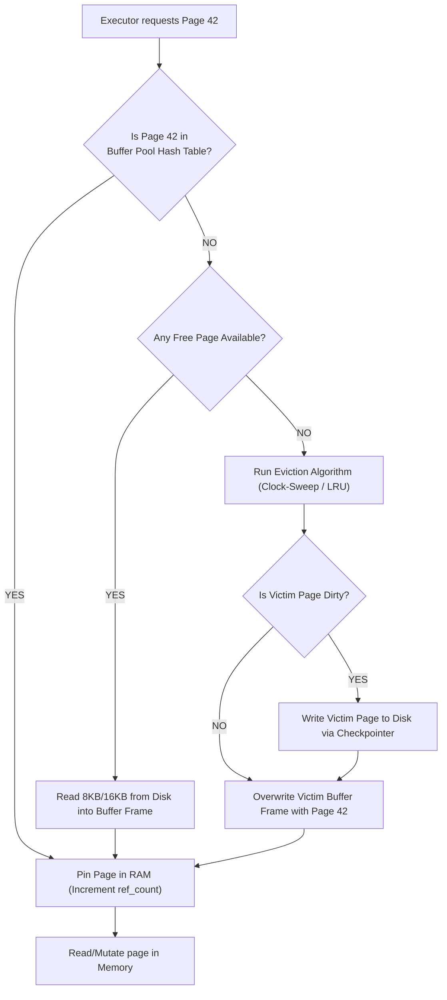
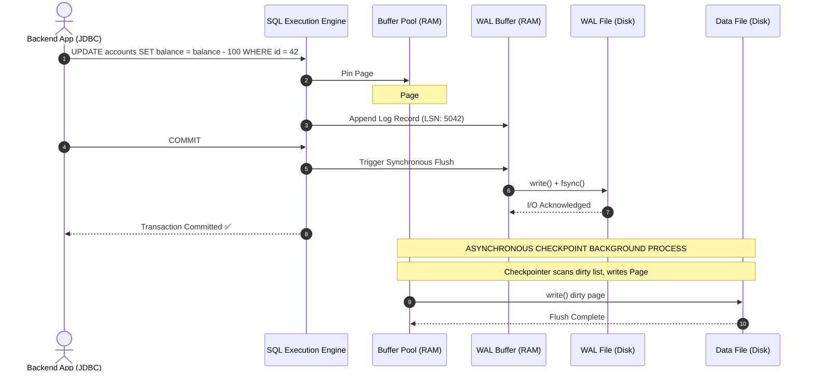

# 03 · Relational Engine & Storage Architecture Internals

> **Level:** Intermediate → Expert  
> **Interview Frequency:** ★★★★★ (Core differentiator in Senior / Staff backend loops)  
> **Target Databases:** PostgreSQL (Heap Engine) & MySQL (InnoDB)  
> **Last Updated:** 2026

---

## 📋 Table of Contents
- [0. TL;DR — The 30-Second Answer](#0-tldr--the-30-second-answer)
- [1. What & Why — The Physical Reality of Databases](#1-what--why--the-physical-reality-of-databases)
- [2. Mental Model — The Relational Engine Stack](#2-mental-model--the-relational-engine-stack)
- [3. Deep Dive — Storage Engine Internals](#3-deep-dive--storage-engine-internals)
  - [3.1 Page/Block Anatomy & Slot Directory](#31-pageblock-anatomy--slot-directory)
  - [3.2 Tuple Headers & Physical Row Layout](#32-tuple-headers--physical-row-layout)
  - [3.3 Buffer Pool Architecture & Eviction Dynamics](#33-buffer-pool-architecture--eviction-dynamics)
  - [3.4 Write-Ahead Logging (WAL) & The ARIES Recovery Algorithm](#34-write-ahead-logging-wal--the-aries-recovery-algorithm)
  - [3.5 Checkpointing & The Torn-Page Problem](#35-checkpointing--the-torn-page-problem)
  - [3.6 Row-Store (NSM) vs Column-Store (DSM/PAX)](#36-row-store-nsm-vs-column-store-dsmpax)
- [4. Visualizations & Physical Layouts](#4-visualizations--physical-layouts)
- [5. Worked Examples: Inspecting Raw Pages with `pageinspect`](#5-worked-examples-inspecting-raw-pages-with-pageinspect)
- [6. Production Diagnostic & Health Scripts](#6-production-diagnostic--health-scripts)
- [7. Common Pitfalls & Production Disasters](#7-common-pitfalls--production-disasters)
- [8. Level-Wise Interview Questions & Answers](#8-level-wise-interview-questions--answers)
- [9. Counter-Questions & Interviewer Traps](#9-counter-questions--interviewer-traps)
- [10. Rapid-Fire MCQs](#10-rapid-fire-mcqs)
- [11. One-Page Cheat Sheet](#11-one-page-cheat-sheet)
- [12. Real-World Production Post-Mortems](#12-real-world-production-post-mortems)
- [13. Follow-up Learning](#13-follow-up-learning)

---

## 0. TL;DR — The 30-Second Answer

1. **Databases read and write Pages, never individual rows.** The atomic unit of I/O is a Page (8KB in PostgreSQL, 16KB in MySQL InnoDB). When you fetch one integer column of one row, the entire page is loaded into memory.
2. **The Slot Directory decouples physical row location from its identifier.** A tuple pointer (`ctid` or `Record Offset`) points to an entry in the page header's line pointer array; line pointers point to the byte offset in the page. This prevents fragmentation when rows update.
3. **Buffer Pool is the database's dedicated RAM cache.** Modifying data happens *only* in the Buffer Pool (marking pages "dirty"). Dirty pages are written back to disk asynchronously in batches by background checkpointers.
4. **WAL (Write-Ahead Log) enables Durability without disk-thrashing.** Before any dirty page is written to disk, the change record is sequentially appended and `fsync`'d to the WAL. Append-only sequential I/O is 100x–1000x faster than random page writes.
5. **ARIES Algorithm powers Crash Recovery:** On restart after a crash, the engine performs **Analysis** (reconstructs dirty pages and active transactions from the last checkpoint), **Redo** (replays all WAL records forward to re-establish exact crash state), and **Undo** (rolls back uncommitted transactions backwards).
6. **Doublewrite Buffer / Full Page Writes solves Torn Pages.** Operating systems write in 4KB blocks. If power fails mid-way through writing a 16KB InnoDB page, the page is corrupted ("torn"). Engines write full pages to a sequential contiguous staging area first before touching data files.

---

## 1. What & Why — The Physical Reality of Databases

A naive developer views a relational database as a giant hash table or spreadsheet on disk. An experienced backend developer understands that **all database architecture is designed to mitigate the brutal latency disparity between RAM and non-volatile storage**.

| Media | Access Latency | Throughput | Access Pattern |
|---|---|---|---|
| **CPU L1/L2/L3 Cache** | 0.5 – 10 ns | Terabytes/sec | Word-level |
| **RAM (DDR4/DDR5)** | 50 – 100 ns | 25 – 100 GB/s | Cache-line (64 bytes) |
| **NVMe SSD (Random I/O)** | 10 – 50 µs (microseconds) | 1 – 7 GB/s | Block-level (4KB) |
| **Rotational HDD (Seek)** | 4 – 10 ms (milliseconds) | 150 – 250 MB/s | Track / Sector |

### The Core Architectural Problem
Random disk I/O is 1,000x to 100,000x slower than RAM. If a relational database had to seek to disk, mutate a row in-place, and flush that specific byte every time a transaction executed `UPDATE users SET balance = balance - 10`, the database would collapse under 50 transactions per second.

### The Solution: The 3 Pillars of Relational Engines
1. **Paging:** Coalesce thousands of bytes into fixed-size contiguous blocks (8KB or 16KB).
2. **Buffer Cache with Asynchronous Flushing:** Turn synchronous random writes into synchronous sequential log writes (WAL) and asynchronous lazy batch writes (Checkpoints).
3. **Slot Directories & Free Space Maps:** Accommodate variable-length strings and deletions without requiring immediate disk defragmentation.

---

## 2. Mental Model — The Relational Engine Stack

```text
               +---------------------------------------------------+
               |             Client Query (SQL String)             |
               +-------------------------+-------------------------+
                                         |
                                         v
               +---------------------------------------------------+
               |                   PARSER & LEXER                  |
               |        (AST: Abstract Syntax Tree generation)     |
               +-------------------------+-------------------------+
                                         |
                                         v
               +---------------------------------------------------+
               |                  REWRITE ENGINE                   |
               |        (View expansion, rule substitutions)       |
               +-------------------------+-------------------------+
                                         |
                                         v
               +---------------------------------------------------+
               |               QUERY OPTIMIZER (CBO)               |
               |     (Cost estimation, join ordering, index scan)  |
               +-------------------------+-------------------------+
                                         | Execution Plan (Plan Tree)
                                         v
               +---------------------------------------------------+
               |                 EXECUTION ENGINE                  |
               |       (Volcano Iterator Model: Open, Next, Close) |
               +-------------------------+-------------------------+
                                         | Requests Page #N
                                         v
+-------------------------------------------------------------------------------+
|                             STORAGE ENGINE LAYER                              |
|                                                                               |
|  +-------------------------------------+    +------------------------------+  |
|  |             BUFFER POOL             |    |          WAL BUFFER          |  |
|  | [Page 1] [Page 2] [Page 3 (Dirty)]  |    |  [LSN 101] [LSN 102] [LSN 103|  |
|  |   (Clock-sweep / Midpoint LRU)      |    +---------------+--------------+  |
|  +------------------+------------------+                    |                 |
|                     | Checkpoint                            | fsync() on      |
|                     | Flush (Async)                         | COMMIT          |
|                     v                                       v                 |
|  +-------------------------------------+    +------------------------------+  |
|  |          TABLESPACE FILES           |    |       WAL / REDO LOG         |  |
|  |     (Data Pages: 8KB / 16KB)        |    |     (Sequential Append)      |  |
|  +-------------------------------------+    +------------------------------+  |
+-------------------------------------------------------------------------------+
```

---

## 3. Deep Dive — Storage Engine Internals

### 3.1 Page/Block Anatomy & Slot Directory

A database file on disk is an array of fixed-size pages. In PostgreSQL, default page size is **8192 bytes (8KB)**. In MySQL InnoDB, default page size is **16384 bytes (16KB)**.

A page must store:
- Metadata about the page (LSN of last change, transaction visibility, checksums).
- Pointers to individual rows.
- Variable-length row data.
- Unallocated free space between the pointers and the data.

```text
+-----------------------------------------------------------------------+
| PAGE HEADER (Page LSN, Checksum, lower/upper offsets, special offset) |
+-----------------------------------------------------------------------+
| ItemPointer (lp 1) | ItemPointer (lp 2) | ItemPointer (lp 3) | ...    |
| (Offset: 8140, len) | (Offset: 8020, len)| (Offset: 7850, len)|        |
+-----------------------------------------------------------------------+
|                                                                       |
|                          FREE SPACE HOLE                              |
|             (Grows down from pointers, up from tuples)                |
|                                                                       |
+-----------------------------------------------------------------------+
| Tuple 3 (Data bytes: id, name, created_at...)                         |
+-----------------------------------------------------------------------+
| Tuple 2 (Data bytes: id, name, created_at...)                         |
+-----------------------------------------------------------------------+
| Tuple 1 (Data bytes: id, name, created_at...)                         |
+-----------------------------------------------------------------------+
| SPECIAL SPACE (Index-specific data, e.g. B-tree sibling page links)   |
+-----------------------------------------------------------------------+
```

#### Why the Slot Directory is an Engineering Masterpiece:
1. **Stable Record ID (TID / CTID):** A row identifier in PostgreSQL is `(block_number, line_pointer_index)`. For example, `(4, 2)` means Page 4, ItemPointer #2.
2. **Zero Secondary Index Updates on Reorganization:** When row #2 is updated or when the page is compacted, the tuple can physically move to a different byte offset within the page. **Only ItemPointer #2 is updated with the new byte offset.** All secondary indexes pointing to `(4, 2)` remain 100% valid. No index writes required!

---

### 3.2 Tuple Headers & Physical Row Layout

Rows are not just raw column bytes; they carry substantial transaction metadata.

#### PostgreSQL Heap Tuple Header (`HeapTupleHeaderData` ~ 23 bytes minimum):
```c
struct HeapTupleHeaderData {
    TransactionId  xmin;        // Inserting Transaction ID (4 bytes)
    TransactionId  xmax;        // Deleting/Locking Transaction ID (4 bytes)
    union {
        CommandId  cid;         // Command ID within the transaction
        TransactionId xvac;     // Vacuum full transaction ID
    } t_cid;
    ItemPointerData t_ctid;     // Current TID of this tuple or updated version (6 bytes)
    uint16         t_infomask2; // Number of attributes + HOT update flags (2 bytes)
    uint16         t_infomask;  // Status bits (committed, aborted, has nulls) (2 bytes)
    uint8          t_hoff;      // Header offset to user data (padding alignment) (1 byte)
    // Null bitmap (variable length)
};
```
* **Storage Implication:** Every single row inserted into PostgreSQL consumes **at least 23 bytes of overhead** before the first user column is stored!
* **Alignment Padding:** PostgreSQL aligns data types according to CPU architectures (4-byte alignment for `INT`, 8-byte alignment for `BIGINT` and `TIMESTAMP`). Putting an `INT2` between two `BIGINT`s causes 6 bytes of dead alignment padding.

#### MySQL InnoDB Row Header (Compact Format ~ 5 bytes overhead):
InnoDB clustered index rows contain:
1. **Record Header (5 bytes):** Deletion flag, min_rec flag, number of records owned, heap_no, record type, next record offset.
2. **`DB_TRX_ID` (6 bytes):** The transaction ID of the last transaction that inserted or updated the row.
3. **`DB_ROLL_PTR` (7 bytes):** A pointer to the undo log record containing the previous version of the row.

---

### 3.3 Buffer Pool Architecture & Eviction Dynamics

The **Buffer Pool** (or Shared Buffers in PostgreSQL) is the shared memory region caching table and index pages.



#### Why Standard LRU Fails in Databases (Scan Resistance)
If a database used a standard Least Recently Used (LRU) queue, a developer running:
```sql
SELECT * FROM massive_audit_log WHERE memo LIKE '%error%';
```
would read 100GB of historical data from disk, instantly evicting the entire working set of active customer rows and B-tree root nodes from RAM! This is known as **Buffer Pool Cache Pollution**.

#### How MySQL InnoDB Solves It: The Midpoint Insertion Strategy
InnoDB divides its LRU list into two sub-lists:
- **Young List (New Sublist - 63% by default)**
- **Old List (Old Sublist - 37% by default)**

```text
[Head] <================ YOUNG LIST (63%) ================> [Midpoint] <=== OLD LIST (37%) ===> [Tail]
Most Recently Accessed                                      Insert Point                  Victims
```
1. New pages read from disk are inserted at the **Midpoint** (head of Old List), *not* at the front of the Young list!
2. If a page in the Old list is accessed again *after* `innodb_old_blocks_time` (default 1000ms), it is promoted to the head of the Young list.
3. Sequential table scans read pages in less than a few milliseconds, so they sit in the Old list and drain out of the Tail without ever displacing high-value pages in the Young list!

#### How PostgreSQL Solves It: The Clock-Sweep Algorithm
PostgreSQL maintains an array of buffer descriptors with a `usage_count` (0 to 5).
1. A sweeping clock hand points to the current buffer frame.
2. If `usage_count > 0`, the sweeper decrements `usage_count` and moves to the next frame.
3. If `usage_count == 0` and the page is not pinned, it is selected as the victim.
4. For sequential scans over large tables, PostgreSQL allocates a tiny ring buffer (typically 256KB to 16MB) so the scan reuses its own few pages without touching the rest of `shared_buffers`.

---

### 3.4 Write-Ahead Logging (WAL) & The ARIES Recovery Algorithm

**The Fundamental Law of Database Durability:**
> *No data page shall be written to non-volatile storage until the WAL record describing the change has been flushed to non-volatile storage (`fsync`).*

#### Why WAL is Faster than In-Place Disk Writes:
- **Random I/O vs Sequential I/O:** Modifying 10 different accounts requires 10 random page writes across gigabytes of file space.
- Writing the WAL record requires **one contiguous sequential append** to the log file. Solid state drives and HDDs achieve maximum theoretical IOPS on sequential appends.

#### The ARIES Algorithm (Algorithms for Recovery and Isolation Exploiting Semantics)
ARIES is the gold-standard crash recovery algorithm developed at IBM, implemented across PostgreSQL, MySQL InnoDB, SQL Server, and Oracle.

```text
Log Sequence:
[LSN 100: Checkpoint] ... [LSN 200: Update A] ... [LSN 300: Update B] ... [CRASH!]
                                                         ▲
Recovery Phases:                                         │
1. ANALYSIS: Scan forward from LSN 100 ──────────────────┘
   - Identify all active (uncommitted) transactions at crash time.
   - Identify all dirty pages in the buffer pool.

2. REDO: Scan forward from smallest unwritten RedoLSN ────►
   - Replay EVERY logged change (both committed AND uncommitted!).
   - Brings database to exact state at the microsecond of the crash ("Repeating History").

3. UNDO: Scan backward from crash point ◄─────────────────┘
   - Roll back changes made by active/uncommitted transactions.
   - Write Compensation Log Records (CLRs) to prevent infinite loops if crash recurs during undo!
```

---

### 3.5 Checkpointing & The Torn-Page Problem

If the database never flushed dirty pages to disk, crash recovery would have to replay WAL records from the day the database was created.

#### The Checkpointer's Job:
1. Periodically flush all dirty pages modified before LSN $X$ to disk.
2. Once complete, write a checkpoint record to WAL noting that all data prior to LSN $X$ is durable on disk.
3. Safely reclaim/delete WAL files older than LSN $X$.

#### The Torn-Page Problem
* Operating system block size: typically **4KB**.
* Database page size: **8KB (Postgres)** or **16KB (InnoDB)**.
* When the database writes a 16KB page, the OS must issue **4 separate 4KB write operations** to the disk controller.
* **The Catastrophe:** If power drops after the 2nd 4KB sector is written, the page on disk contains half new data and half old data. The page header checksum is invalid, and the page is irrecoverably corrupted! WAL cannot fix it because WAL stores delta changes, not the base page.

#### Solutions:
- **MySQL InnoDB — Doublewrite Buffer:** Before writing dirty pages to their final tablespace files, InnoDB writes them to a contiguous block in the system tablespace (the Doublewrite buffer) and calls `fsync()`. If a crash occurs during tablespace write, InnoDB restores the intact 16KB page from the Doublewrite buffer and applies Redo log.
- **PostgreSQL — Full Page Writes (`full_page_writes = on`):** Immediately following a checkpoint, the *very first time* an 8KB page is modified, the entire 8KB page is written into the WAL stream. If a crash tears the page on disk, recovery replaces the torn page with the full page image from the WAL.

---

### 3.6 Row-Store (NSM) vs Column-Store (DSM/PAX)

| Dimension | Row-Store (N-ary Storage Model) | Column-Store (Decomposition Storage Model) |
|---|---|---|
| **Storage Layout** | Row 1: `[id, name, age, salary]`, Row 2: `[id, name, age, salary]` | Column 1: `[id1, id2]`, Column 2: `[name1, name2]` |
| **Best For** | OLTP (High concurrency, point lookups, single-row inserts/updates) | OLAP (Aggregations, analytical queries over billions of rows) |
| **I/O Efficiency** | `SELECT * FROM users WHERE id = 5` reads 1 page | `SELECT AVG(salary) FROM users` reads ONLY the salary column pages |
| **Compression** | Poor (adjacent bytes have wildly different types: int, string, timestamp) | Exceptional (Run-length encoding, dictionary encoding on identical types) |
| **Write Cost** | Cheap (append row to one block) | Expensive (single insert must touch every column file) |
| **Examples** | PostgreSQL, MySQL InnoDB, Oracle | ClickHouse, Snowflake, AWS Redshift, Apache Parquet |

---

## 4. Visualizations & Physical Layouts

### End-to-End Write & Durability Lifecycle


---

## 5. Worked Examples: Inspecting Raw Pages with `pageinspect`

To prove how pages and slot directories behave under real workloads, we use PostgreSQL's built-in `pageinspect` extension.

### Setup and Table Creation
```sql
CREATE EXTENSION IF NOT EXISTS pageinspect;

CREATE TABLE engineer (
    id INT,
    name VARCHAR(20),
    level VARCHAR(10)
);

INSERT INTO engineer VALUES 
    (1, 'Alice', 'Senior'),
    (2, 'Bob',   'Staff');
```

### Querying the Raw Page Header
```sql
SELECT * FROM page_header(get_raw_page('engineer', 0));
```
**Output:**
```text
    lsn    | checksum | flags | lower | upper | special | pagesize | version | prune_xid 
-----------+----------+-------+-------+-------+---------+----------+---------+-----------
 0/1A34820 |        0 |     0 |    32 |  8096 |    8192 |     8192 |       4 |         0
```
* **Takeaway:** `lower = 32` means 32 bytes are consumed by header and line pointers (growing down). `upper = 8096` means row tuples start at byte 8096 (growing up). Free space is $8096 - 32 = 8064$ bytes.

### Querying the Slot Directory (Line Pointers)
```sql
SELECT lp, lp_off, lp_flags, lp_len, t_xmin, t_xmax, t_ctid 
FROM heap_page_items(get_raw_page('engineer', 0));
```
**Output:**
```text
 lp | lp_off | lp_flags | lp_len | t_xmin | t_xmax | t_ctid 
----+--------+----------+--------+--------+--------+--------
  1 |   8144 |        1 |     48 |    601 |      0 | (0,1)
  2 |   8096 |        1 |     48 |    601 |      0 | (0,2)
```
* **Takeaway:** ItemPointer #1 (`lp 1`) points to byte offset 8144 with length 48 bytes. `t_xmin = 601` is the transaction that inserted Alice. `t_xmax = 0` means the row is currently alive!

---

## 6. Production Diagnostic & Health Scripts

### PostgreSQL: Buffer Cache Hit Ratio
```sql
SELECT 
    sum(heap_blks_read) as disk_blocks_read,
    sum(heap_blks_hit)  as buffer_pool_hits,
    round(sum(heap_blks_hit)::numeric / 
          nullif(sum(heap_blks_hit) + sum(heap_blks_read), 0) * 100, 2) as buffer_cache_hit_pct
FROM pg_statio_user_tables;
```
> **Production Rule:** A healthy OLTP system must maintain a buffer cache hit ratio **> 99%**. If this dips below 95%, queries are frequently stalling on disk reads.

### MySQL InnoDB: Buffer Pool Status
```sql
SHOW ENGINE INNODB STATUS\G
```
**Key Sections to Inspect:**
```text
----------------------
BUFFER POOL AND MEMORY
----------------------
Total large memory allocated 17179869184 (16GB)
Buffer pool size        1048576 (pages)
Free buffers            1024
Database pages          1047552
Modified db pages       15420    <-- Current Dirty Pages
Buffer pool hit rate    999 / 1000
Pages read ahead 0.00/s, evicted without access 0.00/s
```

---

## 7. Common Pitfalls & Production Disasters

### 1. The `synchronous_commit = off` / `innodb_flush_log_at_trx_commit = 0` Trap
* **The Temptation:** Setting `synchronous_commit = off` in Postgres or `innodb_flush_log_at_trx_commit = 2` in MySQL increases write throughput by 500% because transactions don't wait for `fsync`.
* **The Catastrophe:** If the OS crashes or power cuts out, the last 1–2 seconds of committed financial transactions are **completely lost**. Database state is internally consistent, but customer payments disappear.
* **The Rule:** Never disable synchronous WAL flushes on transaction-critical or ledger systems.

### 2. Double-Buffering Overhead (Sizing RAM)
* Linux has its own OS Page Cache. If your server has 64GB of RAM and you assign 60GB to PostgreSQL `shared_buffers`, you leave no RAM for connection memory (`work_mem`), query sorting, or the OS page cache. The Linux OOM (Out Of Memory) Killer will abruptly terminate the database master process!
* **Production Sizing:** Set PostgreSQL `shared_buffers` to **25% to 40%** of total system RAM, relying on the OS Page Cache for the rest. For MySQL InnoDB, set `innodb_buffer_pool_size` to **60% to 75%** of system RAM (since InnoDB relies on Direct I/O `O_DIRECT`, bypassing the OS page cache).

---

## 8. Level-Wise Interview Questions & Answers

### 🟢 Junior (0–2 Years)
**Q: What is the difference between a database page and a row?**  
**A:** A row is a single logical record in a table. A page is a fixed-size physical unit of storage on disk and memory (8KB in Postgres, 16KB in MySQL). Databases never read single rows from disk; they read the entire page containing that row into the Buffer Pool.

---

### 🟡 Mid-Level (2–5 Years)
**Q: Why does a database need a Write-Ahead Log (WAL) when it already writes data to tablespace files?**  
**A:** Modifying table pages directly on disk causes random disk I/O, which is slow and would destroy throughput. Furthermore, if the server crashes while writing a page, data is lost or corrupted. The WAL records changes as sequential, append-only entries flushed to disk with `fsync()`. This guarantees durability cheaply, allowing the engine to flush dirty data pages asynchronously in batches.

---

### 🔴 Senior (5–8 Years)
**Q: Explain how the ARIES recovery algorithm works when a database crashes during high write traffic.**  
**A:** ARIES executes three sequential phases upon restart:
1. **Analysis Phase:** Scans the WAL forward from the latest checkpoint to reconstruct the Dirty Page Table (pages dirty in RAM at crash time) and Transaction Table (transactions active at crash time).
2. **Redo Phase:** Replays all log records forward starting from the earliest unwritten LSN (`RedoLSN`) up to the crash point. This restores the database to the exact physical state at the instant of failure, including redoing uncommitted changes ("repeating history").
3. **Undo Phase:** Scans backward through the WAL to reverse changes made by all transactions that were active (uncommitted) at the time of the crash. It writes Compensation Log Records (CLRs) for each undone action so that if the system crashes during recovery, it does not re-undo work.

---

### ⚫ Principal / Staff (8+ Years)
**Q: How does MySQL InnoDB prevent torn pages, why does the OS allow torn pages to happen, and how does PostgreSQL solve this differently?**  
**A:** Operating systems and filesystems typically guarantee atomic sector writes at 4KB (or 512 bytes). Because MySQL InnoDB pages are 16KB, a single page write requires 4 contiguous block writes. If a power outage occurs after block 2 is written, the page on disk is "torn" (corrupted), rendering page checksums invalid and delta-based Redo recovery impossible.
- **MySQL InnoDB** solves this via the **Doublewrite Buffer**. Pages are first written to a contiguous, dedicated doublewrite area on disk. Once flushed, they are written to their actual data files. If a torn page occurs in the data file, InnoDB recovers the uncorrupted base page from the doublewrite buffer and applies Redo.
- **PostgreSQL** (8KB pages) uses **Full Page Writes (`full_page_writes = on`)**. After every checkpoint, the first time any page is dirtied in memory, the entire 8KB page is serialized into the WAL stream. If a crash tears the page on disk, Postgres discards the disk page and restores the baseline 8KB page directly from WAL before applying subsequent WAL delta records.

---

## 9. Counter-Questions & Interviewer Traps

### Trap 1: "To make our bulk inserts faster, can we just set `fsync = off` during migration?"
- **Naive Answer:** "Yes, that will make inserts much faster because we bypass disk syncs."
- **The Trap:** The interviewer is testing if you understand the failure blast radius. If the machine loses power during migration, the database cluster cannot be recovered using WAL and must be reinitialized from scratch.
- **The Expert Answer:** "You can only turn off `fsync` if the entire database cluster is disposable and you are prepared to destroy the cluster and restart the migration from zero on failure. A safer production alternative is to load into an `UNLOGGED` table, drop indexes before bulk loading, increase `maintenance_work_mem` and `max_wal_size`, and alter the table back to logged status after creating indexes concurrently."

### Trap 2: "If we add more RAM so the entire database fits in the Buffer Pool, do we still have disk writes on COMMIT?"
- **Naive Answer:** "No, because the entire database is in memory, so everything runs in RAM."
- **The Trap:** Conflating Buffer Pool reads with Transaction Durability writes.
- **The Expert Answer:** "Yes, you still have disk writes on every `COMMIT` because of the 'D' in ACID. Even if 100% of data reads are served from RAM with zero page faults, every committing transaction must synchronously flush its WAL records to disk via `fsync` before returning success to the client, unless asynchronous commit is explicitly enabled."

---

## 10. Rapid-Fire MCQs

#### Q1: What is the default page size in PostgreSQL and MySQL InnoDB respectively?
- [ ] A) 4KB, 8KB
- [ ] B) 8KB, 16KB
- [ ] C) 16KB, 32KB
- [ ] D) 64KB, 64KB
* **Answer:** **B**. PostgreSQL uses 8KB pages; MySQL InnoDB uses 16KB pages.

#### Q2: What component of a page ensures that moving a tuple inside the page does NOT break secondary indexes?
- [ ] A) Page Checksum
- [ ] B) Free Space Map
- [ ] C) Slot Directory (Line Pointers)
- [ ] D) WAL Log Sequence Number
* **Answer:** **C**. Secondary indexes point to the line pointer ID (e.g. `(page, index)`), not the raw byte offset. Changing the tuple offset in the slot array preserves all index pointers.

#### Q3: Why does MySQL InnoDB insert new pages at the 3/8th midpoint of the LRU chain instead of the head?
- [ ] A) To reserve memory for undo logs
- [ ] B) To prevent large table scans from evicting hot cached pages
- [ ] C) To speed up B-tree root page lookups
- [ ] D) To avoid thread lock contention
* **Answer:** **B**. Midpoint insertion prevents scan pollution. Pages read once during full table scans sit in the old list and are evicted without purging hot pages from the young list.

#### Q4: What does the ARIES recovery algorithm write during the Undo phase to ensure it does not repeat rollbacks on crash?
- [ ] A) Savepoints
- [ ] B) Dirty Page Records
- [ ] C) Compensation Log Records (CLRs)
- [ ] D) Doublewrite Flags
* **Answer:** **C**. CLRs record the undoing of an action and are never undone, preventing infinite undo loops.

---

## 11. One-Page Cheat Sheet

```text
+-------------------+----------------------------+-----------------------------+
| Architectural Area| PostgreSQL                 | MySQL (InnoDB)              |
+-------------------+----------------------------+-----------------------------+
| Default Page Size | 8192 Bytes (8KB)           | 16384 Bytes (16KB)          |
| Row Identifiers   | ctid: (Block, Slot Index)  | Clustered PK or 6-byte DB_ROW_ID
| Primary Storage   | Heap (Unordered pages)     | Clustered Index (B+ Tree)   |
| Durability Log    | Write-Ahead Log (WAL)      | Redo Log (ib_logfile)       |
| Buffer Eviction   | Clock-Sweep Algorithm      | Midpoint Insertion LRU (5/8)|
| Torn Page Guard   | Full Page Writes (in WAL)  | Doublewrite Buffer (File)   |
| Recommended RAM   | 25% - 40% (Shared Buffers) | 60% - 75% (Buffer Pool Size)|
| I/O Direct Mode   | Relies on OS Page Cache    | O_DIRECT (Bypasses OS cache)|
+-------------------+----------------------------+-----------------------------+
```

---

## 12. Real-World Production Post-Mortems

### Incident: The Checkpoint Storm Stalling API Latency
* **Symptoms:** Every 5 minutes, 99th percentile API latency spiked from 15ms to 4,500ms on a major fintech checkout gateway.
* **Root Cause Investigation:** `max_wal_size` in PostgreSQL was set too low (1GB). During high transaction spikes, the WAL filled up in under 4 minutes, forcing immediate, aggressive synchronous checkpoints. The checkpointer slammed the disk controller with gigabytes of dirty page flushes, exhausting disk I/O queues and starving query threads.
* **Resolution:**
  1. Increased `max_wal_size` from 1GB to 32GB to allow checkpoint smoothing over longer intervals.
  2. Tuned `checkpoint_completion_target = 0.9` (spreading dirty page writes across 90% of the checkpoint duration instead of writing in one burst).
  3. API p99 latency dropped back down to a constant 18ms without spikes.

---

## 13. Follow-up Learning
- **Next Chapter:** → [04 · Indexing Architecture & B+ Tree Physics](./04-Indexing-Architecture-and-B-Trees.md)
- **Deepening Reading:** C. Mohan's original paper: *ARIES: A Transaction Recovery Method Supporting Fine-Granularity Locking and Partial Rollbacks Using Write-Ahead Logging* (ACM TODS).
