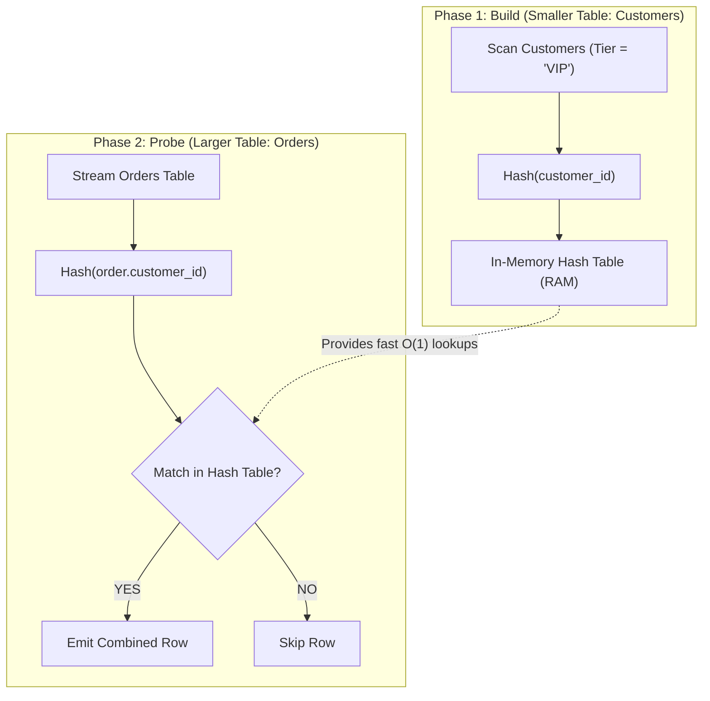

# 04 · Query Planner, Optimizer & Execution Plans

> **Level:** Intermediate → Expert  
> **Interview Frequency:** ★★★★★ (Core differentiator in Senior/Staff performance debugging)  
> **Target Databases:** PostgreSQL & MySQL 8.0+  
> **Last Updated:** 2026

---

## 📋 Table of Contents
- [0. TL;DR — The 30-Second Answer](#0-tldr--the-30-second-answer)
- [1. What & Why — Proof Over Guesswork](#1-what--why--proof-over-guesswork)
- [2. Mental Model — The Cost-Based Optimizer Pipeline](#2-mental-model--the-cost-based-optimizer-pipeline)
- [3. Deep Dive — Optimizer & Join Mechanics](#3-deep-dive--optimizer--join-mechanics)
  - [3.1 Cost Calculation & Cardinality Estimation](#31-cost-calculation--cardinality-estimation)
  - [3.2 The 3 Physical Join Algorithms (Nested Loop, Hash, Merge)](#32-the-3-physical-join-algorithms-nested-loop-hash-merge)
  - [3.3 Anatomy of `EXPLAIN (ANALYZE, BUFFERS)`](#33-anatomy-of-explain-analyze-buffers)
  - [3.4 The 5 Red Flags in Execution Plans](#34-the-5-red-flags-in-execution-plans)
  - [3.5 Multi-Batch Hash Spills & Memory Boundaries (`work_mem`)](#35-multi-batch-hash-spills--memory-boundaries-work_mem)
  - [3.6 Extended Statistics for Correlated Columns](#36-extended-statistics-for-correlated-columns)
- [4. Visualizations & Join Execution Flowcharts](#4-visualizations--join-execution-flowcharts)
- [5. Worked Examples: Step-by-Step Plan Tuning](#5-worked-examples-step-by-step-plan-tuning)
- [6. Production Diagnostic Scripts (`pg_stat_statements`)](#6-production-diagnostic-scripts-pg_stat_statements)
- [7. Common Pitfalls & Performance Traps](#7-common-pitfalls--performance-traps)
- [8. Level-Wise Interview Questions & Answers](#8-level-wise-interview-questions--answers)
- [9. Counter-Questions & Interviewer Traps](#9-counter-questions--interviewer-traps)
- [10. Rapid-Fire MCQs](#10-rapid-fire-mcqs)
- [11. One-Page Cheat Sheet](#11-one-page-cheat-sheet)
- [12. Real-World Production Post-Mortems](#12-real-world-production-post-mortems)
- [13. Follow-up Learning](#13-follow-up-learning)

---

## 0. TL;DR — The 30-Second Answer

1. **`EXPLAIN` shows estimates; `EXPLAIN ANALYZE` executes the query.** Never diagnose performance with plain `EXPLAIN`. Plain `EXPLAIN` prints mathematical estimates. `EXPLAIN (ANALYZE, BUFFERS)` runs the query, measures real microsecond latencies, and counts physical buffer hits and disk reads.
2. **The 3 Join Algorithms are chosen based on data size and sorting:**
   - **Nested Loop Join:** Best when the outer table is tiny ($M$) and the inner table has an index ($O(M \log N)$).
   - **Hash Join:** Best for large, unsorted datasets. Builds an in-memory hash table on the smaller relation, then streams the larger relation to probe it ($O(M + N)$).
   - **Sort-Merge Join:** Best when both inputs are large and already sorted (e.g. via B-tree index) or for non-equi joins ($O(M + N)$).
3. **The Loops Multiplier Trap:** When reading `EXPLAIN ANALYZE`, always multiply `actual time` and `rows` by `loops`. If a step takes `0.5ms` with `loops=10000`, that step consumed **5,000ms (5 seconds)**!
4. **Cardinality Misestimation is the #1 cause of slow queries.** When table statistics are outdated, the optimizer underestimates rows (e.g. predicts 5 rows, actual is 500,000). It chooses an Index Nested Loop instead of a Hash Join, resulting in catastrophic random I/O thrashing.
5. **Memory Spills destroy latency:** If a Sort or Hash Join exceeds `work_mem` (Postgres) or `join_buffer_size` (MySQL), the engine spills intermediate buckets to temporary disk files (`Sort Method: external merge Disk`), degrading performance by 10x to 100x.

---

## 1. What & Why — Proof Over Guesswork

In junior engineering, query tuning is superstition:
> *"Let's add an index here, change this subquery to a join, restart the pool, and see if it's faster."*

In senior engineering, query tuning is empirical science:
> *"The plan proves we have a cardinality estimation error at Node 4 due to stale statistics on `tenant_id`. The optimizer chose a Nested Loop instead of a Hash Join, resulting in 40,000 random disk seeks. Re-analyzing the table with `CREATE STATISTICS` dropped runtime from 12s to 3ms."*

---

## 2. Mental Model — The Cost-Based Optimizer Pipeline

The **Cost-Based Optimizer (CBO)** is a compiler that takes an abstract relational algebra expression and selects the cheapest physical execution path among thousands of possibilities.

```text
               +----------------------------------------+
               |        Parsed Query (AST Tree)         |
               +-------------------+--------------------+
                                   |
                                   v
               +----------------------------------------+
               |           PLAN ENUMERATION             |
               | (Generate permutations: join orders,   |
               |  access paths: SeqScan vs IndexScan)   |
               +-------------------+--------------------+
                                   |
                                   v
               +----------------------------------------+
               |            COST ESTIMATION             |
               | (Evaluate CPU + I/O cost using table   |
               |  statistics, histograms, MCV lists)    |
               +-------------------+--------------------+
                                   |
                                   v
               +----------------------------------------+
               |        PHYSICAL PLAN GENERATION        |
               | (Select lowest cost tree: Hash Join,   |
               |  Index Scan, Materialize, Sort)        |
               +-------------------+--------------------+
                                   |
                                   v
               +----------------------------------------+
               |             PLAN EXECUTOR              |
               |   (Volcano iterator: Open, Next, Close)|
               +----------------------------------------+
```

---

## 3. Deep Dive — Optimizer & Join Mechanics

### 3.1 Cost Calculation & Cardinality Estimation

The optimizer does not measure execution time in milliseconds; it measures **Cost** in arbitrary units normalized against sequential page access.

#### Postgres Cost Formula:
$$\text{Cost} = (\text{Pages Read} \times \text{page\_cost}) + (\text{Tuples Scanned} \times \text{cpu\_tuple\_cost}) + (\text{Operators Evaluated} \times \text{cpu\_operator\_cost})$$

#### Key Cost Parameters:
- `seq_page_cost = 1.0` (Baseline: cost of reading 1 sequential 8KB page).
- `random_page_cost = 4.0` (Cost of reading 1 random 8KB page from HDD. *Production Tip:* On NVMe SSDs, lower this to `1.1` to `1.5` so the optimizer favors index scans!).
- `cpu_tuple_cost = 0.01` (CPU cost to process one row).
- `cpu_operator_cost = 0.0025` (CPU cost to evaluate an operator/function in `WHERE`).

#### How the Optimizer Knows How Many Rows Match:
The catalog view `pg_stats` tracks:
1. `null_frac`: Percentage of NULL values.
2. `n_distinct`: Estimated distinct values (negative values represent fraction of total rows).
3. `most_common_vals` (MCV) & `most_common_freqs` (MCF): Frequency of top values.
4. `histogram_bounds`: Divides non-MCV values into equal-sized buckets.

---

### 3.2 The 3 Physical Join Algorithms (Nested Loop, Hash, Merge)

Every `INNER JOIN`, `LEFT JOIN`, or `OUTER JOIN` is physically executed by one of three core algorithms:

```text
+---------------------+-------------------------------+-----------------------------------+
| Join Algorithm      | Time Complexity               | Best When...                      |
+---------------------+-------------------------------+-----------------------------------+
| Nested Loop Join    | O(M * log N) with index       | Outer table is small (M < 1000)   |
|                     | O(M * N) without index        | and Inner table has index on key  |
+---------------------+-------------------------------+-----------------------------------+
| Hash Join           | O(M + N)                      | Joining large, unsorted datasets; |
|                     | Build: O(M), Probe: O(N)      | Equi-joins only (A.id = B.id)     |
+---------------------+-------------------------------+-----------------------------------+
| Sort-Merge Join     | O(M log M + N log N) un-sorted| Both tables are already sorted on |
|                     | O(M + N) if pre-sorted        | join key; Non-equi joins (<=, >=) |
+---------------------+-------------------------------+-----------------------------------+
```

#### 1. Nested Loop Join
For every row in the outer table, scan the inner table for matching keys:
```python
for outer_row in outer_table:  # M rows
    for inner_row in inner_index.seek(outer_row.key):  # O(log N)
        emit(outer_row, inner_row)
```
* **Production Trap:** If the inner table lacks an index, the engine must perform a full sequential scan for every single outer row ($O(M \times N)$). If $M = 10,000$ and $N = 10,000$, that requires 100,000,000 row inspections!

#### 2. Hash Join
Equi-joins (`ON A.customer_id = B.customer_id`) on large unsorted tables:
1. **Build Phase:** Scan the smaller relation (the *inner* table). Construct an in-memory hash table using a hash function on the join key.
2. **Probe Phase:** Sequentially stream the larger relation (the *outer* table). For each row, hash the join key and probe the in-memory hash table for matching rows.

#### 3. Sort-Merge Join
1. **Sort Phase:** Ensure both tables are ordered by the join key (either via an existing B-tree index or an explicit sort operation).
2. **Merge Phase:** Maintain two pointers moving monotonically forward in lockstep:
   - If `Outer.key == Inner.key`: emit match.
   - If `Outer.key < Inner.key`: advance Outer pointer.
   - If `Outer.key > Inner.key`: advance Inner pointer.

---

### 3.3 Anatomy of `EXPLAIN (ANALYZE, BUFFERS)`

```text
                                QUERY PLAN
-----------------------------------------------------------------------------------------
Hash Join  (cost=3.25..35.50 rows=10 width=48) (actual time=0.045..0.120 rows=8 loops=1)
  Hash Cond: (o.customer_id = c.id)
  Buffers: shared hit=12 read=2
  ->  Seq Scan on orders o  (cost=0.00..28.50 rows=800 width=32) 
                            (actual time=0.010..0.050 rows=800 loops=1)
        Buffers: shared hit=8
  ->  Hash  (cost=3.12..3.12 rows=10 width=16) 
            (actual time=0.025..0.025 rows=10 loops=1)
        Buckets: 1024  Batches: 1  Memory Usage: 9kB
        Buffers: shared hit=4 read=2
        ->  Index Scan using idx_cust_vip on customers c  
            (cost=0.15..3.12 rows=10 width=16) 
            (actual time=0.008..0.018 rows=10 loops=1)
              Index Cond: (tier = 'VIP'::text)
              Buffers: shared hit=4 read=2
Planning Time: 0.180 ms
Execution Time: 0.155 ms
```

#### Line-by-Line Breakdown:
- **`cost=3.25..35.50`:**
  - `3.25`: Startup cost (cost to return the *first* row).
  - `35.50`: Total cost (cost to return *all* rows).
- **`rows=10 width=48`:**
  - Optimizer estimated 10 rows returned, averaging 48 bytes per row.
- **`(actual time=0.045..0.120 rows=8 loops=1)`:**
  - `0.045 ms` to first row; `0.120 ms` total. Actual rows returned: `8`.
- **`Buffers: shared hit=12 read=2`:**
  - `shared hit=12`: 12 pages (96KB) were already in RAM Buffer Pool.
  - `read=2`: 2 pages (16KB) had to be read from physical disk.
- **`Buckets: 1024 Batches: 1 Memory Usage: 9kB`:**
  - The Hash Table fit completely within memory in 1 batch.

---

### 3.4 The 5 Red Flags in Execution Plans

1. **Large Disparity Between Estimated Rows and Actual Rows:**
   ```text
   Index Scan ... (cost=0.28..8.30 rows=2 ...) (actual rows=450000 ...)
   ```
   *Diagnosis:* Stale statistics or correlated column blindness. The optimizer made decisions based on 2 rows when 450,000 exist!
2. **Loops Multiplier:**
   ```text
   Index Scan ... (actual time=0.080..0.120 rows=5 loops=50000)
   ```
   *Diagnosis:* Total time is $0.120 \text{ ms} \times 50,000 = 6,000 \text{ ms}$ (6 seconds)!
3. **Sort Spilled to Disk:**
   ```text
   Sort Method: external merge  Disk: 42180kB
   ```
   *Diagnosis:* Sorting required 42MB of RAM, but `work_mem` was 4MB. The sort spilled to disk, slowing the query 50x.
4. **Hash Table Multi-Batch Spill:**
   ```text
   Hash  Buckets: 65536  Batches: 8  Memory Usage: 32768kB
   ```
   *Diagnosis:* Hash join could not fit in RAM. It was partitioned into 8 separate batches on disk.
5. **High Rows Removed by Filter:**
   ```text
   Seq Scan on transactions (actual rows=10 loops=1)
     Filter: (status = 'PENDING')
     Rows Removed by Filter: 4999990
   ```
   *Diagnosis:* Scanned 5,000,000 rows to find 10. A partial index on `WHERE status = 'PENDING'` will reduce I/O to near zero.

---

### 3.5 Multi-Batch Hash Spills & Memory Boundaries (`work_mem`)

In PostgreSQL, sorting and hash joins are constrained by `work_mem` (default: 4MB).
* **Crucial Rule:** `work_mem` is allocated **per operation, per connection**.
* A complex query with 3 joins and 2 sorts can allocate $5 \times \text{work\_mem}$. If 100 concurrent clients run this query, RAM consumption is $100 \times 5 \times 4\text{MB} = 2\text{GB}$.
* **Production Sizing:** Never set `work_mem` to 1GB globally in `postgresql.conf`! Instead, increase it dynamically only for the specific session running the heavy report:
  ```sql
  SET work_mem = '256MB';
  SELECT ... FROM heavy_report;
  RESET work_mem;
  ```

---

### 3.6 Extended Statistics for Correlated Columns

By default, the query planner assumes columns are completely independent:
$$P(A \ \mathbf{AND} \ B) = P(A) \times P(B)$$

#### The Classic Failure: City and Zip Code
```sql
SELECT * FROM addresses WHERE city = 'San Francisco' AND zip_code = '94102';
```
- If 1% of users live in San Francisco ($P = 0.01$).
- If 0.1% of users have zip 94102 ($P = 0.001$).
- The optimizer calculates:
  $$P = 0.01 \times 0.001 = 0.00001 \ (10 \text{ rows out of } 1,000,000)$$
- But every resident in 94102 lives in San Francisco! The real match count is 1,000 rows. The optimizer underestimates by 100x and picks a catastrophic plan!

#### The Fix: Extended Statistics
```sql
CREATE STATISTICS stat_city_zip (dependencies) ON city, zip_code FROM addresses;
ANALYZE addresses;
```

---

## 4. Visualizations & Join Execution Flowcharts

### Hash Join Build & Probe Lifecycle


---

## 5. Worked Examples: Step-by-Step Plan Tuning

### Problem: Slow Sorting Query Spilling to Disk
```sql
EXPLAIN (ANALYZE, BUFFERS)
SELECT id, customer_id, amount, memo 
FROM payments 
ORDER BY amount DESC 
LIMIT 1000;
```

#### Raw Plan Output (Unoptimized):
```text
Limit  (cost=45200.00..45202.50 rows=1000 width=64) (actual time=142.100..142.350 rows=1000 loops=1)
  Buffers: shared hit=4200, temp read=2150 written=2150
  ->  Sort  (cost=45200.00..47700.00 rows=1000000 width=64) (actual time=142.080..142.250 rows=1000 loops=1)
        Sort Key: amount DESC
        Sort Method: external merge  Disk: 17200kB
        Buffers: shared hit=4200, temp read=2150 written=2150
        ->  Seq Scan on payments  (cost=0.00..18500.00 rows=1000000 width=64) (actual time=0.020..45.100 rows=1000000 loops=1)
              Buffers: shared hit=4200
Execution Time: 144.500 ms
```

#### Identifying the Bottlenecks:
1. `Sort Method: external merge Disk: 17200kB`: 17MB was written to and read from disk (`temp read=2150 written=2150`).
2. `Seq Scan on payments`: Scanned 1,000,000 rows just to find the top 1,000.

#### Solution: Add an Index on the Sort Column
```sql
CREATE INDEX idx_payments_amount_desc ON payments (amount DESC);
```

#### New Optimized Plan Output:
```text
Limit  (cost=0.42..38.50 rows=1000 width=64) (actual time=0.025..0.450 rows=1000 loops=1)
  Buffers: shared hit=85
  ->  Index Scan using idx_payments_amount_desc on payments  (cost=0.42..38120.00 rows=1000000 width=64) (actual time=0.024..0.380 rows=1000 loops=1)
        Buffers: shared hit=85
Execution Time: 0.490 ms  (294x Faster!)
```
* **Proof:** Zero disk temp files, 85 shared buffer hits, runtime down from 144ms to 0.49ms!

---

## 6. Production Diagnostic Scripts (`pg_stat_statements`)

`pg_stat_statements` is the essential production extension for tracking slow queries.

### Enabling the Extension
```sql
-- In postgresql.conf:
-- shared_preload_libraries = 'pg_stat_statements'
CREATE EXTENSION IF NOT EXISTS pg_stat_statements;
```

### Finding the Top 5 Queries Burning the Most I/O Time:
```sql
SELECT 
    round((total_exec_time / 1000)::numeric, 2) as total_seconds,
    calls,
    round((mean_exec_time)::numeric, 2) as avg_ms,
    round((100.0 * shared_blks_hit / nullif(shared_blks_hit + shared_blks_read, 0))::numeric, 2) as hit_pct,
    query
FROM pg_stat_statements
ORDER BY total_exec_time DESC
LIMIT 5;
```

---

## 7. Common Pitfalls & Performance Traps

### 1. Sizing `work_mem` Too High Globally
* **The Trap:** A developer notices sort spills on disk and sets `work_mem = '2GB'` in `postgresql.conf`.
* **The Catastrophe:** Under peak traffic with 200 concurrent active connections, multiple query nodes allocate 2GB each. The host exhausts RAM, and the Linux kernel OOM-killer terminates the database server.
* **The Rule:** Keep global `work_mem` conservative (8MB to 64MB). Increase it per session or transaction for heavy analytical queries.

### 2. Trusting Plain `EXPLAIN` Without `ANALYZE`
* Plain `EXPLAIN` only prints what the optimizer **thinks** will happen based on mathematical estimates. It does not run the query, show buffer hits, or reveal disk spills. Always use `EXPLAIN (ANALYZE, BUFFERS)`.

---

## 8. Level-Wise Interview Questions & Answers

### 🟢 Junior (0–2 Years)
**Q: What is the difference between `EXPLAIN` and `EXPLAIN ANALYZE`?**  
**A:** `EXPLAIN` shows the execution plan generated by the optimizer along with estimated costs, without executing the query. `EXPLAIN ANALYZE` actually executes the query, outputting real execution times, row counts, memory usage, and buffer I/O alongside the estimates.

---

### 🟡 Mid-Level (2–5 Years)
**Q: When does the query optimizer choose a Hash Join over a Nested Loop Join?**  
**A:** The optimizer selects a Hash Join when joining two relatively large, unsorted datasets on an equality predicate (`=`), where neither side has an index supporting the join condition. It builds an in-memory hash table on the smaller relation and streams the larger relation to probe it in $O(M + N)$ time. It selects a Nested Loop Join when the outer dataset is small and the inner dataset has an index, allowing $O(M \log N)$ seeks.

---

### 🔴 Senior (5–8 Years)
**Q: Why does a query plan show `Sort Method: external merge Disk`, what are the performance consequences, and how do you resolve it?**  
**A:** `Sort Method: external merge Disk` indicates that the data being sorted exceeded the memory allocated by `work_mem`. The engine was forced to write sorted runs to temporary disk files and merge them in passes. This causes substantial random and sequential disk I/O, slowing execution by 10x to 100x.
To resolve it:
1. Create a B+ tree index on the `ORDER BY` columns to eliminate the sort entirely.
2. For batch or reporting queries, temporarily increase `work_mem` for the transaction or session (`SET LOCAL work_mem = '128MB'`).
3. Reduce projected columns by eliminating `SELECT *`, minimizing row width in memory.

---

### ⚫ Principal / Staff (8+ Years)
**Q: What is the "Loops Multiplier" in `EXPLAIN ANALYZE`, and how can a plan look fast at first glance but take 30 seconds to execute?**  
**A:** In an `EXPLAIN ANALYZE` plan, the metrics printed for inner nodes of Nested Loop joins or Subplans display the **average time and rows per single iteration**, followed by `loops = N`.
For example, if an inner index scan node shows:
```text
Index Scan ... (actual time=0.005..0.020 rows=2 loops=500000)
```
A junior engineer might see `0.020 ms` and assume the node is lightning fast. In reality, total time is:
$$\text{Total Time} = 0.020 \text{ ms} \times 500,000 = 10,000 \text{ ms} \ (10 \text{ seconds!})$$
The true cost of the node is multiplied by the number of loops.

---

## 9. Counter-Questions & Interviewer Traps

### Trap 1: "Can we force Postgres to use an index using index hints like in MySQL?"
- **Naive Answer:** "Yes, you use `USE INDEX (idx_name)`."
- **The Trap:** PostgreSQL deliberately does not support index hints.
- **The Expert Answer:** "No, PostgreSQL has no index hint syntax by design because the PostgreSQL core team believes the optimizer should make cost-based decisions based on accurate statistics. If Postgres is ignoring an index, the correct solutions are:
  1. Fix the root cause: run `ANALYZE` to refresh statistics or adjust `random_page_cost`.
  2. For debugging, temporarily disable sequential scans for the session via `SET enable_seqscan = off;` to see what plan the engine produces and compare estimated costs.
  3. Create an expression index or partial index if the query uses functions or filters."

### Trap 2: "If `EXPLAIN ANALYZE` executes the query, what happens if I run `EXPLAIN ANALYZE DELETE FROM users`?"
- **Naive Answer:** "It just analyzes how the delete would happen."
- **The Trap:** `ANALYZE` physically mutates data!
- **The Expert Answer:** "It will physically delete all rows from the `users` table! Because `EXPLAIN ANALYZE` executes the statement, running it on an `INSERT`, `UPDATE`, or `DELETE` executes the mutation. To safely inspect the execution plan of a data modification query, you must always run it inside an explicit transaction block and rollback:
  ```sql
  BEGIN;
  EXPLAIN ANALYZE DELETE FROM users WHERE last_login < '2020-01-01';
  ROLLBACK;
  ```"

---

## 10. Rapid-Fire MCQs

#### Q1: Which join algorithm requires an equality operator (`=`) and cannot handle range joins (`<, >`)?
- [ ] A) Nested Loop Join
- [ ] B) Hash Join
- [ ] C) Sort-Merge Join
- [ ] D) Cartesian Product
* **Answer:** **B**. Hash joins compute discrete bucket hashes from keys, requiring exact equality.

#### Q2: What does `shared hit=50 read=10` mean in an `EXPLAIN (ANALYZE, BUFFERS)` output?
- [ ] A) 50 queries hit the cache; 10 queries failed
- [ ] B) 50 8KB pages were retrieved from RAM Buffer Pool; 10 pages were read from disk
- [ ] C) 50 rows were updated; 10 rows were read
- [ ] D) 50 locks acquired; 10 deadlocks avoided
* **Answer:** **B**. `shared hit` counts pages in memory; `read` counts pages loaded from disk storage.

#### Q3: What is the default `work_mem` value in PostgreSQL?
- [ ] A) 64KB
- [ ] B) 4MB
- [ ] C) 128MB
- [ ] D) 1GB
* **Answer:** **B**. Default `work_mem` is 4MB.

#### Q4: Why would setting `random_page_cost = 1.1` be recommended on modern cloud databases?
- [ ] A) It disables parallel query execution
- [ ] B) Modern NVMe SSDs have random read speeds near sequential speeds, encouraging the optimizer to use index scans
- [ ] C) It forces sequential scans on all queries
- [ ] D) It reduces RAM usage in the buffer pool
* **Answer:** **B**. Default `random_page_cost = 4.0` was designed for spinning hard drives with high seek latency. On NVMe SSDs, random I/O is nearly as fast as sequential I/O.

---

## 11. One-Page Cheat Sheet

```text
+-----------------------+-------------------------------------------------------------+
| Concept               | Diagnostic Rule                                             |
+-----------------------+-------------------------------------------------------------+
| EXPLAIN Command       | Always use: EXPLAIN (ANALYZE, BUFFERS, VERBOSE, SETTINGS)   |
| Join Choice: Small+Idx| Nested Loop Join (Index seek on inner table)                |
| Join Choice: Big+Big  | Hash Join (Build smaller in RAM, probe larger stream)       |
| Join Choice: Sorted   | Sort-Merge Join (Pointers advance in lockstep)              |
| Memory Spill Signal   | "Sort Method: external merge Disk" or "Batches: > 1"        |
| Fix Memory Spills     | SET LOCAL work_mem = '128MB'; or add B-Tree index on sort   |
| Red Flag: Discrepancy | Est Rows = 1 vs Actual Rows = 50,000 -> Run ANALYZE!        |
| Red Flag: Filter Drop | "Rows Removed by Filter: 99.9%" -> Add Partial/Comp Index   |
| Loops Rule            | Always calculate: (actual_time * loops)                     |
+-----------------------+-------------------------------------------------------------+
```

---

## 12. Real-World Production Post-Mortems

### Incident: The Correlated Column Outage That Stalled E-Commerce Checkout
* **Symptoms:** Orders placed by customers in New York took 8 seconds to process instead of 20ms.
* **Root Cause:** A query filtered on `WHERE state = 'NY' AND city = 'New York'`. The optimizer assumed independence:
  $$P(\text{state}) = 0.05, \quad P(\text{city}) = 0.04 \implies P = 0.002$$
  It estimated 10 matching order rows and chose a Nested Loop Join with 10 index lookups. In reality, there were 250,000 matching rows. The Nested Loop performed 250,000 random index lookups, generating massive disk I/O and locking worker threads.
* **Resolution:**
  1. Ran `CREATE STATISTICS orders_city_state (dependencies) ON city, state FROM orders;` followed by `ANALYZE orders;`.
  2. The optimizer updated its cardinality estimate to 248,000 rows and switched the plan to a **Hash Join**.
  3. Query execution time dropped from 8,200ms to **14ms**.

---

## 13. Follow-up Learning
- **Next Chapter:** → [05 · Transactions, ACID, MVCC & Locking](./05-Transactions-ACID-MVCC-and-Locking.md)
- **Previous Chapter:** ← [03 · Advanced SQL, Window Functions & CTEs](./03-Advanced-SQL-Window-Functions-and-CTEs.md)
