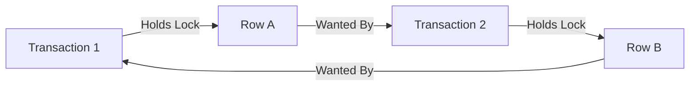
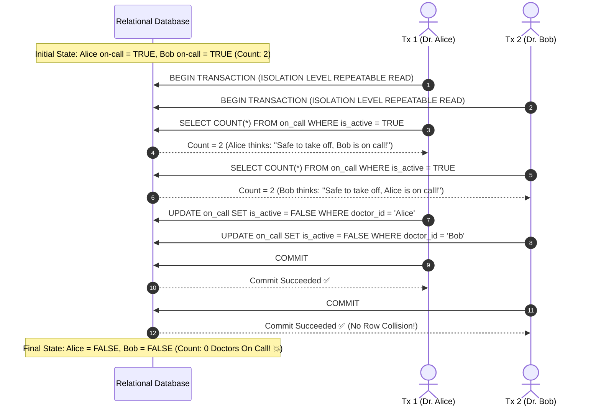

# 05 · Transactions, ACID, MVCC & Locking

> **Level:** Advanced → Expert  
> **Interview Frequency:** ★★★★★ (The core battlefield of Senior, Staff, and Principal backend interviews)  
> **Target Databases:** PostgreSQL & MySQL (InnoDB)  
> **Last Updated:** 2026

---

## 📋 Table of Contents
- [0. TL;DR — The 30-Second Answer](#0-tldr--the-30-second-answer)
- [1. What & Why — Concurrency Under Load](#1-what--why--concurrency-under-load)
- [2. Mental Model — The ACID Guarantee Matrix](#2-mental-model--the-acid-guarantee-matrix)
- [3. Deep Dive — Isolation Anomalies & Engine Mechanics](#3-deep-dive--isolation-anomalies--engine-mechanics)
  - [3.1 The 6 Concurrency Anomalies (Beyond ANSI-92)](#31-the-6-concurrency-anomalies-beyond-ansi-92)
  - [3.2 ANSI Isolation Levels vs Reality: Snapshot Isolation (SI)](#32-ansi-isolation-levels-vs-reality-snapshot-isolation-si)
  - [3.3 MVCC Internals: PostgreSQL Heap vs MySQL InnoDB Undo Logs](#33-mvcc-internals-postgresql-heap-vs-mysql-innodb-undo-logs)
  - [3.4 The PostgreSQL VACUUM & TXID Wraparound Disaster](#34-the-postgresql-vacuum--txid-wraparound-disaster)
  - [3.5 Locking Physics: Intention, Record, Gap & Next-Key Locks](#35-locking-physics-intention-record-gap--next-key-locks)
  - [3.6 Non-Blocking Queues with `FOR UPDATE SKIP LOCKED`](#36-non-blocking-queues-with-for-update-skip-locked)
  - [3.7 Deadlock Detection & The Wait-For Graph](#37-deadlock-detection--the-wait-for-graph)
- [4. Visualizations & Concurrency Timelines](#4-visualizations--concurrency-timelines)
- [5. Worked Examples: Reproducing & Fixing Write Skew](#5-worked-examples-reproducing--fixing-write-skew)
- [6. Production Diagnostic Scripts](#6-production-diagnostic-scripts)
- [7. Common Pitfalls & Architectural Antipatterns](#7-common-pitfalls--architectural-antipatterns)
- [8. Level-Wise Interview Questions & Answers](#8-level-wise-interview-questions--answers)
- [9. Counter-Questions & Interviewer Traps](#9-counter-questions--interviewer-traps)
- [10. Rapid-Fire MCQs](#10-rapid-fire-mcqs)
- [11. One-Page Cheat Sheet](#11-one-page-cheat-sheet)
- [12. Real-World Production Post-Mortems](#12-real-world-production-post-mortems)
- [13. Follow-up Learning](#13-follow-up-learning)

---

## 0. TL;DR — The 30-Second Answer

1. **"ACID" is not an off-the-shelf binary toggle.** Atomicity and Durability are governed by WAL and Undo logs; Consistency is an application-schema invariant; Isolation is a sliding spectrum of performance versus concurrency anomalies.
2. **The ANSI SQL-92 Standard is fundamentally flawed.** ANSI defined isolation using only 3 phenomena (Dirty Read, Non-Repeatable Read, Phantom Read). It completely missed **Write Skew**, **Read Skew**, and **Lost Updates**.
3. **Snapshot Isolation (SI) is NOT ANSI Repeatable Read.** In PostgreSQL, Repeatable Read is actually Snapshot Isolation. It prevents Phantom Reads *without locking*, but it still permits **Write Skew**. Only **Serializable Snapshot Isolation (SSI)** prevents Write Skew.
4. **PostgreSQL MVCC vs MySQL InnoDB MVCC:**
   - **Postgres:** Appends new tuple versions directly to the table heap (`xmin`/`xmax`). Old dead versions remain in the table until cleaned by `VACUUM`. Causes table bloat.
   - **MySQL InnoDB:** Overwrites row in-place in the clustered index; writes old row versions into **Undo Log segments**. Reconstructs older snapshots by traversing the `DB_ROLL_PTR` undo chain. Zero table bloat, but undo segments can grow massive under long-running transactions.
5. **Next-Key Locks eliminate Phantoms in MySQL:** InnoDB Repeatable Read locks both the index record AND the gap before it (→(\text{previous\_key}, \text{current\_key}]→), physically preventing concurrent transactions from inserting new rows into the scanned range.
6. **`SKIP LOCKED` enables Lock-Free Job Queues:** `SELECT ... FOR UPDATE SKIP LOCKED` allows worker threads to dequeue jobs without blocking each other, eliminating queue contention.

---

## 1. What & Why — Concurrency Under Load

In a single-threaded system, database transactions are trivial. In high-concurrency production backends handling 50,000 requests/sec, concurrent transactions read and mutate overlapping data sets simultaneously.

The database must solve two opposing forces:
- **Safety:** Prevent concurrent transactions from corrupting invariants (e.g. balance dropping below zero, double-spending, booking the same seat twice).
- **Liveness & Throughput:** Minimize locking so transactions do not block each other into complete stagnation.

**Multi-Version Concurrency Control (MVCC)** is the universal architectural solution:
> *"Readers never block Writers, and Writers never block Readers."*

---

## 2. Mental Model — The ACID Guarantee Matrix

```text
+--------------+----------------------------------------------------+------------------------------------+
| Property     | Architectural Mechanism                            | Failure Mode Prevented             |
+--------------+----------------------------------------------------+------------------------------------+
| ATOMICITY    | WAL + Undo Logs                                    | Partial writes if process crashes  |
| CONSISTENCY  | Constraints (FK, UNIQUE, CHECK) + App Invariants   | Corrupted state / Broken rules     |
| ISOLATION    | MVCC + Locking Protocols (2PL, SSI, Gap Locks)    | Concurrency race conditions        |
| DURABILITY   | Synchronous WAL flush (fsync) to non-volatile disk | Data loss on power failure         |
+--------------+----------------------------------------------------+------------------------------------+
```

---

## 3. Deep Dive — Isolation Anomalies & Engine Mechanics

### 3.1 The 6 Concurrency Anomalies (Beyond ANSI-92)

```text
+-----------------------+------------------------------------------------------------------------------------+
| Anomaly               | Real-World Scenario & Physical Mechanism                                           |
+-----------------------+------------------------------------------------------------------------------------+
| 1. Dirty Read         | Tx1 modifies row A. Tx2 reads row A. Tx1 aborts/rolls back. Tx2 acted on data that |
|                       | never legitimately existed.                                                        |
+-----------------------+------------------------------------------------------------------------------------+
| 2. Non-Repeatable     | Tx1 reads row A (→100). Tx2 updates row A to →200 and commits. Tx1 reads row A     |
|    Read (Fuzzy Read)  | again and sees →200. The same query in the same transaction yielded two values.    |
+-----------------------+------------------------------------------------------------------------------------+
| 3. Phantom Read       | Tx1 queries range: `WHERE age > 30` (finds 5 rows). Tx2 inserts new row with       |
|                       | age 35 and commits. Tx1 re-runs query and finds 6 rows. (Range changed).           |
+-----------------------+------------------------------------------------------------------------------------+
| 4. Read Skew          | Balance in Account A = →500, Account B = →500 (Total →1000). Tx2 transfers →200    |
|                       | from B to A. Tx1 reads A (→500), then Tx2 commits, then Tx1 reads B (→300).        |
|                       | Tx1 observes total balance of →800! (Violates multi-table consistency).            |
+-----------------------+------------------------------------------------------------------------------------+
| 5. Lost Update        | Tx1 reads balance (→100). Tx2 reads balance (→100). Tx1 sets balance = →150 and    |
|                       | commits. Tx2 sets balance = →120 and commits. Tx1's update is completely erased!   |
+-----------------------+------------------------------------------------------------------------------------+
| 6. Write Skew         | Minimum requirement: At least 1 doctor on-call. Doctors Alice and Bob are on-call. |
|                       | Alice requests off (sees Bob on call). Bob requests off (sees Alice on call).      |
|                       | Both transactions commit concurrently. Result: 0 doctors on-call!                  |
+-----------------------+------------------------------------------------------------------------------------+
```

---

### 3.2 ANSI Isolation Levels vs Reality: Snapshot Isolation (SI)

The ANSI-92 standard defined 4 isolation levels based on Dirty Reads, Non-Repeatable Reads, and Phantoms. In modern databases, **Snapshot Isolation (SI)** dominates:

```text
+-----------------------+------------+---------------------+--------------+------------+------------+
| Isolation Level       | Dirty Read | Non-Repeatable Read | Phantom Read | Read Skew  | Write Skew |
+-----------------------+------------+---------------------+--------------+------------+------------+
| Read Uncommitted      | ❌ YES     | ❌ YES              | ❌ YES       | ❌ YES     | ❌ YES     |
| Read Committed        | ✅ NO      | ❌ YES              | ❌ YES       | ❌ YES     | ❌ YES     |
| Repeatable Read (ANSI)| ✅ NO      | ✅ NO               | ❌ YES       | ✅ NO      | ❌ YES     |
| Postgres Repeatable R | ✅ NO      | ✅ NO               | ✅ NO (SI)   | ✅ NO      | ❌ YES     |
| MySQL Repeatable Read | ✅ NO      | ✅ NO               | ✅ NO (Locks)| ✅ NO      | ❌ YES     |
| Serializable (SSI)    | ✅ NO      | ✅ NO               | ✅ NO        | ✅ NO      | ✅ NO      |
+-----------------------+------------+---------------------+--------------+------------+------------+
```

> **The Senior Distinction:**
> - In **PostgreSQL**, `REPEATABLE READ` is implemented via **Snapshot Isolation**. When the transaction starts, it takes a logical snapshot of the entire database. It reads *only* versions committed before its snapshot began. Therefore, **Postgres Repeatable Read prevents Phantom Reads automatically** without gap locking!
> - However, Snapshot Isolation **does NOT prevent Write Skew**. If two transactions read disjoint rows and write to disjoint rows based on overlapping invariants, both commit successfully, violating the invariant!

---

### 3.3 MVCC Internals: PostgreSQL Heap vs MySQL InnoDB Undo Logs

```text
=============================================================================
POSTGRESQL MVCC: HEAP TUPLE APPEND-ONLY ARCHITECTURE
=============================================================================
Table: accounts (Page 0, Block 1)
Tuple 1: [xmin: 500, xmax: 505, t_ctid: (0,2)] -> id: 1, balance: →1000 (DEAD)
Tuple 2: [xmin: 505, xmax: 0,   t_ctid: (0,2)] -> id: 1, balance: →1200 (LIVE)

* HOW IT WORKS:
  - An UPDATE never modifies a tuple in-place.
  - It writes a brand new tuple (Tuple 2) and sets the old tuple's xmax = 505.
  - Active transactions with snapshot < 505 read Tuple 1.
  - Transactions with snapshot >= 505 read Tuple 2.
* CONSEQUENCE:
  - Dead tuples consume disk and memory.
  - VACUUM is mandatory to reclaim dead space.

=============================================================================
MYSQL INNODB MVCC: CLUSTERED INDEX + UNDO LOGS
=============================================================================
[ Clustered Index Leaf Page ]
Primary Key: 1 | DB_TRX_ID: 505 | DB_ROLL_PTR: 0x8FA2 | balance: →1200 (Current)
                                        │
                                        ▼ (Traverse Pointer)
[ Undo Log Segment in Rollback Segment ]
Undo Record: DB_TRX_ID: 500 | balance: →1000
                                        │
                                        ▼ (Older Undo Record)
Undo Record: DB_TRX_ID: 420 | balance: →800

* HOW IT WORKS:
  - Updates occur IN-PLACE in the clustered index leaf.
  - Prior versions are pushed to the Undo Log.
  - To read an older snapshot, a transaction traverses the DB_ROLL_PTR backward.
* CONSEQUENCE:
  - Zero table bloat. Table files remain compact.
  - If a transaction stays open for hours, Undo Logs cannot be purged and balloon to gigabytes.
```

---

### 3.4 The PostgreSQL VACUUM & TXID Wraparound Disaster

#### 1. Why VACUUM is Necessary:
Because PostgreSQL updates and deletes leave dead tuples on heap pages, `VACUUM` performs three tasks:
1. Scans pages and removes dead tuples whose `xmax` is older than the oldest running transaction.
2. Updates the Free Space Map (FSM) so new `INSERT`s reuse the space.
3. Updates the Visibility Map (VM) to enable Index-Only Scans.

#### 2. The Transaction ID (TXID) Wraparound Disaster (The 2-Billion Horizon)
PostgreSQL represents transaction IDs (`xmin`/`xmax`) using an unsigned **32-bit integer** (→2^{32} \approx 4.29 \text{ billion}→).
- Postgres uses modulo arithmetic: at any time, 2 billion transactions are in the "past", and 2 billion are in the "future".
- **The Disaster:** If a database runs 2.1 billion transactions without freezing old tuples, the oldest rows suddenly appear to have been created in the *future*, becoming **instantly invisible to all queries**! The database corrupts its entire history.
- **The Defense:** `autovacuum` runs aggressive **Freeze** operations, converting `xmin` values to a special sentinel ID: `FrozenTransactionId` (value 2). Frozen rows are treated as permanently committed in the infinite past.
- **Fail-Safe:** If transaction age exceeds `autovacuum_freeze_max_age` (default 200M transactions) and cannot keep up, PostgreSQL shuts down and refuses all new writes with a critical error:
  ```text
  PANIC: database is not accepting commands to avoid wraparound data loss in database "production"
  ```

---

### 3.5 Locking Physics: Intention, Record, Gap & Next-Key Locks

#### Lock Compatibility Matrix
```text
Existing Lock \ Requested Lock | Shared (S) | Exclusive (X) |
-------------------------------+------------+---------------+
Shared (S)                     |   GRANT    |    BLOCK      |
Exclusive (X)                  |   BLOCK    |    BLOCK      |
```

#### Table-Level Intention Locks (IS / IX)
Before a transaction can acquire a row-level Exclusive lock (X), it must acquire a table-level **Intention Exclusive lock (IX)**.
* **Why Intention Locks Exist:** Without intention locks, if Transaction 1 modifies a single row in a 10-million row table (acquiring a row-level X lock), and Transaction 2 wants to run `ALTER TABLE` or `LOCK TABLE accounts IN EXCLUSIVE MODE`, Transaction 2 would have to scan 10 million rows to check if any row has an X lock!
* With Intention Locks, Transaction 2 checks the table header: sees `IX` lock → immediately blocks. →O(1)→ efficiency!

#### MySQL InnoDB Row Lock Variants:
Given an index with values: `[ 10, 20, 30 ]`

```text
               Gap 1         Gap 2         Gap 3         Gap 4
          (-infinity, 10)  (10, 20)      (20, 30)     (30, +infinity)
                |             |             |               |
Index Record:  [10]          [20]          [30]          [Supremum]
```

1. **Record Lock:** Locks the physical index record itself (e.g. locks `20`).
2. **Gap Lock:** Locks the open interval *between* records (e.g. locks `(10, 20)`). Prevents other transactions from inserting any value between 11 and 19!
3. **Next-Key Lock:** A Record Lock combined with the Gap Lock *before* it:
   →\text{Next-Key Lock on 20} = (10, 20]→
   InnoDB default repeatable read uses Next-Key locks during range scans to eliminate Phantom Reads!

---

### 3.6 Non-Blocking Queues with `FOR UPDATE SKIP LOCKED`

Building message or task queues in relational databases historically caused massive lock contention:
```sql
-- ❌ Naive queue polling (Causes massive lock serialization):
SELECT * FROM task_queue WHERE status = 'PENDING' ORDER BY id LIMIT 1 FOR UPDATE;
```
When 50 worker threads run this simultaneously, Thread 1 acquires the lock on row 1. Threads 2 through 50 **block and sleep**, waiting for Thread 1 to finish.

#### The High-Throughput Solution: `SKIP LOCKED`
```sql
-- ✅ Production Lock-Free Queue:
SELECT id, payload 
FROM task_queue 
WHERE status = 'PENDING' 
ORDER BY id 
LIMIT 1 
FOR UPDATE SKIP LOCKED;
```
* **How it works:** Thread 1 locks row 1. Thread 2 sees row 1 is locked, **instantly skips it without waiting**, and locks row 2. All 50 workers process distinct rows in parallel with zero lock contention!

---

### 3.7 Deadlock Detection & The Wait-For Graph

A **Deadlock** occurs when two or more transactions have circular lock dependencies:
- Tx1 holds lock on Row A, waits for lock on Row B.
- Tx2 holds lock on Row B, waits for lock on Row A.



#### How the Engine Resolves It:
1. **Wait-For Graph:** The database maintains an internal directed graph where vertices are transactions and edges represent lock wait queues.
2. **Cycle Detection Algorithm:** Periodically (e.g. every `deadlock_timeout = 1s` in Postgres, or continuously in InnoDB), a background thread runs cycle detection (Depth-First Search) on the graph.
3. **Victim Selection:** When a cycle is detected, the engine chooses one transaction as the **Victim**, aborts it, rolls back its changes, and throws an exception to the client:
   ```text
   ERROR: deadlock detected (SQLSTATE 40P01)
   ```
4. **Victim Heuristics:** Usually selects the transaction that has performed the least amount of undo work (cheapest to roll back).

---

## 4. Visualizations & Concurrency Timelines

### Write Skew Timeline (Why Repeatable Read Fails)


---

## 5. Worked Examples: Reproducing & Fixing Write Skew

### Schema & Invariant Setup
```sql
CREATE TABLE doctors (
    id SERIAL PRIMARY KEY,
    name VARCHAR(50) NOT NULL,
    on_call BOOLEAN NOT NULL DEFAULT TRUE
);
INSERT INTO doctors (name, on_call) VALUES ('Alice', TRUE), ('Bob', TRUE);
```
**Business Rule Invariant:** `COUNT(on_call = TRUE) >= 1`.

### Solution 1: Explicit Pessimistic Locking (`FOR UPDATE`)
```sql
-- Transaction 1 (Alice):
BEGIN;
-- Lock BOTH rows so concurrent transactions cannot evaluate count simultaneously!
SELECT * FROM doctors WHERE on_call = TRUE FOR UPDATE;
UPDATE doctors SET on_call = FALSE WHERE name = 'Alice';
COMMIT;
```
* **Why it works:** When Bob runs `SELECT ... FOR UPDATE`, his transaction blocks until Alice commits. Once unblocked, Bob sees count = 1 and aborts his request.

### Solution 2: Serializable Snapshot Isolation (SSI)
```sql
-- Transaction 1 (Alice):
BEGIN TRANSACTION ISOLATION LEVEL SERIALIZABLE;
SELECT COUNT(*) FROM doctors WHERE on_call = TRUE; -- Sees 2
UPDATE doctors SET on_call = FALSE WHERE name = 'Alice';
COMMIT; -- Succeeded

-- Transaction 2 (Bob):
BEGIN TRANSACTION ISOLATION LEVEL SERIALIZABLE;
SELECT COUNT(*) FROM doctors WHERE on_call = TRUE; -- Sees 2
UPDATE doctors SET on_call = FALSE WHERE name = 'Bob';
COMMIT; 
-- 💥 ERROR: could not serialize access due to read/write dependencies among transactions
-- Detail: Reason code: Canceled on identification as a pivot, during commit attempt.
```

---

## 6. Production Diagnostic Scripts

### PostgreSQL: Active Lock Wait Chains (Who is Blocking Whom?)
```sql
SELECT 
    blocked_locks.pid     AS blocked_pid,
    blocked_activity.usename  AS blocked_user,
    blocking_locks.pid    AS blocking_pid,
    blocking_activity.usename AS blocking_user,
    blocked_activity.query    AS blocked_statement,
    blocking_activity.query   AS current_statement_in_blocking_process
FROM pg_catalog.pg_locks blocked_locks
JOIN pg_catalog.pg_stat_activity blocked_activity ON blocked_activity.pid = blocked_locks.pid
JOIN pg_catalog.pg_locks blocking_locks 
    ON blocking_locks.locktype = blocked_locks.locktype
    AND blocking_locks.database IS NOT DISTINCT FROM blocked_locks.database
    AND blocking_locks.relation IS NOT DISTINCT FROM blocked_locks.relation
    AND blocking_locks.page IS NOT DISTINCT FROM blocked_locks.page
    AND blocking_locks.tuple IS NOT DISTINCT FROM blocked_locks.tuple
    AND blocking_locks.virtualxid IS NOT DISTINCT FROM blocked_locks.virtualxid
    AND blocking_locks.transactionid IS NOT DISTINCT FROM blocked_locks.transactionid
    AND blocking_locks.classid IS NOT DISTINCT FROM blocked_locks.classid
    AND blocking_locks.objid IS NOT DISTINCT FROM blocked_locks.objid
    AND blocking_locks.objsubid IS NOT DISTINCT FROM blocked_locks.objsubid
    AND blocking_locks.pid != blocked_locks.pid
JOIN pg_catalog.pg_stat_activity blocking_activity ON blocking_activity.pid = blocking_locks.pid
WHERE NOT blocked_locks.granted;
```

### PostgreSQL: Monitoring Transaction ID Wraparound Risk
```sql
SELECT 
    datname,
    age(datfrozenxid) AS xid_age,
    2147483648 - age(datfrozenxid) AS xids_until_wraparound_emergency
FROM pg_database
ORDER BY xid_age DESC;
```
> **Alert Threshold:** Trigger a P1 alert if `xid_age > 150,000,000`.

---

## 7. Common Pitfalls & Architectural Antipatterns

### 1. External Network I/O Inside `@Transactional`
* **The Antipattern:**
  ```java
  @Transactional
  public void processPayment(Long orderId) {
      Order order = orderRepo.findByIdForUpdate(orderId); // Holds row lock
      PaymentResponse res = stripeClient.charge(order);   // ⚠️ HTTP Call: 1.5 - 5.0 seconds!
      order.setStatus(res.getStatus());
      orderRepo.save(order);
  }
  ```
* **The Catastrophe:** If Stripe's API experiences latency, the database transaction remains open for seconds, holding row locks and consuming a connection from the pool. Connection pool runs dry in under 10 seconds, crashing the entire backend!
* **The Rule:** **Never make HTTP calls, Kafka writes, or external network requests inside an active database transaction.** Pre-fetch data, execute external calls, then open a brief transaction to update state.

### 2. Inconsistent Row Update Ordering Causing Deadlocks
* Transaction 1 updates Account A, then Account B.
* Transaction 2 updates Account B, then Account A.
* **The Rule:** Always enforce a deterministic global ordering when locking multiple rows (e.g. `ORDER BY id ASC`):
  ```sql
  SELECT * FROM accounts WHERE id IN (10, 42) ORDER BY id ASC FOR UPDATE;
  ```

---

## 8. Level-Wise Interview Questions & Answers

### 🟢 Junior (0–2 Years)
**Q: What is a Dirty Read and how is it prevented?**  
**A:** A dirty read occurs when a transaction reads uncommitted changes made by another concurrent transaction. If the modifying transaction subsequently rolls back, the reading transaction has operated on data that never existed. It is prevented by using `READ COMMITTED` or higher isolation levels, where the engine only serves row versions that have committed.

---

### 🟡 Mid-Level (2–5 Years)
**Q: What is the difference between Optimistic Concurrency Control (OCC) and Pessimistic Concurrency Control (PCC)?**  
**A:** Pessimistic Concurrency Control locks rows in advance (`SELECT ... FOR UPDATE`), preventing concurrent transactions from modifying them until the lock is released. It is best for high-contention write workloads. Optimistic Concurrency Control does not lock rows on read; instead, it tracks a version number (`version_id`). On update, it checks `WHERE id = ? AND version_id = ?`. If another transaction modified the row, the update affects 0 rows, triggering an application-level retry. OCC is ideal for read-heavy workloads with low write contention.

---

### 🔴 Senior (5–8 Years)
**Q: Explain Write Skew. Why does Repeatable Read fail to prevent it, and how do you resolve it in production?**  
**A:** Write Skew occurs when two concurrent transactions read overlapping state, enforce an invariant based on that state, but write to disjoint rows. Because the rows written do not overlap, neither transaction blocks or conflicts under standard Snapshot Isolation / Repeatable Read. Both commit, resulting in an invariant violation (such as the classic on-call doctor scenario).
To prevent Write Skew in production:
1. Promote the isolation level to `SERIALIZABLE` (Postgres uses Serializable Snapshot Isolation to track read-write dependencies and abort one transaction with a serialization error).
2. Use explicit pessimistic locking (`SELECT ... FOR UPDATE`) to lock all rows evaluated in the invariant predicate, forcing transactions to serialize.

---

### ⚫ Principal / Staff (8+ Years)
**Q: Contrast how PostgreSQL and MySQL InnoDB manage dead row versions physically on disk, and discuss how each engine behaves under high-write churn.**  
**A:** PostgreSQL uses an append-only heap architecture. Every `UPDATE` writes a new tuple on the heap page with `xmin = current_txid` and updates the old tuple with `xmax = current_txid`. Under high-write churn:
- Dead tuples accumulate in table pages, causing **table and index bloat**.
- If updates modify indexed columns, every index on the table must add an entry pointing to the new `ctid` (bypassing Heap-Only Tuple optimization).
- Background `autovacuum` workers must constantly sweep pages to freeze transaction IDs and reclaim line pointers, consuming high disk I/O.
- If long-running transactions hold open old snapshots, `autovacuum` cannot remove dead tuples, causing severe disk expansion.

MySQL InnoDB updates clustered index records in-place and writes previous row states into **Undo Log segments**. Under high-write churn:
- The table pages remain compact on disk with near-zero table bloat.
- Secondary indexes store primary key values, meaning updating non-indexed columns requires zero secondary index modifications.
- However, if a long-running read transaction holds open a Read View, purge threads cannot delete old undo log records, causing the system tablespace or undo tablespaces to swell to hundreds of gigabytes.
- Reconstructing older row versions requires traversing long undo pointer chains (`DB_ROLL_PTR`), degrading read performance for older snapshots.

---

## 9. Counter-Questions & Interviewer Traps

### Trap 1: "If we set isolation level to SERIALIZABLE, does our application code need retry logic?"
- **Naive Answer:** "No, because the database handles serializability automatically."
- **The Trap:** Conflating serializability with zero-error execution.
- **The Expert Answer:** "Yes, absolutely! In fact, `SERIALIZABLE` **mandates** robust application-level retry logic. Under Serializable Snapshot Isolation (SSI), the database detects dangerous serialization dependency cycles (rw-antidependencies) and intentionally aborts one of the transactions with a `40001` serialization failure. The application must catch this exception and retry the entire transaction from the beginning."

### Trap 2: "Can two concurrent transactions running `SELECT ... FOR UPDATE` deadlock on an empty table?"
- **Naive Answer:** "No, there are no rows to lock."
- **The Trap:** Omitting Gap Locks in MySQL InnoDB.
- **The Expert Answer:** "Yes, in MySQL InnoDB under Repeatable Read they can! When both transactions execute `SELECT * FROM empty_table WHERE id = 10 FOR UPDATE`, both transactions acquire a **Gap Lock** on the open range `(-infinity, +infinity)` because Gap Locks are mutually compatible. When Transaction 1 subsequently attempts to `INSERT (id=10)`, it blocks waiting for Transaction 2's Gap Lock to clear. When Transaction 2 attempts to `INSERT (id=10)`, it blocks waiting for Transaction 1's Gap Lock. Deadlock ensues!"

---

## 10. Rapid-Fire MCQs

#### Q1: Which transaction anomaly is permitted under ANSI Repeatable Read but prevented under PostgreSQL Repeatable Read?
- [ ] A) Dirty Read
- [ ] B) Phantom Read
- [ ] C) Lost Update
- [ ] D) Write Skew
* **Answer:** **B**. PostgreSQL uses Snapshot Isolation for Repeatable Read, which freezes the table view and prevents Phantom Reads without gap locking.

#### Q2: What row-level lock clause allows worker threads to process tasks concurrently without blocking each other?
- [ ] A) `FOR UPDATE NOWAIT`
- [ ] B) `FOR SHARE`
- [ ] C) `FOR UPDATE SKIP LOCKED`
- [ ] D) `LOCK TABLE IN EXCLUSIVE MODE`
* **Answer:** **C**. `SKIP LOCKED` causes queries to skip already-locked rows and claim the next available row.

#### Q3: What is the maximum number of transactions that can occur in PostgreSQL before an emergency freeze is triggered?
- [ ] A) 65,536
- [ ] B) 16,777,216
- [ ] C) ~2.1 Billion (2^31)
- [ ] D) Unlimited
* **Answer:** **C**. PostgreSQL transaction IDs are 32-bit unsigned integers; after 2.1 billion transactions, modulo arithmetic wraps around.

#### Q4: What type of lock does MySQL InnoDB acquire on the open interval between two index records?
- [ ] A) Intention Lock
- [ ] B) Record Lock
- [ ] C) Gap Lock
- [ ] D) Predicate Lock
* **Answer:** **C**. A Gap Lock locks the space between index records to prevent concurrent inserts into the gap.

---

## 11. One-Page Cheat Sheet

```text
+-----------------------+-----------------------------+-------------------------------+
| Dimension             | PostgreSQL                  | MySQL (InnoDB)                |
+-----------------------+-----------------------------+-------------------------------+
| Repeatable Read Model | Snapshot Isolation (SI)     | 2PL + Next-Key Locking        |
| Phantoms in Rep Read  | Prevented via SI Snapshot   | Prevented via Gap Locks       |
| Write Skew Prevention | SERIALIZABLE (SSI)          | SERIALIZABLE (Shared 2PL)     |
| Multi-Version Storage | Heap Pages (xmin / xmax)    | Clustered Index + Undo Logs   |
| Garbage Collection    | VACUUM / autovacuum worker  | Purge Threads on Undo Logs    |
| Lock Queues           | FOR UPDATE SKIP LOCKED      | FOR UPDATE SKIP LOCKED (8.0+) |
| Emergency Horizon     | TXID Wraparound (2 Billion) | Undo tablespace exhaustion    |
+-----------------------+-----------------------------+-------------------------------+
```

---

## 12. Real-World Production Post-Mortems

### Incident: The Long-Running Analytical Query That Caused Production Table Bloat
* **Symptoms:** An 80GB production database expanded to 650GB over 36 hours. Disk space reached 98% capacity, triggering emergency pager alerts.
* **Root Cause Investigation:** A business intelligence analyst opened a `BEGIN TRANSACTION` session via DBeaver on Friday afternoon to inspect customer data and left their laptop open over the weekend. Because this backend process held open an active transaction with a very old snapshot (`xmin = 142050`), PostgreSQL `autovacuum` was legally prohibited from cleaning up any dead tuples created after transaction 142050. Two days of high-velocity customer order updates created 500GB of dead tuples that could not be reclaimed!
* **Resolution:**
  1. Terminated the offending connection: `SELECT pg_terminate_backend(pid);`
  2. Configured PostgreSQL safety guards:
     ```sql
     -- Automatically kill transactions idling in transaction for > 10 minutes:
     idle_in_transaction_session_timeout = '10min'
     -- Prevent snapshot from holding back vacuum indefinitely:
     old_snapshot_threshold = '4h'
     ```
  3. Ran `pg_repack` to reclaim table bloat online without locking tables.

---

## 13. Follow-up Learning
- **Next Chapter:** → [06 · Schema Design, Modeling & Zero-Downtime Migrations](./06-Schema-Design-Modeling-and-Migrations.md)
- **Previous Chapter:** ← [04 · Query Planner, Optimizer & Execution Plans](./04-Query-Planner-Optimizer-and-Explain.md)
