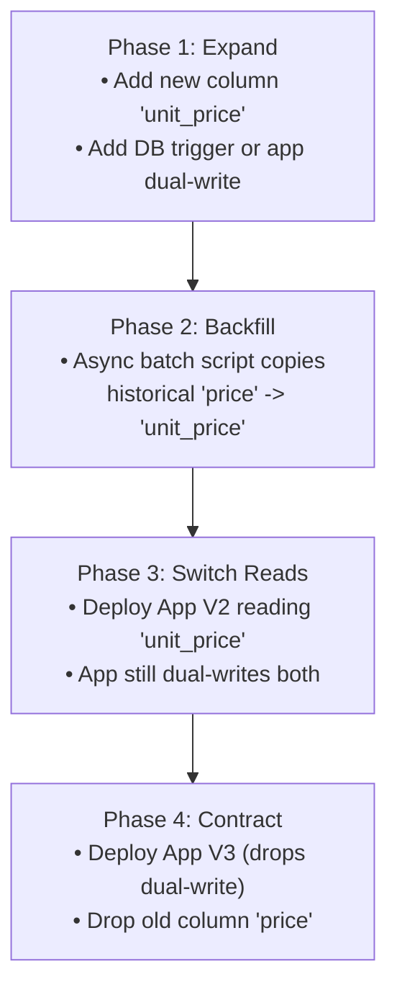

# 08 · Schema Design, Modeling & Zero-Downtime Migrations

> **Level:** Intermediate → Expert  
> **Interview Frequency:** ★★★★★ (Core test of architectural maturity in Senior / Staff design interviews)  
> **Target Databases:** PostgreSQL & MySQL 8.0+  
> **Last Updated:** 2026

---

## 📋 Table of Contents
- [0. TL;DR — The 30-Second Answer](#0-tldr--the-30-second-answer)
- [1. What & Why — The Irreversibility of Bad Schema](#1-what--why--the-irreversibility-of-bad-schema)
- [2. Mental Model — The Normalization vs Denormalization Trade-off](#2-mental-model--the-normalization-vs-denormalization-trade-off)
- [3. Deep Dive — Relational Modeling & Production Migrations](#3-deep-dive--relational-modeling--production-migrations)
  - [3.1 Normal Forms Demystified (1NF, 2NF, 3NF, BCNF)](#31-normal-forms-demystified-1nf-2nf-3nf-bcnf)
  - [3.2 Primary Key Engineering: BIGINT vs UUIDv4 vs UUIDv7](#32-primary-key-engineering-bigint-vs-uuidv4-vs-uuidv7)
  - [3.3 Column Types & Financial Integrity (`DECIMAL` vs `FLOAT`)](#33-column-types--financial-integrity-decimal-vs-float)
  - [3.4 JSONB vs Relational Normalization](#34-jsonb-vs-relational-normalization)
  - [3.5 CPU Alignment & The Struct Padding Tax](#35-cpu-alignment--the-struct-padding-tax)
  - [3.6 Zero-Downtime Migrations: The Expand-Contract Pattern](#36-zero-downtime-migrations-the-expand-contract-pattern)
- [4. Visualizations & Migration Lifecycles](#4-visualizations--migration-lifecycles)
- [5. Worked Examples: Zero-Downtime Column Renaming](#5-worked-examples-zero-downtime-column-renaming)
- [6. Production Diagnostic Scripts](#6-production-diagnostic-scripts)
- [7. Common Pitfalls & Antipatterns (EAV Disaster)](#7-common-pitfalls--antipatterns-eav-disaster)
- [8. Level-Wise Interview Questions & Answers](#8-level-wise-interview-questions--answers)
- [9. Counter-Questions & Interviewer Traps](#9-counter-questions--interviewer-traps)
- [10. Rapid-Fire MCQs](#10-rapid-fire-mcqs)
- [11. One-Page Cheat Sheet](#11-one-page-cheat-sheet)
- [12. Real-World Production Post-Mortems](#12-real-world-production-post-mortems)
- [13. Follow-up Learning](#13-follow-up-learning)

---

## 0. TL;DR — The 30-Second Answer

1. **Normalize to eliminate write anomalies; Denormalize to eliminate join overhead.** 3NF eliminates insert, update, and delete anomalies by ensuring every non-key attribute depends *on the key, the whole key, and nothing but the key*. Strategic denormalization is permissible only when read throughput demands it and a clear invariant owner exists.
2. **UUIDv4 is toxic for B+ Trees; use UUIDv7 or TSID.** Random 128-bit UUIDv4 primary keys cause constant 50/50 page splits, degrading leaf density to ~67% and thrashing the Buffer Pool. **UUIDv7** embeds a 48-bit millisecond timestamp prefix, guaranteeing monotonic append-only B+ tree inserts while preserving global uniqueness.
3. **Never use `FLOAT` or `DOUBLE` for financial amounts.** IEEE-754 floating-point arithmetic causes binary precision rounding errors (→0.1 + 0.2 = 0.30000000000000004→). Always use `DECIMAL` / `NUMERIC` or store integer cents (`BIGINT`).
4. **PostgreSQL `VARCHAR(n)` has zero performance benefit over `TEXT`.** Both use the exact same underlying `varlena` storage layout. Adding arbitrary length constraints (`VARCHAR(50)`) adds migration friction when requirements expand.
5. **Zero-Downtime DDL requires Expand-Contract:** Never run `ALTER TABLE DROP COLUMN` or rename a column synchronously in production. Follow the 4-phase Expand-Contract (Parallel Run) pattern: **Expand** (add new column) → **Dual-Write** (app writes both) → **Backfill** (async update past rows) → **Contract** (switch reads to new column, drop old).
6. **Always index Foreign Key columns.** Databases automatically index Primary Keys, but **PostgreSQL and MySQL do NOT automatically index Foreign Keys**. Omitting an index on foreign keys causes full table locks on parent table deletions and slow joins.

---

## 1. What & Why — The Irreversibility of Bad Schema

Application code is flexible: a poorly structured Java class or API endpoint can be refactored, recompiled, and deployed in an afternoon.

**A production relational schema holding 500 million rows across 20 services cannot be trivially changed.**
- Altering column types requires rewriting gigabytes of storage files under table-level locks.
- Unnormalized structures cause subtle data anomalies where two rows disagree on a customer's address.
- Flawed primary key choices lock the architecture into single-node bottlenecks.

---

## 2. Mental Model — The Normalization vs Denormalization Trade-off

```text
NORMALIZATION (3NF / BCNF)                    DENORMALIZATION
------------------------------------          -------------------------------------
Goal: Eliminate Redundancy & Anomalies        Goal: Maximize Read Throughput
Pros:                                         Pros:
  - Single Source of Truth                      - Zero or fewer JOINs needed
  - Fast, small INSERTs / UPDATEs               - Queries hit single table
  - Minimal storage footprint                   - Pre-aggregated summary metrics
Cons:                                         Cons:
  - Requires multi-table JOINs on read          - Write Amplification (update 10 rows)
  - Complex analytical queries                  - Data Inconsistency Risk (divergence)
```

---

## 3. Deep Dive — Relational Modeling & Production Migrations

### 3.1 Normal Forms Demystified (1NF, 2NF, 3NF, BCNF)

#### 1. First Normal Form (1NF): Atomic Values
- Each column must contain atomic (indivisible) values.
- No repeating groups or comma-separated strings (e.g. `roles = 'ADMIN,USER,DEV'`).
- Must have a designated Primary Key.

#### 2. Second Normal Form (2NF): No Partial Dependencies
- Must be in 1NF.
- Every non-key column must depend on the **entire Primary Key**, not a subset of a composite primary key.
- *Violation Example:* Table with composite PK `(order_id, product_id)`. Column `product_name` depends only on `product_id`, not on `order_id`.  
  *Fix:* Move `product_name` to a dedicated `products` table.

#### 3. Third Normal Form (3NF): No Transitive Dependencies
- Must be in 2NF.
- No non-key column may depend on another non-key column:
  →\text{Key} → X → Y \quad (\text{Transitive})→
- *Violation Example:* In `orders (order_id, customer_id, customer_zip, customer_city)`, `customer_city` depends on `customer_zip`, which depends on `customer_id`.  
  *The Classic Mantra:* **"Every non-key attribute must provide a fact about the key, the whole key, and nothing but the key, so help me Codd."**

#### 4. Boyce-Codd Normal Form (BCNF):
- A stricter version of 3NF: **Every determinant must be a candidate key.**
- Eliminates anomalies when a table has multiple overlapping composite candidate keys.

---

### 3.2 Primary Key Engineering: BIGINT vs UUIDv4 vs UUIDv7

Choosing a primary key type defines the physical layout of your data on disk.

```text
+-----------------------+-------------+---------------+--------------------+-----------------------+
| Identifier Type       | Storage Size| Monotonic?    | Distributed Safe?  | B+ Tree Friendliness  |
+-----------------------+-------------+---------------+--------------------+-----------------------+
| BIGINT (Auto-Inc)     | 8 Bytes     | ✅ Yes (Right)| ❌ No (Single node)| 🟢 Optimal (No splits)|
| UUIDv4 (Random)       | 16 Bytes    | ❌ No (Random)| ✅ Yes (Global)    | 🔴 Toxic (50/50 splits|
| UUIDv7 (Time-Ordered) | 16 Bytes    | ✅ Yes (Time) | ✅ Yes (Global)    | 🟢 Excellent (Monotonic|
| TSID (Twitter Snowflake| 8 Bytes    | ✅ Yes (Time) | ✅ Yes (Global)    | 🟢 Optimal (64-bit int|
+-----------------------+-------------+---------------+--------------------+-----------------------+
```

#### Why Random UUIDv4 Degrades Performance:
A random UUIDv4 has no ordering. New inserts land in random leaf pages across the B+ tree:
1. Every insert loads an arbitrary page from disk into the Buffer Pool.
2. When pages fill up, random inserts trigger **50/50 page splits** throughout the tree.
3. Leaf page density drops from ~90% to ~60–67%, leaving ~35% of memory wasted.
4. The entire working set of the index cannot fit in RAM, leading to continuous I/O thrashing.

#### The Modern Standard: UUIDv7
UUIDv7 embeds a 48-bit UNIX millisecond timestamp in the most significant bits:
```text
 0                   1                   2                   3
 0 1 2 3 4 5 6 7 8 9 0 1 2 3 4 5 6 7 8 9 0 1 2 3 4 5 6 7 8 9 0 1
+-+-+-+-+-+-+-+-+-+-+-+-+-+-+-+-+-+-+-+-+-+-+-+-+-+-+-+-+-+-+-+-+
|                           unix_ts_ms                          |
+-+-+-+-+-+-+-+-+-+-+-+-+-+-+-+-+-+-+-+-+-+-+-+-+-+-+-+-+-+-+-+-+
|          unix_ts_ms           |  ver  |       rand_a          |
+-+-+-+-+-+-+-+-+-+-+-+-+-+-+-+-+-+-+-+-+-+-+-+-+-+-+-+-+-+-+-+-+
|var|                        rand_b                             |
+-+-+-+-+-+-+-+-+-+-+-+-+-+-+-+-+-+-+-+-+-+-+-+-+-+-+-+-+-+-+-+-+
|                            rand_b                             |
+-+-+-+-+-+-+-+-+-+-+-+-+-+-+-+-+-+-+-+-+-+-+-+-+-+-+-+-+-+-+-+-+
```
Because the leading 48 bits increase monotonically with time, inserts always append to the right-most edge of the B+ tree. **Zero random page splits!**

---

### 3.3 Column Types & Financial Integrity (`DECIMAL` vs `FLOAT`)

```sql
-- ❌ THE FINANCIAL DISASTER:
CREATE TABLE accounts (
    id SERIAL PRIMARY KEY,
    balance FLOAT -- IEEE 754 Binary Floating-Point!
);
INSERT INTO accounts (balance) VALUES (0.1), (0.2);
SELECT SUM(balance) FROM accounts; 
-- Result: 0.30000000000000004  (Reconciliation audit fails!)
```

#### The Rules of Numeric Typing:
1. **Financial Amounts:** Always use `NUMERIC(precision, scale)` or `DECIMAL(precision, scale)` (e.g. `NUMERIC(18, 4)`). Alternatively, store balances as integer cents in a `BIGINT` (→100.50 → 10050→).
2. **Timestamps:** Always use `TIMESTAMPTZ` (Timestamp with Time Zone) in PostgreSQL.
   - `TIMESTAMPTZ` physically stores the timestamp converted to **UTC**. When read, it converts UTC to the client's session timezone.
   - Plain `TIMESTAMP` stores naive wall-clock time without timezone offset, making daylight-saving transitions and global distributed systems unmanageable.
3. **Strings:** Prefer `TEXT` over `VARCHAR(N)` in PostgreSQL unless business logic explicitly dictates a hard character cap. `TEXT` and `VARCHAR` have identical byte representations; using `TEXT` avoids future `ALTER TABLE` migrations when strings exceed arbitrary limits.

---

### 3.4 JSONB vs Relational Normalization

Modern PostgreSQL provides first-class JSON support via `JSONB` (binary JSON).

```sql
CREATE TABLE audit_events (
    id BIGSERIAL PRIMARY KEY,
    event_type VARCHAR(50) NOT NULL,
    payload JSONB NOT NULL
);
-- GIN Index for rapid containment lookups:
CREATE INDEX idx_audit_payload ON audit_events USING GIN (payload);

-- Query using containment operator (@>):
SELECT * FROM audit_events 
WHERE payload @> '{"user": {"role": "admin"}}';
```

#### When to Use JSONB:
- Dynamic, polymorphic attributes where different entities have wildly differing properties (e.g. e-commerce product specifications: screen size for TVs, fabric for shirts).
- Third-party webhook payloads stored for auditing.

#### When NOT to Use JSONB (Anti-Patterns):
- Frequently updated fields: Modifying a single key inside a 20KB JSONB document rewrites the entire 20KB object and updates all GIN index entries!
- Columns that participate in `JOIN`s or foreign key constraints.
- Financial or ledger data requiring schema validation.

---

### 3.5 CPU Alignment & The Struct Padding Tax

Database engines align column bytes to CPU word boundaries (e.g. 8-byte alignment for 64-bit integers and timestamps).

```sql
-- ❌ BAD COLUMN ORDER (Causes dead alignment padding):
CREATE TABLE bad_layout (
    a INT2,      -- 2 bytes
                 -- ⚠️ 6 BYTES PADDING (to align to 8-byte boundary)!
    b BIGINT,    -- 8 bytes
    c INT2,      -- 2 bytes
                 -- ⚠️ 6 BYTES PADDING!
    d BIGINT     -- 8 bytes
);
-- Total size per row: 32 bytes (12 bytes wasted on padding = 37.5% bloat!)

-- ✅ OPTIMIZED COLUMN ORDER (Descending size order):
CREATE TABLE good_layout (
    b BIGINT,    -- 8 bytes
    d BIGINT,    -- 8 bytes
    a INT2,      -- 2 bytes
    c INT2       -- 2 bytes
                 -- 4 bytes remaining free space
);
-- Total size per row: 20 bytes (Saves 12 bytes per row = 37.5% disk/RAM savings!)
```
> **Rule of Thumb:** Order table columns by data type size descending: `BIGINT` / `TIMESTAMPTZ` (8 bytes) → `INT` (4 bytes) → `SMALLINT` (2 bytes) → `BOOLEAN` / `CHAR` (1 byte).

---

### 3.6 Zero-Downtime Migrations: The Expand-Contract Pattern

#### The Danger:
Running `ALTER TABLE orders RENAME COLUMN price TO unit_price;` on a table with active microservices immediately breaks all running service instances executing queries against `price`.

#### The 4-Phase Expand-Contract Migration Architecture:



---

## 4. Visualizations & Migration Lifecycles

### Monotonic (UUIDv7) vs Random (UUIDv4) B+ Tree Insertion
```text
UUIDv7 (Monotonic / Append-Only):
Page #1: [ 10:00:01 | 10:00:02 | 10:00:03 ]
Page #2: [ 10:00:04 | 10:00:05 | 10:00:06 ]
* New keys always land on Page #2. No splits on Page #1. High page density (90%+).

UUIDv4 (Random / Fragmented):
Page #1: [ 0x1A2 | 0x4F1 | 0x8B3 ]  <-- New key 0x3C1 forces 50/50 split!
Page #2: [ 0x902 | 0xC41 | 0xF89 ]  <-- New key 0xB12 forces 50/50 split!
* Keys land randomly across all pages. Constant page splits. Page density ~60%.
```

---

## 5. Worked Examples: Zero-Downtime Column Renaming

### Scenario: Rename `phone` to `phone_number` in `users` without downtime

#### Phase 1: Expand (Add Column & Dual-Write Trigger)
```sql
-- Step 1: Add new column (nullable initially)
ALTER TABLE users ADD COLUMN phone_number VARCHAR(30);

-- Step 2: Create synchronization trigger for new writes
CREATE OR REPLACE FUNCTION sync_user_phone()
RETURNS TRIGGER AS →
BEGIN
    NEW.phone_number := COALESCE(NEW.phone_number, NEW.phone);
    NEW.phone := COALESCE(NEW.phone, NEW.phone_number);
    RETURN NEW;
END;
→ LANGUAGE plpgsql;

CREATE TRIGGER trg_sync_phone
BEFORE INSERT OR UPDATE ON users
FOR EACH ROW EXECUTE FUNCTION sync_user_phone();
```

#### Phase 2: Backfill Historical Data in Batches
Never run a single unbatched `UPDATE users SET phone_number = phone;` across 50M rows—it will lock the table and blow up WAL!
```sql
-- Run in small batches of 5,000 rows with a sleep interval:
DO →
DECLARE
    batch_size INT := 5000;
    rows_updated INT;
BEGIN
    LOOP
        UPDATE users 
        SET phone_number = phone 
        WHERE id IN (
            SELECT id FROM users 
            WHERE phone_number IS NULL AND phone IS NOT NULL 
            LIMIT batch_size
        );
        GET DIAGNOSTICS rows_updated = ROW_COUNT;
        EXIT WHEN rows_updated = 0;
        PERFORM pg_sleep(0.1); -- Yield CPU/disk to live API traffic
    END LOOP;
END →;
```

#### Phase 3: Switch Reads & Deploy App V2
- Deploy application code that reads from `phone_number`.

#### Phase 4: Contract (Drop Trigger & Old Column)
```sql
DROP TRIGGER trg_sync_phone ON users;
DROP FUNCTION sync_user_phone;
ALTER TABLE users DROP COLUMN phone;
```

---

## 6. Production Diagnostic Scripts

### PostgreSQL: Inspecting Column Padding Waste
```sql
SELECT 
    attname, 
    typname, 
    attlen, 
    attalign 
FROM pg_attribute 
JOIN pg_type ON atttypid = pg_type.oid 
WHERE attrelid = 'users'::regclass AND attnum > 0 
ORDER BY attnum;
```

### PostgreSQL: Detecting Dangerous Migration DDL Locks
```sql
SELECT 
    pid, 
    usename, 
    state, 
    query, 
    wait_event_type, 
    wait_event 
FROM pg_stat_activity 
WHERE query ILIKE 'ALTER TABLE%' OR query ILIKE 'CREATE INDEX%';
```

---

## 7. Common Pitfalls & Antipatterns (EAV Disaster)

### The EAV (Entity-Attribute-Value) Anti-Pattern
```sql
-- ❌ THE EAV SCHEMA ANTI-PATTERN:
CREATE TABLE entity_attributes (
    entity_id BIGINT,
    attribute_name VARCHAR(50),
    attribute_value TEXT
);
```
- **Why Developers Build It:** "We don't know what attributes products will have, so we'll make it completely dynamic!"
- **Why It Destroys Databases:**
  1. To display a single product with 10 attributes, you must execute **9 self-joins** on the same table.
  2. Foreign keys and data types are impossible to enforce (all values are strings).
  3. Cardinality estimation breaks completely.
- **The Solution:** Use standard relational columns for core fields (id, name, price, status), and store dynamic attributes in a indexed **JSONB** column.

---

## 8. Level-Wise Interview Questions & Answers

### 🟢 Junior (0–2 Years)
**Q: What is database normalization and what is its primary benefit?**  
**A:** Normalization is the process of organizing relational tables to eliminate data redundancy and prevent insert, update, and delete anomalies. Its primary benefit is data integrity—ensuring every piece of information has a single source of truth.

---

### 🟡 Mid-Level (2–5 Years)
**Q: Why should foreign key columns almost always be indexed in relational databases?**  
**A:** Relational database engines automatically create indexes on Primary Keys, but do **not** automatically index Foreign Key columns. Failing to index foreign keys causes two major problems:
1. `JOIN` operations between parent and child tables must perform slow sequential scans.
2. Deleting or updating a row in the parent table requires a full table scan or acquires high-level table locks on the child table to verify referential integrity, causing severe blocking in concurrent workloads.

---

### 🔴 Senior (5–8 Years)
**Q: What are the architectural differences between UUIDv4 and UUIDv7, and why does UUIDv7 prevent index fragmentation?**  
**A:** UUIDv4 is generated using 122 cryptographically random bits. Because values are completely unordered, inserts land unpredictably across the entire B+ tree, forcing constant 50/50 page splits, reducing page fill factor to ~67%, and thrashing the Buffer Pool.
UUIDv7 embeds a 48-bit millisecond UNIX timestamp in the most significant bits, followed by version bits and random data. Because the timestamp increases monotonically, new keys are sorted chronologically, allowing the B+ tree to execute right-leaning append-only inserts. This eliminates random page splits, maintains high page density (>90%), and preserves cache locality.

---

### ⚫ Principal / Staff (8+ Years)
**Q: Walk me through a zero-downtime migration strategy to add a `NOT NULL` column with a default value to an active 500-million row table in PostgreSQL.**  
**A:** 
- In PostgreSQL 11 and newer, running:
  ```sql
  ALTER TABLE orders ADD COLUMN status VARCHAR(20) NOT NULL DEFAULT 'PENDING';
  ```
  is safe and takes **sub-millisecond time**. PostgreSQL stores the default value in the catalog table (`pg_attribute.atthasmissing`) without rewriting table rows on disk.
- However, if the expression is non-constant (e.g. `DEFAULT clock_timestamp()`) or on older engines (MySQL < 8.0):
  1. Add the column as nullable with no default:
     ```sql
     ALTER TABLE orders ADD COLUMN status VARCHAR(20);
     ```
  2. Add the default constraint for future inserts:
     ```sql
     ALTER TABLE orders ALTER COLUMN status SET DEFAULT 'PENDING';
     ```
  3. Backfill existing historical rows in asynchronous background batches (e.g. 5,000 rows per batch with throttling) to avoid locking and WAL spikes.
  4. Once backfill is complete, add a `CHECK` constraint marked `NOT VALID` (validates new rows without locking):
     ```sql
     ALTER TABLE orders ADD CONSTRAINT chk_status_not_null CHECK (status IS NOT NULL) NOT VALID;
     ```
  5. Validate the constraint in the background:
     ```sql
     ALTER TABLE orders VALIDATE CONSTRAINT chk_status_not_null;
     ```
     This verifies existing data under a weak `SHARE UPDATE EXCLUSIVE` lock that allows concurrent reads and writes.

---

## 9. Counter-Questions & Interviewer Traps

### Trap 1: "Is denormalization always an optimization for read-heavy systems?"
- **Naive Answer:** "Yes, denormalizing avoids joins, so reads are always faster."
- **The Trap:** Omitting write amplification and cache penalties.
- **The Expert Answer:** "Not necessarily. Denormalization duplicates data across rows, increasing average row width. Wider rows mean fewer rows fit on an 8KB page, which degrades Buffer Pool cache hit rates and increases disk I/O. Furthermore, denormalization introduces write amplification: updating a single customer address may require modifying thousands of denormalized order rows, causing lock contention and replication lag. Denormalization should only be applied to proven bottlenecks where caching or covering indexes cannot solve the read latency."

### Trap 2: "Can we rename a production column instantly if we do it inside a fast transaction?"
- **Naive Answer:** "Yes, `ALTER TABLE RENAME COLUMN` is fast because it only updates system catalogs."
- **The Trap:** Conflating DDL execution speed with application lock contention.
- **The Expert Answer:** "While the catalog update takes milliseconds, `ALTER TABLE ... RENAME` acquires an `ACCESS EXCLUSIVE` lock on the table. In a high-traffic production system:
  1. The DDL must wait for all currently running queries on the table to finish.
  2. While it waits, **all subsequent read and write queries queue up behind it**, causing immediate connection pool exhaustion.
  3. Even if the rename finishes, currently running application pods running V1 code will immediately throw exceptions because they query the old column name. You must use the Expand-Contract pattern."

---

## 10. Rapid-Fire MCQs

#### Q1: Which normal form guarantees that no non-key attribute transitively depends on the primary key?
- [ ] A) 1NF
- [ ] B) 2NF
- [ ] C) 3NF
- [ ] D) BCNF
* **Answer:** **C**. 3NF eliminates transitive dependencies.

#### Q2: What is the primary operational flaw of using UUIDv4 as a B+ tree primary key?
- [ ] A) It is not globally unique
- [ ] B) Random values cause frequent 50/50 page splits and low page fill factor
- [ ] C) It cannot be stored in binary format
- [ ] D) It violates 1NF
* **Answer:** **B**. Lack of ordering causes random insertions across all leaf pages.

#### Q3: In PostgreSQL, how does `VARCHAR(100)` differ physically on disk from `TEXT`?
- [ ] A) `TEXT` is stored out-of-line; `VARCHAR` is in-line
- [ ] B) `VARCHAR(100)` allocates 100 bytes fixed; `TEXT` is variable
- [ ] C) There is zero difference; both use the exact same variable-length `varlena` storage
- [ ] D) `VARCHAR` supports B-tree indexes; `TEXT` requires GIN
* **Answer:** **C**. PostgreSQL implements `VARCHAR` and `TEXT` identically under the hood; the only difference is the length validation check.

#### Q4: What type of data type should be used for storing financial transactions in currency?
- [ ] A) `FLOAT`
- [ ] B) `DOUBLE`
- [ ] C) `DECIMAL` / `NUMERIC`
- [ ] D) `REAL`
* **Answer:** **C**. Fixed-point `DECIMAL` prevents binary rounding discrepancies.

---

## 11. One-Page Cheat Sheet

```text
+-----------------------+-------------------------------------------------------------+
| Schema Pattern        | Best Practice Guideline                                     |
+-----------------------+-------------------------------------------------------------+
| Primary Key Standard  | Use UUIDv7 (128-bit) or TSID (64-bit) for distributed scale |
| Financial Precision   | NUMERIC(18, 4) or store integer cents in BIGINT             |
| Timezone Storage      | Always TIMESTAMPTZ (converts to UTC internally)             |
| Text Storage          | Prefer TEXT over arbitrary VARCHAR(N) in PostgreSQL         |
| Foreign Key Rule      | Always create an index on child table Foreign Key columns   |
| Column Ordering Rule  | Place 8-byte types first to eliminate CPU alignment padding |
| Zero-Downtime Rule    | Expand -> Dual-Write -> Backfill -> Switch -> Contract      |
+-----------------------+-------------------------------------------------------------+
```

---

## 12. Real-World Production Post-Mortems

### Incident: The Unindexed Foreign Key Deadlock Wave
* **Symptoms:** Nightly user account cleanup job caused widespread deadlocks and timeout errors on the `orders` table during peak traffic.
* **Root Cause Investigation:** The `orders` table had a foreign key constraint referencing `users(id)`, but there was **no index on `orders.user_id`**. When the batch job ran:
  ```sql
  DELETE FROM users WHERE is_inactive = TRUE;
  ```
  The database engine had to verify that no orphaned records existed in `orders`. Because `orders.user_id` lacked an index, the engine had to acquire high-level table locks and perform sequential scans on the entire multi-million row `orders` table, blocking API checkout transactions and triggering deadlock cascades.
* **Resolution:**
  1. Created the missing index concurrently:
     ```sql
     CREATE INDEX CONCURRENTLY idx_orders_user_id ON orders(user_id);
     ```
  2. Deadlocks ceased immediately, and deletion runtimes dropped from 4 minutes to 120ms.

---

## 13. Follow-up Learning
- **Next Chapter:** → [09 · Replication, High Availability & Scaling](./09-Replication-High-Availability-and-Scaling.md)
- **Previous Chapter:** ← [07 · Transactions, ACID, MVCC & Locking](./07-Transactions-ACID-MVCC-and-Locking.md)
