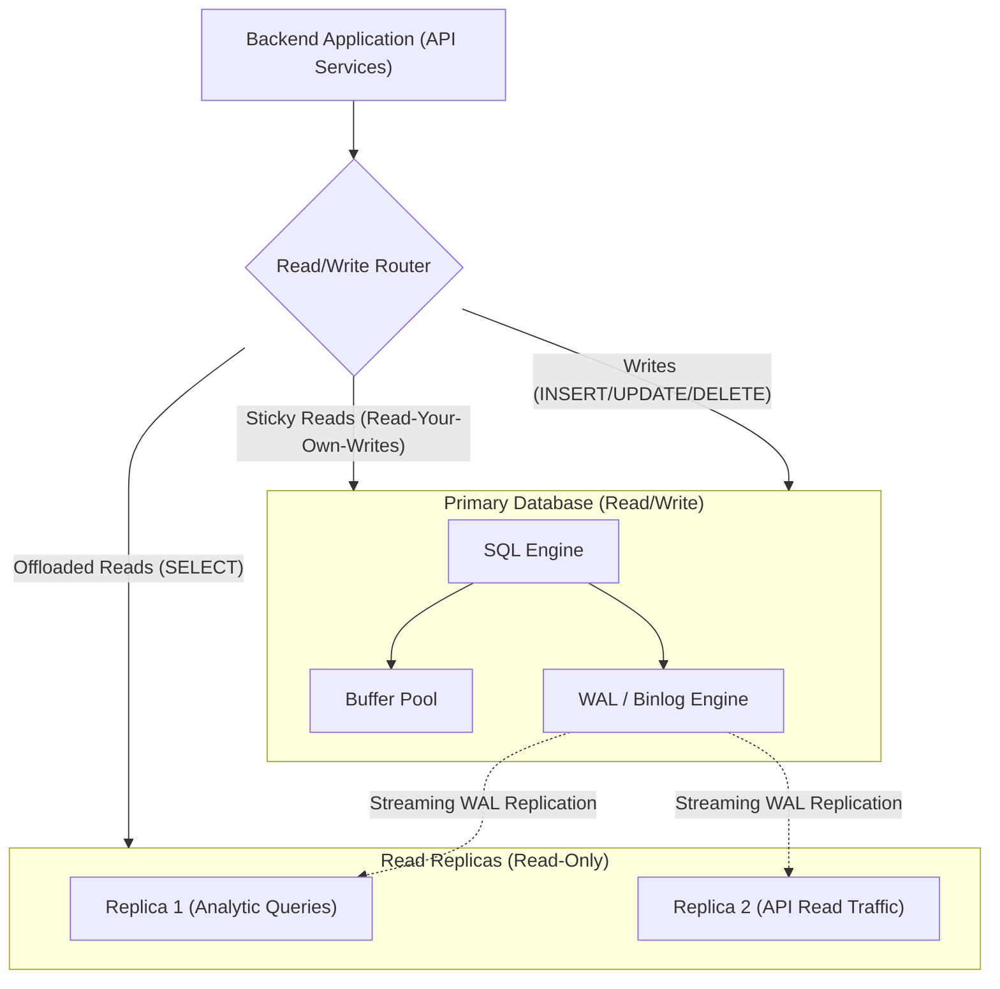
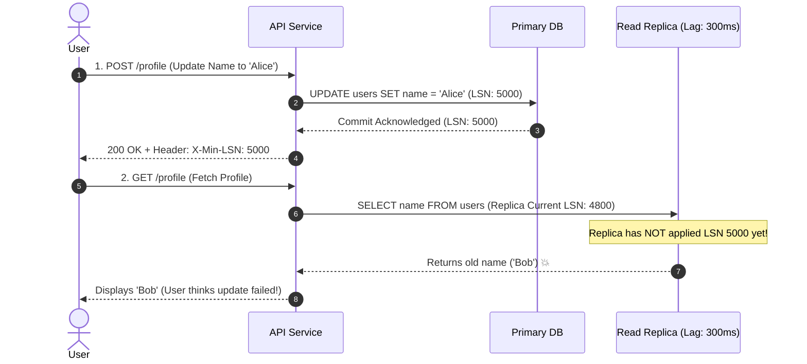
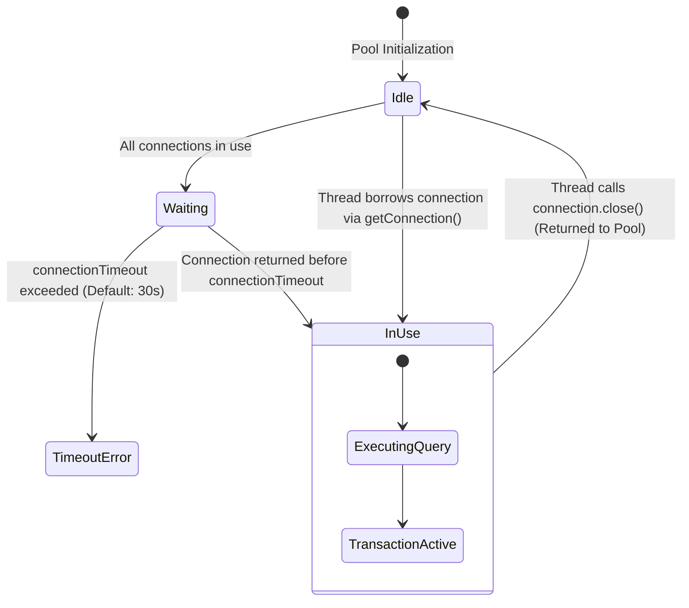

# 09 · Replication, High Availability & Scaling

> **Level:** Advanced → Expert  
> **Interview Frequency:** ★★★★★ (Critical for Senior / Staff System Design & Distributed Database interviews)  
> **Target Databases:** PostgreSQL & MySQL 8.0+  
> **Last Updated:** 2026

---

## 📋 Table of Contents
- [0. TL;DR — The 30-Second Answer](#0-tldr--the-30-second-answer)
- [1. What & Why — The Escalation Ladder of Scaling](#1-what--why--the-escalation-ladder-of-scaling)
- [2. Mental Model — The Primary-Replica Topology](#2-mental-model--the-primary-replica-topology)
- [3. Deep Dive — High Availability & Distributed Scale](#3-deep-dive--high-availability--distributed-scale)
  - [3.1 Replication Topologies: Async vs Semi-Sync vs Sync](#31-replication-topologies-async-vs-semi-sync-vs-sync)
  - [3.2 Replication Mechanics: Physical WAL Streaming vs Logical Binlog](#32-replication-mechanics-physical-wal-streaming-vs-logical-binlog)
  - [3.3 Replication Lag & The Read-Your-Own-Writes Anomaly](#33-replication-lag--the-read-your-own-writes-anomaly)
  - [3.4 Connection Pooling Deep Dive: HikariCP Sizing Math](#34-connection-pooling-deep-dive-hikaricp-sizing-math)
  - [3.5 PgBouncer: Session vs Transaction vs Statement Pooling](#35-pgbouncer-session-vs-transaction-vs-statement-pooling)
  - [3.6 Declarative Table Partitioning & Partition Pruning](#36-declarative-table-partitioning--partition-pruning)
  - [3.7 Horizontal Sharding: Shard Keys & Cross-Shard Distributed Joins](#37-horizontal-sharding-shard-keys--cross-shard-distributed-joins)
- [4. Visualizations & Replication Pipelines](#4-visualizations--replication-pipelines)
- [5. Worked Examples: Declarative Partitioning with Pruning Proof](#5-worked-examples-declarative-partitioning-with-pruning-proof)
- [6. Production Diagnostic Scripts](#6-production-diagnostic-scripts)
- [7. Common Pitfalls & High-Availability Traps](#7-common-pitfalls--high-availability-traps)
- [8. Level-Wise Interview Questions & Answers](#8-level-wise-interview-questions--answers)
- [9. Counter-Questions & Interviewer Traps](#9-counter-questions--interviewer-traps)
- [10. Rapid-Fire MCQs](#10-rapid-fire-mcqs)
- [11. One-Page Cheat Sheet](#11-one-page-cheat-sheet)
- [12. Real-World Production Post-Mortems](#12-real-world-production-post-mortems)
- [13. Follow-up Learning](#13-follow-up-learning)

---

## 0. TL;DR — The 30-Second Answer

1. **Before you shard, climb the Escalation Ladder:** (1) Fix queries & add covering indexes → (2) Scale hardware vertically → (3) Add read replicas → (4) Add connection pooling (PgBouncer/HikariCP) → (5) Declarative Table Partitioning → (6) Application Caching → (7) Horizontal Sharding as the very last resort.
2. **Replication Trade-off (RPO vs Latency):**
   - **Asynchronous:** Client commit returns immediately. Zero network latency penalty. Risk of data loss on failover (→\text{RPO} > 0→).
   - **Synchronous:** Primary waits for replica acknowledge before returning success to client. Zero data loss (→\text{RPO} = 0→), but write latency is bounded by replica round-trip time. If the replica goes down, all primary writes stall.
   - **Semi-Synchronous:** At least 1 replica must acknowledge receiving the WAL record before `COMMIT` completes.
3. **Read-Your-Own-Writes Anomaly:** A user updates their profile on Primary, redirects to view profile, but the read hits a replica experiencing 200ms of lag. User sees their old profile and complains. **Solution:** Track GTID / LSN tokens in cookies or route reads to Primary for →N→ seconds after any write.
4. **HikariCP Sizing Formula:** More database connections do NOT increase throughput; they degrade performance via CPU context switching and lock thrashing. Optimal pool size:
   →\text{Pool Size} = (\text{CPU Cores} \times 2) + \text{Effective Spindle Count}→
   A pool of 20 connections frequently outperforms a pool of 500 connections by 400%.
5. **PostgreSQL Process Model vs PgBouncer:** PostgreSQL allocates a dedicated 10MB OS process per client connection. 1,000 idle connections consume 10GB of RAM and throttle the kernel scheduler. **PgBouncer in Transaction Pooling mode** multiplexes 5,000 client connections onto 50 actual database backend connections.
6. **Partitioning is NOT Sharding:** Partitioning splits a large table into smaller physical files *on the same database instance*. Sharding distributes data across *separate physical database nodes* using a shard key.

---

## 1. What & Why — The Escalation Ladder of Scaling

The #1 hallmark of a junior backend architect is jumping straight to horizontal sharding:
> *"Our user table has 20 million rows, we need to shard across 10 database clusters!"*

A Staff / Principal engineer understands the operational complexity, distributed transaction costs, and cross-shard join limitations of sharding:

```text
THE SCALING ESCALATION LADDER (Cheapest -> Most Complex):
=============================================================================
Level 1: Query & Index Optimization  (Cost: →0 | Effort: Low)
Level 2: Vertical Hardware Scaling   (Cost: Low | 64 Cores, 256GB RAM handles 99% of apps)
Level 3: Connection Pool Multiplexing(Cost: →0 | PgBouncer / HikariCP tuning)
Level 4: Read Replicas               (Cost: Medium | Offload read-heavy traffic)
Level 5: Table Partitioning          (Cost: Medium | Maintain B+ tree sizes on 1 node)
Level 6: Caching Layer (Redis)       (Cost: Medium | Cache-aside for hot reads)
Level 7: Horizontal Sharding         (Cost: Extreme | Distributed 2PC, operational overhead)
```

---

## 2. Mental Model — The Primary-Replica Topology



---

## 3. Deep Dive — High Availability & Distributed Scale

### 3.1 Replication Topologies: Async vs Semi-Sync vs Sync

```text
+-----------------------+--------------------+---------------------+-----------------------------------+
| Mode                  | Write Latency Cost | Data Loss Risk (RPO)| Availability on Replica Failure   |
+-----------------------+--------------------+---------------------+-----------------------------------+
| Asynchronous          | None (Local fsync) | High (Data in-flight| Primary continues unaffected      |
|                       |                    | lost on crash)      |                                   |
+-----------------------+--------------------+---------------------+-----------------------------------+
| Semi-Synchronous      | 1 Replica Network  | Near-Zero (At least | Primary falls back to async after |
|                       | Round-Trip (RTT)   | 1 replica has WAL)  | timeout threshold                 |
+-----------------------+--------------------+---------------------+-----------------------------------+
| Synchronous           | All Replicas RTT   | Zero (Strict RPO=0) | Primary blocks completely if any  |
|                       |                    |                     | replica fails or network partitions|
+-----------------------+--------------------+---------------------+-----------------------------------+
```

#### PostgreSQL `synchronous_commit` Levels:
- `off`: Transaction commits in RAM; WAL is flushed asynchronously (Fastest, risk of losing last few seconds on crash).
- `local`: Flushed to local disk only (Standard default).
- `remote_write`: Primary waits until replica receives WAL and writes to OS cache.
- `on`: Primary waits until replica flushes WAL to physical disk via `fsync`.

---

### 3.2 Replication Mechanics: Physical WAL Streaming vs Logical Binlog

| Dimension | Physical WAL Streaming (PostgreSQL) | Logical Replication / Binlog (MySQL) |
|---|---|---|
| **Mechanism** | Exact byte-for-byte physical block delta stream | High-level logical SQL events (`ROW` or `STATEMENT`) |
| **Cross-Version Support** | ❌ No (Primary and Replica must share major version) | ✅ Yes (Replicate from MySQL 5.7 to 8.0) |
| **Selective Replication** | ❌ No (Replicates entire database cluster byte-for-byte)| ✅ Yes (Replicate specific tables or columns) |
| **Performance Overhead** | Minimal (Direct sequential memory-to-network dump) | Higher (Serialization & deserialization of row events) |
| **CDC Integration** | Requires Logical Decoding plugins (`wal2json`) | Native Binlog parsing (Debezium / Kafka Connect) |

---

### 3.3 Replication Lag & The Read-Your-Own-Writes Anomaly

#### The Race Condition:
1. User submits checkout: `POST /orders` → writes to Primary.
2. Web UI immediately redirects browser to `GET /orders/42`.
3. Load balancer routes read to `Replica 2`.
4. `Replica 2` is lagging behind Primary by 300ms.
5. `Replica 2` returns: `404 Not Found`! User panics and clicks checkout again.



#### Production Solutions:
1. **Time-Based Primary Pinning (Sticky Reads):** When a user executes any write, store a timestamp in their session cookie. For the next 5 seconds, route **all** reads for that specific user directly to Primary. After 5 seconds, resume replica routing.
2. **GTID / LSN Tokens:** Application middleware captures the write's Log Sequence Number (`LSN`) or Global Transaction ID (`GTID`). On subsequent reads, the router verifies that `Replica.applied_lsn >= token.lsn`. If lagging, route read to Primary.

---

### 3.4 Connection Pooling Deep Dive: HikariCP Sizing Math

Why do developers assume: *"More connections = More parallel speed"*?

#### The Physics of CPU Context Switching:
- A database server with 16 CPU cores can execute **exactly 16 instructions in parallel** at any instant.
- If you open 500 active database connections, the operating system kernel must constantly preempt threads, switch CPU registers, flush CPU L1/L2 caches, and coordinate memory bus locks.
- **Result:** The CPU spends 70% of its cycles on context switching rather than executing SQL queries!

#### The Famous PostgreSQL / HikariCP Sizing Formula:
→\text{Max Connections} = (\text{CPU Cores} \times 2) + \text{Effective Spindle Count}→

- For a modern 16-Core server with high-performance NVMe SSDs (→\text{spindle} = 1→):
  →\text{Connections} = (16 \times 2) + 1 = 33 \text{ connections}→
- In production benchmarks, **33 connections deliver higher transaction throughput and lower latency than 500 connections!**

---

### 3.5 PgBouncer: Session vs Transaction vs Statement Pooling

Because PostgreSQL uses a process-per-connection model (~10MB RAM per connection), connecting 5,000 microservice pods directly to Postgres crashes the server. **PgBouncer** is a lightweight connection pooler sitting in front of PostgreSQL.

```text
+-----------------------+------------------------------------------------------------------------------------+
| PgBouncer Mode        | How it Works & Compatibility Traps                                                 |
+-----------------------+------------------------------------------------------------------------------------+
| 1. Session Pooling    | Connection assigned to client upon login; held until client disconnects.           |
|                       | 100% compatible with all features. Limited scaling benefit.                        |
+-----------------------+------------------------------------------------------------------------------------+
| 2. Transaction Pooling| Connection assigned ONLY for the duration of a transaction block (BEGIN...COMMIT). |
|    (Production Gold)  | Between transactions, connection is returned to pool.                              |
|                       | ⚠️ TRAP: Breaks session-level features: `SET search_path`, `LISTEN/NOTIFY`, and    |
|                       | server-side Prepared Statements (unless using PgBouncer 1.21+ / named prep).       |
+-----------------------+------------------------------------------------------------------------------------+
| 3. Statement Pooling  | Connection returned after EVERY single SQL statement.                              |
|                       | ⚠️ TRAP: Multi-statement transactions (`BEGIN...COMMIT`) are completely prohibited!|
+-----------------------+------------------------------------------------------------------------------------+
```

---

### 3.6 Declarative Table Partitioning & Partition Pruning

Declarative partitioning breaks a massive multi-hundred-gigabyte table into smaller physical tables (partitions) while presenting a single logical table to queries.

```text
                                [ Logical Table: orders ]
                                            │
               ┌────────────────────────────┼────────────────────────────┐
               ▼                            ▼                            ▼
    [ orders_2024 ]                  [ orders_2025 ]              [ orders_2026 ]
    (Range: 2024-01-01               (Range: 2025-01-01           (Range: 2026-01-01
     to 2024-12-31)                   to 2025-12-31)               to 2026-12-31)
```

#### Why Partitioning Accelerates Queries (Partition Pruning):
When a query includes the partition key in its `WHERE` clause:
```sql
SELECT * FROM orders WHERE order_date >= '2026-01-01' AND order_date < '2026-02-01';
```
The query planner performs **Partition Pruning**—it completely ignores `orders_2024` and `orders_2025`. It opens and scans **only** the `orders_2026` partition! B+ tree heights remain small, and index scans stay in RAM.

#### Instant Data Retention Reclaim:
To delete 50 million rows from 2022:
- **Without Partitioning:** `DELETE FROM orders WHERE order_date < '2023-01-01';` (Takes 4 hours, generates 50GB of WAL, causes massive table bloat).
- **With Partitioning:** `DROP TABLE orders_2022;` (Takes **2 milliseconds**, instant disk reclaim, zero WAL!).

---

### 3.7 Horizontal Sharding: Shard Keys & Cross-Shard Distributed Joins

When write volume exceeds what a single primary node can process, the database is partitioned across →K→ independent database instances.

```text
Sharding Strategies:
1. Hash-Based: Shard = Hash(user_id) % NumberOfShards
   - Pros: Perfectly even distribution; no write hot spots.
   - Cons: Range queries (WHERE user_id BETWEEN 10 AND 50) must hit EVERY shard.
2. Range-Based: Shard 1 (A-M), Shard 2 (N-Z)
   - Pros: Range queries hit single shard.
   - Cons: Severe write hot spots on temporal or popular letter ranges.
```

#### The Two Fatal Flaws of Sharding:
1. **Cross-Shard Joins:** Joining `users` (Shard 1) with `orders` (Shard 2) cannot be executed in the database engine. The application or a distributed coordinator (e.g. Citus, Vitess) must fetch datasets over the network and join them in memory.
2. **Distributed Transactions (Two-Phase Commit - 2PC):** Modifying two shards in one transaction requires a 2PC coordinator (`PREPARE` → `COMMIT`). If the coordinator crashes mid-commit, locks remain held indefinitely, reducing system availability.

---

## 4. Visualizations & Replication Pipelines

### HikariCP Connection Pool Internal Architecture


---

## 5. Worked Examples: Declarative Partitioning with Pruning Proof

### Setup: Range-Partitioned Orders Table
```sql
CREATE TABLE orders (
    id BIGSERIAL,
    customer_id BIGINT NOT NULL,
    order_date DATE NOT NULL,
    amount NUMERIC(10,2) NOT NULL,
    PRIMARY KEY (id, order_date) -- Partition key MUST be part of PK!
) PARTITION BY RANGE (order_date);

-- Create Child Partitions:
CREATE TABLE orders_2025 PARTITION OF orders
    FOR VALUES FROM ('2025-01-01') TO ('2026-01-01');

CREATE TABLE orders_2026 PARTITION OF orders
    FOR VALUES FROM ('2026-01-01') TO ('2027-01-01');
```

### Proving Partition Pruning with `EXPLAIN`
```sql
EXPLAIN (ANALYZE, BUFFERS)
SELECT * FROM orders 
WHERE order_date = '2026-03-15';
```

**Plan Output:**
```text
Append  (cost=0.00..25.50 rows=10 width=36) (actual time=0.015..0.020 rows=1 loops=1)
  ->  Seq Scan on orders_2026 orders_1  (cost=0.00..25.45 rows=10 width=36) (actual time=0.014..0.018 rows=1 loops=1)
        Filter: (order_date = '2026-03-15'::date)
Planning Time: 0.120 ms
Execution Time: 0.035 ms
```
* **Proof:** `orders_2025` is completely absent from the execution plan! The engine pruned it during query planning.

---

## 6. Production Diagnostic Scripts

### PostgreSQL: Measuring Replication Lag (in Bytes and Latency)
```sql
SELECT 
    client_addr AS replica_ip,
    application_name,
    state,
    sync_state,
    pg_wal_lsn_diff(pg_current_wal_lsn(), sent_lsn) AS send_lag_bytes,
    pg_wal_lsn_diff(sent_lsn, write_lsn) AS write_lag_bytes,
    pg_wal_lsn_diff(write_lsn, flush_lsn) AS flush_lag_bytes,
    pg_wal_lsn_diff(flush_lsn, replay_lsn) AS replay_lag_bytes,
    round(pg_wal_lsn_diff(pg_current_wal_lsn(), replay_lsn) / 1024 / 1024, 2) AS total_lag_mb
FROM pg_stat_replication;
```

### MySQL: Checking Replica Lag & Threads
```sql
SHOW REPLICA STATUS\G
```
**Key Metrics to Inspect:**
- `Replica_IO_Running: Yes` (Fetching binlogs from source)
- `Replica_SQL_Running: Yes` (Applying binlogs to local storage)
- `Seconds_Behind_Source: 0` (Replication lag in seconds)

---

## 7. Common Pitfalls & High-Availability Traps

### 1. The 500-Connection Pool Trap
* **The Error:** A backend team running 20 Spring Boot microservice pods configures `spring.datasource.hikari.maximum-pool-size = 50`.
* **The Catastrophe:** →20 \text{ pods} \times 50 \text{ connections} = 1,000 \text{ concurrent connections}→ to PostgreSQL. The database server spends 80% of its CPU time on context switching between 1,000 processes, throughput collapses by 80%, and API response times spike from 20ms to 5,000ms.
* **The Fix:** Size each pod's pool to 5–10 connections, or place **PgBouncer** in transaction pooling mode between the pods and the database.

### 2. Multi-Primary (Active-Active) Split-Brain
* Running active-active relational primary nodes in different data centers without distributed consensus (Raft/Paxos) results in **split-brain**. When the inter-region network partitions, both primaries accept conflicting updates to the same customer row. Merging diverged relational datasets after a partition heals is mathematically impossible without data loss.

---

## 8. Level-Wise Interview Questions & Answers

### 🟢 Junior (0–2 Years)
**Q: What is a read replica and how does it help application performance?**  
**A:** A read replica is a copy of the primary database kept in sync via log replication. Because applications are typically read-heavy (e.g. 90% reads, 10% writes), offloading `SELECT` queries to read replicas frees up the primary database to handle `INSERT`, `UPDATE`, and `DELETE` write transactions.

---

### 🟡 Mid-Level (2–5 Years)
**Q: What is Replication Lag and how does it affect application correctness?**  
**A:** Replication lag is the time delay between a transaction committing on the primary database and being replayed on a read replica. It creates eventual consistency issues, such as the "Read-Your-Own-Writes" anomaly: if an application writes to the primary and immediately queries a lagging replica, the read returns stale data.

---

### 🔴 Senior (5–8 Years)
**Q: Why does setting a connection pool size to 500 often result in slower performance than setting it to 30?**  
**A:** Relational databases are bounded by physical hardware (CPU cores and disk I/O channels). If a server has 16 CPU cores, it can only execute 16 queries concurrently. Sizing a connection pool to 500 causes the operating system kernel to constantly context-switch between 500 competing processes or threads.
This churn degrades CPU L1/L2/L3 cache hit rates, causes memory bus thrashing, and increases lock contention on internal database latches. Reducing the pool to ~30 allows each core to execute queries to completion with zero context-switching overhead, maximizing aggregate throughput.

---

### ⚫ Principal / Staff (8+ Years)
**Q: How do you implement a zero-data-loss architecture for a distributed financial ledger across multiple regions while maintaining sub-50ms write latency?**  
**A:** 
- The CAP theorem mandates that under network partitioning, a system must choose between Consistency and Availability. For a financial ledger, consistency is non-negotiable (→\text{RPO} = 0→).
- Standard multi-region synchronous replication fails the latency requirement because light-speed fiber round-trip time between US-East and Europe or Asia exceeds 70–100ms.
- **The Optimal Architecture:**
  1. Keep the **Primary and at least two Synchronous / Semi-Synchronous Standbys within the SAME geographic region** across distinct Availability Zones (AZs) connected via low-latency sub-millisecond fiber. This guarantees sub-5ms commit round-trips with zero data loss (→\text{RPO} = 0→).
  2. Replicate **asynchronously to a secondary disaster-recovery region** for catastrophic regional failover.
  3. Partition user accounts by home region (data residency sharding) so that user writes are processed by the regional cluster local to that user, avoiding cross-ocean writes.
  4. Cross-region transfers are implemented via asynchronous **Saga patterns** with distributed compensation events over Kafka, rather than synchronous distributed Two-Phase Commit (2PC).

---

## 9. Counter-Questions & Interviewer Traps

### Trap 1: "Can we use PgBouncer in Transaction Pooling mode with Spring Boot?"
- **Naive Answer:** "Yes, you just change the port in `application.properties`."
- **The Trap:** Omitting Spring Boot / Hibernate prepared statement mechanics.
- **The Expert Answer:** "Not without specific configuration! By default, PostgreSQL JDBC drivers use server-side named prepared statements. In Transaction Pooling mode, a client may prepare a statement on Backend Connection A, but execute it on Backend Connection B during the next transaction, causing `ERROR: prepared statement does not exist`. To use PgBouncer in transaction mode with Spring Boot, you must either:
  1. Append `prepareThreshold=0` to the JDBC URL to disable server-side named prepared statements.
  2. Or upgrade to PgBouncer 1.21+, which introduced built-in support for prepared statements across transaction boundaries."

### Trap 2: "If a read replica goes down in Asynchronous replication, does it affect the Primary?"
- **Naive Answer:** "No, because replication is asynchronous."
- **The Trap:** Omitting WAL sender disk exhaustion.
- **The Expert Answer:** "Not immediately for query execution, but it can crash the Primary later if replication slots are misconfigured! If the Primary uses a physical replication slot for the dead replica, the Primary's WAL manager **will refuse to delete or recycle WAL files** until the replica acknowledges them. If the replica remains offline for hours, WAL files accumulate on the Primary's disk until storage reaches 100% capacity, at which point the Primary crashes and stops accepting all writes!"

---

## 10. Rapid-Fire MCQs

#### Q1: Which replication mode guarantees zero data loss (RPO = 0) upon primary node failure?
- [ ] A) Asynchronous Replication
- [ ] B) Statement-Based Replication
- [ ] C) Synchronous Replication
- [ ] D) Snapshot Replication
* **Answer:** **C**. Synchronous replication ensures all committing transactions are acknowledged by the replica before returning to the client.

#### Q2: What is the primary benefit of Declarative Table Partitioning?
- [ ] A) Replaces the need for B-tree indexes
- [ ] B) Enables partition pruning and instant data deletion via DROP TABLE
- [ ] C) Eliminates the need for primary keys
- [ ] D) Automatically distributes data across separate physical servers
* **Answer:** **B**. Partition pruning restricts query scans to relevant partitions, and dropping a partition reclaims disk space instantly without WAL overhead.

#### Q3: What is the recommended HikariCP connection pool size for an 8-core server with SSDs?
- [ ] A) 100 - 200
- [ ] B) 17 - 25
- [ ] C) 500 - 1000
- [ ] D) Exactly 8
* **Answer:** **B**. Formula: →(\text{Cores} \times 2) + 1 = (8 \times 2) + 1 = 17→.

#### Q4: Why does PgBouncer Transaction Pooling break `LISTEN` / `NOTIFY` in PostgreSQL?
- [ ] A) PgBouncer does not support TCP
- [ ] B) Transaction pooling returns the physical connection to the pool at transaction end, dropping session-level state
- [ ] C) Postgres forbids notifications over proxies
- [ ] D) PgBouncer only supports HTTP
* **Answer:** **B**. `LISTEN` / `NOTIFY` requires a persistent session-level backend connection.

---

## 11. One-Page Cheat Sheet

```text
+-----------------------+-------------------------------------------------------------+
| Scalability Dimension | Architecture Standard                                       |
+-----------------------+-------------------------------------------------------------+
| Connection Pool Math  | Pool Size = (CPU Cores * 2) + Effective Spindle Count       |
| PgBouncer Mode        | Transaction Pooling for web APIs (disable prep statements)   |
| Read-Your-Own-Writes  | Route writes to Primary; pin user reads to Primary for 5s   |
| Large Table Scaling   | Use Declarative Partitioning before jumping to Sharding     |
| Replication Protocol  | Semi-sync within region (low RTT); async across regions     |
| Disk Full Guardrail   | Set max_slot_wal_keep_size to prevent dead replica disk blow|
| High-Speed Retention  | DROP TABLE partition instead of DELETE WHERE date < X       |
+-----------------------+-------------------------------------------------------------+
```

---

## 12. Real-World Production Post-Mortems

### Incident: The Dead Replica That Filled the Primary's Disk
* **Symptoms:** At 4:00 AM on a Sunday, the primary database crashed abruptly, taking down an entire banking app. Disk utilization showed 100% full.
* **Root Cause Investigation:** A staging analytics replica connected to a PostgreSQL replication slot on the production Primary crashed on Friday evening. Because the replication slot was configured without `max_slot_wal_keep_size`, PostgreSQL faithfully preserved every single WAL segment generated over the weekend, waiting for the dead replica to reconnect. Over 48 hours, 400GB of WAL files accumulated, exhausting the primary server's NVMe drive.
* **Resolution:**
  1. Dropped the inactive replication slot: `SELECT pg_drop_replication_slot('staging_replica');`
  2. Postgres immediately reclaimed 350GB of disk space and came back online.
  3. Configured `max_slot_wal_keep_size = '32GB'` on all production primaries to ensure an offline replica can never consume more than 32GB of WAL before being abandoned.

---

## 13. Follow-up Learning
- **Next Chapter:** → [10 · Senior Backend Interview Q&A & Scenarios](./10-Senior-Backend-Interview-QA-and-Scenarios.md)
- **Previous Chapter:** ← [08 · Schema Design, Modeling & Zero-Downtime Migrations](./08-Schema-Design-Modeling-and-Migrations.md)
