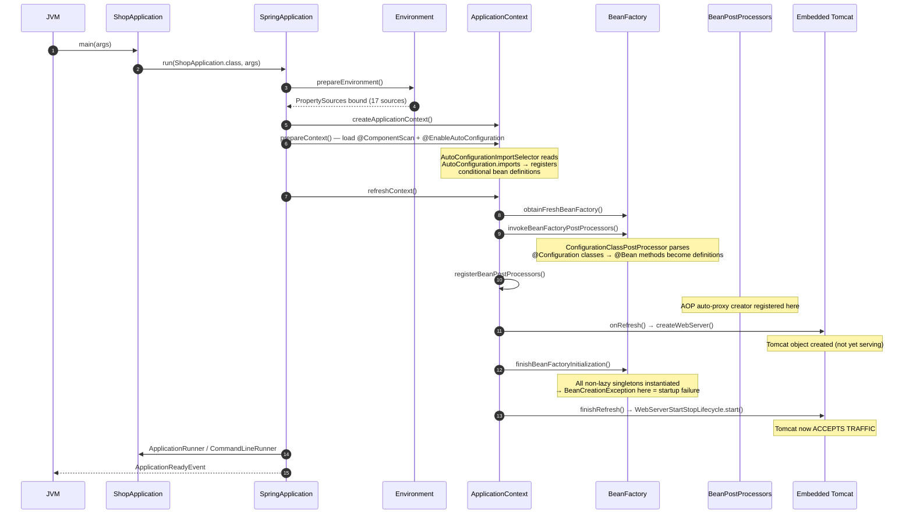
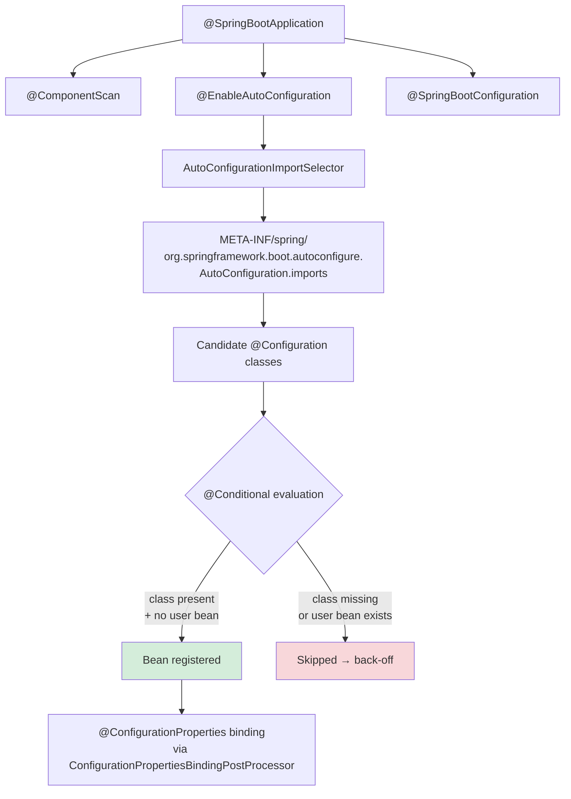

# 01 · Spring Boot Architecture & Internals

> **Level:** Beginner → Advanced
> **Interview Frequency:** ★★★★★ (Every interview asks at least one Boot question)
> **Prerequisite:** [02 · Spring Core](../02-Spring-Core/README.md)
> **Last Updated:** 2026

---

## 📋 Table of Contents
- [0. TL;DR — The 30-Second Answer](#0-tldr--the-30-second-answer)
- [1. What & Why](#1-what--why)
- [2. Mental Model — The Layer Cake](#2-mental-model--the-layer-cake)
- [3. Deep Dive — Theory](#3-deep-dive--theory)
- [4. Internal Working Mechanism](#4-internal-working-mechanism)
- [5. Step-by-Step Execution Flow](#5-step-by-step-execution-flow)
- [6. Architecture Diagrams & Visualizations](#6-architecture-diagrams--visualizations)
- [7. Production-Level Use Cases](#7-production-level-use-cases)
- [8. Code Examples — Production-Grade](#8-code-examples--production-grade)
- [9. Common Mistakes & Gotchas](#9-common-mistakes--gotchas)
- [10. Performance Considerations](#10-performance-considerations)
- [11. Security Considerations](#11-security-considerations)
- [12. Best Practices — The Checklist](#12-best-practices--the-checklist)
- [13. Hands-On Exercises](#13-hands-on-exercises)
- [14. Code Challenges](#14-code-challenges)
- [15. Scenario-Based Questions](#15-scenario-based-questions)
- [16. Interview Q&A — Level-wise](#16-interview-qa--level-wise)
- [17. Counter-Questions & Traps](#17-counter-questions--traps)
- [18. Tricky Interview Questions](#18-tricky-interview-questions)
- [19. Follow-Up Questions Asked by Interviewers](#19-follow-up-questions-asked-by-interviewers)
- [20. Real 3–5 Year Experience Scenarios](#20-real-35-year-experience-scenarios)
- [21. Frequently Asked Production Issues](#21-frequently-asked-production-issues)
- [22. Debugging Scenarios](#22-debugging-scenarios)
- [23. Architecture Design Questions](#23-architecture-design-questions)
- [24. Rapid-Fire MCQs](#24-rapid-fire-mcqs)
- [25. Cheat Sheet — One-Page Summary](#25-cheat-sheet--one-page-summary)
- [26. Real-World Production Notes](#26-real-world-production-notes)
- [27. Follow-up Learning](#27-follow-up-learning)

---

## 0. TL;DR — The 30-Second Answer

- **Spring Boot is not a different framework.** It is Spring Framework + **auto-configuration** + **opinionated starters** + **embedded server** + **externalized config** + **production-ready features (Actuator)**. Delete the auto-config and you have plain Spring.
- **`SpringApplication.run()` is a template method with 5 phases**: `Environment` preparation → `ApplicationContext` creation → `prepareContext` (load sources, listeners, banner) → `refreshContext` (the big one) → `afterRefresh` + `runners`.
- **`refreshContext()` is where the magic is** — it calls `AbstractApplicationContext.refresh()`, which executes 12 `BeanFactoryPostProcessor`s and ~30 bean-definition/aware interfaces, ending with `finishBeanFactoryInitialization()` (instantiate all non-lazy singletons).
- **The `ApplicationContext` is the heart**: it *is* a `BeanFactory` plus environment, event publishing, resource loading and message-source support.
- **Three "Boot magic" mechanisms**: `@EnableAutoConfiguration` → `AutoConfigurationImportSelector` → `spring.factories` / `META-INF/spring/org.springframework.boot.autoconfigure.AutoConfiguration.imports`; `@ConditionalOn*` back-off; and `ConfigurationPropertiesBindingPostProcessor`.
- **`@SpringBootApplication` = `@SpringBootConfiguration` + `@EnableAutoConfiguration` + `@ComponentScan`** — one annotation, three behaviours, and interviewers love asking which part does what.
- **Auto-configuration is "opt-out by classpath"** — it configures beans *only if the user has not already defined them* (`@ConditionalOnMissingBean`).
- **Boot's value is not magic — it is *reversibility*.** Every auto-configured bean can be overridden, and the `ConditionEvaluationReport` tells you exactly what was applied and what was skipped and why.
- **Production-level fact:** you almost never need to understand the *whole* refresh cycle, but you MUST know the **bean creation order** and the **`@Conditional` evaluation order** — that is where 90% of real "why isn't my bean created?" bugs live.

---

## 1. What & Why

### The problem before Spring Boot

Before 2014, a Spring MVC + JPA application required you to hand-write or copy-paste **hundreds of lines of XML**:

```xml
<!-- The "before Boot" world: every bean declared by hand -->
<bean id="dataSource" class="com.zaxxer.hikari.HikariDataSource" destroy-method="close">
  <property name="jdbcUrl" value="jdbc:mysql://localhost:3306/shop"/>
  <property name="maximumPoolSize" value="10"/>
</bean>
<bean id="entityManagerFactory" class="org.springframework.orm.jpa.LocalContainerEntityManagerFactoryBean">
  <property name="dataSource" ref="dataSource"/>
  <property name="packagesToScan" value="com.acme.shop"/>
</bean>
<bean id="transactionManager" class="org.springframework.orm.jpa.JpaTransactionManager">
  <property name="entityManagerFactory" ref="entityManagerFactory"/>
</bean>
<bean id="jpaRepository" class="org.springframework.data.jpa.repository.support.SimpleJpaRepository">
  ...
</bean>
<!-- + web.xml, DispatcherServlet config, Jackson config, view resolvers, ... -->
```

Three problems with this:
1. **Boilerplate ≠ knowledge.** You copy configs without understanding them, and when something breaks you cannot debug it.
2. **Configuration drift.** Two projects in the same company configure JPA slightly differently; nobody notices until a bug.
3. **Slow start.** Every new project starts with 2 days of "wiring".

### What Spring Boot actually did

Spring Boot made three bets:

| Bet | Mechanism | Payoff |
|-----|-----------|--------|
| **"Most apps use the same stack"** | *Starters* bundle a curated dependency set | One line of Maven gets a working JPA stack |
| **"Configuration should be inferred"** | *Auto-configuration* creates beans only if the classpath + properties suggest you want them | No XML, no `@Bean` boilerplate |
| **"Apps should be production-ready out of the box"** | *Actuator* exposes health/metrics/env/loggers endpoints | Health checks, metrics, audit — free |

### The analogy that sticks

> Spring Boot is a **"reversible default"** system, like a smart TV.
> You turn it on and it works out of the box (auto-config). But every setting it chose
> can be overridden by you simply making that choice yourself — the TV notices and steps aside.
> Without Boot, you had to answer every single setting before you could even turn it on.

This "reversible defaults" idea is the single most important mental model for the whole folder.

---

## 2. Mental Model — The Layer Cake

```
┌──────────────────────────────────────────────────────────────────┐
│  YOUR APPLICATION CODE                                            │
│  @RestController  @Service  @Entity  @ConfigurationProperties    │
├──────────────────────────────────────────────────────────────────┤
│  SPRING BOOT STARTERS  (dependency bundles + auto-config)        │
│  spring-boot-starter-web  -web  -data-jpa  -security  -actuator  │
├──────────────────────────────────────────────────────────────────┤
│  SPRING BOOT CORE                                                 │
│  SpringApplication · ApplicationContext · @ConfigurationProperties │
│  @ConditionalOn* · Actuator · EmbeddedServer abstraction         │
├──────────────────────────────────────────────────────────────────┤
│  SPRING FRAMEWORK                                                 │
│  Core (IoC) · MVC · AOP · TX · JDBC · ORM · Security · Test      │
├──────────────────────────────────────────────────────────────────┤
│  RUNTIME                                                          │
│  JVM 17/21 · Tomcat / Jetty / Undertow · HikariCP · Jackson      │
└──────────────────────────────────────────────────────────────────┘
```

> **Caption:** Each layer only *knows about* the layer directly beneath it. Spring Boot never
> re-implements Spring Framework; it *configures* it. If an interviewer asks "is Spring Boot a
> framework?", the answer is: **"No — it is an opinionated configuration layer *on top of* Spring
> Framework that produces a ready-to-run application."**

---

## 3. Deep Dive — Theory

### 3.1 The three annotations of `@SpringBootApplication`

```java
@SpringBootApplication
public class ShopApplication {
    public static void main(String[] args) {
        SpringApplication.run(ShopApplication.class, args);
    }
}
```

```java
// == the following three, literally:
@SpringBootConfiguration   // → @Configuration (proxyBeanMethods=true) + marks the class as the
                            //   source of @Bean definitions (so only ONE per app by default)
@EnableAutoConfiguration    // → imports AutoConfigurationImportSelector → registers auto-configs
@ComponentScan              // → scans the package of this class and below for @Component etc.
```

**Why it matters (and it IS asked):**
- The `@ComponentScan` of the app class means **the component scan root is the app class's package**.
  Move your `@Service` to `com.other` and it silently stops being a bean. This is the #1 "why is my
  bean null" cause in real life.
- `@SpringBootConfiguration` exists so **tests** can find the config class via
  `SpringBootTestContextBootstrapper` — it searches *upwards* from the test class for a
  `@SpringBootConfiguration`. This is why your test class must live under the app package.
- `@EnableAutoConfiguration` is the only one that is Boot-specific.

### 3.2 `SpringApplication.run()` — the 5 phases

```java
public static ConfigurableApplicationContext run(Class<?> primarySource, String... args) {
    return run(new SpringApplication(primarySource), args);
}
```

The real work:

```java
public ConfigurableApplicationContext run(String... args) {
    // ── PHASE 0: bootstrap ───────────────────────────────────────────────
    SpringApplicationRunListeners listeners = prepareEnvironment(listeners, applicationArguments);
    //  → creates ConfigurableEnvironment, adds PropertySources, binds `spring.main.*`
    //  → fires ApplicationEnvironmentPreparedEvent
    //  → ApplicationContext is chosen HERE (ServletWebServerApplicationContext for web apps)

    // ── PHASE 1: create the context ─────────────────────────────────────
    context = createApplicationContext();     // does NOT refresh yet

    // ── PHASE 2: prepare context ────────────────────────────────────────
    prepareContext(context, environment, listeners, applicationArguments, printedBanner);
    //  → set environment, parent, application startup
    //  → load sources: @ComponentScan + @EnableAutoConfiguration imports
    //  → listeners.contextPrepared()
    //  → banner printed
    //  → ApplicationContextInitializer & ApplicationListener callbacks

    // ── PHASE 3: refresh (THE BIG ONE) ──────────────────────────────────
    refreshContext(context);
    //  → AbstractApplicationContext.refresh() — 12 steps, see §4
    //  → afterRefresh() → listeners.started(context)
    //  → ApplicationRunner / CommandLineRunner callbacks  ← YOUR CODE RUNS HERE

    // ── PHASE 4: post-run ────────────────────────────────────────────────
    listeners.running(context);   // → ApplicationReadyEvent → your @EventListener
    return context;
}
```

**Key insight:** your `@Component` constructors, `CommandLineRunner`s and the embedded server start
all happen *inside* `refreshContext` / right after it. A `CommandLineRunner` therefore runs **after**
the web server is already accepting connections in a servlet app — which is why a slow runner can
cause "the pod is ready but the health endpoint returns 503" races.

### 3.3 The `Environment` abstraction

`Environment` is Boot's unified view of *all* configuration sources. It is a `PropertyResolver` +
`ProfileAware` + `ConfigurableEnvironment` with a `MutablePropertySources` list.

```
┌──────────────────────────────────────────────────────────────┐
│                    Environment                               │
│  ┌────────────────────────────────────────────────────┐      │
│  │ MutablePropertySources (ordered, first wins)       │      │
│  │  1. devtools global settings                        │      │
│  │  2. @TestPropertySource                              │      │
│  │  3. @SpringBootTest properties                      │      │
│  │  4. command line args                                │      │
│  │  5. SPRING_APPLICATION_JSON                         │      │
│  │  6. ServletConfig init params                       │      │
│  │  7. ServletContext init params                       │      │
│  │  8. JNDI attributes                                  │      │
│  │  9. Java System properties (System.getProperties)    │      │
│  │ 10. OS environment variables                         │      │
│  │ 11. RandomValuePropertySource                        │      │
│  │ 12. profile-specific application.properties          │      │
│  │ 13. application.properties (packaged in jar)         │      │
│  │ 14. @PropertySource on your @Configuration           │      │
│  │ 15. default properties (SpringApplication.setDefault)│      │
│  └────────────────────────────────────────────────────┘      │
└──────────────────────────────────────────────────────────────┘
```

> **Caption:** Earlier = higher precedence. This 17-source list is the *canonical* Boot precedence
> order — it is asked verbatim in some interviews. The full list with all 17 entries and the
> practical "what wins in prod" table is in [03 · Configuration](./03-Configuration-and-Profiles.md).

### 3.4 `ApplicationContext` — the DI container as the app's spine

`ApplicationContext` is an *extension* of `BeanFactory`:

```
BeanFactory                        ApplicationContext
──────────                         ──────────────────
getBean()                         getBean()
  + BeanPostProcessor              + Environment
  + BeanDefinitionRegistry         + MessageSource (i18n)
  + BeanDefinition                 + ApplicationEventPublisher
    (metadata about beans)         + ResourcePatternResolver
  + ClassLoader                    + Lifecycle (start/stop)
                                   + BeanFactory (it IS one)
```

In practice, **almost every Boot application uses `AnnotationConfigApplicationContext` or
`ServletWebServerApplicationContext`** and you rarely touch `BeanFactory` directly — but knowing
`ApplicationContext extends BeanFactory` is a classic interview follow-up.

### 3.5 Boot's opinionated defaults (and how to see them)

Boot ships a curated set of defaults through `spring-boot-autoconfigure`:

| Area | Default | Where it comes from |
|------|---------|--------------------|
| Web | Tomcat, port 8080, `/` context path | `WebMvcAutoConfiguration` |
| JSON | Jackson on the classpath → Jackson2ObjectMapperBuilder | `JacksonAutoConfiguration` |
| Data | HikariCP + `spring.datasource.*` | `DataSourceAutoConfiguration` |
| JPA | `hibernate.ddl-auto=none`, `open-in-view=true` (!) | `HibernateJpaAutoConfiguration` |
| Logging | Logback, INFO root, console appender | `LoggingSystem` |
| Bean validation | Hibernate Validator if on classpath | `ValidationAutoConfiguration` |
| Shutdown | Graceful shutdown supported | `ServerProperties` |

The killer feature: **you can see every single auto-configuration decision** at runtime.

```
$ java -jar app.jar --debug

***************************
CONDITIONS EVALUATION REPORT
***************************

Positive matches:
-----------------
   DataSourceAutoConfiguration matched:
      - @ConditionalOnClass (javax.sql.DataSource) found
      - @ConditionalOnMissingBean (DataSource) did not find any bean

Negative matches:
-----------------
   RedisAutoConfiguration:
      Did not match:
         - @ConditionalOnClass (org.springframework.data.redis.connection.RedisConnection) 
           did not find required class 'org.springframework.data.redis.connection.RedisConnection'
```

> **Caption:** This report is the single most useful debugging tool Boot gives you. "Why is my
> custom `DataSource` not being used?" → open the report, search for `DataSourceAutoConfiguration`,
> look under *Negative matches* → it says `@ConditionalOnMissingBean (DataSource) did not find any
> bean` → **your bean is not being registered** (usually a package-scan problem).

---

## 4. Internal Working Mechanism

### 4.1 `AbstractApplicationContext.refresh()` — the 12 steps

This is the heart of the whole framework. Memorise the order; it explains dozens of bugs.

```
refresh()
 ①  prepareRefresh()                    — initPropertySources, setActiveProfile, early listeners
 ②  obtainFreshBeanFactory()            — create/reuse the internal BeanFactory (DefaultListableBeanFactory)
 ③  prepareBeanFactory(beanFactory)     — set classloader, expression resolver, aware processors
 ④  postProcessBeanFactory(beanFactory) — ★ BeanFactoryPostProcessors run HERE (property placeholder,
                                          config class parsing, @ConfigurationClassPostProcessor)
 ⑤  invokeBeanFactoryPostProcessors()  — ★ apply BeanFactoryPostProcessor, then their
                                          BeanDefinitionRegistryPostProcessor (already done in ④)
 ⑥  registerBeanPostProcessors()        — ★ register ALL BeanPostProcessors (AOP proxying lives here)
 ⑦  initMessageSource()                 — i18n MessageSource + ApplicationEventMulticaster
 ⑧  initApplicationEventMulticaster()   — (already in ⑦ on 6.x) event broadcasting machinery
 ⑨  onRefresh()                         — subclass hook: ServletWebServerApplicationContext
                                          CREATES THE WEB SERVER HERE (Tomcat starts)
 ⑩  registerListeners()                 — register ApplicationListener beans, ApplicationContextAware
 ⑪  finishBeanFactoryInitialization()  — ★ instantiate non-lazy singletons → FINDS EXCEPTIONS EARLY
 ⑫  finishRefresh()                     — publish ContextRefreshedEvent, init LifecycleProcessor,
                                          WebServerStartStopLifecycle → server starts accepting traffic
```

**The five that interviewers actually ask about:**

| Step | What it does | Why it matters |
|------|--------------|----------------|
| ④⑤ | `ConfigurationClassPostProcessor` parses `@Configuration` classes and turns `@Bean` methods into `BeanDefinition`s | Your `@ComponentScan` and `@Import` are processed here |
| ⑥ | Registers `BeanPostProcessor`s (incl. `AnnotationAwareAspectJAutoProxyCreator`) | **AOP proxies are created here** — which is why `@Transactional` on a bean used by another bean works, but on a `new`-ed object does not |
| ⑨ | `ServletWebServerApplicationContext.onRefresh()` → `createWebServer()` | Tomcat is *created* here but not yet accepting traffic |
| ⑪ | `preInstantiateSingletons()` | All non-lazy singletons are instantiated. **A `BeanCreationException` here kills startup** — fail-fast by design |
| ⑫ | `finishRefresh()` → `WebServerStartStopLifecycle.start()` | Server now accepts traffic; `ContextRefreshedEvent` published |

### 4.2 The `BeanFactoryPostProcessor` vs `BeanPostProcessor` distinction

This trips up nearly every candidate. Get it exactly right.

```text
BeanFactoryPostProcessor          BeanPostProcessor
──────────────────────────         ──────────────────
Operates on BeanDefinitions        Operates on Bean INSTANCES
(metadata), BEFORE instantiation  AFTER instantiation
                                   (and after property injection)
                                   9 stages around a bean
Can't touch the live bean object  Can return a proxy instead of the bean
  (the bean does not exist yet)     (e.g. @Transactional, @Async, @Cacheable)
```

- `PropertySourcesPlaceholderConfigurer` — a `BeanFactoryPostProcessor`. It resolves `${...}` in
  `@Value`/property placeholders. **It must run before bean instantiation**, otherwise it would be
  too late to fill the values.
- `AnnotationAwareAspectJAutoProxyCreator` — a `BeanPostProcessor`. It wraps matching beans in
  CGLIB/JDK proxies **after** they are created.

**Consequence:** `@Value("${db.url}")` in a constructor works (BFP ran already). But a
`BeanPostProcessor` that tries to read a `@Value` field of a *not-yet-created* bean cannot.

### 4.3 The full bean-creation sequence (for a single bean)

```
BeanFactory.getBean("orderService")
  │
  ├─ 1. resolveBeanDefinition      → get the BeanDefinition (metadata)
  ├─ 2. instantiateBean             → choose instantiation strategy:
  │                                  a) @Bean method  → factory method invocation
  │                                  b) no-arg ctor → new OrderService()
  │                                  c) single ctor → autowire it
  │                                  d) multiple ctors → @Autowired / @Primary / @Qualifier
  ├─ 3. populateBean                → inject fields/properties (AutowiredAnnotationBeanPostProcessor)
  ├─ 4. initializeBean             → @PostConstruct / InitializingBean.afterPropertiesSet()
  │                                    └→ applyBeanPostProcessorsBeforeInitialization()
  ├─ 5. applyBeanPostProcessorsAfterInitialization()  → ★ AOP PROXY CREATED HERE
  │                                    └→ @Transactional, @Async, @Cacheable, @Scheduled proxies
  └─ 6. return the (possibly proxied) singleton
```

> **Caption:** Step 5 is why `@Transactional` on a class called via `this.method()` (self-invocation)
> does nothing — the proxy is bypassed, so the advice never runs. See [04 · Transactions](../04-Spring-Data-JPA-Hibernate/05-Transactions-and-Query-Optimization.md).

---

## 5. Step-by-Step Execution Flow

### 5.1 Application startup, end to end



### 5.2 Request lifecycle (the compressed version — full detail in ch. 05)

```
HTTP request
   │
   ▼
[Servlet Container: Tomcat]  →  DispatcherServlet.service()
   │
   ▼
[Spring Security FilterChain]  ← SecurityContextHolder populated here
   │
   ▼
[HandlerMapping]  →  finds @Controller method
   │
   ▼
[HandlerAdapter]  →  invokes it (resolves @RequestBody, @PathVariable, …)
   │
   ▼
[Controller]  →  Service  →  Repository  →  JPA  →  DB
   │
   ▼
[HandlerMethodReturnValueHandler]  →  Jackson serialises @ResponseBody
   │
   ▼
[Filter chain unwinds]  →  response written to the client
```

---

## 6. Architecture Diagrams & Visualizations

### 6.1 Boot's three "auto" mechanisms



> **Caption:** The three mechanisms are (1) *import selection*, (2) *condition evaluation*, and
> (3) *property binding*. Every "auto" behaviour in Boot is one of these three.

### 6.2 The classpath of a typical Boot app

```text
app.jar
 ├── BOOT-INF/classes/                 ← your app: @SpringBootApplication, entities, controllers
 ├── BOOT-INF/lib/
 │    ├── spring-boot-starter-web-3.3.x.jar
 │    │    ├── spring-boot-starter-3.3.x.jar
 │    │    │    ├── spring-boot-3.3.x.jar            (SpringApplication, @ConfigurationProperties)
 │    │    │    ├── spring-boot-autoconfigure-3.3.x.jar
 │    │    │    └── jakarta.annotation-api.jar
 │    │    ├── spring-web-6.1.x.jar
 │    │    ├── spring-webmvc-6.1.x.jar
 │    │    ├── tomcat-embed-core-10.1.x.jar          ← embedded server
 │    │    ├── jackson-databind-2.17.x.jar
 │    │    └── hibernate-validator-8.0.x.jar
 │    ├── spring-boot-starter-data-jpa-3.3.x.jar
 │    │    ├── spring-boot-starter-aop.jar            ← ⚠ AOP proxying lives in starter-aop
 │    │    ├── hibernate-core-6.5.x.jar
 │    │    └── hikaricp-5.1.x.jar
 │    └── spring-boot-starter-security-6.3.x.jar
```

> **Caption:** Note `spring-boot-starter-aop` is pulled in by `starter-data-jpa` — this is why
> `@Transactional` works "for free" with JPA but a plain `spring-boot-starter-web` app has **no**
> `@Transactional` support until you add it.

### 6.3 Startup timeline (what takes how long)

| Phase | Typical cost | Dominated by |
|-------|--------------|--------------|
| JVM start + classpath scan | 100–400 ms | Jar count, classpath indexing |
| `prepareEnvironment` | 5–20 ms | Number of property sources |
| Auto-config import + condition evaluation | 50–300 ms | Number of auto-configs (Boot 3 has ~140) |
| Bean definition registration | 20–100 ms | Component scan size |
| Singleton instantiation | 100–800 ms | Your `@Component` constructors, DB connectivity, `Flyway`/`Liquibase` migrations |
| Tomcat start | 100–300 ms | Connector config, TLS |
| **Total (hello world)** | **~1.5–2.5 s** | |
| **Total (real app with JPA + Flyway)** | **~6–15 s** | **DB + migrations dominate** |

> **Caption:** This is why you should use **lazy initialisation** sparingly but consider it for
> non-critical beans; and why the readiness probe must allow for a slow migration.

---

## 7. Production-Level Use Cases

### 7.1 Real industry examples

| Company type | How they use Boot's architecture | The trap they hit |
|--------------|--------------------------------|-------------------|
| **E-commerce (Big Retail)** | 6–10 Boot services per domain (catalog, cart, pricing, order, payment, fulfilment), each with its own `application.yml`, all sharing a `spring-boot-starter-common` internal module | They duplicated the "common" module into a fat jar and every service inherited every auto-config → startup time ballooned. Fix: use `spring.autoconfigure.exclude` in the common module. |
| **Fintech / Payments** | Boot apps with **strict startup validation** — `spring.jpa.hibernate.ddl-auto=validate` so a schema mismatch fails the pod, not a request | They initially used `ddl-auto=update` and a `NOT NULL` column was added silently in prod → data corruption. |
| **Telecom / SaaS** | Boot apps packaged as **distroless** container images, one per service, with `SPRING_PROFILES_ACTIVE` set from a `ConfigMap` and secrets from a `Secret` | The classic bug: committing `application.yml` with a real password to Git. Fix: `spring.config.import=optional:configserver:` + Vault/K8s Secrets. |
| **Startups (2–10 devs)** | A single **modular monolith** in Boot is the *right* call; Boot's auto-config makes it productive with 1 dev | They prematurely split into 8 microservices, then spent 6 months on tracing, service discovery, and distributed transactions instead of product. |
| **Banks / Insurance** | Boot + **Spring Batch** for nightly jobs, Boot + **Kafka** for events, Boot + **@Scheduled** with a leader lock for cron | They ran `@Scheduled` on **every replica** → the job ran N times. Fix: ShedLock or a single-replica deployment. |

### 7.2 Production configuration patterns

```yaml
# application.yml — NEVER put secrets here
spring:
  application:
    name: order-service
  profiles:
    active: ${SPRING_PROFILES_ACTIVE:dev}
  config:
    import: "optional:configserver:${CONFIG_SERVER_URL}"
  jpa:
    hibernate:
      ddl-auto: validate          # ← fail fast on schema mismatch
    open-in-view: false           # ← see ch. 04, this is the #1 JPA perf bug
server:
  port: ${PORT:8080}
  shutdown: graceful              # ← stop accepting traffic, finish in-flight requests
  tomcat:
    threads:
      max: 200
      max-connections: 8192
    accept-count: 100
    connection-timeout: 20s
management:
  endpoints:
    web:
      exposure:
        include: health,info,metrics,prometheus
  endpoint:
    health:
      probes:
        enabled: true             # ← /actuator/health/liveness and /actuator/health/readiness
      show-details: when-authorized
  health:
    circuitbreakers:
      enabled: true
```

---

## 8. Code Examples — Production-Grade

### 8.1 The canonical Boot application class

```java
package com.acme.shop;

import org.springframework.boot.SpringApplication;
import org.springframework.boot.autoconfigure.SpringBootApplication;
import org.springframework.boot.context.properties.ConfigurationPropertiesScan;
import org.springframework.scheduling.annotation.EnableScheduling;
import org.springframework.transaction.annotation.EnableTransactionManagement;

@SpringBootApplication
@ConfigurationPropertiesScan   // ← picks up @ConfigurationProperties records without @EnableConfigurationProperties
@EnableScheduling            // ← enables @Scheduled
@EnableTransactionManagement // ← Boot auto-configures this, but be explicit
public class ShopApplication {

    public static void main(String[] args) {
        SpringApplication.run(ShopApplication.class, args);
            //      ^^^ always pass the class, never new ShopApplication()
            //          (Boot needs the class for the source, the "primary source")
    }
}
```

### 8.2 A custom auto-configuration (the "how to extend Boot" pattern)

```java
// ① The user-facing properties object
@ConfigurationProperties(prefix = "shop.payments")
public record PaymentProperties(
        String provider,
        URI endpoint,
        Duration timeout,
        @DefaultValue("3") int maxRetries,
        @DefaultValue("true") boolean sandbox) {
    public PaymentProperties {
        Objects.requireNonNull(provider, "provider is required");
        if (timeout.isNegative()) throw new IllegalArgumentException("timeout must be >= 0");
    }
}

// ② The auto-configuration class
@AutoConfiguration
@ConditionalOnClass(PaymentGateway.class)          // only if the SDK is on the classpath
@ConditionalOnMissingBean(PaymentGateway.class)    // back off if the user defined one
@EnableConfigurationProperties(PaymentProperties.class)
public class PaymentAutoConfiguration {

    @Bean
    @ConditionalOnProperty(name = "shop.payments.provider", havingValue = "stripe")
    StripePaymentGateway stripePaymentGateway(PaymentProperties props, RestClient.Builder builder) {
        return new StripePaymentGateway(props, builder);
    }

    @Bean
    @ConditionalOnProperty(name = "shop.payments.provider", havingValue = "razorpay")
    RazorpayPaymentGateway razorpayPaymentGateway(PaymentProperties props) {
        return new RazorpayPaymentGateway(props);
    }
}
```

```java
// ③ Register it — Spring Boot 3.x style (NOT spring.factories!)
//    META-INF/spring/org.springframework.boot.autoconfigure.AutoConfiguration.imports
//    src/main/resources/META-INF/spring/
//        org.springframework.boot.autoconfigure.AutoConfiguration.imports
//    content:
//      com.acme.shop.config.PaymentAutoConfiguration
```

> **Caption:** In Boot **3.x** the `spring.factories` key `EnableAutoConfiguration` was **removed**.
> Auto-configurations must be listed in
> `META-INF/spring/org.springframework.boot.autoconfigure.AutoConfiguration.imports`.
> This is a very common "I moved from 2.x to 3.x and my auto-config stopped working" bug, and it is
> asked in senior interviews.

### 8.3 Inspecting the runtime (the "production debugging" toolkit)

```java
@Component
public class RuntimeInfoLogger implements ApplicationRunner {

    private final ApplicationContext ctx;
    private final Environment env;

    public RuntimeInfoLogger(ApplicationContext ctx, Environment env) {
        this.ctx = ctx;
        this.env = env;
    }

    @Override
    public void run(ApplicationArguments args) {
        int beans = ctx.getBeanDefinitionCount();
        int singletons = ctx.getBeanNamesForType(Object.class).length;
        log.info("Started with {} bean definitions, {} active profiles={}",
                 beans, singletons, Arrays.toString(env.getActiveProfiles()));
    }
}
```

---

## 9. Common Mistakes & Gotchas

| # | ❌ Wrong | ✅ Right | Why |
|---|----------|----------|-----|
| 1 | `@SpringBootApplication` in a package *above* the components, but another `@Configuration` class in a sibling package | Keep the app class in the **root package** of your component tree | Component scan only covers the app class's package *downwards* |
| 2 | Two `@SpringBootApplication` classes | Exactly one per application (tests use `@SpringBootTest` to find it) | Two = two contexts = confusing bean conflicts |
| 3 | `new SpringApplication(...).run(args)` and then `new MyService()` yourself | Let the context manage beans | You lose DI, AOP proxies, `@Transactional`, lifecycle |
| 4 | Setting `spring.jpa.hibernate.ddl-auto=update` in production | `validate` (and migrate with Flyway/Liquibase) | `update` silently drops/alters columns and locks tables |
| 5 | Leaving `spring.jpa.open-in-view=true` (the default!) | Set it to `false` | Holds the DB connection for the whole request → connection pool exhaustion under load |
| 6 | Registering a custom auto-config in `spring.factories` | `META-INF/spring/…AutoConfiguration.imports` | Boot 3 removed the `spring.factories` mechanism |
| 7 | `@Value("${app.name}")` everywhere | `@ConfigurationProperties` | No type safety, no validation, no IDE completion, no relaxed binding |
| 8 | Overriding an auto-configured bean by defining a bean of the *same name* in a `@Configuration` class | Define the bean (any name) — `@ConditionalOnMissingBean` handles back-off | Name collisions cause `BeanDefinitionOverrideException` unless `allow-bean-definition-overriding=true` |
| 9 | `@Component` class in `src/test/java` scanning into the main context | Keep test-only components out of the component-scan root | Test beans leak into production context |
| 10 | Assuming `CommandLineRunner` runs before the server accepts traffic | It runs **after** Tomcat starts | Use `ApplicationRunner` vs `CommandLineRunner` ordering explicitly, and use the readiness probe |

---

## 10. Performance Considerations

| Knob | Default | Production guidance | Impact |
|------|---------|--------------------|--------|
| `spring.main.lazy-initialization=true` | off | Use for services with many optional/integrations; never for beans that must fail fast | Cuts startup 200–800 ms; **hides wiring errors until first request** |
| `spring.jmx.enabled=false` | false in Boot 2.2+ | Keep disabled | JMX endpoint is an attack surface |
| `spring.main.banner-mode=off` | console | Disable in containers (noise) | Cosmetic |
| `server.tomcat.threads.max` | 200 | Size from `Little's Law`: `concurrency = throughput × latency` | Too low → queueing; too high → context-switch thrash |
| `server.tomcat.max-connections` | 8192 | ≥ `threads.max` | Prevents accept-queue overflow |
| `spring.jmx` / actuator exposure | — | **Never** expose `env`, `heapdump`, `threaddump`, `loggers` publicly | Leaks secrets |
| `spring.main.keep-alive` | — | Enables graceful shutdown with a timeout | Zero-downtime deploys |
| Auto-config count | ~140 classes evaluated | Exclude what you don't need: `spring.autoconfigure.exclude=...` | ~50–150 ms saved per exclusion set |

**JVM flags for containers (see ch. 14):**
```
-XX:MaxRAMPercentage=75 -XX:+UseG1GC -XX:+ExitOnOutOfMemoryError \
-XX:+HeapDumpOnOutOfMemoryError -XX:HeapDumpPath=/var/dumps
```

---

## 11. Security Considerations

| Risk | Mitigation |
|------|-----------|
| **Actuator endpoint exposure** | Expose only `health,info,prometheus`; put the rest behind a separate management port bound to localhost or a private network: `management.server.port=8081` |
| **`/actuator/env` leaks secrets** | Never `include: env` in production; `show-details: when-authorized` |
| **Heap dump = full secrets dump** | `heapdump` endpoint downloads live memory — treat as a critical vulnerability |
| **Auto-configured `SecurityFilterChain` with default password** | Boot logs a random password; in prod you always define your own `SecurityFilterChain` |
| **Component scan picking up a `@Component` in a dependency jar** | Narrow the scan with `@ComponentScan(basePackages=...)` or use `@SpringBootApplication(scanBasePackages=...)` |
| **CVE exposure from managed dependency versions** | Use the Boot **BOM** (`spring-boot-starter-parent`), run `mvn dependency-check`, and keep Boot patched (Boot manages CVEs centrally) |
| **DevTools left on in prod** | `spring-boot-devtools` is a **development-only** dependency (`<optional>true</optional>`) and is disabled when the app is packaged as a fat jar — but verify with `mvn dependency:tree` |

---

## 12. Best Practices — The Checklist

- [ ] **One** `@SpringBootApplication` per app, in the **root package** of the component tree.
- [ ] Prefer **constructor injection** everywhere; use `@Autowired` on a setter only for genuine optional dependencies.
- [ ] Use `@ConfigurationProperties` (records) for all configuration; `@Value` only for one-off constants.
- [ ] Validate configuration with `@Validated` + JSR-380 annotations so a bad value **fails at startup**, not at 3 a.m.
- [ ] Use `spring.jpa.hibernate.ddl-auto=validate` and migrate with **Flyway/Liquibase**.
- [ ] Set `spring.jpa.open-in-view=false` and fetch what you need explicitly.
- [ ] Never commit secrets; use env vars / K8s Secrets / Vault.
- [ ] Expose a **minimal** actuator surface; separate management port.
- [ ] Use `ApplicationRunner`/`CommandLineRunner` for startup work, and make it **fast & idempotent** (or move it to a Job).
- [ ] Add `spring.application.name` — it is the key used by Eureka, Zipkin, Prometheus, and log correlation.
- [ ] Enable graceful shutdown (`server.shutdown=graceful` + `spring.lifecycle.timeout-per-shutdown-phase`).
- [ ] Ship a `ConditionEvaluationReport` in your runbook (`--debug` or `debug=true`).
- [ ] Keep Boot patched: 3.3.x is the current line; know that Boot 3.2+ moved to the `AutoConfiguration.imports` mechanism.

---

## 13. Hands-On Exercises

**🧪 Lab 1 — Watch the context start**
1. Create a Boot app with `spring-boot-starter-web`.
2. Add `logging.level.org.springframework.boot=DEBUG` and start it.
3. Find the `Starting ShopApplication` line and the `Started ShopApplication in 1.234 seconds` line — note the gap.
4. Add a `@Component` whose constructor sleeps 2 s. Re-measure. **Where did the time go?**

**✅ Success signal:** You can point at the exact phase (bean instantiation) that the delay landed in.

**🧪 Lab 2 — The condition evaluation report**
1. Add `spring-boot-starter-data-jpa` but **no** datasource. Start with `--debug`.
2. Find `DataSourceAutoConfiguration` in the report → read the *Negative matches* reason.
3. Now define a `DataSource` bean yourself → re-run → it flips to `@ConditionalOnMissingBean did not find any bean`.

**✅ Success signal:** You can predict, before starting, whether a bean will exist and *why*.

**🧪 Lab 3 — Bean creation order**
1. Create beans `A → B → C` (A depends on B depends on C) with `@Order` on them and log in `@PostConstruct`.
2. Predict the log order, then run it.
3. Now make `C` depend on `A` → **circular dependency error**. Explain it.

**✅ Success signal:** You can explain why `@Order` on `@Component` classes does **not** control instantiation order (it controls *processing* order for `Ordered` interfaces; actual instantiation order follows dependency graph).

**🧪 Lab 4 — Auto-config back-off**
1. Define your own `ObjectMapper` bean → check the report: `JacksonAutoConfiguration` is skipped.
2. Define it with a *different* bean name → the auto-config still backs off (the check is **by type**).

**✅ Success signal:** You can state the exact rule: `@ConditionalOnMissingBean` matches by **type**, not by name.

---

## 14. Code Challenges

### Challenge 1 — Custom starter (medium)
**Goal:** Build a `shop-starter-payments` module containing (a) a `PaymentGateway` interface, (b) a `StripePaymentGateway` implementation, (c) an `AutoConfiguration` class, (d) the `AutoConfiguration.imports` file, and (e) a `PaymentProperties` record. Consume it from a demo app with just one dependency and **zero** `@Bean`/`@Configuration` code in the app.

**Test cases:**
- App starts with `shop.payments.provider=stripe` → a `StripePaymentGateway` bean exists.
- App starts with `shop.payments.provider=unknown` → **no** `PaymentGateway` bean, and the app fails with a clear message (add `@ConditionalOnMissingBean` + a `NoSuchBeanDefinitionException` guard).
- App defines its own `PaymentGateway` → the auto-config backs off (assert via the condition report).

### Challenge 2 — Condition evaluation report parser (hard)
**Goal:** Write a `ApplicationContextInitializer` or a test that asserts specific auto-configurations are active/inactive, so a refactor that removes `starter-aop` **fails the build** instead of silently disabling `@Transactional`.

```java
@SpringBootTest
class AutoConfigGuardTest {

    @Autowired ApplicationContext ctx;

    @Test
    void transactionSupportMustBePresent() {
        assertThat(ctx.getBeanNamesForType(TransactionManagementConfigurationSelector.class)).isNotEmpty();
        // better: assert the advice bean exists
        assertThat(ctx.getBeanNamesForType(BeanFactoryTransactionAttributeSourceAdvisor.class)).isNotEmpty();
    }
}
```

**✅ Success signal:** You can name the exact bean that proves AOP proxying is enabled.

### Challenge 3 — Fail-fast configuration (medium)
**Goal:** Create `@ConfigurationProperties` records for `shop.email`, `shop.sms`, `shop.push` and make the app **refuse to start** with a clear aggregated error listing *all* invalid properties, not just the first.

**Test cases:** missing required property → startup fails with a message naming the property; `timeout=-5` → fails with a message naming the constraint that was violated.

---

## 15. Scenario-Based Questions

**S1.** *Your service takes 40 seconds to start in production. The Kubernetes liveness probe has a 30 s failure threshold, so pods crash-loop after deploying. The startup log shows "Started Application in 38.2 seconds". What do you change?*

> **Expected answer:** First, distinguish *slow* from *broken*. The app *does* start, so the liveness probe's `initialDelaySeconds`/failure threshold is too tight. But the *root cause* is the 40 s startup — find out where it goes. Likely culprits: DB connectivity retries (Hikari `connectionTimeout` + `initializationFailTimeout`), Flyway migrations on a large table, too many component-scanned classes, or a `@PostConstruct` doing network I/O. Fixes: (a) run migrations as a separate Job/init container so the app doesn't do them; (b) do slow warm-up **asynchronously** after the app is up; (c) raise the liveness `initialDelaySeconds` and switch to a **readiness** probe for traffic gating — a slow dependency must make the pod *unready*, not *restarted*, otherwise you turn a soft failure into a crash loop. Never "fix" this by disabling liveness.

**S2.** *After upgrading from Spring Boot 2.7 to 3.2, your custom auto-configuration stopped loading, but the app still starts.*

> **Expected answer:** Boot 3 removed the `EnableAutoConfiguration` key from `spring.factories`. Move the list to
> `META-INF/spring/org.springframework.boot.autoconfigure.AutoConfiguration.imports`. Verify with
> `--debug` and the `ConditionEvaluationReport` — the class will appear under *Negative matches*
> with "did not match any condition" or simply not be imported at all. Also check `javax.*` → `jakarta.*`
> namespace migration, and the `hibernate-core` 6.x rename (`org.hibernate.*` → `org.hibernate.*`
> package moves in 6.0 for some annotations).

**S3.** *A bean works in unit tests but is `null` in the running app.*

> **Expected answer:** 90% chance: the bean's class is **outside the component-scan root** (the package
> of your `@SpringBootApplication` class). Second: the class is missing a stereotype annotation.
> Third: it is in `src/test/java` (not scanned in prod). Fourth: it was excluded by a `@Profile` or
> `@Conditional` — check the `ConditionEvaluationReport`. Debug method: `ctx.getBeanNamesForType(X.class)`
> at runtime, or start with `--debug` and grep the report.

**S4.** *Your team wants "one jar for everything". What is the risk?*

> **Expected answer:** A shared "common" module that all services depend on becomes a **distributed
> monolith**: a change to it forces a coordinated release of all services, and its transitive
> dependencies (e.g. `starter-aop` pulled in by `starter-data-jpa`) force auto-configuration on every
> service — even the ones that don't need JPA. Mitigations: keep the common module *thin* (DTOs,
> error handling, observability glue), exclude auto-configs you don't want
> (`spring.autoconfigure.exclude`), and version it independently. Prefer **copy a small amount of code**
> over a fat shared dependency at 3–5 years of experience.

---

## 16. Interview Q&A — Level-wise

### 🟢 Beginner

**Q: What is Spring Boot, and how is it different from Spring Framework?**
**A:** Spring Boot is an *opinionated layer* on top of Spring Framework that removes boilerplate
configuration. It provides four things: auto-configuration (create beans automatically based on the
classpath), starters (curated dependency bundles), embedded servers (the app runs as a plain `main`
method, no external Tomcat), and production features like Actuator. Spring Framework itself is the
IoC container, AOP, MVC, and transaction management — Boot does not replace it, it configures it.

**Q: What is a starter?**
**A:** A starter is a Maven/Gradle POM (usually with a tiny jar) that bundles a curated set of
dependencies plus, usually, the auto-configuration for them. `spring-boot-starter-data-jpa` brings in
`spring-data-jpa`, `hibernate-core`, `spring-orm`, `spring-aspects`, `spring-boot-starter-aop` and
`spring-boot-starter-jdbc` (which brings HikariCP). It means "give me a working JPA stack" in one
dependency.

**Q: What does `@SpringBootApplication` do?**
**A:** It is a composed annotation of three: `@SpringBootConfiguration` (marks the class as a
`@Configuration` and the primary source for tests), `@EnableAutoConfiguration` (turns on
auto-configuration), and `@ComponentScan` (scans the app class's package for `@Component`-style
beans).

**Q: How do you change the port?**
**A:** `server.port=9090` in `application.yml`, the `--server.port=9090` command-line argument, the
`SERVER_PORT` environment variable, or `-Dserver.port=9090`. Command line beats env var beats
`application.yml`.

**Q: What is Actuator?**
**A:** A Spring Boot starter that exposes management endpoints over HTTP (`/actuator/health`,
`/actuator/info`, `/actuator/metrics`, `/actuator/prometheus`) or JMX. It provides health checks,
metrics, env inspection, thread dumps, and log-level changes. In production you expose only a
minimal, authenticated subset.

### 🟡 Intermediate

**Q: Explain the Spring Boot startup process.**
**A:** `SpringApplication.run()` → (1) prepares the `Environment` and binds property sources, (2)
creates the `ApplicationContext`, (3) prepares it — loading `@ComponentScan` and
`@EnableAutoConfiguration` definitions and running `ApplicationContextInitializer`s, (4) calls
`refresh()` which runs `BeanFactoryPostProcessor`s, registers `BeanPostProcessor`s, creates the
embedded web server, instantiates all non-lazy singletons and finally starts the server, (5) runs
`ApplicationRunner`/`CommandLineRunner` beans and publishes `ApplicationReadyEvent`.

**Q: How does Boot know which auto-configurations to apply?**
**A:** `@EnableAutoConfiguration` triggers `AutoConfigurationImportSelector`, which reads
`META-INF/spring/org.springframework.boot.autoconfigure.AutoConfiguration.imports` from every jar on
the classpath, collects the candidate configuration classes, sorts them with
`AutoConfigurationSorter` (using `@AutoConfigureBefore`/`@AutoConfigureAfter` and the
`META-INF/spring-autoconfigure-metadata.properties` file), and then each candidate's
`@Conditional` annotations are evaluated against the current `Environment` and `BeanFactory`.
Beans are registered only if the conditions match.

**Q: What is the difference between `spring.factories` and `AutoConfiguration.imports`?**
**A:** In Boot 2.x, auto-configurations were listed in `spring.factories` under the
`EnableAutoConfiguration` key. Boot 3.x **removed** that mechanism; auto-configurations must now be
listed in `META-INF/spring/org.springframework.boot.autoconfigure.AutoConfiguration.imports`. Other
`spring.factories` keys (e.g. `ApplicationListener`, `EnvironmentPostProcessor`) still exist.

**Q: How can you find out why a bean was not created?**
**A:** Start with `--debug` (or `debug=true`) to get the `ConditionEvaluationReport`, which lists
every auto-configuration, whether it matched, and the exact reason for non-matching (usually a
missing class or an existing user bean). You can also programmatically inspect
`ConditionEvaluationReport.get()` via `ApplicationContext.getBeanFactory()`.

**Q: What is the difference between `ApplicationRunner` and `CommandLineRunner`?**
**A:** Both run after the context is refreshed and the web server started. `CommandLineRunner` takes
`String... args` (raw command-line args) and is meant for CLI-ish work; `ApplicationRunner` takes
`ApplicationArguments` (a structured, environment-aware wrapper with `getOptionNames()`,
`getNonOptionArgs()`). They can be ordered with `@Order`.

### 🔴 Advanced / Senior

**Q: How does the `BeanFactoryPostProcessor` differ from the `BeanPostProcessor`, and why does the order matter?**
**A:** `BeanFactoryPostProcessor`s operate on `BeanDefinition`s — the *metadata* — before any bean is
instantiated; `BeanPostProcessor`s operate on the *instances* after instantiation and property
injection. The distinction matters because property-placeholder resolution
(`@Value("${...}")`) must happen before instantiation, while AOP proxy creation must happen after
the target object exists. Concretely, in `refresh()`: step ⑤ invokes the BFPs, step ⑥ registers the
BPPs, step ⑪ instantiates singletons (and applies the BPPs, creating the proxies).

**Q: Explain `BeanDefinition` and the bean lifecycle phases.**
**A:** A `BeanDefinition` is the metadata record (class name, scope, lazy flag, property values,
init/destroy method names, depends-on). During `finishBeanFactoryInitialization` the container
calls `preInstantiateSingletons()`, which for each non-lazy singleton: resolves the definition,
instantiates (constructor selection: no-arg, single-arg autowired, `@Autowired` constructor),
populates properties, calls `@PostConstruct`/`afterPropertiesSet`, and then applies
`postProcessAfterInitialization` (where AOP proxies are created). The bean is then exposed from the
singleton cache.

**Q: How do you override an auto-configured bean?**
**A:** Define your own bean of the *same type* in a `@Configuration` class — the auto-config's
`@ConditionalOnMissingBean` will then back off. This works because the auto-configuration is
processed **after** your user configuration. Defining a bean with the *same name* also works but
throws `BeanDefinitionOverrideException` unless you set
`spring.main.allow-bean-definition-overriding=true` (discouraged). You can also exclude the
auto-config entirely with `spring.autoconfigure.exclude=...` or by annotating your class with
`@EnableAutoConfiguration(exclude = ...)`.

**Q: What is `spring.main.lazy-initialization` and when is it a bad idea?**
**A:** It defers bean creation to first use instead of startup. It speeds up startup and lets you
start even when a downstream dependency is down — but it moves wiring errors to request time and
means the first request pays the initialisation cost. Use it for optional integrations, not for
core beans whose misconfiguration you want to fail fast.

### ⚫ Expert / Principal

**Q: Design a Boot application that must start in under 3 seconds and survive a downstream outage.**
**A:** (1) Split startup from readiness: the app must *start*, but only become *ready* when its
dependencies are healthy — use a readiness probe gated on a custom `HealthIndicator`, not on process
liveness. (2) Remove DB migrations from the startup path — run them as a Kubernetes `Job`/init
container before the rollout. (3) Lazily initialise non-critical beans (`spring.main.lazy-initialization`
or `@Lazy`) and use `@Async` warm-up for caches. (4) Use **resilience patterns** so a cold/down
dependency degrades instead of failing: `CircuitBreaker` + `Retry` + `Bulkhead` with a fallback,
and never block the request thread on a dead dependency. (5) Keep the JVM warm — AOT/native
(`spring-boot:aot`) or at least classpath indexing (`-XX:SharedArchiveFile` / AppCDS) removes
classloading time. (6) Set `server.shutdown=graceful` so a slow dependency does not block shutdown.

**Q: How would you introduce Boot's auto-configuration into an existing legacy Spring app?**
**A:** Strangler-fig approach: (1) add `spring-boot-starter-web` (not `-data-jpa` yet) and run the
legacy app as a Boot app; (2) exclude the auto-configurations that conflict with the legacy XML
(`spring.autoconfigure.exclude=DataSourceAutoConfiguration,...`); (3) migrate XML bean definitions to
`@Configuration` classes incrementally, module by module; (4) introduce `@ConfigurationProperties`
to replace `${...}` placeholders; (5) enable Actuator and add a `ConditionEvaluationReport` to the
runbook; (6) only then switch the datasource to auto-config with `ddl-auto=validate` and run
migrations with Flyway. The key rule: **never** change the datasource and the schema in the same
release.

---

## 17. Counter-Questions & Traps

### CQ1. "If Spring Boot is just auto-configuration, why can't I just use plain Spring?"
- **Naive answer:** "Because Boot is easier."  ← incomplete
- **The trap:** Boot's real contribution is **batteries-included, reversible defaults** + the
  **Condition Evaluation Report** + **Actuator**. Plain Spring XML can do everything Boot does, but
  Boot makes the *default* correct and makes the *deviation* visible.
- **Expert answer:** The value is in the *out-of-the-box path*: a new service reaches production with
  a datasource, a connection pool, JSON, validation, health checks, metrics and graceful shutdown
  without a single XML file. The `ConditionEvaluationReport` then tells you exactly which defaults
  applied, so you're never fighting magic — you can audit it.

### CQ2. "Why not just define all the beans yourself and skip auto-configuration?"
- **Naive answer:** "It's more explicit and avoids surprises."  ← valid but incomplete
- **The trap:** You re-create what the framework already solved, and you lose the **back-off**
  capability — with auto-config, *your* bean wins automatically; with manual config, a library's
  bean may also register and you get a conflict.
- **Expert answer:** Use auto-configuration for **infrastructure** (datasource, Jackson, MVC) where
  defaults are genuinely right, and explicit `@Bean` for **business** concerns. The hybrid is the
  professional answer: auto-config is a *default*, your explicit bean is an *override*, and the
  framework resolves the conflict for you.

### CQ3. "Is auto-configuration magic? How do you explain it in an interview?"
- **Naive answer:** "It scans the classpath and does stuff."  ← vague
- **The trap:** "Scans the classpath" is not the mechanism. Nothing "scans"; conditions are
  *evaluated*.
- **Expert answer:** Three steps: (1) `AutoConfigurationImportSelector` reads the
  `AutoConfiguration.imports` file from each jar; (2) candidates are sorted and filtered by
  `@Conditional` annotations evaluated against the `Environment` and the current `BeanFactory`;
  (3) surviving classes are registered as configuration classes and their `@Bean` methods become
  `BeanDefinition`s, with `@ConditionalOnMissingBean` providing the back-off. Deterministic,
  inspectable, debuggable.

### CQ4. "What if two auto-configurations both define a bean of the same type?"
- **Naive answer:** "The last one wins."  ← wrong and dangerous
- **The trap:** In Boot 2.1+, **auto-configuration bean definitions are registered *after* user
  beans and are marked as non-overriding**. If two auto-configs both define the same bean name, the
  second one **fails** with `BeanDefinitionOverrideException` — this is deliberate, it surfaces
  genuine conflicts instead of hiding them.
- **Expert answer:** The resolution order is designed so that user code always wins. `@ConditionalOnMissingBean`
  is the standard guard. If you hit the exception, two auto-configs genuinely conflict (often after a
  dependency upgrade) — fix it by excluding one auto-config explicitly.

### CQ5. "You said `open-in-view` should be false. What breaks if you turn it off?"
- **Naive answer:** "Lazy loading breaks."  ← partially right, wrong emphasis
- **The trap:** The real problem is that `open-in-view` keeps a **DB connection + persistence
  context open for the entire HTTP request**, including JSON serialisation. Under concurrency that
  exhausts the Hikari pool, not just "breaks lazy loading".
- **Expert answer:** Turning it off surfaces lazy-loading bugs at development time (a
  `LazyInitializationException` in the test, where the session is definitely closed) instead of
  hiding them until production. The fix is to fetch what you need in the repository layer (join
  fetch, `@EntityGraph`, projections) and map to a DTO before leaving the service.

### CQ6. "How would you unit-test that an auto-configuration is applied?"
- **Naive answer:** "Start the context and check the bean."  ← works but heavy
- **The trap:** A full `@SpringBootTest` is slow and couples the test to the whole app.
- **Expert answer:** Use `ApplicationContextRunner` from `spring-boot-test`:
  ```java
  new ApplicationContextRunner()
      .withConfiguration(AutoConfigurations.of(PaymentAutoConfiguration.class))
      .withPropertyValues("shop.payments.provider=stripe")
      .run(ctx -> assertThat(ctx).hasSingleBean(StripePaymentGateway.class));
  ```
  It is fast, focused, and is the canonical way to test auto-configurations. It also lets you
  assert the *back-off* case: `.withBean(PaymentGateway.class, () -> new MyGateway())`.

### CQ7. "Why does the `ConditionEvaluationReport` exist — is it just for debugging?"
- **Naive answer:** "Yes, it's a debug tool."  ← incomplete
- **The trap:** It is a **contract**. The report is how you audit what a deployment actually runs —
  critical when a service's behaviour differs between environments, or after a dependency upgrade.
- **Expert answer:** Capture it at startup in a non-prod environment and diff it across releases.
  A change in the *negative matches* section between versions is a real behavioural change, even if
  the code diff was empty. Some teams archive it as a build artifact.

### CQ8. "Is it safe to run `SpringApplication.run()` twice in one JVM?"
- **Naive answer:** "Sure, it just creates two contexts."  ← risky
- **The trap:** Two contexts mean two sets of singletons, two connection pools, two web servers
  (port clash), and static state shared between them.
- **Expert answer:** It's possible (and used in some testing scenarios) but almost never what you
  want. If you need a second context, use `SpringApplicationBuilder` with a distinct
  `WebApplicationType.NONE` and no web server, and be explicit about which beans are shared.

### CQ9. "If Boot is so good at defaults, why do teams end up with 200 lines of `application.yml`?"
- **Naive answer:** "Their app is complex."  ← shallow
- **The trap:** A huge YAML file usually means **the defaults were never understood** — people copy
  Stack Overflow snippets, and every snippet disables something (e.g. `spring.jpa.show-sql=true`)
  that then runs forever in production.
- **Expert answer:** A good `application.yml` in production is *short*: datasource URL, credentials
  from env, a few feature flags, and observability. The defaults are the spec — read
  `spring-boot-configuration-metadata.json` inside the Boot jar to see every property, its type,
  its default and its description.

### CQ10. "You said `CommandLineRunner` runs after the web server starts — so why do people use it for migrations?"
- **Naive answer:** "Because it's convenient."  ← true but incomplete
- **The trap:** A long-running migration in a `CommandLineRunner` means the app is *serving traffic*
  (or at least *accepting connections*) while the schema is still changing — a race that causes
  `column does not exist` errors in production.
- **Expert answer:** Use a **separate migration job** (Kubernetes Job, Flyway CLI, or a dedicated
  container) that runs *before* the new version is rolled out. If you must migrate in-process, gate
  the readiness probe so the pod is not marked ready until the migration completes, and ensure the
  old version is compatible with both schemas during the rollout (expand/contract migration).

---

## 18. Tricky Interview Questions

**T1. "Does `@SpringBootApplication` include `@ComponentScan` for the *whole* application?"**
> No — only for the package of the annotated class and its sub-packages. If your app class is in
> `com.acme.shop` and a service is in `com.acme.billing`, it is **not** scanned. You must either
> move the app class up to `com.acme`, or add an explicit `@Import`/`@ComponentScan`.

**T2. "What is the difference between a `BeanDefinition` and a bean instance?"**
> A `BeanDefinition` is *metadata* (class name, scope, property values, lazy flag) — it exists
> before the object does. A bean *instance* is the created object. `BeanFactoryPostProcessor`s work
> on definitions; `BeanPostProcessor`s work on instances. Also: a bean may have **multiple
> definitions** (parent/child) and **0 instances** (lazy, not yet requested).

**T3. "Does `refresh()` instantiate lazy beans?"**
> No. `finishBeanFactoryInitialization` → `preInstantiateSingletons` skips beans marked `lazy-init`
> (including via `spring.main.lazy-initialization=true` and `@Lazy`). They are created on first
> `getBean` call. **But** a lazy bean's *dependencies* are also created lazily.

**T4. "If a `@Bean` method is `static`, what changes?"**
> The method is invoked without creating an instance of the enclosing `@Configuration` class, so the
> configuration class is not proxied and **no CGLIB subclass is generated** for it. This matters
> when the configuration class is `final` (then CGLIB cannot subclass it, so Boot requires the
> `@Bean` method to be `static`) and for `@Bean` methods that must not trigger the configuration
> class's own dependencies.

**T5. "A `@Bean` method is called twice. Why?"**
> Because the configuration class is **CGLIB-proxied** and the proxy intercepts the method to
> enforce the "same instance" contract (`proxyBeanMethods = true` by default). The interception is
> what makes `@Bean` methods return the *same* singleton. Setting `@Configuration(proxyBeanMethods =
> false)` (the default in Boot 2.2+) removes the interception, which is a legitimate optimisation —
> at the cost of losing the guarantee.

**T6. "What is `BeanCurrentlyInCreationException` and when do you get it?"**
> Circular dependency between two non-lazy singletons: A depends on B, B depends on A. The
> container can resolve *some* cycles by injecting the early reference for **singleton** beans
> (constructor injection is not eligible), but a setter/field cycle on singletons usually works
> while a **prototype** cycle always fails. Boot 2.6+ **disables circular references by default**
> (`spring.main.allow-circular-references=false`) — this is a *feature*, it turns a hidden runtime
> bug into a startup failure.

**T7. "Does `ApplicationContext` implement `AutoCloseable`?"**
> Yes, via `ConfigurableApplicationContext extends Closeable`. On `close()` it publishes
> `ContextClosedEvent`, destroys singleton beans (calling `@PreDestroy`/`DisposableBean.destroy()`),
> and closes the web server. In Boot 3, the `SpringApplication` registers a **shutdown hook** so the
> context closes on JVM exit.

**T8. "What is the difference between `spring.main.web-application-type` and `WebApplicationType`?"**
> `WebApplicationType` is the enum Boot uses to *decide* (SERVLET / REACTIVE / NONE) based on the
> classpath; `spring.main.web-application-type` is the property that **overrides** the detection.
> Setting it to `NONE` in a test that has `starter-web` on the classpath prevents Tomcat from
> starting.

---

## 19. Follow-Up Questions Asked by Interviewers

**F1** (after "what is auto-configuration?") → *"OK, so when I add `spring-boot-starter-data-redis`,
what exactly happens?"*
→ The starter adds `spring-data-redis`, `lettuce-core`, and `spring-boot-starter-aop` (a proxy is
required for `@Cacheable`). The auto-config `RedisAutoConfiguration` matches because
`RedisOperations` is on the classpath, creates a `LettuceConnectionFactory` from
`spring.data.redis.*` properties, and a `RedisTemplate<Object,Object>` bean. If you define your own
`RedisConnectionFactory`, the auto-config backs off.

**F2** (after "explain `refresh()`") → *"Which of those steps would you change for a fast start?"*
→ ⑪ `finishBeanFactoryInitialization` (lazy init), ④⑤ auto-config/condition evaluation (exclude
unused auto-configs), and moving migrations out of the startup path. Also class loading (AppCDS/AOT).

**F3** (after "what is a starter?") → *"How would you build your own starter for your company?"*
→ A POM with `spring-boot-starter` as a parent, the library as a dependency, an
`@AutoConfiguration` class, a `@ConfigurationProperties` record, the `AutoConfiguration.imports`
file, and — critically — **the auto-configurations of the libraries you depend on must be
excluded from your starter's transitive deps** if you don't want them. Test it with
`ApplicationContextRunner`.

**F4** (after "what is `ApplicationContext`?") → *"How is it different from a plain `new`?"*
→ The container owns the lifecycle (creation, dependency injection, scoping, AOP proxying,
destruction), so `new` gives you an object with **none** of those — no `@Transactional`, no
`@Async`, no `@PreDestroy`, no prototype scoping.

**F5** (after "what is `CommandLineRunner`?") → *"What if it throws?"**
→ The exception propagates out of `run()`; Boot's `SpringApplication` catches it, reports it, and
**exits the JVM** (`ExitCodeGenerator` determines the code). So a failing runner = a crash-looping
pod. Keep runners small and let real work happen in a separate job.

**F6** (after "explain the condition report") → *"How do you disable an auto-configuration you don't want?"*
→ Three ways: `spring.autoconfigure.exclude=org.springframework.boot.autoconfigure.jdbc.DataSourceAutoConfiguration`
in properties; `@EnableAutoConfiguration(exclude = ...)` on the app class; or exclude the *starter*
dependency entirely (preferred if you don't need the feature at all).

---

## 20. Real 3–5 Year Experience Scenarios

**R1. "Your team's Boot app has 350 lines of `application.yml`. A new joiner asks which settings matter."**
> **Ideal answer:** Don't read the YAML top to bottom — read it against
> `spring-boot-configuration-metadata.json` in the Boot jar (or the IDE's Spring Boot configuration
> metadata view). That file lists every property, its type, its **default** and its description.
> Then classify each override into: (a) *deliberate deviation from default* — keep and comment
> **why**; (b) *copy-paste noise* (e.g. `spring.jpa.show-sql=true`, `logging.level.org.hibernate=DEBUG`)
> — remove; (c) *environment-specific* (URLs, credentials) — move to env vars/Secrets; (d)
> *dangerous* (`ddl-auto=update`, `open-in-view=true`, actuator `env` exposure) — fix.
> A good YAML has a comment next to every non-obvious line explaining the *reason*; the next
> engineer should not have to guess. This is a real 3–5 year expectation: **you own the
> configuration's blast radius**.

**R2. "A new starter you introduced auto-configured a `RestClient` that captured the wrong `ObjectMapper`, breaking Jackson customisations in one service but not another."**
> **Ideal answer:** Trace with the `ConditionEvaluationReport` in the affected environment: the
> auto-config matched in both, but the *bean graph* differed because in one service a custom
> `ObjectMapper` bean exists and in the other it doesn't — a `@ConditionalOnMissingBean` on the
> `ObjectMapper` in the consuming service changes which `RestClient` is built. The fix is to make
> the starter depend on `ObjectMapper` (not create its own) and let the *user's* `ObjectMapper`
> win; plus add a test with `ApplicationContextRunner` covering both "custom mapper present" and
> "absent" cases. The lesson: **auto-configurations must be written against the *user's* bean
> graph, not their own**.

**R3. "Your service takes 25 s to become ready after a restart; the load balancer sends traffic
before the app is warm, and the first 200 requests fail with `NoSuchBeanDefinitionException` for a
warm-up bean."**
> **Ideal answer:** The bean was `@Lazy` (or the whole app was lazy-initialised) and the
> readiness probe reported UP before the bean existed. The fix is not to remove `@Lazy` but to make
> the readiness signal *depend on the warm-up*: implement a custom `HealthIndicator` that reports
> DOWN until the warm-up completes, or perform the warm-up inside a `SmartLifecycle` with a phase
> that starts before the web server's `WebServerStartStopLifecycle` phase. Ordering matters:
> `WebServerStartStopLifecycle` has phase `Integer.MAX_VALUE - 1`, so any `SmartLifecycle` with a
> lower phase starts first.

---

## 21. Frequently Asked Production Issues

| Symptom | Likely cause | Diagnosis | Fix |
|---------|--------------|-----------|-----|
| App starts, but `/actuator/health` returns 503 | A `HealthIndicator` (DB, Redis, disk space) is DOWN | `GET /actuator/health` (with details authorised) | Fix the dependency or mark the indicator as non-critical (`management.health.<name>.enabled=false`) |
| App hangs at startup for minutes | DB connection retries (Hikari `initializationFailTimeout`) | Look for `HikariPool-1 - Starting...` then a long gap | Set `spring.datasource.hikari.initialization-fail-timeout=1` (fail fast) and fix the DB |
| App hangs at startup | Flyway migration waiting on a **lock** | `SELECT * FROM flyway_schema_history` / `SHOW PROCESSLIST` | Migrations must run as a single job, never from N replicas |
| `BeanDefinitionOverrideException` | Two libraries define the same bean name | Exception message names the bean | Set `allow-bean-definition-overriding` **only** if you know what you're doing; better, exclude one auto-config |
| `NoSuchBeanDefinitionException` at runtime | Class outside the scan root, or a `@Profile` mismatch | `ctx.getBeanNamesForType(X.class)` | Move the class under the app package, or check `--debug` report |
| `LazyInitializationException` in prod but not in tests | `open-in-view=false` + lazy association | Stack trace points at the getter | Fetch in the repository; map to DTO inside the transactional boundary |
| `Circular reference` error after a dependency upgrade | Boot 2.6+ disables circular refs by default | Stack trace shows the cycle | Break the cycle; do **not** re-enable the flag globally |
| Port already in use | Another instance running | `lsof -i :8080` | Use `server.port=0` (random) in tests |
| Startup slow, then fast | Classpath scanning + JIT warm-up | `-Dspring.jmx.enabled` no; use `-verbose:class` or `-XX:+PrintCompilation` | AppCDS / AOT, exclude unused auto-configs |
| `OutOfMemoryError: Metaspace` | Classloader leak (hot reload, devtools in prod) | `jcmd <pid> GC.class_stats` | Remove devtools from the runtime image |

---

## 22. Debugging Scenarios

**D1. "A bean is null in production but present in dev. Where do you look?"**
1. Start with the **condition report**: `java -jar app.jar --debug > conditions.txt`, then `grep -A5 "MyService" conditions.txt`.
2. Check the **component-scan root**: is the class under the `@SpringBootApplication` package?
3. Check **profiles**: `spring.profiles.active` in prod may activate a `@Profile("!prod")` exclusion.
4. Check **conditional annotations** on the bean: `@ConditionalOnProperty`, `@ConditionalOnBean` (order-sensitive!), `@ConditionalOnMissingBean`.
5. Compare the **classpath**: `mvn dependency:tree -Dincludes=my.lib` — a missing starter in prod changes auto-config.
6. Compare **property values**: `GET /actuator/env` (dev only) or `Environment` dump.

**D2. "The app starts but a request 500s with `NoSuchBeanDefinitionException`."**
1. The exception names the missing type → find who injects it.
2. Check if the bean is `@Lazy` and the injection point is outside the context (e.g. a manually created object).
3. Check for a **circular dependency** that Boot now forbids — the error would be at startup though.
4. Check **conditional back-off**: another auto-config may have created a bean of a *subtype*, causing `@ConditionalOnMissingBean(ExactType.class)` to match and skip yours.
5. Reproduce with `@SpringBootTest` and `ctx.getBeanNamesForType(X.class)` — if the test passes, it's an environment/property difference, not a wiring difference.

**D3. "Startup takes 40 s. Where exactly?"**
1. Add `-Dspring.main.log-startup-info=true` (Boot 3.2+) to get per-phase startup timings.
2. Turn on `logging.level.org.springframework.beans.factory.support=DEBUG` to see bean creation timestamps.
3. Add `logging.level.org.springframework.boot.autoconfigure=DEBUG` for the condition report timings.
4. Check `ApplicationStartup` (Boot 3) — `SpringApplication.setApplicationStartup(new BufferingApplicationStartup(2048))` and expose the buffer as a `StartupStep` endpoint; this gives an **exact per-step timeline** and is the professional answer.
5. Common culprits: DB connect, migrations, `RestTemplate`/`WebClient` bean creation, `@PostConstruct` network calls, `spring.jpa.hibernate.ddl-auto` schema export.

**D4. "Memory grows unboundedly over 24 hours."**
1. `jcmd <pid> GC.heap_info` → is it the heap or the metaspace?
2. Take two heap dumps (`jcmd <pid> GC.heap_dump`) and compare with **Eclipse MAT**'s "Duplicate classes" / "leak suspects" report.
3. If it is metaspace → classloader leak (check `GC.class_stats`); if it is the heap → look for unbounded collections (a static `Map` cache, a `@Scheduled` task appending to a list).
4. Check for a **thread leak** (`jcmd <pid> Thread.print`) — an unbounded `ExecutorService` or a new Tomcat thread per request.
5. In containers, check that `-XX:MaxRAMPercentage` is set and that the container limit is respected — a JVM unaware of cgroup limits will be OOM-killed.

---

## 23. Architecture Design Questions

**Q1. 🏗️ Design the startup/ready/liveness strategy for a Boot service with three external dependencies (Postgres, Redis, Kafka).**
> **Answer structure:** (1) **Liveness** = "is the JVM healthy?" — no dependency checks at all; a failing
> dependency must not cause a restart. (2) **Readiness** = "can this pod serve traffic?" — a composite
> health indicator that checks only the dependencies *required to serve traffic*; Kafka is often
> non-critical (consumers can lag) so it should be a *warning*, not a DOWN. (3) **Startup** = a
> `SmartLifecycle` phase lower than the web server's, for warm-up, with a bounded timeout. (4) On
> dependency loss, use resilience patterns (circuit breaker) so requests degrade instead of failing.
> (5) Alert on the *symptom* (5xx rate, lag) not on the dependency being down.

**Q2. 🏗️ You own 12 Boot services. Design a shared "platform" library without creating a distributed monolith.**
> **Answer structure:** (1) Split the shared code into *layers* with different coupling: a **thin
> `platform-web`** (global exception handler, correlation-id filter, `ProblemDetail` conventions),
> a **`platform-observability`** (logging/trace/MDC setup), a **`platform-security`** (JWT decoder,
> user context). (2) Each module must bring **no** auto-configurations except its own; publish them
> via `AutoConfiguration.imports` and guard every bean with `@ConditionalOnMissingBean`.
> (3) Version independently (semver), and make breaking changes a **major version** with a migration
> guide. (4) Add a **compatibility test** in the shared module: a `ApplicationContextRunner` test
> asserting the auto-config applies and backs off correctly. (5) No shared module may depend on a
> *business* domain. (6) Monitor: if a shared module is changed weekly, it is a monolith in disguise —
> split it.

**Q3. 🏗️ How would you migrate a legacy XML Spring app to Boot with zero downtime?**
> **Answer structure:** Strangler-fig. (1) Introduce Boot as a **new module** that depends on the
> legacy jar; the legacy beans become plain Spring beans inside the Boot context. (2) Exclude
> conflicting auto-configs. (3) Move the HTTP layer to Boot's `DispatcherServlet` while keeping the
> legacy controllers. (4) Replace `${}` placeholders with `@ConfigurationProperties` incrementally.
> (5) Introduce Actuator + a readiness probe. (6) Swap the datasource to auto-config with
> `ddl-auto=validate` and migrate the schema with Flyway (expand/contract). (7) Only then remove the
> XML. Guard each step with a **canary** release and an automated smoke test.

---

## 24. Rapid-Fire MCQs

**1.** What does `@SpringBootApplication` NOT include?
A) `@ComponentScan`  B) `@EnableAutoConfiguration`  C) `@EnableJpaRepositories`  D) `@SpringBootConfiguration`
**✅ C** — JPA repositories are enabled by auto-configuration when the JPA classes are present.

**2.** In Boot 3.x, where must a custom auto-configuration be registered?
A) `META-INF/spring.factories`  B) `META-INF/spring/org.springframework.boot.autoconfigure.AutoConfiguration.imports`  C) `META-INF/beans.xml`  D) `spring.auto-config.imports` in the classpath root
**✅ B** — the `spring.factories` mechanism for auto-config was removed in Boot 3.

**3.** What is the execution order of `BeanFactoryPostProcessor` and `BeanPostProcessor`?
A) BPP then BFP  B) BFP then BPP  C) They run in parallel  D) Depends on `@Order`
**✅ B** — definitions are post-processed first, then instances.

**4.** Which step of `refresh()` instantiates the non-lazy singletons?
A) `prepareBeanFactory`  B) `invokeBeanFactoryPostProcessors`  C) `finishBeanFactoryInitialization`  D) `finishRefresh`
**✅ C**

**5.** `@ConditionalOnMissingBean` matches by:
A) Bean name  B) Bean type  C) Either  D) Qualifier
**✅ B** — by type (or by type + name/qualifier attributes).

**6.** Which is **not** part of Spring Boot's "core" offering?
A) Auto-configuration  B) Starters  C) Embedded servers  D) An ORM implementation
**✅ D** — Hibernate is provided by `spring-boot-starter-data-jpa`; Boot ships `spring-boot-starter-jdbc` with a plain `JdbcTemplate`.

**7.** `CommandLineRunner` beans run:
A) Before the context refresh  B) After the context refresh and web server start  C) On the first request  D) Before bean instantiation
**✅ B**

**8.** `spring.jpa.hibernate.ddl-auto=validate` in production will:
A) Create missing tables  B) Drop unused columns  C) Fail startup on a schema mismatch  D) Do nothing
**✅ C** — this is the "fail fast" setting.

**9.** Which property makes a config value overridable by an environment variable without renaming it?
A) `spring.config.import`  B) Relaxed binding  C) `@Value`  D) `spring.main.lazy-initialization`
**✅ B** — `MY_SERVICE_URL` binds to `my.service.url`.

**10.** Which endpoint is *most* dangerous to expose publicly?
A) `/actuator/health`  B) `/actuator/info`  C) `/actuator/heapdump`  D) `/actuator/metrics`
**✅ C** — it dumps live memory, including secrets.

**11.** `spring.main.lazy-initialization=true` will:
A) Make every request slower  B) Defer bean creation to first use  C) Disable auto-configuration  D) Speed up every request
**✅ B**

**12.** What does the `ConditionEvaluationReport` tell you?
A) Which beans are lazy  B) Why each auto-configuration matched or was skipped  C) The bean creation order  D) The SQL statements executed
**✅ B**

**13.** `@Configuration(proxyBeanMethods = false)` means:
A) The config class is not proxied, so `@Bean` methods may be called more than once  B) `@Bean` methods are not supported  C) Auto-configuration is disabled  D) The class must be final
**✅ A**

**14.** Boot's default `spring.jpa.open-in-view` value and its effect:
A) `true` → keeps the session open for the whole request  B) `false` → lazy loading always fails  C) `true` → disables transactions  D) `false` → disables the second-level cache
**✅ A** — the default is `true`, and it is a common cause of connection-pool exhaustion.

**15.** How do you exclude an auto-configuration?
A) `@ComponentScan(excludeFilters=…)`  B) `spring.autoconfigure.exclude=…`  C) `@SpringBootApplication(exclude=…)` — either B or C  D) Delete the starter
**✅ C** — both B and C work; D removes the feature entirely.

**16.** What is `SmartLifecycle` used for in Boot?
A) Bean destruction  B) Controlling start/stop ordering of components relative to the web server  C) Health checks  D) Auto-configuration
**✅ B** — e.g. warming caches before the server accepts traffic.

**17.** `ApplicationContext.getBeanNamesForType(X.class)` returning empty means:
A) The class is not on the classpath  B) No bean of that type is registered (scan root, conditions, or profile)  C) The context is closed  D) X is an interface
**✅ B**

**18.** In a `docker run` container with 512 MB limit, what `-Xmx` should you set?
A) `-Xmx512m`  B) `-Xmx256m`  C) Leave it unset  D) `-Xmx1g`
**✅ B** — leave headroom for metaspace, thread stacks, direct buffers, and native memory. Better: `-XX:MaxRAMPercentage=70`.

**19.** `WebServerStartStopLifecycle` starts the web server in which `refresh()` step?
A) `onRefresh()`  B) `finishBeanFactoryInitialization()`  C) `finishRefresh()`  D) `prepareRefresh()`
**✅ C** — `onRefresh()` *creates* the server; `finishRefresh()` *starts* it.

**20.** What is `ApplicationStartup` (Boot 3.0+) used for?
A) Replacing SpringApplication  B) Recording per-startup-step timings for observability  C) Auto-config ordering  D) Health probes
**✅ B** — `BufferingApplicationStartup` is the way to profile startup.

---

## 25. Cheat Sheet — One-Page Summary

```text
┌──────────────────────────────────────────────────────────────────────────────┐
│  SPRING BOOT — ARCHITECTURE & INTERNALS                                     │
├──────────────────────────────────────────────────────────────────────────────┤
│  @SpringBootApplication = @SpringBootConfiguration                            │
│                          + @EnableAutoConfiguration                         │
│                          + @ComponentScan (app class package ONLY)          │
├──────────────────────────────────────────────────────────────────────────────┤
│  SpringApplication.run() 5 PHASES                                            │
│   1 prepareEnvironment  → PropertySources (17, ordered)                     │
│   2 createApplicationContext                                                │
│   3 prepareContext      → scan + auto-config import                         │
│   4 refreshContext      → refresh() (12 steps)  ← THE BIG ONE                │
│   5 runners + ApplicationReadyEvent                                          │
├──────────────────────────────────────────────────────────────────────────────┤
│  refresh() key steps                                                         │
│   ④⑤ invokeBeanFactoryPostProcessors  → @Configuration parsing, ${} resolve │
│   ⑥  registerBeanPostProcessors        → AOP proxy creator registered       │
│   ⑨  onRefresh()                       → Tomcat CREATED (not serving)       │
│   ⑪  finishBeanFactoryInitialization    → singletons instantiated (fail-fast)│
│   ⑫  finishRefresh()                   → Tomcat STARTS serving               │
├──────────────────────────────────────────────────────────────────────────────┤
│  BFP (definitions, pre-instantiation)  vs  BPP (instances, post-injection)  │
│  @Value resolution = BFP │ @Transactional/@Async/@Cacheable = BPP            │
├──────────────────────────────────────────────────────────────────────────────┤
│  AUTO-CONFIG = import selection + @Conditional eval + property binding       │
│  Boot 3 registration: META-INF/spring/…AutoConfiguration.imports            │
│  Back-off: @ConditionalOnMissingBean (matches by TYPE)                      │
│  Debug:  --debug → ConditionEvaluationReport                                │
├──────────────────────────────────────────────────────────────────────────────┤
│  Bean creation: instantiate → populate → @PostConstruct → BPP → PROXY       │
│  ⚠ proxy is created in the LAST step → self-invocation bypasses AOP         │
├──────────────────────────────────────────────────────────────────────────────┤
│  PRODUCTION DEFAULTS                                                         │
│   ddl-auto=validate │ open-in-view=false │ minimal actuator │ graceful stop │
│   no secrets in yaml │ one @SpringBootApplication │ constructor injection   │
└──────────────────────────────────────────────────────────────────────────────┘
```

---

## 26. Real-World Production Notes

- **The `--debug` flag is a runbook item.** Teach your team to grab the condition report before
  escalating a "why isn't my bean there" issue.
- **`spring.application.name` is the correlation key** across Eureka, Zipkin, Prometheus, and log
  aggregation. Always set it.
- **Startup time is a SLO.** Most teams set a budget (e.g. "ready in < 30 s"). Track it with
  `BufferingApplicationStartup` and alert on regressions.
- **`@Profile("!test")` on beans** is a common source of "works locally, 404 in prod" — prefer
  conditional configuration over profile-scanned beans, and always set an explicit profile in prod.
- **Auto-config exclusions are a legitimate tool.** `spring.autoconfigure.exclude` is how you keep a
  shared library's transitive auto-config from surprising you.
- **Watch `spring.main.banner-mode`** — noisy logs in Kubernetes.
- **Upgrade path:** Boot 3.0 → 3.1 → 3.2 → 3.3 is usually painless; 2.7 → 3.x is the hard jump
  (javax → jakarta, `spring.factories` → `AutoConfiguration.imports`, Hibernate 5 → 6, `@ConstructorBinding`
  changes, and the removal of `WebSecurityConfigurerAdapter` in Spring Security 6).

---

## 27. Follow-up Learning

- → [02 · Auto-Configuration & Starters](./02-Auto-Configuration-and-Starters.md) — the deep dive on
  conditions, imports, and how to write your own.
- → [03 · Configuration & Profiles](./03-Configuration-and-Profiles.md) — the 17-source precedence
  order, profiles, and `@ConfigurationProperties`.
- → [05 · Request Lifecycle & Startup Flow](./05-Request-Lifecycle-and-Startup-Flow.md) — the full
  startup and request flows, start to finish.
- → [02 · Spring Core](../02-Spring-Core/01-IoC-Container-and-ApplicationContext.md) — the container
  internals in detail.

---
**Next Chapter:** → [02 · Auto-Configuration & Starters](./02-Auto-Configuration-and-Starters.md)
**Previous Chapter:** ← [Index](../README.md)
