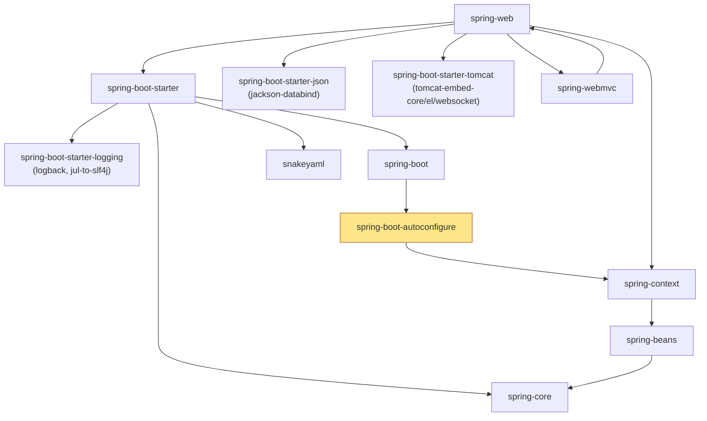
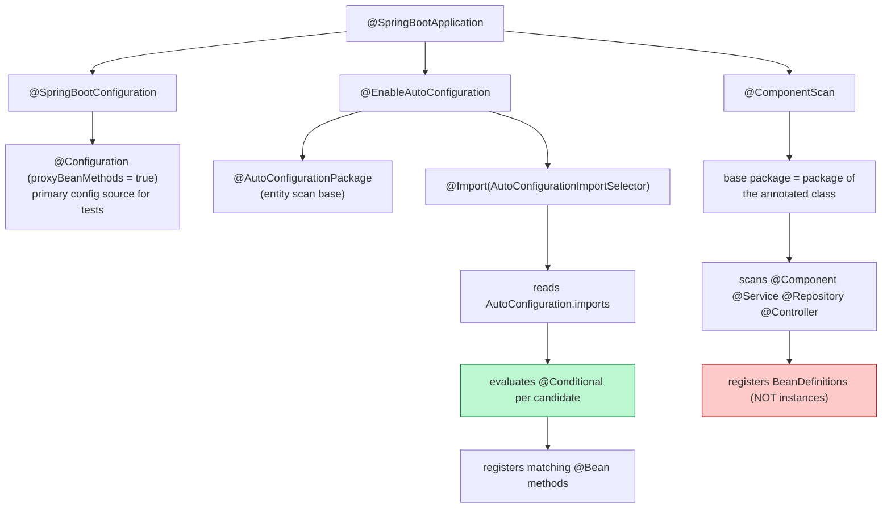
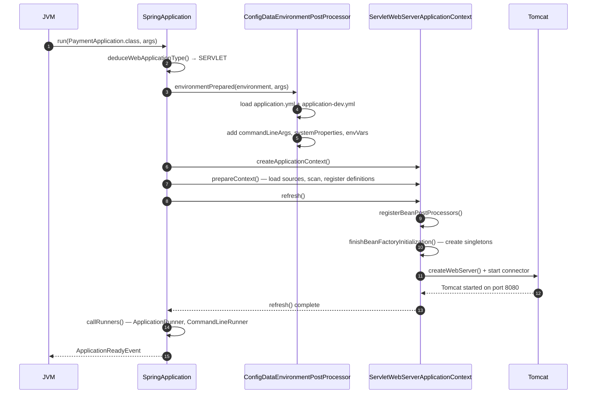

# 01 · Core Concepts & Architecture — The Complete Interview Guide

> **Level:** Beginner → Advanced
> **Interview Frequency:** ★★★★★ (every interview opens with "what is Spring Boot / how does it work" before it goes anywhere near MVC, JPA or Security)
> **Prerequisites:** [Java 17+](../../CORE_JAVA/README.md) · [02 · Spring Core & Framework](../02-Spring-Core-Framework/README.md)
> **Last Updated:** 2026

---

## 📋 Table of Contents

- [0. TL;DR — The 30-Second Answer](#0-tldr--the-30-second-answer)
- [1. What & Why — The Problem This Solves](#1-what--why--the-problem-this-solves)
- [2. Mental Model — The One Picture](#2-mental-model--the-one-picture)
- [3. Deep Dive — Theory (Beginner → Advanced)](#3-deep-dive--theory-beginner--advanced)
  - [3.1 Beginner Level](#31-beginner-level)
  - [3.2 Intermediate Level](#32-intermediate-level)
  - [3.3 Advanced Level](#33-advanced-level)
  - [3.4 Expert Level](#34-expert-level)
- [4. Internal Working Mechanism](#4-internal-working-mechanism)
- [5. Step-by-Step Execution Flow](#5-step-by-step-execution-flow)
- [6. Visualizations](#6-visualizations)
- [7. Production-Level Use Cases & Real Industry Examples](#7-production-level-use-cases--real-industry-examples)
- [8. Worked Examples (with Output + Dry Run)](#8-worked-examples-with-output--dry-run)
- [9. Code from Scratch — Production-Grade](#9-code-from-scratch--production-grade)
- [10. Common Mistakes & Gotchas](#10-common-mistakes--gotchas)
- [11. Performance Considerations](#11-performance-considerations)
- [12. Security Considerations](#12-security-considerations)
- [13. Best Practices](#13-best-practices)
- [14. Hands-On Exercises & Code Challenges](#14-hands-on-exercises--code-challenges)
- [15. Interview Q&A — Level-wise](#15-interview-qa--level-wise)
- [16. Scenario-Based & Real-Experience Scenarios (3–5 yrs)](#16-scenario-based--real-experience-scenarios-35-yrs)
- [17. Counter-Questions, Tricky Questions & Follow-Ups](#17-counter-questions-tricky-questions--follow-ups)
- [18. Frequently Asked Production Issues & Debugging Scenarios](#18-frequently-asked-production-issues--debugging-scenarios)
- [19. Architecture Design Questions](#19-architecture-design-questions)
- [20. Rapid-Fire MCQs](#20-rapid-fire-mcqs)
- [21. Cheat Sheet / One-Page Summary](#21-cheat-sheet--one-page-summary)
- [22. Real-World Production Notes](#22-real-world-production-notes)
- [23. Follow-up Learning](#23-follow-up-learning)

---

## 0. TL;DR — The 30-Second Answer

- **Spring Boot is not a new framework.** It is Spring Framework 6 with **five conveniences**: an **embedded server**, curated **starters**, **conditional auto-configuration**, **externalised configuration**, and **production-ready endpoints** (Actuator). Everything about `@Autowired`, `@Transactional` and `DispatcherServlet` still works identically.
- **Spring Boot 3 = Spring Framework 6 + Jakarta EE 10 + Java 17.** The headline change is the `javax.*` → `jakarta.*` package rename.
- **`@SpringBootApplication` = `@SpringBootConfiguration` + `@EnableAutoConfiguration` + `@ComponentScan`.** The first marks a `@Configuration`; the second imports auto-config candidates; the third scans **the package of the annotated class and below**.
- **The main class's package is the scan base.** Put `PaymentApplication` in `com.acme.payments` and controllers must live under it — one in `com.other.web` is **silently not registered** (404, not an error).
- **Auto-configuration does not guess your beans.** It reads `META-INF/spring/org.springframework.boot.autoconfigure.AutoConfiguration.imports` and applies *known-good defaults* guarded by `@Conditional` — "if Tomcat is on the classpath **and** you did not define your own factory, use ours".
- **Boot 3 removed auto-configuration registration from `spring.factories`** and moved it to the dedicated `.imports` file. `spring.factories` still works for other SPIs — it is not "dead".
- **A starter is a dependency-only POM.** In Boot 3 most starters contain **zero Java code**; a starter *with* code is a **library** that also ships an `AutoConfiguration.imports` file.
- **`spring-boot-starter-parent` vs `spring-boot-dependencies`:** the **parent** gives dependency management *plus* plugin management, resource filtering and the Java version; the **dependencies** BOM gives version management only. Parent for applications, BOM import for libraries.
- **The application context is the container you already know.** `SpringApplication.run(...)` builds a `ServletWebServerApplicationContext`, runs the **12 steps of `AbstractApplicationContext.refresh()`**, and starts Tomcat inside it.
- **Actuator's default web exposure is `health` — nothing else.** `management.endpoints.web.exposure.include=*` is a **critical finding**: `env` and `heapdump` leak secrets.
- **Property precedence is a strict ladder:** CLI args > `SPRING_APPLICATION_JSON` > servlet params > JNDI > system properties > OS env > profile-specific properties > plain properties > `@PropertySource` > defaults.
- **The most useful debugging skill in Boot:** start with `--debug` and read the `ConditionEvaluationReport` (`/actuator/conditions`) — it names the condition that matched and the one that did not.

---

## 1. What & Why — The Problem This Solves

Before Boot, every Spring web application repeated six chores by hand: **packaging a WAR**
and installing Tomcat; **hand-writing 12 `<dependency>` blocks** with every version picked by
hand (one typo = `NoSuchMethodError` at runtime); **writing `web.xml`** and the root context;
**wiring `@ComponentScan` / `@EnableWebMvc` / `@EnableTransactionManagement`** by hand;
**hard-coding configuration** so every environment change was a rebuild; and having **no
health endpoint, no metrics and no view of the effective configuration**.

Each of those is a decision thousands of teams have already answered — and each one is an
opportunity to get it subtly wrong. Boot answers them **once**, sensibly, and ships the
answers as defaults you can override: **embedded server** (Tomcat inside the fat JAR),
**starters** (one dependency, a curated aligned set), **auto-configuration** (the `@Enable*`
wiring, applied conditionally), **externalised configuration** (12+ sources, profiles, env
vars) and **Actuator** (health, metrics, env, beans, loggers).

**Why "conditional" is the crucial word.** Unconditional auto-configuration is dangerous:
two libraries that both configure an `ObjectMapper` would collide. So every auto-configuration
is guarded — *"apply this default **only if** the user has not supplied their own"*, *"only
**if** the required class is on the classpath"*, *"only **if** this property is set"*. That is
what lets Boot hand you sensible defaults **without** taking away control.

**The interview analogy.** Spring Framework is a *toolbox*: every tool is there, but you must
know which one to pick and wire it. Spring Boot is a *contractor*: they arrive with the right
tools, do the standard job, and step aside the moment you say "I'll do that part myself".
The contractor's rule is the `@Conditional` family — which is exactly why Boot never fights
you.

## 2. Mental Model — The One Picture

```text
   SPRING BOOT IS NOT A DIFFERENT FRAMEWORK
   ═══════════════════════════════════════════

     ┌──────────────────────────────────────────────────────────────┐
     │  SPRING FRAMEWORK 6.x  (IoC, DI, AOP, MVC, TX, JDBC, Test)   │
     │  ⚠ NOTHING HERE CHANGED — package, bean and annotation       │
     │    semantics are identical with or without Boot                │
     └──────────────────────────────┬───────────────────────────────┘
                                    ▲
   BOOT ADDS EXACTLY FIVE THINGS:
     ① EMBEDDED SERVER        ② STARTERS
     ③ AUTO-CONFIGURATION     ④ EXTERNALISED CONFIG   ⑤ PRODUCTION-READY
     (Tomcat inside the JAR)  (one dependency,   (@Conditional       (application.yml +   (/actuator/health
                                a curated set)     defaults, NOT       profiles + env       /metrics /env
                                                 bean scanning)      vars)                /beans)

```
**What to look at:** the arrow points *up*. Boot never replaces Spring; it *configures* it.

**What to look at:** the arrow points *up*. Boot never replaces Spring; it *configures* it.


**What to look at:** the arrow points *up*. Boot never replaces Spring; it *configures* it.

## 3. Deep Dive — Theory (Beginner → Advanced)

### 3.1 Beginner Level

#### 3.1.1 The five families on the table

| Technology | What it *is* | Cold start | RSS | Who picks it |
|---|---|---|---|---|

> ⚠ **The trap in this table.** Spring Boot and Jakarta EE are **not** competitors. Jakarta EE
> is a *specification*; Boot implements much of it and adds a lot more. You deploy a Boot app
> *to* a Jakarta EE 10 world (Tomcat 10.1 is a Jakarta EE 10 servlet container). Micronaut and
> Quarkus are the real competitors, and they compete on **cold-start time and memory**, not on
> feature set.

#### 3.1.2 The five core Boot features

| # | Feature | What you get |
|---|---|---|
| 1 | **Embedded server** | Tomcat 10.1 inside your JAR |
| 2 | **Starters** | `spring-boot-starter-web` = 5 jars, one version |
| 3 | **Auto-configuration** | `DispatcherServlet`, `ObjectMapper`, `DataSource` … created for you |
| 5 | **Production-ready features** | Actuator: health, metrics, env, beans, loggers |

#### 3.1.4 What `@SpringBootApplication` really is

```text
   @SpringBootApplication
   ══════════════════════
             │
             ├── @SpringBootConfiguration
             │      └── @Configuration  (proxyBeanMethods = true)
             │          → registers beans via @Bean methods
             │          → also the primary configuration source for tests
             │
             ├── @EnableAutoConfiguration
             │      → imports AutoConfigurationImportSelector
             │      → reads META-INF/spring/…AutoConfiguration.imports
             │      → evaluates @Conditional for every candidate
             │      → registers the beans that match
             │
             └── @ComponentScan
                    → scans the package of the annotated class, recursively
                    → registers @Component / @Service / @Repository / @Controller
                    → also registers @Configuration classes found in that package

```
> ⚠ **The silent-failure trap.** `@ComponentScan` has **no** base package argument here, so it
> defaults to **the package of the class carrying the annotation**. Move your `@RestController`
> to `com.other.controller` and it is *not* registered — no error, no warning, just a **404**.

#### 3.1.5 Why the package becomes the scan base


**Rule of thumb:** the main class goes in the **highest common package** of everything you
want scanned — in a Maven multi-module project, the `application` module.

### 3.2 Intermediate Level

#### 3.2.2 The `ApplicationContext` bootstrap


`SpringApplication` is a **configurable bootstrapper**, not a static utility. It holds the
primary sources, the `ApplicationContextFactory` that decides *which* context type to build,
the `ApplicationListener` / `ApplicationContextInitializer` / `EnvironmentPostProcessor`
collections it has been given, a `ResourceLoader` and the lowest-precedence
`defaultProperties`.

#### 3.2.3 The three ways to run

```java
// ① The 99% case — static helper, returns the running context.
SpringApplication.run(PaymentApplication.class, args);

// ② Programmatic — fluent builder (tests, multiple contexts, custom banner/profiles).
new SpringApplicationBuilder(PaymentApplication.class)
        .profiles("dev")
        .bannerMode(Banner.Mode.OFF)
        .run(args);

// ③ Factory-style — static factory wrapping an existing main.
SpringApplication application = SpringApplication.from(PaymentApplication::main);
application.setDefaultProperties(Map.of("server.port", "9090"));
application.run(args);

```
| Style | When | Returns |
|---|---|---|
| `SpringApplication.run(Class, String[])` | Almost always | The `ConfigurableApplicationContext` |
| `SpringApplicationBuilder` | Tests, multiple contexts | A builder → `.run(args)` → context |
| `SpringApplication.from(...)` | Wrapping an existing `main` | A `SpringApplication` you can tweak |

> ⚠ `SpringApplication.run` is **not** idempotent and the returned context is **not** closed
> for you. In a test or batch job you must `context.close()`; in an application the JVM stays
> alive because the Tomcat worker threads are non-daemon.

### 3.3 Advanced Level

#### 3.3.1 Definitions first, instances second

Scanning does **not** create beans — it creates **`BeanDefinition`s** (metadata).
Instantiation happens much later, in `finishBeanFactoryInitialization()`. This two-phase
model explains three things: `@Bean` method *ordering* is not guaranteed (definitions are
what get ordered); a circular dependency between two `@Bean` methods is legal in definition
space but fails at instantiation time; and `@ConditionalOnMissingBean` compares
**definitions**, not instances — which is why ordering between auto-configurations matters.

> 📌 `@EnableAutoConfiguration` also implies `@AutoConfigurationPackage`, marking the package
> as the base for **entity scanning** — another reason the main class must sit at the root.

#### 3.3.4 Multi-module layout and the dependency rule

```text
   acme-payments-parent        (pom — dependencyManagement only)
   ├── acme-payments-domain        ← POJOs, JPA entities, ports (interfaces)
   │                                 NO spring-web, NO spring-boot-starter-web
   ├── acme-payments-application   ← use cases, @Transactional
   ├── acme-payments-infrastructure← JPA repositories, HTTP clients, Kafka producers
   ├── acme-payments-api           ← @RestController DTOs, request/response models
   └── acme-payments-app           ← the runnable Spring Boot fat JAR

   app ──▶ api ──▶ application ──▶ domain ◀── infrastructure

```
**Why `spring-boot-starter-web` must not be in `domain`:** the domain must be reusable in a
**non-web** context — a Kafka consumer, a batch job, a unit test with no container. If
`domain` depends on the web starter you drag Tomcat into a batch job and cannot unit-test the
domain without a servlet API on the classpath.

**The application boundary rule:** *the Boot application boundary is the set of packages the
main class can see.* Everything inside is auto-registered; everything outside must be opted
in explicitly (`@Import`, `@ComponentScan`, an `AutoConfiguration.imports` entry). This is
why "modular monolith" teams argue about package placement — the boundary is a *classpath*
fact, not a documentation convention.

### 3.4 Expert Level

#### 3.4.1 Boot 2 → Boot 3: what changed and why it matters

| Change | Boot 2 | Boot 3 | Why it matters |
|---|---|---|---|
| Namespace | `javax.*` | `jakarta.*` | Jakarta EE 9+ renamed the packages; Servlet 6.0, JPA 3.1 |
| Baseline Java | 8 | **17** | Records, sealed types, pattern matching, virtual threads |
| Spring Framework | 5.3.x | **6.x** | `RestClient`, `SecurityFilterChain` lambda DSL, AOT support |
| Auto-config registry | `spring.factories` | **`AutoConfiguration.imports`** | A dedicated, typed, IDE-navigable registry |
| `@AutoConfiguration` | introduced 2.7 | standard | Carries `proxyBeanMethods = false` by default |
| Undertow | supported | **deprecated in 3.4** | Its Servlet implementation stalled |

## 4. Internal Working Mechanism

**The call chain, class by class** — this is the answer to "what does Spring Boot actually
*do* when you call `run`?".

```text
   SpringApplication.run(Class<?> primarySource, String... args)
   │
   ├─1─ new SpringApplication(primarySource)
   │      ├─ deduceMainApplicationClass() → PaymentApplication.class
   │      ├─ WebApplicationType.deduceFromClasspath() → SERVLET | REACTIVE | NONE
   │      ├─ setInitializers(...ApplicationContextInitializer.class)
   │      └─ setListeners(...ApplicationListener.class)
   │
   ├─2─ listeners = getRunListeners(args)   → EventPublishingRunListener
   │
   ├─3─ configureEnvironment(environment, bannerMode)
   │      ├─ configurePropertySources(environment, args)     ← command-line args
   │      ├─ ConfigurationPropertySources.attach(environment) ← relaxed-binding view
   │      └─ listeners.environmentPrepared(...) → ConfigDataEnvironmentPostProcessor
   │             loads application.yml + application-{profile}.yml + spring.config.import
   │             → ApplicationEnvironmentPreparedEvent
   │
   ├─4─ context = createApplicationContext()
   │      → ApplicationContextFactory → AnnotationConfigServletWebServerApplicationContext
   │
   ├─5─ prepareContext(context, environment, listeners, args, banner)
   │      ├─ postProcessApplicationContext(context)  → applyBeanFactoryPostProcessors
   │      ├─ applyInitializers(context)              → ApplicationContextInitializer
   │      ├─ listeners.contextPrepared(context)      → ContextPreparedEvent
   │      ├─ load(context, sources.toArray())        → ★ BeanDefinitions registered
   │      └─ listeners.contextLoaded(context)        → ContextLoadedEvent
   │
   ├─6─ refreshContext(context) → AbstractApplicationContext.refresh()  (12 steps)
   │
   ├─7─ afterRefresh(...) → listeners.started(...)  → ApplicationStartedEvent
   ├─8─ callRunners(...)  → ApplicationRunner then CommandLineRunner (@Order)
   └─9─ listeners.ready(...) → ApplicationReadyEvent

```
**The extension points — what you implement to hook each phase:**

| Phase | Interface / hook | Typical use |
|---|---|---|
| Before the context exists | `EnvironmentPostProcessor` | Register a new `PropertySource` (Vault, cloud config) |
| During refresh | `BeanFactoryPostProcessor` | Mutate `BeanDefinition`s before instantiation |
| Around bean creation | `BeanPostProcessor` | Wrap/proxy beans, measure creation cost |

> 🎯 **The interview hook.** "To *read* configuration before the context exists, implement
> `EnvironmentPostProcessor`. To *add* a bean before refresh, implement
> `ApplicationContextInitializer`. To *act* after everything is wired, implement
> `ApplicationRunner`." — that one sentence proves you understand the lifecycle order.

## 5. Step-by-Step Execution Flow

| # | Step | What happens | Visible signal |
|---|---|---|---|
| 1 | **Deduce the application type** | `WebApplicationType.deduceFromClasspath()` | — |
| 5 | **Prepare the context** | Initializers → `ContextPreparedEvent` → **sources loaded** (scan + `BeanDefinition`s) → `ContextLoadedEvent` | — |
| 6 | **Refresh the context** | `refresh()` — 12 steps; `finishBeanFactoryInitialization` creates all non-lazy singletons; `WebServerStartStopLifecycle` **starts Tomcat** | `Root WebApplicationContext: initialization completed in 812 ms` |

> ⚠ **The distinction interviewers love.** `ApplicationStartedEvent` fires *after* refresh but
> **before** the runners; `ApplicationReadyEvent` fires **after** them. If your cache warm-up
> is in a `CommandLineRunner`, the app is *started* but *not *ready* while it runs — which is
> exactly why a readiness probe should check readiness, not liveness.

---

## 6. Visualizations

### 6.1 Boot is Spring with 5 conveniences (layered picture)

```text
   ┌────────────────────────────────────────────────────────────────┐
   │  YOUR CODE: @RestController · @Service · @Repository          │
   └───────────────────────────────┬────────────────────────────────┘
                                   │  plain Spring
   ┌───────────────────────────────▼────────────────────────────────┐
   │  SPRING FRAMEWORK 6.x                                           │
   │  spring-web · spring-webmvc · spring-tx · spring-jdbc · spring-aop│
   │  spring-context · spring-beans · spring-core                    │
   └───────────────────────────────┬────────────────────────────────┘
                                   │  unchanged by Boot
   ┌───────────────────────────────▼────────────────────────────────┐
   │  SPRING BOOT 3.x — five conveniences                            │
   │  ① EMBEDDED SERVER  ② STARTERS  ③ AUTO-CONFIG                  │
   │  ④ EXTERNALISED CFG  ⑤ /actuator/health · /metrics · /env     │
   └────────────────────────────────────────────────────────────────┘

```
**Caption:** Everything between the top two lines is *plain Spring Framework*. Boot adds the
bottom band and then *configures* the middle — which is exactly why a Boot app is still a
Spring app.

### 6.2 Module dependency stack


**What to look at:** the stack is strictly layered — `spring-core` at the bottom knows nothing
about the web, and `spring-boot-autoconfigure` is the only module that knows about both the
container and the configuration.

### 6.3 `@SpringBootApplication` decomposition


**What to look at:** the red node — scanning produces **definitions**, not beans. That single fact explains bean ordering, circular-dependency behaviour, and why `@ConditionalOnMissingBean` can inspect a bean you have not created yet.

fact explains bean ordering, circular-dependency behaviour, and why `@ConditionalOnMissingBean`
can inspect a bean you have not created yet.

### 6.4 Minimal app boot — sequence diagram


**What to look at:** Tomcat starts **inside** `refresh()`, i.e. *before*
`ApplicationReadyEvent` and *before* the runners. A runner that must run before traffic is
accepted belongs in the readiness probe, not in the runner ordering.

## 7. Production-Level Use Cases & Real Industry Examples

**1 · Payments platform, 40k transactions/min peak (banking).** A monolith was split into
Boot "ledger" and "settlement" services. The split was only possible because Boot's
*starter* model let the platform team standardise one `spring-boot-starter-platform-web`
with a fixed Tomcat configuration, Micrometer tracing and a shared error envelope. Boot's
*auto-configuration* meant each service needed ~30 lines of `@Configuration` instead of 400
lines of `@Enable*` wiring. p99 **38 ms** on `/api/v1/ledger/entries`, met by keeping the web
layer thin and pushing Hibernate into a dedicated persistence module — possible only
because `spring-boot-starter-web` was kept out of the domain module.

**2 · Retail order service, 12k orders/min peak (e-commerce).** A Boot 3.3 service with
`starter-web`, `starter-data-jpa`, `starter-actuator` and `micrometer-registry-prometheus`.
The five features map onto operational needs directly: the embedded Tomcat means one Docker
image per service; the Actuator feeds the Kubernetes readiness probe
(`/actuator/health/readiness`); and `management.endpoints.web.exposure.include=health,prometheus`
gives Prometheus a scrape endpoint without opening `/env`. The team learned this the hard way:
an early build exposed `*` and a crawler found `/actuator/env` containing a database password
in plaintext — exactly the scenario in §12.

**3 · SaaS billing engine, 300 tenants, 8 pods (multi-tenant).** Every tenant gets its own
configuration, and Boot's *externalised configuration* is the mechanism: the platform injects
the tenant's plan as environment variables, and `@ConfigurationProperties` binds it into a
typed `BillingPlan` record. Because binding is *relaxed*, the platform can use
`BILLING_PLAN_MAX_SEATS` while the Java code reads `billingPlan.maxSeats`. Onboarding a
tenant = setting 6 environment variables; no rebuild, no redeploy.

not just convenience — it lets the team run one process per pod with a 512 MB heap and 200
Tomcat threads and no sidecar web server. Compared with the previous Tomcat-under-WildFly
deployment, the pod count dropped from 24 to 9 and p95 latency improved from **410 ms** to
**96 ms** — mostly because the app-server hop (Nginx → WildFly → app) became app → pod.

## 8. Worked Examples (with Output + Dry Run)

### 8.1 A minimal Boot app and what its startup log is telling you

**The code.**

```java
package com.acme.payments;

import org.springframework.boot.SpringApplication;
import org.springframework.boot.autoconfigure.SpringBootApplication;
import org.springframework.web.bind.annotation.GetMapping;
import org.springframework.web.bind.annotation.RestController;

@SpringBootApplication
@RestController
public class PaymentApplication {

    public static void main(String[] args) {
        SpringApplication.run(PaymentApplication.class, args);
    }

    @GetMapping("/ping")
    public String ping() {
        return "pong";
    }
}

```
**The expected output** (Boot 3.3.5, Java 17, trimmed to the meaningful lines):

```text
2026-10-22 09:14:02.113  INFO 14124 --- [main] c.a.p.PaymentApplication : Starting PaymentApplication using Java 17.0.11 with PID 14124 (/app/payment-service.jar) started by aritr in /app
2026-10-22 09:14:02.301  INFO 14124 --- [main] c.a.p.PaymentApplication : No active profile set, falling back to 1 default profile: "default"
2026-10-22 09:14:02.418  INFO 14124 --- [main] o.s.b.w.e.tomcat.TomcatWebServer : Tomcat initialized with port(s): 8080 (http)
2026-10-22 09:14:03.006  INFO 14124 --- [main] o.s.b.w.e.tomcat.TomcatWebServerFactory : Tomcat started with port(s): 8080 (http) with context path ''
2026-10-22 09:14:03.041  INFO 14124 --- [main] c.a.p.PaymentApplication : Started PaymentApplication in 1.284 seconds (JVM running for 1.617)

```
**Dry run — what each line proves.**

1. `Starting … with PID 14124` — the **banner** phase: framework version, JVM version, main
   class. A Java version other than 17+ here means you are off the Boot 3 baseline.
2. `No active profile set, falling back to 1 default profile: "default"` — the **profile
   resolution** phase. Note the exact wording: no profile was *active*, so the default
   profile applies (see [04 · Profiles](04-Profiles-Environment-Actuator-and-DevTools.md)).
3. `Tomcat initialized with port(s): 8080` — `ServletWebServerApplicationContext.onRefresh()`
   created the container. The connector has **not** accepted traffic yet.
4. `Tomcat started with port(s): 8080 … context path ''` — the connector is **bound and
   listening**, emitted by `WebServerStartStopLifecycle` during `finishRefresh()`. `context
   path ''` means the app is served at `/`, not `/payment`.
5. `Started … in 1.284 seconds (JVM running for 1.617)` — total time from `main()` to a
   refreshed context. The gap (1.617 − 1.284 = 0.333 s) is JVM class-loading before `main()`.

none of them.

### 8.2 Converting a plain Spring MVC application to Boot

**Before — plain Spring MVC (Spring 5, `web.xml`):**

```xml
<project>
  <groupId>com.acme</groupId>
  <artifactId>payment-service</artifactId>
  <version>1.0.0</version>
  <packaging>war</packaging>                 <!-- ← needs an external container -->
  <properties>
    <spring.version>5.3.31</spring.version>
  </properties>
  <dependencies>
    <dependency>
      <groupId>org.springframework</groupId>
      <artifactId>spring-webmvc</artifactId>
      <version>${spring.version}</version>
    </dependency>
    <dependency>
      <groupId>javax.servlet</groupId>
      <artifactId>javax.servlet-api</artifactId>
      <version>4.0.1</version>
      <scope>provided</scope>
    </dependency>
    <dependency>
      <groupId>com.fasterxml.jackson.core</groupId>
      <artifactId>jackson-databind</artifactId>
      <version>2.15.3</version>
    </dependency>
  </dependencies>
</project>

```
Plus a `web.xml` declaring `DispatcherServlet`, a `dispatcher-servlet.xml` with
`<context:component-scan/>`, `<mvc:annotation-driven/>` and `<tx:annotation-driven/>`, and a
separate Tomcat installation.

**After — Spring Boot 3.3:**

```xml
<project>
  <modelVersion>4.0.0</modelVersion>
  <parent>
    <groupId>org.springframework.boot</groupId>
    <artifactId>spring-boot-starter-parent</artifactId>
    <version>3.3.5</version>
    <relativePath/>                    <!-- resolve the parent from the repository -->
  </parent>

  <groupId>com.acme</groupId>
  <artifactId>payment-service</artifactId>
  <version>1.0.0</version>
  <packaging>jar</packaging>            <!-- ← fat JAR, not WAR -->

  <properties>
    <java.version>17</java.version>
  </properties>

  <dependencies>
    <dependency>
      <groupId>org.springframework.boot</groupId>
      <artifactId>spring-boot-starter-web</artifactId>
    </dependency>
  </dependencies>

  <build>
    <plugins>
      <plugin>
        <groupId>org.springframework.boot</groupId>
        <artifactId>spring-boot-maven-plugin</artifactId>
      </plugin>
    </plugins>
  </build>
</project>

```
**What Boot removed — the dry run:**

| Removed | Why Boot does not need it |
|---|---|
| `<packaging>war</packaging>` | The server is **inside** the JAR (`tomcat-embed-core`). |
| `<version>` on every dependency | The parent imports `spring-boot-dependencies`, which manages every version. |
| `javax.servlet-api` (provided) | `tomcat-embed-core` supplies `jakarta.servlet.*`. |
| The external Tomcat install | The embedded server starts in ~120 ms. |

**executable fat JAR** (`BOOT-INF/classes` + nested jars under `BOOT-INF/lib`).

**The takeaway:** Boot did not add magic; it *deleted configuration*. The migration is mostly a
deletion exercise — which is why Boot is described as "convention over configuration" rather
than "magic".

### 8.3 Building a multi-module Maven project

**The parent POM** (`acme-payments-parent/pom.xml`):

```xml
<project>
  <modelVersion>4.0.0</modelVersion>
  <parent>
    <groupId>org.springframework.boot</groupId>
    <artifactId>spring-boot-starter-parent</artifactId>
    <version>3.3.5</version>
    <relativePath/>
  </parent>
  <groupId>com.acme</groupId>
  <artifactId>acme-payments-parent</artifactId>
  <version>1.0.0</version>
  <packaging>pom</packaging>
  <modules>
    <module>acme-payments-domain</module>
    <module>acme-payments-application</module>
    <module>acme-payments-infrastructure</module>
    <module>acme-payments-api</module>
    <module>acme-payments-app</module>
  </modules>
</project>

```
**`acme-payments-domain/pom.xml` — deliberately web-free:** it declares only
`jakarta.persistence:jakarta.persistence-api` and `org.springframework:spring-context`
(the latter only for `@Transactional`). It must **not** declare
`spring-boot-starter-web` — that starter drags Tomcat and Hikari into the domain module and
into every test that uses it.

**`acme-payments-app/pom.xml` — the only runnable module:** it declares
`spring-boot-starter-web` plus `acme-payments-api` and `acme-payments-infrastructure` at
`${project.version}`, and it is the **only** module with the
`spring-boot-maven-plugin` (no `<version>` — the parent manages it).

**The expected build output:**

```text
[INFO] Reactor Build Order:
[INFO]
[INFO] acme-payments-parent ........................................ SUCCESS [  0.031 s]
[INFO] acme-payments-domain ........................................ SUCCESS [  1.884 s]
[INFO] acme-payments-application ................................... SUCCESS [  0.412 s]
[INFO] acme-payments-infrastructure ............................... SUCCESS [  0.507 s]
[INFO] acme-payments-api .......................................... SUCCESS [  0.223 s]
[INFO] acme-payments-app .......................................... SUCCESS [  4.106 s]
[INFO] ------------------------------------------------------------------------
[INFO] BUILD SUCCESS

```
**Dry run.**

1. `acme-payments-domain` builds **first** because nothing depends on it — the bottom of the
   dependency graph. Its 1.884 s (vs ~0.4 s for the others) is the compiler working on the
   entity model.
2. `acme-payments-app` builds **last** because it depends on `api` and `infrastructure`.
3. The **reactor** is what makes this work: `mvn -pl acme-payments-app -am package` builds
   only `app` **and its dependencies** (`-am` = also make). Without `-am`:
   `Could not resolve dependencies … acme-payments-api:jar:1.0.0 was not found`.
4. `spring-boot-maven-plugin` runs **only** in `acme-payments-app`. Putting the plugin in the
   parent turns every module into a fat JAR and triples the build time for no benefit.

**The takeaway:** the *dependency direction* is the architecture. `domain` has no idea whether
the world is a web app, a Kafka consumer or a unit test — and that is exactly the property
that keeps it testable.

## 9. Code from Scratch — Production-Grade

A complete, runnable, production-shaped Boot 3.3 application. Every file is importable and
compiles against the real Boot 3.3 API.

**`com.acme.payments.PaymentApplication`**

```java
package com.acme.payments;

import org.springframework.boot.SpringApplication;
import org.springframework.boot.autoconfigure.SpringBootApplication;
import org.springframework.boot.context.properties.ConfigurationPropertiesScan;

/**
 * The single entry point of the service.
 *
 * <p>Package rule: this class MUST live in the root package of the component hierarchy
 * (com.acme.payments), because @ComponentScan derives its base package from here.
 */
@SpringBootApplication
@ConfigurationPropertiesScan          // register @ConfigurationProperties without @EnableConfigurationProperties
public class PaymentApplication {

    public static void main(String[] args) {
        // FIX: pass the primary source explicitly — never rely on classpath scanning to
        //      deduce the main class; it fails as soon as two @SpringBootApplication
        //      classes are on the classpath (e.g. in a test slice).
        SpringApplication.run(PaymentApplication.class, args);
    }
}

```
**`com.acme.payments.config.PaymentProperties`**

```java
package com.acme.payments.config;

import java.time.Duration;
import java.util.List;

import jakarta.validation.constraints.NotBlank;
import jakarta.validation.constraints.NotEmpty;
import jakarta.validation.constraints.Positive;

import org.springframework.boot.context.properties.ConfigurationProperties;
import org.springframework.validation.annotation.Validated;

/**
 * Type-safe configuration for the payment service.
 *
 * <p>Validated at STARTUP, not at first request: a missing downstream URL must fail the
 * deployment, not a customer's transaction.
 */
@Validated
@ConfigurationProperties(prefix = "payments")
public record PaymentProperties(
        @NotBlank
        String providerUrl,                        // e.g. https://psp.internal

        @NotEmpty
        List<@NotBlank String> supportedCurrencies,

        @Positive
        int maxRetries,

        Duration connectTimeout,

        Duration readTimeout) {

    public PaymentProperties {
        // Compact constructor: apply defaults for anything the operator left out.
        if (maxRetries == 0) {
            maxRetries = 3;
        }
        if (connectTimeout == null) {
            connectTimeout = Duration.ofSeconds(2);
        }
        if (readTimeout == null) {
            readTimeout = Duration.ofSeconds(5);
        }
    }
}

```
---
## 10. Common Mistakes & Gotchas

| # | ❌ Wrong | ✅ Right | Why it breaks |
|---|---|---|---|
| 3 | `spring-boot-starter-parent` in a **library** POM | Import `spring-boot-dependencies` as a BOM | A published library must not impose the parent's plugin management, resource filtering or Java version on consumers. |

---

## 11. Performance Considerations

| Concern | Default | How to move it | How to measure it |
|---|---|---|---|
| **Startup time** | ~3–5 s typical Boot 3.3 app | `spring.main.lazy-initialization=true`; `spring.jmx.enabled=false`; `spring.main.banner-mode=off`; AppCDS; AOT/native | `Started … in X seconds`; `ApplicationStartup` with `BufferingApplicationStartup` |
| **Bean creation** | Hundreds of eager singletons | Lazy initialisation (trade-off: the first request pays) | `ApplicationStartup` → `beans.starter.*` events |
| **Memory** | ~200 MB heap; ~1 MB per thread stack | Right-size `-Xmx`; reduce `server.tomcat.threads.max` | `jcmd <pid> GC.heap_info`, Micrometer `jvm.memory.used` |

```text
   Tomcat max threads = 200 (default)   vs   Hikari maximum-pool-size = 10 (default).
   -> 200 concurrent requests, but only 10 can reach the database.
   -> 190 requests queue in Hikari for up to connection-timeout (30 s) -> p99 ~ 30 s.

   RULE (Little law):  pool_size ~= concurrent_requests x service_time
   PRACTICAL: pool_size ~= Tomcat max threads when every request touches the DB (0.8x headroom).
   SECOND-ORDER RULE: if the DB sustains 200 concurrent queries globally and you run 10 pods,
   then per-pod pool = 20, not 200 - divide the global budget by the replica count.
```
### 11.2 Lazy initialisation — the trade you must be able to state

`spring.main.lazy-initialization=true` moves bean creation from startup to first use.

| Gain | Cost |
|---|---|
| Startup can drop **30–60%** on a JPA-heavy app | The **first request** to each endpoint pays the creation cost (100–800 ms for a JPA repository) |
| Fewer beans → less memory pressure | A misconfigured lazy bean now fails **under load**, not at deploy time — the classic "works in staging, 500s in production" bug |
| Faster rollback of a bad deploy | Errors become **runtime** errors, so your readiness probe can pass while the app is broken |

**The production verdict:** use it only with a **measured** startup problem *and* a
**warm-up** step. Otherwise, fail fast at startup.

---

## 12. Security Considerations

| Threat | Boot-specific attack path | Defence |
|---|---|---|
| **Secrets in `application.yml`** | The file is committed to git; it usually holds `spring.datasource.password` | Keep secrets out of the file. Use `${DB_PASSWORD}` placeholders injected from a Kubernetes Secret / Vault / SSM. |
| **Actuator exposure** | `management.endpoints.web.exposure.include=*` publishes `/actuator/env` (every property, including passwords) and `/actuator/heapdump` (a **full heap image**) | Expose only what you need (`health,prometheus`); put Actuator on a separate, internal-only port (`management.server.port=8081`). |
| **Dependency CVEs** | Boot pins versions — an old Boot means an old Tomcat/Jackson with known CVEs | Stay on the latest patch; run `mvn dependency-check` / `trivy` in CI. |
| **Error detail leakage** | Overriding `server.error.include-message=always` leaks internals | Keep the Boot 3 defaults; return `ProblemDetail` (RFC 7807) with a correlation id. |
| **DevTools in production** | `spring-boot-devtools` on the production classpath restarts the app on a class change | DevTools is a **development-only** dependency; assert it is absent from the production image. |
| **Unauthenticated management endpoints** | `/actuator/health` is exposed **by default** over the web | Block `/actuator/**` at the ingress, or use a management-only port. |
> 🎯 **The one-line security answer.** "Spring Boot's defaults are secure by default in exactly
> three places — error messages, Actuator exposure (`health` only) and dependency versions —
> and the two things teams break are the Actuator exposure and the secrets in
> `application.yml`."

---

## 13. Best Practices

**Boot-specific**

- [ ] **Libraries use `AutoConfiguration.imports` + `@AutoConfiguration(proxyBeanMethods = false)`, never `@ComponentScan`.**

**Spring-general (still applies)**


**Production hygiene**


---

## 14. Hands-On Exercises & Code Challenges

### Exercise 1 — Inventory the five Boot features in your own project

**Steps**

3. Copy the `Tomcat started on port(s): <N>` line and `curl http://localhost:<N>/<endpoint>`.
4. Open `META-INF/spring/org.springframework.boot.autoconfigure.AutoConfiguration.imports` inside
   `~/.m2/repository/org/springframework/boot/spring-boot-autoconfigure/3.3.5/*.jar` and count the lines.


**Acceptance criteria**

- [ ] You can point at the exact log line that proves the **embedded server**.
- [ ] You can name the **starter** your project uses and list its 5 jars.
- [ ] You can name **one** auto-configuration that fired and **one** that did not (from `--debug`).
- [ ] You can show the **profile-specific property** overriding the default.

first and why that is a *good* sign (it proves the configuration is genuinely external).

### Exercise 2 — Prove the component-scan boundary

**Steps**

3. Add `@ComponentScan("com.acme")` to the main class → observe **200**.
4. Enable `logging.level.org.springframework.context.annotation=DEBUG` and count the packages scanned.
5. Move the main class to `com.acme` → the 404 disappears without touching the controller.


**Acceptance criteria**

- [ ] You can explain the 404 in terms of *component scanning*, not "routing".
- [ ] You can state the rule in one sentence: **the main class's package is the scan base.**
- [ ] You can explain why a controller that *is* registered can still 404 (wrong path/method).

(`assertThat(context.getBeanNamesForType(OtherController.class)).isEmpty()`).

### Exercise 3 — Trace one request end to end

**Steps**

1. Start your app with `--logging.level.org.springframework.web=DEBUG`.
2. `curl -i http://localhost:8080/<your-endpoint>` and capture the full log.
3. Annotate every log line with the component that produced it: `DispatcherServlet`,
   `RequestMappingHandlerMapping`, `RequestMappingHandlerAdapter`, the controller, the
   `HttpMessageConverter`.
4. Repeat with `--logging.level.org.springframework.security=DEBUG` and locate the
   `FilterChainProxy` lines.


**Acceptance criteria**

- [ ] You can name the nine `DispatcherServlet` strategies you observed (or the subset your
      request actually used).
- [ ] You can point at the log line that shows the *handler* that was selected.
- [ ] You can explain, from the log, why the response was JSON and not XML.

time, then correlate it with the `http.server.requests` Micrometer timer.

### Code Challenge 1 — A "Boot application boundary" test

**Task.** Write a JUnit 5 test that fails if any project `@Component` exists outside the
allowed package tree, so the scan boundary cannot silently drift.


**Acceptance criteria**

- [ ] The test fails when a `@Component` is added under `com.other`.
- [ ] The test ignores framework beans (only project beans are checked).
- [ ] The failure message names the offending class and its package.
- [ ] The test runs in under **5 seconds** (no full context restart per case).


### Code Challenge 2 — Multi-module build with an enforced dependency rule

**Task.** Build the 5-module layout from §8.3 and **mechanically prevent** anyone from adding
`spring-boot-starter-web` to the domain module.

The enforcer rule bans `org.springframework.boot:spring-boot-starter-web` and
`:spring-boot-starter-webflux` from the domain module, so the build fails with a clear
message the moment someone adds the web starter to `acme-payments-domain`.


**Acceptance criteria**

- [ ] `mvn verify` fails with a clear message when the banned starter is added to `domain`.
- [ ] `mvn -pl acme-payments-app -am package` produces a runnable fat JAR.
- [ ] `java -jar acme-payments-app/target/acme-payments-app-1.0.0.jar` starts and answers `/actuator/health`.
- [ ] `acme-payments-domain` has **no** Tomcat classes on its test classpath (assert it).

**used-but-undeclared** and **declared-but-unused** dependencies.

---

## 15. Interview Q&A — Level-wise

### 🟢 Beginner

**Q: What is Spring Boot, in one sentence?**
**A:** Spring Boot is Spring Framework plus five conveniences — an embedded server, curated starters, conditional auto-configuration, externalised configuration and production-ready endpoints (Actuator). It does not change how Spring itself works; the IoC container, DI, AOP and MVC behave exactly as they do in plain Spring.

**Q: Name the five core Spring Boot features.**
**A:** (1) **Embedded server** — Tomcat/Jetty inside your JAR, so `java -jar app.jar` is the deployment. (2) **Starters** — dependency-only POMs giving a curated, version-aligned set. (3) **Auto-configuration** — sensible defaults applied *conditionally*. (4) **Externalised configuration** — one artifact, many environments. (5) **Production-ready features** — Actuator's health, metrics, env and loggers endpoints.

**Q: What does `@SpringBootApplication` do?**
**A:** It is a meta-annotation of three things: `@SpringBootConfiguration` (marks the class as a `@Configuration` and as the primary source for tests), `@EnableAutoConfiguration` (imports the candidates from `AutoConfiguration.imports` and applies those whose conditions match), and `@ComponentScan` (scans the package of the annotated class for `@Component` and its stereotypes). The reason it matters is that the third part derives its base package from *where you put the class*.

**Q: Why did you put the main class in the root package?**
**A:** Because `@ComponentScan` uses the package of the `@SpringBootApplication` class as its base and scans everything below it. If the main class lives in `com.acme.payments.web`, a controller in `com.acme.payments.controller` is a *sibling*, not a descendant, and is never registered — you get a 404 with no error message.

**Q: What is a starter?**
**A:** A starter is a POM with (in Boot 3) no code that gives you a curated set of jars with versions aligned to your Boot release. `spring-boot-starter-web` pulls in `spring-webmvc`, `spring-web`, `spring-boot-starter-json` (Jackson) and `spring-boot-starter-tomcat`. A starter that *does* contain code is really a library that also ships an `AutoConfiguration.imports` file.

**Q: What does "auto-configuration" actually configure?**
**A:** The *framework plumbing* — `DispatcherServlet`, the `ObjectMapper`, the `DataSource` and `TransactionManager`, the `RestClient`/`WebClient` builders, the message-converter registry — but never your business beans. It never guesses what a service does; it applies known defaults, each guarded by a `@Conditional`, so it stays out of the way the moment you define your own bean.

### 🟡 Intermediate

**Q: What is the difference between `spring-boot-starter-parent` and importing `spring-boot-dependencies`?**
**A:** The **parent POM** gives you dependency management *plus* plugin management, resource filtering (`@...@` delimiters in `application.yml`), the `spring-boot-maven-plugin` configuration and a managed Java version. The **dependencies BOM** gives version management only. Use the parent for your application; use the BOM import in a **library**, because a published library must not impose plugin configuration or a Java version on its consumers.

**Q: Why are most starters code-free? What is a starter that contains code, then?**
**A:** A starter is a *dependency aggregator*; adding code would make it a library with a version-coupling problem — every fix would force a new starter version and a re-release for every consumer. The community answer was to separate the concerns: starters aggregate dependencies, and libraries (e.g. `spring-cloud-starter-gateway`) ship code plus an `AutoConfiguration.imports` file so their beans are registered automatically *but conditionally*.

**Q: How does Boot know which auto-configurations to apply?**
**A:** `@EnableAutoConfiguration` imports `AutoConfigurationImportSelector`, which reads `META-INF/spring/org.springframework.boot.autoconfigure.AutoConfiguration.imports` from every jar on the classpath. Each candidate is evaluated against the current `Environment` by `ConditionEvaluator`: `@ConditionalOnClass`, `@ConditionalOnProperty`, `@ConditionalOnMissingBean` and friends decide. The matches are registered; the rest are recorded as **negative matches** in the `ConditionEvaluationReport`.

**Q: What changed about auto-configuration registration in Boot 3?**
**A:** `spring.factories` used to carry the `EnableAutoConfiguration` key, so the same file served auto-configuration *and* a dozen unrelated SPI lookups. Boot 3 removed the auto-config key from it and moved it to a dedicated `.imports` file. `spring.factories` is not dead — it still registers `EnvironmentPostProcessor`, `ApplicationListener`, `ApplicationContextInitializer` and `FailureAnalyzer`. The migration was staged on purpose: 2.7 wrote to both places, 3.0 read only the new one.

**Q: What is `@ConditionalOnMissingBean` and why does ordering matter?**
**A:** It means "register this bean only if no bean of that type is already defined". The problem is *when* the check happens: auto-configurations are processed in a defined order, and the condition compares **bean definitions**, not instances. If your auto-configuration is evaluated *before* the one that defines the "user's" bean, the condition sees "no bean of type X" and registers its own — then both register and you get a conflict or a surprising winner. `@AutoConfigureBefore` / `@AutoConfigureAfter` express the intended order.

### 🔴 Advanced / Senior

**Q: Explain the 12 steps of `AbstractApplicationContext.refresh()` and where each extension point hooks in.**
**A:** `prepareRefresh` → `obtainFreshBeanFactory` → `prepareBeanFactory` → `postProcessBeanFactory` → `invokeBeanFactoryPostProcessors` (where `BeanFactoryPostProcessor`s and `@Configuration` class parsing happen) → `registerBeanPostProcessors` (registered *before* any bean is created, which is why a `BeanPostProcessor` can affect the beans it processes) → `initMessageSource` → `initApplicationEventMulticaster` → `onRefresh` (where the servlet container is *created*) → `registerListeners` → `finishBeanFactoryInitialization` (all non-lazy singletons instantiated — the heaviest step) → `finishRefresh` (where the web server is *started* by `WebServerStartStopLifecycle` and the `ContextRefreshedEvent` is published).

**Q: Where does Tomcat actually start, and why does that matter?**
**A:** `ServletWebServerApplicationContext.onRefresh()` *creates* the `WebServer` (via `createWebServer()` → `TomcatServletWebServerFactory`), but the server is not *started* there — `WebServerStartStopLifecycle`, a `SmartLifecycle` bean, starts it in `finishRefresh()`. It matters for two reasons: (1) the `ServletContextInitializer`s — including the auto-registered `DispatcherServlet` — run during `createWebServer()`, i.e. *before* the connector accepts traffic, so the servlet mapping is guaranteed to exist before the first request; (2) `SmartLifecycle` beans start in **phase order**, so "start the HTTP server last" is a real, expressible lever.

**Q: What is the difference between `ApplicationStartedEvent` and `ApplicationReadyEvent`?**
**A:** `ApplicationStartedEvent` is published right after the context is refreshed but **before** the `ApplicationRunner`s and `CommandLineRunner`s execute. `ApplicationReadyEvent` is published **after** them. So an application can be *started* but not *ready*: if a runner warms a cache for 30 seconds, the app is started at t+3 s and ready at t+33 s. That gap is exactly what a readiness probe must cover — which is why long warm-up belongs in a readiness endpoint rather than a runner if you want to serve traffic during warm-up.

**Q: How would you split a 40-module monolith into a sane Boot application boundary?**
**A:** Not by module count — by **change rate and dependency direction**. The rule: one `@SpringBootApplication` per deployable, and the module graph beneath it is a strict DAG — `api → application → domain`, with `infrastructure` depending on `domain` and implementing its ports. Packages that are genuinely unrelated (a billing engine and a notification engine) belong in **separate applications**, not in one context with 40 packages. The diagnostic: if two packages must be deployed together *and* change together *and* are always changed in the same PR, they are one module — because of the coupling, not the count.

### ⚫ Expert / Principal

**Q: Spring Boot claims "no configuration". Is that true, and where does the complexity actually go?**
**A:** The claim is about *absence of boilerplate*, not absence of configuration. Boot moves configuration from **your code** into three places: (a) **conventions in the auto-configuration classes**, (b) **externalised properties** with a documented precedence ladder, and (c) **the classpath shape** itself, which Boot reads as configuration. The complexity does not disappear — it becomes *implicit*. The engineering consequence is that you must be able to answer "what is the effective configuration?", which is exactly what `/actuator/configprops` and `/actuator/env` are for — and why "my property is not being picked up" is one of the most common production issues in Spring Boot.

**Q: Boot's auto-configuration can be overridden by the user. How is that made safe, and what are the failure modes?**
**A:** The mechanism is `@ConditionalOnMissingBean` plus an explicit ordering graph via `@AutoConfigureBefore`/`@AutoConfigureAfter`. It is safe when three invariants hold: the auto-configuration declares the *exact* bean type the user is expected to override; the conditions are evaluated at the right point in the order; and the auto-configuration does not depend on the bean it replaces in a way that would fail with a different user implementation. The failure modes: **ordering races** (both match, the later one wins, or `BeanDefinitionOverrideException`), **type mismatch** (the user defines an implementation of an interface while the auto-configuration checks for the concrete class, so both register), and **the user's bean in a different module** (the condition matches because the user's `@Configuration` is processed later). A hardened library therefore checks on the *interface* and pins the order explicitly.

**Q: How would you make a Boot application's startup deterministic and fast enough for scale-to-zero?**
**A:** Four levers, by payoff. (1) **Reduce eager work**: lazy initialisation plus an explicit warm-up of the hot paths — a trade, not a free win, because it moves failure from deploy time to request time. (2) **Class-loading**: AppCDS (`-XX:SharedArchiveFile=app.jsa`) cuts class-loading time dramatically with no code change. (3) **AOT and native images**: `spring-boot:process-aot` + `native-maven-plugin` produce a ~50 ms, ~10 MB binary — but force you to declare every reflection in `RuntimeHints` and disable some dynamic features. (4) **Eliminate auto-configuration you do not need**: `spring.autoconfigure.exclude` removes whole auto-configurations, each worth tens of milliseconds. I would also insist on a **startup SLO** (p99 < 4 s) measured in CI, because startup regressions are silent until they become a scale-to-zero bill.

**Q: Design question — a monolith with 40 modules in one module. Where do you draw the Boot application boundary?**
**A:** Around the **change axis, not the module axis**. One `@SpringBootApplication` per *deployable*; deployables are defined by which modules must be deployed, versioned and scaled together. If all 40 modules always ship together and share a transaction boundary, they are **one application** — and the correct action is *not* to split the application but to split the **package structure** into a layered, dependency-enforced tree (`api`, `application`, `domain`, `infrastructure`) with an enforcer rule forbidding `domain → infrastructure` and `domain → api`. If a subset can be released independently and has its own scaling profile, it becomes a **second application** with its own fat JAR, sharing only a `domain` library. The diagnostic I use in review: "if a release of module A forces a release of module B, are they really one application?" — and the anti-pattern to avoid is a "modular monolith" with 40 Gradle modules, one 400 MB jar and 3,000 beans in a single context, where a change to any module restarts everything.

---

## 16. Scenario-Based & Real-Experience Scenarios (3–5 yrs)

### Scenario 1 — "The controllers work locally but return 404 in staging"

**The situation.** You deploy a service to staging. Every endpoint returns `404`. No
exceptions, the app starts cleanly, `/actuator/health` is green.

the `Allow` header. A Boot 404 on a registered-but-unmapped path returns a JSON
`ProblemDetail`; a 404 with *no* handler returns Tomcat's default error page. That single
distinction tells you whether the request reached your application at all.

actual cause: the **component-scan boundary**. The staging build packages the controller
module under a different root package than the module containing `@SpringBootApplication`
(a multi-module refactor moved `PaymentApplication` into `com.acme.payments.app` while the
controllers stayed in `com.acme.payments.web`). The scan base became `com.acme.payments.app`,
so the controllers were never registered — and the context **started successfully**, because
an empty component set is not an error.

**The resolution.** Move `PaymentApplication` back to `com.acme.payments`, or declare
`@ComponentScan("com.acme.payments")` explicitly. Then add a **guard test** asserting the
expected controllers are present:
`assertThat(context.getBeanNamesForType(PaymentController.class)).isNotEmpty()`.

found. Bean-count assertions in smoke tests are cheap insurance against a whole class of
silent 404s.

### Scenario 2 — "The container image is 1.2 GB and the deploy takes 9 minutes"

quarters, and CI now takes 9 minutes per deploy because the build re-pushes everything.

is almost always **layering**: everything is copied into one final layer, so every code change
invalidates the entire dependency layer.

debugging tools. Or "let's just use `spring-boot:build-image`" — that gives a layered image,
but only if you then run it with the *layered* extractor.

**The resolution.** Multi-stage build with the Spring Boot layer tools:


`jarmode=layertools` exists precisely so a code change produces a **small** new layer instead
of a new 1.2 GB image.

### Scenario 3 — "Two teams added an auto-configuration and now the app won't start"

**The situation.** After a dependency upgrade the application fails to start with
`BeanDefinitionOverrideException: Invalid bean definition with name 'objectMapper' defined in
... JacksonAutoConfiguration and ... PlatformJacksonAutoConfiguration`.

which one is *yours*. Then start with `--debug` and read the `ConditionEvaluationReport` for
both auto-configurations.

makes the collision *silent* — the winner is whichever definition was registered last, which
depends on ordering. You have converted a loud startup failure into a production incident
where `ObjectMapper` has the wrong configuration.

auto-configuration that defines `ObjectMapper` **without** `@ConditionalOnMissingBean`, or
defines it with a *different type* than the user's (the user defines `ObjectMapper`, the
library defines `Jackson2ObjectMapperBuilder`). The fix belongs in the library: add
`@ConditionalOnMissingBean(ObjectMapper.class)` and declare an explicit order with
`@AutoConfigureBefore` / `@AutoConfigureAfter`.

makes auto-configuration composable. An auto-configuration without it is a library that
cannot be safely consumed.

---

## 17. Counter-Questions, Tricky Questions & Follow-Ups

### CQ1. "If Boot is just Spring with conveniences, why not just use plain Spring?"

- **Naive answer:** "Because Boot saves time — you write less configuration." ← *true, but it describes the symptom, not the value*
- **The trap:** The trap is answering with **ergonomics** when the real answer is **risk reduction**. Plain Spring's flexibility means every team must decide: which JSON library, which connection pool, how to serve static resources, what the health endpoint returns. Each of those is a decision that has been made badly somewhere. Boot encodes **the community's answer**, so the decision is inherited instead of remade.
- **Expert answer:** The value is **standardisation and reversibility**. With Boot, "how do we serve a JSON body" has exactly one answer across 200 services, so an engineer moving between teams does not re-learn it, and a platform team can change the answer in **one** place (a BOM or a shared auto-configuration) instead of 200 repositories. The cost is **reduced control**: you can override anything, but the *default* path is opinionated, so you sometimes fight the framework. That is the trade to state: Boot buys consistency at the price of opinionation. If you need genuine control over the container, the DI wiring and the configuration model — or a 10 ms cold start and 10 MB RSS — plain Spring (or Quarkus/Micronaut) is the better fit.

### CQ2. "You said auto-configuration does not scan for your beans. Then how does my `@Service` get registered?"

- **Naive answer:** "Spring scans the classpath and finds all the annotated classes." ← *half true, and the half is wrong*
- **The trap:** The trap is conflating **two different scans**. Spring Boot does **not** scan the *classpath*; it scans your **base package** for your components and separately reads a **fixed list** of auto-configuration class names from `.imports` files. Nothing scans the classpath for "classes that look like services". The distinction matters because a library that expects to be scanned will silently find nothing.
- **Expert answer:** Two independent mechanisms. (1) **Component scanning** — `@ComponentScan` walks the **base package** (the package of the `@SpringBootApplication` class) looking for `@Component` and its stereotypes, plus `@Configuration` classes. It is **package-based**, not classpath-based. (2) **Auto-configuration** — `AutoConfigurationImportSelector` reads `AutoConfiguration.imports` files and evaluates conditions; it applies a **known list** of configurations, each declaring *specific* beans via `@Bean` methods. The difference in practice: your `OrderService` is registered because of where it sits in the package tree; `DataSource` is registered because `DataSourceAutoConfiguration` is on the list, `spring.datasource.url` is set, and no `DataSource` bean exists. When a bean "does not exist", the two mechanisms have different fixes — move the package (scanning) versus check the condition report (auto-config).

### CQ3. "Why did Spring Boot 3 break `spring.factories`? Wasn't that just churn?"

- **Naive answer:** "Because Jakarta." ← *wrong, and it is a common misremembering*
- **The trap:** The trap is attributing the `spring.factories` change to the Jakarta migration. The Jakarta rename is a **separate, simultaneous** change. The `spring.factories` change was a **design** decision: the file was used for auto-configuration registration *and* a dozen unrelated SPI lookups, so auto-configurations could not be ordered, annotated or IDE-navigated, and any typo in an SPI key silently disabled a feature.
- **Expert answer:** The real problems were **ergonomics and safety**. `spring.factories` stores `Class<?> -> String[]` pairs, so an IDE cannot jump to an auto-configuration and the file cannot express *ordering*. Boot 2.7 introduced `@AutoConfiguration` and the `.imports` file to fix that; Boot 3 **removed the old key** so there is exactly one mechanism. Crucially, `spring.factories` was **not** removed — it still registers `EnvironmentPostProcessor`, `ApplicationListener`, `ApplicationContextInitializer`, `FailureAnalyzer` and the servlet/filter registration. The nuance that impresses: the migration was staged on purpose — 2.7 wrote to **both** places, 3.0 read only the new one, so libraries had a full minor release to move.

### CQ4. "If `@ConditionalOnMissingBean` protects me, why do I still get `BeanDefinitionOverrideException`?"

- **Naive answer:** "Because I defined the bean in the wrong package." ← *usually wrong*
- **The trap:** The trap is assuming the condition *failed*. `BeanDefinitionOverrideException` means **two definitions with the same name** were registered — which happens when the condition *matched* on a **different type** than the one you defined. The canonical case: the library's auto-configuration declares `@Bean @ConditionalOnMissingBean(ObjectMapper.class) ObjectMapper objectMapper(...)`, and you define a bean of type `Jackson2ObjectMapperBuilder` with the **method name** `objectMapper` — same bean *name*, different type — so the condition does not match, the library registers `objectMapper`, and now two definitions share the name.
- **Expert answer:** `@ConditionalOnMissingBean` matches on **type**, but bean overriding is detected by **name**. Two ways to get the same name with different types: (a) your `@Bean` method has the same name as the library's, or (b) you enabled `spring.main.allow-bean-definition-overriding=true`. The disciplined fixes: **do not** set that flag (it converts a loud error into a silent, order-dependent winner); **name your bean methods distinctly** (`platformObjectMapper`); **override deliberately** by declaring the bean of the *same type* the auto-configuration checks for, so the condition skips it; and **read the condition report** to confirm which auto-configuration matched. The deeper principle: the condition-based override contract is *type-based and order-sensitive*, while bean *name* uniqueness is a separate, older invariant that still holds.

### CQ5. "Why does the main class's package matter so much? Isn't that a Spring wart?"

- **Naive answer:** "It's just how component scanning works." ← *true but inert*
- **The trap:** The trap is treating it as an inconvenience rather than as the **composition mechanism**. If Boot had a magic "scan everything" mode, a library on the classpath could hijack your context; if the scan base were a global setting, two libraries could not coexist. Deriving the base from the annotated class makes the boundary **local and explicit**: *the context of this application consists of the components below this class.*
- **Expert answer:** The design gives you a **safe default that is also a boundary**: `main()` at the root of the package tree means "everything in this tree is mine", and everything else must be opted in explicitly via `@Import`, a starter's auto-configuration, or an explicit `@ComponentScan`. The wart is the **silent** failure mode: a misplaced controller produces a 404, not a startup error. The production answer is therefore to make the boundary **testable** — assert the expected controller beans exist in the context, and enforce the dependency direction with `maven-enforcer-plugin` so `domain` cannot reach `api`. The related concept is `@AutoConfigurationPackage` — the same "root package" idea applied to entity scanning, which is why an `@Entity` outside the tree is silently not registered and you get "Not a managed type".

### CQ6. "Is a multi-module Maven project always worth it for a Spring Boot app?"

- **Naive answer:** "Yes, it keeps things clean and enables parallel builds." ← *true, but it omits the cost*
- **The trap:** The trap is ignoring that a multi-module build has a **real cost**: the reactor, version management, the `-am` requirement, circular-module risk, slower IDE indexing, and ceremony for a 5-class service. Many teams split modules for six months and then spend more time on the POM than on the code.
- **Expert answer:** The trigger for splitting a module is not size but **change rate, ownership and dependency direction**. Split when (a) two parts change together but are owned by different teams — they need a contract, not a package; (b) one part must be reused in another application — it needs to be a versioned artifact; or (c) one part must be *provably* free of web/framework dependencies — the domain layer, which is worth enforcing even inside a single module. My default for a team of five: **one module** until you have a genuine boundary, then split *vertically* (by feature, not by layer), because a vertical slice is independently deployable while a horizontal split (controller/service/repository) is not. And I would apply the same layering *inside* the single module with package-level rules, because the architecture you want is the dependency direction, not the module count.

### CQ7. "You said Boot's five features. Which one would you give up to get a smaller binary?"

- **Naive answer:** "Auto-configuration — it's the magic and the biggest part." ← *wrong, and measurably so*
- **The trap:** The trap is that auto-configuration is **cheap**. The auto-configuration *classes* are a few hundred KB; the **bulk of a Boot fat JAR is the framework itself** — Tomcat (`tomcat-embed-core` + `el` + `websocket` ≈ 8 MB), Jackson (≈ 2 MB), Spring core + webmvc (≈ 6 MB), Micrometer and Logback (≈ 1.5 MB). Removing auto-configuration saves almost nothing.
- **Expert answer:** The size levers, ranked by real effect on a typical Boot 3 fat JAR (≈ 18–20 MB): (1) **drop the web stack you do not use** — `starter-web` pulls ~9 MB with Tomcat; a WebFlux app drops to ~9 MB; (2) **exclude the starters you do not need** — `starter-data-jpa` (Hibernate ≈ 8 MB) is the biggest optional dependency; (3) **exclude devtools and the configuration processor** from the packaged JAR; (4) **the layered JAR + `jarmode=layertools`** — this does not reduce total size but makes it *incremental*, which is what actually slows pipelines down; (5) **native image** — a 10 MB binary with AOT constraints. The honest answer to "give one up": give up **the embedded server** if you deploy to an app server (saves ~9 MB) — and only that; auto-configuration is not where the bytes are.

### CQ8. "How do you know your application is actually correctly wired at startup?"

- **Naive answer:** "It starts without an exception." ← *insufficient, and dangerous*
- **The trap:** The trap is believing "no exception = correctly wired". A context with **zero** beans starts perfectly. A controller in the wrong package starts perfectly. A `DataSource` pointing at the wrong database starts perfectly. A missing `@Transactional` proxy starts perfectly and fails only under load.
- **Expert answer:** Four layers. (1) **Fail-fast validation** — `@Validated` on `@ConfigurationProperties` so a missing or malformed property aborts the *deployment*, not the first request; JPA `ddl-auto=validate` so a schema mismatch aborts the deployment. (2) **A smoke test that asserts on the context**, not just that it starts — `assertThat(context.getBeanNamesForType(PaymentController.class)).hasSize(3)`; `@SpringBootTest(webEnvironment = RANDOM_PORT)` plus one `TestRestTemplate` call proves the whole stack including servlet registration. (3) **The Actuator as a live assertion** — `/actuator/health/readiness` with a custom `HealthIndicator` for every dependency you cannot serve traffic without, and `/actuator/configprops` to review the effective configuration. (4) **A startup assertion runner** — an `ApplicationRunner` verifying invariants and *failing the boot* by throwing, because a pod that is not ready should never become ready. The principle: *correctness at startup must be asserted, not assumed*, and the cheapest place to assert it is the deployment gate.

---

## 18. Frequently Asked Production Issues & Debugging Scenarios

### Incident 1 — `UnsatisfiedDependencyException`: "No qualifying bean of type 'X'"

**Symptom.** The app fails during context refresh:

```text
***************************
APPLICATION FAILED TO START
***************************
Description:

Parameter 0 of constructor com.acme.payments.web.PaymentController required a bean of type
'com.acme.payments.domain.PaymentService' that could not be found.

```
**Diagnostic tool / command.**

```bash
# 1. The condition report tells you WHY the bean was not registered:
java -jar app.jar --debug
#   → the "Negative matches" section, look for your auto-configuration

# 2. Or query it live (endpoint must be exposed):
curl -s http://localhost:8080/actuator/conditions | jq '.contexts.application.negativeMatches'

```
**Expected signal.** Three distinct signals, and the difference decides the fix:

| Signal in the report | Meaning | Fix |
|---|---|---|
| Your auto-configuration **matched** but the type differs | The bean exists with a *different* type/name | Look for a `@Bean` method with the same name but a different return type |
| The bean is **not in the report at all** | It was never a candidate — the class was never scanned | Check the package / component-scan boundary |

**Fix.** Read the `FailureAnalyzer` output, then the condition report. In this scenario the
usual root cause is the **component-scan boundary**: `PaymentService` lives in
`com.acme.payments.service` while the scan base is `com.acme.payments.app`.

### Incident 2 — `BeanDefinitionOverrideException` after a dependency upgrade

**Symptom.**

```text
org.springframework.beans.factory.BeanDefinitionOverrideException: Invalid bean definition with name
'objectMapper' defined in class path resource [JacksonAutoConfiguration.class]
defined in class path resource [com.acme.platform.PlatformJacksonAutoConfiguration.class]:
Cannot override bean definition with bean definition ...

```
**Diagnostic tool / command.**

```bash
# 1. Which definitions collide? The exception names both classes.
grep -rn "objectMapper" src/main/java --include=*.java

# 2. What did the condition report say about each auto-configuration?
java -jar app.jar --debug 2>&1 | grep -A5 "PlatformJacksonAutoConfiguration"

# 3. See the effective bean definition map:
curl -s http://localhost:8080/actuator/beans | jq '.contexts.application.beans.objectMapper'

```
**Expected signal.** The report shows **one** of the two auto-configurations matched (the one
that registered the name) while the other was evaluated *after* — an **ordering** problem, not
a condition problem. If both appear under "Positive matches", both registered: the classic
"both are active, names collide" case.

**Fix (in order).**

1. **Do not** set `spring.main.allow-bean-definition-overriding=true` — it hides the problem
   and makes the winner order-dependent.
2. In your library's auto-configuration, add `@ConditionalOnMissingBean(ObjectMapper.class)`
   and, if ordering matters, `@AutoConfigureBefore(JacksonAutoConfiguration.class)`.
   and declare your own with the same bean name.

### Incident 3 — "The application starts but every request 404s"

**Symptom.** The app boots, `/actuator/health` is green, but every application endpoint returns
404 with no stack traces.

**Diagnostic tool / command.**

```bash
# 1. Are the controllers even in the context?
curl -s http://localhost:8080/actuator/beans | jq '.contexts.application.beans'

# 2. What did the component scan actually cover?
java -jar app.jar --logging.level.org.springframework.context.annotation=TRACE

# 3. What is mapped?
curl -s http://localhost:8080/actuator/mappings | jq '.contexts.application.mappings'

```
**Expected signal.** The `beans` endpoint shows **no** controller beans at all, while
`mappings` shows only the framework's own entries. The TRACE log then names the **exact base
packages scanned**:

```text
o.s.context.annotation.ClassPathBeanDefinitionScanner : Scanning class path
[com.acme.payments.app] for @Component ...

```
**The trap.** `mappings` shows entries for `/error` and `/actuator/**`, so someone concludes
"the DispatcherServlet is working, so it must be a routing problem" and starts adding
`@RequestMapping` variants. The `beans` endpoint is the decisive diagnostic: if the bean is
missing, the problem is **registration**, not routing.

**Fix.** Put the `@SpringBootApplication` class in the root package of the component tree (or
declare `@ComponentScan` explicitly), and add the context-content assertion test from §14.

## 19. Architecture Design Questions

### 19.1 "A monolith has 40 modules in one module. Where do you draw the Boot application boundary?"
**Reference design.**


```text
   ❌ ONE MODULE, 40 PACKAGES, ONE CONTEXT
   ───────────────────────────────────────
   acme-platform (single jar)
   └── com.acme.<40 packages>      → 1 @SpringBootApplication, ~3,000 beans
                                     → every change restarts everything
                                     → no enforceable boundary

   ✅ ONE APPLICATION, LAYERED, ENFORCED
   ───────────────────────────────────────
   acme-payments-parent (pom)
   ├── acme-payments-domain         (POJOs + ports; no Spring web, no Boot starter)
   ├── acme-payments-application    (use cases, @Transactional; depends on domain)
   ├── acme-payments-infrastructure (JPA repos, HTTP clients; implements domain ports)
   ├── acme-payments-api            (REST controllers + DTOs)
   └── acme-payments-app            (@SpringBootApplication; the ONLY runnable module)

   ✅ MULTIPLE APPLICATIONS WHEN DEPLOYMENT DECOUPPLES
   ───────────────────────────────────────
   acme-billing-app  (its own @SpringBootApplication, its own fat JAR)
   acme-notify-app   (its own @SpringBootApplication, its own fat JAR)
   both depend on: acme-core-domain (a shared, versioned library)

```
**The decision rule I would state out loud:**

> Draw the boundary where the **release cadence, the scaling profile and the data ownership
> diverge** — not where the module count happens to be. If two modules always ship together,
> scale together and share a transaction boundary, they belong in **one** application.

**Trade-offs the interviewer wants to hear spoken.**

| Decision | Trade-off |
|---|---|
| Enforce with Maven modules vs ArchUnit | Modules enforce at *compile* time (strong, slow to restructure); ArchUnit enforces at *test* time (flexible, no build change). Use **both**: ArchUnit for package rules, `maven-enforcer-plugin` for the hard "no web in domain" rule. |
| What to do with the 40 existing modules | Do **not** big-bang split. **Strangler-fig**: introduce the layered package structure, move one vertical slice at a time behind a feature flag, keep the legacy modules as adapters until each slice is migrated. |

**The mistake I would explicitly call out:** splitting into 40 Maven modules purely because
"40 modules is too many". Module count is a symptom of **mixed change rates**; the fix is to
find the two or three groups that actually change together, not to create 40 POMs.

### 19.2 "You own a shared `acme-spring-boot-starter` used by 40 services. What goes in it?"
**Reference design.**


```text
   acme-spring-boot-starter/
   ├── pom.xml                    ← dependency-only; imports spring-boot-dependencies
   └── src/main/resources/META-INF/spring/
       └── org.springframework.boot.autoconfigure.AutoConfiguration.imports
           └── com.acme.platform.PlatformAutoConfiguration

   WHAT IS IN                WHAT IS NOT IN
   ──────────────            ──────────────────
   Dependency set            Business logic / domain rules
   Auto-configuration        Credentials, URLs, endpoints
   HealthIndicator           Database schema / migrations
   Micrometer tags           Global state, caches, schedulers
   Typed @ConfigurationProperties

```
**The rules I would enforce on the starter:**

1. **It is a library, not a parent POM.** Import `spring-boot-dependencies` as a BOM; never
   inherit `spring-boot-starter-parent` — a published starter must not impose a parent on 40
   consumers.
2. **Every bean is conditional.** `@ConditionalOnMissingBean` on everything a consumer might
   reasonably replace; `@ConditionalOnClass` on anything depending on an optional library.
3. **Every bean is ordered.** `@AutoConfigureBefore`/`@AutoConfigureAfter` for anything
   interacting with a Boot auto-configuration (`WebClient`, `ObjectMapper`, `RestClient`).
4. **No secrets, no endpoints, no environment-specific values.** The starter exposes
   *properties*; the consumer supplies the values.
5. **It ships tests.** `ApplicationContextRunner` tests that assert (a) the beans exist by
   default and (b) they disappear when the user defines their own — the second test is the
   one teams forget, and the one that prevents "it worked in our app, not in yours".
6. **It is versioned independently** and released on a schedule consumers can absorb.

**Trade-offs to speak aloud.**

| Decision | Trade-off |
|---|---|
| Starter with code vs dependency-only starter | Code gives convenience but creates a **version-coupling** problem: a fix in the starter's code forces a re-release for every consumer. Prefer **dependency-only** starters and keep volatile code in a separate, independently-versioned library. |
| Overriding Boot defaults inside the starter | Convenient, but it is a **global opinion** shipped to 40 teams. Each override needs a written ADR. |

---

## 20. Rapid-Fire MCQs

**Q1.** Spring Boot is best described as…
- A) A new IoC container that replaces Spring
- B) Spring Framework plus conveniences (embedded server, starters, auto-config, externalised config, Actuator)
- C) A Jakarta EE implementation
- D) An application server

**Q2.** `@SpringBootApplication` is a meta-annotation for…
- A) `@Configuration` + `@ComponentScan` + `@EnableAspectJAutoProxy`
- B) `@SpringBootConfiguration` + `@EnableAutoConfiguration` + `@ComponentScan`
- C) `@SpringBootTest` + `@AutoConfiguration` + `@ComponentScan`
- D) `@Configuration` + `@EnableAutoConfiguration` + `@EnableJpaRepositories`

**Q3.** `@ComponentScan` with no explicit base package scans…
- A) The entire classpath
- B) The `spring` package
- C) The package of the class carrying the annotation and its sub-packages
- D) Only the classes listed in `AutoConfiguration.imports`

**Q4.** In Boot 3, auto-configurations are registered from…
- A) `META-INF/spring.factories` (key `EnableAutoConfiguration`)
- B) `META-INF/spring/org.springframework.boot.autoconfigure.AutoConfiguration.imports`
- C) A classpath scan of `org.springframework.boot.autoconfigure`
- D) `META-INF/beans.xml`

**Q5.** `spring.factories` in Boot 3…
- A) Was removed entirely
- B) Still exists for other SPIs (listeners, initializers, `EnvironmentPostProcessor`)
- C) Is only used by the packaging plugin
- D) Must contain the `EnableAutoConfiguration` key

**Q6.** In Boot 3, a typical starter such as `spring-boot-starter-web`…
- A) Contains a `WebMvcAutoConfiguration` class
- B) Contains only configuration metadata and no Java
- C) Contains a `MANIFEST.MF` with the servlet version
- D) Contains a shaded copy of Tomcat

**Q7.** `@ConditionalOnMissingBean` on `@Bean ObjectMapper objectMapper()` means…
- A) Register it only if no `ObjectMapper` **bean definition** exists
- B) Register it only if the `ObjectMapper` **class** is absent from the classpath
- C) It is always registered and overwrites the user's
- D) It fails at startup if the user has one

**Q8.** Two auto-configurations both define a bean named `objectMapper` and both match. You get…
- A) `BeanDefinitionOverrideException` unless `spring.main.allow-bean-definition-overriding=true`
- B) The last one silently wins
- C) Both are registered with generated names
- D) A `NoUniqueBeanDefinitionException` at first injection

**Q9.** `spring-boot-starter-parent` vs `spring-boot-dependencies`…

**Q10.** The default Actuator web exposure is…

- A) All endpoints
- B) `health` only
- C) `health,info,env,beans`
- D) Nothing

**Q11.** In the Boot 3 startup sequence, `ApplicationReadyEvent` is published…
- A) Immediately after `refresh()` and **before** the runners
- B) After the `ApplicationRunner`s and `CommandLineRunner`s have completed
- C) Before the context is refreshed
- D) At the same time as `ApplicationStartedEvent`
- A) Identical
- B) Parent = dependency management + plugin/resource/Java management; dependencies = BOM only
- C) Parent = BOM only; dependencies = plugin management only
- D) Parent is for libraries, dependencies is for applications

- A) All endpoints
- B) `health` only
- C) `health,info,env,beans`
- D) Nothing

- A) Immediately after `refresh()` and **before** the runners
- B) After the `ApplicationRunner`s and `CommandLineRunner`s have completed
- C) Before the context is refreshed
- D) At the same time as `ApplicationStartedEvent`

### ✅ Answer Key

| # | Answer | One-line explanation |
|---|--------|----------------------|
| 1 | **B** | Boot configures Spring; it does not replace the IoC container. |
| 2 | **B** | `@SpringBootConfiguration` + `@EnableAutoConfiguration` + `@ComponentScan`. |
| 3 | **C** | The base package is derived from the annotated class — that is the whole point of the convention. |
| 4 | **B** | Boot 3 moved auto-config registration to a dedicated, typed `.imports` file. |
| 5 | **B** | `spring.factories` is still the registry for listeners, initializers and `EnvironmentPostProcessor`. |
| 6 | **B** | Boot 3 starters are dependency-only POMs — the auto-configuration lives in `spring-boot-autoconfigure`. |
| 7 | **A** | The condition inspects **bean definitions** of that type, evaluated at that point in the order. |
| 8 | **A** | Two definitions with the same **name** collide; overriding is disabled by default since Boot 2.1. |
| 9 | **B** | The parent also manages plugins, resources and the Java version; the BOM only manages versions. |
| 10 | **B** | `health` is the only endpoint exposed over the web by default. |
| 11 | **B** | `ApplicationStartedEvent` is pre-runners; `ApplicationReadyEvent` is post-runners. |

```
---

## 21. Cheat Sheet / One-Page Summary

```text
┌────────────────────────────────────────────────────────────────────────────┐
│                     THE FIVE CORE BOOT FEATURES                          │
├──────────────────────────────┬─────────────────────────────────────────────┤
│ ① EMBEDDED SERVER            │ Tomcat/Jetty inside the fat JAR            │
│ ② STARTERS                   │ dependency-only POMs, version-aligned      │
│ ③ AUTO-CONFIGURATION         │ @Conditional defaults, NOT bean scanning   │
│ ④ EXTERNALISED CONFIG        │ 12+ property sources, profiles             │
│ ⑤ PRODUCTION-READY           │ Actuator: health, metrics, env, loggers    │
└──────────────────────────────┴─────────────────────────────────────────────┘

┌────────────────────────────────────────────────────────────────────────────┐
│            @SpringBootApplication = @SpringBootConfiguration             │
│                               + @EnableAutoConfiguration                  │
│                               + @ComponentScan                            │
│  → scan base = the package of the annotated class (silently excludes      │
│    siblings → 404s with no error)                                         │
└────────────────────────────────────────────────────────────────────────────┘

┌────────────────────────────────────────────────────────────────────────────┐
│                   PROPERTY PRECEDENCE (highest → lowest)                 │
├────────────────────────────────────────────────────────────────────────────┤
│  1. command-line arguments                                                 │
│  2. SPRING_APPLICATION_JSON                                                │
│  3. servlet context/config params                                          │
│  4. JNDI (java:comp/env)                                                   │
│  5. Java system properties                                                  │
│  6. OS environment variables                                               │
│  7. profile-specific application properties (application-dev.yml)         │
│  8. application.properties / application.yml                              │
│  9. @PropertySource on a @Configuration class                             │
│ 10. default properties (SpringApplication.setDefaultProperties)           │
└────────────────────────────────────────────────────────────────────────────┘

## 22. Real-World Production Notes

### Tuning knobs

| Knob | Default | Change it when |
|---|---|---|

### Metrics worth alerting on

| Metric | Alert when | Why |
| `http.server.requests` p99 | > your SLO | The primary service-level signal. |
| `hikaricp.connections.pending` | **> 0 sustained** | Requests are queueing for a DB connection — the pool is undersized. |
|---|---|---|

## 23. Follow-up Learning

| Topic | Where to go next |
|---|---|
| How the conditions are actually evaluated | [02 · Auto-Configuration & Conditional Internals](02-Auto-Configuration-and-Conditional-Internals.md) |
| Starters, BOMs, embedded servers, typed configuration | [03 · Starters, Embedded Servers & Configuration Properties](03-Starters-Embedded-Servers-and-Configuration-Properties.md) |
| Property precedence, profiles, Actuator, DevTools | [04 · Profiles, Environment, Actuator & DevTools](04-Profiles-Environment-Actuator-and-DevTools.md) |
| The 12 `refresh()` steps and the full request chain | [05 · Internal Working Flow & Request Lifecycle](05-Internal-Working-Flow-and-Request-Lifecycle.md) |
| The IoC container behind all of this | [02 · Spring Core & Framework](../02-Spring-Core-Framework/README.md) |
| The `DispatcherServlet` in full detail | [03 · Spring MVC](../03-Spring-MVC/README.md) |

---

**Next Chapter:** → [02 · Auto-Configuration & Conditional Internals](02-Auto-Configuration-and-Conditional-Internals.md)
**Standard followed:** [../STANDARD.md](../STANDARD.md) · **Updated:** 2026
