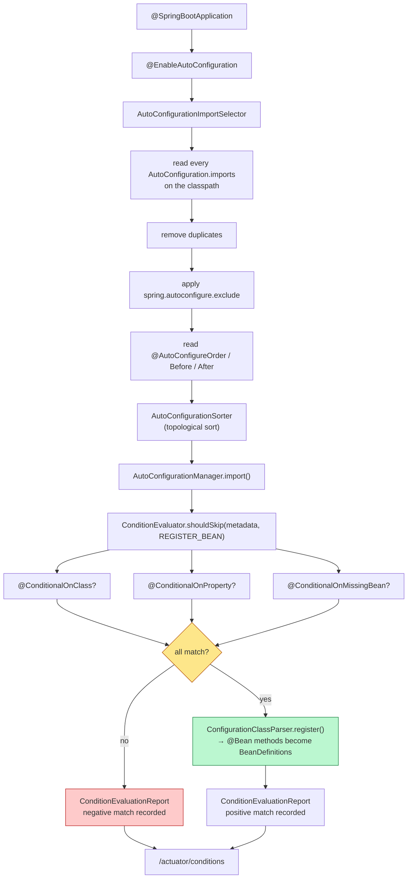
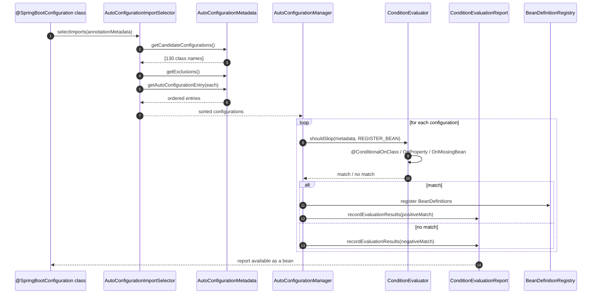

# 02 · Auto-Configuration & Conditional Internals — The Complete Interview Guide

> **Level:** Intermediate → Expert
> **Interview Frequency:** ★★★★★ (the single most-asked Spring Boot question: "what exactly does Boot auto-configure, and how does it decide?")
> **Prerequisites:** [01 · Core Concepts & Architecture](01-Core-Concepts-and-Architecture.md) · [02 · Spring Core & Framework](../02-Spring-Core-Framework/README.md)
> **Last Updated:** 2026
---

## 📋 Table of Contents

- [0. TL;DR — The 30-Second Answer](#0-tldr--the-30-second-answer)
- [1. What & Why — The Problem This Solves](#1-what--why--the-problem-this-solves)
- [2. Mental Model — The One Picture](#2-mental-model--the-one-picture)
- [3. Deep Dive — Theory (Beginner → Advanced)](#3-deep-dive--theory-beginner--advanced)
  - [3.1 Beginner Level](#31-beginner-level)
  - [3.2 Intermediate Level](#32-intermediate-level)
  - [3.3 Advanced Level](#33-advanced-level)
  - [3.4 Expert Level](#34-expert-level)
- [4. Internal Working Mechanism](#4-internal-working-mechanism)
- [5. Step-by-Step Execution Flow](#5-step-by-step-execution-flow)
- [6. Visualizations](#6-visualizations)
- [7. Production-Level Use Cases & Real Industry Examples](#7-production-level-use-cases--real-industry-examples)
- [8. Worked Examples (with Output + Dry Run)](#8-worked-examples-with-output--dry-run)
- [9. Code from Scratch — Production-Grade](#9-code-from-scratch--production-grade)
- [10. Common Mistakes & Gotchas](#10-common-mistakes--gotchas)
- [11. Performance Considerations](#11-performance-considerations)
- [12. Security Considerations](#12-security-considerations)
- [13. Best Practices](#13-best-practices)
- [14. Hands-On Exercises & Code Challenges](#14-hands-on-exercises--code-challenges)
- [15. Interview Q&A — Level-wise](#15-interview-qa--level-wise)
- [16. Scenario-Based & Real-Experience Scenarios (3–5 yrs)](#16-scenario-based--real-experience-scenarios-35-yrs)
- [17. Counter-Questions, Tricky Questions & Follow-Ups](#17-counter-questions-tricky-questions--follow-ups)
- [18. Frequently Asked Production Issues & Debugging Scenarios](#18-frequently-asked-production-issues--debugging-scenarios)
- [19. Architecture Design Questions](#19-architecture-design-questions)
- [20. Rapid-Fire MCQs](#20-rapid-fire-mcqs)
- [21. Cheat Sheet / One-Page Summary](#21-cheat-sheet--one-page-summary)
- [22. Real-World Production Notes](#22-real-world-production-notes)
- [23. Follow-up Learning](#23-follow-up-learning)
---

## 0. TL;DR — The 30-Second Answer

- **Auto-configuration is NOT bean scanning.** It does not look at your classes and guess what you meant. It reads a **fixed list** of auto-configuration classes and applies **known-good defaults**, each guarded by a `@Conditional`.
- **The registry** is `META-INF/spring/org.springframework.boot.autoconfigure.AutoConfiguration.imports` — one fully-qualified class name per line, in every jar on the classpath. Boot 3 **removed** the `EnableAutoConfiguration` key from `spring.factories`.
- **The pipeline** is: `AutoConfigurationImportSelector` → `AutoConfigurationGroup` → `AutoConfigurationManager` → `ConditionEvaluator` → `ConditionEvaluationReport`.
- **`@AutoConfiguration` is the modern replacement for `@Configuration` in a library**: it is `@Configuration(proxyBeanMethods = false)` plus ordering metadata, and it is what `AutoConfiguration.imports` expects.
- **The `@Conditional` family** is the decision vocabulary: `@ConditionalOnClass`, `@ConditionalOnMissingClass`, `@ConditionalOnBean`, `@ConditionalOnMissingBean`, `@ConditionalOnProperty`, `@ConditionalOnSingleCandidate`, `@ConditionalOnWebApplication`, `@ConditionalOnResource`, `@ConditionalOnExpression`, `@ConditionalOnWarDeployment`, `@ConditionalOnCloudPlatform`.
- **`@ConditionalOnMissingBean` compares bean *definitions*, not instances** — and it is evaluated **in auto-configuration order**, which is why `@AutoConfigureBefore` / `@AutoConfigureAfter` are not optional decoration.
- **`@ConditionalOnClass` must not break class loading.** It must be on the auto-configuration class itself or on a `@Bean` method whose return type is not the missing class, otherwise `NoClassDefFoundError` at parse time.
- **The `ConditionEvaluationReport` is the single most useful debugging artefact in Boot.** `/actuator/conditions` (or `--debug`) shows, per auto-configuration, the exact condition that matched or did not match.
- **A library registers beans with `.imports`, never `@ComponentScan`.** A `@ComponentScan` in a library grabs the *consumer's* classes.
- **Ordering is explicit and total.** `@AutoConfigureBefore`, `@AutoConfigureAfter` and `@AutoConfigureOrder` build a graph that Boot topologically sorts before evaluating conditions.
- **The cost of auto-configuration** is a slower startup (hundreds of condition evaluations) and an *implicit* configuration model — which is why `/actuator/configprops` exists.
---

## 1. What & Why — The Problem This Solves

a message converter, an `ObjectMapper`, a `DataSource`, a `TransactionManager`, a `RestClient`
builder. Written by hand, each application repeats 200–400 lines of `@Configuration` that
must be *kept in step* with the Spring version — and the moment Spring changes an API, every
application breaks and must be fixed separately.

Worse, the naive alternative — "scan the classpath and wire what I find" — is unpredictable:
the presence of a jar would silently change your application's behaviour.

**The solution.** Boot replaces hand-written wiring with a **declarative, conditional
contract**:

```
```

**Why this is safe — and this is the crux of the whole chapter.** The word **conditional**
carries the entire design:

| Guard | Meaning | Why it exists |
|---|---|---|
| `@ConditionalOnClass` | Only if the class is on the classpath | "I configure Jackson — if you use Jackson" |
| `@ConditionalOnMissingBean` | Only if you have not defined one | "I provide a default — you can always override me" |
| `@ConditionalOnProperty` | Only if a property is set | "I configure Kafka — if you enabled Kafka" |
| `@ConditionalOnBean` | Only if another bean exists | "I enhance the `DataSource` you defined" |
| `@ConditionalOnMissingClass` | Only if the class is *absent* | "I provide a fallback implementation" |

**The contract with the user is therefore: *I will never fight you.*** If you define a bean
of the same type, Boot's auto-configuration steps aside. That is what makes Boot safe to
adopt in an existing codebase and safe to expose as a shared library.

**What breaks without it.** Without conditions, two libraries on the same classpath both
register `ObjectMapper` → `BeanDefinitionOverrideException` at startup, and the only fix is
to disable one of them — pushing a Boot-version problem into every consumer.
---

## 2. Mental Model — The One Picture

```text
   WHAT AUTO-CONFIGURATION ACTUALLY IS
   ═════════════════════════════════════

   classpath → [ spring-boot-autoconfigure | my-library | my-app ]
               each ships META-INF/spring/…AutoConfiguration.imports
                              │
                              ▼
   AutoConfigurationImportSelector → 130 + N candidate classes
                              │
                              ▼
   ConditionEvaluator evaluates each candidate's @Conditional
        • @ConditionalOnClass       → classpath shape
        • @ConditionalOnMissingBean → have YOU defined one?
        • @ConditionalOnProperty    → is the feature enabled?
        MATCH    → register its @Bean methods
        NO MATCH → record a NEGATIVE MATCH
                              │
                              ▼
   ConditionEvaluationReport  →  /actuator/conditions
```

**What to look at:** the input is a **list of class names**, not a scan. The decision is a
**pure function of (classpath, bean definitions, environment)** — and the report tells you
exactly why each decision was made.
```

**What to look at:** the input is a **list of class names**, not a scan. The decision is a
**pure function of (classpath, bean definitions, environment)**. The output is a report that
tells you exactly why each decision was made.
---

## 3. Deep Dive — Theory (Beginner → Advanced)
### 3.1 Beginner Level
#### 3.1.1 What auto-configuration is — and is not

| It IS | It is NOT |
|---|---|
| A list of well-known configurations Boot applies for you | A scan that guesses your intent |
| Guarded by `@Conditional` so it never fights you | A replacement for your own configuration |
| Versioned with the framework (Boot pins the Spring version) | Magic — every decision is inspectable in the report |
| Applied in a **defined order** | Applied in classpath order |

#### 3.1.2 The `AutoConfiguration.imports` file

The location is fixed by the Boot contract:

```text
   META-INF/spring/org.springframework.boot.autoconfigure.AutoConfiguration.imports
   # one fully-qualified class name per line, e.g.
   org.springframework.boot.autoconfigure.jackson.JacksonAutoConfiguration
   org.springframework.boot.autoconfigure.jdbc.DataSourceAutoConfiguration
   org.springframework.boot.autoconfigure.web.servlet.WebMvcAutoConfiguration
   ...
```
```

```text
   # Inside spring-boot-autoconfigure-3.3.5.jar — 130+ lines, one class per line:
   org.springframework.boot.autoconfigure.jackson.JacksonAutoConfiguration
   org.springframework.boot.autoconfigure.jdbc.DataSourceAutoConfiguration
   org.springframework.boot.autoconfigure.web.servlet.DispatcherServletAutoConfiguration
   org.springframework.boot.autoconfigure.web.servlet.WebMvcAutoConfiguration
   org.springframework.boot.autoconfigure.security.servlet.SecurityAutoConfiguration
   ...
```

**Rules for the file:**
- One **fully-qualified class name** per line; `#` starts a comment.
- The classes are **not** component-scanned — Boot loads them explicitly by name.
- A library ships its own file; Boot **merges all of them** from the classpath.
- Order within a file is *not* the evaluation order — the `@AutoConfigureOrder` /
  `@AutoConfigureBefore` / `@AutoConfigureAfter` graph decides that.

#### 3.1.3 `@AutoConfiguration` vs `@Configuration`

```java
package com.acme.payments;

import org.springframework.boot.SpringApplication;
import org.springframework.boot.autoconfigure.SpringBootApplication;
import org.springframework.web.bind.annotation.GetMapping;
import org.springframework.web.bind.annotation.RestController;

@SpringBootApplication
@RestController
public class PaymentApplication {

    public static void main(String[] args) {
        SpringApplication.run(PaymentApplication.class, args);
    }

    @GetMapping("/ping")
    public String ping() {
        return "pong";
    }
}
```
```

| | `@Configuration` | `@AutoConfiguration` |
|---|---|---|
| `proxyBeanMethods` | `true` (default) | **`false`** |
| Intended use | Your own config classes | Auto-configuration classes in libraries |
| Ordering metadata | none | honours `@AutoConfigureOrder/Before/After` |
| Registered via | `@ComponentScan` | `AutoConfiguration.imports` |
| Meta-annotated | — | `@Configuration(proxyBeanMethods = false)` |

**Why `proxyBeanMethods = false` matters:** an auto-configuration class should not rely on
inter-bean method calls, because inter-bean calls only work through the CGLIB proxy that
`@Configuration` normally provides. Turning it off also means the class is instantiated
once, not proxied — marginally faster and no accidental self-invocation semantics.

#### 3.1.4 `@AutoConfigureBefore` / `@AutoConfigureAfter` / `@AutoConfigureOrder`

```java
@AutoConfiguration
@AutoConfigureBefore(DataSourceAutoConfiguration.class)   // I must be evaluated FIRST
public class AcmeDataSourceAutoConfiguration { ... }
```

- `@AutoConfigureBefore(X)` — evaluate **before** `X`.
- `@AutoConfigureAfter(X)` — evaluate **after** `X`.
- `@AutoConfigureOrder(n)` — a coarse ordering hint for auto-configurations that have no
  explicit relationship (lower = earlier).

Boot builds a **directed graph** from these annotations and **topologically sorts** it.
A cycle is reported as `IllegalStateException: AutoConfigure cycle detected`.

**Why the ordering matters — the canonical failure.** Auto-configuration A defines
`ObjectMapper` with `@ConditionalOnMissingBean`; auto-configuration B (the user's own,
scanned) also defines one. If A is evaluated **before** the user's configuration class is
processed, A sees "no `ObjectMapper` bean" and registers its own — and the user's bean is
then either overridden or collides. Declaring `@AutoConfigureBefore` on the *user's*
auto-configuration (or `@AutoConfigureAfter` on the library's) fixes it.
### 3.2 Intermediate Level
#### 3.2.1 The `@Conditional` family

| Annotation | Matches when | Typical use |
|---|---|---|
| `@ConditionalOnClass(X.class)` | `X` is on the classpath | "configure Jackson" |
| `@ConditionalOnMissingClass(X.class)` | `X` is **not** on the classpath | "provide a fallback" |
| `@ConditionalOnBean(X.class)` | a bean of type `X` is defined | "enhance the user's `DataSource`" |
| `@ConditionalOnMissingBean(X.class)` | **no** bean of type `X` is defined | "default value" |
| `@ConditionalOnSingleCandidate(X.class)` | exactly one bean of type `X` | "use the primary one" |
| `@ConditionalOnProperty(prefix, name, havingValue, matchIfMissing)` | the property matches | "enable this feature" |
| `@ConditionalOnResource(resources, type)` | the classpath resource exists | "static assets present" |
| `@ConditionalOnExpression("...")` | the SpEL expression is `true` | escape hatch — avoid |
| `@ConditionalOnWebApplication(type)` | SERVLET / REACTIVE / ANY | "only in a web app" |
| `@ConditionalOnWarDeployment` | the app is deployed as a WAR | "container-provided datasource" |
| `@ConditionalOnCloudPlatform` | running on a detected cloud platform | "use the platform's metadata service" |

#### 3.2.2 The `@ConditionalOnClass` class-loading trap

```java
// ❌ BROKEN — the return type is the missing class, so the JVM must load it
@Bean
public SomeVendorClient vendorClient() { return new SomeVendorClient(); }

// ✅ CORRECT — the condition is on the CONFIGURATION class
@AutoConfiguration
@ConditionalOnClass(SomeVendorClient.class)
public class VendorAutoConfiguration {
    @Bean
    public Object vendorClient() { return new SomeVendorClient(); }
}
```
```

**The rule:** `@ConditionalOnClass` is evaluated by **reading the annotation metadata**, not
by loading the class. If the annotation is on a `@Bean` method, Spring must load the method's
return type to read the metadata — so the class must be present. Put the condition on the
**outer configuration class**, and make the `@Bean` method's return type something always
available (`Object`, an interface, or a `@ConfigurationProperties`-style holder) — or use
`@ConditionalOnClass(name = "com.vendor.Client")` with the **string** form.

#### 3.2.3 `@ConditionalOnProperty` details

```java
@ConditionalOnProperty(prefix = "acme.ledger", name = "enabled", havingValue = "true")
@ConditionalOnProperty(prefix = "acme.ledger", name = "mode", havingValue = "async")
```

| Parameter | Meaning |
|---|---|

**The trap:** with `havingValue = "true"` and `matchIfMissing = false` (the defaults), a
property that is **missing** does **not** match — so the feature is **off** unless you
explicitly enable it. That is the safe default, but it surprises people who expect
"present-but-not-set" to enable the feature.
### 3.3 Advanced Level
#### 3.3.1 The evaluation pipeline in detail

```text
   1. AutoConfigurationImportSelector.selectImports()
        → reads every AutoConfiguration.imports, removes duplicates,
          applies spring.autoconfigure.exclude, builds AutoConfigurationEntry objects
   2. AutoConfigurationGroup.selectImports() → sorts with the ordering graph
   3. AutoConfigurationManager.import() → for each entry:
        → ConditionEvaluator.shouldSkip(...) evaluates every @Conditional
        → match  → ConfigurationClassParser registers the @Bean methods
        → no match → recorded as a negative match in the report
```
```

**Key insight:** the *ordering* is resolved **before** the conditions are evaluated, so
`@ConditionalOnMissingBean` always sees a consistent world.

#### 3.3.2 How the conditions are actually evaluated

`ConditionEvaluator.shouldSkip(AnnotatedTypeMetadata, ConfigurationPhase)`:

1. Read the metadata for `@Conditional`.
2. For each condition class (there may be several), instantiate it and ask
   `matches(ConditionContext, AnnotatedTypeMetadata)`.
3. If **any** condition does not match → the whole configuration is skipped.
4. The `ConditionContext` gives the condition access to:
   - `getEnvironment()` — for `@ConditionalOnProperty`
   - `getResourceLoader()` / `getClassLoader()` — for `@ConditionalOnClass`
   - `getBeanFactory()` / `getRegistry()` — for `@ConditionalOnBean` / `@ConditionalOnMissingBean`
   - `getPhase()` — `REGISTER_BEAN` vs `PARSE_CONFIGURATION`

**The phase matters.** `@ConditionalOnBean` evaluated in `REGISTER_BEAN` phase sees beans
that are *already defined*; in `PARSE_CONFIGURATION` phase it sees fewer. This is why
`@ConditionalOnBean` is fragile for *ordering-dependent* checks, while
`@ConditionalOnMissingBean` is robust — it is meant to be evaluated late.

#### 3.3.3 The `ConditionEvaluationReport`

The report is a bean of type `ConditionEvaluationReport` (Boot 3 uses
`SpringBootConditionEvaluationReport`). It records, per auto-configuration, which conditions
matched and which did not — and it is exposed at `/actuator/conditions` (needs the endpoint
exposed) or printed to the console with `--debug`. §6.4 shows what it looks like.
### 3.4 Expert Level
#### 3.4.1 The history: `spring.factories` → `.imports`

| Version | Auto-config registry | Notes |
|---|---|---|
| Boot ≤ 2.6 | `META-INF/spring.factories`, key `EnableAutoConfiguration` | One file for auto-config **and** a dozen other SPIs |
| Boot 2.7 | **both** written | `spring.factories` still written for compatibility; the new `.imports` file added; `@AutoConfiguration` introduced |
| Boot 3.0 | **only** `AutoConfiguration.imports` read | The `EnableAutoConfiguration` key in `spring.factories` is **ignored** |

**Why the change:** the old file could not express *ordering*, was not IDE-navigable, and
mixed two unrelated concerns. The new file is dedicated, typed, one-class-per-line, and
supports `@AutoConfigureOrder`.

> ⚠ **Migration consequence.** A custom auto-configuration that used the `spring.factories`
> `EnableAutoConfiguration` key **silently stops running** on Boot 3 — no error, the beans
> just disappear. That is one of the most confusing upgrade failures in the ecosystem.

#### 3.4.2 Why auto-configuration is a *classpath-shape* mechanism

Boot's conditions can only ask questions about the **classpath**, the **environment** and the
**bean registry**. They cannot ask *"is this the right database?"*. Two consequences: the
conditions are always satisfiable in more than one environment (so the *values* must come
from configuration, not from the condition), and two libraries matching the same shape will
fight — the only tie-breaker is the ordering graph plus `@ConditionalOnMissingBean`.

#### 3.4.3 Determinism, and the "same app, different behaviour" problem

Because the decision is a function of (classpath, definitions, environment), the same
artifact can behave **differently** in two environments — by design. The production-safe
response is to make the *decision* observable: log the auto-configurations that were
**skipped** at startup. That single log line turns "why is my bean missing?" from a
two-hour investigation into a five-second answer.

## 4. Internal Working Mechanism

**The call chain, class by class.**

```text
   @EnableAutoConfiguration
        │
        ▼
   AutoConfigurationImportSelector (an ImportSelector)
        ├─ getCandidateConfigurations()  → reads every AutoConfiguration.imports
        ├─ getExclusions()              → spring.autoconfigure.exclude
        └─ getAutoConfigurationEntry()  → ordering metadata per class
        │
        ▼
   AutoConfigurationGroup.selectImports()  → AutoConfigurationSorter (topological sort)
        │
        ▼
   AutoConfigurationManager.import()
        ├─ ConditionEvaluator.shouldSkip(metadata, REGISTER_BEAN)
        │     └─ every @Conditional → matches(context, metadata)
        ├─ match    → ConfigurationClassParser.register() → BeanDefinitions
        └─ no match → ConditionEvaluationReport.negativeMatch
```
```

**The extension points:**

| Hook | Interface | Use it to |
|---|---|---|
| Add/remove auto-configurations | `spring.autoconfigure.exclude` property | Disable a Boot auto-configuration |
| Contribute your own | `AutoConfiguration.imports` in your jar | Ship an auto-configuration |
| React to the outcome | `ConditionEvaluationReport` bean | Log which auto-configurations were skipped |
| Influence the environment before evaluation | `EnvironmentPostProcessor` | Add a `PropertySource` that a `@ConditionalOnProperty` reads |
| Influence bean definitions before evaluation | `BeanFactoryPostProcessor` | Change what `@ConditionalOnMissingBean` can see |

> 🎯 **The interview hook.** "Auto-configuration is evaluated in `AutoConfigurationManager.import()`:
> for each candidate, `ConditionEvaluator.shouldSkip(...)` runs every `@Conditional`; if they all
> match, `ConfigurationClassParser` registers the `@Bean` methods. The ordering is resolved
> **before** evaluation, so `@ConditionalOnMissingBean` sees a consistent world."
---

## 5. Step-by-Step Execution Flow

| # | Step | What happens | Where you can see it |
|---|---|---|---|
| 1 | `@EnableAutoConfiguration` is processed | `AutoConfigurationImportSelector` is imported | — |
| 2 | Candidates are collected | every `AutoConfiguration.imports` on the classpath is read | `spring-boot-autoconfigure-3.3.5.jar` |
| 3 | Exclusions are applied | `spring.autoconfigure.exclude` removed | `application.yml` |
| 4 | Ordering metadata is read | `@AutoConfigureOrder/Before/After` → `AutoConfigurationEntry` | source of the auto-config class |
| 5 | The graph is sorted | `AutoConfigurationSorter` topologically sorts | "AutoConfigure cycle detected" on error |
| 6 | Conditions are evaluated | `ConditionEvaluator.shouldSkip(..., REGISTER_BEAN)` | `ConditionEvaluationReport` |
| 7 | Matches are registered | `ConfigurationClassParser` → `BeanDefinition`s | `/actuator/beans` |
| 8 | Non-matches are recorded | negative match + the failing condition | `/actuator/conditions` |
| 9 | The report is published | a `ConditionEvaluationReport` bean exists | `--debug` output at startup |
| 10 | The beans are instantiated | later, in `finishBeanFactoryInitialization()` | `/actuator/beans` shows instances |

**The crucial distinction:** steps 1–9 happen during **bean-definition registration**;
step 10 happens later during **instantiation**. `@ConditionalOnMissingBean` therefore sees
*definitions*, never instances.
---

## 6. Visualizations
### 6.1 The auto-configuration evaluation pipeline



**What to look at:** the **decision diamond** comes *after* the sort. That ordering is the
whole reason `@ConditionalOnMissingBean` is reliable: the world it inspects is deterministic.
### 6.2 Import selector → condition evaluation → report



**What to look at:** the report is written **per configuration, per condition** — which is
why it can answer "the class was there but the property was missing".
### 6.3 The `AutoConfiguration.imports` file layout

```text
   ┌───────────────────────────────────────────────────────────────────────────┐
   │  spring-boot-autoconfigure-3.3.5.jar                                      │
   │  └── META-INF/spring/                                                    │
   │        org.springframework.boot.autoconfigure.AutoConfiguration.imports   │
   │        # org.springframework.boot.autoconfigure.aop.AopAutoConfig...      │
   │        # org.springframework.boot.autoconfigure.jdbc.DataSourceAuto...    │
   │        # org.springframework.boot.autoconfigure.jackson.JacksonAuto...    │
   │        # ... 130 lines, one FQCN per line ...                            │
   └───────────────────────────────────────────────────────────────────────────┘

   ┌───────────────────────────────────────────────────────────────────────────┐
   │  acme-spring-boot-starter-1.4.0.jar   (YOUR library)                    │
   │  └── META-INF/spring/                                                    │
   │        org.springframework.boot.autoconfigure.AutoConfiguration.imports   │
   │        # com.acme.platform.PlatformAutoConfiguration                      │
   └───────────────────────────────────────────────────────────────────────────┘

   Boot merges ALL of these files at startup and evaluates every listed class.
```

**What to look at:** an **application** never declares auto-configurations; only
**libraries** do. That is the difference between a starter and a library.
```

**What to look at:** an **application** never declares auto-configurations; only
**libraries** do. That is the difference between a starter and a library.
### 6.4 A negative match in the `ConditionEvaluationReport`

```text
   ======================= CONDITIONS EVALUATION REPORT =======================
   Positive matches:
     JacksonAutoConfiguration matched:
        - @ConditionalOnClass (Jackson2ObjectMapperBuilder) matched
        - @ConditionalOnMissingBean matched

   Negative matches:
     AcmeLedgerAutoConfiguration:
        - @ConditionalOnClass (com.acme.ledger.LedgerClient) did not match
          (error: class not found)
     AcmeHttpClientAutoConfiguration:
        - @ConditionalOnMissingBean (com.acme.http.AcmeHttpClient) did not match
          (matched by: com.acme.app.MyOwnHttpClient)
   ========================================================================
```

**What to look at:** the last entry is the *desired* outcome — the user defined their own
`AcmeHttpClient`, so the library's default stepped aside. That is the whole design working.
```

**What to look at:** the third entry is the *desired* outcome — the user defined their own
`AcmeHttpClient`, so the library's default stepped aside. That is the whole design working.
```

**What to look at:** the third entry is the *desired* outcome — the user defined their own
`AcmeHttpClient`, so the library's default stepped aside. That is the whole design working.
---

## 7. Production-Level Use Cases & Real Industry Examples

`acme-spring-boot-starter-platform-web`, whose `PlatformAutoConfiguration` registers a
`RestClient` with the corporate TLS trust store, the mandated 2 s connect timeout, and
Micrometer tags. It is guarded by `@ConditionalOnMissingBean` so any service that needs a
different client can define its own — **and the platform team verifies it** with an
`ApplicationContextRunner` test asserting the bean disappears when the user supplies one.
Without that test, three services in the estate had silently drifted onto the default client.

`acme-inventory-client`, whose auto-configuration is `@ConditionalOnClass(InventoryClient)`
and `@ConditionalOnProperty(prefix = "acme.inventory", name = "enabled", matchIfMissing = true)`.
When the inventory system was decommissioned, the property was flipped to `false` rather
than the dependency being removed — the service kept starting, and the `ConditionEvaluationReport`
showed exactly one negative match, which became the team's standard "did my flag work?"
check.

property, not by a jar, precisely so that the *same artifact* can serve tenants with
different features. `@ConditionalOnProperty` is the switch; the **negative match** recorded
in the report is the audit trail ("tenant 41 had the loyalty module disabled at 14:02").

anything touching money: `LedgerAutoConfiguration` is `@ConditionalOnMissingBean` for
*everything*, and the application module explicitly declares its own `ObjectMapper` with
BigDecimal scale rules. The audit requirement is satisfied by archiving
`/actuator/conditions` at deploy time — a signed record of exactly which framework
defaults were in force.
---

## 8. Worked Examples (with Output + Dry Run)
### 8.1 A custom auto-configuration that yields to the user

**The problem.** Ship a library that provides a `RestClient` for a downstream service —
but let any application override it.

**The code** (`acme-platform/src/main/java/com/acme/platform/PlatformAutoConfiguration.java`):

```java
package com.acme.platform;

import java.time.Duration;

import org.springframework.boot.autoconfigure.AutoConfiguration;
import org.springframework.boot.autoconfigure.condition.ConditionalOnClass;
import org.springframework.boot.autoconfigure.condition.ConditionalOnMissingBean;
import org.springframework.boot.autoconfigure.condition.ConditionalOnProperty;
import org.springframework.boot.context.properties.EnableConfigurationProperties;
import org.springframework.context.annotation.Bean;
import org.springframework.http.client.JdkClientHttpRequestFactory;
import org.springframework.web.client.RestClient;

@AutoConfiguration
@ConditionalOnClass(RestClient.class)
@EnableConfigurationProperties(PlatformProperties.class)
public class PlatformAutoConfiguration {

    @Bean
    @ConditionalOnProperty(prefix = "acme.platform", name = "enabled", havingValue = "true",
            matchIfMissing = true)
    @ConditionalOnMissingBean(RestClient.class)
    public RestClient platformRestClient(RestClient.Builder builder,
                                          PlatformProperties properties) {
        JdkClientHttpRequestFactory requestFactory = new JdkClientHttpRequestFactory();
        requestFactory.setConnectTimeout(properties.connectTimeout());
        requestFactory.setReadTimeout(properties.readTimeout());
        return builder.baseUrl(properties.baseUrl())
                .requestFactory(requestFactory)
                .defaultHeader("X-Client", "acme-platform")
                .build();
    }
}
```
```

**The registration file**
(`acme-platform/src/main/resources/META-INF/spring/org.springframework.boot.autoconfigure.AutoConfiguration.imports`):

```text
com.acme.platform.PlatformAutoConfiguration
```

**The expected output** (`application.yml` has no `acme.platform.*` keys, so the default
profile applies):

```text
2026-10-22 10:02:11.884  INFO 9921 --- [main] c.a.p.PaymentApplication : Started PaymentApplication in 2.104 seconds (JVM running for 2.441)
```

and, with `--debug`, the report contains:

```text
=========================== Positive matches ===========================
PlatformAutoConfiguration matched:
   - @ConditionalOnClass (RestClient) matched
   - @ConditionalOnProperty (acme.platform.enabled) matched
   - @ConditionalOnMissingBean (RestClient) matched
```

**Dry run.**

1. `@ConditionalOnClass(RestClient.class)` — `RestClient` (Spring Framework 6.1) is present
   because `spring-boot-starter-web` is on the classpath → **match**.
2. `@ConditionalOnProperty(prefix = "acme.platform", name = "enabled", havingValue = "true",
   matchIfMissing = true)` — the property is **absent**, and `matchIfMissing = true` means
   "absent is OK" → **match**. (With the default `matchIfMissing = false` this would *not*
   match and the client would silently not exist — the single most common bug in this
   pattern.)
3. `@ConditionalOnMissingBean(RestClient.class)` — the application has not defined a
   `RestClient` → **match**, so the bean is registered.
4. The bean is registered as a **definition**; it is instantiated later, in
   `finishBeanFactoryInitialization()`.

**The takeaway:** three conditions, three different reasons to skip, and each one is visible
in the report.
### 8.2 Debugging a bean that does not exist

**The problem.** A downstream team reports that `LedgerClient` is not injected. The
application starts, but the endpoint that uses it throws
`NoSuchBeanDefinitionException: No qualifying bean of type 'com.acme.ledger.LedgerClient'`.

**The diagnostic command.**

```bash
curl -s http://localhost:8080/actuator/beans | jq '.contexts.application.beans'
java -jar app.jar --logging.level.org.springframework.context.annotation=TRACE
curl -s http://localhost:8080/actuator/mappings | jq '.contexts.application.mappings'
```
```
```
```

**The expected output.**

```text
=========================== Negative matches ===========================
AcmeLedgerAutoConfiguration:
   - @ConditionalOnClass (com.acme.ledger.LedgerClient) did not match
     (error: class not found)
   - @ConditionalOnProperty (acme.ledger.enabled) did not match
     (required: acme.ledger.enabled=true, found: none)
======================================================================
```

**The dry run.**

1. The report shows **two** failing conditions for the same auto-configuration. That is
   enough to explain the missing bean — no further investigation is needed.
2. The **first** failure (`@ConditionalOnClass`) is the *root cause*: the `acme-ledger-client`
   jar is not on the classpath. `ConditionEvaluator` short-circuits, but the report lists
   **every** condition, so you see both.
3. If the class *were* present but the property missing, the fix is `acme.ledger.enabled=true`
   — the report's "required / found" text tells you exactly which key to set.

**The second diagnostic** (when the class *is* present and the property *is* set but the bean
is still absent) is the bean-definition map:

```bash
curl -s http://localhost:8080/actuator/beans | jq '.contexts.application.beans.ledgerClient'
```

**The expected signal:** `null` — the definition was never registered, so the problem is the
condition, not the injection point. If the key exists but points at the wrong bean, the
problem is a **type mismatch**: `@ConditionalOnMissingBean(LedgerClient.class)` will not
match a bean of type `LedgerClientAdapter`, and the two definitions will not collide by
name either — producing exactly this confusing symptom.
### 8.3 Testing an auto-configuration with `ApplicationContextRunner`

**The problem.** Prove that the auto-configuration applies by default **and** steps aside
when the user defines their own bean.

**The code** (`src/test/java/com/acme/platform/PlatformAutoConfigurationTests.java`):

```java
class PlatformAutoConfigurationTests {

    private final ApplicationContextRunner runner = new ApplicationContextRunner()
            .withConfiguration(AutoConfigurations.of(PlatformAutoConfiguration.class))
            .withPropertyValues("acme.platform.base-url=https://api.acme.test");

    @Test
    void registersRestClientByDefault() {
        runner.run(context -> assertThat(context).hasSingleBean(RestClient.class));
    }

    @Test
    void backsOffWhenTheApplicationDefinesItsOwn() {
        runner.withUserConfiguration(MyOwnClientConfiguration.class).run(context ->
                assertThat(context.getBean(RestClient.class))
                        .isSameAs(context.getBean("myOwnRestClient")));
    }

    @Test
    void backsOffWhenTheFeatureIsDisabled() {
        runner.withPropertyValues("acme.platform.enabled=false")
              .run(context -> assertThat(context).doesNotHaveBean(RestClient.class));
    }
}
```
```
```

**The expected output.**

```text
[INFO] Tests run: 3, Failures: 0, Errors: 0, Skipped: 0
[INFO] BUILD SUCCESS
```

**The dry run.**

1. `ApplicationContextRunner` builds a **minimal** `AnnotationConfigApplicationContext` — no
   web server, no full application — so the test runs in **~200 ms** instead of seconds.
2. `withConfiguration(AutoConfigurations.of(PlatformAutoConfiguration.class))` applies **only**
   the auto-configuration under test. That isolation is the point: you are testing the
   contract, not your whole application.
3. `withUserConfiguration(...)` simulates the consumer defining their own bean — this is
   the assertion that **almost nobody writes** and that catches the most common library bug.
4. `withPropertyValues("acme.platform.enabled=false")` proves the feature switch works.

**The takeaway:** a library without these tests is a library that will break a consumer's
build on the next upgrade — and the failing test will be in *their* repository, not yours.
---

## 9. Code from Scratch — Production-Grade

A complete, shippable auto-configuration library.

**`com.acme.platform.PlatformProperties`**

```java
package com.acme.platform;

import java.time.Duration;

import jakarta.validation.constraints.NotBlank;

import org.springframework.boot.context.properties.ConfigurationProperties;
import org.springframework.validation.annotation.Validated;

/**
 * Type-safe configuration for the Acme platform client.
 *
 * <p>Validated at startup so a missing base URL fails the deployment, not the first call.
 */
@Validated
@ConfigurationProperties(prefix = "acme.platform")
public record PlatformProperties(

        @NotBlank
        String baseUrl,

        boolean enabled,

        Duration connectTimeout,

        Duration readTimeout) {

    public PlatformProperties {
        if (baseUrl == null || baseUrl.isBlank()) {
            baseUrl = "https://api.acme.internal";
        }
        connectTimeout = connectTimeout == null ? Duration.ofSeconds(2) : connectTimeout;
        readTimeout = readTimeout == null ? Duration.ofSeconds(5) : readTimeout;
    }
}
```

**`com.acme.platform.PlatformHealthIndicator`**

```java
@Component("acmePlatform")
public class PlatformHealthIndicator implements HealthIndicator {

    private final PlatformProperties properties;

    public PlatformHealthIndicator(PlatformProperties properties) {
        this.properties = properties;
    }

    @Override
    public Health health() {
        if (!this.properties.enabled()) {
            return Health.up().withDetail("feature", "disabled").build();
        }
        return Health.up().withDetail("baseUrl", this.properties.baseUrl()).build();
    }
}
```

> ⚠ A `HealthIndicator` must **never throw** — an exception here breaks the whole
> `/actuator/health` response, not just this contributor.

```

**`META-INF/spring/org.springframework.boot.autoconfigure.AutoConfiguration.imports`**

```text
com.acme.platform.PlatformAutoConfiguration
```

**`META-INF/additional-spring-configuration-metadata.json`** — optional, but it gives IDE
completion for the properties your library introduces:

```json
{
  "properties": [
    { "name": "acme.platform.enabled", "type": "java.lang.Boolean",
      "description": "Whether the Acme platform client auto-configuration is active.",
      "defaultValue": true },
    { "name": "acme.platform.base-url", "type": "java.lang.String",
      "description": "Base URL of the platform API.",
      "defaultValue": "https://api.acme.internal" }
  ]
}
```
```
---

## 10. Common Mistakes & Gotchas

| # | ❌ Wrong | ✅ Right | Why it breaks |
| 1 | `@ComponentScan` in a library | `AutoConfiguration.imports` + `@AutoConfiguration` | The scan grabs the **consumer's** classes and can cause duplicate-bean failures in their app. |
| 3 | `@ConditionalOnMissingBean` without any ordering | Add `@AutoConfigureBefore` / `@AutoConfigureAfter` | The condition may be evaluated before the user's bean is registered → your bean wins unexpectedly. |
| 5 | `@ConditionalOnMissingBean(MyConcreteClass.class)` | Check the **interface** | The user may implement an interface; the concrete-type check does not match, so both beans register. |
| 6 | Relying on `spring.factories` for auto-config in Boot 3 | `AutoConfiguration.imports` | The old key is **ignored** on Boot 3 — the beans silently disappear, with no error. |
| 9 | Throwing from a `HealthIndicator` | Return `Health.down()` | An exception breaks the entire `/actuator/health` payload, not just one contributor. |
|---|---|---|---|
| 2 | `@ConditionalOnClass` on a `@Bean` method whose return type is the missing class | Put the condition on the **configuration class** | Spring must load the return type to read the metadata → `NoClassDefFoundError` before the condition is evaluated. |
---

## 11. Performance Considerations

| Concern | Cost / default | Mitigation |
| **Condition evaluation** | ~130 auto-configurations × ~3 conditions = **~400 evaluations** at startup | Keep your own auto-configurations few; avoid `@ConditionalOnExpression` (SpEL compilation is expensive) |
| **Eager beans** | Each `@Bean` you add is an eager singleton | Mark expensive beans `@Lazy`, or gate them behind a condition |
| **AOT / native image** | Conditions are evaluated at **build time** | Keep runtime-varying decisions in application `@Configuration` |
|---|---|---|

**The number to quote in an interview:** a typical Boot 3.3 application evaluates roughly
**400 conditions** and registers **150–350 beans** during startup. Auto-configuration is
responsible for about **60% of the bean count** — which is exactly why
`@ConditionalOnMissingBean` matters: a library that registers 12 beans unconditionally slows
every consumer.
---

## 12. Security Considerations

| Threat | Attack path | Defence |
|---|---|---|
| **Disclosure via `/actuator/conditions`** | The report lists every auto-configuration, every condition and the values of `@ConditionalOnProperty` properties — effectively a map of your stack | Never expose `conditions` publicly; keep the Actuator on an internal port |
---

## 13. Best Practices

- [ ] **Use `@AutoConfiguration` (not `@Configuration`) in libraries.**
---

## 14. Hands-On Exercises & Code Challenges
### Exercise 1 — Read the condition report like a detective

**Steps**

1. Start any Boot 3.3 app with `--debug`.
2. Extract the report: `java -jar app.jar --debug 2>&1 | sed -n '/CONDITIONS EVALUATION REPORT/,/^===/p'`.
3. Count the positive and negative matches.
4. Find one negative match caused by `@ConditionalOnClass` and one by `@ConditionalOnProperty`.

**Acceptance criteria**

- [ ] You can name the class that evaluated each condition.
- [ ] You can explain in one sentence why `matchIfMissing = true` behaves differently from the default.
- [ ] You can state which condition produced the negative match you found.

**Stretch goal:** expose `conditions` on an internal port and write a script that fails the
pipeline when a **specific** auto-configuration flips from positive to negative.
### Exercise 2 — Prove the class-loading trap

**Steps**

1. Create a `@Configuration` class with `@ConditionalOnClass(com.example.Missing.class)` and a
   `@Bean` method returning `com.example.Missing`.
2. Do **not** put `com.example.Missing` on the classpath; start the app.
3. Observe the failure — it is a class-loading error, **not** a "condition did not match" message.
4. Move the condition to the configuration class and make the `@Bean` method return `Object`.
5. Start again — the condition is now evaluated and the configuration is skipped cleanly.

**Acceptance criteria**

- [ ] You can explain *why* the first version fails before the condition is evaluated.
- [ ] You can state the rule: **the condition belongs on the outermost class the condition system loads.**

**Stretch goal:** repeat the exercise with `@ConditionalOnClass(name = "com.example.Missing")`
and confirm the class is never loaded.
### Exercise 3 — Turn a library into a starter

**Steps**

1. Take an existing library module with an `@Configuration` class.
2. Move the class to an `@AutoConfiguration` and add the `.imports` file.
3. Add `ApplicationContextRunner` tests for the default and back-off paths.

**Acceptance criteria**

- [ ] The `.imports` file is present in the built JAR.
- [ ] The consumer's `/actuator/conditions` shows your auto-configuration under **positive matches**.
- [ ] When the consumer defines its own bean, the auto-configuration shows under **negative matches**.

**Stretch goal:** diff the condition report between two versions of your library and fail CI
when the positive-match set changes unexpectedly.
### Code Challenge 1 — A starter that is safe to consume

**Task.** Build `acme-spring-boot-starter-ledger` with an auto-configuration, a typed
properties class and two `ApplicationContextRunner` tests.

**Acceptance criteria**

- [ ] `AutoConfiguration.imports` contains exactly one line naming your auto-configuration.
- [ ] The `RestClient` bean is `@ConditionalOnMissingBean` **and** `@ConditionalOnClass`.
- [ ] `@ConditionalOnProperty(prefix = "acme.ledger", name = "enabled", havingValue = "true", matchIfMissing = true)`.
- [ ] Test 1 asserts the bean exists by default; Test 2 asserts it is replaced by the user's; Test 3 asserts it disappears when `acme.ledger.enabled=false`.
- [ ] `mvn verify` passes and the JAR contains the `.imports` file (`jar tf target/acme-spring-boot-starter-ledger-1.0.0.jar | grep imports`).

**Stretch goal:** add a listener that logs every *skipped* auto-configuration at startup, and
prove it works by disabling the feature.
### Code Challenge 2 — Make two libraries coexist

**Task.** You own `lib-alpha` and `lib-beta`; both want to define a `MetricsClient`. They must
never collide, and the user must always be able to override.

**Acceptance criteria**

- [ ] Exactly one `MetricsClient` bean exists when both libraries are on the classpath.
- [ ] A user-defined `MetricsClient` wins over both.
- [ ] The ordering is expressed explicitly with `@AutoConfigureBefore` / `@AutoConfigureAfter`.
- [ ] A test proves the behaviour with both libraries present.

**Stretch goal:** add a third library that should only win when the other two are absent, and
express that with `@ConditionalOnMissingBean` rather than ordering.
---

## 15. Interview Q&A — Level-wise
### 🟢 Beginner

**A:** It configures the framework *plumbing*: the `DispatcherServlet`, the message-converter registry, the `ObjectMapper`, the `DataSource` and `TransactionManager`, the `RestClient`/`WebClient` builders, the embedded server. It never configures your business beans — those are yours via component scanning.

**A:** It reads `META-INF/spring/org.springframework.boot.autoconfigure.AutoConfiguration.imports` from every jar on the classpath — one class name per line. Each listed class is then evaluated against the `@Conditional` annotations it carries; the ones that match get their `@Bean` methods registered.

**Q: What is `@ConditionalOnMissingBean` for?**
**A:** It is the "you can override me" contract. The auto-configuration registers its default bean only if the application has not already defined a bean of that type. It is evaluated against bean *definitions*, in auto-configuration order, which is why the ordering annotations matter.

**Q: What does Spring Boot auto-configure?**
**A:** The framework *plumbing*: the `DispatcherServlet`, the message-converter registry, the `ObjectMapper`, the `DataSource` and `TransactionManager`, the `RestClient`/`WebClient` builders, the embedded server. It never configures your business beans — those are yours via component scanning.

**Q: How does Spring Boot decide which auto-configurations to apply?**
**A:** It reads `META-INF/spring/org.springframework.boot.autoconfigure.AutoConfiguration.imports` from every jar on the classpath — one class name per line — and then evaluates the `@Conditional` annotations on each listed class. The ones that match get their `@Bean` methods registered; the rest are recorded as negative matches.

**Q: What is the difference between `@Configuration` and `@AutoConfiguration`?**
**A:** `@AutoConfiguration` is `@Configuration(proxyBeanMethods = false)` plus ordering metadata, designed for classes listed in `AutoConfiguration.imports`. Turning off `proxyBeanMethods` means no CGLIB subclass and no inter-bean method interception — auto-configuration classes should not rely on those calls.


**A:** `@AutoConfiguration` is `@Configuration(proxyBeanMethods = false)` plus ordering metadata, designed for classes listed in `AutoConfiguration.imports`. Turning off `proxyBeanMethods` means no CGLIB subclass is created and inter-bean method calls are not intercepted — auto-configuration classes should not rely on them.

**A:** In `META-INF/spring/org.springframework.boot.autoconfigure.AutoConfiguration.imports` inside your jar, one fully-qualified class name per line. Not in `spring.factories` — Boot 3 ignores the old key.
### 🟡 Intermediate

**Q: Where do I put a custom auto-configuration?**
**A:** In `META-INF/spring/org.springframework.boot.autoconfigure.AutoConfiguration.imports` inside your jar, one fully-qualified class name per line — not in `spring.factories`, whose `EnableAutoConfiguration` key Boot 3 ignores.


**Q: What is the `ConditionEvaluationReport` and why does it matter?**
**A:** It is a bean that records, for every auto-configuration and every condition, whether it matched and why. It is the fastest way to answer "why is my bean not created?" — exposed at `/actuator/conditions` or printed with `--debug`. Without it you are reading stack traces and guessing.

**Q: Why must `@ConditionalOnClass` be on the configuration class rather than the `@Bean` method?**
**A:** `spring.factories` is the general SPI registry — it still registers `EnvironmentPostProcessor`s, `ApplicationListener`s, `ApplicationContextInitializer`s and `FailureAnalyzer`s. `AutoConfiguration.imports` is a **dedicated** registry for auto-configurations only, introduced in Boot 2.7 and the only one read from Boot 3.

**A:** `spring.autoconfigure.exclude=org.springframework.boot.autoconfigure.jackson.JacksonAutoConfiguration` (comma-separated for several). The alternative — and usually the better one — is to define the bean yourself and let `@ConditionalOnMissingBean` skip the auto-configuration.

**Q: `@ConditionalOnProperty` with `matchIfMissing = true` — what does it mean?**
**A:** The condition matches when the property is **absent** as well as when it equals `havingValue`. With the default `matchIfMissing = false`, an absent property does **not** match, so the feature is off unless explicitly enabled. That default is deliberate: "off unless switched on" is the safe default.
### 🔴 Advanced / Senior

**Q: Walk me through the auto-configuration pipeline.**
**A:** Roughly 400 condition evaluations and 150–350 beans at startup, plus the classloading that metadata reading implies. You reduce it by having fewer auto-configurations (merge your own into one class), avoiding `@ConditionalOnExpression`, using the string form of `@ConditionalOnClass` where the class is genuinely absent, and marking expensive beans `@Lazy`. You *measure* it with `ApplicationStartup` and `BufferingApplicationStartup`.

**Q: How do conditions behave under native images?**
**A:** Under AOT processing the conditions are evaluated at **build time** against the build-time environment. A `@ConditionalOnProperty` that is true at build time but false at runtime can produce an image that is missing beans — a failure that only appears in production. Keep runtime-varying decisions out of auto-configurations and move them into application-level `@Configuration` classes, which are processed at runtime.

**Q: Why does `@ConditionalOnMissingBean` sometimes fail to back off?**
**Q: How would you design a starter that 40 teams can safely consume?**
**A:** Four rules: every bean is conditional (`@ConditionalOnMissingBean` on anything replaceable, `@ConditionalOnClass` on anything optional); every bean is ordered (`@AutoConfigureBefore/After` for anything touching a Boot auto-configuration); no environment-specific values (the starter exposes properties, the consumer supplies them); and it ships `ApplicationContextRunner` tests for both the "applies by default" and the "backs off when the user defines their own" paths.
### ⚫ Expert / Principal

**Q: Is auto-configuration really "not scanning"? What exactly is the epistemic difference?**
**A:** Boot's mechanism is **declarative and closed**: a fixed list of classes, each with explicit preconditions. Scanning is **open and heuristic**: it looks at the world and infers intent. The difference is that a declarative mechanism makes the set of possible behaviours **enumerable and reviewable** — you can read the list, read the conditions, and reason about how two libraries compose. Scanning cannot give you that: the behaviour depends on the entire classpath, which is not reviewable. This is also why Boot can ship a *condition report*: a declarative system can explain itself.

**Q: Auto-configuration is often criticised as "magic". How do you defend it?**
**A:** By refusing the framing. It is not magic — it is **declarative configuration with a documented precedence contract**, and the "magic" is only the *absence of a decision you would otherwise have to make*. The right criticism is different and more useful: auto-configuration is **implicit**, so the effective configuration is not visible in your source code. The answer is not to remove auto-configuration but to make it *observable* — `/actuator/configprops`, `/actuator/conditions`, and logging the skipped auto-configurations. Implicit but observable beats explicit but repetitive.

**Q: How would you make a system's effective configuration auditable?**
---

## 16. Scenario-Based & Real-Experience Scenarios (3–5 yrs)
### Scenario 1 — "My bean vanished after the Boot upgrade"

**The situation.** You upgrade from Boot 2.7 to Boot 3.2. The application starts, but a
`@Bean` you expected from a third-party library is gone, and a downstream service now fails
with `NoSuchBeanDefinitionException` — in **one** environment only, because that environment
still has the old jar.

on both versions, and compare the **jar contents**, not just the versions:
`unzip -l vendor-lib-2.4.0.jar | grep -i imports`.

that the library's auto-configuration was registered through the **old** `spring.factories`
key, which Boot 3 **ignores silently** — no error, no warning, the beans just do not exist.

`ConditionEvaluationReport`. The library's auto-configuration is **absent from the candidate
list entirely** in Boot 3 (not a negative match — it is not even considered). That is the
signature of a **registry** problem, not a condition problem. The fix is on the library side:
publish an `AutoConfiguration.imports` file. As a workaround you can pin Boot 2.7 for that
service, or temporarily register the class with `@Import(VendorAutoConfiguration.class)`.

**negative match** (condition problem), **registered but not instantiated** (bean-definition
problem). The report tells you which.
### Scenario 2 — "Two teams' libraries fight over the same bean"

**The situation.** Team A ships `acme-metrics-client` and Team B ships `acme-telemetry-client`.
Both register a bean of type `TelemetryClient`. The application fails to start with
`BeanDefinitionOverrideException: Invalid bean definition with name 'telemetryClient'`.

*names* (not just the types) with `/actuator/beans`.

the collision silent and the winner order-dependent — you have converted a loud startup
failure into a production incident where the wrong client (wrong timeout, wrong retries,
wrong metrics tags) is in use. The next engineer to add a library changes which one wins.

**generic name** and neither is `@ConditionalOnMissingBean`. The fix is in both libraries:
rename to `acmeMetricsTelemetryClient` / `acmeTelemetryClient`, add
`@ConditionalOnMissingBean(TelemetryClient.class)` so only one is registered, and express the
relationship with `@AutoConfigureBefore`/`@AutoConfigureAfter` so the winner is deterministic.
If you cannot ship library fixes immediately, exclude one auto-configuration via
`spring.autoconfigure.exclude` as a **temporary** measure and file the issue.

on **type**. Two libraries using the same simple bean name will collide even if their types
differ.
### Scenario 3 — "The feature is off in production and nobody knows why"

**The situation.** A new module (`acme.loyalty`) is deployed. In staging the endpoints work;
in production every call returns the "feature disabled" response. Nothing in the logs mentions it.

`curl -s https://internal/actuator/conditions | jq '.contexts.application.negativeMatches'`.
Find `AcmeLoyaltyAutoConfiguration` and read its failing condition.

usually shows a subtler cause: the property **is** set, but the value is the string `"false"`
where a boolean was expected, or the property is in the **wrong profile document**, or it is
being **overridden by an environment variable** from the platform that has higher precedence
than the YAML file.

Fix the source, and — more importantly — **change the deployment gate**: add a startup
assertion (an `ApplicationRunner` that fails the boot when a required feature flag is
unexpectedly off) or a Prometheus metric for the feature state. That converts a silent
misconfiguration into a failing deployment.

negative-match report is that visibility — but only if someone is looking.
---

## 17. Counter-Questions, Tricky Questions & Follow-Ups
### CQ1. "You said auto-configuration is not scanning. But `@ComponentScan` scans the classpath — what's the difference?"

- **Naive answer:** "Component scanning is for your classes, auto-configuration is for the framework's." ← *true, but it restates the conclusion*
- **The trap:** The trap is to leave it at "who does the scanning" and miss the deeper point: **the epistemic difference**. Scanning is open and heuristic — the behaviour depends on the whole classpath, which you cannot review. A declared list is closed and enumerable — you can read it, diff it, and reason about how two libraries compose.
- **Expert answer:** The difference is **reviewability**. With a declared registry I can answer "what will this artifact do in my application?" by reading two files: the `.imports` file and the condition annotations. With scanning, that question depends on every jar present, which is unbounded and changes with a transitive dependency bump. That is also why Boot can publish a *condition report*: a declarative system can explain its own decisions; a heuristic one cannot. The practical consequence for you: when you want Boot to pick something up, you never "hope it scans" — you either add the jar and read the report, or you declare the bean yourself.
### CQ2. "If `@ConditionalOnMissingBean` exists, why do you need `@AutoConfigureBefore` at all?"

- **Naive answer:** "To make sure your condition is checked after the user's bean is registered." ← *true, and it misses the general case*
- **The trap:** The trap is treating ordering as a special case about `@ConditionalOnMissingBean`. Ordering is **general**: it determines the whole *evaluation sequence*, and therefore which conditions see which definitions, which beans get post-processed by which `BeanPostProcessor`, and which auto-configuration "wins" when two could provide the same type.
- **Expert answer:** `@ConditionalOnMissingBean` is evaluated against the **definitions registered so far**. If the user's configuration class has not been processed yet, the definition does not exist and the condition matches — so your auto-configuration registers its bean, and later the user's does too. `@AutoConfigureBefore(UserConfig.class)` fixes *that* case. But the general lesson is bigger: **in a system with multiple contributors, order is part of the contract.** Two auto-configurations that both enhance an `ObjectMapper` must have a declared relationship, otherwise the result depends on classpath ordering — which is not something you should rely on. The deeper design rule: *any time two components can touch the same object, make the relationship explicit in the ordering graph rather than in the hope that the sort works out.*
### CQ3. "Why does Boot 3 use a new file instead of just fixing `spring.factories`?"

- **Naive answer:** "Because `spring.factories` was messy." ← *right, but it misses the design constraint*
- **The trap:** The trap is treating this as a cleanliness refactor. The real reason is **expressiveness**: `spring.factories` stores `Class<?> -> String[]` pairs. It cannot express *ordering between auto-configurations*, it is not navigable from an IDE, and it is not type-checked. The new file plus the `@AutoConfigureOrder/Before/After` annotations is a **graph**, not a list.
- **Expert answer:** Three concrete capabilities were required. (1) **Ordering** — `@AutoConfigureBefore/After` can only be attached to a class if the registry knows about classes, and the old key was a string array on a shared file used for many unrelated SPIs. (2) **IDE navigation** — a file with one class per line is clickable and searchable; a `String[]` inside a properties file is not. (3) **Separation of concerns** — `spring.factories` was doing auto-config registration *and* `EnvironmentPostProcessor`, `ApplicationListener`, `ApplicationContextInitializer` and `FailureAnalyzer` registration; mixing them meant a typo in one key silently disabled an unrelated feature. The migration was staged over two minor versions precisely so libraries had time to move. The general lesson: *when one mechanism starts serving two incompatible purposes, split it before it becomes unmaintainable.*
### CQ4. "Isn't a `@ConditionalOnMissingBean` auto-configuration just a slow, fragile version of `@ConditionalOnProperty`?"

- **Naive answer:** "No, they check different things." ← *true, but the interesting part is when to use which*
- **The trap:** The trap is treating them as interchangeable "feature switches". They answer **different questions**: `@ConditionalOnProperty` asks *"did the operator ask for this?"*; `@ConditionalOnMissingBean` asks *"did the application already provide this?"*. The second is about **composability with user code**, the first about **operator intent**.
- **Expert answer:** The distinction matters because they have different failure modes. A property switch that is accidentally off disables the feature (visible, but silent). A missing-bean check that accidentally matches installs a default you did not want (also silent). The correct pattern is to **combine them**: `@ConditionalOnProperty(..., matchIfMissing = true)` for the operator's intent, and `@ConditionalOnMissingBean` for the user's beans — the first gates the feature, the second makes it non-intrusive. Using only the property check means the library always registers its bean and fights the user; using only the missing-bean check means the operator cannot switch the feature off without defining a dummy bean.
### CQ5. "Could you implement auto-configuration yourself, without Boot's machinery?"

- **Naive answer:** "Sure — just read a list of class names and register them." ← *true, and it misses 90% of the difficulty*
- **The trap:** The trap is underestimating the machinery. The *list* is trivial. The hard parts are: evaluating conditions in a **deterministic order**; understanding **when** bean definitions exist (`REGISTER_BEAN` vs `PARSE_CONFIGURATION` phase); handling the **class-loading** problem for `@ConditionalOnClass`; producing a **report**; and supporting `@AutoConfigureBefore/After` with **cycle detection**.
- **Expert answer:** I could, and the interesting exercise is what I would *keep*. I would keep: a declarative registry, a condition SPI with a `ConditionContext`, an ordering graph, and a report. I would drop: the Spring-specific `@Conditional` metadata integration and the `EnvironmentPostProcessor` timing. The one part I would **not** reimplement is the interaction with the bean-definition registry — specifically that conditions must be evaluated **after** the relevant configuration classes have been parsed, otherwise `@ConditionalOnMissingBean` is unreliable. The real lesson: *the hard part of a framework is not the API, it is the timing.*
### CQ6. "If auto-configuration only applies defaults, why does the application context end up with 300 beans?"

- **Naive answer:** "Because each auto-configuration registers several beans." ← *true, but it misses the compounding*
- **The trap:** The trap is thinking of "one auto-configuration = one bean". The real drivers are (a) each auto-configuration typically declares **2–5** `@Bean` methods, (b) auto-configurations **compose** — `JacksonAutoConfiguration` + `HttpMessageConvertersAutoConfiguration` + `WebMvcAutoConfiguration` together produce ~15 beans, and (c) **your own** `@Configuration` classes add to the total.
- **Expert answer:** The number to remember is that auto-configuration typically accounts for **roughly 60% of the bean count**. The practical consequences: (1) **startup cost** — every eager singleton is constructed at boot, so a library that adds 12 eager beans slows every consumer (this is why `@Lazy` and `@ConditionalOnMissingBean` matter); (2) **the `/actuator/beans` output is huge**, which is why "why is my bean not there?" is answered with the *conditions* report rather than the beans endpoint; (3) **bean-name collisions become likely**, so distinctive names are mandatory. And the trade-off to state: *the more Boot decides for you, the more you must be able to inspect what it decided.*
### CQ7. "How would you prove, in CI, that a library's auto-configuration is safe?"

- **Naive answer:** "Write a unit test with `ApplicationContextRunner`." ← *necessary, not sufficient*
- **The trap:** The trap is that the `ApplicationContextRunner` test proves the auto-configuration works **in isolation**. It does not prove it works **next to the other 40 libraries** in a real application — the classic failure is a *composition* problem (ordering, name collision, type mismatch) that no isolated test can see.
- **Expert answer:** Three levels of proof, in increasing cost. (1) **Unit** — `ApplicationContextRunner`: applies by default; backs off when the user defines their own; backs off when the feature is disabled. (2) **Composition** — a test that puts your library in a context with the *specific* libraries you know conflict with (usually the ones that also touch `ObjectMapper`, `RestClient` or the security chain) and asserts a single bean of each contested type. (3) **Integration** — an actual `@SpringBootTest` against the real application, asserting the bean counts and the condition report. The CI gate I would add: fail the build if the **positive-match set** of the condition report changes without a corresponding change in your library's version — the check that catches "the framework upgraded and my auto-configuration silently stopped applying".
### CQ8. "Is it a problem that auto-configuration behaviour can change between minor Boot versions?"

- **Naive answer:** "No — Boot follows semantic versioning." ← *wrong in a way that matters*
- **The trap:** The trap is assuming that "semantic versioning" protects you from *auto-configuration* changes. It does not: a minor release can add a **new** auto-configuration that registers a bean you were also defining — which changes your application's behaviour **without any API change and without a compile error**.
- **Expert answer:** Boot's contract is: **patch = bug fixes, no behaviour change; minor = new features, which may include new auto-configurations.** That is why the framework team is conservative about *existing* auto-configurations but free to *add* new ones. The practical consequence: a minor upgrade is a **behavioural** change, and you manage it by (a) upgrading minors on a separate branch, never bundled with feature work; (b) **diffing the condition report** between the old and new versions — the set of auto-configurations that newly match is exactly the list of behaviour changes; and (c) treating the `/actuator/conditions` snapshot as a release artefact. The deeper engineering point: *configuration systems have behaviour that is invisible in the diff, so you need an observable fingerprint of that behaviour.*
---

## 18. Frequently Asked Production Issues & Debugging Scenarios
### Incident 1 — `NoSuchBeanDefinitionException` for a bean the library "should" provide

**Symptom.** `java.lang.NoSuchBeanDefinitionException: No qualifying bean of type
'com.acme.ledger.LedgerClient' available`.

**Diagnostic tool / command.**

```bash
# 1. Is the auto-configuration even a candidate?
java -jar app.jar --debug 2>&1 | grep -A6 "AcmeLedgerAutoConfiguration"

# 2. Or query the live report (needs the endpoint exposed):
curl -s http://localhost:8080/actuator/conditions \
  | jq '.contexts.application.negativeMatches."com.acme.LedgerAutoConfiguration"'
```

**Expected signal.** Five distinct shapes, and the difference decides the fix:

| Signal | Meaning | Fix |
|---|---|---|
| The auto-configuration is **not in the report at all** | It was never a candidate — the registry is wrong (old `spring.factories`, or the jar is missing) | Add the `AutoConfiguration.imports` file; check the jar is on the classpath |
| **Negative match** on `@ConditionalOnClass` | The required class is absent | Add the optional dependency, or change the condition |
| Negative match on `@ConditionalOnProperty` | The property is missing or has the wrong value | Set it; the report prints "required / found" |
| Negative match on `@ConditionalOnMissingBean` | The user's bean already exists — the library stepped aside | Check the *type* of the user's bean: if it does not implement the expected interface, the injection point is wrong, not the condition |
| It appears under **positive matches** but the bean is still absent | The condition passed but the `@Bean` method was never parsed | Look for a `@Bean` method whose return type could not be loaded, or an ordering problem |
### Incident 2 — `BeanDefinitionOverrideException` between two auto-configurations

**Symptom.**

```text
org.springframework.beans.factory.BeanDefinitionOverrideException: Invalid bean definition with name
'telemetryClient' defined in class path resource [com.acme.metrics.MetricsAutoConfiguration.class]
defined in class path resource [com.acme.telemetry.TelemetryAutoConfiguration.class]:
Cannot override bean definition with bean definition ...
```

**Diagnostic tool / command.**

```bash
# 1. Confirm the two sources and the bean NAME:
grep -rn "telemetryClient" src/main/java --include=*.java
jar tf ~/.m2/repository/com/acme/metrics-client/1.4.0/metrics-client-1.4.0.jar | grep -i imports

# 2. Compare the evaluation order in the two reports:
java -jar app.jar --debug 2>&1 | grep -E "MetricsAutoConfiguration|TelemetryAutoConfiguration"

# 3. See the effective bean map:
curl -s http://localhost:8080/actuator/beans | jq '.contexts.application.beans.telemetryClient'
```

**Expected signal.** Both auto-configurations appear under **positive matches** — neither
backed off — and the exception names the same **bean name** from two sources. That
combination (same name, two sources, both matched) is the signature of "two libraries using
a generic bean name, neither with `@ConditionalOnMissingBean`".

library: add `@ConditionalOnMissingBean(TelemetryClient.class)` and give the bean a
**distinctive name**. (3) If one must always win, express it with `@AutoConfigureBefore` on
the winner. (4) Temporarily, exclude one:
`spring.autoconfigure.exclude=com.acme.metrics.MetricsAutoConfiguration`.
### Incident 3 — "The bean exists but the injection point says no qualifying bean"

**Symptom.** The application starts, the bean is visible in `/actuator/beans`, but the
constructor injection fails with `NoSuchBeanDefinitionException`.

**Diagnostic tool / command.**

```bash
# 1. What type is the bean actually?
curl -s http://localhost:8080/actuator/beans | jq '.contexts.application.beans.telemetryClient'

# 2. Compare it with the injection point's type:
grep -rn "TelemetryClient" src/main/java --include=*.java

# 3. Is there more than one candidate?
curl -s http://localhost:8080/actuator/beans | jq '[.contexts.application.beans[] | select(.type | test("Telemetry"))]'
```

**Expected signal.** The bean's type is `TelemetryClientAdapter` while the injection point
wants `TelemetryClient`, **and** the adapter does not implement the interface. The classic
version: the library's `@ConditionalOnMissingBean(TelemetryClient.class)` did not match the
user's `TelemetryClientAdapter`, so **two** beans of different types exist and the injection
point finds neither.

condition check the *implementation* type as well. The systemic fix is for libraries to
document the **exact type** they back off for, and to use `@ConditionalOnMissingBean` on the
interface so the back-off actually works.
---

## 19. Architecture Design Questions
### 19.1 "Your company ships a shared `acme-spring-boot-starter`. What belongs in it, and how do you make it safe to consume?"

**Reference design.**

```text
   ❌ ONE MODULE, 40 PACKAGES, ONE CONTEXT
      acme-platform (single jar) → 1 @SpringBootApplication, ~3,000 beans
      → every change restarts everything, no enforceable boundary

   ✅ ONE APPLICATION, LAYERED, ENFORCED
   acme-payments-parent (pom)
   ├── acme-payments-domain         (POJOs + ports; no Spring web, no Boot starter)
   ├── acme-payments-application    (use cases, @Transactional; depends on domain)
   ├── acme-payments-infrastructure (JPA repos, HTTP clients; implements domain ports)
   ├── acme-payments-api            (REST controllers + DTOs)
   └── acme-payments-app            (@SpringBootApplication; the ONLY runnable module)

   ✅ MULTIPLE APPLICATIONS WHEN DEPLOYMENT DECOUPPLES
   acme-billing-app / acme-notify-app — each its own @SpringBootApplication and fat JAR,
   sharing only a versioned acme-core-domain library
```
```

health indicator, the Micrometer tags, the shared error envelope.

depends on a specific application's data model.


| # | Rule | Enforcement |
| 2 | **Every bean is `@ConditionalOnMissingBean`** | Code review + `ApplicationContextRunner` "back-off" test |
| 5 | **Distinctive bean names** (`acmePlatformRestClient`) | Review checklist |
|---|---|---|
| 1 | It is a **library**, not a parent POM | `spring-boot-dependencies` imported as a BOM; never `spring-boot-starter-parent` |

**The trade-offs to speak aloud.**

| Decision | Trade-off |
| Code in the starter vs dependency-only starter | Code gives convenience but creates a **version-coupling** problem: a fix forces a re-release for every consumer. Prefer dependency-only starters. |
|---|---|
| Code in the starter vs dependency-only | Code is convenient but creates a **version-coupling** problem: a bug fix forces a re-release for every consumer. Prefer dependency-only starters and keep volatile code in a separately-versioned library. |
### 19.2 "How do you stop one team's auto-configuration from breaking 39 other teams?"

**Reference design.**

```text
   acme-spring-boot-starter/
   ├── pom.xml                    ← dependency-only; imports spring-boot-dependencies
   └── META-INF/spring/org.springframework.boot.autoconfigure.AutoConfiguration.imports
           └── com.acme.platform.PlatformAutoConfiguration

   IN:  Dependency set · Auto-configuration · HealthIndicator · Micrometer tags
   OUT: Business logic · Credentials · Endpoints · Schema · Global state
```
```
```


| Decision | Trade-off |
|---|---|

ship **contracts** — types, conditions, ordering and observability. A library that exports a
type but not a condition will eventually collide with another library, and the collision will
be resolved by whoever has the more aggressive startup code.*
---

## 20. Rapid-Fire MCQs

**Q1.** In Boot 3, auto-configurations are listed in…
- A) `META-INF/spring.factories`
- B) `META-INF/spring/org.springframework.boot.autoconfigure.AutoConfiguration.imports`
- C) `META-INF/beans.xml`
- D) `META-INF/services/org.springframework.boot.AutoConfiguration`

**Q2.** `@AutoConfiguration` is equivalent to…
- A) `@Configuration(proxyBeanMethods = false)`
- B) `@Configuration(proxyBeanMethods = true)`
- C) `@Component`
- D) `@Import` + `@ComponentScan`

**Q3.** `@ConditionalOnMissingBean` matches when…
- A) The class is absent from the classpath
- B) No bean **definition** of that type exists *at evaluation time*
- C) The bean is null
- D) The property is missing

**Q4.** `@ConditionalOnClass` must be placed on…
- A) The `@Bean` method, so the condition is checked per bean
- B) The **outermost configuration class**, to avoid loading the missing class
- C) The `pom.xml`
- D) The `AutoConfiguration.imports` file

**Q5.** Boot 3's `spring.factories`…
- A) Was deleted
- B) Still registers listeners, initializers and `EnvironmentPostProcessor`s — just not auto-configurations
- C) Only works in Boot 2
- D) Is where `@ConditionalOnProperty` is declared

**Q6.** `@ConditionalOnProperty` with `havingValue = "true"` and no `matchIfMissing`…
- A) Matches when the property is absent
- B) Does **not** match when the property is absent
- C) Throws if the property is absent
- D) Matches only when the value is `"false"`

**Q7.** The `ConditionEvaluationReport` is useful because it…
- A) Lists every bean in the context
- B) Records, per auto-configuration and per condition, whether it matched and why
- C) Serialises the environment
- D) Dumps the classpath

**Q8.** Auto-configuration ordering is resolved by…
- A) Classpath order
- B) Alphabetical order of class names
- C) `@AutoConfigureOrder/Before/After`, topologically sorted
- D) The order of lines in `AutoConfiguration.imports`

**Q9.** Two auto-configurations define a bean with the same **name**; the application fails with…
- A) `NoSuchBeanDefinitionException`
- B) `BeanDefinitionOverrideException`
- C) `IllegalStateException: ambiguous constructor`
- D) `ClassNotFoundException`

**Q10.** The safest condition to back off a replaceable bean is one that checks…
- A) The concrete implementation class
- B) The **interface** the consumer will inject
- C) The bean name
- D) The property

- A) Fully instantiated singleton instances
- B) Bean **definitions** available at that point in the evaluation order
- C) The classpath
- D) Environment variables

- A) Entirely at runtime
- B) At **build time** against the build-time environment
- C) Never
- D) Only when the property differs from the default
### ✅ Answer Key

| # | Answer | One-line explanation |
|---|--------|----------------------|
| 1 | **B** | The dedicated `.imports` file replaced the old `spring.factories` key in Boot 3. |
| 2 | **A** | `@AutoConfiguration` is `@Configuration(proxyBeanMethods = false)` plus ordering metadata. |
| 3 | **B** | It compares **definitions** that exist at that point in the evaluation order — never instances. |
| 4 | **B** | The condition system reads metadata; putting it on a `@Bean` method forces the missing class to load. |
| 5 | **B** | `spring.factories` still registers other SPIs — only the auto-config registry moved. |
| 6 | **B** | With `matchIfMissing = false` (the default) an absent property does not match — the feature stays off. |
| 7 | **B** | It is a decision log: which conditions matched, which did not, and why. |
| 8 | **C** | The ordering graph is topologically sorted before any condition is evaluated. |
| 9 | **B** | Bean overriding is detected by **name**; two definitions with the same name collide. |
| 10 | **B** | The consumer injects the interface; back off on the interface so the user's implementation wins. |
---

## 21. Cheat Sheet / One-Page Summary

```text
┌────────────────────────────────────────────────────────────────────────────┐
│                     THE AUTO-CONFIGURATION PIPELINE                       │
├────────────────────────────────────────────────────────────────────────────┤
│  .imports file  →  exclusions  →  ordering graph  →  CONDITION EVALUATION  │
│                                          │                    │         │
│                                          ▼                    ▼         │
│                              AutoConfigurationManager      report       │
│                                          │                    │         │
│                                          ▼                    ▼         │
│                              @Bean methods registered    /actuator/    │
│                              (definitions, not instances)  conditions   │
└────────────────────────────────────────────────────────────────────────────┘

┌────────────────────────────────────────────────────────────────────────────┐
│                     THE FIVE AUTO-CONFIG FAILURE SHAPES                   │
├────────────────────────────────────────────────────────────────────────────┤
│  1. NOT A CANDIDATE      → registry problem (old spring.factories)      │
│  2. NEGATIVE MATCH       → condition problem (class/property/bean)        │
│  3. REGISTERED, NOT INSTANTIATED → bean-definition problem                │
│  4. BEAN EXISTS, WRONG TYPE     → type-mismatch problem                  │
│  5. TWO DEFINITIONS, SAME NAME  → naming problem                         │
└────────────────────────────────────────────────────────────────────────────┘
```
---

## 22. Real-World Production Notes
### Tuning knobs

| Knob | Default | Change it when |
| `spring.autoconfigure.exclude` | *(empty)* | To disable a Boot auto-configuration you cannot override otherwise — one FQCN per entry |
| `management.endpoints.web.exposure.include` | `health` | Add `conditions` **only** on an internal port, never publicly |
| `spring.main.lazy-initialization` | `false` | If the auto-configured bean graph is huge and you accept first-request cost |
|---|---|---|
### Metrics and signals worth watching

| Signal | Why |
| Count of **negative** matches for *your* auto-configurations | The number of times your feature was silently disabled |
| `/actuator/conditions` snapshot in the release record | Auditable evidence of which framework defaults were in force |
|---|---|
### The one startup log line worth adding

```text
   log.info("Auto-configurations skipped: {}", skippedAutoConfigurationNames);
```

It converts "why is my bean not there?" from an hour-long investigation into a five-second
answer — and it is the cheapest observability you will ever add to a Boot service.
---

## 23. Follow-up Learning

| Topic | Where to go next |
|---|---|
| The container that evaluates the conditions | [02 · Spring Core & Framework](../02-Spring-Core-Framework/README.md) |
| How the auto-configured beans are used at runtime | [03 · Starters, Embedded Servers & Configuration Properties](03-Starters-Embedded-Servers-and-Configuration-Properties.md) |
| Reading the effective configuration | [04 · Profiles, Environment, Actuator & DevTools](04-Profiles-Environment-Actuator-and-DevTools.md) |
| The full startup sequence | [05 · Internal Working Flow & Request Lifecycle](05-Internal-Working-Flow-and-Request-Lifecycle.md) |
| The `DispatcherServlet` that auto-configuration registers | [03 · Spring MVC](../03-Spring-MVC/README.md) |
---

**Previous Chapter:** ← [01 · Core Concepts & Architecture](01-Core-Concepts-and-Architecture.md)
**Standard followed:** [../STANDARD.md](../STANDARD.md) · **Updated:** 2026
