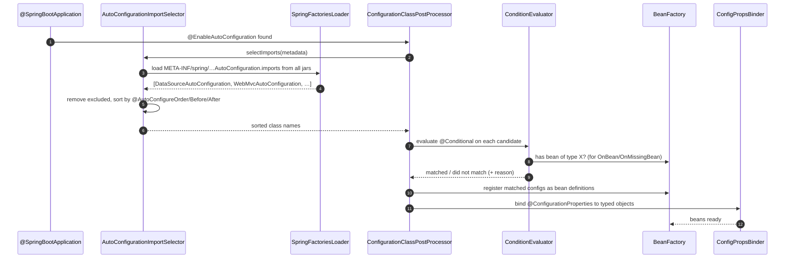
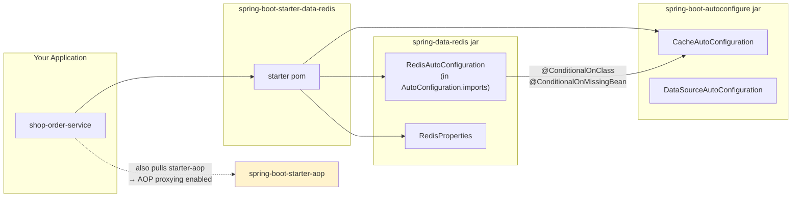

# 02 · Auto-Configuration & Starters

> **Level:** Beginner → Advanced
> **Interview Frequency:** ★★★★★ (Auto-configuration is *the* Spring Boot question)
> **Prerequisite:** [01 · Architecture & Internals](./01-Architecture-and-Internals.md)
> **Last Updated:** 2026

---

## 📋 Table of Contents
- [0. TL;DR — The 30-Second Answer](#0-tldr--the-30-second-answer)
- [1. What & Why](#1-what--why)
- [2. Mental Model — the three gates](#2-mental-model--the-three-gates)
- [3. Deep Dive — Theory](#3-deep-dive--theory)
- [4. Internal Working Mechanism](#4-internal-working-mechanism)
- [5. Step-by-Step Execution Flow](#5-step-by-step-execution-flow)
- [6. Architecture Diagrams](#6-architecture-diagrams)
- [7. Production-Level Use Cases](#7-production-level-use-cases)
- [8. Code Examples — Production-Grade](#8-code-examples--production-grade)
- [9. Common Mistakes & Gotchas](#9-common-mistakes--gotchas)
- [10. Performance Considerations](#10-performance-considerations)
- [11. Security Considerations](#11-security-considerations)
- [12. Best Practices — The Checklist](#12-best-practices--the-checklist)
- [13. Hands-On Exercises](#13-hands-on-exercises)
- [14. Code Challenges](#14-code-challenges)
- [15. Scenario-Based Questions](#15-scenario-based-questions)
- [16. Interview Q&A — Level-wise](#16-interview-qa--level-wise)
- [17. Counter-Questions & Traps](#17-counter-questions--traps)
- [18. Tricky Interview Questions](#18-tricky-interview-questions)
- [19. Follow-Up Questions Asked by Interviewers](#19-follow-up-questions-asked-by-interviewers)
- [20. Real 3–5 Year Experience Scenarios](#20-real-35-year-experience-scenarios)
- [21. Frequently Asked Production Issues](#21-frequently-asked-production-issues)
- [22. Debugging Scenarios](#22-debugging-scenarios)
- [23. Architecture Design Questions](#23-architecture-design-questions)
- [24. Rapid-Fire MCQs](#24-rapid-fire-mcqs)
- [25. Cheat Sheet — One-Page Summary](#25-cheat-sheet--one-page-summary)
- [26. Real-World Production Notes](#26-real-world-production-notes)
- [27. Follow-up Learning](#27-follow-up-learning)

---

## 0. TL;DR — The 30-Second Answer

- **Auto-configuration = "create this bean *if* the user hasn't and the classpath suggests they want it."** Three ingredients: *import selection*, *conditional evaluation*, *property binding*.
- **`@ConditionalOnMissingBean` is the back-off.** It is the mechanism that makes Boot's defaults **reversible** — your bean wins, Boot's steps aside. It matches by **type**, not name.
- **`@ConditionalOnClass` / `@ConditionalOnMissingClass` guard the *classpath*.** This is how a starter supports "with Redis" and "without Redis" in the same jar.
- **Boot 3 registration:** `META-INF/spring/org.springframework.boot.autoconfigure.AutoConfiguration.imports` — **not** `spring.factories` (removed in 3.0).
- **A starter is a POM** (usually with an empty jar) that bundles a curated dependency list *and* the auto-configurations for those dependencies.
- **Ordering matters:** `@AutoConfigureBefore` / `@AutoConfigureAfter` (or `@AutoConfigureOrder`) determines the order in which auto-configurations are evaluated, because `@ConditionalOnBean` is order-sensitive.
- **Auto-configurations must be idempotent and side-effect-free** — they may be evaluated in a context where the user has already defined their own beans.
- **The `ConditionEvaluationReport` (`--debug`) is your debugger.** It tells you exactly why every auto-config matched or was skipped.
- **The biggest real-world trap:** a starter's transitive dependencies drag in auto-configurations you don't want (e.g. `starter-data-jpa` pulls `starter-aop`, `starter-jdbc` → `DataSourceAutoConfiguration`) — so *one* starter can switch on a whole data stack.
- **Professional answer to "is auto-config magic?":** No — it is a **declarative, ordered, inspectable rule set** evaluated against the classpath, the `Environment` and the current `BeanFactory`.

---

## 1. What & Why

### The problem

Every Spring project has the same 30 lines of infrastructure setup. Spring Boot's insight was:
**if 90% of projects need a `DataSource` when `spring-boot-starter-data-jpa` is present, why ask
the 90%?**

The naive fix (a plain "always create a DataSource") breaks the 10% who want a custom one. So
auto-configuration must be **conditional** — and that conditionality is the entire engineering
content of this chapter.

### The analogy — the restaurant kitchen

> A **starter** is a *supplier contract*: "if you order the sushi set, I bring rice, fish, and a
> chef." The **auto-configuration** is the *chef's default plating*: "if rice and fish are on the
> counter and the customer hasn't said how they want it plated, I plate it the standard way."
> The **conditional** is the *check*: "is the ingredient there? has the customer already plated it
> themselves?" If yes → I step back. If no → I plate it.

The key insight for the interview: **the customer (you) always has the last word, and the chef
says out loud what he did and why** (the Condition Evaluation Report).

---

## 2. Mental Model — the three gates

```
                 ┌──────────────────────────────────────────┐
   Gate 1        │  IMPORT SELECTION                        │
   (selection)   │  "Which auto-config classes even apply?" │
                 │  → AutoConfigurationImportSelector       │
                 │  → reads AutoConfiguration.imports       │
                 └───────────────────┬──────────────────────┘
                                     ▼
                 ┌──────────────────────────────────────────┐
   Gate 2        │  CONDITIONAL EVALUATION                 │
   (gating)      │  "Given the classpath, env & beans,      │
                 │   should this class be applied?"         │
                 │  → @ConditionalOnClass / OnMissingBean / │
   (gating)      │    OnProperty / OnBean / OnMissingBean…  │
                 └───────────────────┬──────────────────────┘
                                     ▼
                 ┌──────────────────────────────────────────┐
   Gate 3        │  PROPERTY BINDING                       │
   (configuration)│  "What values do the beans use?"       │
                 │  → @ConfigurationProperties + relaxed    │
                 │    binding + validation                 │
                 └───────────────────┬──────────────────────┘
                                     ▼
                              BEANS IN THE CONTEXT
```

> **Caption:** Every "magic" behaviour in Boot is one of these three gates. If you can name the
> gate, you can debug the behaviour.

---

## 3. Deep Dive — Theory

### 3.1 The `@Conditional` family (Boot's annotations)

| Annotation | Matches when… | Typical use |
|------------|---------------|-------------|
| `@ConditionalOnClass(X.class)` | `X` is on the classpath | "only configure if the SDK is present" |
| `@ConditionalOnMissingClass(X.class)` | `X` is **not** on the classpath | "disable the default when the user replaced it" |
| `@ConditionalOnBean(X.class)` | A bean of type `X` is already registered | "configure B because A exists" |
| `@ConditionalOnMissingBean(X.class)` | No bean of type `X` is registered | **the back-off mechanism** |
| `@ConditionalOnProperty(name, havingValue, matchIfMissing)` | A property has a value | feature flags |
| `@ConditionalOnWebApplication(type=…)` | SERVLET / REACTIVE / ANY | "only in a servlet app" |
| `@ConditionalOnSingleCandidate(X.class)` | Exactly one candidate bean of type `X` | "use the primary one" |
| `@ConditionalOnResource` | A resource (file) exists on the classpath | "if `application.yml` exists" |
| `@ConditionalOnExpression` | A SpEL expression is true | escape hatch — use sparingly |

```java
// Real-world example: configure a Kafka consumer factory ONLY if Kafka is used
// AND the user has not defined their own.
@AutoConfiguration
@ConditionalOnClass(KafkaTemplate.class)
@ConditionalOnMissingBean(KafkaTemplate.class)
@EnableConfigurationProperties(KafkaProperties.class)
public class KafkaAutoConfiguration {

    @Bean
    @ConditionalOnProperty(prefix = "spring.kafka", name = "bootstrap-servers")
    KafkaTemplate<String, Object> kafkaTemplate(KafkaProperties props) {
        return new KafkaTemplate<>(producerFactory(props));
    }
}
```

### 3.2 Why `@ConditionalOnMissingBean` matches by **type**

This trips people up constantly. The evaluation is:

> "Is there a bean **definition** in the current `BeanFactory` whose type is assignable to `X`?"

Not "is there a bean *named* `x`?" and not "is there a bean *instance*?".

```java
@Bean
public DataSource myDataSource() { return new HikariDataSource(); }   // name: myDataSource
```
→ `DataSourceAutoConfiguration` still backs off, because the check is `@ConditionalOnMissingBean(DataSource.class)`
and your bean **is** a `DataSource`.

**Consequence:** you cannot have "the default plus an extra one" of the same type without
expressing the intent (e.g. `@Primary` on yours and a qualifier on the auto-configured one).

### 3.3 The import-selection mechanism

`@EnableAutoConfiguration` → `AutoConfigurationImportSelector` (a `DeferredImportSelector`):

```java
public class AutoConfigurationImportSelector implements DeferredImportSelector {
    @Override
    public String[] selectImports(AnnotationMetadata metadata) {
        // 1. find all "AutoConfigurationImportSelector" candidates declared in
        //    META-INF/spring/org.springframework.boot.autoconfigure.AutoConfiguration.imports
        //    (loaded by SpringFactoriesLoader across ALL jars)
        List<String> configurations = getCandidateConfigurations(...);

        // 2. remove duplicates, sort them
        List<String> sorted = sort(configurations, ...);

        // 3. filter out classes the user excluded via
        //    spring.autoconfigure.exclude  /  @EnableAutoConfiguration(exclude=...)
        return sorted;
    }
}
```

`DeferredImportSelector` matters: it runs **after** all regular configuration classes are parsed, so
that `@ConditionalOnBean` can see the user's own beans. That is exactly why auto-config can back off
from a user bean — the ordering guarantees it.

### 3.4 Auto-configuration ordering

Auto-configurations are not independent — some need another's beans. Ordering is declared with:

```java
@AutoConfiguration(before = DataSourceAutoConfiguration.class)
@AutoConfigureAfter(DataSourceAutoConfiguration.class)
@AutoConfigureOrder(10)     // lower = earlier
```

`AutoConfigurationSorter` builds a graph using:
1. `@AutoConfigureBefore` / `@AutoConfigureAfter` (explicit, wins)
2. `@AutoConfigureOrder` (numeric hint)
3. `META-INF/spring-autoconfigure-metadata.properties` (optional, for third-party libraries)

**The critical subtlety:** `@ConditionalOnBean` / `@ConditionalOnMissingBean` are evaluated **in
order**. If `MyAutoConfiguration` has `@ConditionalOnBean(DataSource.class)` but is evaluated
*before* `DataSourceAutoConfiguration`, it will **not** match — because at that moment no
`DataSource` bean is registered yet.

> 💡 This is why the Boot team is strict: "auto-configurations must not depend on the *order* of
> other auto-configurations unless they declare it explicitly."

### 3.5 Property binding

`@ConfigurationProperties` binds external config to a typed object.

```java
@ConfigurationProperties(prefix = "shop")
public record ShopProperties(String name, Duration timeout, boolean enabled) {}
```

**Relaxed binding** (the rules that always come up):

| Written in `application.yml` | Bound to |
|---------------------------|-----------|
| `shop.timeout-seconds` | `Duration` → `timeoutSeconds` (value 30 → 30s) |
| `shop.timeout` | `Duration` → `timeout` (value `30s`) |
| `SHOP_TIMEOUT` (env var) | `shop.timeout` |
| `shop.timeout` | `timeout` |
| `shop."timeout"` | `timeout` (quotes needed for special chars) |
| `shop.timeout` | `timeout` |

Rules: **kebab-case** in YAML, **camelCase** in Java. Environment variables use `SPRING_DATASOURCE_URL`
style (uppercase, `_` for `.`). Placeholders work: `url: ${DB_HOST:localhost}:5432/shop`.

**Binding vs. `@Value`:**

| | `@Value` | `@ConfigurationProperties` |
|---|---|---|
| Type safety | String → you parse it | Typed, converted by the `ConversionService` |
| Validation | None (unless you add `@Validated` on the class) | `@Validated` + JSR-380 → **fails at startup** |
| IDE support | None | Full metadata + completion |
| Relaxed binding | No | Yes |
| Multiple properties | Repetitive | One object, one prefix |
| Collections/maps | Awkward | Natural (`Map<String, PaymentProvider>`) |
| Reload at runtime | No | Yes, with `@RefreshScope` (Spring Cloud) |

### 3.6 What exactly is a "starter"?

```xml
<!-- spring-boot-starter-data-jpa (simplified) -->
<dependencies>
  <dependency><groupId>org.springframework.boot</groupId>
    <artifactId>spring-boot-starter-aop</artifactId></dependency>
  <dependency><groupId>org.springframework.boot</groupId>
    <artifactId>spring-boot-starter-jdbc</artifactId></dependency>
  <dependency><groupId>org.springframework.boot</groupId>
    <artifactId>spring-boot-starter-validation</artifactId></dependency>
  <dependency><groupId>jakarta.persistence</groupId>
    <artifactId>jakarta.persistence-api</artifactId></dependency>
  <dependency><groupId>org.hibernate.orm</groupId>
    <artifactId>hibernate-core</artifactId></dependency>
  <dependency><groupId>org.springframework.data</groupId>
    <artifactId>spring-data-jpa</artifactId></dependency>
</dependencies>
```

Three things a starter does:
1. **Curates the dependency set** with versions managed by the Boot BOM.
2. **Brings in the auto-configurations** transitively (via the library jars' own `imports` files).
3. **Optionally brings an auto-configuration of its own** (e.g. `spring-boot-starter-actuator`).

> ⚠️ **The trap:** `starter-data-jpa` → `starter-aop` + `starter-jdbc`. So adding JPA to one service
> silently enables `DataSourceAutoConfiguration`, `HibernateJpaAutoConfiguration` **and** AOP proxying
> everywhere. In a shared library, this is how a "read-only reporting" service ends up needing a
> `DataSource` it never configured.

---

## 4. Internal Working Mechanism

### 4.1 End-to-end auto-configuration flow



### 4.2 The `ConditionEvaluationReport` data model

```java
public class ConditionEvaluationReport {
    private final Map<String, ConditionEvaluationReport> parentReports;
    private final ConditionEvaluationReportUnfiltered unfiltered;
    private final Map<String, List<ConditionEvaluationReport>> evaluationReports;
    //  ↑ keyed by "source" — the auto-config class or the @Bean method
}
```

Each entry records:
- `matched` / `notMatched`
- `outcomes` — each condition's message, e.g.
  `@ConditionalOnClass (org.springframework.web.servlet.DispatcherServlet) found`
- `exceptions` — if the condition itself threw

**How to read it in production:**

```bash
java -jar app.jar --debug 2>&1 | sed -n '/CONDITIONS EVALUATION REPORT/,/^$/p' > conditions.txt

# "Is my auto-config active?"
grep -A3 "MyAutoConfiguration" conditions.txt

# "Why is DataSource not created?"
grep -A8 "DataSourceAutoConfiguration" conditions.txt   # look under "Negative matches"
```

### 4.3 What the auto-config actually registers

For `DataSourceAutoConfiguration` (Boot 3.3) the chain is:

```text
DataSourceAutoConfiguration
  @ConditionalOnClass({ DataSource.class, EmbeddedDatabaseType.class })
  @ConditionalOnMissingBean(type = "io.r2dbc.spi.ConnectionFactory")
  @EnableConfigurationProperties(DataSourceProperties.class)

  ├─ PooledDataSourceConfiguration
  │    @Conditional(PooledDataSourceCondition.class)   // a pooling DataSource is available
  │    @ConditionalOnMissingBean({ DataSource.class, XADataSource.class })
  │    └─ Hikari (if HikariCP is on the classpath)
  │         @ConditionalOnMissingBean(HikariDataSource.class)  ← per-implementation back-off
  ├─ EmbeddedDatabaseConfiguration
  │    @ConditionalOnMissingBean(type="io.r2dbc.spi.ConnectionFactory")
  │    @Conditional(EmbeddedDatabaseCondition.class)   // no URL configured
  │    └─ H2/HSQL/Derby in-memory
  └─ DataSourceInitializationConfiguration
       → runs `DataSourceInitializer` (schema.sql / data.sql) and `DatabaseInitializationDependencyConfigurer`
```

> **Caption:** Note the **nested** `@ConditionalOnMissingBean` — the auto-config is a *tree* of
> decisions, and the report shows you exactly which branch was taken. This is also why the
> *order of evaluation* matters, and why `DataSourceProperties` (`spring.datasource.*`) is bound
> and used to decide between pooled vs embedded.

---

## 5. Step-by-Step Execution Flow

### 5.1 "I added `spring-boot-starter-data-redis`. What happens?"

```
1. Maven resolves lettuce-core, spring-data-redis, spring-boot-starter-aop.
2. At runtime, SpringFactoriesLoader scans every jar for
   META-INF/spring/org.springframework.boot.autoconfigure.AutoConfiguration.imports
3. It finds:
     - org.springframework.boot.autoconfigure.data.redis.RedisAutoConfiguration
     - org.springframework.boot.autoconfigure.data.redis.RedisRepositoriesAutoConfiguration
4. AutoConfigurationSorter places RedisAutoConfiguration after DataSourceAutoConfiguration
   (because @AutoConfigureAfter) and after CacheAutoConfiguration.
5. Condition evaluation:
     @ConditionalOnClass(RedisOperations.class)            → PASS
     @ConditionalOnMissingBean(RedisTemplate.class)        → PASS (no user bean)
     @ConditionalOnProperty("spring.data.redis.host")     → PASS
6. Beans registered:
     RedisConnectionFactory (LettuceConnectionFactory)
     RedisTemplate<Object,Object> / StringRedisTemplate
     RedisCacheManager (from CacheAutoConfiguration)
7. @ConfigurationProperties binding:
     RedisProperties ← spring.data.redis.*  (host, port, password, timeout, ssl…)
8. If the user had defined their own RedisConnectionFactory → step 5's
   @ConditionalOnMissingBean would FAIL → auto-config backs off.
```

### 5.2 Writing your own auto-configuration — the 8 steps

```
1. Create the properties class       → @ConfigurationProperties(prefix="shop.payments")
2. Create the auto-config class       → @AutoConfiguration
3. Add @ConditionalOnClass            → only if your SDK is present
4. Add @ConditionalOnMissingBean      → so users can override
5. Add @EnableConfigurationProperties → bind the properties
6. Declare ordering                   → @AutoConfigureAfter(X.class) if you depend on X
7. Register in the imports file       → META-INF/spring/…AutoConfiguration.imports
8. Write an ApplicationContextRunner test for the "applied" and "backed off" cases
```

---

## 6. Architecture Diagrams

### 6.1 How a starter pulls in an auto-configuration



> **Caption:** The yellow box is the hidden cost — a starter can switch on capabilities
> (`@Transactional`, `@Async`, `@Cacheable`) in services that never intended to have them.

### 6.2 The condition decision tree for one bean

```text
@Bean
@ConditionalOnClass(RedisOperations.class)
@ConditionalOnMissingBean(RedisTemplate.class)
@ConditionalOnProperty(name = "spring.data.redis.enabled", matchIfMissing = true)
RedisTemplate<String,String> redisTemplate(RedisConnectionFactory cf) { ... }
```

```text
                        ┌──────────────────────────┐
                        │ Is RedisOperations on    │
                        │ the classpath?          │
                        └───────┬──────────┬───────┘
                          NO   │          │ YES
                   ┌────────────┘          └────────────┐
                   ▼                                   ▼
            SKIP (no class)               ┌──────────────────────┐
                                           │ Does a user-defined │
                                           │ RedisTemplate exist? │
                                           └────┬──────────┬──────┘
                                          YES   │          │ NO
                            ┌────────────────────┘          └──────────────┐
                            ▼                                          ▼
                     SKIP (back-off)              ┌──────────────────────────┐
                                                │ Is spring.data.redis.    │
                                                │ enabled=true?            │
                                                └────┬──────────────┬──────┘
                                                 NO │              │ YES
                            ┌────────────────────────┘              ▼
                            ▼                              ┌──────────────┐
                     SKIP (property)                        │ REGISTER BEAN │
                                                         └──────────────┘
```

> **Caption:** All conditions must pass. A single failure skips the bean — and the report records
> *which* one failed and why.

### 6.3 What a starter actually contains

```text
spring-boot-starter-data-redis/
 ├── pom.xml                        ← the dependency list (versions from the Boot BOM)
 └── src/main/resources/
      └── META-INF/spring/
           └── org.springframework.boot.autoconfigure.AutoConfiguration.imports
                └── (usually empty — the auto-config lives in the spring-data-redis jar)

spring-data-redis/
 ├── pom.xml
 └── src/main/resources/META-INF/spring/
      └── org.springframework.boot.autoconfigure.AutoConfiguration.imports
           └── org.springframework.boot.autoconfigure.data.redis.RedisAutoConfiguration
```

---

## 7. Production-Level Use Cases

| Scenario | How auto-config is used | The trap |
|----------|------------------------|----------|
| **Multi-tenant SaaS** | A custom `TenantAutoConfiguration` that creates a `TenantContext` holder + a `TenantFilter` only when `shop.multi-tenant.enabled=true` | The tenant filter is registered in the **security filter chain**, but if the chain is redefined by the app, the filter is silently dropped |
| **Payments platform** | A `PaymentAutoConfiguration` exposing `PaymentGateway` beans per provider, chosen by `shop.payments.provider` | Using `@ConditionalOnProperty(havingValue=…)` for each provider is fine, but a `Map<String, PaymentGateway>` built from all beans is the more flexible design |
| **Feature flags** | `@ConditionalOnProperty` gates whole modules (new pricing engine) behind a flag | Flags checked at *startup* are not runtime flags — a flag flip needs a restart. Use a config server + `@RefreshScope` for runtime changes |
| **Legacy coexistence** | Exclude `DataSourceAutoConfiguration` while the legacy XML defines the datasource | Then you must also exclude `JpaRepositoriesAutoConfiguration` and the `FlywayAutoConfiguration`, or the app fails with "no DataSource" |
| **Library authors** | Ship a starter so customers get 1 dependency + 0 config | If the starter's auto-config has a `@Bean` without `@ConditionalOnMissingBean`, it will **conflict** with the customer's own bean → `BeanDefinitionOverrideException` |
| **Testing** | `ApplicationContextRunner` tests the auto-config in isolation, without booting the whole app | Forgetting the "user bean present" test case → the override path is untested and breaks in prod |

### Production patterns

```java
// ✅ A robust third-party-style auto-configuration
@AutoConfiguration
@ConditionalOnClass({ RedisTemplate.class, RedisConnectionFactory.class })
@ConditionalOnMissingBean(RedisTemplate.class)
@EnableConfigurationProperties(ShopRedisProperties.class)
@AutoConfigureAfter({ RedisAutoConfiguration.class, CacheAutoConfiguration.class })
public class ShopRedisAutoConfiguration {

    @Bean
    @ConditionalOnProperty(prefix = "shop.redis", name = "enabled", havingValue = "true", matchIfMissing = true)
    RedisTemplate<String, Object> shopRedisTemplate(
            RedisConnectionFactory cf,
            ShopRedisProperties props) {
        RedisTemplate<String, Object> template = new RedisTemplate<>();
        template.setConnectionFactory(cf);
        template.setKeySerializer(props.keySerializer());
        template.setValueSerializer(props.valueSerializer());
        template.afterPropertiesSet();
        return template;
    }
}
```

---

## 8. Code Examples — Production-Grade

### 8.1 Properties class with validation (the modern way)

```java
@ConfigurationProperties(prefix = "shop.payments")
@Validated                                   // ← enables JSR-380 validation on binding
public record PaymentProperties(

        @NotBlank
        String provider,                     // ← validated at STARTUP, not at request time

        @NotNull
        URI endpoint,

        @NotNull
        @DurationMin(seconds = 1)
        Duration timeout,                    // ← DurationMin: at least 1 second

        @Min(0) @Max(5)
        int maxRetries,

        @DefaultValue("true")
        boolean sandbox,

        @DefaultValue("USD")
        Currency currency
) {
    public PaymentProperties {
        if (maxRetries > 3 && sandbox) {
            // Business-rule validation in the compact constructor
            throw new IllegalArgumentException("sandbox allows at most 3 retries");
        }
    }
}
```

```java
// ✅ Enable it without listing every properties class
@SpringBootApplication
@ConfigurationPropertiesScan
public class ShopApplication { }
```

```java
// ❌ The old way — must list every class explicitly
@EnableConfigurationProperties({PaymentProperties.class, OrderProperties.class, /* ... */})
```

### 8.2 The three ways to declare a property, compared

```java
// ① @Value — simple, untyped, no validation
@Value("${shop.payments.timeout:PT30S}")
Duration timeout;

// ② @ConfigurationProperties — the professional choice
@ConfigurationProperties(prefix = "shop.payments")
public record PaymentProperties(Duration timeout) {}

// ③ @ConfigurationProperties + @Value on a nested record (rare, but legal)
@ConfigurationProperties(prefix = "shop.payments")
public record PaymentProperties(@Value("${shop.payments.timeout}") Duration timeout) {}
```

### 8.3 A full `ApplicationContextRunner` test for an auto-configuration

```java
class PaymentAutoConfigurationTest {

    private final ApplicationContextRunner runner = new ApplicationContextRunner()
            .withConfiguration(AutoConfigurations.of(PaymentAutoConfiguration.class));

    @Test
    void backsOffWhenUserDefinesTheirOwnGateway() {
        runner.withUserConfiguration(UserGatewayConfig.class)
              .run(context -> {
                  assertThat(context).hasSingleBean(PaymentGateway.class);
                  assertThat(context.getBean(PaymentGateway.class))
                          .isInstanceOf(MyOwnGateway.class);   // ← user's bean wins
              });
    }

    @Test
    void createsStripeGatewayWhenProviderIsStripe() {
        runner.withPropertyValues("shop.payments.provider=stripe",
                                  "shop.payments.endpoint=https://api.stripe.com")
              .run(context -> {
                  assertThat(context).hasSingleBean(StripePaymentGateway.class);
                  PaymentProperties props = context.getBean(PaymentProperties.class);
                  assertThat(props.provider()).isEqualTo("stripe");
              });
    }

    @Test
    void failsFastWhenRequiredPropertyIsMissing() {
        runner.withPropertyValues("shop.payments.endpoint=https://api.stripe.com")
              .run(context -> {
                  assertThat(context).hasFailed();
                  assertThat(context.getStartupFailure())
                      .hasMessageContaining("provider");   // ← clear, actionable message
              });
    }

    @Test
    void backsOffEntirelyWhenSdkIsNotOnClasspath() {
        new ApplicationContextRunner()
            .withConfiguration(AutoConfigurations.of(PaymentAutoConfiguration.class))
            .withClassLoader(new FilteredClassLoader(PaymentGateway.class))
            .run(context -> assertThat(context).doesNotHaveBean(PaymentGateway.class));
    }

    @Configuration(proxyBeanMethods = false)
    static class UserGatewayConfig {
        @Bean
        PaymentGateway myOwnGateway() { return new MyOwnGateway(); }
    }
}
```

> **Caption:** The `FilteredClassLoader` trick is the professional way to test the
> `@ConditionalOnClass` path — it simulates a classpath without the SDK.

### 8.4 Reading the condition report programmatically

```java
@Component
public class ConditionReportLogger implements ApplicationRunner {

    private final ConfigurableApplicationContext ctx;

    public ConditionReportLogger(ConfigurableApplicationContext ctx) { this.ctx = ctx; }

    @Override
    public void run(ApplicationArguments args) {
        ConditionEvaluationReport report =
                ConditionEvaluationReport.get(ctx.getBeanFactory());
        if (report == null) return;

        report.getConditionAndOutcomesBySource().forEach((source, outcomes) -> {
            boolean matched = outcomes.stream().anyMatch(ConditionEvaluationReport.ConditionOutcome::isMatch);
            log.info("{} -> {}", matched ? "APPLIED " : "SKIPPED ", source);
        });
    }
}
```

---

## 9. Common Mistakes & Gotchas

| # | ❌ Wrong | ✅ Right | Why |
|---|----------|----------|-----|
| 1 | Registering the auto-config in `META-INF/spring.factories` | `META-INF/spring/org.springframework.boot.autoconfigure.AutoConfiguration.imports` | Boot 3 removed the `spring.factories` auto-config key |
| 2 | A `@Bean` in an auto-config **without** `@ConditionalOnMissingBean` | Always add it | Otherwise the user's own bean collides → `BeanDefinitionOverrideException` |
| 3 | `@ConditionalOnMissingBean` expecting a *name* match | It matches by **type** | Name matching is a different, rarely-correct semantic |
| 4 | `@ConditionalOnBean` without declaring `@AutoConfigureAfter` | Declare the ordering explicitly | `@ConditionalOnBean` is evaluated in order — it can miss a bean that will exist later |
| 5 | `@Value("${app.timeout}")` expecting a `Duration` | `@Value("${app.timeout:30s}")` or use `@ConfigurationProperties` | `@Value` does **not** apply `Duration` conversion unless the suffix is present |
| 6 | Putting `spring.datasource.url` in `application.yml` committed to Git | Env var / Secret | Credentials in Git |
| 7 | Assuming a starter adds no behaviour | Assume a starter can switch on whole subsystems | `starter-data-jpa` → AOP + JDBC + DataSource auto-config |
| 8 | `@ConditionalOnProperty` with `matchIfMissing=true` for a **destructive** feature | `matchIfMissing=false` for anything that writes | A missing property should never enable a risky behaviour |
| 9 | Overriding an auto-config by using the **same bean name** | Define the bean; let `@ConditionalOnMissingBean` back off | Name collisions throw unless `allow-bean-definition-overriding=true` |
| 10 | Reloading `application.yml` at runtime and expecting `@Value` to update | `@ConfigurationProperties` + `@RefreshScope` (Spring Cloud) | `@Value` is resolved once at injection time |
| 11 | Using `@ConditionalOnExpression` with a complex SpEL | Use explicit `@ConditionalOnProperty`/`@ConditionalOnBean` | SpEL conditions are evaluated at startup, are hard to test, and hide intent |
| 12 | Putting a `@Component` class in the auto-config jar | Auto-configs are `@Configuration` classes, not components | Component scanning of auto-config jars is not how Boot works |

---

## 10. Performance Considerations

| Aspect | Impact | Guidance |
|--------|--------|----------|
| **Condition evaluation** | ~140 auto-config classes evaluated at startup; each condition does classpath/resource lookups | 50–150 ms total. Exclude unused auto-configs to speed it up |
| **Property binding** | Each `@ConfigurationProperties` creates a binder + validator | Negligible, but hundreds of properties classes add tens of ms |
| **`@ConditionalOnClass` on a class that is *not* present** | Uses `ClassUtils.isPresent` → `Class.forName` with `initialize=false` — cheap but not free | Fine; but note `@ConditionalOnClass` on a class **not** on the classpath requires the annotation value to be a `Class` reference, which is why the class must be isolated in a separate `@Configuration` class to avoid `NoClassDefFoundError` |
| **AOT / native image** | Conditions are evaluated at **build time** in AOT mode | Use `@ConditionalOnBean`/`@ConditionalOnMissingBean` conservatively — AOT records the result at build time |
| **Runtime property refresh** | `@RefreshScope` destroys and re-creates beans | Expensive; use sparingly, prefer a config-server push to specific beans |

**Startup budget cheat-sheet (3–5 yr):**
```
1.5 s  JVM + classpath
0.3 s  auto-config evaluation
0.8 s  bean instantiation (DB connect, migrations)
0.3 s  Tomcat
------
3.0 s  target
```

---

## 11. Security Considerations

| Risk | Mitigation |
|------|-----------|
| **Auto-configured `SecurityFilterChain` with a generated password** | Always define your own `SecurityFilterChain` bean; Boot backs off when you do |
| **A starter auto-configuring a client with insecure defaults** (e.g. `verify=false`, `ssl=false`) | Audit starter properties; set secure defaults in `application.yml` for every service |
| **Secrets bound from properties** | Use `${ENV_VAR}` placeholders, K8s Secrets, or Vault; never literal values |
| **A starter exposing an endpoint** (e.g. a debug/management endpoint) | Review the starter's `WebMvcAutoConfiguration` additions; restrict via security config |
| **`@ConditionalOnProperty` used as a security control** | A property can be overridden by an env var — **never** gate authentication on a property. Use real authentication |
| **Classpath leakage through the `AutoConfiguration.imports`** | Not a direct risk, but a starter that pulls in an SDK also pulls its CVEs — audit transitive dependencies |
| **Actuator `conditions` endpoint** | `/actuator/conditions` reveals which auto-configs matched → useful recon for an attacker. Restrict it |

---

## 12. Best Practices — The Checklist

- [ ] Every `@Bean` in an auto-config has `@ConditionalOnMissingBean`.
- [ ] Every auto-config has `@ConditionalOnClass` for the classes it needs.
- [ ] Use `@AutoConfiguration` (Boot 3) + `@AutoConfigureAfter/Before` for ordering.
- [ ] Put properties in a `@ConfigurationProperties` **record** with `@Validated` + JSR-380 constraints.
- [ ] Bind with `@ConfigurationPropertiesScan`, not a growing list of `@EnableConfigurationProperties`.
- [ ] Never use `@Value` for anything but a single constant.
- [ ] Write an `ApplicationContextRunner` test for **each** auto-config: applied, backed-off, and
      missing-required-property cases.
- [ ] Document every property you add in `additional-spring-configuration-metadata.json`.
- [ ] Use `matchIfMissing = false` for anything that mutates data or calls an external system.
- [ ] Audit transitive starters: `mvn dependency:tree` and know which auto-configs you switched on.
- [ ] Keep `spring.autoconfigure.exclude` documented in the README when you use it.
- [ ] Prefer **exclusion of a starter** over exclusion of an auto-config when you don't need the feature.

---

## 13. Hands-On Exercises

**🧪 Lab 1 — Break the back-off**
1. Add `spring-boot-starter-data-jpa` with an H2 datasource.
2. Define your own `DataSource` bean pointing at a different URL.
3. Start with `--debug` → search `DataSourceAutoConfiguration` → confirm it is under **Negative
   matches** with `@ConditionalOnMissingBean (DataSource) did not find any bean`.
4. Rename your bean to `myDataSource` and repeat → **still backed off** (matches by type).

**✅ Success signal:** You can state the rule and predict the report before running.

**🧪 Lab 2 — Ordering sensitivity**
1. Write two auto-configs, `A` with `@ConditionalOnBean(DataSource.class)` and `B` that creates the
   `DataSource`, and put `A` **before** `B` in the imports file.
2. Start → `A` is skipped (no `DataSource` yet).
3. Add `@AutoConfigureAfter(B.class)` to `A` → `A` now matches.

**✅ Success signal:** You can explain why the *order of evaluation* changed the outcome.

**🧪 Lab 3 — Write your own starter**
1. Create a multi-module Maven project: `shop-starter-payments` (the starter POM) and
   `shop-payments-core` (the library + auto-config + `AutoConfiguration.imports`).
2. Consume it in a demo app: **one dependency, zero `@Configuration` classes**.
3. Add a `shop.payments.provider` property and verify the right bean is created.
4. Add the "user defines their own gateway" test with `ApplicationContextRunner`.

**✅ Success signal:** The demo app has no auto-config awareness at all.

---

## 14. Code Challenges

### Challenge 1 — A "feature toggle" auto-config (medium)
**Goal:** Create a `FeatureToggleAutoConfiguration` that registers a `FeatureToggle` bean only when
`shop.features.enabled=true`, backed by a `Map<String, Boolean>` bound from `shop.features.flags.*`.

**Test cases:**
- `shop.features.enabled` absent → no `FeatureToggle` bean, app still starts.
- `shop.features.enabled=true` and `shop.features.flags.new-checkout=true` → `toggle.isEnabled("new-checkout")` is `true`.
- Unknown flag → `false` (never throw).

### Challenge 2 — Conditional bean graph (hard)
**Goal:** Configure a `NotificationSender` for each enabled channel (email, SMS, push). Each channel
is optional and gated by a property; the app must start with **any subset** of channels enabled.

**Hints:** use a `Map<String, NotificationSender>` built by injecting `List<NotificationSender>` —
do **not** use `@ConditionalOnProperty` per channel with hard-coded bean names, because that
prevents extensions.

### Challenge 3 — Auto-config audit test (medium)
**Goal:** Write a test that boots the **real** application context and asserts that a curated list
of auto-configurations is active, failing the build if a dependency upgrade silently disables them
(e.g. `TransactionAutoConfiguration`, `JacksonAutoConfiguration`, `WebMvcAutoConfiguration`).

**Hint:** `assertThat(context).hasSingleBean(...)` from `AssertableApplicationContext`, or inspect
`ConditionEvaluationReport`.

---

## 15. Scenario-Based Questions

**S1.** *A teammate added `spring-boot-starter-data-elasticsearch` to fix a search feature. Now the
service requires a `DataSource` at startup and fails to boot in the test environment, which has no
database. How do you fix it without removing the search dependency?*

> **Expected answer:** Trace it. `starter-data-elasticsearch` → `starter-data-jpa`? No — but it does
> pull `spring-boot-starter-json`, and depending on the version it may pull `spring-boot-starter-jdbc`
> or `starter-aop`. The failure is `DataSourceAutoConfiguration` matching (because
> `javax.sql.DataSource`/`jakarta.sql.DataSource` is on the classpath) and then
> `DataSourceProperties` requiring a URL, or `HibernateJpaAutoConfiguration` requiring an
> `EntityManagerFactory`.
> Fixes, in order of preference: (1) exclude the auto-config you don't need:
> `spring.autoconfigure.exclude=org.springframework.boot.autoconfigure.jdbc.DataSourceAutoConfiguration`
> (and `DataSourceTransactionManagerAutoConfiguration`, `JooqAutoConfiguration`, `HibernateJpaAutoConfiguration`);
> (2) if you need the dependency but not the data stack, use the **core** artifact instead of the
> starter (e.g. `spring-data-elasticsearch` + `elasticsearch-java` rather than the starter);
> (3) in tests, set `spring.autoconfigure.exclude` in the test properties.
> **The lesson:** starters carry *subsystem* implications; always inspect `mvn dependency:tree` and
> the condition report before adding one.

**S2.** *You want to roll out a new pricing engine to 10% of traffic, controlled by a property, and
flip it without a redeploy. Your auto-config uses `@ConditionalOnProperty`. What is wrong?*

> **Expected answer:** `@ConditionalOnProperty` is evaluated **once, at startup**. Changing the
> property at runtime does nothing — the bean set is fixed until restart. That contradicts the
> requirement.
> The right design: always register the engine behind a **runtime** abstraction, e.g.
> `PricingEngine` with two implementations, and choose between them with a `PricingEngineSelector`
> that reads a **dynamic** source (a feature-flag service, a Redis key, a config-server property
> with `@RefreshScope`). Use `@ConditionalOnProperty` only for things that legitimately require a
> restart (a different bean *shape*, a different connection pool).

**S3.** *A third-party library ships an auto-configuration that creates a `RestClient` with its own
`ObjectMapper`, ignoring your customised one (custom `LocalDateTime` format, snake_case naming).
Your tests pass; production responses are wrong. Why did tests pass?*

> **Expected answer:** In your test, the library's auto-config probably **did not match** (e.g. the
> SDK class wasn't on the test classpath, or a `@Profile` excluded it), or your custom `ObjectMapper`
> was not registered in the test slice. The condition report differs between environments.
> Fix: (1) make sure the auto-config is exercised in tests (`ApplicationContextRunner` with the
> same properties as prod); (2) make the library's auto-config **depend on** `ObjectMapper` rather
> than create one; if you can't change the library, define an `ObjectMapper` bean with
> `@Primary` and/or exclude its auto-config.

---

## 16. Interview Q&A — Level-wise

### 🟢 Beginner
**Q: What is a starter and what does it contain?**
**A:** A starter is a pre-packaged Maven/Gradle dependency bundle. It contains (a) a POM with a
curated list of dependencies with versions managed by the Boot BOM, (b) usually an empty jar, and
(c) transitively the auto-configurations for those libraries. It lets you add a whole capability
with one dependency line.

**Q: What does `@ConditionalOnMissingBean` do?**
**A:** It makes a bean definition conditional on the absence of any existing bean of the given type.
If the user already defined one, the auto-configured bean is skipped. This is how Spring Boot's
defaults are "reversible".

**Q: How do you exclude an auto-configuration?**
**A:** `spring.autoconfigure.exclude=org.springframework.boot.autoconfigure.jdbc.DataSourceAutoConfiguration`
in properties, or `@SpringBootApplication(exclude = DataSourceAutoConfiguration.class)`.

### 🟡 Intermediate
**Q: Explain the auto-configuration mechanism in detail.**
**A:** `@EnableAutoConfiguration` imports `AutoConfigurationImportSelector`, which reads
`META-INF/spring/org.springframework.boot.autoconfigure.AutoConfiguration.imports` from every jar on
the classpath, collects candidate classes, removes user-excluded ones, and sorts them using
`@AutoConfigureBefore/After/Order`. Each candidate is then evaluated: `@ConditionalOnClass` checks
the classpath, `@ConditionalOnMissingBean` checks the `BeanFactory` for existing definitions,
`@ConditionalOnProperty` checks the `Environment`. Matching classes are registered as configuration
classes; their `@Bean` methods become `BeanDefinition`s. Finally, `@ConfigurationProperties` classes
are bound from the `Environment` with relaxed binding and validation.

**Q: Why are auto-configurations ordered?**
**A:** Because `@ConditionalOnBean` and `@ConditionalOnMissingBean` are evaluated in sequence. If
`A` requires a bean that `B` creates, `A` must be evaluated after `B`, otherwise the condition
fails. Ordering is declared with `@AutoConfigureAfter`/`@AutoConfigureBefore`, or numerically with
`@AutoConfigureOrder`. The `AutoConfigurationSorter` builds a dependency graph and applies a
deterministic topological sort.

**Q: `@Value` vs `@ConfigurationProperties`?**
**A:** `@Value` injects a single value as a String with limited conversion and no validation, and
it is resolved once at injection time. `@ConfigurationProperties` binds a whole prefix into a typed
object, supports relaxed binding (so `MY_SERVICE_URL` maps to `my.service.url`), supports JSR-380
validation that fails the app at startup, and gives IDE completion from the configuration metadata.

**Q: How do you debug a bean that isn't being created?**
**A:** Start with `--debug` to get the `ConditionEvaluationReport`; find your auto-configuration in
the report and read the exact reason under *Negative matches* — usually a missing class, a missing
property, or an existing user bean. Then check the component-scan root and the active profiles.

### 🔴 Advanced / Senior
**Q: You're writing a starter. How do you guarantee it never breaks a customer app?**
**A:** (1) Every `@Bean` gets `@ConditionalOnMissingBean`. (2) Every class you touch is guarded by
`@ConditionalOnClass`, and classes you reference that may be absent are isolated in their own
configuration class. (3) Use `@AutoConfigureAfter` for anything you depend on. (4) Never set a
*default* for a property that has a security or data-integrity implication — use
`matchIfMissing=false`. (5) Provide `additional-spring-configuration-metadata.json` so the IDE
documents your properties. (6) Test with `ApplicationContextRunner` for the applied, back-off, and
missing-class paths. (7) Do not use `@PostConstruct` side effects; use `InitializingBean` or
`SmartLifecycle` so the lifecycle is predictable. (8) Do not depend on a *specific* library version
in your starter's POM beyond what the BOM provides.

**Q: How does the `ConditionEvaluationReport` interact with AOT (native image)?**
**A:** In AOT mode, conditions are evaluated at **build time** during the AOT processing phase, and
the *result* is baked into the native image. That means a condition that depends on the runtime
environment (e.g. a property that differs between build and run) is baked incorrectly. Boot's
guidance: avoid runtime-dependent conditions in auto-configurations intended for native images, and
prefer `@ConditionalOnProperty` with values fixed at build time, or use runtime checks in the
application code rather than in conditions.

**Q: Why did the Boot team move auto-configuration registration out of `spring.factories`?**
**A:** `spring.factories` was doing too many jobs (auto-config, listeners, environment
post-processors, failure analyzers), and it had no ordering information and no metadata support.
The dedicated `AutoConfiguration.imports` file is a single-purpose, well-defined extension point
that supports per-class ordering metadata and the `spring-autoconfigure-metadata.properties`
optimisation. It also allows the file to be processed by the AOT/native tooling.

### ⚫ Expert / Principal
**Q: Design the auto-configuration strategy for a company-wide shared starter used by 40 services.**
**A:** (1) **Scope it**: the starter must contain *no* business logic — only infrastructure
(plumbing, observability, error handling, security primitives). (2) **Own the dependency graph**:
publish with the Boot BOM; expose a `platform-bom` so all services align versions. (3) **Namespace
your properties** (`acme.platform.*`) and publish configuration metadata. (4) **Make every bean
overridable** with `@ConditionalOnMissingBean` and `@ConditionalOnSingleCandidate`. (5) **Auto-config
must be idempotent** and must not require the user to define anything. (6) **Version & deprecate**
with semantic versioning; publish a migration guide; never break a property name in a minor
release. (7) **Test matrix**: a `ApplicationContextRunner` suite that boots against N different
service shapes (with/without JPA, with/without WebFlux). (8) **Guardrail against a distributed
monolith**: monitor how often the starter changes; if it changes weekly, it's absorbing business
logic — split it.

---

## 17. Counter-Questions & Traps

### CQ1. "If auto-configuration handles everything, why do we still write `@Bean` methods?"
- **Naive answer:** "For custom behaviour."  ← incomplete
- **The trap:** The real reason is that auto-configuration handles the **infrastructure default**;
  your `@Bean` handles the **business decision**. Mixing them is the mistake.
- **Expert answer:** Use auto-config for "give me a sane `DataSource`" and explicit `@Bean` for
"my `DataSource` must point at the read replica with a 5 s timeout". If you find yourself
overriding 10 auto-configured beans, your app is fighting the framework — either exclude the
auto-config entirely or reconsider the design.

### CQ2. "Is `@ConditionalOnMissingBean` a guarantee that my bean wins?"
- **Naive answer:** "Yes, always."  ← almost, but not quite
- **The trap:** It only works if your bean is registered **before** the auto-configuration is
  evaluated. That is guaranteed for *user* configuration classes (Boot processes them first), but
  **not** between two auto-configurations — the ordering rules apply there.
- **Expert answer:** User beans always win over auto-configured beans because the auto-config
import is a `DeferredImportSelector` that runs after user configuration is parsed. Between two
auto-configs, you must declare `@AutoConfigureBefore/After` — and the condition report will show
you which way it went.

### CQ3. "Why is my `@ConditionalOnProperty` not matching even though the property is set?"
- **Naive answer:** "The property name is wrong."  ← maybe
- **The trap:** `havingValue` is **case-sensitive** and compared literally; `matchIfMissing`
  defaults to `false`; and the property may be *overridden* by a higher-precedence source.
- **Expert answer:** Check three things: (1) exact name and `havingValue` string; (2) the
`ConditionEvaluationReport` shows the *actual* property value the condition saw; (3) precedence —
an env var may override your YAML. The report's `outcomes` message includes the property value, so
read it rather than guessing.

### CQ4. "Can I use `@ConditionalOnClass` on a class that might not be present?"
- **Naive answer:** "Yes, just annotate it."  ← dangerous
- **The trap:** If the annotated class is missing, the JVM may fail to load the configuration class
  itself with `NoClassDefFoundError` — the condition can't protect you if the *annotation
  attribute* triggers class loading during metadata parsing.
- **Expert answer:** Spring handles this via ASM-based metadata reading, so a missing class in
`@ConditionalOnClass` is usually fine **as long as** the configuration class is not loaded
eagerly and the missing type is not referenced in the class's own signature. The safe pattern is
to isolate the missing-class usage in a **separate `@Configuration` class** that is only loaded when
the condition matches. This is a genuinely advanced point and worth stating.

### CQ5. "My auto-config works in dev but is skipped in prod. Why?"
- **Naive answer:** "Different classpath."  ← plausible but incomplete
- **The trap:** The classpath difference is only one cause; a **different property value**,
  a **different active profile**, or a **user bean that only exists in prod** are all more common.
- **Expert answer:** Diff the `ConditionEvaluationReport` between environments (they're the same
report format). Look at the specific condition's outcome message — it tells you the property value
it saw. A frequent real-world cause: the property is set in `application-prod.yml`, but the prod
profile isn't active (`SPRING_PROFILES_ACTIVE` not set) — remember `application-<profile>.yml` is
only loaded when the profile is active.

### CQ6. "Why is my `ObjectMapper` customisation ignored?"
- **Naive answer:** "Spring Boot overwrote it."  ← the opposite
- **The trap:** Boot's `JacksonAutoConfiguration` has `@ConditionalOnMissingBean(ObjectMapper.class)`,
  so it *backs off*. The real cause is usually that the custom `ObjectMapper` is defined in a class
  that isn't scanned, or the library you're using creates its **own** `ObjectMapper` internally
  (not via the context) — the latter is not overridable by the context.
- **Expert answer:** Check the condition report for `JacksonAutoConfiguration`. If it's *applied*,
your bean isn't registered. If it's *skipped*, your bean exists but something else built its own
mapper — in that case configure the library's builder explicitly (e.g. `RestClient.Builder` /
`WebClient.Builder` customization) rather than relying on a context bean.

### CQ7. "What is the difference between a starter and an auto-configuration?"
- **Naive answer:** "A starter contains an auto-configuration."  ← half true
- **The trap:** They are orthogonal concepts. A starter is a **dependency bundle**; an
  auto-configuration is a **conditional bean definition**. Most starters exist to bring in the
  libraries whose auto-configurations you want — but you can have a starter with no
  auto-configuration, and an auto-configuration with no starter.
- **Expert answer:** Starter = "what's on the classpath". Auto-configuration = "what beans get
  created because of what's on the classpath". They are two different halves of the same idea, and
  understanding the split explains why a starter can change behaviour without adding code.

### CQ8. "Is it a problem that my starter's auto-config pulls in `starter-aop`?"
- **Naive answer:** "Only if I use AOP."  ← wrong
- **The trap:** `spring-boot-starter-aop` enables `AopAutoConfiguration`, which registers
  `AnnotationAwareAspectJAutoProxyCreator`. That proxy creator then proxies **every** bean that
  matches a pointcut — including your `@Transactional`, `@Async` and `@Cacheable` beans, and it
  adds overhead to *all* bean creation (proxy wrapping checks) even when no aspect matches.
- **Expert answer:** It's mostly benign but not free: it changes bean identity (a `@Transactional`
  bean is a proxy, so `bean.getClass()` is not your class), it changes proxying semantics, and it
  means `@Transactional` suddenly works in a service that wasn't designed for it. Audit the
  transitive starters of your shared library and exclude what you don't want.

### CQ9. "How do I know if my auto-config is actually the reason something works?"
- **Naive answer:** "It must be, since I didn't write that code."  ← assumption
- **The trap:** The framework does a lot; attributing behaviour to auto-config without evidence
  leads to fragile fixes.
- **Expert answer:** Use the `ConditionEvaluationReport` to see what was applied, then **disable
  the auto-config** (`spring.autoconfigure.exclude=...`) and re-run your test. If the behaviour
  changes, the auto-config was responsible. This "subtractive debugging" is the rigorous method.

### CQ10. "Can two auto-configurations define the same bean name?"
- **Naive answer:** "The later one overwrites."  ← dangerous
- **The trap:** Boot 2.1+ made auto-configured bean definitions **non-overridable** and registered
  them **after** user beans. Two auto-configs defining the same name cause a
  `BeanDefinitionOverrideException` at startup — a deliberate fail-fast.
- **Expert answer:** It is a genuine conflict and should be surfaced, not silently resolved. Check
  the report for both classes, then exclude one — usually the cause is a dependency upgrade that
  brought in a second auto-config for the same concern.

---

## 18. Tricky Interview Questions

**T1. "Does `@ConditionalOnMissingBean` work for a `@Bean` method or only for a class?"**
> Both, but with different granularity. On a class, it guards the whole configuration class. On a
> `@Bean` **method**, it guards that single bean definition by the method's return type.

**T2. "Why is `@AutoConfiguration` better than `@Configuration` for auto-configurations?"**
> `@AutoConfiguration` is a meta-annotation that adds `proxyBeanMethods = false` (no CGLIB proxy
> for the config class — faster startup) and marks the class as a candidate for `AutoConfiguration.imports`.
> It also implies the class is a "lite" configuration (no component scanning of its own package).

**T3. "Can an auto-configuration be `@Import`ed directly instead of registered in `imports`?"**
> Yes, but then it loses ordering and the "not applied unless matched" semantics you get from the
> import selector? Actually the `@Conditional`s still work — `@Import` respects conditions. What you
> lose is the *automatic* discovery and the `AutoConfigurationSorter` ordering. It's legal but
> unusual.

**T4. "What happens if two auto-configurations both have `@ConditionalOnMissingBean(DataSource.class)`?"**
> The **first** one evaluated wins and registers the bean; the second one's condition then evaluates
> to *false* and it is skipped. That's why ordering matters for auto-configs that provide a default
> for a type another one also provides.

**T5. "Is `@ConditionalOnProperty` case-sensitive for the property *name*?"**
> The **name** is case-insensitive in the sense that relaxed binding applies (you can use
> `shop.redis.enabled` or `SHOP_REDIS_ENABLED` via env var), but the `havingValue` comparison is
> **case-sensitive** against the resolved string value.

**T6. "How does Boot decide the order of `@AutoConfigureOrder` values — lower first?"**
> Yes, **lower values are processed first** (like `Ordered`).

**T7. "What does `@ConditionalOnSingleCandidate` do differently from `@ConditionalOnBean`?"**
> `@ConditionalOnBean(X.class)` matches if **any** bean of type X exists. `@ConditionalOnSingleCandidate(X.class)`
> matches only if there is **exactly one** candidate (or one marked `@Primary`). It is the right
> condition when you want to *consume* a bean, e.g. inject the primary `ObjectMapper`.

**T8. "Can a `@ConfigurationProperties` class be a record with nested records and maps?"**
> Yes — Boot 3 supports constructor binding for records, including nested records, `List<T>`,
> `Map<String, T>`, and `Duration`/`DataSize`/`URI` conversions.

---

## 19. Follow-Up Questions Asked by Interviewers

**F1** (after "what is a starter?") → *"Show me how you'd inspect what a starter actually pulls in."*
→ `mvn dependency:tree -Dincludes=org.springframework.boot` and
`mvn dependency:tree -Dverbose` to see omitted-for-conflict versions. Then, for each auto-config
jar, look inside: `unzip -p ~/.m2/.../spring-data-redis-3.3.x.jar
META-INF/spring/org.springframework.boot.autoconfigure.AutoConfiguration.imports`.

**F2** (after "explain `@ConditionalOnMissingBean`") → *"What if I want to override only *part* of an
auto-configured bean?"*
→ Don't. Either exclude the whole auto-config and define your own bean, or make the auto-configed
bean a `@ConditionalOnSingleCandidate`/builder that you customise via properties or by
customising the underlying builder bean (e.g. `RestClient.Builder`).

**F3** (after "how do you debug it?") → *"Show me the exact command."*
→ `java -jar app.jar --debug` (or `--logging.level.org.springframework.boot.autoconfigure=DEBUG`) and
then look for the `CONDITIONS EVALUATION REPORT` block; grep for your class name.

**F4** (after "what is relaxed binding?") → *"Give me the exact env var name for
`spring.datasource.hikari.maximum-pool-size`."*
→ `SPRING_DATASOURCE_HIKARI_MAXIMUM_POOL_SIZE`. Rule: uppercase, `_` instead of `.` and `-`.

**F5** (after "why not `@Value`?") → *"When would you still use `@Value`?"*
→ For a single, one-off constant that isn't a configuration surface — e.g. a feature flag used in
one place, or a SpEL expression. Never for a group of related settings.

---

## 20. Real 3–5 Year Experience Scenarios

**R1. "You inherited a service where 40 properties live in `application.yml` with no comments, and
nobody knows which ones are load-bearing."**
> **Ideal answer:** Don't refactor blindly. First, **generate the truth**: pull
> `spring-boot-configuration-metadata.json` from the Boot jars and your own code, and cross-check
> every key in the YAML against the metadata (type, default, description). That produces three
> buckets: (a) keys that are **not real properties at all** — typos and legacy names that silently
> do nothing (the most dangerous category, because someone *thinks* they're tuning something);
> (b) keys whose value **equals the default** — delete them; (c) keys that are **real overrides** —
> keep and add a comment explaining *why*. Then verify by starting the app with
> `--debug` and diffing the condition report. A bonus: convert the YAML to
> `application.yml` + per-profile files and move environment-specific values to env vars with
> `${VAR:default}` placeholders. The deliverable is a YAML where every line answers "why is this
> here?".

**R2. "A shared starter your team owns caused one customer's service to fail at startup because the
customer had defined their own `RedisConnectionFactory` with a different `RedisTemplate` type."**
> **Ideal answer:** Two bugs. (1) The starter's auto-config used
> `@ConditionalOnMissingBean(RedisTemplate.class)` but created a `RedisTemplate<Object,Object>`
> while the customer's was `RedisTemplate<String,String>` — the condition is checked against the
> **raw type**, so a `RedisTemplate<String,String>` bean does **not** satisfy
> `@ConditionalOnMissingBean(RedisTemplate.class)` if generics are considered... it does satisfy
> the raw-type check, but the *beans* then have incompatible generic types and the customer's
> injection point fails. (2) The starter should be **type-safe**: use
> `@ConditionalOnMissingBean(name = "...")` with a documented bean name, or provide the
> `RedisTemplate` as a `@ConditionalOnSingleCandidate` and let the customer inject a
  `RedisOperations<String, Object>` interface.
> The professional fix: in the starter, never expose generic-typed concrete beans; expose
> interfaces (`RedisOperations<String, Object>`) and provide a `@ConditionalOnMissingBean` on the
> *interface* type. And add a customer-matrix test.

**R3. "Your team wants to move from a monolith to microservices, and each new service copies a
`config-starter` with 200 lines of `application.yml` and a `CommonAutoConfiguration`."**
> **Ideal answer:** Recognise the pattern that will become a distributed monolith. The correct
> decomposition: (1) the **config** belongs in a **config server** (Spring Cloud Config) with
  per-service profiles — not in a shared jar; (2) the shared jar should hold only **code**
  (error handling, correlation IDs, security primitives, DTO conventions) with **no properties
  and no auto-config that creates infrastructure**; (3) properties that are genuinely common should
  move into a shared *properties* artifact with defaults, so each service overrides only what
  differs; (4) add a build-time check that a service's `application.yml` does not exceed N lines and
  does not redefine another's domain. The principle: **share code, not configuration; share
  contracts, not infrastructure.**

---

## 21. Frequently Asked Production Issues

| Symptom | Cause | Diagnosis | Fix |
|---------|-------|-----------|-----|
| Auto-config silently skipped | Missing class / missing property / existing user bean | `--debug` → condition report | Read the exact outcome message |
| `BeanDefinitionOverrideException` | Two auto-configs, or auto-config vs user bean, same name | Exception message names the bean | Exclude one auto-config; or use `@ConditionalOnMissingBean` on the library side |
| `No qualifying bean of type X` at startup | A `@ConditionalOnBean(X.class)` auto-config evaluated too early | Condition report ordering | Add `@AutoConfigureAfter` for the producer of `X` |
| `Failed to bind properties under 'shop.payments'` | Type mismatch (e.g. `"30"` into a `Duration` needs `30s`) | The binding error names the property and the value | Use `30s`/`PT30S`; or use `@DurationUnit` |
| App starts but the custom `ObjectMapper` is ignored | The library creates its own mapper internally | Inspect the library's autoconfiguration | Customise the library's builder bean, not a context `ObjectMapper` |
| `@Value("${...}")` returns the literal `${...}` | No `PropertySourcesPlaceholderConfigurer` / no property source | Log the value | Boot auto-registers the configurer; if you built the context manually, add it |
| Two `DataSource` beans → `NoUniqueBeanDefinitionException` | Your bean + a `DataSource` created by another library | `ctx.getBeanNamesForType(DataSource.class)` | Mark yours `@Primary` or add `@Qualifier` |
| Property not picked up from env var | Wrong name (dots vs underscores) | Print `env.getProperty("my.service.url")` | Use `MY_SERVICE_URL` for `my.service.url` |
| Slow startup after adding a starter | The starter added a heavy auto-config (e.g. JDBC → DataSource pool + health checks) | Condition report + startup timings | Exclude the auto-config you don't need |
| `IllegalArgumentException: Class is not present` from `@ConditionalOnClass` | The missing class is referenced in the config class signature | Stack trace | Move the usage into a nested `@Configuration` class |

---

## 22. Debugging Scenarios

**D1. "My `@ConfigurationProperties` bean has null fields."**
1. Is the class registered? `@ConfigurationPropertiesScan` on the app class, or
   `@EnableConfigurationProperties(X.class)`.
2. Is the prefix right? Print `ctx.getBean(X.class).prefix()`… actually print the bound object's
   fields and compare with the YAML key.
3. Is the property in the *active* profile's file? `application-dev.yml` is only loaded when `dev` is
   active.
4. Is a higher-precedence source overriding it? (`SERVER_PORT` env var, command-line args, a
   `SPRING_APPLICATION_JSON` document.)
5. Print all property sources: `env.getPropertySources()` and dump the first-match value for the key.

**D2. "The condition report says my auto-config matched, but the bean is not in the context."**
1. The auto-config class matched, but the **@Bean method's own condition** did not — the report has
   entries for both the class and each method. Look under the *method* source.
2. The bean is `@Lazy` and not yet instantiated → `ctx.getBeanNamesForType(X.class)` returns the
   name, `ctx.getBean(X.class)` triggers creation. If creation fails you get
   `BeanCreationException` with a `Caused by`.
3. The bean was registered but then **replaced/overridden** by another definition — check
   `ctx.getBeanDefinition(name)` and `isOverriddenBy`.
4. The bean is defined in a profile that is not active.

**D3. "Everything worked locally; in CI the auto-config is skipped."**
1. Compare the **effective classpath**: `mvn dependency:tree` locally vs CI (`-Pci` profile may
   exclude a dependency).
2. Compare the **active profiles** and the **property values** used by the CI run.
3. CI often runs with a different `java.version` or a different Boot version if the build uses a
   version range.
4. Use `ApplicationContextRunner` in a unit test replicating the CI classpath — or simply add the
   CI profile to your local run (`-Dspring.profiles.active=ci`).

**D4. "Our startup time doubled after a dependency upgrade."**
1. Run with `--debug` and diff the condition report — an upgrade may have added auto-configs
   (each is evaluated).
2. Use `BufferingApplicationStartup` to get per-step timings — this will point at the exact phase.
3. Check whether the upgrade enabled a new data stack (e.g. a starter now pulls `starter-jdbc` →
   a new `DataSource` + health indicator + pool).
4. Check for a new `Flyway`/`Liquibase` migration on the startup path.
5. Revert to the previous version and compare the condition reports — the diff is your root cause.

---

## 23. Architecture Design Questions

**Q1. 🏗️ Design a company-wide "platform" starter for 40 services.**
> **Answer structure:** (1) *Layers*: `platform-web` (filters, error handling, `ProblemDetail`),
> `platform-observability` (MDC, tracing, metrics), `platform-security` (JWT decoder, current-user
> context), `platform-data` (auditing, outbox). Each is optional — a service depends only on what
> it uses. (2) *No business logic*, no `application.yml` in the starter — properties are namespace-owned
> and have **defaults**. (3) *Every bean* `@ConditionalOnMissingBean`; every class
> `@ConditionalOnClass`. (4) *Versioning*: `platform-bom` + semver + a deprecation policy. (5)
> *Testing*: `ApplicationContextRunner` matrix per module. (6) *Guardrail*: a CI check that the
> starter's own `application.yml` is empty and that no service overrides a platform property
> without an explicit comment.

**Q2. 🏗️ How do you roll out a new auto-configuration to 40 services without breaking any of them?**
> **Answer structure:** (1) Ship it in a **new major version** of the starter; do not change existing
> property defaults in a minor release. (2) Make the new behaviour **opt-in**
> (`@ConditionalOnProperty(matchIfMissing=false)`). (3) Release to a **canary** set first, using the
> condition report as the verification artefact (diff the reports). (4) Provide a **feature flag**
> and a kill-switch (`acme.platform.newfeature.enabled=false` in the config server) so a rollback
> is a config change, not a deploy. (5) Add a **contract test** module that every service runs in
> CI, asserting the new beans exist and behave. (6) Announce with a migration guide and a
> deprecation timeline. (7) After adoption, flip the default to `true` in the *next major* version.

**Q3. 🏗️ A service needs to support "PostgreSQL in prod, H2 in dev" without the code knowing. Design it.**
> **Answer structure:** (1) Let Boot's `DataSourceAutoConfiguration` handle it: with a URL configured
> it creates a pooled `DataSource`; without one it falls back to an embedded DB — but make that
> **explicit** rather than accidental. (2) Use `spring.profiles.active` with `application-dev.yml`
> (H2 URL) and `application-prod.yml` (Postgres URL from env). (3) Use **Flyway** with
> **profile-specific locations** (`classpath:db/migration/common` + `classpath:db/migration/{vendor}`)
> so the schema matches the DB dialect. (4) Use `ddl-auto=validate` in prod and `create-drop` in
> dev. (5) Never let the code branch on the dialect — use a `DatabaseDialect` abstraction or
> vendor-specific Flyway scripts. (6) Test the Postgres path with **Testcontainers**, not H2 —
> H2's dialect is not Postgres and will hide real bugs.

---

## 24. Rapid-Fire MCQs

**1.** In Boot 3.x, custom auto-configurations are registered in:
A) `META-INF/spring.factories`  B) `META-INF/spring/org.springframework.boot.autoconfigure.AutoConfiguration.imports`  C) `application.yml`  D) `META-INF/beans.xml`
**✅ B**

**2.** `@ConditionalOnMissingBean` matches by:
A) Bean name  B) Bean type  C) Qualifier  D) Scope
**✅ B** — type, by default.

**3.** Which annotation backs off if the user defined their own bean?
A) `@ConditionalOnBean`  B) `@ConditionalOnMissingBean`  C) `@ConditionalOnClass`  D) `@ConditionalOnProperty`
**✅ B**

**4.** `@AutoConfigureOrder(10)` — is 10 processed before or after `@AutoConfigureOrder(20)`?
A) After  B) Before  C) Same time  D) Alphabetically
**✅ B** — lower first.

**5.** The env var for `shop.payment.timeout` is:
A) `SHOP_PAYMENT_TIMEOUT`  B) `SHOP_PAYMENT_TIMEOUT` (same)  C) `shop.payment.timeout`  D) `SHOP_PAYMENT-TIMEOUT`
**✅ B** — `SHOP_PAYMENT_TIMEOUT` (uppercase, `_` for `.`).

**6.** Which is the recommended way to bind many related properties?
A) Multiple `@Value`  B) `@ConfigurationProperties`  C) `Environment.getProperty`  D) A `static` block
**✅ B**

**7.** `@ConfigurationProperties` on a record requires:
A) A no-arg constructor  B) Constructor binding (Boot 3 does this automatically)  C) `@Autowired`  D) Setters
**✅ B**

**8.** Why does Boot 3 require `AutoConfiguration.imports` instead of `spring.factories`?
A) Faster startup  B) Single-purpose extension point with ordering metadata  C) Security  D) Java module system support only
**✅ B**

**9.** `@ConditionalOnBean` is order-sensitive because:
A) Beans are created in order  B) The condition is evaluated against the `BeanFactory` state *at that moment*  C) `@Order` on beans  D) It is random
**✅ B**

**10.** What does `@ConditionalOnSingleCandidate` do?
A) Matches when any bean of the type exists  B) Matches when exactly one candidate (or a `@Primary`) exists  C) Creates a single bean  D) Restricts the scope
**✅ B**

**11.** `spring.autoconfigure.exclude` takes:
A) Class names  B) Bean names  C) Package names  D) JAR names
**✅ A** — fully-qualified class names.

**12.** Which tool shows *why* an auto-config was skipped?
A) `jstack`  B) The `ConditionEvaluationReport` (`--debug`)  C) `jmap`  D) `top`
**✅ B**

**13.** `spring-boot-starter-data-jpa` transitively includes:
A) `spring-boot-starter-aop` and `spring-boot-starter-jdbc`  B) Nothing  C) Only `hibernate-core`  D) `starter-web`
**✅ A** — this is the "hidden subsystem" trap.

**14.** Can `@ConditionalOnClass` reference a class that is absent?
A) No, it always fails  B) Yes, if the class is only referenced in the annotation and the config class isn't eagerly loaded  C) Only with `matchIfMissing`  D) Only in Boot 2
**✅ B**

**15.** The default `spring.main.allow-circular-references` in Boot 2.6+ is:
A) `true`  B) `false`  C) `null`  D) `strict`
**✅ B** — circular references are rejected at startup.

**16.** Which is the best way to test an auto-configuration?
A) `@SpringBootTest` only  B) `ApplicationContextRunner`  C) A manual `new AnnotationConfigApplicationContext()`  D) Reflection
**✅ B**

**17.** `@ConfigurationProperties` + `@Validated` + `@NotBlank` on a field causes:
A) A warning  B) A startup failure with a clear message  C) A runtime 500 on first request  D) Nothing
**✅ B**

**18.** Which property is *not* relaxed-bound?
A) `shop.timeout`  B) `shop-timeout`  C) `shop.timeout`  D) `SHOP_TIMEOUT`
**✅ B** — kebab-case is only for YAML/`.properties` files, not env vars.

**19.** `@ConditionalOnProperty(prefix="shop.redis", name="enabled", matchIfMissing=true)` — what if the property is absent?
A) The bean is skipped  B) The bean is created  C) An exception  D) The default value is queried from the DB
**✅ B**

**20.** `ApplicationContextRunner` vs `@SpringBootTest` — the key difference?
A) The former is faster and focused on specific auto-configurations  B) The latter is faster  C) They are identical  D) The former needs a running server
**✅ A**

---

## 25. Cheat Sheet — One-Page Summary

```text
┌──────────────────────────────────────────────────────────────────────────────┐
│  AUTO-CONFIGURATION & STARTERS                                               │
├──────────────────────────────────────────────────────────────────────────────┤
│  3 GATES:  IMPORT SELECTION → CONDITION EVAL → PROPERTY BINDING            │
├──────────────────────────────────────────────────────────────────────────────┤
│  Boot 3 registration:                                                       │
│   META-INF/spring/org.springframework.boot.autoconfigure.AutoConfiguration.imports
│   (spring.factories mechanism REMOVED in Boot 3)                             │
├──────────────────────────────────────────────────────────────────────────────┤
│  CONDITIONS                                                                 │
│   OnClass / OnMissingClass   → classpath                                   │
│   OnBean / OnMissingBean     → BeanFactory (by TYPE!)                       │
│   OnSingleCandidate          → exactly one / @Primary                       │
│   OnProperty                 → Environment (havingValue case-SENSITIVE)    │
│   OnWebApplication           → SERVLET/REACTIVE                             │
│   OnResource / OnExpression  → resource / SpEL (use sparingly)              │
├──────────────────────────────────────────────────────────────────────────────┤
│  BACK-OFF  = @ConditionalOnMissingBean  → user's bean always wins           │
│  ORDERING = @AutoConfigureAfter/Before  → required for OnBean conditions    │
├──────────────────────────────────────────────────────────────────────────────┤
│  STARTER = curated dependency POM (+ empty jar)                              │
│   ⚠ starter-data-jpa → starter-aop + starter-jdbc (hidden subsystems!)      │
├──────────────────────────────────────────────────────────────────────────────┤
│  PROPERTIES                                                                │
│   @ConfigurationProperties + record + @Validated + @ConfigurationPropertiesScan
│   Relaxed binding: shop.timeout ↔ SHOP_TIMEOUT; kebab in YAML, camel in Java│
│   @Value = single value, unvalidated, resolved once                         │
├──────────────────────────────────────────────────────────────────────────────┤
│  DEBUG:  --debug  →  CONDITIONS EVALUATION REPORT                           │
│   Positive matches = applied;  Negative matches = why it was skipped        │
│   ApplicationContextRunner = fast focused tests (applied / back-off / no-cls)│
├──────────────────────────────────────────────────────────────────────────────┤
│  WRITING A STARTER                                                          │
│   ① @ConfigurationProperties record   ② @AutoConfiguration class             │
│   ③ @ConditionalOnClass  ④ @ConditionalOnMissingBean on EVERY @Bean         │
│   ⑤ @EnableConfigurationProperties  ⑥ @AutoConfigureAfter if needed         │
│   ⑦ register in imports file  ⑧ test with ApplicationContextRunner         │
└──────────────────────────────────────────────────────────────────────────────┘
```

---

## 26. Real-World Production Notes

- **Ship `additional-spring-configuration-metadata.json`** with your starter so the properties are
  documented in the IDE.
- **Never change a property's default in a minor release** of a shared starter — you will break
  customers who relied on it.
- **Audit your starter's transitive dependencies quarterly.** A single upstream change can switch on
  a whole subsystem.
- **Keep the `ConditionEvaluationReport` as a build artifact** for non-prod releases and diff it
  between versions — an empty code diff can still change behaviour.
- **`spring.autoconfigure.exclude` should be documented in the service README** with a reason.
- If a customer of your starter reports "the bean isn't created", the first thing to ask is: "can
  you send me your condition report?" — that single artefact solves 80% of auto-config questions.

---

## 27. Follow-up Learning

- → [03 · Configuration & Profiles](./03-Configuration-and-Profiles.md) — the 17-source precedence
  order, profile files, and secret management.
- → [05 · Request Lifecycle](./05-Request-Lifecycle-and-Startup-Flow.md) — how all of this shows up
  in a live request.
- → [04 · Transactions](../04-Spring-Data-JPA-Hibernate/05-Transactions-and-Query-Optimization.md) — why
  `starter-aop` matters for `@Transactional`.
- → [14 · DevOps](../14-Deployment-DevOps/01-Containerizing-Spring-Boot-with-Docker.md) — packaging a Boot app.

---
**Next Chapter:** → [03 · Configuration & Profiles](./03-Configuration-and-Profiles.md)
**Previous Chapter:** ← [01 · Architecture & Internals](./01-Architecture-and-Internals.md)
