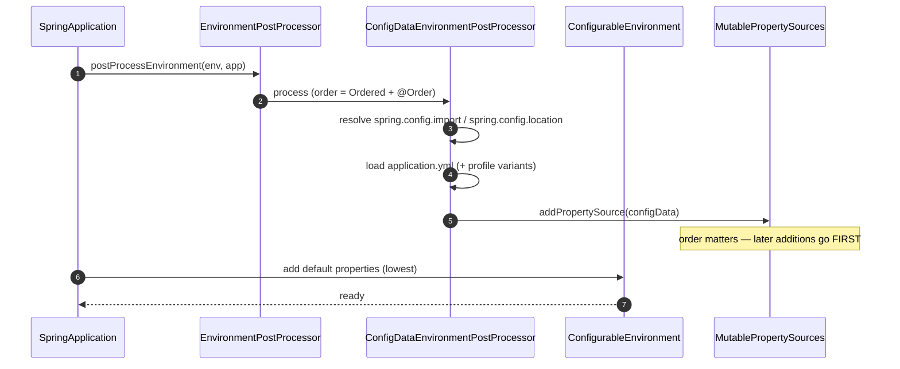
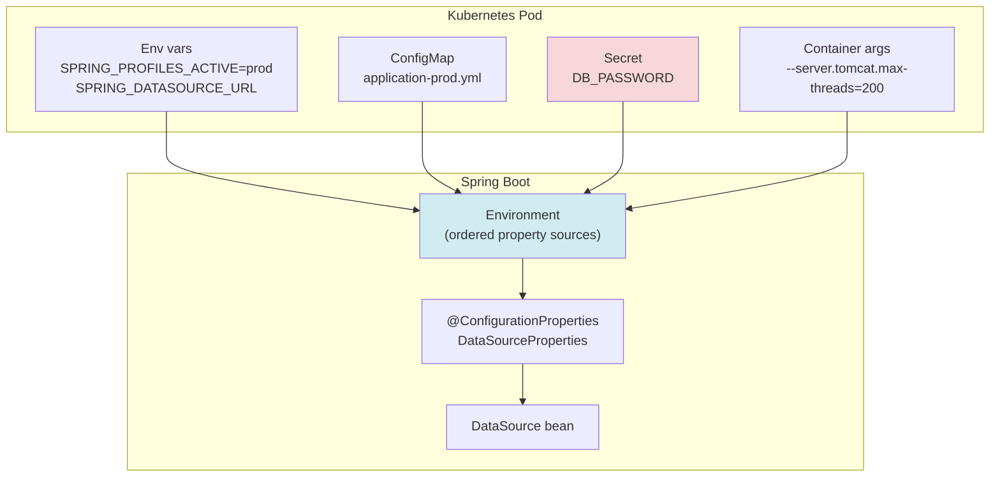

# 03 · Externalized Configuration, Profiles & Environment Management

> **Level:** Beginner → Advanced
> **Interview Frequency:** ★★★★☆ (Very common; the "where do I put this?" question)
> **Prerequisite:** [02 · Auto-Configuration & Starters](./02-Auto-Configuration-and-Conditional-Internals.md)
> **Last Updated:** 2026

---

## 📋 Table of Contents
- [0. TL;DR — The 30-Second Answer](#0-tldr--the-30-second-answer)
- [1. What & Why](#1-what--why)
- [2. Mental Model — the layered override](#2-mental-model--the-layered-override)
- [3. Deep Dive — Theory](#3-deep-dive--theory)
- [4. Internal Working Mechanism](#4-internal-working-mechanism)
- [5. Step-by-Step Execution Flow](#5-step-by-step-execution-flow)
- [6. Architecture Diagrams](#6-architecture-diagrams)
- [7. Production-Level Use Cases](#7-production-level-use-cases)
- [8. Code Examples — Production-Grade](#8-code-examples--production-grade)
- [9. Common Mistakes & Gotchas](#9-common-mistakes--gotchas)
- [10. Performance Considerations](#10-performance-considerations)
- [11. Security Considerations](#11-security-considerations)
- [12. Best Practices — The Checklist](#12-best-practices--the-checklist)
- [13. Hands-On Exercises](#13-hands-on-exercises)
- [14. Code Challenges](#14-code-challenges)
- [15. Scenario-Based Questions](#15-scenario-based-questions)
- [16. Interview Q&A — Level-wise](#16-interview-qa--level-wise)
- [17. Counter-Questions & Traps](#17-counter-questions--traps)
- [18. Tricky Interview Questions](#18-tricky-interview-questions)
- [19. Follow-Up Questions Asked by Interviewers](#19-follow-up-questions-asked-by-interviewers)
- [20. Real 3–5 Year Experience Scenarios](#20-real-35-year-experience-scenarios)
- [21. Frequently Asked Production Issues](#21-frequently-asked-production-issues)
- [22. Debugging Scenarios](#22-debugging-scenarios)
- [23. Architecture Design Questions](#23-architecture-design-questions)
- [24. Rapid-Fire MCQs](#24-rapid-fire-mcqs)
- [25. Cheat Sheet — One-Page Summary](#25-cheat-sheet--one-page-summary)
- [26. Real-World Production Notes](#26-real-world-production-notes)
- [27. Follow-up Learning](#27-follow-up-learning)

---

## 0. TL;DR — The 30-Second Answer

- **Spring Boot externalises configuration so the *same jar* runs in every environment.** Twelve-factor
  principle #3: config is an environment concern, not baked into the build.
- **There are 17 property sources, and earlier = higher precedence.** The famous top-4:
  **command-line args → `SPRING_APPLICATION_JSON` → OS env vars → packaged `application.yml`**.
- **Profile-specific files override the generic ones**, and **multiple profiles are additive**
  (`application-dev.yml` + `application-eu.yml` → later-declared profile wins).
- **`@ConfigurationProperties` + records + `@Validated`** is the professional way. `@Value` is for
  one-off constants only.
- **Relaxed binding** is what makes `SHOP_TIMEOUT` map to `shop.timeout` — it works for env vars,
  YAML, and command-line args.
- **Type-safe properties are bound at startup, and invalid values fail the boot** — that is a feature,
  not a bug.
- **Secrets never go in `application.yml`.** Use `${ENV_VAR}` placeholders, K8s Secrets, or Vault.
- **`spring.config.import`** is how you compose configuration from other sources (config server,
  Vault, a file on disk) — this is the modern replacement for `spring.config.location`.
- **`SPRING_APPLICATION_JSON`** lets you pass a whole JSON document as env vars — perfect for
  Kubernetes/Helm where you can't easily mount many files.
- **Beware `@Value` with profiles**: it is resolved once at injection, so it does not react to
  `@RefreshScope` or runtime changes.

---

## 1. What & Why

### The problem

A `application.yml` with hard-coded values means:
- you must rebuild the jar to change a database URL,
- you have 5 near-identical YAML files (`dev`, `test`, `staging`, `prod`, `qa`),
- secrets live in Git,
- and you cannot tell "which environment am I in?" from the code.

### The solution

Spring Boot splits configuration into **two halves**:

```
┌────────────────────────────┐   ┌──────────────────────────────────┐
│  APPLICATION CODE           │   │  CONFIGURATION                    │
│  (compiled once)            │   │  (varies per environment)         │
│                             │   │                                   │
│  @ConfigurationProperties   │◀──┤  application.yml                  │
│  (shop.payments.timeout)    │   │  application-prod.yml             │
│                             │   │  env vars, args, config server    │
└────────────────────────────┘   └──────────────────────────────────┘
              └────────────── same jar, different behaviour ──────────────┘
```

The **twelve-factor** framing: config is everything that *could* differ between deploys — it
belongs in the environment, not in the build.

### The analogy

> Think of a **thermostat** vs a **fixed heater**. A fixed heater is compiled into the device: it
> always outputs 2000 W. A thermostat has a *setpoint* that is read from the environment at runtime.
> Spring Boot's configuration is the setpoint; your code is the heater. The code is the same; only
> the setpoint changes.

---

## 2. Mental Model — the layered override

```
  HIGHEST  ┌──────────────────────────────────────┐
  priority │  command line args  --server.port=90 │  ← wins
           ├──────────────────────────────────────┤
           │  SPRING_APPLICATION_JSON  '{"a":1}'  │
           ├──────────────────────────────────────┤
           │  OS environment variables  SERVER_PORT│
           ├──────────────────────────────────────┤
           │  application-prod.yml  (profile)      │  ← packaged, profile-specific
           ├──────────────────────────────────────┤
           │  application.yml        (default)     │
           └──────────────────────────────────────┘
  LOWEST
```

> **Caption:** Boot walks this list **top to bottom** and the **first source that has the key**
> wins. It does not merge keys across sources — a key present in a higher source completely
> replaces the lower one.

---

## 3. Deep Dive — Theory

### 3.1 The canonical 17 property sources (highest → lowest)

| # | Source | Notes |
|---|--------|-------|
| 1 | DevTools global settings | `~/.config/spring-boot/devtools.properties` — dev only |
| 2 | `@TestPropertySource` | on a test class |
| 3 | `@SpringBootTest#properties` | on a test class |
| 4 | **Command line arguments** | `--server.port=9000` |
| 5 | **`SPRING_APPLICATION_JSON`** | inline JSON in an env var |
| 6 | `ServletConfig` init params | `web.xml` / `ServletContext` |
| 7 | `ServletContext` init params | same |
| 8 | JNDI attributes | `java:comp/env/...` |
| 9 | **Java System properties** | `-Dserver.port=9000` |
| 10 | **OS environment variables** | `SERVER_PORT=9000` |
| 11 | `RandomValuePropertySource` | `${random.uuid}` |
| 12 | **Profile-specific `application.properties|yml`** outside the jar | `application.prod.yml` next to the jar |
| 13 | Profile-specific inside the jar | `application-prod.yml` inside the jar |
| 14 | `application.properties|yml` inside the jar | packaged defaults |
| 15 | `@PropertySource` on your config | |
| 16 | `SpringApplication.setDefaultProperties(...)` | lowest |
| 17 | *(fallback)* `Environment.getProperty` default value | the `:` default in `${a:b}` |

> **The practical top-5 you must know:** command-line args → `SPRING_APPLICATION_JSON` → env vars →
> profile-specific file → `application.yml`.

### 3.2 Profiles

```yaml
# application.yml — defaults for ALL environments
spring:
  application:
    name: order-service
server:
  port: 8080

---
# application-dev.yml — overrides when profile "dev" is active
spring:
  jpa:
    show-sql: true
logging:
  level:
    com.acme: DEBUG

---
# application-prod.yml — overrides when profile "prod" is active
spring:
  jpa:
    show-sql: false
  datasource:
    url: ${DB_URL}
```

**Multi-profile documents** use `---` separators inside a *single* file, and each document can be
activated by `spring.config.activate.on-profile`.

**Profile groups** (Boot 2.4+): group profiles so you activate one logical name.

```yaml
spring:
  profiles:
    group:
      prod: [prod-aws, prod-rds, prod-cloudwatch]
      local: [local-h2, local-debug]
    default: local
```

Activate with `SPRING_PROFILES_ACTIVE=prod` and you get all three.

**Profile-specific *files* vs profile-specific *documents*:** a file named
`application-prod.yml` is loaded only when `prod` is active. A document with
`spring.config.activate.on-profile: prod` inside `application.yml` behaves the same way but lives in
one file.

> ⚠️ **`spring.profiles.active` in `application.yml` is a footgun.** It only works if the profile
> isn't set externally. If `application.yml` says `spring.profiles.active=dev` and the env sets
> `SPRING_PROFILES_ACTIVE=prod`, the **env wins** (higher precedence) — fine. But if you *rely* on
> the YAML value and someone sets the env var, the YAML is silently ignored. **Set the profile
> externally, never in the packaged YAML.**

### 3.3 `@ConfigurationProperties` — the professional way

```java
@ConfigurationProperties(prefix = "shop.payments")
@Validated
public record PaymentProperties(

        @NotBlank String provider,
        @NotNull URI endpoint,

        @NotNull
        @DurationMin(seconds = 1)          // Spring Boot's @DurationMin
        @DurationUnit(ChronoUnit.SECONDS)  // allows "30" to mean 30 seconds
        Duration timeout,

        @Min(0) @Max(5) int maxRetries,
        @DefaultValue("true") boolean sandbox,

        Map<String, String> headers,        // shop.payments.headers.X-Api-Key=...
        List<Region> regions                 // shop.payments.regions[0]=eu-west-1
) {}
```

**Three binding styles:**

| Style | How | When |
|-------|-----|------|
| **JavaBean** (setters) | `@ConfigurationProperties` + mutable class with setters | Legacy, or when you need optional mutable state |
| **Constructor binding** | Immutable class/record with an all-args constructor | **Default in Boot 3** if there is a single constructor |
| **Value object binding** | `@ConstructorBinding` on a nested record | Boot 2 style; in Boot 3, nesting is automatic when using a single constructor |

```yaml
shop:
  payments:
    provider: stripe
    endpoint: https://api.stripe.com
    timeout: 30s
    max-retries: 2
    headers:
      X-Api-Version: "2024-06-20"
    regions: [eu-west-1, us-east-1]
```

### 3.4 Relaxed binding — the exact rules

| Source | Canonical form | Example |
|--------|----------------|---------|
| `.properties` / `.yml` | kebab-case | `shop.payments.timeout` |
| Environment variable | UPPER_SNAKE | `SHOP_PAYMENTS_TIMEOUT` |
| Java system property | kebab or camel | `-Dshop.payments.timeout=30s` |
| Command line | kebab-case | `--shop.payments.timeout=30s` |
| JSON document | camelCase or kebab | `{"shop":{"payments":{"timeout":"30s"}}}` |
| Java field / getter | camelCase | `timeout` |

**Rules:**
- Dots separate elements; hyphens separate words *within* an element.
- Bracket notation for maps/lists: `shop.payments.headers[region-1].key=value`.
- For **env vars**, `_` replaces `.`, and the binding is case-insensitive.
- `Duration` and `DataSize` need a **unit suffix** unless you add `@DurationUnit`.
- `List<String>` binds from a comma-separated value: `shop.regions=a,b,c`.

### 3.5 `spring.config.import` — composing configuration

```yaml
spring:
  config:
    import:
      - "optional:configserver:http://config-server:8888"   # Spring Cloud Config
      - "optional:file:/etc/shop/secrets.yml"                # mounted secret file
      - "classpath:/extra-defaults.yml"                      # packaged extra defaults
```

| Prefix | Meaning |
|--------|---------|
| `optional:` | Don't fail if the source is missing |
| `configserver:` | Spring Cloud Config Server |
| `vault:` | Spring Cloud Vault |
| `file:` | A file (absolute or relative) |
| `classpath:` | A classpath resource |
| `kubernetes:` | Kubernetes ConfigMaps/Secrets (via the Fabric8 config resolver) |

> The old `spring.config.location` **replaces** the default locations. `spring.config.import`
> **adds** to them. Prefer `import`.

### 3.6 `SPRING_APPLICATION_JSON` — inline JSON config

```bash
export SPRING_APPLICATION_JSON='{
  "spring": {"datasource": {"url": "jdbc:postgresql://db:5432/shop"}},
  "shop": {"payments": {"provider": "stripe", "timeout": "15s"}}
}'
```

Perfect for **Helm/Kubernetes** where you want a single env var to carry a structured config, and
for **12-factor** compliance (everything in the environment).

### 3.7 Dynamic configuration & `@RefreshScope`

```java
@RefreshScope
@Component
public class FeatureFlags {
    @Value("${shop.flags.newCheckout:false}")
    private boolean newCheckout;
}
```

`@RefreshScope` (Spring Cloud) destroys and re-creates the bean when the config changes.
**Without Spring Cloud**, Boot has no runtime refresh — but you can implement it yourself with an
`EnvironmentChangeEvent` listener that re-binds `@ConfigurationProperties` beans.

---

## 4. Internal Working Mechanism

### 4.1 How the `Environment` is built



**Critical detail:** `ConfigDataEnvironmentPostProcessor` implements `Ordered` with
`HIGHEST_PRECEDENCE + 10`. It runs **before** most other post-processors, so `application.yml` is
available to them.

### 4.2 How a property is resolved

```java
// The exact call chain
Environment env = context.getEnvironment();
String url = env.getProperty("spring.datasource.url");
//  → AbstractEnvironment.getProperty(key, String.class, true)
//     → for each PropertySource in MutablePropertySources (in order):
//         → source.getProperty(key)  → if non-null, convert & return
//     → if none, return null / the default
```

**Relaxed binding happens in a different place:** `@ConfigurationProperties` binding uses the
`ConfigurationPropertySources` adapter, which creates a **`SpringConfigurationPropertySource`** that
*adapts* the `Environment` so that a lookup of `shop.payments.timeout` also tries
`shop.payments-timeout`, `SHOP_PAYMENTS_TIMEOUT`, `shop.payments.timeout` in various forms.

> **Key distinction:**
> - `env.getProperty("shop.payments.timeout")` → **strict** name matching (no relaxed binding).
> - `@ConfigurationProperties(prefix="shop.payments")` + field `timeout` → **relaxed** binding.
> This is a real interview distinction and a common source of bugs.

### 4.3 How the `@ConfigurationProperties` binder works

```java
// AbstractBoundablePropertyBinder / JavaBeanBinder / ValueObjectBinder
@ConfigurationProperties("shop.payments")
public record PaymentProperties(String provider, Duration timeout) {}
```

```
ConfigurationPropertyName ("shop.payments")
        │
        ▼
ConfigurationPropertySource (adapted from Environment)
        │  → resolves "shop.payments.provider" with relaxed rules
        ▼
Binder
        │  1. find the source for the prefix
        │  2. bind each property (name → value)
        │  3. convert the String to the target type
        │     (ConversionService: String → Duration, String → URI, String → List<T>…)
        │  4. apply JSR-380 validation if @Validated is present
        ▼
PaymentProperties instance (registered as a bean)
```

**Type conversion** uses the `ApplicationConversionService` (Boot's extended `ConversionService`):
- `String` → `Duration` (`"30s"`, `"PT30S"`, or with `@DurationUnit`)
- `String` → `DataSize` (`"512MB"`)
- `String` → `URI`, `URL`, `File`, `Path`, `Charset`
- `String` → `List<T>` (comma-separated) and `Map<K,V>`
- `String` → `Enum` (case-insensitive)
- `String` → `InetAddress`, `Locale`, `ZoneId`, `TimeZone`

---

## 5. Step-by-Step Execution Flow

### 5.1 "What happens when the app starts with `SERVER_PORT=9000` and `--server.port=7000`?"

```
1. SpringApplication.prepareEnvironment()
2. ConfigDataEnvironmentPostProcessor loads application.yml → PropertySource #14
3. CommandLineArgsPropertySource added → #4   (server.port=7000)
4. SystemEnvironmentPropertySource added → #10 (SERVER_PORT=9000)
5. Binding: the binder walks sources from #1 to #17:
     #4 command line args  → server.port = 7000   ← FIRST MATCH, STOP
6. server.port = 7000.  SERVER_PORT is ignored.
```

### 5.2 Profile resolution

```
1. spring.profiles.active is resolved from the highest-precedence source that defines it
   (env var SPRING_PROFILES_ACTIVE, or the command line, or application.yml)
2. SpringApplication.setActiveProfiles(...) / Environment.setActiveProfiles(...)
3. ConfigDataEnvironmentPostProcessor loads:
     application.yml               (always)
     application-<profile>.yml     (for each active profile, in declaration order)
     application-<profile>.<ext>   (e.g. .properties, .yaml, .xml)
4. Profile-specific properties are added as SEPARATE property sources placed BEFORE
   the non-profile ones, so they win.
5. If a profile file is inside a multi-document YAML, each document's
   spring.config.activate.on-profile is evaluated.
```

**Multi-profile order:**
```bash
SPRING_PROFILES_ACTIVE=dev,eu
```
→ `application-dev.yml` is loaded, then `application-eu.yml`. For the **same key**, the **later**
profile (`eu`) wins.

---

## 6. Architecture Diagrams

### 6.1 Config composition in a real service



> **Caption:** In Kubernetes the *packaged* `application.yml` holds only defaults and non-secret
> values. Everything environment-specific comes from ConfigMaps (non-secret) and Secrets (secret).

### 6.2 The `application.yml` layering model

```text
┌──────────────────────────────────────────────────────────┐
│ application.yml          ← defaults for every environment│
├──────────────────────────────────────────────────────────┤
│ application-dev.yml      ← developer laptops              │
├──────────────────────────────────────────────────────────┤
│ application-test.yml     ← automated tests                │
├──────────────────────────────────────────────────────────┤
│ application-staging.yml  ← pre-production                │
├──────────────────────────────────────────────────────────┤
│ application-prod.yml     ← production (non-secret only!)  │
└──────────────────────────────────────────────────────────┘
        + env vars / config server / secrets  (highest precedence)
```

### 6.3 Precedence cheat-pipeline

```text
--server.port=1  →  SPRING_APPLICATION_JSON  →  SERVER_PORT=2  →  application-prod.yml:3  →  application.yml:4
        ▲                                                                            ▲
     WINS                                                                      fallback
```

---

## 7. Production-Level Use Cases

| Context | Pattern | Why |
|---------|---------|-----|
| **E-commerce multi-region** | Same jar; per-region values from a **Spring Cloud Config Server** with a `region` profile (`application-eu-west-1.yml`) | One artifact promoted through environments; no rebuild |
| **Fintech secrets** | `spring.datasource.password=${DB_PASSWORD}` + K8s Secret mounted as an env var, or **Vault** with `spring.config.import=optional:vault://...` | Secrets never in Git, never in the image |
| **Feature flags** | `shop.flags.checkout-v2=${CHECKOUT_V2:false}` + a config server for runtime flips | Roll out to 10% of traffic without a deploy |
| **A/B testing** | `spring.profiles.active=exp-b` on a separate deployment | Isolation via profile |
| **12-factor compliance** | `SPRING_APPLICATION_JSON` carries the whole config | Everything in the environment, nothing in the build |
| **Local development** | `application-local.yml` **outside** the jar (in the working directory) with H2 + a Docker Postgres | A developer's local overrides never get packaged |
| **Helm deployments** | `values.yaml` → `env:` → `SPRING_APPLICATION_JSON` | One value to template; no per-property env var sprawl |

---

## 8. Code Examples — Production-Grade

### 8.1 A complete, validated properties class

```java
package com.acme.shop.config;

import jakarta.validation.constraints.*;
import org.springframework.boot.context.properties.ConfigurationProperties;
import org.springframework.boot.convert.DurationUnit;
import org.springframework.validation.annotation.Validated;

import java.net.URI;
import java.time.Duration;
import java.time.temporal.ChronoUnit;
import java.util.List;
import java.util.Map;

@Validated
@ConfigurationProperties(prefix = "shop.payments")
public record PaymentProperties(

        @NotBlank
        String provider,                                   // shop.payments.provider

        @NotNull
        URI endpoint,                                      // shop.payments.endpoint

        @NotNull
        @DurationMin(seconds = 1)
        @DurationMax(minutes = 5)
        @DurationUnit(ChronoUnit.SECONDS)
        Duration timeout,                                  // shop.payments.timeout=30s

        @Min(0) @Max(5)
        int maxRetries,                                    // shop.payments.max-retries

        @DefaultValue("true")
        boolean sandbox,                                   // shop.payments.sandbox

        @DefaultValue("USD")
        String currency,                                   // shop.payments.currency

        @Valid
        List<ProviderConfig> providers,                    // shop.payments.providers[0].key=...

        Map<String, String> headers                        // shop.payments.headers.X-Key=...
) {

    public record ProviderConfig(
            @NotBlank String key,
            @NotNull URI baseUrl,
            @Min(1) int weight
    ) {}
}
```

```yaml
shop:
  payments:
    provider: stripe
    endpoint: https://api.stripe.com/v1
    timeout: 30s
    max-retries: 2
    sandbox: false
    currency: EUR
    providers:
      - key: stripe
        base-url: https://api.stripe.com
        weight: 80
      - key: adyen
        base-url: https://api.adyen.com
        weight: 20
    headers:
      X-Api-Version: "2024-06-20"
```

### 8.2 Enabling and consuming

```java
@SpringBootApplication
@ConfigurationPropertiesScan
public class ShopApplication { }
```

```java
@Service
public class PaymentService {
    private final PaymentProperties props;

    // ✅ Constructor injection of a *bound, validated* object
    public PaymentService(PaymentProperties props) {
        this.props = props;
    }

    public void pay(long orderId) {
        // props.timeout() is a real Duration, already converted and validated
        var client = HttpClient.newBuilder()
                .connectTimeout(props.timeout())
                .build();
        // ...
    }
}
```

### 8.3 A `DataSourceProperties` with a full URL from env

```yaml
spring:
  datasource:
    url: jdbc:postgresql://${DB_HOST:localhost}:${DB_PORT:5432}/${DB_NAME:shop}?sslmode=${DB_SSL:disable}
    username: ${DB_USER:shop}
    password: ${DB_PASSWORD:}
    hikari:
      maximum-pool-size: ${DB_POOL_SIZE:10}
      connection-timeout: 30000
      leak-detection-threshold: 60000
```

### 8.4 Loading an external file (outside the jar)

```yaml
# application.yml
spring:
  config:
    import:
      - "optional:file:./config/local-overrides.yml"
      - "optional:file:/etc/shop/application.yml"
```

```java
// Or programmatically, for a legacy bootstrap
SpringApplication app = new SpringApplication(ShopApplication.class);
app.setDefaultProperties(Map.of("shop.payments.provider", "mock"));
app.run(args);
```

### 8.5 Validating configuration **before** anything else runs

```java
@Component
public class ConfigPreflight implements ApplicationRunner {

    private final Environment env;
    private final PaymentProperties payments;

    public ConfigPreflight(Environment env, PaymentProperties payments) {
        this.env = env;
        this.payments = payments;
    }

    @Override
    public void run(ApplicationArguments args) {
        log.info("Booting profile(s)={} provider={} timeout={}",
                Arrays.toString(env.getActiveProfiles()),
                payments.provider(), payments.timeout());

        // Fail loudly if a required downstream is misconfigured
        if (payments.sandbox() && payments.maxRetries() > 3) {
            throw new IllegalStateException("sandbox must not retry more than 3 times");
        }
    }
}
```

---

## 9. Common Mistakes & Gotchas

| # | ❌ Wrong | ✅ Right | Why |
|---|----------|----------|-----|
| 1 | Secret in `application.yml` committed to Git | `${DB_PASSWORD}` from env/Secret | Secrets in Git are permanent |
| 2 | `spring.profiles.active=dev` inside the packaged `application.yml` | Set `SPRING_PROFILES_ACTIVE` externally | The packaged value is ignored when an env var is present, and it leaks "dev" into prod images |
| 3 | `@Value("${shop.timeout}")` with no default | `@Value("${shop.timeout:30s}")` or `@ConfigurationProperties` | A missing property kills startup with an opaque error |
| 4 | `@Value("${shop.timeout}")` expecting a `Duration` | `${shop.timeout:30s}` — the unit suffix is required | `@Value` does **not** apply `@DurationUnit`; only the properties binder does |
| 5 | Expecting `env.getProperty("shop.payment-timeout")` to work | Use the canonical name `shop.payment.timeout` | `Environment.getProperty` is **strict**; only `@ConfigurationProperties` is relaxed |
| 6 | Using `spring.config.location` and losing the defaults | `spring.config.import` | `location` **replaces**, `import` **adds** |
| 7 | A `application-prod.yml` with values but no active profile | Set the profile; verify with `env.getActiveProfiles()` | Profile files are only loaded when the profile is active |
| 8 | 5 copies of `application-<env>.yml` with 80 % duplication | One `application.yml` + small profile deltas | Duplication drifts |
| 9 | Assuming a later profile wins | The **later-declared** profile wins (`dev,eu` → `eu`) | Order in `spring.profiles.active` |
| 10 | Mutating a `@ConfigurationProperties` bean at runtime | Recreate it (or use `@RefreshScope`) | The bound object is a snapshot |
| 11 | `Duration` bound from `"30"` without a unit | `"30s"`, or `@DurationUnit(SECONDS)` | Bare numbers are ambiguous |
| 12 | Assuming `SPRING_APPLICATION_JSON` overrides command-line args | Command-line args win | Precedence order |
| 13 | A `@Profile("!prod")` bean that is needed in prod | Use `@ConditionalOnProperty` with an explicit default | Profile negation is hard to reason about |

---

## 10. Performance Considerations

| Aspect | Impact | Guidance |
|--------|--------|----------|
| Property source count | Each `getProperty` walks the list | ~17 sources → tens of microseconds. Irrelevant per-request; relevant if called in a loop |
| `@Value` resolution | Resolved once at injection — cheap | Fine |
| `@ConfigurationProperties` binding | One bind at startup; O(properties) | Negligible; but hundreds of properties classes add a few ms |
| **Runtime refresh** (`@RefreshScope`) | Destroys + recreates beans; breaks in-flight references | Use sparingly; prefer a targeted refresh |
| **Config server fetch** | Network call at startup (and on refresh) | Cache locally; use `spring.cloud.config.fail-fast=false` + a local fallback so the app can start without the config server |
| **Actuator `/env`** | Expensive (resolves every property) | Never expose publicly; it's also an information-disclosure endpoint |
| Large `application.yml` | Parsed once | Negligible |

---

## 11. Security Considerations

| Risk | Mitigation |
|------|-----------|
| **Secrets in Git / in the image** | `${ENV_VAR}` placeholders; K8s Secrets; Vault; secret scanning in CI (e.g. `gitleaks`, `trufflehog`) |
| **Actuator `/actuator/env` and `/actuator/configprops`** | Never expose; if needed, restrict to an internal network and require authorisation — they print masked values, but *some* values leak unmasked |
| **Property injection into SQL / logs** | Never build SQL or log lines by concatenating property values |
| **`SPRING_APPLICATION_JSON` visible in the process env** | Env vars are visible in `/proc/<pid>/environ` — use mounted secrets where the threat model requires it |
| **Config server without auth** | The config server holds secrets — enable TLS, mTLS, and authentication |
| **`@Value` with a default that is a secret** | `${DB_PASSWORD:changeme}` — the default becomes the real password in prod if the env var is missing. **Never default a secret.** Instead make it required so startup fails |
| **Profile-specific file leaks dev credentials into the prod image** | Multi-stage Docker builds: don't copy `src/main/resources` wholesale; use Maven profiles to exclude dev files |

---

## 12. Best Practices — The Checklist

- [ ] **Never** put a secret in a packaged `application*.yml`. Use `${ENV_VAR}` with **no default** so
      startup fails loudly if it's missing.
- [ ] Set the active profile **externally** (`SPRING_PROFILES_ACTIVE`), never in the packaged YAML.
- [ ] Use `@ConfigurationProperties` records + `@Validated` + `@ConfigurationPropertiesScan`.
- [ ] Use **typed** values (`Duration`, `DataSize`, `URI`) instead of Strings.
- [ ] Put **defaults** in `application.yml`, **deltas** in profile files, **secrets** in the environment.
- [ ] Prefer `spring.config.import` over `spring.config.location`.
- [ ] Use `SPRING_APPLICATION_JSON` for structured config in Helm/K8s.
- [ ] Log the **active profiles** and a **redacted** config summary at startup (never the secrets).
- [ ] Version your config: a change to a property's meaning is a breaking change.
- [ ] Add `additional-spring-configuration-metadata.json` for your own properties.
- [ ] Never use `@Value` for a group of related settings.
- [ ] Use `@Profile` sparingly; prefer `@ConditionalOnProperty` with an explicit default value.
- [ ] Document in the README which properties are required, optional, and defaulted.

---

## 13. Hands-On Exercises

**🧪 Lab 1 — Prove the precedence order**
1. Create `application.yml` with `shop.mode=file`.
2. Run with `--shop.mode=cli` → prints `cli`.
3. Run with `SHOP_MODE=env` → prints `env`.
4. Run with **both** → prints `cli` (command line wins over env).
5. Run with `SPRING_APPLICATION_JSON='{"shop":{"mode":"json"}}'` + `--shop.mode=cli` → prints `cli`.
6. Run with `SPRING_APPLICATION_JSON` + `SHOP_MODE=env` → prints `json`.

**✅ Success signal:** You can state the top-5 order from memory and predict each outcome.

**🧪 Lab 2 — Relaxed binding vs strict lookup**
1. `@ConfigurationProperties(prefix="shop.payments")` with field `apiTimeout` → set
   `SHOP_PAYMENTS_API_TIMEOUT=30s` → it binds.
2. `env.getProperty("shop.payments.apiTimeout")` → returns `null`.
3. `env.getProperty("shop.payments.api-timeout")` → also `null` (strict!).

**✅ Success signal:** You understand that relaxed binding lives in the *binder*, not the `Environment`.

**🧪 Lab 3 — Fail-fast validation**
1. Add `@NotBlank` to a property with no default → start → observe the failure message.
2. Add `@DurationMin(seconds=1)` and set `timeout=0s` → observe the constraint violation.
3. Add `@DurationUnit(SECONDS)` and set `timeout=30` → it now binds to 30 seconds.

**✅ Success signal:** Every misconfiguration fails at startup, not at request time.

**🧪 Lab 4 — Profile composition**
1. `application.yml` + `application-dev.yml` + `application-eu.yml` with the same key in each.
2. `SPRING_PROFILES_ACTIVE=dev` → dev value.
3. `SPRING_PROFILES_ACTIVE=dev,eu` → **eu** value.
4. `SPRING_PROFILES_ACTIVE=eu,dev` → **dev** value.

**✅ Success signal:** You can explain "last profile declared wins".

---

## 14. Code Challenges

### Challenge 1 — A typed config with a validation matrix (medium)
**Goal:** Create `shop.mail` properties: `host`, `port` (1–65535), `username`, `password`
(**required, no default**), `from` (must be a valid email — write a custom `@Email`-like
constraint or use `@Pattern`), `timeouts` (a `Duration` with `@DurationUnit`).

**Test cases:** missing password → startup fails naming `shop.mail.password`; `port=70000` → fails;
`from=not-an-email` → fails; `timeouts.connect=5` with `@DurationUnit(SECONDS)` → binds to 5 s.

### Challenge 2 — Config precedence unit test (medium)
**Goal:** Write a JUnit 5 test that boots the context with different property sources and asserts
the winning value each time. Use `ApplicationContextRunner.withPropertyValues(...)` and
`withSystemProperties(...)`.

**Test cases:** file only; env only (via `withSystemProperties("SERVER_PORT=9090")`); CLI only
(simulate with `withPropertyValues`); and both — assert the CLI wins.

### Challenge 3 — A "config drift detector" (hard)
**Goal:** Write a startup check that compares the *active* configuration against a checked-in
`expected-config.json` (produced by a `@Profile("contract")` bean) and **fails the boot** if a
property differs. This is how a team prevents an unnoticed default change from altering behaviour.

**Hint:** dump the bound `PaymentProperties` to JSON with `ObjectMapper` and compare with
`JsonNode`.

---

## 15. Scenario-Based Questions

**S1.** *Your service reads `app.legacy-mode=true` from `application.yml`. The flag is supposed to be
off in production. A security audit finds it is on in prod. How did that happen, and how do you
prevent it?*

> **Expected answer:** Root cause is almost always one of: (a) the YAML value was never overridden
> because the env var name was wrong (`APP_LEGACY_MODE` vs `APP_LEGACYMODE` — relaxed binding maps
> `_`→`.`, so `APP_LEGACY_MODE` → `app.legacy.mode`, **not** `app.legacy-mode`); (b) the flag was
> read with `@Value` and the property in question is `app.legacy-mode` (kebab) but the env var
> `APP_LEGACYMODE` maps to `app.legacymode` — mismatch; (c) the profile file wasn't active;
> (d) someone set `spring.profiles.active=dev` in the packaged YAML, so `application-dev.yml` (which
> sets the flag on) was loaded in prod.
> Prevention: (1) make the *safe* value the default — i.e. **don't** put `legacy-mode=true` in any
> packaged file; put the **default** in code (`@Value("${app.legacy-mode:false}")`) and only ever set
> it to `true` explicitly via env; (2) log the effective value of every feature flag at startup and
> assert it in a smoke test; (3) add a CI check that scans `application*.yml` for `true` values of
> feature flags; (4) prefer runtime flags from a config server with an audit trail.

**S2.** *A deployment works with `SPRING_APPLICATION_JSON` but fails when you switch to individual
env vars. Why?*

> **Expected answer:** `SPRING_APPLICATION_JSON` is a **single JSON document**, so it can express
> nested structures, lists and maps naturally. Individual env vars can only express **flat** values,
> and a nested object becomes a *string* that the binder may not be able to convert. Example:
> `{"shop":{"payments":{"timeout":"30s"}}}` vs `SHOP_PAYMENTS_TIMEOUT=30s`. The second usually works
> for simple scalars, but `shop.payments.providers[0].key=stripe` is painful, and a value that
> contains `:` or `=` breaks naive env-var parsing.
> Also, **precedence**: env vars (#10) lose to `SPRING_APPLICATION_JSON` (#5) and to command-line args
> (#4). If a deployment relies on both, the JSON wins and the "individual" env var is ignored —
> which looks like "the env var didn't work" but is actually the opposite.
> The fix: pick one mechanism per deployment, and if using env vars, name them exactly per relaxed
> binding (`SPRING_PAYMENTS_TIMEOUT` for `shop.payments.timeout`).

**S3.** *Your team wants to move 300 hard-coded `application.yml` values into a config server.
Give a migration plan that won't break the running fleet.*

> **Expected answer:** (1) **Inventory**: use `spring-boot-configuration-metadata.json` plus a
> script to list every key actually used in code (`@Value`/`@ConfigurationProperties` prefixes).
> (2) **Classify**: defaults (stay in the jar), environment-specific (move to the config server),
> secrets (move to Vault — *not* the config server unless it is encrypted at rest and audited).
> (3) **Phase 1 (non-breaking)**: add `spring.config.import=optional:configserver:...` while leaving
> the values in the YAML. The config server has higher precedence, so it already overrides — but
> because the import is `optional:`, the app still starts if the config server is down. (4) **Phase 2
>**: move the values to the config server, keeping the YAML as the fallback. (5) **Phase 3**: delete
> the YAML values. (6) **At every phase**: verify with the condition report + a startup log of the
> active profile, and add a CI test that asserts each migrated key resolves to the expected value.
> (7) **Never** migrate a *secret* and a *non-secret* in the same release.

---

## 16. Interview Q&A — Level-wise

### 🟢 Beginner
**Q: What is externalized configuration?**
**A:** Keeping configuration outside the application binary so the same artifact can run in
different environments. Spring Boot supports properties/yml files, environment variables, command
line arguments, system properties, JNDI and remote config servers.

**Q: How do you set a property from the command line?**
**A:** `--server.port=9000`. Command-line arguments have the **highest** precedence among normal
sources.

**Q: What is the difference between `application.yml` and `application-prod.yml`?**
**A:** The profile-specific file is loaded **only** when the `prod` profile is active, and its values
take precedence over `application.yml`.

**Q: How do you know which profile is active?**
**A:** `Environment.getActiveProfiles()`, or log it at startup, or check
`/actuator/env` (dev only).

### 🟡 Intermediate
**Q: What is the order of precedence for Spring Boot properties?**
**A:** Command line args → `SPRING_APPLICATION_JSON` → Servlet config/context params → JNDI →
Java system properties → OS environment variables → random → profile-specific files (outside jar)
→ profile-specific files (inside jar) → `application.properties/yml` → `@PropertySource` → default
properties. The rule: the **first** source containing the key wins; sources do not merge.

**Q: `@Value` vs `@ConfigurationProperties`?**
**A:** `@Value` injects a single value into a field; it is untyped unless you add a conversion
suffix, it is resolved once at injection time, and it offers no validation. `@ConfigurationProperties`
binds a whole prefix into a typed object with relaxed binding, JSR-380 validation that fails startup,
and IDE support via configuration metadata.

**Q: What is relaxed binding?**
**A:** The mapping between a canonical property name and the various external forms: kebab-case in
YAML/properties, UPPER_SNAKE in env vars, camelCase in Java. It applies to
`@ConfigurationProperties` binding, **not** to `Environment.getProperty` calls.

**Q: How do you keep secrets out of the application?**
**A:** Placeholders (`password: ${DB_PASSWORD}`) resolved from environment variables, Kubernetes
Secrets, or a secret manager (Vault). Never a default value for a secret — that turns a missing
variable into a known password.

### 🔴 Advanced / Senior
**Q: How does `@ConfigurationProperties` binding actually work?**
**A:** The `Binder` walks the `ConfigurationPropertySources` (an adaptation of the `Environment` that
supports relaxed names), resolves the prefix to a `ConfigurationPropertyName`, then for each
property uses the `BindHandler` + `BindConverter` to convert the raw `String` to the target type via
the `ApplicationConversionService` (which adds `Duration`, `DataSize`, `URI`, `List`, `Map`,
`Charset`, `Locale` support). For a JavaBean it calls setters; for a value object (record) it uses
constructor binding. If `@Validated` is present, `ValidationBindHandler` runs the JSR-380 validator
and throws `BindValidationException` → startup failure.

**Q: What is `spring.config.import` and why is it better than `spring.config.location`?**
**A:** `import` **adds** configuration sources on top of the defaults, is composable (you can import
several sources), supports `optional:`, and works with the ConfigData API introduced in Boot 2.4.
`location` **replaces** the default locations, so you lose `application.yml` unless you list it
explicitly. `import` is the modern, additive mechanism.

**Q: How would you make a property changeable at runtime without a restart?**
**A:** Spring Cloud's `@RefreshScope` + a config server that pushes updates (or a
`/actuator/refresh` endpoint). The bean is destroyed and recreated on refresh, so it must be
thread-safe and its references replaced. Without Spring Cloud, listen for
`EnvironmentChangeEvent` and re-bind manually, or use a dynamic source (Redis/DB) polled by a
scheduled task. For anything that changes the *bean graph*, a restart is the only safe answer.

**Q: Why shouldn't you put `spring.profiles.active` in `application.yml`?**
**A:** Because the packaged file is the *lowest-precedence* source for that key — an env var or
command-line argument overrides it, so the value in the file becomes a silent lie. It also leaks a
development profile into a production image, and it makes the "what profile is this?" question
answerable only by inspecting the jar. Set it externally.

### ⚫ Expert / Principal
**Q: Design a configuration strategy for 50 services across 4 environments and 3 regions.**
> **Answer structure:** (1) **Layered ownership** — code defaults (in the jar) → team-owned defaults
> (a `platform` starter's `@ConfigurationProperties` with defaults) → environment values (config
> server) → region values (config server, per-region profile) → secrets (Vault). (2) **One naming
> convention** — `service.domain.property`; every service owns a `service.*` namespace. (3) **Config
> server hierarchy** — a repository of YAML per service, with a **fallback chain** (region → env →
> shared defaults) so a missing leaf does not break startup. (4) **Typed contracts** — each service
> publishes a `config-schema` module (a `@ConfigurationProperties` class + metadata) that the config
> server validates on commit (Spring Cloud Config Server supports native + placeholder profiles and
> can validate). (5) **Secret separation** — never in the config server's plain YAML; Vault with
> dynamic credentials for the DB. (6) **Rollout safety** — `optional:` imports, a local fallback
> file, and a "last known good" snapshot so a config server outage does not take the fleet down.
> (7) **Auditability** — every config change is a git commit with a reviewer; the config server
> exposes the commit hash. (8) **Observability** — log the *config fingerprint* (hash of the resolved
> config) so you can prove which version a pod is running.

---

## 17. Counter-Questions & Traps

### CQ1. "Is `application.yml` inside the jar or outside — which one wins?"
- **Naive answer:** "The one with the more specific name."  ← vague
- **The trap:** It is not about the file name, it is about the **property source order**. A profile
  file *outside* the jar (#12) beats a profile file *inside* the jar (#13), which beats the
  non-profile file (#14). And **env vars (#10) beat all packaged files**.
- **Expert answer:** The ordering is by *source*, not by specificity. Packaged files are the
  **lowest** precedence among real sources — only `@PropertySource` and default properties are
  lower. So a prod env var beats a packaged `application-prod.yml`.

### CQ2. "Why does my `@Value("${shop.timeout}")` fail but `@ConfigurationProperties` works?"
- **Naive answer:** "The property name is wrong."  ← maybe
- **The trap:** `Duration` conversion. `@Value` uses a limited conversion path that does **not**
> apply Boot's `ApplicationConversionService` conventions the same way, and a bare `"30"` is not a
> valid `Duration`. The properties binder, by contrast, understands `@DurationUnit`.
- **Expert answer:** Always give an explicit unit in `@Value` (`"${shop.timeout:30s}"`) and prefer
`@ConfigurationProperties` for anything structured. If you must use `@Value` for a `Duration`, use
`@Value("${shop.timeout:30s}")` — the suffix is the parse hint.

### CQ3. "If I set `SPRING_APPLICATION_JSON`, can I still override with an env var?"
- **Naive answer:** "Yes, env vars are high precedence."  ← wrong for this pair
- **The trap:** `SPRING_APPLICATION_JSON` (#5) sits **above** OS env vars (#10).
- **Expert answer:** No — `SPRING_APPLICATION_JSON` wins over plain env vars. Only command-line
arguments (#4) beat it. This matters when a Helm chart injects both a JSON blob and individual env
vars: the individual ones are silently ignored, which looks like a bug in the chart.

### CQ4. "Why did my profile-specific file not get loaded?"
- **Naive answer:** "The filename is wrong."  ← sometimes
- **The trap:** The profile must be **active** at the time the config data is resolved. Setting
`@Profile` on a bean is different from the *config* profile.
- **Expert answer:** Check in order: (1) is the profile active? log `env.getActiveProfiles()`;
(2) is the file named exactly `application-<profile>.yml` and in the classpath root? (3) did you
put it in `src/test/resources` when you meant `src/main/resources`? (4) does a **higher-precedence**
source override the profile's own values? (5) did you use `spring.config.activate.on-profile` in a
multi-document YAML and forget the `---` separator?

### CQ5. "Can two services share one `application.yml`?"
- **Naive answer:** "Yes, put it in a shared jar."  ← the distributed-monolith trap
- **The trap:** Sharing a YAML means sharing *values*, so one service's change silently affects
> others, and the shared file grows a section per service.
- **Expert answer:** Share **defaults with a namespace** (`shared.defaults.timeout`) and let each
service own its namespace, or use a config server with per-service files and a fallback chain.
Never put one service's *specific* values into a shared artifact.

### CQ6. "Why is my property `null` in a `@Value` but present in the actuator `/env` output?"
- **Naive answer:** "The actuator shows a different value."  ← confusing
- **The trap:** `/env` shows the **resolved** property source; `@Value` resolves at **injection
time**, and if the bean was created before the property source was added (e.g. in a
`BeanFactoryPostProcessor` context), it can see a different world.
- **Expert answer:** In practice, the cause is a **typo or a relaxed-binding mismatch**:
`/env` lists the raw keys, and if your key is `shop.timeout` but the code asks for
`shop.time-out`, `env.getProperty` (strict) returns null while the actuator shows a nearby key.
Always copy the exact key from `/env`.

### CQ7. "Is it safe to change a property's default value in a new release?"
- **Naive answer:** "It's just a default."  ← no
- **The trap:** A default is a **behaviour** for every customer who hasn't overridden it. Changing
it changes production behaviour with no diff in their code.
- **Expert answer:** Treat default changes as **breaking changes** for shared starters. Introduce
the new default behind a flag first (`feature.new-default=true`), migrate customers, and only then
change the default in a major version.

### CQ8. "Why doesn't `@Value` see the value from `SPRING_APPLICATION_JSON`?"
- **Naive answer:** "It should."  ← it does, actually
- **The trap:** This is usually a *timing* or *casing* issue: the JSON key was `shop.timeout` but
the code used `shopTimeout`, and `Environment.getProperty` is strict.
- **Expert answer:** `SPRING_APPLICATION_JSON` is added as a `SystemEnvironmentPropertySource`-like
source and is fully available to `@Value`. If the value is missing, compare the exact key strings;
`@Value` does **not** do relaxed binding. Also verify the JSON is valid — a malformed JSON document
makes Boot **ignore the whole thing** silently (it logs a warning).

### CQ9. "Why did my app start with the *default* profile in production?"
- **Naive answer:** "Because the profile wasn't set."  ← correct but incomplete
- **The trap:** The profile may have been **set but overridden**: `spring.profiles.active` in
`application.yml` is a *default* that any env var or CLI arg overrides. If the env var was
misspelled (e.g. `SPRING_PROFILE_ACTIVE`), the YAML default silently applies.
- **Expert answer:** Log `env.getActiveProfiles()` at startup and **assert** it in the entrypoint —
a "wrong profile in prod" should crash the pod, not limp along. This is a genuinely senior
production practice.

### CQ10. "How do you change a property without restarting?"
- **Naive answer:** "Use `@RefreshScope`."  ← partial
- **The trap:** `@RefreshScope` only works with Spring Cloud's context refresh, and it **destroys and
recreates** the bean — any other bean holding a direct reference keeps the old instance.
- **Expert answer:** It depends on what the property controls. (a) A *value* → `@RefreshScope` +
config server. (b) A *bean-graph* change (a new datasource, a different strategy implementation) →
restart. (c) A *business flag* → don't use config at all; use a dedicated feature-flag service
that the application polls, because business flags change at a different cadence and need auditing
and targeting. Choosing the right mechanism is the real skill.

---

## 18. Tricky Interview Questions

**T1. "Which has higher precedence, `application-prod.yml` in the jar or the `SERVER_PORT` env var?"**
> The **env var**. Packaged files are near the bottom of the list (#13–14); env vars are #10.

**T2. "If `spring.profiles.active=dev,prod` is set, which profile's `application-*.yml` wins?"**
> The **last one**, `prod` — profile-specific property sources are added in the order the profiles are
> declared, and later additions are placed *before* earlier ones in the source list.

**T3. "Does `@Value` support relaxed binding?"**
> No. `@Value("${shop.timeout}")` looks up the **exact** name. Only the
> `@ConfigurationProperties` binder performs relaxed binding.

**T4. "What is the difference between `spring.config.location` and `spring.config.import` for the
file `config/application.yml`?"**
> `location` **replaces** the default search locations (so `application.yml` inside the jar is no
> longer loaded unless you also list it). `import` **adds** the file on top of the defaults.

**T5. "Can a `@ConfigurationProperties` class have a `@Value` field?"**
> Yes, but it's an anti-pattern — the class then has two sources of truth and loses the
> "bind everything" guarantee. Use nested value objects or separate the concerns.

**T6. "What happens if the JSON in `SPRING_APPLICATION_JSON` is malformed?"**
> Boot logs a warning and **ignores the whole document** — it does not fail startup. This is a
> genuine production trap: a Helm template with a broken JSON produces a pod that starts with
> *all defaults*.

**T7. "Is `application.properties` or `application.yml` preferred?"**
> Properties are read first by Boot's `ConfigDataEnvironment` for the same location? Actually — for
> the *same* location, Boot 2.4+ loads **both**, with `.properties` taking precedence over `.yml`.
> Yaml is preferred for readability and lists.

**T8. "How do you read a property that may not exist, with a typed default?"**
> `env.getProperty("shop.timeout", Duration.class, Duration.ofSeconds(30))` — the `Environment` uses
> the `ConversionService` to convert the default too. Or use a `@ConfigurationProperties` with
> `@DefaultValue`.

**T9. "Can you use a placeholder inside a placeholder?"**
> Yes: `${A:${B:default}}` works, and the inner default is used if `A` is absent. But Boot 3.x
> **warns** on circular placeholders and fails fast with
`IllegalArgumentException: Circular placeholder reference`.

**T10. "What is `spring.config.activate.on-profile`?"**
> A document-level condition inside a multi-document YAML/properties file. The document is loaded
> only if the condition matches. It is the in-file alternative to separate `application-<profile>.yml`
> files, and it is the right choice when the profile-specific values are small.

---

## 19. Follow-Up Questions Asked by Interviewers

**F1** (after "explain the precedence order") → *"Which one would you use to force a value in a
Kubernetes deployment?"*
→ Usually a **ConfigMap-mounted env var** or a **command-line argument**; for a *secret*, a Secret
mounted as an env var. Avoid `SPRING_APPLICATION_JSON` when other env vars are already in use,
because it outranks them and causes confusion.

**F2** (after "what is relaxed binding?") → *"Does it apply to `@Value`?"*
→ No. Only the properties binder. This is a good discriminator between candidates who've read the
docs and those who've used it.

**F3** (after "how do you handle secrets?") → *"What if the env var is missing?"*
→ Make it **required** (no default) so startup fails with a clear message, and add an explicit
preflight check that reports *all* missing required variables at once rather than one per restart.

**F4** (after "profiles") → *"How do you know the right profile is active in prod?"*
→ Log it at startup, expose it in `/actuator/info` (not `/env`), and add a **liveness assertion**:
if `prod` is expected and the active profile isn't `prod`, fail the boot. Also, put the profile in
the pod spec so it's visible in `kubectl describe pod`.

**F5** (after "config server") → *"What happens if the config server is down at startup?"*
→ With `optional:` the app starts with the local/packaged config — a deliberate trade-off
(availability vs. correctness). Without `optional:` the app **fails to start** — which is correct
if the config contains something the app cannot run without (like a mandatory key). The senior
answer discusses which of your properties are *mandatory* and makes the import non-optional only
when it must be.

---

## 20. Real 3–5 Year Experience Scenarios

**R1. "A new service's `application.yml` is 400 lines, mostly copied from another service. The
new joiner asks which values matter."**
> **Ideal answer:** Don't read it — **query it**. (1) Pull the configuration metadata
> (`spring-boot-configuration-metadata.json` from the Boot jars + your own
> `additional-spring-configuration-metadata.json`) and produce a table of every property, its type,
> its **default** and its description. (2) Cross-reference with the YAML to find (a) keys that are
> **not real properties** (typos that silently do nothing — the most dangerous, because someone
> believes they are tuning something), (b) keys whose value **equals the default** (delete), and
> (c) genuine overrides. (3) For the genuine overrides, add a comment with the *reason* — "why is
> this here?" is the question a reader will have. (4) Move environment-specific values to env vars
> with defaults. (5) Finally, add a **contract test** that boots the context and asserts the
> expected effective configuration, so a typo becomes a **test failure** instead of a silent
> misconfiguration. This is a real 3–5 year deliverable: you own the configuration's blast radius.

**R2. "A config change broke 12% of checkout requests in production. The change was a single
`timeout` value in the config server. How do you prevent the next one?"**
> **Ideal answer:** The root cause is that a config change has the same blast radius as a deploy,
> but none of a deploy's safeguards. Fixes, in order: (1) **Rollback button** — the config server
> must support instant revert, and the runbook must name it. (2) **Canary** — route 5% of traffic
> to a config version, compare the checkout success rate, then promote. (3) **Guardrails in code** —
> the timeout should have a sane bound (`@DurationMax`) so an absurd value is rejected at startup,
> and the HTTP client should use `timeout` as a *maximum* with its own retry budget. (4) **Static
> validation** — validate the config against a JSON schema in the config server's commit hook.
> (5) **Change management** — config changes require the same review as code. (6) **Observability**
> — a dashboard of error rate by config version, so a bad change is visible in minutes, not hours.
> (7) **Budget the total timeout** — a per-call timeout of 30 s with 3 retries and 4 hops = 6
> minutes of user latency; the real fix is a *deadline* propagated across the call chain.

**R3. "You join a team whose services all read config from environment variables, and there is no
record of which env vars each service actually needs. A new environment is impossible to set up
correctly."**
> **Ideal answer:** Make the configuration contract **explicit and machine-readable**. (1) For each
service, export its `@ConfigurationProperties` classes as a **JSON schema** (the properties
classes *are* the schema — use `spring-boot-configuration-processor` to generate the metadata, and
a small tool to dump the effective values). (2) Publish a **required-vs-optional** classification
in the schema metadata. (3) Store the per-environment values in a **config server repository** with
a fallback chain, so a new environment is a new directory, not 40 manual edits. (4) Add a **CI
check** that boots each service with the *production* env-var set and asserts the effective config
matches the expected snapshot — this catches drift and missing variables before deployment.
(5) Adopt the **12-factor** naming convention so the env var name is derivable from the property
name (no more guessing whether it's `SHOP_TIMEOUT` or `SHOP_TIME_OUT`).

---

## 21. Frequently Asked Production Issues

| Symptom | Cause | Diagnosis | Fix |
|---------|-------|-----------|-----|
| Config ignored | Lower precedence than expected | `/actuator/env` (dev) or log the value at startup | Move to a higher-precedence source |
| Value is the literal `${VAR}` | Placeholder not resolved | Log `env.getProperty(key)` | The property source doesn't exist; check env var name |
| `Could not resolve placeholder` | Missing required property | The error names the key | Provide it, or give a default |
| Profile file ignored | Profile not active | `env.getActiveProfiles()` | Set `SPRING_PROFILES_ACTIVE` externally |
| `SPRING_APPLICATION_JSON` ignored | Malformed JSON | Boot logs a warning at startup | Validate the JSON in the chart template |
| Secret printed in logs | `logging.level` too verbose, or you logged the properties object | Grep the logs | Mask before logging; never log a `Properties`/`Map` of secrets |
| `BindException` on startup | Type mismatch (e.g. `"30"` → `Duration`) | The error names the property and the target type | Add a unit or `@DurationUnit` |
| Timeout not applied | `@Value` used without a unit suffix, or a different property is read | Log the effective value | Use a `Duration` with an explicit unit |
| Config differs between pods | Not all pods have the same env vars | `kubectl exec ... env` | Fix the deployment spec; add a startup assertion on the config fingerprint |
| Config server outage kills the fleet | Non-optional `import` | — | Use `optional:` for non-mandatory sources; keep a local fallback |

---

## 22. Debugging Scenarios

**D1. "The property is set but the app uses the default."**
1. `System.out.println(env.getProperty("my.key"))` — but note: this is **strict** matching.
2. `env.getPropertySources()` → iterate and print each source's `getProperty("my.key")` to see
   **which** source has it and which ones are shadowed.
3. Check for a **typo** in the key (the #1 cause). Compare with the actuator's `/env` listing.
4. Check the **profile** — the value may be in `application-prod.yml` but `prod` isn't active.
5. Check **relaxed-binding mismatch**: `my.timeout` vs `my-timeout` vs `myTimeout` are *different*
   keys for `Environment.getProperty`, but the same for `@ConfigurationProperties`.
6. Check whether the value was **overridden by a higher-precedence source** (e.g. a K8s env var
   that was supposed to be removed).

**D2. "How do I find every property the app actually reads?"**
1. Enable `logging.level.org.springframework.core.env=TRACE` — noisy but complete.
2. Better: use the **`@ConfigurationProperties` prefix inventory** — grep the codebase for
   `@Value("` and `@ConfigurationProperties(prefix=` and build the list.
3. Best: use the **Spring Boot `spring-boot-configuration-processor`** to generate
`META-INF/spring-configuration-metadata.json`, and cross-check with the actuator's
`/actuator/configprops` (dev only) which reports the *effective* value of every bound properties
object.

**D3. "Why does the app start with a different profile in prod than in staging?"**
1. Compare `SPRING_PROFILES_ACTIVE` in both environments.
2. Check if the **image** contains an `application.yml` with `spring.profiles.active` (it would be
   overridden by the env var, so the env var must be missing/misspelled).
3. Check the **command-line args** of the container (`kubectl describe pod`).
4. Check for a `SPRING_APPLICATION_JSON` blob that sets `spring.profiles.active`.

**D4. "Config values change between restarts without any deploy."**
1. If using a config server with a Git backend → the Git repo changed. Check the config server's
   commit log and the `configVersion`/`label` the pod requests.
2. If using a mounted file (ConfigMap) → the ConfigMap was updated in place; the file changes but
   the app only re-reads on restart.
3. If using env vars → the Deployment was patched (a new `env` entry) or a mutating webhook
   injected it.
4. Correlate with the pod's start time and the deployment's `resourceVersion` history.

---

## 23. Architecture Design Questions

**Q1. 🏗️ Design a configuration strategy for 50 services, 4 environments, 3 regions, with secrets.**
> **Answer structure:** (1) Layered ownership (code defaults → team defaults → env → region → secrets).
> (2) A config server with a **fallback chain** (region → env → shared) so a missing leaf never
> breaks a start. (3) Secrets in **Vault** with dynamic DB credentials, delivered via
> `spring.config.import=optional:vault://...`; never in the config server's plain files.
> (4) A **typed schema per service** (published as a `config-schema` artifact) validated on commit
> by the config server. (5) `optional:` imports + a packaged fallback so a config-server outage
> degrades rather than fails. (6) Version everything in git; the config server exposes the commit
> hash in `/actuator/info` so a pod can prove which config it used. (7) Per-environment **change
> management** (canary + auto-rollback on error-rate regression).

**Q2. 🏗️ How do you support "one deployment, per-tenant configuration" (SaaS multi-tenancy)?**
> **Answer structure:** (1) **Never** per-tenant config in the process environment — you can't
> scale that. (2) Use a **runtime config source** (DB/Redis keyed by tenant) resolved at request
> time by a `TenantConfigResolver`; combine it with the static config (static = defaults, runtime =
> overrides). (3) Make the resolution part of the request context (a `TenantContext` filter) so
> downstream code can ask for `config.forTenant("acme").timeout()`. (4) Cache per-tenant config with
> a short TTL and **invalidate on change** (a pub/sub event). (5) Version tenant config so a
> rollback is possible. (6) Isolate noisy tenants (a config that enables an expensive feature for
> one tenant must not slow the others). (7) Keep the *schema* uniform: the same
> `@ConfigurationProperties` shape for all tenants, with per-tenant values.

**Q3. 🏗️ How do you rotate a secret (e.g. a DB password) with zero downtime?**
> **Answer structure:** (1) **Two-phase rotation** — create the new credential and make it valid
> *alongside* the old one (Postgres: `ALTER ROLE ... PASSWORD` while the old password still works;
> RDS: modify + apply). (2) Update the secret in Vault/K8s. (3) Roll the deployment — but the old
> pods still use the old password, so the old credential must still be valid. (4) Once all pods are
> rolled, revoke the old credential. (5) Automate with a rotation controller + a runbook. (6) The
> app must **not** cache credentials forever — with connection pooling, rotating the password
> invalidates pooled connections; make the pool resilient (`max-lifetime` < credential TTL) or have
> the app re-read the secret. (7) Test the rollback path *before* you need it.

---

## 24. Rapid-Fire MCQs

**1.** Which source has the **highest** precedence?
A) `application.yml`  B) OS env vars  C) Command line args  D) `SPRING_APPLICATION_JSON`
**✅ C** — command line args beat `SPRING_APPLICATION_JSON`.

**2.** `SPRING_APPLICATION_JSON` vs OS env vars — which wins?
A) env vars  B) `SPRING_APPLICATION_JSON`  C) equal  D) depends on the key
**✅ B**

**3.** Does `@Value("${shop.timeout}")` do relaxed binding?
A) Yes  B) No  C) Only for env vars  D) Only in Boot 3
**✅ B** — only the `@ConfigurationProperties` binder does.

**4.** `SPRING_PROFILES_ACTIVE=dev,eu` — which wins for a key in both files?
A) `dev`  B) `eu`  C) neither  D) an error
**✅ B** — the last-declared profile wins.

**5.** `spring.config.location` vs `spring.config.import`:
A) location adds, import replaces  B) location replaces, import adds  C) identical  D) neither works in Boot 3
**✅ B**

**6.** Where do profile-specific files inside the jar sit in precedence?
A) Above env vars  B) Below command-line args but above `application.yml`  C) Lowest of all  D) Same as `application.yml`
**✅ B**

**7.** Which type does Boot's binder convert `"512MB"` into?
A) `long`  B) `DataSize`  C) `int`  D) `String`
**✅ B** — `DataSize`.

**8.** `Duration` bound from `"30"` with `@DurationUnit(ChronoUnit.SECONDS)`:
A) Fails  B) 30 seconds  C) 30 nanoseconds  D) 30 minutes
**✅ B**

**9.** A record with `@ConfigurationProperties` needs:
A) A no-arg constructor  B) A single constructor (constructor binding)  C) `@Autowired`  D) Setters
**✅ B**

**10.** `@Validated` + `@NotBlank` on a property with no value causes:
A) A warning  B) A startup failure  C) A runtime 500  D) Nothing
**✅ B**

**11.** Which is **not** a valid property source?
A) `SPRING_APPLICATION_JSON`  B) JNDI  C) A `random.int` source  D) A `application-logback.xml`
**✅ D**

**12.** `spring.profiles.active` set inside the packaged `application.yml`:
A) Always wins  B) Is overridden by any env var / CLI arg  C) Is ignored entirely  D) Causes a startup failure
**✅ B**

**13.** Boot 3's `spring.config.activate.on-profile` is used:
A) In a multi-document YAML/properties file  B) Only in Java  C) Only with the config server  D) Only in tests
**✅ A**

**14.** A malformed `SPRING_APPLICATION_JSON` document causes:
A) A startup failure  B) A warning, and the document is ignored  C) A fallback to defaults with an exception  D) A 500 on every request
**✅ B**

**15.** Which is the best way to supply a secret in Kubernetes?
A) A ConfigMap  B) A Secret mounted as an env var, referenced by `${VAR}` in the config  C) An `@Value` default  D) A file committed to the repo
**✅ B**

**16.** `@ConfigurationPropertiesScan` on the app class enables:
A) Component scanning of `@Component` classes  B) Registration of `@ConfigurationProperties` classes  C) Auto-configuration  D) AOP
**✅ B**

**17.** `Environment.getProperty("shop.timeout")` with only `SHOP_TIMEOUT=30` set returns:
A) `"30"`  B) `null`  C) `0`  D) An exception
**✅ B** — strict name matching; relaxed binding is a binder feature.

**18.** To make a property changeable at runtime with Spring Cloud, you use:
A) `@Value`  B) `@RefreshScope`  C) `@Lazy`  D) `@Primary`
**✅ B**

**19.** Boot's `ApplicationConversionService` adds support for:
A) `Duration`, `DataSize`, `URI`, `List`, `Map`  B) Only primitives  C) Only `Duration`  D) JSON binding
**✅ A**

**20.** The correct way to share a *default* timeout across 20 services is:
A) A shared `application.yml` in a common jar  B) A shared `@ConfigurationProperties` class with a default, each service overriding if needed  C) Copy-paste the value  D) A DB table
**✅ B**

---

## 25. Cheat Sheet — One-Page Summary

```text
┌──────────────────────────────────────────────────────────────────────────────┐
│  CONFIGURATION & PROFILES                                                    │
├──────────────────────────────────────────────────────────────────────────────┤
│  PRECEDENCE (high → low)                                                     │
│   1 CLI args  2 SPRING_APPLICATION_JSON  3 Servlet params  4 JNDI            │
│   5 System props (-D)  6 ENV VARS  7 random  8 profile-file(outside jar)      │
│   9 profile-file(inside jar)  10 application.yml  11 @PropertySource         │
│   12 defaultProperties                                                       │
│   ⚠ first source with the key WINS; sources do NOT merge                    │
├──────────────────────────────────────────────────────────────────────────────┤
│  RELAXED BINDING (binder only — NOT Environment.getProperty)                 │
│   shop.payments.timeout  ⇄  SHOP_PAYMENTS_TIMEOUT  ⇄  shop.payments.timeout │
│   kebab in YAML · UPPER_SNAKE in env · camelCase in Java                     │
├──────────────────────────────────────────────────────────────────────────────┤
│  PROFILES                                                                  │
│   SPRING_PROFILES_ACTIVE=prod,eu   →  eu wins (last declared)                │
│   groups: spring.profiles.group.prod=[...]                                   │
│   multi-doc yaml: --- + spring.config.activate.on-profile: prod              │
│   ⚠ never set spring.profiles.active in packaged yaml                        │
├──────────────────────────────────────────────────────────────────────────────┤
│  @ConfigurationProperties                                                  │
│   record + @Validated + @ConfigurationPropertiesScan                          │
│   @NotBlank @Min @Max @DurationMin @DurationUnit @DefaultValue                │
│   types: Duration("30s") DataSize("512MB") URI List Map Enum                │
│   ⚠ invalid values FAIL STARTUP (a feature, not a bug)                      │
├──────────────────────────────────────────────────────────────────────────────┤
│  SECRETS: ${DB_PASSWORD} (NO default) → env / K8s Secret / Vault             │
│  COMPOSE: spring.config.import=optional:configserver:... (adds, not replaces)│
│  RUNTIME:  @RefreshScope + config server (destroys & recreates the bean)     │
└──────────────────────────────────────────────────────────────────────────────┘
```

---

## 26. Real-World Production Notes

- **Log the config fingerprint, not the config.** A hash of the effective configuration lets you
  prove two pods are identical without printing secrets.
- **Assert the expected profile at startup.** `if (!env.matchesProfiles("prod") && isProdLike) throw`
  — a wrong-profile start should be a crash, not a mystery.
- **Bound every timeout** with `@DurationMax`. A config typo that sets a 5-minute timeout is a
  self-inflicted outage.
- **Never default a secret.** `${DB_PASSWORD:}` silently means "empty password" and will surface as
  a confusing auth error at 3 a.m.
- **Config changes are code changes** — same review, same rollback discipline, same audit trail.
- **Keep `application.yml` under ~50 lines.** Everything else is environment-specific and belongs
  outside the jar.

---

## 27. Follow-up Learning

- → [04 · Actuator & Observability](./04-Actuator-and-Observability.md) — exposing health, metrics
  and config safely.
- → [02 · Auto-Configuration](./02-Auto-Configuration-and-Starters.md) — how properties bind into
  auto-configured beans.
- → [11 · DB Optimisation](../11-Database-Design-Optimization/05-Scaling-Partitioning-and-Replication.md) —
  tuning HikariCP from properties.
- → [14 · DevOps](../14-Deployment-DevOps/02-Kubernetes-for-Java-Developers.md) — ConfigMaps, Secrets and probes.

---
**Next Chapter:** → [04 · Actuator & Observability](./04-Actuator-and-Observability.md)
**Previous Chapter:** ← [02 · Auto-Configuration & Starters](./02-Auto-Configuration-and-Starters.md)
