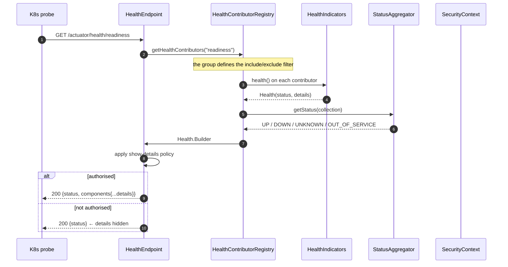
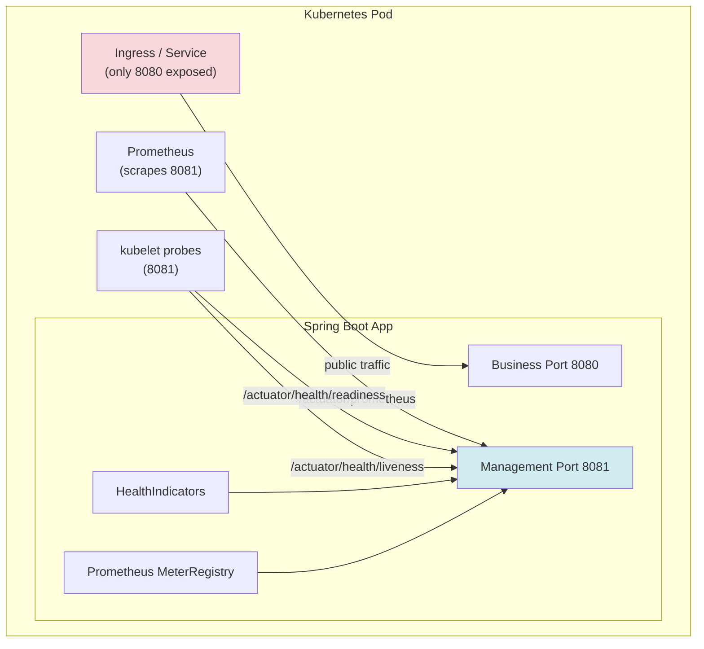

# 04 · Actuator, DevTools & Observability

> **Level:** Beginner → Advanced
> **Interview Frequency:** ★★★★☆ (Common in platform/DevOps-heavy roles and SRE-adjacent teams)
> **Prerequisite:** [03 · Configuration & Profiles](./03-Configuration-and-Profiles.md)
> **Last Updated:** 2026

---

## 📋 Table of Contents
- [0. TL;DR — The 30-Second Answer](#0-tldr--the-30-second-answer)
- [1. What & Why](#1-what--why)
- [2. Mental Model — the three health questions](#2-mental-model--the-three-health-questions)
- [3. Deep Dive — Theory](#3-deep-dive--theory)
- [4. Internal Working Mechanism](#4-internal-working-mechanism)
- [5. Step-by-Step Execution Flow](#5-step-by-step-execution-flow)
- [6. Architecture Diagrams](#6-architecture-diagrams)
- [7. Production-Level Use Cases](#7-production-level-use-cases)
- [8. Code Examples — Production-Grade](#8-code-examples--production-grade)
- [9. Common Mistakes & Gotchas](#9-common-mistakes--gotchas)
- [10. Performance Considerations](#10-performance-considerations)
- [11. Security Considerations](#11-security-considerations)
- [12. Best Practices — The Checklist](#12-best-practices--the-checklist)
- [13. Hands-On Exercises](#13-hands-on-exercises)
- [14. Code Challenges](#14-code-challenges)
- [15. Scenario-Based Questions](#15-scenario-based-questions)
- [16. Interview Q&A — Level-wise](#16-interview-qa--level-wise)
- [17. Counter-Questions & Traps](#17-counter-questions--traps)
- [18. Tricky Interview Questions](#18-tricky-interview-questions)
- [19. Follow-Up Questions Asked by Interviewers](#19-follow-up-questions-asked-by-interviewers)
- [20. Real 3–5 Year Experience Scenarios](#20-real-35-year-experience-scenarios)
- [21. Frequently Asked Production Issues](#21-frequently-asked-production-issues)
- [22. Debugging Scenarios](#22-debugging-scenarios)
- [23. Architecture Design Questions](#23-architecture-design-questions)
- [24. Rapid-Fire MCQs](#24-rapid-fire-mcqs)
- [25. Cheat Sheet — One-Page Summary](#25-cheat-sheet--one-page-summary)
- [26. Real-World Production Notes](#26-real-world-production-notes)
- [27. Follow-up Learning](#27-follow-up-learning)

---

## 0. TL;DR — The 30-Second Answer

- **Actuator = the operational control panel of a Boot app.** It exposes *management endpoints* over
  HTTP or JMX: health, info, metrics, env, loggers, caches, sessions, flyway, threaddump, heapdump.
- **Only `health`, `info`, `prometheus` and `metrics` should be exposed in production.** Everything
  else is an information-disclosure risk — `env` leaks secrets, `heapdump` dumps live memory,
  `threaddump` reveals internals.
- **Health has three flavours**: `liveness` (is the JVM alive?), `readiness` (can it serve traffic?),
  and the composite `/actuator/health`. **Liveness must NOT check external dependencies** — a DB
  outage must not cause a restart loop.
- **`management.server.port` puts actuator on a separate port** — the cleanest way to keep it off the
  public internet.
- **Health indicators aggregate into groups** (`readiness`, `liveness`) with explicit `include`/
  `exclude` lists. A default `DiskSpaceHealthIndicator` failing on a small container filesystem is a
  classic production surprise.
- **DevTools** gives you live restart, a property explorer, and a remote debugger. It is a
  **development-only** dependency (`<optional>true</optional>`) and is auto-disabled in a packaged
  fat jar.
- **Metrics** come from Micrometer and are exposed in Prometheus format. Spring Boot 3 renamed many
  metric names (e.g. `http.server.requests`) — dashboards break on upgrade.
- **`/actuator/loggers`** lets you change log levels at runtime — invaluable, and a security risk if
  exposed (it can enable `TRACE` and cause a log flood / DoS).
- **Observability triad**: metrics (what is broken?), logs (what happened?), traces (where did the
  time go?). Alert on metrics, debug with traces, correlate with logs.

---

## 1. What & Why

### The problem

Without Actuator, answering "is the service healthy?" requires SSH into the pod, `curl`ing the
health endpoint you wrote yourself, or reading logs. And "is it healthy?" is not a binary — a
service can be *up* but *not ready* (still warming up), or *ready* but *degraded* (DB slow,
cache down).

### The solution

Actuator provides a **management plane** separate from the **business plane**:

```text
┌────────────────────────────────────────────────────────┐
│  BUSINESS PLANE  (port 8080)                          │
│   /api/orders  /api/customers  ...                     │
│   → SLO: latency, availability, error rate            │
├────────────────────────────────────────────────────────┤
│  MANAGEMENT PLANE (port 8081 or same port, restricted)│
│   /actuator/health  /actuator/prometheus  /actuator/env│
│   → OPS: is it up? is it ready? what config is loaded? │
└────────────────────────────────────────────────────────┘
```

### The analogy — hospital vital signs

> The **business plane** is the patient doing their job (treating customers).
> The **management plane** is the **monitoring equipment** (ECG, blood pressure, temperature).
> A patient can be "working" (busy) while their **saturation is dropping** (a dependency is
> failing) — vital signs catch what the work doesn't. And crucially: the vital-signs monitor must
> not be **plugged into the patient's life support** — if the monitor fails, the patient must not
> die. That's exactly why **liveness must not depend on external systems**.

---

## 2. Mental Model — the three health questions

```text
   ┌──────────────────────────────────────────────────────────────┐
   │  LIVENESS  (/actuator/health/liveness)                      │
   │  "Is this process irrecoverably broken?"                    │
   │  → Kubernetes RESTARTS the pod if this fails                │
   │  → MUST depend on NOTHING external                           │
   │  → Examples: JVM deadlocked, OOM-killer, app not started   │
   ├──────────────────────────────────────────────────────────────┤
   │  READINESS  (/actuator/health/readiness)                    │
   │  "Can this pod serve traffic RIGHT NOW?"                    │
   │  → Kubernetes REMOVES the pod from the Service endpoints    │
   │  → MAY depend on external systems                          │
   │  → Examples: DB reachable, cache warm, migrations done    │
   ├──────────────────────────────────────────────────────────────┤
   │  HEALTH  (/actuator/health)                                 │
   │  "What is the detailed state of every component?"           │
   │  → Used by humans + dashboards, aggregated UP/DOWN          │
   └──────────────────────────────────────────────────────────────┘
```

> **Caption:** This distinction is the single most important production concept in this chapter.
> Getting it wrong causes **restart storms** — a textbook example of a 3–5 year level question.

---

## 3. Deep Dive — Theory

### 3.1 The endpoint catalogue (Boot 3.3)

| Endpoint | What it returns | Safe to expose? | Notes |
|----------|-----------------|------------------|-------|
| `health` | Aggregate status of all indicators | ✅ (with `show-details` restricted) | The most important one |
| `info` | Build/git/app info from `InfoContributor` | ✅ | Set via `build-info` / `git.properties` |
| `metrics` | Micrometer metric names & values | ✅ | Prometheus format via `prometheus` |
| `prometheus` | Prometheus scrape format | ✅ | The one you actually want in K8s |
| `env` | Every property source and its values | ⛔ | **Leaks secrets** |
| `configprops` | Every `@ConfigurationProperties` bean | ⛔ | Leaks secrets (masked, but not always) |
| `beans` | All bean definitions | ⚠️ | Reveals internals; large payload |
| `loggers` | Log levels; **writable** | ⛔ | Can enable TRACE → log flood |
| `caches` | Cache names & statistics | ⚠️ | Low risk, useful |
| `sessions` | Active HTTP sessions | ⚠️ | User identifiers may appear |
| `flyway` / `liquibase` | Migration history | ⚠️ | Reveals schema version |
| `threaddump` | All thread stacks | ⛔ | Internal + can be huge |
| `heapdump` | A **full heap dump file** | ⛔⛔ | **Contains secrets in memory** |
| `scheduledtasks` | `@Scheduled` cron jobs | ⚠️ | Useful for ops |
| `conditions` | The `ConditionEvaluationReport` | ⚠️ | Reveals which auto-configs matched |
| `mappings` | All URL mappings | ⚠️ | Maps the attack surface |

**Default exposure:** only `health` (and `info`) are exposed over HTTP by default. Everything else
must be explicitly exposed.

### 3.2 The `management.endpoints.web.exposure.include` rules

```yaml
management:
  endpoints:
    web:
      exposure:
        include: health,info,metrics,prometheus
        exclude: env,heapdump,threaddump,loggers
  endpoint:
    health:
      show-details: when-authorized     # never "always" in prod
      probes:
        enabled: true                   # creates /health/liveness and /health/readiness
      group:
        readiness:
          include: readinessState,db,redis
          additional-path: "server:/readyz"
        liveness:
          include: livenessState
          additional-path: "server:/livez"
```

> ⚠️ **`include` and `exclude` are mutually exclusive** — Boot throws
> `IllegalStateException` if you set both. Use `include` alone.

### 3.3 Health indicators

```java
public interface HealthIndicator {
    Health health();
}

public interface HealthContributor extends HealthIndicator {   // for nested components
    void contributeTo(Health.Builder builder);
}
```

**Built-in indicators** (auto-configured when the class is present):
`db`, `diskSpace`, `ping`, `mongo`, `redis`, `rabbit`, `elasticsearch`, `cassandra`, `couchbase`,
`liquibase`, `flyway`, `mail`, `ssl`, `ldap`, `hazelcast`, `neo4j`, `influx`, `jms`, `artemis`.

**The composite status logic:**

```java
// DefaultStatusAggregator
public HealthStatus getStatus(Collection<Health> healths) {
    if (healths.isEmpty()) return HealthStatus.UNKNOWN;
    // DOWN if any is DOWN (or OUT_OF_SERVICE), else UNKNOWN if any UNKNOWN, else UP
}
```

**Custom indicator (the professional version):**

```java
@Component
public class PaymentsHealthIndicator implements HealthIndicator {

    private final PaymentGateway gateway;

    public PaymentsHealthIndicator(PaymentGateway gateway) { this.gateway = gateway; }

    @Override
    public Health health() {
        try {
            long start = System.nanoTime();
            gateway.ping();
            long ms = (System.nanoTime() - start) / 1_000_000;
            return Health.up()
                    .withDetail("latencyMs", ms)
                    .withDetail("provider", gateway.name())
                    .build();
        } catch (Exception ex) {
            return Health.down(ex)
                    .withDetail("provider", gateway.name())
                    .build();
        }
    }
}
```

**Reactive version** (for non-blocking apps) — implement `ReactiveHealthIndicator` and return a
`Mono<Health>`; a timeout on the Mono is honoured by the aggregator.

### 3.4 Health **groups** — the mechanism behind probes

```yaml
management:
  endpoint:
    health:
      group:
        readiness:
          include: readinessState,db          # ← only these count
          exclude: diskSpace                  # ← explicitly excluded
          show-details: always
          additional-path: "server:/readyz"
        liveness:
          include: livenessState              # ← ONLY the JVM's own liveness
          additional-path: "server:/livez"
```

The `readinessState` and `livenessState` contributors come from
`ApplicationAvailability` — Spring Boot publishes an `AvailabilityChangeEvent` and the state moves:

```text
  LivenessState:  CORRECT → BROKEN
  ReadinessState: REFUSING_TRAFFIC ──(app started)──→ ACCEPTING_TRAFFIC
                        │                                    │
             (readiness probe fails)                  (shutdown → REFUSING_TRAFFIC)
```

`ReadinessStateHealthIndicator` is `UP` only when the state is `ACCEPTING_TRAFFIC`.
`LivenessStateHealthIndicator` is `UP` only when the state is `CORRECT`.

**K8s probes then look like:**

```yaml
readinessProbe:
  httpGet: { path: /actuator/health/readiness, port: 8081 }
  initialDelaySeconds: 10
  periodSeconds: 5
  failureThreshold: 3
livenessProbe:
  httpGet: { path: /actuator/health/liveness, port: 8081 }
  initialDelaySeconds: 30
  periodSeconds: 10
  failureThreshold: 3
```

### 3.5 The `DiskSpaceHealthIndicator` trap

```text
DiskSpaceHealthContributor
  → checks the free space on the filesystem where the temp dir lives
  → threshold = 10 MB  OR  10% of total free space, whichever is greater
  → if free < threshold → status DOWN
```

In a container with a 100 MB writable layer, the *absolute* 10 MB threshold can be tripped
legitimately. Two fixes:

```yaml
management:
  health:
    diskSpace:
      threshold: 500MB        # raise the absolute threshold
```
or exclude it from the readiness group:
```yaml
management:
  endpoint:
    health:
      group:
        readiness:
          exclude: diskSpace
```

### 3.6 DevTools

```xml
<dependency>
  <groupId>org.springframework.boot</groupId>
  <artifactId>spring-boot-devtools</artifactId>
  <optional>true</optional>   <!-- ← CRITICAL: not transitively included -->
</dependency>
```

**What it gives you:**
| Feature | What it does |
|---------|--------------|
| **Live restart** | Classpath change → context restart (not a JVM restart) |
| **Live reload** | Browser refresh on static resource change |
| **Remote debug** | Auto-attach a debugger |
| **Property explorer** | A UI listing all properties and their sources |
| **Exclusions** | By default excludes `spring-boot-devtools` from the restart classloader |

**The classloader trick:** DevTools splits the classpath into a **restart classloader** (your
classes + the base classpath) and a **base classloader** (the jars). Only the restart classloader
is recreated on a change → fast restart (≈1 s vs 10 s+ for a JVM restart).

**Production safety:**
- `<optional>true</optional>` → not transitively pulled into downstream apps.
- DevTools is **auto-disabled** when the app is started from a **packaged fat jar** (`JarLauncher`).
  It only runs when launched from an IDE or with `java -cp`.
- If you see devtools active in production, check your `Dockerfile` — usually `mvn package` was
  replaced with `mvn spring-boot:run`, or the jar was launched with `java -cp` instead of `-jar`.

**Never use devtools' "restart" for stateful work** — the context restart loses in-memory state
and re-runs `@PostConstruct`.

### 3.7 Micrometer metrics

```text
Metric types
─────────────
Counter       jvm.threads.daemon, http.server.requests (count)
Gauge         jvm.memory.used, process.cpu.usage   (instantaneous value)
Timer         http.server.requests (duration)      ← Count + Timer + Summary
DistributionSummary  a custom measured value
LongTaskTimer long-running tasks
```

**Spring Boot 3 metric naming** (Micrometer's new convention — this broke a lot of dashboards):

| Old (Boot 2) | New (Boot 3) |
|---------------|--------------|
| `http.requests` | `http.server.requests` |
| `jvm.memory.used` (tag `area=heap`) | `jvm.memory.used` (tag `id=heap`) |
| `hikaricp.connections.*` | `hikaricp.connections.*` (unchanged) |

**Common tags to add:**

```java
@Bean
MeterRegistryCustomizer<PrometheusMeterRegistry> commonTags() {
    return registry -> registry.config().commonTags(
            "application", "order-service",
            "env", "prod",
            "region", "eu-west-1");
    // ⚠ NEVER tag by user id, request id, or anything unbounded → cardinality explosion
}
```

> ⚠️ **Cardinality is the #1 metrics production incident.** One `userId` tag with 1 M users = 1 M
> time series per metric → Prometheus OOM. Rule: tags must come from a **bounded** set.

### 3.8 Observability triad

```text
   METRICS  ─────────────────────────►  "Is something wrong?"
   (aggregated numbers over time)         "Error rate is 2% on /checkout"

   TRACES   ─────────────────────────►  "Where did the time go?"
   (one request's path across services)   "The 800 ms was 600 ms in payment-service"

   LOGS     ─────────────────────────►  "What exactly happened?"
   (discrete events with context)         "Payment declined: reason=INSUFFICIENT_FUNDS"
```

**The rule:** *alert on a metric, debug with a trace, explain with a log.*
A metric tells you **that** something is broken; only a trace tells you **where**.

---

## 4. Internal Working Mechanism

### 4.1 How the health endpoint aggregates



### 4.2 The `HealthEndpoint` security path

```text
GET /actuator/health
  → HealthEndpointWebExtension
      → health(...)
          → showDetails = (showComponents && isUserInRole/hasAuthority)
              "when_authorized" → requires an authenticated user with ROLE_ACTUATOR
              "always"         → always show details   (DANGEROUS in prod)
              "never"          → never show details
```

With `show-details: when-authorized` and **no security configured**, Spring Boot returns
`{"status":"UP"}` and hides everything — which is the safe default, but it also means your
`/actuator/health` in a plain app tells you almost nothing.

### 4.3 `AvailabilityChangeEvent` → probe state

```java
// Spring Boot publishes these automatically:
ApplicationAvailability applicationAvailability = ctx.getBean(ApplicationAvailability.class);

// SpringApplication sets these:
context.publishEvent(new AvailabilityChangeEvent<>(context, LivenessState.CORRECT));
context.publishEvent(new AvailabilityChangeEvent<>(context, ReadinessState.ACCEPTING_TRAFFIC));

// You publish these yourself:
context.publishEvent(new AvailabilityChangeEvent<>(context, ReadinessState.REFUSING_TRAFFIC));
// e.g. when a critical background job fails or a dependency is down
```

`AvailabilityState` is a `State` object with a `getState()` and `isAvailable()`. The
`ReadinessStateHealthIndicator` maps `ACCEPTING_TRAFFIC` → UP, everything else → DOWN.

---

## 5. Step-by-Step Execution Flow

### 5.1 "What happens when Kubernetes hits `/actuator/health/readiness`?"

```
1. K8s HTTP GET → pod IP : 8081 (management port)
2. Tomcat (management context) → DispatcherServlet
3. HandlerMapping finds HealthEndpoint (it's a @Endpoint with @WebMvcEndpoint)
4. HealthEndpointWebExtension.health(...)
5. HealthContributorRegistry.getHealthContributors("readiness")
      → reads the "readiness" group's include/exclude
      → returns only readinessState, db, redis
6. For each contributor: call health()
      → db: SELECT 1 (with a timeout)
      → redis: PING
      → readinessState: ApplicationAvailability state == ACCEPTING_TRAFFIC ?
7. StatusAggregator aggregates → UP / DOWN
8. showDetails policy applied
9. Response: 200 {"status":"UP","components":{...}}
10. K8s: 200 → pod stays in the Service endpoints
```

### 5.2 "Actuator on a separate port — what changes?"

```yaml
management:
  server:
    port: 8081
    address: 127.0.0.1   # optional: bind to loopback only
```

```text
With a separate management port:
  → A SECOND Tomcat is started (management.server.port)
  → It has its OWN SecurityFilterChain? NO — it shares the app's Spring Security
     config, but you can add a separate chain with securityMatcher on the port
  → application.properties from the MAIN context still apply
  → A separate web server = extra memory (~30-50 MB) and extra startup time
```

> 💡 **Professional tip:** Use `management.server.port` to keep actuator off the public load balancer,
> and secure the management port with an mTLS sidecar or a network policy.

---

## 6. Architecture Diagrams

### 6.1 The management plane in a Kubernetes pod



> **Caption:** The management port is reachable from the cluster network but **not** from the
> internet. That single decision removes most of the actuator attack surface.

### 6.2 Health group composition

```text
                    /actuator/health
                           │
        ┌──────────────────┼───────────────────────┐
        ▼                  ▼                       ▼
   readinessState      livenessState          (everything)
        │                  │                       │
   ┌────┴────┐        ┌────┴────┐                  │
   │ READINESS│        │ LIVENESS │                  │
   │  GROUP   │        │  GROUP  │                  │
   └────┬────┘        └────┬────┘                  │
        │                  │                       │
   readinessState       livenessState               │
   db                  (nothing else)              │
   redis                                      ┌─────┴─────┐
   paymentsHealthIndicator                    │  diskSpace│
                                             │  mail     │
                                             │  ssl      │
                                             └───────────┘
```

### 6.3 The observability triad in a debugging session

```text
   ALERT:  "checkout error rate > 1% for 5 min"        ← METRIC
                │
                ▼
   "Which service?"  → trace: span waterfall shows
        payment-service ──► postgres (600 ms)           ← TRACE
                │
                ▼
   "Why?"  → log: "Payment declined: reason=INSUFFICIENT_FUNDS"  ← LOG
```

---

## 7. Production-Level Use Cases

| Context | Pattern | Why |
|---------|---------|-----|
| **E-commerce** | Readiness includes `db` + `redis`; liveness includes **only** `livenessState` | A DB blip must unready pods, not restart them |
| **Fintech** | A custom `HealthIndicator` for a mandatory downstream (payment gateway) with a **short** timeout (2 s) | A slow dependency must not hang the probe |
| **Batch jobs** | A `SmartLifecycle` publishes `ReadinessState.REFUSING_TRAFFIC` while the nightly job runs | Don't send traffic to a pod that's mid-migration |
| **Canary releases** | `/actuator/prometheus` is scraped by Prometheus; the analysis is automated on error rate | Automated rollback on metric regression |
| **Cost control** | `management.server.port` + NetworkPolicy: only the monitoring namespace may reach it | Reduces attack surface without losing observability |
| **Hot debugging** | `/actuator/threaddump` + `/actuator/heapdump` behind a break-glass auth, used in an incident | No SSH into prod |
| **Config drift** | `/actuator/configprops` (restricted) compared against a Git baseline | Detects unintended config changes |
| **Multi-region** | Common tags `env`, `region`, `version` on every metric | Every dashboard and alert can be filtered |

---

## 8. Code Examples — Production-Grade

### 8.1 A production `application.yml` for actuator

```yaml
management:
  server:
    port: 8081
  endpoints:
    web:
      exposure:
        include: health,info,metrics,prometheus,caches
      base-path: /actuator
  endpoint:
    health:
      show-details: when-authorized
      show-components: when-authorized
      probes:
        enabled: true
        add-additional-paths: true     # /actuator/health/liveness and /actuator/health/readiness
      group:
        readiness:
          include: readinessState,db,redis,payments
          exclude: diskSpace
        liveness:
          include: livenessState
  health:
    diskSpace:
      threshold: 512MB
    redis:
      enabled: true
  info:
    env:
      enabled: true
  metrics:
    tags:
      application: ${spring.application.name}
      env: ${ENVIRONMENT:unknown}
  prometheus:
    metrics:
      export:
        enabled: true
  observations:
    key-values:
      application: ${spring.application.name}

info:
  app:
    name: ${spring.application.name}
    version: @project.version@          # filtered by Maven
```

### 8.2 A custom health indicator with a timeout and a down-signal

```java
@Component
public class PaymentsHealthIndicator implements HealthIndicator {

    private static final Duration TIMEOUT = Duration.ofSeconds(2);

    private final PaymentGateway gateway;
    private final MeterRegistry meters;

    public PaymentsHealthIndicator(PaymentGateway gateway, MeterRegistry meters) {
        this.gateway = gateway;
        this.meters = meters;
    }

    @Override
    public Health health() {
        try {
            boolean ok = gateway.ping(TIMEOUT);
            if (!ok) {
                meters.counter("payments.health.down").increment();
                return Health.down()
                        .withDetail("provider", gateway.name())
                        .withDetail("reason", "ping returned false")
                        .build();
            }
            return Health.up()
                    .withDetail("provider", gateway.name())
                    .build();
        } catch (Exception ex) {
            meters.counter("payments.health.errors").increment();
            return Health.down(ex)
                    .withDetail("provider", gateway.name())
                    .withDetail("errorType", ex.getClass().getSimpleName())
                    .build();
        }
    }
}
```

```java
// Reactive version (non-blocking app) — a timeout on the Mono is honoured
@Component
class ReactivePaymentsHealthIndicator implements ReactiveHealthIndicator {

    private final WebClient client;

    @Override
    public Mono<Health> health() {
        return client.get().uri("/ping")
                .retrieve()
                .bodyToMono(String.class)
                .map(body -> Health.up().withDetail("body", body).build())
                .timeout(Duration.ofSeconds(2))
                .onErrorResume(ex -> Mono.just(Health.down(ex).build()));
    }
}
```

### 8.3 Publishing readiness state manually (e.g. after a migration)

```java
@Component
public class MigrationReadinessGate implements ApplicationListener<ContextRefreshedEvent> {

    private final ApplicationEventPublisher publisher;
    private final Flyway flyway;

    public MigrationReadinessGate(ApplicationEventPublisher publisher, Flyway flyway) {
        this.publisher = publisher;
        this.flyway = flyway;
    }

    @Override
    public void onApplicationEvent(ContextRefreshedEvent event) {
        try {
            int pending = flyway.info().pending();
            if (pending > 0) {
                publisher.publishEvent(new AvailabilityChangeEvent<>(
                        event.getApplicationContext(), ReadinessState.REFUSING_TRAFFIC));
            }
        } catch (Exception ex) {
            publisher.publishEvent(new AvailabilityChangeEvent<>(
                    event.getApplicationContext(), ReadinessState.REFUSING_TRAFFIC));
        }
    }
}
```

### 8.4 Securing the actuator endpoints

```java
@Configuration
@EnableWebSecurity
public class SecurityConfig {

    @Bean
    @Order(1)
    SecurityFilterChain actuatorChain(HttpSecurity http) throws Exception {
        http.securityMatcher(EndpointRequest.toAnyEndpoint())
            .authorizeHttpRequests(auth -> auth
                .requestMatchers(EndpointRequest.to("health", "info", "prometheus")).permitAll()
                .requestMatchers(EndpointRequest.to("env", "heapdump", "threaddump", "loggers"))
                    .hasAuthority("ACTUATOR_ADMIN")
                .anyRequest().hasAuthority("ACTUATOR_ADMIN"))
            .httpBasic(Customizer.withDefaults())
            .csrf(csrf -> csrf.disable());   // only if the actuator is not browser-accessible
        return http.build();
    }

    @Bean
    @Order(2)
    SecurityFilterChain appChain(HttpSecurity http) throws Exception {
        http.authorizeHttpRequests(auth -> auth
                .anyRequest().authenticated())
            .oauth2ResourceServer(oauth2 -> oauth2.jwt(Customizer.withDefaults()));
        return http.build();
    }
}
```

### 8.5 A `MeterRegistryCustomizer` with safe (bounded) tags

```java
@Configuration
public class MetricsConfig {

    @Bean
    MeterRegistryCustomizer<MeterRegistry> commonTags() {
        return registry -> registry.config()
                .commonTags("application", "order-service")
                .commonTags("env", envName())
                // ⚠ NEVER: user id, order id, request id, raw path with ids
                ;
    }

    private String envName() {
        return System.getenv().getOrDefault("ENVIRONMENT", "local");
    }
}
```

```java
// A bounded tag: use the HTTP method + a NORMALISED path template
@Bean
MeterRegistryCustomizer<MeterRegistry> normaliseUriTags() {
    return registry -> registry.config()
            .meterFilter(MeterFilter.ignoreTags("uri"))
            .meterFilter(new MeterFilter() {
                @Override
                public MeterFilterReply accept(Meter.Id id) {
                    if (id.getTag("uri") != null) {
                        // replace /orders/12345 with /orders/{id}
                        String normalised = id.getTag("uri").replaceAll("/\\d+", "/{id}");
                        return MeterFilterReply.replaceTags(id, "uri", normalised);
                    }
                    return MeterFilterReply.accept(id);
                }
            });
}
```

---

## 9. Common Mistakes & Gotchas

| # | ❌ Wrong | ✅ Right | Why |
|---|----------|----------|-----|
| 1 | `management.endpoints.web.exposure.include: "*"` | Expose only what you need | `heapdump` + `env` = full compromise |
| 2 | `show-details: always` in production | `when-authorized` | Details include connection strings, paths, versions |
| 3 | Liveness probe checks the DB | Liveness checks only `livenessState` | A DB outage → restart storm → outage amplification |
| 4 | Readiness probe = liveness probe | Separate them | A slow dependency makes the pod unready, not restarted |
| 5 | Both `include` and `exclude` set | Use `include` only | Boot throws at startup |
| 6 | Exposing actuator on the **public** port | `management.server.port` + NetworkPolicy | Attack surface |
| 7 | `DiskSpaceHealthIndicator` failing in a small container | Raise `management.health.diskSpace.threshold` or exclude it | 10 MB default threshold is too small for some runtimes |
| 8 | Tagging metrics with `userId` | Use bounded tags only | Cardinality explosion → Prometheus OOM |
| 9 | Assuming Boot 2 metric names still work | Rename dashboards for Boot 3 names | `http.requests` → `http.server.requests` |
| 10 | `spring-boot-devtools` as a normal (non-optional) dependency | `<optional>true</optional>` | Leaks into downstream apps |
| 11 | Shipping devtools by running `java -cp` in prod | Run the packaged jar with `java -jar` | DevTools activates outside a fat jar |
| 12 | Exposing `/actuator/loggers` publicly | Restrict to an admin authority | Anyone can set `TRACE` → log flood / disk exhaustion |
| 13 | Health check without a **timeout** | Put a timeout inside the indicator | A hanging DB makes the probe hang → K8s timeout → restart |
| 14 | Using `@Scheduled` in every replica for a health check | Use a leader-elected task | N replicas = N checks |

---

## 10. Performance Considerations

| Aspect | Impact | Guidance |
|--------|--------|----------|
| **Health endpoint cost** | Each indicator does I/O (DB query, Redis ping) | The probe runs every 5–10 s per pod. With 100 pods × 3 indicators = 30–60 checks/s. Keep them cheap; add a **short cache** (1–2 s) for expensive indicators |
| **Endpoint on a separate port** | A second Tomcat: +30–50 MB heap, +200–400 ms startup | Worth it for security; not worth it for a 3-pod internal service |
| **`/actuator/beans`** | Large payload (1000s of beans), slow to serialise | Don't scrape it; use it interactively |
| **`/actuator/heapdump`** | **Stops the world** for the dump; writes GBs to disk | Never on a hot path; use only in an incident, and to a mounted volume |
| **Metrics cardinality** | 1 M series × 40 B = 40 MB per metric in Prometheus | Enforce bounded tags; alert on series count |
| **`/actuator/metrics`** | Iterates all meters | Use `prometheus` for scraping; `metrics` is for humans |
| **MDC / correlation IDs** | One `ThreadLocal` per request | Cheap; use `micrometer-tracing` for the full picture |

---

## 11. Security Considerations

| Risk | Mitigation |
|------|-----------|
| **`/actuator/env` leaks secrets** | Never expose; if exposed, use `show-values: never` (Boot 2.x) and restrict access |
| **`/actuator/heapdump` = full memory dump** (secrets, PII, tokens in memory) | Never expose; restrict to an admin authority + audit access |
| **`/actuator/threaddump`** | Internal detail; restrict |
| **`/actuator/loggers` is writable** → log flooding / DoS | Restrict; also cap the log level changes with a rate limit |
| **`/actuator/mappings`** reveals every endpoint (attack surface map) | Restrict in prod |
| **`/actuator/configprops`** reveals masked-but-partial secrets | Restrict |
| **JMX exposure** | `spring.jmx.enabled=false` by default in Boot 2.2+; keep it off or bind to localhost |
| **Unauthenticated management port** | NetworkPolicy + `management.server.port` + mTLS |
| **Health details leaking internal hostnames** | `show-details: when-authorized` |
| **`/actuator/prometheus` leaking business metrics** | Scrape it; don't route it through the public ingress |

---

## 12. Best Practices — The Checklist

- [ ] Expose **only** `health, info, metrics, prometheus` (and `caches` if useful) over HTTP.
- [ ] Put actuator on a **separate management port** with a NetworkPolicy.
- [ ] `show-details: when-authorized` — never `always` in prod.
- [ ] **Liveness = JVM only.** Readiness = what the pod needs to serve traffic.
- [ ] Add a **timeout** inside every custom health indicator.
- [ ] Exclude `diskSpace` from the readiness group in containerised environments (or raise the
      threshold).
- [ ] Use **bounded** metric tags. Add a CI check that no tag contains an id.
- [ ] Update dashboards for the **Boot 3 metric names**.
- [ ] `spring-boot-devtools` is `<optional>true</optional>` and never in the runtime image.
- [ ] Publish `ReadinessState.REFUSING_TRAFFIC` from your own lifecycle code when needed.
- [ ] Add `env`, `region`, `version` as common tags on every metric.
- [ ] Scrape Prometheus from the **cluster network**, never through the public ingress.
- [ ] Have an incident runbook for `/actuator/threaddump` and `/actuator/heapdump` (who can call
      them, where the file goes, how it's deleted).
- [ ] Set `management.endpoint.health.show-components: never` if you don't need component names.

---

## 13. Hands-On Exercises

**🧪 Lab 1 — The readiness/liveness split**
1. Configure the readiness group to include `db` and the liveness group to include only
   `livenessState`.
2. Stop Postgres → `curl /actuator/health/readiness` → `DOWN`; `curl /actuator/health/liveness` →
   `UP`.
3. Now write the K8s probes and explain: what happens to the pod when Postgres is down?

**✅ Success signal:** You can articulate "unready, not restarted" and why.

**🧪 Lab 2 — The disk-space trap**
1. Run the app in a container with a 64 MB writable layer, or set
   `java.io.tmpdir` to a small tmpfs.
2. Watch `/actuator/health` flip to DOWN because of `diskSpace`.
3. Fix it two ways (threshold and group exclusion) and see the difference.

**✅ Success signal:** You've *hit* the bug, not just read about it.

**🧪 Lab 3 — Cardinality explosion**
1. Add a tag `userId` to a custom metric.
2. Drive 10 000 distinct users.
3. Observe the series count in `/actuator/prometheus`.
4. Remove the tag and repeat.

**✅ Success signal:** You can quote the "1 M series per metric" rule.

**🧪 Lab 4 — Actuator security**
1. Expose `env` and `heapdump` with `show-details: always`.
2. Curl them and observe the leaked values.
3. Lock them down with `EndpointRequest` matchers and re-test.

**✅ Success signal:** You can list exactly which endpoint leaked what.

---

## 14. Code Challenges

### Challenge 1 — A composite health model (medium)
**Goal:** Implement a `HealthIndicator` for a downstream service that:
- times out after 1.5 s,
- reports `UP`, `DOWN`, or `UNKNOWN` (when it can't tell),
- includes the latency in the details,
- and increments a Micrometer counter for each outcome.

**Test cases:** a fast healthy dependency → UP with `latencyMs`; a slow dependency → DOWN with a
timeout error; a dependency that throws → DOWN with the exception type.

### Challenge 2 — A readiness gate (hard)
**Goal:** Make the pod refuse traffic until an asynchronous warm-up completes:
- the app starts and the web server binds,
- but `ReadinessState` stays `REFUSING_TRAFFIC`,
- and flips to `ACCEPTING_TRAFFIC` when the warm-up future completes (or times out after 60 s).

**Hint:** publish `AvailabilityChangeEvent` from a `CompletableFuture` callback.

### Challenge 3 — A safe metrics filter (hard)
**Goal:** Write a `MeterFilter` that (a) strips unbounded tags (`userId`, `requestId`, `orderId`)
and (b) normalises `uri` tags so `/orders/123` becomes `/orders/{id}`. Assert with a test that
after filtering, the series count for a high-cardinality endpoint is constant.

---

## 15. Scenario-Based Questions

**S1.** *Your Kubernetes pods restart every time the database has a 30-second blip. The liveness
probe is `GET /actuator/health` with `failureThreshold=3, periodSeconds=10`. What do you change?*

> **Expected answer:** The liveness probe is hitting the **composite** health endpoint, which
> includes the `db` indicator. During a DB blip the health goes DOWN → 3 failures in 30 s → kubelet
> restarts the pod. But the pod was *fine* — the DB wasn't. Restarting **all** replicas during a DB
> outage turns a partial degradation into a **total outage** (and a restart storm makes recovery
> worse — cold caches, connection storms).
> Fix: (1) enable probes (`management.endpoint.health.probes.enabled=true`) and point **liveness**
> at `/actuator/health/liveness` with only `livenessState` included; (2) point **readiness** at
> `/actuator/health/readiness` with `db` included — the pod is removed from the Service but **not**
> restarted; (3) set `initialDelaySeconds` generously and `periodSeconds` to 10 s; (4) consider
> `failureThreshold: 3` on readiness to avoid flapping; (5) add a **circuit breaker** so requests
> fail fast during the blip rather than timing out.
> The principle: *liveness detects process death; readiness detects dependency loss.*

**S2.** *Your `/actuator/env` returns `spring.datasource.password=****` but you can still see the
plaintext password of a *third-party* API key. Is that a Boot bug?*

> **Expected answer:** Not a Boot bug — Boot masks keys matching a pattern
> (`password`, `secret`, `key`, `token`, `.*credentials.*`, `vcap_services`, `sun.java.command`).
> A third-party key like `STRIPE_API_KEY` is masked by default, but a property named e.g.
> `payments.provider.api-key` **is** masked by the `key` suffix... while `payments.stripeSecret`
> may not match. The real lesson: **never rely on actuator masking**. Masking is best-effort and
> the *value* of a non-matching key is shown in full.
> Correct answer: (1) never expose `/actuator/env` publicly; (2) if you must, use
> `management.endpoint.env.show-values: never` (Boot 2.6+) which shows the *keys* but never the
> values; (3) treat any property whose name contains a secret-ish word as sensitive and enforce it
> with a CI check; (4) consider `sanitize` support in Spring Boot 3.2+ (`SanitizingFunction`).

**S3.** *Your team wants to add `/actuator/heapdump` to a "debug menu" in the internal admin UI so
on-call engineers can grab a heap dump during an incident. How would you make this safe?*

> **Expected answer:** (1) **Authenticate & authorise** with a dedicated `ACTUATOR_ADMIN` authority
> (and require corporate SSO + a step-up MFA). (2) **Audit** every access — the download is a
> data-exfiltration event. (3) **Never serve it inline** — a heap dump of a 4 GB heap will OOM the
> pod and fill the disk; write it to a **mounted volume** and return a job id, then serve it from
> object storage with an expiry. (4) **Rate-limit** and **concurrency-limit** it. (5) **Scrub
> secrets before the dump** — a heap dump contains DB passwords, JWT signing keys, and PII;
> consider a dump taken in a controlled environment with the secrets rotated afterwards.
> (6) **Prefer alternatives**: `jcmd GC.heap_info` + `jcmd Thread.print` via a sidecar, or a
> continuous profiler (e.g. `async-profiler` as a sidecar) that has no data-exfiltration surface.
> (7) Document it in the incident runbook with the explicit warning that a heap dump is
> equivalent to exporting the customer's entire in-memory dataset.

---

## 16. Interview Q&A — Level-wise

### 🟢 Beginner
**Q: What is Spring Boot Actuator?**
**A:** A starter that exposes management endpoints for monitoring and managing a running app:
health, info, metrics, env, loggers, caches, sessions, plus thread/heap dumps. Endpoints are
exposed over HTTP (`/actuator/...`) or JMX, and only `health` and `info` are exposed by default.

**Q: How do you expose a metric?**
**A:** Add `spring-boot-starter-actuator` + `micrometer-registry-prometheus`, then expose the
`prometheus` endpoint and scrape it. Custom metrics are created with `MeterRegistry` (counters,
gauges, timers).

**Q: What is the difference between liveness and readiness?**
**A:** Liveness = "is this process working?" → failing it makes Kubernetes **restart** the pod.
Readiness = "can this pod serve traffic?" → failing it removes the pod from the **Service
endpoints** without restarting it.

### 🟡 Intermediate
**Q: Why shouldn't the liveness probe check the database?**
**A:** Because a liveness failure triggers a **restart**. If every replica's liveness depends on
a shared database, a database blip restarts the entire fleet simultaneously — turning a partial
degradation into a total outage, and the restarts (cold caches, connection storms) make recovery
slower. Liveness should only detect *process-level* death (deadlock, OOM).

**Q: How do you create a custom health check?**
**A:** Implement `HealthIndicator` (or `ReactiveHealthIndicator`) and register it as a `@Component`.
Return `Health.up()` / `Health.down(ex)` with details. It is auto-discovered and aggregated into
the health endpoint and the health groups.

**Q: What is `show-details: when-authorized`?**
**A:** It shows component names and details only to authenticated users with the right authority
(`ROLE_ACTUATOR` by default). Unauthenticated callers get just `{"status":"UP"}`. This is the
production-safe setting.

**Q: What does DevTools give you and why is it optional?**
**A:** Live restart (via a separate classloader so only your classes reload), live reload of
static resources, a remote debugger, and a property explorer. It must be `<optional>true</optional>`
so it isn't transitively inherited by applications that depend on your library, and Boot
auto-disables it when the app runs from a packaged fat jar.

### 🔴 Advanced / Senior
**Q: How do health groups work and why do you need them?**
**A:** A health group is a named subset of health contributors with `include`/`exclude` lists and
its own status aggregator and `show-details` policy. The `liveness` and `readiness` groups are
special: they back the Kubernetes probes. Without groups, both probes would hit the composite
endpoint and behave identically — which is exactly the misconfiguration that causes restart
storms. Groups also let you build a third group, e.g. `businessHealth`, with a stricter policy for
a customer-facing status page.

**Q: What are the risks of exposing Actuator endpoints?**
**A:** `env`/`configprops` leak configuration (secrets are masked best-effort, but masking is
pattern-based and not guaranteed); `heapdump` downloads the entire heap including in-memory
secrets and PII and can OOM the process; `threaddump` and `beans` reveal internals; `loggers` is
**writable**, so an attacker can switch a logger to `TRACE` and flood the disk. Mitigation: a
separate management port, network policies, `EndpointRequest` authorisation, and never exposing
`*`.

**Q: How do you prevent a metrics cardinality explosion?**
**A:** Tags must come from a **bounded** set. Never tag with user id, order id, request id, session
id, or a raw URL containing an id. Use `MeterFilter` to strip unbounded tags and to normalise URI
templates (`/orders/{id}`). Add a Prometheus alert on `count(count by (__name__)({__name__=~".+"}))`
to detect series growth, and enforce it in a canary before rollout.

**Q: How would you monitor a Boot app end to end?**
**A:** **Metrics** → Micrometer → Prometheus → Grafana + Alertmanager (SLO alerts on latency, error
rate, saturation). **Traces** → Micrometer Tracing + OpenTelemetry → Tempo/Jaeger (identify the
slow span). **Logs** → structured JSON (Logstash encoder) → Elasticsearch/Loki, with the trace id
in every line so you can pivot from a metric to a trace to a log. **Profiling** → a sidecar
continuous profiler (Pyroscope/async-profiler) for CPU and memory. **Synthetic** → a periodic probe
of a real business endpoint, because "the process is up" ≠ "the business works".

### ⚫ Expert / Principal
**Q: Design the health model for a multi-service platform.**
> **Answer structure:** (1) **Three signals, three consumers**: liveness (kubelet, per-process,
> no dependencies), readiness (kubelet, dependency-aware, with a *budgeted* timeout), and
> **business health** (customer-facing status page + synthetic checks) — the third is not the
> actuator's job. (2) **Dependency classification**: each downstream is *critical* (readiness
> depends on it), *degradable* (a fallback exists → readiness stays UP, a metric alerts), or
> *optional* (a consumer → a lag metric, never readiness). (3) **Timeout budgets**: each indicator
> gets a fraction of the probe period (e.g. probe every 10 s → indicator timeout 2 s), and the
> probe endpoint's own server timeouts are configured to match. (4) **Caching**: expensive
> indicators cache for a fraction of the probe period to protect the dependency. (5) **Custom
> status**: `UP` / `DOWN` / `UNKNOWN` / `OUT_OF_SERVICE` — use `UNKNOWN` when a check is
> inconclusive so it doesn't flap the aggregate. (6) **No restart loops**: the liveness group
> contains exactly one contributor, and any team that wants to add a dependency check to it must
> justify it in review. (7) **Audit**: log every readiness transition with a timestamp — a
> flapping pod is a visible, diagnosable event.

---

## 17. Counter-Questions & Traps

### CQ1. "Why not just use the default `/actuator/health` for both probes?"
- **Naive answer:** "It's simpler."  ← correct but catastrophic
- **The trap:** The composite health includes every indicator — so a **shared dependency** outage
  restarts every replica simultaneously.
- **Expert answer:** Separate the concerns. Liveness = "the process itself is broken"; readiness =
> "a dependency is broken". Restarting a pod doesn't fix Postgres, and doing it to every pod
  simultaneously creates a thundering herd on the DB connection pool. Health groups exist precisely
  to let one endpoint carry two different truths.

### CQ2. "If `/actuator/env` masks passwords, why is it a risk?"
- **Naive answer:** "It doesn't leak."  ← wrong
- **The trap:** Masking is **pattern-based** (`password`, `secret`, `key`, `token`, `credentials`).
> A secret stored under an unusual name (`shop.stripe.pin`) is shown in full.
- **Expert answer:** Masking is best-effort, not a security control. Use
> `management.endpoint.env.show-values: never` (Boot 2.6+) or don't expose the endpoint. The
> actuator's default posture is safe; the risk comes from `include: "*"`.

### CQ3. "Is a health check with a DB query expensive?"
- **Naive answer:** "Not really."  ← depends on scale
- **The trap:** With 200 pods probing every 5 s, that's 40 health checks/s hitting the DB — real
> load, and it can be the reason the DB falls over.
- **Expert answer:** It scales with `pods × 1/period`. At 200 pods / 5 s = 40/s. Mitigation: a
> longer probe period (10–15 s), a short-lived cache in the indicator, a cheap query
> (`SELECT 1` on a read replica), and a readiness *budget* (the probe timeout must be well under
> the probe period). A health check that loads the DB is a design decision, not a freebie.

### CQ4. "Why does my pod restart when the disk is full, even though the app is fine?"
- **Naive answer:** "The liveness check failed because of disk space."  ← correct!
- **The trap:** The *default* `DiskSpaceHealthIndicator` uses a threshold of 10 MB or 10 % — in a
> container with a small writable layer this trips often.
- **Expert answer:** Raise `management.health.diskSpace.threshold` to something meaningful for the
> container (e.g. 512 MB) and, more importantly, **exclude `diskSpace` from the liveness group** —
> a full disk should trigger an *alert*, not a restart loop. Also add `ephemeral-storage` requests
> and limits in the pod spec, and monitor `node.filesystem.available`.

### CQ5. "Can I use a health indicator to check an external service?"
- **Naive answer:** "Sure, just call it."  ← dangerous
- **The trap:** If that indicator is in the **liveness** group, an external outage restarts your
> fleet. If it has no timeout, a hanging call makes the probe hang.
- **Expert answer:** Yes, but put it in the **readiness** group, give it a hard timeout shorter
> than the probe period, and cache the result. Even better: don't call the external service from
> the health endpoint at all — the *resilience* layer (circuit breaker) already knows whether it's
> reachable, so expose the **circuit breaker's state** as the indicator. That's both cheaper and
> more accurate.

### CQ6. "Is `show-details: always` OK if the app is behind an API gateway with auth?"
- **Naive answer:** "It's behind auth, so it's fine."  ← mostly right, with caveats
- **The trap:** The gateway authenticates *users*; internal traffic (other pods, a compromised
> sidecar, a misrouted route) can still reach it. And "always" also applies to the *public* health
> endpoint if you share the port.
- **Expert answer:** Use `when-authorized` so defence-in-depth holds even if the network layer is
> misconfigured. If you're certain the endpoint is unreachable except through an authenticated
> gateway, `always` is defensible — but write down *why* in the ADR.

### CQ7. "Why is the health endpoint returning `UNKNOWN`?"
- **Naive answer:** "The check failed."  ← not necessarily
- **The trap:** `UNKNOWN` is a **distinct** status meaning "the check was inconclusive" — a
> timeout, an exception in the aggregator, or a contributor returning `Health.unknown()`.
- **Expert answer:** `UNKNOWN` doesn't fail a probe by default in the readiness group? It does —
> the default `StatusAggregator` treats any non-UP as not-UP. So `UNKNOWN` effectively means "not
> ready". If you see it, look for an exception inside the contributor, and prefer returning an
> explicit `DOWN` with a reason — silent `UNKNOWN` is hard to debug.

### CQ8. "Should I expose actuator on a separate port?"
- **Naive answer:** "Yes, for security."  ← incomplete
- **The trap:** A second Tomcat costs memory, startup time, and a second place to patch — and if
> your management endpoints are *also* protected by the app's `SecurityFilterChain`, you now have
> two filter chains to reason about.
- **Expert answer:** Separate the port **and** secure it. In Kubernetes, a sidecar proxy (Envoy)
> terminating mTLS on the management port is the strongest pattern: only the proxy can reach the
> app, and the proxy authenticates the caller. If you don't have a sidecar, use
> `management.server.port` + NetworkPolicy + `EndpointRequest` authorisation.

### CQ9. "How do I find out which auto-configurations were applied in production?"
- **Naive answer:** "Check the logs."  ← they'd need `--debug`
- **The trap:** The condition report isn't logged by default; it only appears with `--debug` (or
> `logging.level.org.springframework.boot.autoconfigure=DEBUG`).
- **Expert answer:** Start with `--debug`, or expose the `conditions` endpoint (restricted). Even
> better, **capture the report at startup** into a file/metric, so you can diff it across
> deployments without re-running with `--debug`.

### CQ10. "Why did my metrics change names after the upgrade?"
- **Naive answer:** "The metrics library changed."  ← correct but incomplete
- **The trap:** Spring Boot 3 adopted Micrometer's **new naming convention** — the same *concept*
> got a new name (`http.requests` → `http.server.requests`, tag `area=heap` → `id=heap`).
> Dashboards, alerts and SLO queries break silently.
- **Expert answer:** Micrometer supports both conventions via `management.metrics.use-new-observation-conventions`
> (or the legacy `management.metrics.enable-prometheus-*` legacy toggles) but the long-term answer
> is to migrate the dashboards. The professional habit: **treat metric names as a public API** and
> version them; add a note in the upgrade checklist.

---

## 18. Tricky Interview Questions

**T1. "What is the default `management.endpoints.web.exposure.include`?"**
> `health` only (plus `info`, which is exposed by default in the same group). Everything else
> requires explicit inclusion.

**T2. "What is the difference between `show-details` and `show-components`?"**
> `show-components` controls whether the **component names** are listed; `show-details` controls
> whether the **details** of each component are shown. `show-details: when-authorized` implies
> components are shown only to authorised users.

**T3. "Do health indicators run on every probe?"**
> Yes, each time the health endpoint is called (unless you cache inside the indicator). There's no
> built-in caching layer in the health endpoint.

**T4. "What is `ReadinessState.REFUSING_TRAFFIC` used for?"**
> Spring Boot publishes it automatically during **graceful shutdown** — the app stops accepting new
> traffic while in-flight requests finish. You can also publish it manually (e.g. during a
> migration).

**T5. "Does the `/actuator/health/liveness` endpoint exist without enabling probes?"**
> No. You need `management.endpoint.health.probes.enabled=true` (or
> `management.endpoint.health.group.liveness.include=livenessState` plus the additional path). Boot
> 3 can also add `server:/livez` and `server:/readyz` paths via
> `management.endpoint.health.probes.add-additional-paths=true`.

**T6. "What happens if a health indicator throws?"**
> The exception is caught, logged, and the contributor is reported as `DOWN` (with the exception in
> the details). The health endpoint itself still returns 200/503 based on the aggregate — it does
> not fail with a 500. The `HealthEndpoint`'s error handling is deliberate.

**T7. "Can a health indicator be asynchronous?"**
> Yes — implement `ReactiveHealthIndicator` returning a `Mono<Health>`; the aggregator applies the
> endpoint's configured timeout. For servlet apps, a plain `HealthIndicator` that blocks is
> simpler but consumes a request thread.

**T8. "Is the actuator's `/actuator/health` the same as the Kubernetes probe path?"**
> Only if you configure it. The default is `/actuator/health`; the probes are at
> `/actuator/health/liveness` and `/actuator/health/readiness` once probes are enabled.

**T9. "What is a `MeterFilter`?"**
> A hook that can accept, deny, or **replace** meters (and their tags) as they are registered. It's
> the correct place to strip unbounded tags or normalise URIs.

**T10. "Does `management.server.port` create a second Tomcat?"**
> Yes — a second embedded web server for the management context. It has its own thread pool and
> memory footprint.

---

## 19. Follow-Up Questions Asked by Interviewers

**F1** (after "what is Actuator?") → *"How do you use it in production?"*
→ Expose `health, info, prometheus` on a separate port; scrape with Prometheus; use
`/health/readiness` and `/health/liveness` as K8s probes; keep `env`/`heapdump`/`loggers` behind an
admin authority and a NetworkPolicy; use `/threaddump` and `/heapdump` in the incident runbook.

**F2** (after "liveness vs readiness") → *"What if a dependency is a hard requirement — should
liveness still exclude it?"*
→ Yes. Even a hard requirement should not be in liveness. If the DB is genuinely required and the
app is useless without it, you want the pod **removed from traffic** (readiness) and an **alert**,
not a restart. Restarting does not restore the DB and creates a storm. The only thing liveness
should detect is "this JVM is wedged".

**F3** (after "how do you expose metrics?") → *"What about business metrics?"*
→ Inject `MeterRegistry` and create counters/timers explicitly for business events (orders
placed, payments failed) with **bounded** tags. Or use Micrometer's `@Observed` / Observation API
for automatic HTTP/client instrumentation.

**F4** (after "what does DevTools do?") → *"How does live restart actually work?"*
→ It uses two classloaders: a *base* classloader for the jars and a *restart* classloader for
your application classes. On a change, the restart classloader is discarded and recreated — so
your classes are reloaded without reloading Spring, Tomcat or the JDK classes. That's why restarts
take ~1 s instead of ~10 s.

**F5** (after "how do you secure actuator?") → *"What if you're not using Spring Security?"*
→ Then rely on network isolation: a separate management port bound to the pod/host network
(`management.server.address`), a Kubernetes `NetworkPolicy` allowing only the monitoring
namespace, and an ingress that never routes to it. Boot 2.6+ also has `management.endpoint.env.show-values`
and Spring Boot 3.2+ `SanitizingFunction` for defence in depth.

---

## 20. Real 3–5 Year Experience Scenarios

**R1. "The health endpoint is the single most-called endpoint in the cluster and the DB team
complains about the load."**
> **Ideal answer:** Quantify first: `pods × (1 / probePeriod)` = 200 pods / 10 s = 20 health
> requests/s; if each does a `SELECT 1` plus a connection-pool checkout, that's 20 connections/s
> churned against the pool and real DB CPU. Then fix in layers:
> (1) **Lengthen the period** to 15–30 s for readiness — a pod doesn't need to be re-evaluated
> 10 times a minute; (2) **cache the indicator result** for a fraction of the period (e.g. 5 s) with
> a simple timestamp guard — this turns 20/s into 4/s; (3) **use a cheap check** — `SELECT 1` on a
> read replica, or the pool's own metrics (`HikariPool.getActiveConnections()`) rather than a new
> DB connection; (4) **check the pool, not the DB** — if the pool has a free connection, the DB is
> fine for our purposes; (5) **exclude `db` from the readiness group** if a DB outage should not
> remove the pod (it depends on the API's behaviour — a read-only API can still serve cached
> reads); (6) **measure the health endpoint's own latency** (`/actuator/metrics` →
> `http.server.requests` with the actuator URI) and alert if the probe itself becomes slow.
> The senior habit: **the health endpoint is part of your production load budget** and belongs in
> the same capacity planning as the business endpoints.

**R2. "Metrics look fine but users report slowness. The Grafana dashboard shows p50 latency at
80 ms. Where do you look?"**
> **Ideal answer:** p50 hides the tail. (1) Look at **p95/p99** and the **histogram buckets** — the
> dashboard is probably showing percentiles over a long window that smooths spikes. (2) Look at
> **saturation** metrics: Hikari `hikaricp.connections.pending` (requests waiting for a
> connection) — if that's non-zero, the pool is the bottleneck. (3) Look at the **thread pool**:
> `tomcat.threads.busy` vs `tomcat.threads.config.max` — a saturated Tomcat pool shows queueing
> delay. (4) **Use a trace**: pick a slow trace id from the APM and see which span dominates —
> is it the DB, a downstream HTTP call, or GC? (5) Check **GC pauses** (`jvm.gc.pause`) — a 200 ms
> pause every 10 s would show in p99 but be invisible in p50. (6) Check the **connection pool
> timeouts** and the **DNS resolution** time (a slow DNS lookup under load is a classic). (7)
> Finally, check whether the slow path is **serving from a different replica** — one pod with a
> bad pod affinity, a bad node, or a cold cache. This is a genuinely senior investigation plan and
> it exercises the "metric → trace → log" ladder.

**R3. "You need to debug a memory leak in production but cannot SSH into the pod."**
> **Ideal answer:** Use the actuator as the remote debugging console, in order of increasing
> invasiveness: (1) `/actuator/metrics` → `jvm.memory.used` and `jvm.gc.*` to confirm a leak and
> its shape (heap vs non-heap vs direct buffers); (2) `/actuator/threaddump` → look for threads
> blocked or a growing thread count (a thread leak shows up immediately as a rising
> `jvm.threads.live`); (3) `/actuator/heapdump` → analyse offline with **Eclipse MAT** for
> dominator trees and leak suspects — the dump is the definitive artefact; (4) if the dump is too
> big or the process can't survive it, use a **sidecar** with `jcmd`/`jmap` on the shared PID
> namespace (`shareProcessNamespace: true`) or a continuous profiler (Pyroscope) that samples
> instead of dumping. **Safety**: authenticate, audit, write to a mounted volume, transfer to
> object storage with an expiry, and **rotate secrets afterwards** because the dump contains them.
> Then fix the leak and confirm with the same metrics. A senior answer also says what they'd add
> to *prevent* a repeat: a heap-usage alert, `-XX:+HeapDumpOnOutOfMemoryError` to a mounted volume,
> and a memory limit in the pod spec.

---

## 21. Frequently Asked Production Issues

| Symptom | Cause | Diagnosis | Fix |
|---------|-------|-----------|-----|
| Pods restart in a loop during a DB outage | Liveness probe hits the composite health | Compare the probe path with the groups | Point liveness at `/health/liveness` with only `livenessState` |
| Health is `DOWN` but the app works | `diskSpace` threshold too small for the container | `/actuator/health` details | Raise the threshold or exclude it from the group |
| `/actuator/env` shows a plaintext secret | The name didn't match the masking patterns | Inspect the response | Rename the property or use `show-values: never` |
| Prometheus is OOM | Unbounded metric tags | Check the series count | Strip tags with a `MeterFilter`; add a series-count alert |
| Dashboards empty after the Boot 3 upgrade | Metric names changed | Compare with the Micrometer naming convention | Update the queries (`http.server.requests`) |
| `/actuator/health` is slow | An indicator does slow I/O | Time the endpoint | Cache the result; shorten the timeout |
| Health endpoint returns 404 | The endpoint isn't exposed / the path is wrong | Check `management.endpoints.web.exposure.include` | Include `health`; check the base path |
| DevTools is active in production | The app was launched with `java -cp` | Look for the DevTools restart banner | Launch the packaged jar with `java -jar`; keep devtools `optional` |
| `/actuator/heapdump` fills the disk | No volume limit | Disk usage | Mount a size-limited volume; delete after transfer |
| Readiness flaps every 30 s | A dependency is intermittently slow | Health history in the dashboard | Add a cache/hysteresis; fix the dependency |

---

## 22. Debugging Scenarios

**D1. "The pod is not receiving traffic but the app is up and healthy."**
1. `kubectl describe pod` → look at the **Events**: `Readiness probe failed` shows the HTTP code and
   the body.
2. `curl` the readiness path **from inside the pod** (`kubectl exec`) — the body tells you which
   component is DOWN.
3. Check the **readiness group definition** — did you accidentally include a component that flaps?
4. Check the **management port**: if `management.server.port` is set and the probe uses the app
   port, you get a 404 → the probe fails with a confusing message.
5. Check whether the `Service` selector matches the pod's labels.

**D2. "Metrics show the endpoint is slow but the code is trivial."**
1. Compare the `http.server.requests` timer for that URI with the `uri` tag — is the slowness
   uniform or only for some `status`/`exception` tags? (A few slow error responses skew p99.)
2. Check `hikaricp.connections.pending` → pool saturation.
3. Check `tomcat.threads.busy` → thread pool saturation.
4. Check `jvm.gc.pause` → GC pauses.
5. Check `process.cpu.usage` vs the container limit → CPU throttling (check
   `container_cpu_cfs_throttled_seconds_total` in cAdvisor).
6. Get a trace for a slow request and find the dominant span.

**D3. "How do I know which pod is serving a slow request?"**
1. Add a **correlation id** to the log pattern and to the response header (`X-Request-Id`).
2. Use `micrometer-tracing` so the trace id is in the logs.
3. With OpenTelemetry, the trace shows the pod (`service.instance.id` / `k8s.pod.name` resource
   attribute) — filter the trace by the slow span.
4. Alternatively, add the pod name to the common metric tags (`k8s.pod.name` from the downward API
   env var) and slice the dashboard by pod.

**D4. "The health endpoint returns `DOWN` but no indicator shows a problem."**
1. The aggregate can be DOWN because of a contributor that isn't in the group you're looking at —
> get the full `/actuator/health` (authorised) and read `components`.
2. A `StatusAggregator` can be customised by your own `StatusAggregator` bean — check for one.
3. `OUT_OF_SERVICE` counts as not-UP in the default aggregator.
4. Check the logs for an exception in a contributor (the exception is logged, and the contributor
   becomes DOWN).

---

## 23. Architecture Design Questions

**Q1. 🏗️ Design the observability stack for 30 microservices.**
> **Answer structure:** (1) **Metrics**: Micrometer → Prometheus (or a managed equivalent) with
> `scrape_configs`; a Grafana dashboard *library* with a standard panel set (RED: rate, errors,
> duration + saturation) per service; labels standardised via common tags (`service`, `env`,
> `version`, `region`). (2) **Traces**: OpenTelemetry SDK → OTLP → Tempo/Jaeger; a W3C
> `traceparent` propagated automatically by the `RestClient`/`WebClient` instrumentation; sampling
> at the edge (tail-based in the collector) plus **always-on** for errors. (3) **Logs**: structured
> JSON with `trace_id`, `span_id`, `service`, `pod`; shipped via an OpenTelemetry Collector →
> Loki/Elasticsearch; retention tiers. (4) **Correlation**: the trace id in every log line, the
> `version` in every metric, and a **release marker** so you can correlate a metric spike with a
> deploy. (5) **SLOs**: define SLIs per service (availability, latency) and error budgets; alert on
> **burn rate**, not raw thresholds. (6) **Health**: the probe model from above, with liveness
> strictly process-level. (7) **Cost control**: cardinality budgets, a series-count alert, and
> sampling. (8) **Governance**: a shared `observability-starter` (not a fat jar — code, not config).

**Q2. 🏗️ Your health check needs to be fast, but the DB check is inherently slow. Design it.**
> **Answer structure:** (1) **Check the pool, not the DB**: `HikariPoolMXBean.getActiveConnections()`
> and `getIdleConnections()` — if the pool can hand out a connection, the DB is reachable. This is
> an in-process check: microseconds. (2) **Cache** a slower real check for N seconds. (3) **Use a
> dedicated, tiny query** on a read replica (`SELECT 1`) with a 500 ms statement timeout. (4)
> **Use the circuit breaker's state** — if the breaker is closed, the dependency is healthy; if
> open, it's failing (and the breaker already knows). (5) **Separate the check by severity**:
> readiness uses the cheap in-process signal; a **separate, slower, non-blocking** business health
> check runs on a schedule and drives an alert, not the probe. (6) **Budget**: probe timeout <
> probe period, and the health endpoint's own timeout must be less than the K8s probe timeout.
> (7) Never let a health check *cause* the failure it is detecting (a health check that hammers a
> struggling DB makes it worse).

**Q3. 🏗️ Design the health model for a platform serving 500 tenants with wildly different loads.**
> **Answer structure:** (1) **Per-tenant health is not a pod-level concern** — the pod's health must
> be about the pod. (2) **Aggregate tenant health into a business metric**, not the probe (e.g.
> `tenants.degraded` gauge). (3) **Isolate noisy tenants**: a tenant with a 5-minute query must not
> make the pod unready — enforce per-tenant timeouts and a bulkhead. (4) **The readiness probe**
> covers the shared infrastructure only (DB, cache) plus a "no systemic failure" signal. (5)
> **Per-tenant degradation** is surfaced via a status endpoint and an alert, not via a pod restart.
> (6) **Capacity-aware readiness**: if a pod is at 95 % CPU because of one tenant, shed that
> tenant (429 + retry-after) rather than becoming unready. (7) **Audit**: log which tenants were
> degraded and why — this becomes the input to capacity planning.

---

## 24. Rapid-Fire MCQs

**1.** Which endpoints are exposed over HTTP by default?
A) health, info  B) health only  C) health, info, metrics  D) all
**✅ A** — `health` and `info` (Boot 2.3+); `info` may be restricted to authorised users.

**2.** A failing liveness probe causes Kubernetes to:
A) Remove the pod from the Service  B) Restart the pod  C) Scale down  D) Log a warning
**✅ B**

**3.** A failing readiness probe causes Kubernetes to:
A) Restart the pod  B) Remove the pod from Service endpoints  C) Both  D) Nothing
**✅ B**

**4.** Should the liveness probe check the database?
A) Yes, always  B) No  C) Only in prod  D) Only if the DB is critical
**✅ B** — a shared dependency in liveness causes restart storms.

**5.** `show-details: always` in production is:
A) Recommended  B) Dangerous — leaks internal detail  C) Required by Kubernetes  D) The default
**✅ B**

**6.** `management.server.port` creates:
A) Nothing  B) A second web server for management endpoints  C) A new JVM  D) A JMX connector
**✅ B**

**7.** Boot 3's replacement for `http.requests` is:
A) `http.client.requests`  B) `http.server.requests`  C) `http.requests.total`  D) unchanged
**✅ B**

**8.** The default `DiskSpaceHealthIndicator` threshold is:
A) 1 GB  B) 10 MB or 10 % of free space, whichever is greater  C) 5 %  D) 100 MB
**✅ B**

**9.** Setting both `exposure.include` and `exposure.exclude` causes:
A) Both are applied  B) A startup failure  C) A warning  D) The exclude wins
**✅ B**

**10.** `spring-boot-devtools` must be declared as:
A) A normal dependency  B) `<optional>true</optional>`  C) A runtime scope  D) A provided scope
**✅ B**

**11.** DevTools is auto-disabled when the app runs:
A) In an IDE  B) From a packaged fat jar  C) With `java -cp`  D) In tests
**✅ B**

**12.** Which metric tag is dangerous?
A) `status`  B) `method`  C) `userId`  D) `uri`
**✅ C** — unbounded cardinality.

**13.** `ReadinessState.ACCEPTING_TRAFFIC` is published by Spring Boot:
A) At startup after the context refreshes  B) When the first request arrives  C) Never  D) Only in tests
**✅ A**

**14.** A custom `HealthIndicator` that throws causes the component to be:
A) `UP`  B) `DOWN`  C) `UNKNOWN`  D) Omitted
**✅ B** — the exception is caught and reported as DOWN.

**15.** `management.endpoint.health.probes.enabled=true` creates:
A) `/actuator/health/liveness` and `/actuator/health/readiness`  B) `/live` and `/ready`  C) `/healthz`  D) Nothing
**✅ A**

**16.** Which endpoint can **change** the application's behaviour at runtime?
A) `metrics`  B) `loggers`  C) `info`  D) `caches`
**✅ B** — you can set a logger to TRACE.

**17.** `/actuator/heapdump` is best described as:
A) A JSON summary  B) A binary dump of the JVM heap (contains secrets)  C) A thread listing  D) A metrics snapshot
**✅ B**

**18.** To restrict actuator access use:
A) `management.endpoints.web.exposure.exclude`  B) `EndpointRequest` matchers in Spring Security  C) A firewall  D) A servlet filter
**✅ B** — and combine with a network policy.

**19.** Health indicator aggregation: one component `DOWN` and the rest `UP` gives:
A) UP  B) DOWN  C) UNKNOWN  D) OUT_OF_SERVICE
**✅ B**

**20.** In a Kubernetes deployment, the recommended management port setup is:
A) Same port as the app, public  B) A separate port reachable only from the cluster network  C) JMX  D) No actuator
**✅ B**

---

## 25. Cheat Sheet — One-Page Summary

```text
┌──────────────────────────────────────────────────────────────────────────────┐
│  ACTUATOR / DEVOPS / OBSERVABILITY                                            │
├──────────────────────────────────────────────────────────────────────────────┤
│  EXPOSE (prod):  health, info, metrics, prometheus        (NOT env/heapdump) │
│  management.server.port=8081  +  NetworkPolicy  +  EndpointRequest authz      │
│  show-details: when-authorized                                                     │
├──────────────────────────────────────────────────────────────────────────────┤
│  HEALTH GROUPS                                                                │
│   liveness  → include: livenessState        → FAIL = RESTART the pod          │
│   readiness → include: readinessState,db,redis → FAIL = REMOVE from Service    │
│   ⚠ NEVER put a shared dependency in liveness → restart storm                 │
│   ⚠ diskSpace threshold 10MB → raise or exclude in containers                │
├──────────────────────────────────────────────────────────────────────────────┤
│  CUSTOM HealthIndicator                                                      │
│   Health.up() / Health.down(ex).withDetail("k",v)  + hard timeout + caching  │
│   Reactive: Mono<Health> for non-blocking apps                               │
├──────────────────────────────────────────────────────────────────────────────┤
│  DEVTOOLS  <optional>true</optional>  · 2 classloaders → 1s restart          │
│   disabled automatically when launched from a fat jar (use java -jar)        │
├──────────────────────────────────────────────────────────────────────────────┤
│  METRICS (Micrometer → Prometheus)                                           │
│   Boot 3 names: http.server.requests (was http.requests)                     │
│   tags MUST be bounded — never userId/orderId/requestId/raw-uri-with-id      │
│   MeterFilter to strip + normalise (uri → /orders/{id})                       │
├──────────────────────────────────────────────────────────────────────────────┤
│  THE TRIAD:  metric = "is it broken?" · trace = "where?" · log = "why?"      │
│  ALERT on metrics, DEBUG with traces, EXPLAIN with logs                       │
└──────────────────────────────────────────────────────────────────────────────┘
```

---

## 26. Real-World Production Notes

- **Capture the condition report at startup** and store it as a build artifact — you cannot
  reproduce `--debug` in an incident at 3 a.m.
- **`/actuator/health` should answer "can I take traffic?"** in one call, and nothing more. The
  composite detail view is for humans on a terminal.
- **Health indicators are production load.** Include them in capacity planning.
- **Metric names are a public API.** Treat renames as breaking changes for your dashboards.
- **Have a runbook for `/actuator/threaddump` and `/actuator/heapdump`.** Most teams discover
  during an incident that nobody knows they're allowed to call them.
- **Rotate secrets after a heap dump** — it is a full export of process memory.
- **`management.endpoints.web.exposure.include: "*"` is a CVSS-worthy finding** in a security
  review. Add a CI check.

---

## 27. Follow-up Learning

- → [05 · Request Lifecycle & Startup Flow](./05-Request-Lifecycle-and-Startup-Flow.md) — where
  Actuator and DevTools fit into the startup and request story.
- → [08 · Microservices](../08-Microservices-with-Spring-Boot/05-Distributed-Tracing-and-Observability.md)
  — tracing across services.
- → [14 · DevOps](../14-Deployment-DevOps/04-Observability-SRE-and-Incident-Response.md) — Prometheus,
  Grafana and the ELK stack.
- → [05 · Spring Security](../05-Spring-Security/06-Production-Security-Patterns.md) — securing
  management endpoints.

---
**Next Chapter:** → [05 · Request Lifecycle & Startup Flow](./05-Request-Lifecycle-and-Startup-Flow.md)
**Previous Chapter:** ← [03 · Configuration & Profiles](./03-Configuration-and-Profiles.md)
