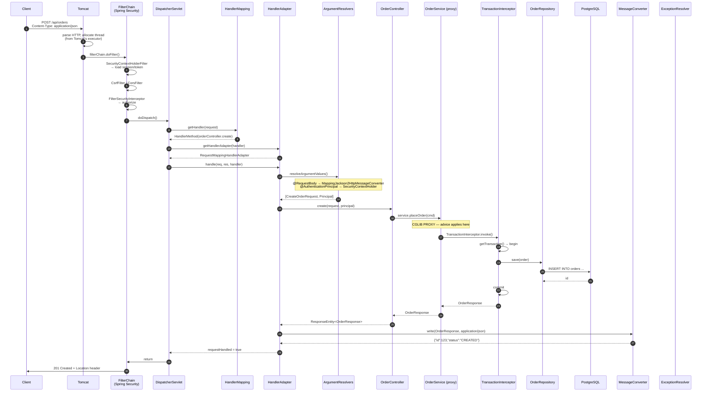
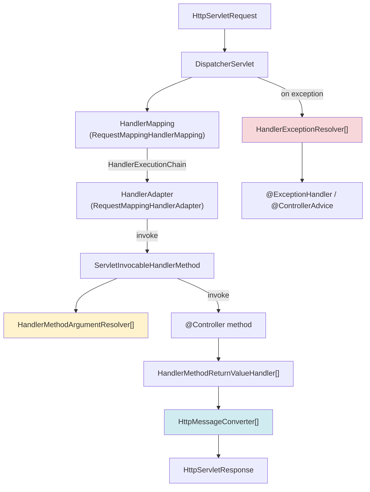

# 05 · Spring Boot Internal Working Flow: Startup & Request Lifecycle

> **Level:** Intermediate → Advanced
> **Interview Frequency:** ★★★★★ ("Walk me through what happens when a request comes in")
> **Prerequisite:** [04 · Actuator & Observability](./04-Actuator-and-Observability.md)
> **Last Updated:** 2026

---

## 📋 Table of Contents
- [0. TL;DR — The 30-Second Answer](#0-tldr--the-30-second-answer)
- [1. What & Why](#1-what--why)
- [2. Mental Model — two timelines](#2-mental-model--two-timelines)
- [3. Deep Dive — Theory](#3-deep-dive--theory)
- [4. Internal Working Mechanism](#4-internal-working-mechanism)
- [5. Step-by-Step Execution Flow](#5-step-by-step-execution-flow)
- [6. Architecture Diagrams](#6-architecture-diagrams)
- [7. Production-Level Use Cases](#7-production-level-use-cases)
- [8. Code Examples — Production-Grade](#8-code-examples--production-grade)
- [9. Common Mistakes & Gotchas](#9-common-mistakes--gotchas)
- [10. Performance Considerations](#10-performance-considerations)
- [11. Security Considerations](#11-security-considerations)
- [12. Best Practices — The Checklist](#12-best-practices--the-checklist)
- [13. Hands-On Exercises](#13-hands-on-exercises)
- [14. Code Challenges](#14-code-challenges)
- [15. Scenario-Based Questions](#15-scenario-based-questions)
- [16. Interview Q&A — Level-wise](#16-interview-qa--level-wise)
- [17. Counter- Questions & Traps](#17-counter--questions--traps)
- [18. Tricky Interview Questions](#18-tricky-interview-questions)
- [19. Follow-Up Questions Asked by Interviewers](#19-follow-up-questions-asked-by-interviewers)
- [20. Real 3–5 Year Experience Scenarios](#20-real-35-year-experience-scenarios)
- [21. Frequently Asked Production Issues](#21-frequently-asked-production-issues)
- [22. Debugging Scenarios](#22-debugging-scenarios)
- [23. Architecture Design Questions](#23-architecture-design-questions)
- [24. Rapid-Fire MCQs](#24-rapid-fire-mcqs)
- [25. Cheat Sheet — One-Page Summary](#25-cheat-sheet--one-page-summary)
- [26. Real-World Production Notes](#26-real-world-production-notes)
- [27. Follow-up Learning](#27-follow-up-learning)

---

## 0. TL;DR — The 30-Second Answer

- **Two timelines matter:** the **startup** timeline (once per process) and the **request** timeline
  (per request). Interviewers ask about both.
- **Startup in one sentence:** `SpringApplication.run()` → prepare the `Environment` → create the
  `ApplicationContext` → `refresh()` (12 steps) → `ApplicationRunner`s → `ApplicationReadyEvent`.
- **The embedded server is created in `onRefresh()` (step ⑨) but only *accepts traffic* in
  `finishRefresh()` (step ⑫).** Everything between (singleton instantiation) is your startup cost.
- **Per request:** Tomcat → Spring Security filter chain → `DispatcherServlet` → `HandlerMapping` →
  `HandlerAdapter` → controller → service → repository → response → filter chain unwinds.
- **`DispatcherServlet` is a `FrontController`** — it doesn't know your controllers; it delegates to
  `HandlerMapping`/`HandlerAdapter` strategies.
- **`HandlerAdapter` is the key abstraction** — it's why `@Controller`, `@RequestMapping`, and
  functional endpoints all work through the same path.
- **`@RequestBody`/`@ResponseBody` are handled by `HttpMessageConverter`s** — Jackson is one of
  them. The `Content-Type` selects the converter.
- **Argument resolution is pluggable** — `HandlerMethodArgumentResolver` implementations handle
  `@PathVariable`, `@RequestParam`, `@RequestHeader`, `@RequestBody`, `@AuthenticationPrincipal`,
  and custom types.
- **The filter chain runs BEFORE the DispatcherServlet, and OUTSIDE the `ApplicationContext` bean
  lifecycle** — a filter is a `jakarta.servlet.Filter`, not (usually) a Spring bean. This is why
  filters can't easily use Spring beans unless registered manually.
- **Exception handling happens in `DispatcherServlet.processHandlerException`** → `HandlerExceptionResolver`
  chain → `@ExceptionHandler` → `@ControllerAdvice` → `ResponseStatusExceptionResolver` → `DefaultHandlerExceptionResolver`.

---

## 1. What & Why

### The problem

Most developers use Spring MVC as a black box: put an annotation, it works. But at 3–5 years of
experience, the questions change:

- "Why does my filter run before/after my interceptor?"
- "Why is my `@RequestBody` empty?"
- "Why is the exception handler not catching it?"
- "Why did the app take 30 s to start?"
- "Can I make the startup faster?"

All of these are answered by understanding the **exact flow**. The flow is also the foundation for
**debugging**: if you know the sequence, you know where to look.

### The analogy — a restaurant

| Spring | Restaurant |
|--------|-----------|
| Tomcat | The front door / hostess seating area |
| Spring Security filter chain | The ID check at the entrance |
| `DispatcherServlet` | The **head waiter** — takes the order, routes it, hands it to the kitchen |
| `HandlerMapping` | The menu board / reservation book — "who handles table 5?" |
| `HandlerAdapter` | The **kitchen's protocol translator** — it knows how to talk to that specific cook |
| Controller | The cook who takes the order |
| Service | The prep kitchen |
| Repository / DB | The pantry |
| `HttpMessageConverter` | The translation between the order slip and the kitchen's format |
| `HandlerExceptionResolver` | The manager who handles complaints |

> The head waiter **never** cooks. `DispatcherServlet` never touches your business logic. It routes,
> translates and delegates. Understanding that is the whole chapter.

---

## 2. Mental Model — two timelines

```text
╔═══════════════════════ STARTUP (once per process) ═══════════════════════╗
║                                                                          ║
║  main()                                                                   ║
║    │                                                                      ║
║    ├─ prepareEnvironment     (property sources, profiles)                ║
║    ├─ createApplicationContext                                         ║
║    ├─ prepareContext            (scan + auto-config import)              ║
║    ├─ refresh() ─────────────────────────────────────────────┐            ║
║    │     ① prepareRefresh                                    │            ║
║    │     ② obtainFreshBeanFactory                           │            ║
║    │     ③④⑤ BeanFactoryPostProcessors  (@Configuration)   │            ║
║    │     ⑥   registerBeanPostProcessors    (AOP proxies)    │            ║
║    │     ⑦⑧   message source + event multicaster           │            ║
║    │     ⑨   onRefresh()      → Tomcat CREATED             │            ║
║    │     ⑩   registerListeners                              │            ║
║    │     ⑪   finishBeanFactoryInitialization → SINGLETONS   │            ║
║    │     ⑫   finishRefresh()    → Tomcat STARTS SERVING     │            ║
║    │                                                        │            ║
║    ├─ ApplicationRunner / CommandLineRunner  (YOUR CODE)                   ║
║    └─ ApplicationReadyEvent                                             ║
╚══════════════════════════════════════════════════════════════════════════╝

╔═══════════════════════ REQUEST (per request) ═══════════════════════════╗
║                                                                          ║
║  Client → Tomcat (accept, parse HTTP)                                    ║
║      → Spring Security FilterChain  (authN/authZ, SecurityContext)       ║
║      → DispatcherServlet.doDispatch()                                    ║
║           → HandlerMapping.getHandler()      → HandlerMethod              ║
║           → HandlerAdapter.handle()          → method invocation          ║
║                → argument resolvers (@PathVariable, @RequestBody, …)     ║
║                → Controller → Service → Repository → DB                  ║
║                → return value → ReturnValueHandler → HttpMessageConverter ║
║           → (on exception) HandlerExceptionResolver chain                 ║
║      ← response written, filter chain unwinds                            ║
╚══════════════════════════════════════════════════════════════════════════╝
```

---

## 3. Deep Dive — Theory

### 3.1 `DispatcherServlet` — the front controller

`DispatcherServlet` extends `FrameworkServlet` extends `HttpServlet`. It is registered with the
servlet container by `DispatcherServletRegistrationBean` (auto-configured by
`DispatcherServletAutoConfiguration`).

**`FrameworkServlet.processRequest()`:**

```java
protected final void processRequest(HttpServletRequest request, HttpServletResponse response) {
    long startTimestamp = System.currentTimeMillis();
    Object requestAttributes = getWebApplicationContext().getAutowireCapableBeanFactory()
            .resolveEmbeddedValue(request);          // ① resolve ${} in request params
    request.setAttribute(DispatcherServlet.WEB_APPLICATION_CONTEXT_ATTRIBUTE, ...);
    try {
        FrameworkServlet.processRequest(request, response);   // ② delegate to HttpServlet
    } catch (Exception ex) {
        dispatchException(request, response, ex);
    } finally {
        resetContextHolders(request, response);
        logRequestResult(request, response, startTimestamp);
    }
}
```

**`DispatcherServlet.doDispatch()` — the heart:**

```java
protected void doDispatch(HttpServletRequest request, HttpServletResponse response) {
    request.setAttribute(WEB_REQUEST_ATTRIBUTE, request);
    response.setAttribute(WEB_RESPONSE_ATTRIBUTE, response);

    try {
        ModelAndView mv = null;
        Exception dispatchException = null;

        // ── ① RESOLVE THE HANDLER ────────────────────────────────
        try {
            mv = getHandler(request);                       // HandlerMapping
        } catch (Exception ex) { dispatchException = ex; }

        // ── ② RESOLVE THE ADAPTER ───────────────────────────────
        HandlerExecutionChain mappedHandler = null;
        try {
            mappedHandler = getHandlerAdapter(mappedHandler); // HandlerAdapter
        } catch (Exception ex) { dispatchException = ex; }

        // ── ③ NO HANDLER → 404 / exception ──────────────────────
        if (mappedHandler == null) {
            noHandlerFound(request, response);
            return;
        }

        // ── ④ RENDER BEFORE (CORS pre-flight) ───────────────────
        CORS if (CorsUtils.isPreFlightRequest(request)) {
            executePreFlightHandler(request, response, mappedHandler);
            return;
        }

        // ── ⑤ RUN THE HANDLER ───────────────────────────────────
        try {
            mv = ha.handle(request, response, mappedHandler.getHandler());
        } catch (Exception ex) { dispatchException = ex; }

        // ── ⑥ EXCEPTION? → RESOLVE ──────────────────────────────
        if (dispatchException != null) {
            mv = processHandlerException(request, response, handler, mv, dispatchException);
        } else {
            mv = processDispatchResult(request, response, mv, mappedHandler);
        }
    } catch (Exception ex) {
        triggerAfterCompletion(request, response, null);   // always fires
    } finally {
        triggerAfterCompletion(request, response, mappedHandler);
    }
}
```

### 3.2 The `HandlerMapping` implementations (in order)

| HandlerMapping | Purpose |
|----------------|---------|
| `RequestMappingHandlerMapping` | `@RequestMapping` / `@GetMapping` etc. (ordered by `0`) |
| `WelcomePageHandlerMapping` | The welcome page (`index.html`) |
| `BeanNameUrlHandlerMapping` | Maps a bean **named** as a URL (e.g. bean `foo` → `/foo`) |
| `RouterFunctionMapping` | Functional routing (`RouterFunction`, WebFlux style) |
| `SimpleUrlHandlerMapping` | Explicit URL → bean mappings |
| `DefaultServletHttpRequestHandler` | The static-resource fallback (`/**`) |

`RequestMappingHandlerMapping` maintains a `RequestMappingInfo` registry:

```text
RequestMappingInfo
  ├── RequestMethodsRequestCondition      (GET, POST, …)
  ├── ConsumesRequestCondition           (Content-Type)
  ├── ProducesRequestCondition           (Accept)
  ├── ParamsRequestCondition             (query params)
  ├── HeadersRequestCondition            (headers)
  ├── PathPatternsRequestCondition       (URL path)
  └── CustomCondition                    (your own)
```

Matching is done by `getMatchingCondition` — the most specific match wins, with **ties broken by
the order of the conditions** (path > method > params > headers > consumes > produces).

### 3.3 The `HandlerAdapter` implementations

| HandlerAdapter | Handles |
|----------------|---------|
| `RequestMappingHandlerAdapter` | `@RequestMapping` handlers (the one you use) |
| `HttpRequestHandlerAdapter` | `HttpRequestHandler` beans (static resources) |
| `SimpleControllerHandlerAdapter` | Legacy `Controller` (extends `HttpServlet`) |
| `HandlerFunctionAdapter` | Functional `HandlerFunction` (WebFlux-style) |

`RequestMappingHandlerAdapter.handleInternal()` does the real work:

```java
protected ModelAndView handleInternal(HttpServletRequest request,
                                       HttpServletResponse response,
                                       Object handler) throws Exception {
    ModelAndView mav = new ModelAndView();

    // ① invoke the method, resolving arguments
    mavContainer.setRequestHandled(true);
    mavContainer.setRequest(request);
    mavContainer.setResponse(response);

    ServletInvocableHandlerMethod invocable = getServletInvocableMethod(handler);
    invocable.invokeAndHandle(request, response, mavContainer);

    // ② the return value is handled by ReturnValueHandlerComposite
    return mav;
}
```

### 3.4 Argument resolution — `HandlerMethodArgumentResolver`

`RequestMappingHandlerAdapter` registers these resolvers **in order**:

| # | Resolver | Handles |
|---|----------|---------|
| 1 | `RequestParamMethodArgumentResolver` | `@RequestParam`, simple types |
| 2 | `RequestResponseBodyMethodProcessor` | `@RequestBody`, `@ResponseBody` |
| 3 | `RequestPartMethodArgumentResolver` | `@RequestPart` (multipart) |
| 4 | `RequestHeaderMethodArgumentResolver` | `@RequestHeader` |
| 5 | `RequestAttributeMethodArgumentResolver` | `@RequestAttribute` |
| 6 | `ServletModelAttributeMethodProcessor` | `@ModelAttribute` / POJO binding |
| 7 | `ServletRequestMethodArgumentResolver` | `HttpServletRequest`, `HttpServletResponse`, `Session`, `Principal` |
| 8 | `PrincipalMethodArgumentResolver` | `java.security.Principal` |
| 9 | `RequestParamMethodArgumentResolver` (continued) | `@RequestParam` for beans |
| 10 | `SessionAttributeMethodArgumentResolver` | `@SessionAttribute` |
| 11 | `ServletCookieValueMethodArgumentResolver` | `@CookieValue` |
| 12 | `ExpressionValueMethodArgumentResolver` | `@Value` on parameters |
| 13 | `DefaultParameterHandlerMethodArgumentResolver` | simple types by name |
| 14 | **`RequestParamMethodArgumentResolver`** | fallback for simple types |
| 15 | **Custom resolvers** | **your `HandlerMethodArgumentResolver` beans** |

**`ServletModelAttributeMethodProcessor` (the @ModelAttribute resolver) is the one with a surprise:**
if the parameter type is a **simple type** (String, int, …) it *delegates* to the `DefaultParameterHandlerMethodArgumentResolver`;
if it's a **complex type**, it does **data binding** — and for a `@RequestParam`-less complex
parameter, it will try to instantiate the object and bind request parameters to it, which is
classically confusing.

### 3.5 Return value handling — `HandlerMethodReturnValueHandler`

| Handler | Handles |
|---------|---------|
| `ModelAndViewMethodReturnValueHandler` | `ModelAndView` |
| `ModelMethodProcessor` | `Model` |
| `ViewMethodReturnValueHandler` | `View` |
| `ResponseBodyEmitterReturnValueHandler` | `ResponseBodyEmitter` / `SseEmitter` |
| `StreamingResponseBodyReturnValueHandler` | `StreamingResponseBody` |
| `HttpEntityMethodProcessor` | `ResponseEntity` |
| `HttpHeadersReturnValueHandler` | `HttpHeaders` |
| `CallableMethodReturnValueHandler` | `Callable<T>` (async) |
| `DeferredResultMethodReturnValueHandler` | `DeferredResult<T>` (async) |
| `AsyncTaskMethodReturnValueHandler` | `AsyncTask` |
| **`RequestResponseBodyMethodProcessor`** | **`@ResponseBody` — uses `HttpMessageConverter`** |
| `DefaultHandlerMethodReturnValueHandler` | `String` (view name) / other |

**Important:** a `String` return value from a `@RestController` is treated as the **body** (because
`@ResponseBody` is on the class), but in a plain `@Controller` it's a **view name**.

### 3.6 `HttpMessageConverter` — the content negotiation layer

```text
Request:
  Content-Type: application/json
     → RequestResponseBodyMethodProcessor asks the converter list
     → MappingJackson2HttpMessageConverter.canRead(ResolvableType, MediaType) → true
     → reads the body into a Java object

Response:
  Accept: application/json  (or the client sends */*)
     → the first converter that canWrite(type, mediaType) wins
```

Converters shipped by Boot (order matters — the first match wins):
`ByteArrayHttpMessageConverter`, `StringHttpMessageConverter`,
`ResourceHttpMessageConverter`, `AllEncompassingFormHttpMessageConverter`,
`MappingJackson2HttpMessageConverter`, `MappingJackson2XmlHttpMessageConverter`,
`Jaxb2XmlHttpMessageConverter`, `AllEncompassingFormHttpMessageConverter`.

**`MappingJackson2HttpMessageConverter` is what makes `@RequestBody` work** — and it is
auto-configured by `JacksonAutoConfiguration` with a customised `ObjectMapper`.

### 3.7 The exception resolver chain

`DispatcherServlet.processHandlerException()`:

```java
for (HandlerExceptionResolver resolver : getExceptionResolvers()) {
    ModelAndView mav = resolver.resolveException(request, response, handler, ex);
    if (mav != null) { mavContainer.setRequestHandled(true); return mav; }
}
throw ex;   // unhandled → Tomcat's error handling → 500
```

The resolvers, in order:

| # | Resolver | Handles |
|---|----------|---------|
| 1 | `ExceptionHandlerExceptionResolver` | `@ExceptionHandler` methods (controller or `@ControllerAdvice`) |
| 2 | `ResponseStatusExceptionResolver` | `@ResponseStatus`, `ResponseStatusException` |
| 3 | `DefaultHandlerExceptionResolver` | Built-in MVC exceptions (404, 405, 415, 400 …) |

**`ExceptionHandlerExceptionResolver`'s algorithm:**
1. Look for `@ExceptionHandler` in the **handler's own class**.
2. If not found, walk **up the controller hierarchy**.
3. If not found, look in `@ControllerAdvice` beans — **in order**, and the advice's
   `getAnnotation()` filter (`@ControllerAdvice(assignableTypes=…, annotations=…)`) is applied.
4. The **first advice with a matching method wins**; if an advice matches but its method throws,
   the next advice is tried (unless the exception is already handled).

**Common mistake:** a `@ControllerAdvice` with `basePackages` that doesn't match the controller's
package → the handler is never found → 500.

### 3.8 Filters vs Interceptors — the exact order

```text
Servlet Container
  └─ Filter Chain (jakarta.servlet.Filter)          ← OUTSIDE Spring MVC
       ├─ Spring Security's FilterChainProxy
       │    ├─ DisableEncodeUrlFilter
       │    ├─ WebAsyncManagerIntegrationFilter
       │    ├─ SecurityContextHolderFilter
       │    ├─ HeaderWriterFilter
       │    ├─ CorsFilter / CsrfFilter
       │    ├─ LogoutFilter
       │    ├─ UsernamePasswordAuthenticationFilter
       │    ├─ ... OAuth2 / JWT filters ...
       │    └─ FilterSecurityInterceptor → AuthorizationFilter
       ├─ (your custom filters)
       └─ DispatcherServlet
            └─ HandlerInterceptor.preHandle()      ← INSIDE Spring MVC
                 → Controller
                 → HandlerInterceptor.postHandle()
            → HandlerInterceptor.afterCompletion()
       ← (your custom filters, unwinding)
  ← Response
```

**Key facts:**
- Filters are **servlet-level**; they run for **every** request including those not handled by
  Spring MVC (static resources, error dispatches).
- Interceptors are **Spring MVC-level**; they only run for handlers that `HandlerMapping`
  resolved.
- `preHandle` runs in **forward** order; `postHandle` runs in **reverse** order; `afterCompletion`
  runs in **reverse** order of `preHandle` that completed.
- `postHandle` is **NOT** called if the handler throws (that's why `afterCompletion` is the right
  place for cleanup).

---

## 4. Internal Working Mechanism

### 4.1 Who creates the `DispatcherServlet`?

```text
DispatcherServletAutoConfiguration
  @ConditionalOnClass(DispatcherServlet.class)
  @ConditionalOnWebApplication(type = SERVLET)
  └─ DispatcherServletRegistrationConfiguration
       └─ DispatcherServletRegistrationBean
            │  registers a DispatcherServlet at the "dispatcherServlet" bean name
            │  mapped to "/"  (the default servlet mapping)
            └─ DispatcherServlet.properties  →  the "dispatcherServlet" bean
```

**Important:** the `DispatcherServlet` is created by the **servlet container** (Tomcat), not by
Spring. It then gets its `WebApplicationContext` injected. This is why you must use
`@EnableWebMvc`/Boot's auto-config for a proper `DispatcherServlet`, and why a raw
`@RestController` in a non-web context does nothing.

### 4.2 `RequestMappingHandlerMapping` — how a handler is found

```java
protected RequestHandlerInfo getHandlerInternal(HttpServletRequest request) throws Exception {
    // 1. look up by the direct path
    RequestMappingInfo info = getMappingForHandlerMethod(handler, request);
    if (info != null) { return new RequestHandlerInfo(info, handler); }

    // 2. look up by pattern (PathPattern or AntPathMatcher)
    info = getMappingForHandlerMethod(handler, request, ...);
    ...
}
```

The lookup uses a `Map<RequestMappingInfo, HandlerMethod>`, and matching is done by
`RequestMappingInfo.getMatchingCondition(request)`:

```java
public RequestMappingInfo getMatchingCondition(HttpServletRequest request) {
    RequestMethodsRequestCondition methodCondition = this.methodsCondition.getMatchingCondition(request);
    if (methodCondition == null) return null;
    ConsumesRequestCondition consumesCondition = this.consumesCondition.getMatchingCondition(request);
    if (consumesCondition == null) return null;
    ProducesRequestCondition producesCondition = this.producesCondition.getMatchingCondition(request);
    if (producesCondition == null) return null;
    ParamsRequestCondition paramsCondition = this.paramsCondition.getMatchingCondition(request);
    if (paramsCondition == null) return null;
    HeadersRequestCondition headersCondition = this.headersCondition.getMatchingCondition(request);
    if (headersCondition == null) return null;
    CustomCondition customCondition = this.customConditionHolder.getMatchingCondition(request);
    if (customCondition == null) return null;
    return new RequestMappingInfo(this.name, methodCondition, consumesCondition,
            producesCondition, paramsCondition, headersCondition, customCondition);
}
```

> **Caption:** This "each condition must match, and the *most specific* match wins" design is why
> a `@GetMapping("/orders")` and a `@GetMapping("/orders/{id}")` coexist, and why a
> `@PostMapping(consumes="application/json")` rejects a form post with **415**, not 404.

### 4.3 The `invocable` method invocation

`ServletInvocableHandlerMethod.invokeAndHandle()`:

```text
1. getBridgedMethod()               → resolves bridge methods (generics)
2. new ServletMethodParameters()     → resolves @PathVariable etc.
3. invokeHandlerMethod(...)          → the reflective call
     └─ InvocableHandlerMethod.doInvoke()
          └─ getMethodArgumentValues()
               └─ resolveArgumentValues()   ← HandlerMethodArgumentResolver list
          └─ doInvoke()                   ← reflection: method.invoke(args)
4. returnValueHandlers.handleReturnValue(...)  ← @ResponseBody → Jackson
```

**Performance note:** Spring 6 uses `MethodHandle`-based invocation
(`InvocableHandlerMethod` with `MethodHandle` caching) instead of plain reflection, which is
noticeably faster and avoids the `setAccessible` cost. The `MethodHandle` is cached per
`Method` in `InvocableHandlerMethod`.

### 4.4 `@Transactional` and the request timeline

```text
DispatcherServlet.doDispatch()
  → HandlerAdapter.handle()
     → invocable.invokeAndHandle()
        → controller method
           → service.doWork()
              → serviceProxy.doWork()      ← CGLIB/JDK PROXY (created at startup)
                 → TransactionInterceptor.invoke()   ← @Transactional advice
                    → PlatformTransactionManager.getTransaction()
                    → target.doWork()       ← the REAL method
                    → commit / rollback
```

**Critical:** the proxy is invoked at step "serviceProxy" — that is why:
- `this.doWork()` (self-invocation) bypasses the proxy → **no transaction**;
- a `private` method can't be advised → **no transaction**;
- a `final` method can't be CGLIB-proxied → **no transaction**.

---

## 5. Step-by-Step Execution Flow

### 5.1 A full request: `POST /api/orders`



### 5.2 The same request, but the controller throws

```text
1-14  (same as above)
15    Controller throws ValidationException
16    HandlerAdapter propagates the exception
17    DispatcherServlet catches → dispatchException != null
18    → processHandlerException(request, response, handler, mv, ex)
19       → getExceptionResolvers()  [ExceptionHandlerExceptionResolver,
                                    ResponseStatusExceptionResolver,
                                    DefaultHandlerExceptionResolver]
20    → ExceptionHandlerExceptionResolver:
        a) look for @ExceptionHandler in the controller class     → found
        b) invoke it → build a ResponseEntity with the error body
21    → response written, requestHandled = true
22    → triggerAfterCompletion() → interceptor.afterCompletion() runs
23    → filter chain unwinds
```

**If no handler is found** in step 20, the next resolver runs; if none handles it, the exception
re-thrown → Tomcat's default error handling → the `/error` dispatch → `BasicErrorController` →
a JSON error body (for a REST API) or the `error.html` view.

### 5.3 Startup: the exact class sequence

```text
ShopApplication.main()
 └─ SpringApplication.run(ShopApplication.class, args)
     ├─ prepareEnvironment()
     │   ├─ getEnvironment()  → StandardEnvironment (or ApplicationEnvironment)
     │   ├─ configureEnvironment()  → add default properties
     │   ├─ listeners.environmentPrepared(...)  → ConfigDataEnvironmentPostProcessor
     │   │      loads application.yml, application-{profile}.yml
     │   └─ listeners.contextPrepared(...)  → LoggingApplicationListener prints the banner
     ├─ createApplicationContext()
     │      → deduceWebApplicationType() → SERVLET (because DispatcherServlet is present)
     │      → new ServletWebServerApplicationContext()
     ├─ prepareContext()
     │   ├─ context.setEnvironment(env)
     │   ├─ context.setParent(parent)  / setApplicationStartup
     │   ├─ applyInitializers(context)   ← ApplicationContextInitializer beans
     │   ├─ load(context, sources)   → ConfigurationClassPostProcessor runs
     │   │      → @ComponentScan finds @Component classes
     │   │      → @EnableAutoConfiguration imports the auto-configs
     │   │      → @Bean methods become BeanDefinitions
     │   ├─ listeners.contextPrepared(context)
     │   └─ printBanner
     ├─ refreshContext(context)
     │   └─ AbstractApplicationContext.refresh()  ← the 12 steps
     ├─ afterRefresh(context) → listeners.started(context)
     ├─ callRunners(context, args)   → @Order-ed ApplicationRunner / CommandLineRunner
     └─ listeners.running(context)   → ApplicationReadyEvent
```

---

## 6. Architecture Diagrams

### 6.1 The MVC component map



> **Caption:** Yellow = argument resolution, blue = message conversion, red = exception handling.
> These are the three "extension points" that answer most "why did my controller not work" questions.

### 6.2 The interceptor lifecycle

```text
   preHandle(A) ──▶ preHandle(B) ──▶ [CONTROLLER] ──▶ postHandle(B) ──▶ postHandle(A)
        │                                                                │
        └──────────────────── afterCompletion(A) ◀── afterCompletion(B) ─┘

   ⚠ postHandle is skipped entirely if the handler throws
   ⚠ afterCompletion ALWAYS runs (with ex != null in that case)
   ⚠ if preHandle(B) returns false → afterCompletion(A) runs, B and the controller are skipped
```

### 6.3 Where the transaction boundary sits

```text
   [Tomcat thread]
      │
      ▼
   [Filter chain]            ← no transaction
      │
      ▼
   [DispatcherServlet]        ← no transaction
      │
      ▼
   [Controller]               ← no transaction (usually)
      │
      ▼
   [Service PROXY]            ← ★ TRANSACTION STARTS HERE
      │  TransactionInterceptor
      ▼
   [Repository]
      │
      ▼
   [DB]                      ← ★ COMMIT / ROLLBACK HERE
      │
      ▼
   [Service] returns → [Controller] → [serialise]
      │
      ▼
   [Filter chain unwinds]     ← no transaction
```

---

## 7. Production-Level Use Cases

| Context | Pattern | Why |
|---------|---------|-----|
| **Payment authorisation** | `@Transactional` on the **service**, not the controller | The transaction must cover validation + the write, and the controller's return value must be produced *inside* the transaction |
| **Request logging** | A `Filter` (not an interceptor) if you want to log **all** requests including static resources and error dispatches; an `Interceptor` if you want only controller-handled requests | Filters see everything |
| **Request correlation** | A `Filter` that sets the MDC `traceId` and adds the `X-Request-Id` response header — must wrap everything, including error paths | Interceptors don't run on error dispatches |
| **Rate limiting** | A `Filter` (or a Spring Security filter) so it applies **before** the controller and ideally before authentication work | An interceptor runs after the security chain |
| **MDC cleanup** | `Filter` with `try/finally` clearing the MDC — Tomcat pools threads, so a stale MDC leaks into the next request | Thread-local leakage is a classic bug |
| **Response compression** | A `Filter` (`ShallowEtagHeaderFilter` or a gzip filter) | Operates on the raw byte stream |
| **Async requests** | `Callable`/`DeferredResult` → the filter chain unwinds at the **start** of async processing and re-enters at the end | `postHandle` runs on the async dispatch |
| **Long-running report** | `StreamingResponseBody` or `SseEmitter` — the response starts before the data is ready | Keeps the connection open; needs a write timeout |

---

## 8. Code Examples — Production-Grade

### 8.1 A correlation-ID filter (the correct, production-grade version)

```java
@Component
@Order(Ordered.HIGHEST_PRECEDENCE)
public class CorrelationIdFilter extends OncePerRequestFilter {

    public static final String HEADER = "X-Request-Id";
    private static final String MDC_KEY = "requestId";

    @Override
    protected void doFilterInternal(HttpServletRequest request,
                                    HttpServletResponse response,
                                    FilterChain filterChain) throws ServletException, IOException {
        String requestId = request.getHeader(HEADER);
        if (requestId == null || requestId.isBlank()) {
            requestId = UUID.randomUUID().toString();
        }
        // Only accept a safe charset/length to avoid log injection
        requestId = requestId.replaceAll("[^A-Za-z0-9._-]", "").substring(0, Math.min(64, requestId.length()));

        MDC.put(MDC_KEY, requestId);
        response.setHeader(HEADER, requestId);
        try {
            filterChain.doFilter(request, response);
        } finally {
            // ⚠ Tomcat reuses threads — MUST clear, or the next request inherits this id
            MDC.remove(MDC_KEY);
        }
    }
}
```

```yaml
logging:
  pattern:
    console: "%d{HH:mm:ss.SSS} [%thread] %-5level %logger{36} [reqId=%X{requestId}] - %msg%n"
```

### 8.2 A proper `HandlerInterceptor`

```java
@Component
public class AuthorizationInterceptor implements HandlerInterceptor {

    private final AuditService audit;

    public AuthorizationInterceptor(AuditService audit) { this.audit = audit; }

    @Override
    public boolean preHandle(HttpServletRequest request, HttpServletResponse response,
                             Object handler) throws Exception {
        if (handler instanceof HandlerMethod hm) {
            audit.recordAccess(request.getRequestURI(), hm.getBeanType().getSimpleName());
        }
        return true;   // false → the controller is skipped, response already committed
    }

    @Override
    public void afterCompletion(HttpServletRequest request, HttpServletResponse response,
                                Object handler, Exception ex) {
        // ALWAYS runs — put cleanup here, not in postHandle
        audit.flush();
    }
}
```

```java
@Configuration
public class WebConfig implements WebMvcConfigurer {

    @Override
    public void addInterceptors(InterceptorRegistry registry) {
        registry.addInterceptor(authorizationInterceptor)
               .addPathPatterns("/api/**")
               .excludePathPatterns("/api/public/**", "/actuator/**");
        // .order(1)  → ordering matters
    }
}
```

### 8.3 A custom `HandlerMethodArgumentResolver`

```java
@Component
public class CurrentUserArgumentResolver implements HandlerMethodArgumentResolver {

    private final CurrentUserService currentUser;

    public CurrentUserArgumentResolver(CurrentUserService currentUser) {
        this.currentUser = currentUser;
    }

    @Override
    public boolean supportsParameter(MethodParameter parameter) {
        return CurrentUser.class.equals(parameter.getParameterType());
    }

    @Override
    public Object resolveArgument(MethodParameter parameter, ModelAndViewContainer mav,
                                  NativeWebRequest webRequest, WebDataBinderFactory binderFactory) {
        Authentication auth = SecurityContextHolder.getContext().getAuthentication();
        if (auth == null || !auth.isAuthenticated()) {
            throw new AccessDeniedException("No authenticated user");
        }
        return currentUser.load(auth.getName());
    }
}
```

```java
@RestController
@RequestMapping("/api/orders")
public class OrderController {

    @GetMapping("/{id}")
    public OrderDto get(@PathVariable Long id, CurrentUser user) {   // ← resolved by our resolver
        return service.get(id, user.tenantId());
    }
}
```

### 8.4 A global exception handler (RFC 7807 `ProblemDetail`)

```java
@RestControllerAdvice
public class GlobalExceptionHandler {

    private static final Logger log = LoggerFactory.getLogger(GlobalExceptionHandler.class);

    @ExceptionHandler(MethodArgumentNotValidException.class)
    public ProblemDetail handleValidation(MethodArgumentNotValidException ex) {
        ProblemDetail pd = ProblemDetail.forStatus(HttpStatus.BAD_REQUEST);
        pd.setTitle("Validation failed");
        pd.setProperty("errors", ex.getBindingResult().getFieldErrors().stream()
                .map(fe -> Map.of("field", fe.getField(),
                                  "message", fe.getDefaultMessage() == null ? "invalid" : fe.getDefaultMessage()))
                .toList());
        return pd;
    }

    @ExceptionHandler(OrderNotFoundException.class)
    public ProblemDetail handleNotFound(OrderNotFoundException ex) {
        ProblemDetail pd = ProblemDetail.forStatus(HttpStatus.NOT_FOUND);
        pd.setTitle("Order not found");
        pd.setDetail(ex.getMessage());
        return pd;
    }

    @ExceptionHandler(DataIntegrityViolationException.class)
    public ProblemDetail handleConstraint(DataIntegrityViolationException ex) {
        // ⚠ NEVER leak the SQL / constraint name to the client
        log.warn("Data integrity violation", ex);
        return ProblemDetail.forStatus(HttpStatus.CONFLICT);
    }

    @ExceptionHandler(Exception.class)
    public ProblemDetail handleUnexpected(Exception ex) {
        log.error("Unhandled exception", ex);
        ProblemDetail pd = ProblemDetail.forStatus(HttpStatus.INTERNAL_SERVER_ERROR);
        pd.setTitle("Internal error");
        pd.setProperty("traceId", MDC.get("requestId"));   // so support can find the log
        return pd;
    }
}
```

### 8.5 A `ResponseBodyAdvice` to standardise every response

```java
@Component
public class ApiResponseAdvice implements ResponseBodyAdvice<Object> {

    @Override
    public boolean supports(MethodParameter returnType, Class<? extends HttpMessageConverter<?>> converterType) {
        // only for our own API package, not for actuator or framework types
        return returnType.getContainingClass() != null
            && returnType.getContainingClass().getPackageName().startsWith("com.acme.api");
    }

    @Override
    public Object beforeBodyWrite(Object body, MethodParameter returnType, MediaType selectedContentType,
                                  Class<? extends HttpMessageConverter<?>> converterType,
                                  ServerHttpRequest request, ServerHttpResponse response) {
        if (body instanceof ApiResponse<?> already) return already;
        return ApiResponse.ok(body);
    }
}
```

### 8.6 An interceptor that must not break on error dispatch

```java
// ⚠ A common bug: using @RequestMapping on the interceptor's method
@Component
public class AuthInterceptor implements HandlerInterceptor {

    @Override
    public boolean preHandle(HttpServletRequest request, HttpServletResponse response, Object handler) {
        if (request.getDispatcherType() == DispatcherType.ERROR) {
            return true;   // never block the error path
        }
        // ...
        return true;
    }
}
```

---

## 9. Common Mistakes & Gotchas

| # | ❌ Wrong | ✅ Right | Why |
|---|----------|----------|-----|
| 1 | `@Transactional` on a `private` method | Make it `public`/`protected` (and non-final) | CGLIB can't advise private methods |
| 2 | `@Transactional` on a method called via `this.method()` | Move the call to another bean, or inject self-proxy | Self-invocation bypasses the proxy |
| 3 | `@Transactional` on the controller | Put it on the service | The controller's response is produced outside the transaction |
| 4 | A filter using `@Autowired` constructor injection | Register it as a `FilterRegistrationBean` bean | A `Filter` is created by the container, not Spring — constructor injection silently doesn't happen |
| 5 | Clearing the MDC in `postHandle` | Clear it in a `finally` in the filter | `postHandle` doesn't run on exceptions |
| 6 | `@ExceptionHandler` in a controller that isn't the one that threw | Use `@RestControllerAdvice` | The handler must be in the controller's class or an advice |
| 7 | `@ControllerAdvice` with a `basePackages` that doesn't match | Fix the package or remove the restriction | The advice is never consulted |
| 8 | Returning `String` from a `@RestController` and expecting a view | Use `ResponseEntity` or a DTO | `@ResponseBody` makes the String the body |
| 9 | `@RequestBody` on a `GET` request | Use `@RequestParam` | The body of a GET is unusual; the resolver won't find a body |
| 10 | `@RequestBody` with `Content-Type: application/x-www-form-urlencoded` | Use `@ModelAttribute` | The message converter doesn't match → 415 |
| 11 | A filter that reads the request body | Wrap with `ContentCachingRequestWrapper` | The stream is consumed |
| 12 | Assuming `postHandle` runs after an exception | Use `afterCompletion` | `postHandle` is skipped on exception |
| 13 | Registering a `Filter` as a `@Component` **and** via `FilterRegistrationBean` | Pick one | The filter runs twice |
| 14 | Expecting `@Value` on a method parameter to work with a complex type | Register a custom argument resolver | The default resolver only handles simple types |
| 15 | Catching `Exception` in the controller and returning 200 | Let the `@ControllerAdvice` handle it | Silent failures hide bugs |
| 16 | `HttpServletRequest` in a `WebClient` call | Use `RestClient`/`WebClient` | Blocking the Tomcat thread |

---

## 10. Performance Considerations

| Knob | Default | Guidance | Impact |
|------|---------|----------|--------|
| `server.tomcat.threads.max` | 200 | `concurrency = throughput × latency` | The real capacity knob |
| `server.tomcat.accept-count` | 100 | Raise with the thread pool | Backlog before rejection |
| `server.tomcat.max-connections` | 8192 | ≥ threads.max | Connection handling |
| `server.tomcat.threads.max-keep-alive` | 60 s | — | Thread reuse cost |
| `server.tomcat.max-http-form-post-size` | 2 MB | — | Form limits |
| `spring.mvc.log-resolved-exception` | false | Enable in dev | |
| `spring.mvc.throw-exception-if-no-handler-found` | false | true in dev | 404 vs NoHandlerFoundException |
| `spring.web.resources.add-mappings` | true | false for a pure API | Saves a resource handler |
| `server.compression.enabled` | false | true + `mime-types` for JSON | CPU vs bandwidth |
| `spring.jackson.serialization-inclusion` | — | `NON_NULL` | Smaller payloads |
| `@ResponseBody` + DTO vs entity | — | Always DTO | Avoids lazy-loading and over-fetching |
| Spring 6 `MethodHandle` invocation | — | Automatic | ~2–3× faster than plain reflection |

**Async servlet:** `spring.mvc.async.request-timeout` (default is the container's, 30 s for Tomcat);
`server.tomcat.threads.max` should be raised if you use many async requests (the thread is released
while waiting).

---

## 11. Security Considerations

| Risk | Mitigation |
|------|-----------|
| **Filter ordering** | Spring Security's chain must run **first** — register your filters with
`@Order(Ordered.HIGHEST_PRECEDENCE + n)` or via `FilterRegistrationBean.setOrder(...)` |
| **CORS pre-flight** | Handled in `doDispatch` **before** the handler; a filter for CORS also works, but don't do both |
| **CSRF** | Spring Security's `CsrfFilter` runs in the filter chain, not as an interceptor |
| **Request body logging** | Never log the body of an auth/registration endpoint; wrap and redact |
| **MDC/log injection** | Sanitise the request id (as in the example above) — a newline in a header can forge log lines |
| **Mass assignment** | Never bind request params straight to an entity; use a DTO with explicit fields |
| **Over-fetching** | Returning entities leaks fields (password hash, internal flags) — always map to a DTO |
| **Error leakage** | A generic `Exception` handler must not return the stack trace or the SQL |
| **Path traversal** | Never build file paths from user input; use `Path.resolve(...).normalize()` and check `startsWith` |
| **Async + security context** | The `SecurityContext` is not propagated to the async thread by default — capture it explicitly |

---

## 12. Best Practices — The Checklist

- [ ] Put `@Transactional` on the **service**, `public`, non-final, and avoid self-invocation.
- [ ] Register filters via `FilterRegistrationBean` (so Spring can inject dependencies and you
      control the order) — never as a bare `@Component` *and* a registration bean.
- [ ] Clear MDC/ThreadLocals in a `finally` block.
- [ ] Use `@RestControllerAdvice` + `ProblemDetail` (RFC 7807) for a consistent error contract.
- [ ] Map entities to **DTOs** — never return JPA entities from controllers.
- [ ] Use `HandlerMethodArgumentResolver` for custom argument types instead of scattering
      `SecurityContextHolder.getContext().getAuthentication()` through controllers.
- [ ] Use `ResponseBodyAdvice` for a uniform response envelope — but keep it opt-in per package.
- [ ] Set `server.shutdown=graceful` so in-flight requests finish.
- [ ] Set explicit timeouts on every outbound call (`RestClient`/`WebClient`).
- [ ] Never block the Tomcat thread on a remote call — use `WebClient` or an async controller.
- [ ] Enable `spring.mvc.log-resolved-exception=true` in dev only.
- [ ] Keep the `DispatcherServlet` mapping at `/` but disable static resource handling for a pure
      API (`spring.web.resources.add-mappings=false`).
- [ ] Log the request id in **every** log line (MDC) and return it in the response header.

---

## 13. Hands-On Exercises

**🧪 Lab 1 — Trace a request with a debugger**
1. Set a breakpoint in `DispatcherServlet.doDispatch()` and in your controller.
2. Step through and identify: the `HandlerExecutionChain`, the `HandlerAdapter`, the argument
   resolvers used, and the return value handler.
3. Repeat for a request that throws.

**✅ Success signal:** You can name the exact class for each step without looking.

**🧪 Lab 2 — Filter vs interceptor ordering**
1. Write a filter and an interceptor that both log.
2. Send a request to a controller → note the order.
3. Send a request to a **non-existent URL** → the filter logs, the interceptor does not.
4. Send a request to a static resource → the filter logs, the interceptor does not.

**✅ Success signal:** You can predict the log order for all three cases.

**🧪 Lab 3 — The self-invocation trap**
1. Create a service with `@Transactional` on `methodA()`, and `methodB()` that calls
   `this.methodA()`.
2. Call `methodB()` → check the logs → **no transaction**.
3. Move `methodA()` to another bean → the transaction appears.

**✅ Success signal:** You've seen the bug, not just read about it.

**🧪 Lab 4 — The `PostHandle` trap**
1. Add `postHandle` and `afterCompletion` logging to an interceptor.
2. Make the controller throw → `postHandle` is missing, `afterCompletion` is present.

**✅ Success signal:** You can explain why `afterCompletion` is the only safe cleanup hook.

---

## 14. Code Challenges

### Challenge 1 — A "client info" argument resolver (medium)
**Goal:** Resolve a `ClientInfo` record (`ip`, `userAgent`, `requestId`) into any controller
method parameter.

**Test cases:** a method with `ClientInfo` resolves it; a method without it is unaffected; the IP
respects `X-Forwarded-For` **only** when the app is behind a trusted proxy (otherwise it is
spoofable).

### Challenge 2 — A request-timing filter with a `ThreadLocal` (medium)
**Goal:** Measure the total request time, put it in the MDC, and expose it as a `Timer` metric
labelled by the **URI template** (not the raw URI).

**Test cases:** the timer is recorded with a bounded tag; the MDC is cleared after the request
(verify with a second request in the same thread).

### Challenge 3 — A uniform error contract (hard)
**Goal:** Implement a `@RestControllerAdvice` that returns RFC 7807 `ProblemDetail` for every
exception type, with a `traceId` property, and **never** leaks the stack trace, SQL, or internal
class names. Add a test that throws 10 different exceptions and asserts the shape.

**Extra:** map `HttpMessageNotReadableException` → 400 (not 500) — a very common real-world bug.

---

## 15. Scenario-Based Questions

**S1.** *A `@Transactional` method that saves an order works in the controller test but does NOT roll
back in production when an exception is thrown. What are the likely causes?*

> **Expected answer:** Work through the checklist: (1) **Self-invocation** — the transactional method
> is called from another method of the same class; the proxy is bypassed. (2) **The exception is
> caught** inside the transactional method, so the transaction commits normally — a
> `try/catch` that swallows the exception is the #1 cause. (3) **The exception is not a
> `RuntimeException`** — `@Transactional` rolls back only on unchecked exceptions and errors by
> default; a checked exception commits the transaction (you need `rollbackFor`). (4) **A different
> transaction manager** — the method has a `@Transactional` with a `transactionManager` that isn't
> the JPA one. (5) **The exception is thrown after the transaction ends** (e.g. during JSON
> serialisation, which happens *outside* the service's transaction) — this is very common: the
> save succeeds, then serialisation fails. (6) **The method is private/final.** (7) The bean was
> created in a way that bypasses the proxy (e.g. `new` inside another class). The diagnosis tool:
> put a log in the transactional method and check `TransactionSynchronizationManager.isActualTransactionActive()`
> — if it's false, the transaction isn't there.

**S2.** *Your REST endpoint returns 200 with an empty body for a request that should have returned
an object. Where do you look?*

> **Expected answer:** (1) Is the controller annotated `@RestController` (or does the method have
> `@ResponseBody`)? A plain `@Controller` returning an object is treated as a **model** for the
> view, and the body may be empty. (2) Is the return type `void`/`ResponseEntity<Void>`? (3) Is
> there a `ResponseBodyAdvice` that swallowed it? (4) Is a `HttpMessageConverter` able to write the
> type? If no converter matches, Spring throws `HttpMediaTypeNotAcceptableException` (406) rather
> than an empty body — so an empty 200 usually means the method returned `null` and the converter
> wrote nothing. (5) Check `supports()` in your `ResponseBodyAdvice` — if it returns false for
> your type, it's skipped. (6) Check whether an `Exception` was thrown and swallowed by a
> `@ExceptionHandler` that returns `null`.

**S3.** *After a refactor, an interceptor stops running for some endpoints. Why?*

> **Expected answer:** The most likely causes: (1) the interceptor was registered with
> `addPathPatterns` that no longer match (a path variable or a trailing slash change);
> (2) the handler is a **functional endpoint** (`RouterFunction`) — `HandlerInterceptor`s only apply
> to `HandlerMethod`-based handlers, so functional routes bypass them; (3) the endpoint is served by
> a **different `DispatcherServlet`** or by a resource handler; (4) the interceptor was added to the
> `WebMvcConfigurer` of a configuration class that is no longer imported (component scan change);
> (5) the request is an **async** dispatch — `preHandle` runs once, `postHandle`/`afterCompletion`
> run on the async dispatch; (6) an **error dispatch** — the interceptor is skipped unless
> explicitly configured (`registry.addInterceptor(...).dispatchTypes(DispatchType.ERROR)`);
> (7) the endpoint is under `/actuator` or another path excluded by the pattern.

---

## 16. Interview Q&A — Level-wise

### 🟢 Beginner
**Q: What is `DispatcherServlet`?**
**A:** The Spring MVC front controller. It receives every request, delegates to a `HandlerMapping`
to find the handler, invokes it through a `HandlerAdapter`, handles exceptions via
`HandlerExceptionResolver`s, and writes the response. It doesn't contain business logic.

**Q: What is a `Controller`?**
**A:** A class annotated with `@Controller` (view-oriented) or `@RestController` (JSON-oriented)
whose methods are mapped to HTTP requests via `@RequestMapping`/`@GetMapping` etc.

**Q: What is `ModelAndView`?**
**A:** A container for the model (data) and the view name. In a REST API with `@RestController` it's
usually irrelevant — the return value is written directly to the response body.

**Q: What does `@RequestBody` do?**
**A:** It tells Spring to deserialize the HTTP request body into the method parameter, using the
`HttpMessageConverter` that matches the `Content-Type` (usually Jackson for JSON).

### 🟡 Intermediate
**Q: Walk me through what happens when a request hits a Spring Boot app.**
**A:** Tomcat accepts the connection and dispatches to the servlet filter chain. Spring Security's
filter chain authenticates and authorises, populating the `SecurityContext`. The
`DispatcherServlet.doDispatch()` then asks a `HandlerMapping` for a `HandlerExecutionChain`
(`RequestMappingHandlerMapping` for `@RequestMapping` handlers), picks a `HandlerAdapter`
(`RequestMappingHandlerAdapter`), which resolves the method arguments via
`HandlerMethodArgumentResolver`s (including `@RequestBody` via a message converter), invokes the
controller method, handles the return value via `HandlerMethodReturnValueHandler`s (again via a
message converter), and writes the response. Any exception goes to the `HandlerExceptionResolver`
chain.

**Q: What is the difference between a filter and an interceptor?**
**A:** A filter is a `jakarta.servlet.Filter` that wraps the **whole servlet container request** —
it runs for every request including static resources, error dispatches, and non-Spring handlers.
An interceptor is Spring MVC's `HandlerInterceptor` and runs only for requests that a
`HandlerMapping` resolved to a handler. Filters run before the `DispatcherServlet`; interceptor
`preHandle` runs inside it. Filters are the right place for cross-cutting concerns that must apply
everywhere (correlation ids, security, rate limiting); interceptors for MVC-specific concerns.

**Q: How does content negotiation work?**
**A:** The `Accept` header selects the response `MediaType`; the `Content-Type` header selects the
request converter. `RequestResponseBodyMethodProcessor` iterates the registered
`HttpMessageConverter`s and picks the first whose `canRead`/`canWrite` returns true for the type
and media type.

**Q: How are exceptions handled?**
**A:** `DispatcherServlet` catches the exception and asks each `HandlerExceptionResolver` in turn.
`ExceptionHandlerExceptionResolver` looks for an `@ExceptionHandler` method in the controller, its
superclasses, and then in `@ControllerAdvice` beans (filtered by `assignableTypes`/`basePackages`).
`ResponseStatusExceptionResolver` handles `@ResponseStatus`/`ResponseStatusException`, and
`DefaultHandlerExceptionResolver` maps standard MVC exceptions (404, 405, 415) to statuses.

### 🔴 Advanced / Senior
**Q: Why doesn't `@Transactional` work on a private method?**
**A:** Because Spring's transactions are implemented with **AOP proxies**. The proxy intercepts
calls to the bean from *outside*. A private method cannot be overridden by the CGLIB proxy, and a
call from within the same class (`this.otherMethod()`) does not go through the proxy at all. The
advice never runs, so no transaction is started. The fix: make the method `public`/non-final and
call it through the proxy (from another bean, or by injecting the proxy itself).

**Q: How does Spring pick the most specific handler when several could match?**
**A:** `RequestMappingInfo` combines several `RequestCondition`s (method, consumes, produces,
params, headers, path). Each condition provides `getMatchingCondition(request)` which returns the
*most specific* match or `null`. The combination is compared against the registered mappings; the
best match wins. Ties are broken by the condition order (path pattern specificity first, then
method, params, headers, consumes, produces).

**Q: What is the difference between `HandlerAdapter` and `HandlerMethodArgumentResolver`?**
**A:** The `HandlerAdapter` is a **strategy** for invoking a handler of a given *style* (annotated
controller, `HttpRequestHandler`, functional `HandlerFunction`, legacy `Controller`). The
`HandlerMethodArgumentResolver` is a **strategy for one argument** of a method invocation. The
adapter drives the invocation; the resolvers fill in the parameters.

**Q: Why is my `@ControllerAdvice` not catching the exception?**
**A:** Four checks: (1) the exception type must be assignable to the handler's parameter type —
`@ExceptionHandler(Exception.class)` catches everything, a specific type doesn't; (2) the advice
must be in the **component-scan path** of your app; (3) the advice's `basePackages`/`assignableTypes`
/`annotations` filter must match the controller — a mismatch silently excludes it; (4) the advice
must be **before** any other advice that also matches in the list order, and if the first matching
advice's method throws, the exception is not retried against later advices. Also check that the
exception wasn't already handled by a controller-local `@ExceptionHandler` (which wins).

**Q: How do you make a controller method return a stream of data?**
**A:** `SseEmitter` (server-sent events), `StreamingResponseBody` (a streamed body with a
`Stream<OutboundMessage>`), or a reactive `Flux` with `spring-boot-starter-webflux`. Each has
different trade-offs around backpressure, timeouts, and client disconnect detection.

### ⚫ Expert / Principal
**Q: Design the request pipeline for a high-throughput, multi-tenant API.**
> **Answer structure:** (1) **Edge** — TLS termination, WAF, rate limiting per tenant, request size
> limits, and a **correlation id** assigned at the edge and propagated (the `traceparent` header
> must be honoured, not overwritten). (2) **Container** — Tomcat with a tuned thread pool, sized by
> Little's Law; `max-connections` ≥ `threads.max`; `accept-count` as the backpressure buffer;
> `server.shutdown=graceful` for rolling deploys. (3) **Security** — the Spring Security chain
> first, then the tenant-resolution filter, then the authorisation interceptor; JWT verification
> cached per token (not per request). (4) **MVC** — `HandlerMapping` for the route,
> `HandlerAdapter` for the invocation, DTOs only, `@Valid` for input validation, and a
> `ResponseBodyAdvice` for a uniform envelope. (5) **Async** — anything I/O-bound uses
> `WebClient`/virtual threads so the Tomcat thread is released; a `Bulkhead` protects the
> downstream. (6) **Errors** — a `@RestControllerAdvice` producing RFC 7807 with a `traceId`;
> never a stack trace. (7) **Observability** — a Micrometer `Timer` per route (URI **template**,
> bounded), a `CorrelationId` in the MDC, and an OpenTelemetry span per request.
> (8) **Capacity** — load-test the whole pipeline, including the serialisation cost, not just the
> controller.

---

## 17. Counter- Questions & Traps

### CQ1. "Is `DispatcherServlet` a Spring bean?"
- **Naive answer:** "Yes, it's created by Spring."  ← wrong
- **The trap:** The `DispatcherServlet` is created by the **servlet container** (Tomcat). Spring's
> `ServletContextInitializer` mechanism registers it and injects the `WebApplicationContext`.
- **Expert answer:** It's registered as a `ServletRegistrationBean` by
> `DispatcherServletAutoConfiguration`; the container instantiates it and Spring's
> `FrameworkServlet.initServletBean()` pulls the `ApplicationContext` out of the
> `ServletContext`. This matters when you're registering a *second* `DispatcherServlet` (e.g. for
> a separate API version) — you do it with a `ServletRegistrationBean`, not as a `@Component`.

### CQ2. "Why is my filter not receiving its `@Autowired` dependencies?"
- **Naive answer:** "Because the filter is instantiated by Tomcat, not Spring."  ← correct
- **The trap:** You might add `@Component` and expect it to work — it *may* work if Spring Boot's
> `ServletContextInitializer` picks it up, but the **ordering** and **lifecycle** are then wrong.
- **Expert answer:** Register it as a `FilterRegistrationBean<MyFilter>` with the filter as a bean
> — then Spring creates it, injects it, and you control the order, URL patterns, and async support.
> This is the production-correct pattern and it also lets you set `setDispatcherTypes(ASYNC, ERROR)`.

### CQ3. "If filters run before the DispatcherServlet, why do `@PreAuthorize` checks happen later?"
- **Naive answer:** "Because authorization is a controller concern."  ← partially right
- **The trap:** Spring Security's *URL-based* authorization happens in the filter chain
> (`AuthorizationFilter`); **`@PreAuthorize` (method security) happens in an AOP proxy around the
> controller method** — i.e. inside the DispatcherServlet.
- **Expert answer:** Two layers: coarse-grained URL rules in the filter chain (cheap, always
applied) and fine-grained method rules in an AOP proxy (per method, needs the
`@EnableMethodSecurity` proxy). Method security is more expressive but costs a proxy invocation
and requires the method to be called through the proxy.

### CQ4. "Why is my `postHandle` not running?"
- **Naive answer:** "Because the request failed."  ← often right
- **The trap:** `postHandle` is skipped when the handler throws **or** when `preHandle` of a later
> interceptor returned false. Also skipped for async requests until the async dispatch.
- **Expert answer:** Use `afterCompletion` for anything that must always happen — it runs for
> success and failure, and receives the exception. Use `postHandle` only for the "successful
> response" case (e.g. adding a response header). The `HandlerInterceptor` contract is documented
> with this exact gotcha, and it is asked in interviews.

### CQ5. "Why does my controller return 415 Unsupported Media Type?"
- **Naive answer:** "The content type is wrong."  ← partially right
- **The trap:** The `@RequestBody` resolver's `HttpMessageConverter` couldn't read the body for
> that `Content-Type` — e.g. posting JSON with `Content-Type: text/plain`, or posting a form with
> `application/json`.
- **Expert answer:** Check the `Content-Type` header matches the body format, and check that a
> converter for that type is registered. `application/x-www-form-urlencoded` is handled by
> `AllEncompassingFormHttpMessageConverter` and binds to `@ModelAttribute`, not `@RequestBody`.
> Also: a `415` from a **response** side is `HttpMediaTypeNotAcceptableException` (406) — check
> the `Accept` header.

### CQ6. "Can I call another controller's method directly?"
- **Naive answer:** "Sure, inject the controller."  ← works, but is a trap
- **The trap:** Direct calls skip the `HandlerAdapter`, the argument resolvers, and the
> interceptors — and, crucially, **skip the AOP proxy**, so `@Transactional` and `@PreAuthorize`
> won't apply.
- **Expert answer:** Extract the shared logic into a service. If you must call the controller, go
> through `HATEOAS` or an internal HTTP call — but understand that you've left the MVC pipeline.
> Controllers should be thin; the "call another controller" antipattern is a code smell that
> interviewers love to spot.

### CQ7. "Why is my response missing a field I set on the entity?"
- **Naive answer:** "Jackson ignores it."  ← sometimes
- **The trap:** The common causes are (a) the field is `null` and you have
> `@JsonInclude(NON_NULL)`; (b) the getter is named `getX` but the field is `x` and you have
> `@JsonIgnore` on the getter; (c) you're serialising a **Hibernate proxy** and the field is lazy
> and the session is closed → it silently becomes `null`; (d) the DTO doesn't have the field.
- **Expert answer:** Check the `ObjectMapper` configuration, and — the one that bites in production
> — check whether you're serialising a **lazy-loaded association outside the transaction**. Map to
> a DTO inside the transactional boundary.

### CQ8. "Why is the `DispatcherServlet` slower than expected? Where's the overhead?"
- **Naive answer:** "It's Spring, it's slow."  ← not an answer
- **The trap:** The framework overhead is small; the time is usually in **serialisation**, **the
> database**, or **logging**.
- **Expert answer:** Measure with a profiler. The typical breakdown: 5–15 % in Spring MVC
> resolution, 10–30 % in Jackson, and the rest in your code + I/O. Spring 6's `MethodHandle`
> invocation removed much of the reflection cost. To find out, use a `Filter` with a
> `Timer`, and Micrometer's `http.server.requests` timer split by URI — then drill into a trace
> to see the dominant span.

### CQ9. "Does the `SecurityContext` survive an async request?"
- **Naive answer:** "Yes, it's thread-local."  ← wrong for async
- **The trap:** `SecurityContextHolder` uses a `ThreadLocal`; the async worker is a **different
> thread**, so the context is not there.
- **Expert answer:** By default, `SecurityContextHolderFilter` does **not** propagate the context
> to the async dispatch thread in the same way (Spring Security 6 has
> `DelegatingSecurityContextExecutor` for this). Capture the `Authentication` explicitly before
> starting the async work and pass it in, or use `SecurityContextHolder.setContext(...)` inside the
> async task with a `finally` that clears it.

### CQ10. "Why is the response committed before my exception handler runs?"
- **Naive answer:** "Because the exception happened after the response was written."  ← correct
- **The trap:** Once the response is committed (buffer flushed), you cannot change the status code
> or body. This happens when the controller writes to the response directly, or when the exception
> occurs during **response serialisation** (after the status line was sent).
- **Expert answer:** Don't write to the response in the controller (use `ResponseEntity`/DTOs and
> let the converter handle it). For streaming responses (`StreamingResponseBody`,
> `ResponseBodyEmitter`), an error after the first write cannot produce an error body — you must
> close the connection and log it, and the client sees a truncated response.

---

## 18. Tricky Interview Questions

**T1. "What is `OncePerRequestFilter` and why does it exist?"**
> A base class that guarantees the filter runs **once per request**, even if the request is
> dispatched multiple times (e.g. an `ERROR` or `ASYNC` dispatch). It uses a request attribute as a
> flag. Use it (or `shouldNotFilterAsyncDispatch()`/`shouldNotFilterErrorDispatch()`) to avoid
> double-processing.

**T2. "What is the difference between `DispatcherServlet` and `FrameworkServlet`?"**
> `FrameworkServlet` provides the Spring-aware plumbing (context lookup, `processRequest`,
> exception handling, multipart resolution); `DispatcherServlet` adds the MVC-specific dispatch
> (handler mapping, adapter, exception resolvers, view resolution).

**T3. "What does `getHandler()` return and what's in it?**
> A `HandlerExecutionChain` containing the `HandlerMethod` (or `HttpRequestHandler`) plus the
> list of interceptors and the `HandlerMethodArgumentResolver`s configured for that handler
> (from `HandlerMethodArgumentResolverComposite`).

**T4. "Is the `HandlerMethodArgumentResolver` list global or per-handler?"**
> Per-handler in the sense that the composite is built per `HandlerMethod` (it can add
> handler-specific resolvers, e.g. for `@RequestPart`), but the underlying resolver list is
> global (all `HandlerMethodArgumentResolver` beans in the context, in order).

**T5. "What is the `ServletInvocableHandlerMethod`?"**
> The bridge between Spring MVC and the actual reflective invocation of a controller method. It
> resolves arguments, handles the return value, and (in Spring 6) uses cached `MethodHandle`s
> rather than plain reflection.

**T6. "Does the `DispatcherServlet` handle the `Content-Type` of the response automatically?"**
> Yes — `RequestResponseBodyMethodProcessor` writes the response `Content-Type` based on the
> selected converter and the negotiated media type. If the client sends `Accept: application/xml`
> and only Jackson is present, you get a 406.

**T7. "What is `ModelAttribute` and when does it kick in silently?"**
> `@ModelAttribute` binds request parameters to an object. **Implicitly**, any non-simple
> parameter type in a controller method is treated as a `@ModelAttribute` — that's the source of
> the confusing "Spring created an object from my query params" behaviour.

**T8. "What does `ResponseStatusExceptionResolver` do?"**
> It looks for `@ResponseStatus` on the exception class or method and sets the status code. It's
> the *second* resolver, so a `@ExceptionHandler` in a controller/advice takes precedence.

**T9. "How is the `DispatcherServlet` mapped, and can you change it?"**
> By default at `/` (as the default servlet mapping, so it handles everything not matched by
> another servlet). You can change it with
`DispatcherServletRegistrationBean.setLoadOnStartup`, `setMultipartConfig`, or a `ServletContextInitializer`
that registers a `DispatcherServlet` with a custom mapping — this is how you run **two** MVC
applications (e.g. `/api/v1` and `/api/v2`) with different handler mappings.

**T10. "Why does the `HandlerExceptionResolver` chain run in the order it does?"**
> Because the first one that returns a non-null `ModelAndView` wins. `ExceptionHandlerExceptionResolver`
> is first (most specific, user intent), then `ResponseStatusExceptionResolver` (annotation-driven),
> then `DefaultHandlerExceptionResolver` (built-in mapping of standard MVC exceptions to statuses).
> The order encodes "most specific user-defined handling wins".

---

## 19. Follow-Up Questions Asked by Interviewers

**F1** (after "walk me through a request") → *"What if no handler is found?"*
→ `getHandler()` returns `null` → `noHandlerFound()` → if
`throwExceptionIfNoHandlerFound=true` (or in Boot 3.2+, `spring.mvc.throw-exception-if-no-handler-found=true`),
a `NoHandlerFoundException` is thrown and goes to the exception resolvers; otherwise
`response.sendError(404)` → the container's error dispatch → `/error` → `BasicErrorController`.

**F2** (after "filters vs interceptors") → *"Which one would you use for JWT validation?"*
→ A **filter**, because it should run before anything else and be able to short-circuit with a 401
without touching the MVC machinery. If you use the `oauth2ResourceServer` filter (which is a
filter), you get the `SecurityContext` populated for the rest of the chain.

**F3** (after "how are exceptions handled") → *"What's the difference between `@ExceptionHandler`
and `ResponseEntityExceptionHandler`?"**
→ `ResponseEntityExceptionHandler` is a base class that provides `@ExceptionHandler` methods for the
standard Spring MVC exceptions (`MethodArgumentNotValidException`, `HttpRequestMethodNotSupportedException`,
`HttpMediaTypeNotAcceptableException`, …) mapped to the right status codes. Extending it gives you
consistent handling of framework exceptions for free; then you add your own methods for your
business exceptions.

**F4** (after "argument resolution") → *"How would you add a custom one?"*
→ Implement `HandlerMethodArgumentResolver` and register it as a `@Component` — Spring Boot collects
all `HandlerMethodArgumentResolver` beans and adds them to the composite. Note the ordering: Boot
adds custom resolvers **before** the built-in ones? (Custom resolvers are added by
`WebMvcAutoConfiguration`/`RequestMappingHandlerAdapter` after the defaults, but
`RequestMappingHandlerAdapter`'s `customArgumentResolvers` are consulted first for the custom ones —
verify the order, because a naive resolver that "supports" everything will hijack every parameter.)

**F5** (after "walk me through the request") → *"Where would you put a database transaction?"**
→ At the **service** layer, wrapping the whole business operation, and it must be a public method
on a bean called through the proxy. The transaction should start after input validation and end
before the response is serialised.

---

## 20. Real 3–5 Year Experience Scenarios

**R1. "A controller method takes 3 seconds. The team's theory is that 'Spring is slow'. You
disagree. How do you settle it?"**
> **Ideal answer:** Measure, don't argue — and measure at each layer. (1) Add a Micrometer
> `Timer` for the URI (available automatically via `http.server.requests`) and confirm the server
> time. (2) If the server time is ~3 s, the time is *inside* the request: get a **trace** and find
> the dominant span. (3) Attribute the time: DB (look at the `hikaricp.connections.pending` gauge
> and the SQL duration in the trace), downstream HTTP (a 2 s client timeout?), or CPU (a profiler
> on a replica). (4) Note that "Spring overhead" is typically 5–15 % of a request — if 3 s is spent
> in one `SELECT`, the framework isn't the story. (5) The fix is rarely in Spring: it's a missing
> index, an N+1, a cold cache, or a missing timeout. (6) But do fix the *real* framework issues you
> find: a serialisation cost of 200 ms for a 2 MB payload (use a projection, not an entity graph),
> or a filter chain doing expensive work per request. (7) Finally, add a **timeout budget**: the
> method should have a deadline, so a slow DB fails fast instead of holding a Tomcat thread for 3 s.
> The senior habit: **never optimise before you have a span breakdown.**

**R2. "Your API returns inconsistent error shapes: some endpoints return
`{"error":"..."}`, others return `{"timestamp":...,"status":404,...}` (Spring's default), and one
returns a plain string."**
> **Ideal answer:** Standardise on **RFC 7807 `ProblemDetail`** (Spring 6 has first-class support).
> (1) Implement a single `@RestControllerAdvice` extending `ResponseEntityExceptionHandler` so
> framework exceptions map correctly. (2) Add handlers for your business exceptions with a stable
> `type` URI (`https://api.acme.com/problems/order-not-found`) — clients switch on `type`, not on
> the message. (3) Remove the ad-hoc `@ExceptionHandler`s scattered across controllers (or keep them
> but make them delegate to a common builder). (4) Always include a **`traceId`** so support can
> find the server log. (5) Add an **error contract test** that triggers every known exception and
> asserts the shape — this is what stops the drift from returning. (6) Document the contract in the
> OpenAPI spec. (7) Careful: never include a stack trace, SQL, or class names in the response; and
> decide explicitly what to do with validation errors (field-level messages vs a generic message —
> for security, don't reveal whether an email exists).

**R3. "A request occasionally returns 200 with a truncated body. It happens under load, maybe 1 in
5 000 requests."**
> **Ideal answer:** Truncated bodies point at the **response writing** path, not the controller.
> (1) Check whether the code streams (`StreamingResponseBody`, `SseEmitter`, `ResponseBodyEmitter`) —
> in a streaming response, an exception after the first chunk **cannot** be turned into an error
> body; the connection is simply closed. (2) Check the **client** timeout: if the client gives up
> mid-body, the server logs a broken pipe; the client sees a truncated response while the server
> sees a 200. (3) Check the **Tomcat response buffer / output** and `server.tomcat.connection-timeout`.
> (4) Look for an exception during **Jackson serialisation** (a lazy-loaded association throwing
> `LazyInitializationException`, or a `getter` that throws) — with `open-in-view=false`, a lazy
> getter outside the transaction throws during serialisation, which is exactly this symptom. (5)
> Find the correlation id in the client logs and grep the server logs for it — the server-side
> exception (if any) will be there. (6) Fix: map to DTOs inside the transaction (so serialisation
> can't fail on lazy loading), set explicit client timeouts, and if streaming, define a protocol for
> mid-stream errors (e.g. send a final "error" event).

---

## 21. Frequently Asked Production Issues

| Symptom | Cause | Diagnosis | Fix |
|---------|-------|-----------|-----|
| 404 on a valid endpoint | Path not mapped, wrong `basePath`, or a typo in the request | `GET /actuator/mappings` | Fix the mapping |
| 405 Method Not Allowed | The path exists but the method doesn't | `Allow` header in the response | Use the right verb; check `@RequestMapping(method=…)` |
| 406 Not Acceptable | The `Accept` header doesn't match any converter | Check `Accept` and the registered converters | Fix the client or add a converter |
| 415 Unsupported Media Type | `Content-Type` doesn't match the `@RequestBody` type | Check the header and the converter | Fix the client; or use `@ModelAttribute` for forms |
| 400 with an empty body | A `MethodArgumentNotValidException` handled by a handler that returns nothing | Log the exception | Return a `ProblemDetail` with field errors |
| 500 with no useful message | The exception was handled by a generic handler | Check the server log with the trace id | Log the exception; never swallow it |
| A filter runs twice | Registered as both a `@Component` and a `FilterRegistrationBean` | Check the servlet context registrations | Register exactly once |
| A filter's dependencies are null | Registered as a bare servlet filter | — | Use `FilterRegistrationBean` |
| The MDC shows a stale request id | The MDC wasn't cleared on the error path | Compare two consecutive requests | Clear in a `finally` |
| `LazyInitializationException` on a response | Serialising an entity outside the transaction | The stack trace points at the getter | Map to a DTO inside the transaction |
| The transaction doesn't roll back | A checked exception, or a caught exception, or self-invocation | Log `TransactionSynchronizationManager.isActualTransactionActive()` | `rollbackFor = Exception.class`; don't catch; don't self-invoke |
| 500 on every request after a deploy | A missing bean or a bad property | The startup log / condition report | Fix the config |

---

## 22. Debugging Scenarios

**D1. "A request isn't reaching my controller. Where does it stop?"**
1. Check the **URL and method** — `/actuator/mappings` shows every registered mapping.
2. Check the **filters** — add a log to each filter; the last one that logs is where it stops.
   (Remember: a filter can short-circuit with a 401/403 and never call `doDispatch`.)
3. Check the **Spring Security** logs (`logging.level.org.springframework.security=DEBUG`) — a 401/403
   comes from there.
4. Check the **DispatcherServlet** — enable `logging.level.org.springframework.web=DEBUG` to see
   the resolved `HandlerMethod` and the "no matching handler" message.
5. Check whether the request reached the app at all — look at the **access log** (Tomcat's
   `server.tomcat.accesslog.enabled=true`) or the ingress logs.

**D2. "The response is correct in dev but wrong in prod."**
1. **Content negotiation** — the prod client sends a different `Accept` header → a different
   converter → a different shape. Check `Accept` in both.
2. **Jackson config** — a different `ObjectMapper` in prod (a library's own mapper, or a
   `@JsonInclude` difference). Dump the effective `ObjectMapper` config at startup.
3. **Case sensitivity** — `equals` on `BigDecimal` vs `double`, `String` comparison, and
   **time zones** (the classic: `LocalDateTime` in UTC vs the server's local zone). Set
   `spring.jackson.time-zone=UTC` and use `Instant`/`OffsetDateTime`.
4. **Locale** — `String.format`/`toUpperCase` depend on the default locale.
5. **Property differences** — the condition report and the config differ between environments.
6. **Data differences** — prod has rows the dev DB doesn't (nulls, unicode, very long strings,
   numbers exceeding the dev column width).

**D3. "Requests are slow only under concurrency."**
1. **Thread pool exhaustion** — `tomcat.threads.busy` vs `tomcat.threads.config.max`. If busy ==
max, requests queue.
2. **Connection pool exhaustion** — `hikaricp.connections.pending` > 0, or
   `hikaricp.connections.acquire` > ~10 ms. The classic cause is a **slow query holding a
   connection**.
3. **Lock contention in the DB** — a row lock, or `SELECT ... FOR UPDATE` on a hot row.
4. **Contention in your code** — a `synchronized` block, a `ConcurrentHashMap` hotspot, a
   single-threaded queue.
5. **Downstream degradation** — a slow dependency; check the circuit breaker's state.
6. **GC** — `jvm.gc.pause` and allocation rate.
7. Reproduce with a load test that reports **p50/p95/p99**, and always compare the **queueing
   delay** (time in Tomcat's queue) with the **service time**.

**D4. "How do I prove the transaction is actually active?"**
```java
if (TransactionSynchronizationManager.isActualTransactionActive()) {
    log.info("tx active, isolation={}", TransactionSynchronizationManager.getCurrentTransactionIsolation());
} else {
    log.warn("NO TRANSACTION — check self-invocation / private method / wrong tx manager");
}
```
Add it temporarily to the method. If it says "no transaction", the cause is one of:
self-invocation, a private/final method, the wrong `transactionManager`, a non-proxied bean, or
`@Transactional` on a class not managed by Spring.

---

## 23. Architecture Design Questions

**Q1. 🏗️ Design the web layer for an API that must support 50k RPS with p99 < 100 ms.**
> **Answer structure:** (1) **Stateless** — no session affinity; JWT or a signed session cookie
> with a shared store. (2) **Threading** — Tomcat with `threads.max` from Little's Law; for 50k RPS
> with a 5 ms service time you need ~250 concurrent threads; consider **virtual threads**
> (Java 21) if the workload is I/O-bound — then `threads.max` becomes irrelevant. (3) **No blocking
> I/O on the request thread** — `WebClient` or virtual threads; a `Bulkhead` per downstream.
> (4) **Caching** at the edge (CDN) and in the app (Redis) — this is what actually gets you to
> 50k. (5) **Data locality** — read replicas, denormalised read models, precomputed aggregates.
> (6) **Payload discipline** — projections, pagination (keyset, not offset), compression.
> (7) **Timeouts and budgets** — a request deadline propagated across hops; the total budget must
> be less than the client's. (8) **Load shedding** — a rate limiter with a 429 and `Retry-After`,
> and a load balancer with connection limits. (9) **Observability** — a `Timer` per route,
> a trace sampled at 1 %, and an SLO with burn-rate alerts. (10) **No session affinity** — scale
> horizontally and let the LB balance.

**Q2. 🏗️ Design versioning for a public REST API.**
> **Answer structure:** (1) **URL versioning** (`/api/v1/...`) — simple, visible, cacheable;
> **header versioning** (`Accept: application/vnd.acme.v1+json`) — cleaner but harder to debug in
> browsers. (2) **Dtos per version** — never reuse a v1 DTO for v2; introduce
> `OrderResponseV1`/`OrderResponseV2` and convert internally from a canonical model. (3) **Deprecation
> policy** — a published sunset date, a `Deprecation`/`Sunset`/`Link` header, usage metrics per
> version, and a hard `410 Gone` after the date. (4) **Don't break additive changes** — new optional
> fields are backwards compatible; removing a field, renaming it, or changing its type is not. (5)
> **Contract tests** (Pact) between the producer and the consumers. (6) **Telemetry** — track
> version usage so you can retire v1 with evidence, not guesses. (7) **Documentation** — OpenAPI
> per version, generated from the code so it can't drift.

**Q3. 🏗️ Design a file-upload endpoint that handles 1 GB files safely.**
> **Answer structure:** (1) **Don't buffer in memory** — `spring.servlet.multipart.file-size-threshold`
> (default 0 = always to disk) and `max-file-size`/`max-request-size`; stream to disk or object
> storage. (2) **Stream to S3 directly** with a pre-signed URL — the app never proxies the bytes
> (this is the production answer for large files). (3) **Limits** — file size, extension and
> content-type allowlist, and **content validation** (magic bytes) — never trust the client's
> content type. (4) **Virus scanning** as an async step with a quarantine bucket; the file is not
> "available" until it's scanned. (5) **Path safety** — never use the client's filename; generate
> a UUID name and store the original in the DB. (6) **Resource limits** — a per-user quota, a
> concurrent-upload limit, and a request timeout that matches the client. (7) **Idempotency** — a
> checksum-based key so a retried upload doesn't duplicate. (8) **Cleanup** — a scheduled job for
> abandoned uploads.

---

## 24. Rapid-Fire MCQs

**1.** `DispatcherServlet` is created by:
A) Spring  B) The servlet container  C) The `main` method  D) Tomcat's `ContextConfig`
**✅ B** — the container creates it; Spring registers it.

**2.** Filters run:
A) After the DispatcherServlet  B) Before the DispatcherServlet  C) Inside the controller  D) After the response is written
**✅ B**

**3.** Interceptors run:
A) For every request  B) Only for requests handled by a `HandlerMapping`  C) Only for REST  D) After the controller
**✅ B**

**4.** `postHandle` is skipped when:
A) The response is committed  B) The handler throws  C) The request is async  D) B and C
**✅ D** — `postHandle` doesn't run for an exception, and for async it runs on the async dispatch.

**5.** The hook that always runs is:
A) `preHandle`  B) `postHandle`  C) `afterCompletion`  D) `destroy`
**✅ C**

**6.** Which resolver handles `@ExceptionHandler` methods?
A) `DefaultHandlerExceptionResolver`  B) `ExceptionHandlerExceptionResolver`  C) `ResponseStatusExceptionResolver`  D) `HandlerAdapter`
**✅ B**

**7.** `@RestControllerAdvice` is consulted:
A) Before controller-local `@ExceptionHandler`  B) After controller-local `@ExceptionHandler`  C) Only if no controller handler matches  D) Never
**✅ C** — the controller's own handler is checked first.

**8.** The default return value of a `String` from a `@RestController` method is:
A) A view name  B) The response body  C) `null`  D) A 500
**✅ B** — `@ResponseBody` makes it the body.

**9.** A `String` return from a plain `@Controller` method is:
A) The response body  B) A view name  C) An error  D) Serialised as JSON
**✅ B**

**10.** Which resolver handles `@PathVariable`?
A) `RequestParamMethodArgumentResolver`  B) `ServletModelAttributeMethodProcessor`  C) `RequestMappingHandlerAdapter`'s path-variable resolver (a `RequestParam`-family resolver)  D) `PrincipalMethodArgumentResolver`
**✅ C** — `@PathVariable` is handled by a dedicated resolver in the same family.

**11.** A request with `Content-Type: application/json` to a method without `@RequestBody`:
A) Is ignored  B) Binds to `@ModelAttribute`  C) Returns 415  D) Returns 400
**✅ C** — no converter can read it for the target type.

**12.** The `HttpMessageConverter` used for JSON by default is:
A) `GsonHttpMessageConverter`  B) `MappingJackson2HttpMessageConverter`  C) `Jaxb2XmlHttpMessageConverter`  D) `StringHttpMessageConverter`
**✅ B**

**13.** `HandlerAdapter` is chosen by:
A) The controller's annotation  B) The type of handler returned by `HandlerMapping`  C) The URL  D) The `Accept` header
**✅ B**

**14.** Spring 6 invokes controller methods using:
A) Plain reflection  B) Cached `MethodHandle`s  C) Bytecode generation  D) JNI
**✅ B**

**15.** A `Filter` registered via `FilterRegistrationBean` is:
A) Not a Spring bean  B) A Spring bean, created and injected by Spring  C) Created by Tomcat  D) Registered twice
**✅ B**

**16.** The transaction starts at:
A) The controller  B) The service proxy  C) The repository  D) The first SQL statement
**✅ B** — the `TransactionInterceptor` on the service proxy.

**17.** `@Transactional` rolls back on:
A) Any exception  B) Unchecked exceptions and errors by default  C) Checked exceptions only  D) Never
**✅ B** — unless `rollbackFor` is specified.

**18.** `open-in-view=false` means:
A) Lazy loading is disabled  B) The persistence context is closed before the response is serialised  C) Transactions are disabled  D) The L2 cache is off
**✅ B**

**19.** `HandlerMethodArgumentResolver`s are consulted:
A) Only for `@RequestBody`  B) For every method parameter  C) Only for `@PathVariable`  D) Only in `@RestController`s
**✅ B** — each resolver decides whether it `supportsParameter`.

**20.** The `DispatcherServlet`'s default servlet mapping is:
A) `/api`  B) `/`  C) `/dispatch`  D) `/*`
**✅ B** — the default servlet mapping, so it handles everything not claimed by another servlet.

---

## 25. Cheat Sheet — One-Page Summary

```text
┌──────────────────────────────────────────────────────────────────────────────┐
│  STARTUP & REQUEST LIFECYCLE                                                  │
├──────────────────────────────────────────────────────────────────────────────┤
│  STARTUP: SpringApplication.run()                                            │
│   prepareEnvironment → createContext → prepareContext → refresh() → runners   │
│  refresh() 12 steps:                                                         │
│   ④⑤ BFP (@Configuration parsing)  ⑥ BPP (AOP proxy creator)                │
│   ⑨ onRefresh() → Tomcat CREATED  ⑪ singletons  ⑫ finishRefresh() → SERVING  │
├──────────────────────────────────────────────────────────────────────────────┤
│  REQUEST:  Tomcat → [FILTERS: Security, CORS, CSRF] → DispatcherServlet       │
│   doDispatch:  getHandler (HandlerMapping) → getHandlerAdapter (HandlerAdapter)│
│                → ha.handle → resolve args (ArgumentResolver) → invoke        │
│                → handle return value (ReturnValueHandler + MessageConverter)  │
│                → on exception: HandlerExceptionResolver chain                 │
│   preHandle → [CONTROLLER] → postHandle → afterCompletion                    │
│   ⚠ postHandle skipped on exception → use afterCompletion for cleanup        │
├──────────────────────────────────────────────────────────────────────────────┤
│  FILTER vs INTERCEPTOR                                                       │
│   Filter  = servlet level, ALL requests, outside Spring, register via        │
│             FilterRegistrationBean to control order + get DI                  │
│   Interceptor = Spring MVC level, only mapped handlers                      │
│   ORDER: Filter → DispatcherServlet → preHandle → controller → postHandle    │
├──────────────────────────────────────────────────────────────────────────────┤
│  EXCEPTION RESOLVERS (first non-null wins)                                   │
│   1 ExceptionHandlerExceptionResolver  (@ExceptionHandler, @ControllerAdvice)│
│   2 ResponseStatusExceptionResolver    (@ResponseStatus)                    │
│   3 DefaultHandlerExceptionResolver    (404/405/415/400 …)                  │
├──────────────────────────────────────────────────────────────────────────────┤
│  @Transactional: starts at the SERVICE PROXY (AOP)                           │
│   ⚠ private/final/self-invocation → NO transaction                          │
│   ⚠ rollback only on unchecked exceptions (unless rollbackFor)               │
├──────────────────────────────────────────────────────────────────────────────┤
│  MESSAGE CONVERTERS: Content-Type picks the reader, Accept picks the writer  │
│  ARGUMENT RESOLVERS: @RequestBody @PathVariable @RequestParam @RequestHeader │
│                      @RequestPart @CookieValue @AuthenticationPrincipal     │
├──────────────────────────────────────────────────────────────────────────────┤
│  PRODUCTION: DTOs not entities · ProblemDetail errors · traceId in every log │
│              clear MDC in finally · graceful shutdown · timeouts everywhere  │
└──────────────────────────────────────────────────────────────────────────────┘
```

---

## 26. Real-World Production Notes

- **Log the request id in every line.** The single highest-value production habit in this chapter.
- **Map entities to DTOs inside the transaction** — it prevents lazy-loading failures during
  serialisation, which is a top-3 cause of "random" 500s.
- **`@RestControllerAdvice` extending `ResponseEntityExceptionHandler`** gives you correct status
  codes for the framework's exceptions for free.
- **Every outbound call needs a timeout.** A missing timeout is the classic cascade failure.
- **Use `FilterRegistrationBean` for filters** — it's the only way to guarantee DI and ordering.
- **Keep the controller thin.** If a controller method is more than ~10 lines, it usually belongs in
  a service (and the transaction belongs there too).
- **Add an `Accept`-header-safe API** — clients that send `Accept: */*` get JSON by default; a
  client that sends nothing is fine too, but a client that sends `Accept: text/html` gets a 406.

---

## 27. Follow-up Learning

- → [03 · Spring MVC](../03-Spring-MVC/README.md) — the full MVC deep dive (controllers, REST,
  validation, exceptions, file upload).
- → [02 · Spring Core](../02-Spring-Core/04-AOP-and-Proxies.md) — the proxy mechanics that make
  `@Transactional` work (or not).
- → [04 · JPA](../04-Spring-Data-JPA-Hibernate/05-Transactions-and-Query-Optimization.md) — transaction
> propagation in detail.
- → [05 · Spring Security](../05-Spring-Security/01-Security-Architecture-and-Filter-Chain.md) —
> the filter chain in depth.

---
**Next Chapter:** → [Topic 03 · Spring MVC](../03-Spring-MVC/README.md)
**Previous Chapter:** ← [04 · Actuator & Observability](./04-Actuator-and-Observability.md)
