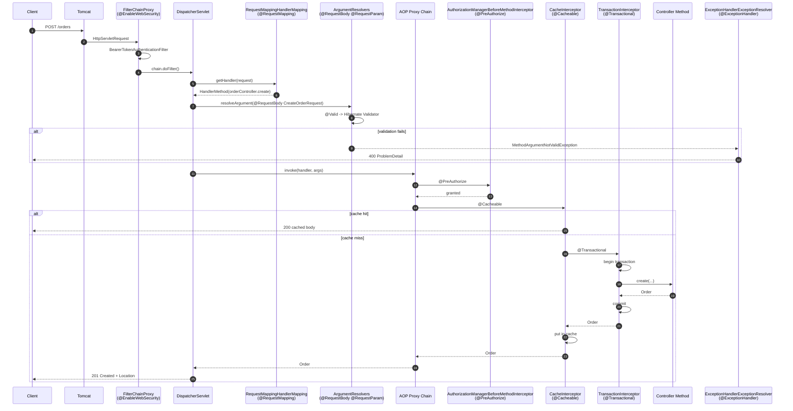
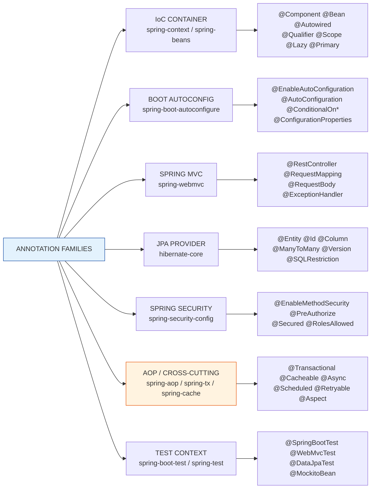

# 06 · The Complete Spring Boot Annotation Reference — Every Annotation, How It Works, Every Interview Question

> **Level:** Beginner → Expert
> **Interview Frequency:** ★★★★★ (annotations are the *vocabulary* of every Spring interview — a candidate who knows only `@RestController` and `@Transactional` cannot answer "how does Spring know to proxy this class?")
> **Prerequisites:** [01 · Core Concepts & Architecture](./01-Core-Concepts-and-Architecture.md) · [02 · Spring Core & Framework](../02-Spring-Core-Framework/README.md) · [03 · Spring MVC](../03-Spring-MVC/README.md)
> **Last Updated:** 2026

---

> ⚠️ **Version target for this chapter: Spring Boot 3.3+ · Spring Framework 6.1+ · Java 17+ · Jakarta EE 10.**
> Every default value printed in the catalogue tables below was **read from the compiled
> annotation classes** (reflection over `spring-boot-3.2.5`, `spring-*-6.1.6`,
> `spring-security-6.2.4`, `jakarta.persistence-api-3.1.0`), not from memory. Where a
> behaviour changed after those versions, it is called out inline as a **version delta**.

---

## 📋 Table of Contents

- [0. TL;DR — The 30-Second Answer](#0-tldr--the-30-second-answer)
- [1. What & Why — The Problem This Solves](#1-what--why--the-problem-this-solves)
- [2. Mental Model — The One Picture](#2-mental-model--the-one-picture)
- [3. Deep Dive — Theory (Beginner → Advanced)](#3-deep-dive--theory-beginner--advanced)
  - [3.1 Beginner Level — The 10 Annotation Families](#31-beginner-level--the-10-annotation-families)
  - [3.2 Intermediate Level — The 15 You Use Every Day](#32-intermediate-level--the-15-you-use-every-day)
  - [3.3 Advanced Level — The Complete Catalogue](#33-advanced-level--the-complete-catalogue)
  - [3.4 Expert Level — Which Class Processes Which Annotation](#34-expert-level--which-class-processes-which-annotation)
- [4. Internal Working Mechanism](#4-internal-working-mechanism)
- [5. Step-by-Step Execution Flow](#5-step-by-step-execution-flow)
- [6. Visualizations](#6-visualizations)
- [7. Production-Level Use Cases & Real Industry Examples](#7-production-level-use-cases--real-industry-examples)
- [8. Worked Examples (with Output + Dry Run)](#8-worked-examples-with-output--dry-run)
- [9. Code from Scratch — Production-Grade](#9-code-from-scratch--production-grade)
- [10. Common Mistakes & Gotchas](#10-common-mistakes--gotchas)
- [11. Performance Considerations](#11-performance-considerations)
- [12. Security Considerations](#12-security-considerations)
- [13. Best Practices](#13-best-practices)
- [14. Hands-On Exercises & Code Challenges](#14-hands-on-exercises--code-challenges)
- [15. Interview Q&A — Level-wise](#15-interview-qa--level-wise)
- [16. Scenario-Based & Real-Experience Scenarios (3–5 yrs)](#16-scenario-based--real-experience-scenarios-35-yrs)
- [17. Counter-Questions, Tricky Questions & Follow-Ups](#17-counter-questions-tricky-questions--follow-ups)
- [18. Frequently Asked Production Issues & Debugging Scenarios](#18-frequently-asked-production-issues--debugging-scenarios)
- [19. Architecture Design Questions](#19-architecture-design-questions)
- [20. Rapid-Fire MCQs](#20-rapid-fire-mcqs)
- [21. Cheat Sheet / One-Page Summary](#21-cheat-sheet--one-page-summary)
- [22. Real-World Production Notes](#22-real-world-production-notes)
- [23. Follow-up Learning](#23-follow-up-learning)

---

## 0. TL;DR — The 30-Second Answer

- **An annotation is metadata on a class/method/field that a `BeanPostProcessor`, an
  `ImportSelector`, or an `AnnotationMetadata` reader consumes to change behaviour.** Spring
  itself does not "read" annotations — Spring Boot's `AnnotationConfigApplicationContext`
  does, via **`ConfigurationClassPostProcessor`** (a `BeanDefinitionRegistryPostProcessor`).
- **Three processing mechanisms exist, and confusing them is the #1 beginner mistake:**
  (1) **Definition-time** — `@ComponentScan`, `@Import`, `@Bean` decide *which beans exist*;
  (2) **Post-processing** — `@Autowired`, `@Value`, `@PostConstruct`, `@Transactional` decide
  *how an existing bean is built or wrapped*; (3) **Runtime interception** — `@PreAuthorize`,
  `@Cacheable`, `@Async` decide *what happens when the method is called*.
- **`@SpringBootApplication` = `@SpringBootConfiguration` + `@EnableAutoConfiguration` +
  `@ComponentScan`.** Verified defaults: `@SpringBootConfiguration` carries
  `proxyBeanMethods = true`, and `@ComponentScan` ships **two exclude filters** —
  `TypeExcludeFilter` and `AutoConfigurationExcludeFilter` — which is why your `@Component`
  classes are never treated as auto-configurations.
- **`@AutoConfiguration` ≠ `@Configuration`.** Verified: `@AutoConfiguration` is
  `@Configuration(proxyBeanMethods = false)` + `@AutoConfigureBefore` + `@AutoConfigureAfter`.
  It is for *library* auto-config classes; `@Configuration` is for *your* configuration.
- **`@EnableMethodSecurity` does NOT enable `@Secured` or JSR-250 by default.** Verified
  defaults: `prePostEnabled = true`, `securedEnabled = **false**`, `jsr250Enabled = **false**`.
  Put `@Secured` on a method, enable `@EnableMethodSecurity`, and it silently does nothing.
- **`@Enumerated` defaults to `ORDINAL`, not `STRING`.** Verified from
  `jakarta.persistence-api 3.1.0`. Reordering an enum later silently corrupts persisted data.
- **`@Transactional` defaults to `propagation = REQUIRED`, `isolation = DEFAULT`,
  `timeout = -1`, `readOnly = false`.** `readOnly = true` is a *database hint*, not a lock.
- **Conditionals are the heart of auto-configuration.** `@ConditionalOnProperty` defaults to
  `matchIfMissing = false`; `@ConditionalOnMissingBean` defaults to `search = ALL`.
- **`@Bean.destroyMethod` defaults to `"(inferred)"`** — Spring calls `close()`/`shutdown()`
  on your bean automatically if it has such a method. You rarely need to name it.
- **`@Value` is resolved by `AutowiredAnnotationBeanPostProcessor`; `@ConfigurationProperties`
  is resolved by `ConfigurationPropertiesBindingPostProcessor` + the `Binder`.** They are
  different subsystems with different capabilities — only the latter validates, supports
  relaxed binding and JSR-303.
- **`@RequestBody(required = true)`** — a missing body is a `400`, not a `null` parameter.
  `@RequestParam(required = true)` behaves the same way, but `@PathVariable` is always
  "required" in practice because the path would not match otherwise.
- **`@DataJpaTest` is meta-annotated with `@Transactional`** — every test method rolls back.
  That is why `@DataJpaTest` is fast *and* why a test that manually commits behaves oddly.

---

## 1. What & Why — The Problem This Solves

Spring's core problem is that a plain Java class has **no way to declare intent to the
container**. Java annotations solve that by attaching *structured metadata* to the class
file, and the JVM is required to retain it when `RetentionPolicy.RUNTIME` is set. Spring then
makes that metadata *behavioural*.

Without annotations, Spring needed XML: every bean, every property, every endpoint, every
transaction boundary was described in a separate file, far away from the class it described.
Annotations collapse that distance — the intent lives **on the class it applies to**, so a
reader of `PaymentService.java` sees everything about how Spring will treat it. That is the
whole value proposition, and it is why Spring's XML support was deprecated in Framework 6 and
removed in Boot 3.

But the deeper problem — the one that this chapter exists to fix — is that **the annotation
you write and the behaviour you get are separated by thousands of lines of framework code**.
A candidate can memorise `@Transactional` for a year and still not know that:

- it only works because a **proxy** wraps the bean (`InfrastructureAdvisorAutoProxyCreator`),
- the proxy is **JDK dynamic** when the class implements an interface, and **CGLIB** otherwise,
- **self-invocation** never crosses the proxy boundary, so the advice never runs,
- `REQUIRES_NEW` needs a **second database connection** from the pool.

Knowing *the annotation* is table stakes. Knowing *the mechanism behind the annotation* is
what separates a 3-year candidate from a 6-year one. That is why this chapter has three
layers for every annotation:

1. **What it declares** — the contract, the attributes, and their verified defaults.
2. **How it is processed** — which framework class reads it, at which lifecycle phase.
3. **What it costs** — the trade-off, the failure mode, and the number to watch.

### Why one giant reference beats twelve scattered ones

The most common study failure in Spring is *fragmentation*: the `@Transactional` question is
answered in the JPA folder, the `@PreAuthorize` question in the Security folder, and the
`@ComponentScan` question in the Core folder — so a candidate learns three correct answers
but never the **one pattern** that connects them:

> Every Spring annotation is *a request to a specific framework extension point*. Learn the
> extension point once, and every annotation that uses it becomes trivial.

There are exactly **five** extension points in the Spring container:

| # | Extension point | Interface | Annotations it consumes |
|---|---|---|---|
| 1 | **Definition registration** | `ImportSelector`, `ImportBeanDefinitionRegistrar` | `@Import`, `@Enable*`, `@ComponentScan`, `@EntityScan` |
| 2 | **Bean definition metadata** | `BeanDefinition` + `AnnotationMetadata` | `@Component`, `@Service`, `@Repository`, `@Scope`, `@Lazy`, `@Primary`, `@Qualifier` |
| 3 | **Instance post-processing** | `BeanPostProcessor` | `@Autowired`, `@Value`, `@PostConstruct`, `@PreDestroy`, `@ConfigurationProperties` |
| 4 | **Method interception (AOP)** | `MethodInterceptor` + `Advisor` | `@Transactional`, `@Cacheable`, `@Async`, `@Retryable`, `@PreAuthorize`, `@Scheduled` |
| 5 | **Servlet/runtime dispatch** | `HandlerMapping`, `HandlerAdapter`, `ArgumentResolver` | `@RestController`, `@RequestMapping`, `@RequestBody`, `@ExceptionHandler` |

Everything in Spring's annotation vocabulary lands in one of these five buckets. Hold that
picture and a 200-annotation catalogue becomes five ideas with 200 variations.

---

## 2. Mental Model — The One Picture

```text
   EVERY SPRING ANNOTATION IS A MESSAGE TO ONE OF FIVE INTERCEPTORS
   ══════════════════════════════════════════════════════════════════

   ┌──────────────────────────────────────────────────────────────────────────┐
   │  SOURCE CODE                                                             │
   │  @RestController  @Transactional  @Component  @Cacheable  @PreAuthorize  │
   └────────────────────────────────┬─────────────────────────────────────────┘
                                    │  (class file, RUNTIME retention)
                                    ▼
        ┌───────────────────────────────────────────────────────────┐
        │        Spring's ANNOTATION METADATA LAYER                 │
        │  AnnotationMetadata · AnnotatedElement · MergedAnnotations │
        │  (reads attributes WITHOUT loading the class, when possible)│
        └───────────────────────────────────────────────────────────┘
                    │                    │                   │
      ┌─────────────▼──────┐  ┌─────────▼─────────┐  ┌──────▼───────────────┐
      │ ① DEFINITION TIME  │  │ ② POST-PROCESSING │  │ ③ METHOD INTERCEPT  │
      │                    │  │                   │  │                    │
      │ ConfigurationClass │  │ AutowiredAnnotation│  │ TransactionAdvisor │
      │ PostProcessor      │  │ BeanPostProcessor  │  │ CacheInterceptor    │
      │                    │  │                   │  │ AuthorizationManager│
      │ @Import            │  │ @Autowired         │  │ AsyncAnnotation     │
      │ @ComponentScan     │  │ @Value             │  │ @PreAuthorize       │
      │ @Enable*           │  │ @PostConstruct     │  │ @Cacheable          │
      │ @EntityScan        │  │ @ConfigurationProps│  │ @Retryable          │
      │                    │  │ @Scheduled (BPP)   │  │ @Transactional      │
      │ DECIDES:           │  │ DECIDES:           │  │ DECIDES:            │
      │ "which beans exist" │  │ "how bean is built"│  │ "what happens on    │
      │                    │  │                   │  │  method call"       │
      └────────────────────┘  └───────────────────┘  └────────────────────┘
                    │                    │                   │
                    └────────────┬───────┴───────────────────┘
                                 ▼
   ┌──────────────────────────────────────────────────────────────────────────┐
   │  ④ SERVLET / RUNTIME DISPATCH        ⑤ LIFECYCLE CALLBACKS             │
   │  HandlerMapping · HandlerAdapter      InitializingBean · DisposableBean │
   │  ArgumentResolver · MessageConverter  @PostConstruct · @PreDestroy      │
   │  @RequestMapping · @RequestBody       @EventListener                    │
   │  @RestController · @ExceptionHandler                                   │
   └──────────────────────────────────────────────────────────────────────────┘

   THE ONE-LINE ANSWER:
   "An annotation is not magic. It is a message, and there are exactly five
    places in the Spring container that read messages. Learn the five
    receivers and you have read the whole framework."
```

**What to look at:** the three *lifecycle phases* in the middle row. The single most common
interview mistake is treating `@Autowired` (phase 2) and `@Transactional` (phase 3) as the
same kind of thing — one happens while the object is being **built**, the other happens when
a **method is called**. That difference explains every "why doesn't my annotation work"
question in this chapter.

---

## 3. Deep Dive — Theory (Beginner → Advanced)

### 3.1 Beginner Level — The 10 Annotation Families

Before the details, the map. Every Spring Boot annotation belongs to one of these ten
families, and knowing the family tells you **which framework subsystem owns it** and
**what kind of failure you will see when it misbehaves**.

| # | Family | Package (root) | Example annotations | Owned by | Failure looks like |
|---|---|---|---|---|---|
| 1 | **Bootstrap** | `org.springframework.boot` | `@SpringBootApplication`, `@EnableAutoConfiguration`, `@AutoConfiguration` | Boot bootstrap | Context never starts; bean missing |
| 2 | **Stereotypes** | `org.springframework.stereotype` | `@Component`, `@Service`, `@Repository`, `@Controller` | IoC container | Bean not registered (404) |
| 3 | **Configuration** | `org.springframework.context.annotation` | `@Configuration`, `@Bean`, `@Import`, `@ComponentScan`, `@PropertySource` | IoC container | Bean missing / property ignored |
| 4 | **Wiring & DI** | `org.springframework.beans.factory.annotation` | `@Autowired`, `@Qualifier`, `@Value`, `@Lookup` | Bean factory | `NoSuchBeanDefinitionException` |
| 5 | **Conditionals** | `org.springframework.boot.autoconfigure.condition` | `@ConditionalOnClass`, `@ConditionalOnProperty`, `@ConditionalOnMissingBean` | Boot auto-config | Auto-config silently skipped |
| 6 | **Configuration properties** | `org.springframework.boot.context.properties` | `@ConfigurationProperties`, `@ConstructorBinding`, `@DefaultValue`, `@DurationUnit` | Boot context | Property bound as 0/null |
| 7 | **Web / MVC** | `org.springframework.web.bind.annotation` | `@RestController`, `@RequestMapping`, `@RequestBody`, `@ResponseStatus` | Spring MVC | 404 / 400 / 415 / 406 |
| 8 | **Validation** | `jakarta.validation` + `org.springframework.validation` | `@Valid`, `@Validated`, `@NotNull`, `@NotBlank`, `@Size` | Bean Validation | 500 (not 400!) if misconfigured |
| 9 | **Persistence** | `jakarta.persistence` + `org.hibernate.annotations` | `@Entity`, `@Id`, `@Column`, `@ManyToMany`, `@Version`, `@SQLRestriction` | JPA provider | Schema mismatch / N+1 / stale data |
| 10 | **Cross-cutting** | `spring-tx`, `spring-cache`, `spring-security`, `spring-context`, `spring-retry` | `@Transactional`, `@Cacheable`, `@PreAuthorize`, `@Async`, `@Scheduled`, `@EventListener` | AOP / proxies | Advice does not fire |

Two more families exist but are deliberately **not** "Spring Boot annotations" in the usual
sense — they belong to the ecosystem and appear in most real codebases:

- **11 · Testing** — `org.springframework.boot.test.*` (`@SpringBootTest`, `@WebMvcTest`,
  `@DataJpaTest`, `@MockitoBean`) and `org.springframework.test.context.*`.
- **12 · Messaging & Resilience** — `org.springframework.kafka.annotation`,
  `org.springframework.messaging.handler.annotation`, `org.springframework.retry.annotation`,
  and Resilience4j's `io.github.resilience4j.*`.

> 💡 **The "which family" reflex.** When a colleague says "the annotation isn't working",
> the first question is *which family?* — because that tells you the debugging tool.
> Conditionals → `--debug` + `/actuator/conditions`. Wiring → `/actuator/beans`.
> MVC → `curl -v` + the `DispatcherServlet` DEBUG log. Cross-cutting → the proxy
> is missing (self-invocation) or the aspect was never enabled.

### 3.2 Intermediate Level — The 15 You Use Every Day

These fifteen cover roughly 95% of the annotations in a production Spring Boot codebase.
For each: what it declares, how it is processed, and the trap.

---

#### ① `@SpringBootApplication`

**Declares:** the entry point of a Boot application. Verified composition:

```java
@Target(ElementType.TYPE)
@Retention(RetentionPolicy.RUNTIME)
@Documented
@Inherited
@Configuration(proxyBeanMethods = true)          // via @SpringBootConfiguration
@EnableAutoConfiguration
@ComponentScan(excludeFilters = {
    @Filter(type = FilterType.CUSTOM, classes = TypeExcludeFilter.class),
    @Filter(type = FilterType.CUSTOM, classes = AutoConfigurationExcludeFilter.class) })
public @interface SpringBootApplication {
    Class<?>[] exclude() default {};
    String[] excludeName() default {};
    String[] scanBasePackages() default {};
    Class<?>[] scanBasePackageClasses() default {};
    BeanNameGenerator nameGenerator() default AnnotationBeanNameGenerator.class;
    boolean proxyBeanMethods() default true;
}
```

**How it is processed:** the container finds the class, then
`ConfigurationClassPostProcessor` parses it. `@ComponentScan` becomes a
`ClassPathBeanDefinitionScanner` run; `@EnableAutoConfiguration` imports
`AutoConfigurationImportSelector`; `@SpringBootConfiguration` registers the class itself
as the primary configuration source.

**The three traps:**

1. **The package becomes the scan base.** No `basePackages` attribute is given, so the scan
   starts at the *package of the annotated class*. A controller in a sibling package is not
   registered — **404, no error, no warning**. This is the single most common "why is my
   endpoint 404" cause in Spring Boot.
2. **`exclude()` only accepts auto-configuration classes** (it is passed to
   `AutoConfigurationImportSelector`). To exclude a *user* `@Configuration` class you need
   `excludeName()` or a `@ComponentScan` exclude filter — different mechanisms.
3. **`proxyBeanMethods = true` is the default** (verified). The application class *is*
   CGLIB-proxied, so calling a `@Bean` method from another `@Bean` method in the same class
   returns the *singleton* rather than a new instance. This is a feature (it preserves
   singleton semantics) and a cost (a CGLIB proxy is created for the whole class).

> 💡 **Version delta.** `proxyBeanMethods` was **added** to `@SpringBootApplication` in
> Boot **3.2**. On Boot 3.0/3.1 the attribute does not exist and you must put
> `@Configuration(proxyBeanMethods = false)` on the class instead. This chapter targets 3.3+.

---

#### ② `@Component`, `@Service`, `@Repository`, `@Controller`

**Declares:** "register this class as a bean." All four are meta-annotated with
`@Component`; the other three add *semantics* that machinery keys off.

| Annotation | Meta-annotation | What the framework actually does with it |
|---|---|---|
| `@Component` | — | Registers a `BeanDefinition` with the class name as bean name |
| `@Service` | `@Component` | Same registration **plus** it is a documented "business layer" marker |
| `@Repository` | `@Component` | Same registration **plus** `PersistenceExceptionTranslationPostProcessor` wraps it so JPA/Hibernate exceptions become Spring's `DataAccessException` hierarchy |
| `@Controller` | `@Component` | Same registration **plus** `RequestMappingHandlerMapping` treats it as a handler candidate |

**How it is processed:** `ClassPathBeanDefinitionScanner.doScan()` →
`ClassPathScanningCandidateComponentProvider.findCandidateComponents()` →
`AnnotationBeanNameGenerator` → `AnnotatedBeanDefinitionReader.registerBean()`.

**The trap:** the stereotypes are **not** interchangeable in effect.
`@Repository` genuinely changes behaviour (exception translation). `@Service` does **not** —
it is purely a semantic marker for humans and tooling. Claiming "`@Service` gives you a
transaction" is wrong; transactions come from `@Transactional`, not from the stereotype.

> ⚠️ **Why `@Repository` is a security feature too.** Without it, a `DataIntegrityViolationException`
> bubbles out of the repository as a 500 with a driver message that can leak table and
> column names. With it, Spring translates it to `DataIntegrityViolationException` and your
> `@RestControllerAdvice` can return a clean `409 Conflict`.

---

#### ③ `@Configuration` and `@Bean`

**Declares:** `@Configuration` marks a class as a *bean factory*; `@Bean` marks a method as
a *factory method* for a bean.

**The `@Bean` attributes (verified defaults):**

| Attribute | Default | What it does |
|---|---|---|
| `name` / `value` | `{}` | Bean name(s). `value` is the `@AliasFor` alias of `name` |
| `initMethod` | `""` | Method called after the bean is built. `""` = do nothing |
| `destroyMethod` | `"(inferred)"` | Method called on shutdown. `"(inferred)"` = auto-detect `close()` or `shutdown()` |
| `autowireCandidate` | `true` | Whether this bean can be injected by type at all |

**How it is processed:** `ConfigurationClassPostProcessor` →
`ConfigurationClassParser` (parses) → `ConfigurationClassBeanDefinitionReader` (registers a
`ConfigurationClassBeanDefinition` whose `factoryBeanName` is the config class and
`factoryMethodName` is your method). The method is then invoked through the **CGLIB proxy**
of the configuration class, so `@Bean` methods can depend on each other.

**The trap:** `destroyMethod = "(inferred)"` means Spring will call `close()` on your bean
**automatically**. If your `@Bean` returns a `DataSource` wrapper that happens to have a
`close()` method, it *will* be called at shutdown — usually what you want, but surprising
if you also call `close()` yourself.

---

#### ④ `@ComponentScan`

**Declares:** where to look for stereotype-annotated classes. Verified attributes:

| Attribute | Default | Notes |
|---|---|---|
| `basePackages` / `value` | `{}` | Package names to scan. `@AliasFor` aliases of each other |
| `basePackageClasses` | `{}` | Marker classes; their package is scanned. **Type-safe** — prefer this |
| `useDefaultFilters` | `true` | Scan for `@Component` and friends |
| `includeFilters` | `{}` | `FilterType.ANNOTATION`, `ASSIGNABLE_TYPE`, `ASPECTJ`, `REGEX`, `CUSTOM` |
| `excludeFilters` | `{}` | Same filter types |
| `resourcePattern` | `"**/*.class"` | Which resources are candidates |
| `nameGenerator` | `AnnotationBeanNameGenerator` | How bean names are derived |
| `lazyInit` | `false` | Register beans as lazy-initialized |
| `scopedProxy` | `DEFAULT` | `ScopedProxyMode` for scoped beans |

**The trap:** `excludeFilters` are matched against the **candidate's metadata**, and a
`FilterType.REGEX` filter matches the **fully-qualified class name**, not a path pattern.
People write `excludeFilters = @ComponentScan.Filter(regex = ".*\\.dto\\..*")` and get
confused when it does not match. It works, but only because the FQN happens to contain
`.dto.` — the pattern is matched against the class name.

**Also note:** `@ComponentScan` on the main class is *not* how auto-configuration works.
Auto-configuration is **import-based** (`@Import(AutoConfigurationImportSelector)` reading
`AutoConfiguration.imports`), not scan-based. Conflating the two is a classic
interview-essay mistake.

---

#### ⑤ `@Autowired`, `@Qualifier`, `@Value`

**`@Autowired`** — verified: targets `CONSTRUCTOR, METHOD, PARAMETER, FIELD, ANNOTATION_TYPE`,
with `required()` defaulting to **`true`**.

**How it is processed:** `AutowiredAnnotationBeanPostProcessor` implements
`MergedBeanDefinitionPostProcessor` and `InstantiationAwareBeanPostProcessor`. During
`populateBean()` it resolves the dependency points, and during
`resolveDependency()` it asks the `DependencyDescriptor` for a candidate from the
`DefaultListableBeanFactory`. If `required = true` and no candidate exists →
`NoSuchBeanDefinitionException`.

**`@Value`** — verified: targets `FIELD, METHOD, PARAMETER, ANNOTATION_TYPE`. The placeholder
is resolved by a `PropertySourcesPlaceholderConfigurer` (added by
`PropertyPlaceholderAutoConfiguration`) against the `Environment`'s `PropertySource` list.

**`@Qualifier`** — verified: targets `FIELD, METHOD, PARAMETER, TYPE, ANNOTATION_TYPE`, and
is `@Inherited`. It narrows the candidate set **after** type matching.

**The traps:**

- **`@Autowired(required = false)` does not give you `null` for a missing *collection*.** For
  a collection parameter (`List<Foo>`), Spring injects an **empty list** — the `required`
  flag is irrelevant, because the collection itself is always satisfiable.
- **A single-constructor bean does not need `@Autowired`** (since Spring 4.3). It is
  *implicit*. This is why modern code omits it — and why removing it from a class with
  **two** constructors suddenly fails to start.
- **`@Value` cannot do relaxed binding.** `@Value("${app.timeout-seconds}")` binds to a
  `String` field; to get an `int` you must write `${app.timeout-seconds}` and hope the
  conversion succeeds — a bad value throws at *startup*, not at use. `@ConfigurationProperties`
  fails fast with a *named* error message.

---

#### ⑥ `@ConfigurationProperties` and friends

**Declares:** "bind a group of properties from the `Environment` onto this object."

| Annotation | Package | Target | Key attribute | Default |
|---|---|---|---|---|
| `@ConfigurationProperties` | `o.s.b.context.properties` | TYPE, METHOD | `prefix` / `value` | `""` |
| `@ConstructorBinding` | `o.s.b.context.properties.bind` | CONSTRUCTOR | — | — |
| `@DefaultValue` | `o.s.b.context.properties.bind` | PARAMETER, RECORD_COMPONENT | `value` | `""` |
| `@Name` | `o.s.b.context.properties.bind` | PARAMETER | `value` | required |
| `@DurationUnit` | `o.s.b.convert` | FIELD, PARAMETER | `value` | required |

**Verified defaults of `@ConfigurationProperties`:** `ignoreUnknownFields = true`,
`ignoreInvalidFields = false`.

**How it is processed:** `ConfigurationPropertiesBindingPostProcessor` (a
`BeanPostProcessor`) sees the annotation on the bean class, asks `ConfigurationPropertiesBinder`
to bind, which delegates to Spring Boot's `Binder` — the same relaxed-binding engine that
binds `application.yml` to the `Environment`.

**The three traps:**

1. **`ignoreUnknownFields = true` is the default**, so a typo in your YAML
   (`app.timout` instead of `app.timeout`) is **silently ignored** and your field stays at
   its default. Setting `ignoreUnknownFields = false` turns typos into a startup failure —
   this is the single most valuable line you can add to a `@ConfigurationProperties` class.
2. **Constructor binding is implicit when there is exactly one constructor.** Adding
   `@ConstructorBinding` is only *necessary* when the class has multiple constructors, and
   *harmless* when it has one.
3. **Validation requires `@Validated` on the class** — `@ConfigurationProperties` alone does
   not trigger JSR-303 checks. Without it, an invalid value binds and fails at *use* time
   instead of at *startup* time.

---

#### ⑦ `@RestController` / `@Controller` / `@RequestMapping`

**`@RestController`** — verified meta-annotations: `@Controller` (which is itself
`@Component`) **and `@ResponseBody`**. That single extra annotation is the entire difference:
`@ResponseBody` marks the *return value* as the response body, bypassing view resolution.

**`@RequestMapping` attributes (verified):** `name`, `value`, `method`, `params`, `path`,
`consumes`, `headers`, `produces`.

**How it is processed:** `RequestMappingHandlerMapping` scans every bean whose type is
annotated `@Controller` or `@RequestMapping` (via `AnnotatedElementUtils.hasAnnotation`),
builds `RequestMappingInfo` from the attributes, and registers a
`HandlerMethod` in a `Map<RequestMappingInfo, HandlerMethod>`. At request time,
`RequestMappingInfoHandlerMapping.handleMatch` performs the actual match.

**The traps:**

- **`consumes`/`produces` participate in matching, and a mismatch is a `415`/`406`, not a
  `404`.** `produces = "application/json"` means a client sending `Accept: text/html` gets
  a `406 Not Acceptable` — a confusing error when the API "works" in Postman (Postman sends
  `Accept: */*`).
- **`@RequestMapping` without `method` accepts every HTTP method**, including `OPTIONS`.
  Always pin the method.
- **`@ResponseStatus` default is `500 INTERNAL_SERVER_ERROR`** (verified). Omitting it on a
  `void`/`ResponseEntity`-less method means a `200` with no body, but on an exception
  path it is the `500`.

---

#### ⑧ `@RequestBody`, `@RequestParam`, `@PathVariable`, `@RequestHeader`

| Annotation | Target | `required` default | Missing-value behaviour |
|---|---|---|---|
| `@RequestBody` | PARAMETER | **`true`** | `400 HttpMessageNotReadableException` |
| `@RequestParam` | PARAMETER | **`true`** | `400 MissingServletRequestParameterException` |
| `@PathVariable` | PARAMETER | **`true`** | `400 MissingPathVariableException` |
| `@RequestHeader` | PARAMETER | **`true`** | `400 MissingRequestHeaderException` |
| `@CookieValue` | PARAMETER | **`true`** | `400 MissingCookieException` |
| `@RequestPart` | PARAMETER | **`true`** | `400 MissingServletRequestPartException` |
| `@MatrixVariable` | PARAMETER | **`true`** | `400 MissingPathVariableException` |

**How they are processed:** each has a matching `HandlerMethodArgumentResolver`:
`RequestResponseBodyMethodProcessor` (`@RequestBody`),
`RequestParamMethodArgumentResolver`, `PathVariableMethodArgumentResolver`,
`RequestHeaderMethodArgumentResolver`, `RequestCookieValueMethodArgumentResolver`,
`RequestPartMethodArgumentResolver`.

**The trap:** `@RequestParam Map<String, String>` **never** fails for a missing parameter —
it injects an empty map. And `@RequestParam` on a `List<String>` with `required = true` and
no value throws `MissingServletRequestParameterException`; with `required = false` you get
an empty list. Always be explicit.

---

#### ⑨ `@Valid` vs `@Validated`

This is the most-asked MVC question in the repo's question bank, so it gets the full
treatment.

| | `@Valid` (`jakarta.validation.Valid`) | `@Validated` (`org.springframework.validation.annotation.Validated`) |
|---|---|---|
| Package | Jakarta Bean Validation | Spring Framework |
| Target | METHOD, FIELD, CONSTRUCTOR, PARAMETER, TYPE_USE | TYPE, METHOD, PARAMETER |
| Triggers validation on a **method parameter** | ✅ yes | ✅ yes |
| Triggers validation on a **method's return value** | ❌ | ❌ |
| **Method-level** validation (constraints directly on method params) | ❌ | ✅ |
| Validation **groups** | ✅ (via `groups` on the constraint) | ✅ |
| Works with `MethodValidationPostProcessor` | ❌ | ✅ |

**How they work internally:**

- `@Valid` on a `@RequestBody` parameter is detected by
  `RequestResponseBodyMethodProcessor.validateIfApplicable()` → the `Validator` (Hibernate
  Validator) validates the object → on failure, a `MethodArgumentNotValidException` is
  thrown, which `DefaultHandlerExceptionResolver` maps to `400`.
- `@Validated` on a **class** makes `MethodValidationPostProcessor` create a proxy for that
  bean; the `MethodValidationInterceptor` then validates **method arguments and return
  values** using `MethodValidationInterceptor`'s `AnnotationMatchingPointcut` (which matches
  the annotation's presence on the method, not on the parameter type).

**The trap everyone falls into:** putting `@Valid` on a `@RequestParam` or a
`@PathVariable` does **nothing**. Parameter-level constraints (`@NotNull`, `@Min`) placed
directly on a controller method parameter require **`@Validated` on the class**, otherwise
they are silently ignored and the request is served with an invalid value.

```java
// ❌ WRONG — constraints on method params are silently ignored (no @Validated on class)
@RestController
public class OrderController {

    @GetMapping("/orders/{id}")
    public OrderDto get(@PathVariable @Positive Long id) {   // ← never validated
        return service.find(id);
    }
}

// ✅ RIGHT — @Validated on the class activates MethodValidationPostProcessor
@RestController
@Validated
public class OrderController {

    @GetMapping("/orders/{id}")
    public OrderDto get(@PathVariable @Positive Long id) {   // ← now validated
        return service.find(id);
    }
}
```

> ⚠️ **Which failure mode?** With `@Validated` on the class and an invalid parameter, the
> exception is a `ConstraintViolationException`, **not** a `MethodArgumentNotValidException`.
> Your `@RestControllerAdvice` must handle `ConstraintViolationException` separately or the
> client gets a raw `500` instead of a `400`. This is the single most common reason a
> "validated" endpoint returns 500.

---

#### ⑩ `@Transactional`

**Verified defaults:** `propagation = REQUIRED`, `isolation = DEFAULT`, `timeout = -1`,
`readOnly = false`, `rollbackFor = {}`, `noRollbackFor = {}`, `transactionManager = ""`,
`label = {}`, `timeoutString = ""`.

**How it is processed:**

1. `@EnableTransactionManagement` imports `TransactionManagementConfigurationSelector` →
   registers `InfrastructureAdvisorAutoProxyCreator` (verified `mode = PROXY`,
   `proxyTargetClass = false`) and `TransactionAttributeSourceAdvisor`.
2. `AnnotationTransactionAttributeSource` reads the annotation into a
   `TransactionAttribute` (`RuleBasedTransactionAttribute`).
3. `TransactionInterceptor.invoke()` opens/joins/suspends the transaction, using the
   `PlatformTransactionManager` (`JpaTransactionManager` when JPA is on the classpath).

**The traps:**

- **Self-invocation kills it.** `this.save()` inside the same class never crosses the
  proxy, so no advice runs, so no transaction exists. The fix is to split the class or
  inject a self-reference.
- **`readOnly = true` is a hint, not an enforcement.** It sets the JDBC connection to
  read-only (and Hibernate to flush-mode MANUAL). A `save()` inside a `readOnly` transaction
  still executes — it just may not be flushed.
- **Only unchecked exceptions roll back by default.** `rollbackFor` defaults to empty, and
  Spring rolls back on `RuntimeException`/`Error` only. A checked exception
  (`throw new IOException(...)`) **commits** unless you add `rollbackFor = Exception.class`.
  This one silently corrupts data.

---

#### ⑪ `@Cacheable` / `@CacheEvict` / `@CachePut`

**Verified defaults:** `@Cacheable` — `sync = false`, `key = ""`, `condition = ""`,
`unless = ""`; `@CacheEvict` — `beforeInvocation = false`, `allEntries = false`;
`@CachePut` — `condition = ""`, `unless = ""`.

**How it is processed:** `@EnableCaching` imports `CachingConfigurationSelector` →
`ProxyCachingConfiguration` registers `CacheInterceptor` as an `Advisor` +
`InfrastructureAdvisorAutoProxyCreator`. `CacheInterceptor.invoke()` computes the key via
`CacheOperationExpressionEvaluator`, then calls `Cache.get/put/evict`.

**The traps:**

- **`condition` is evaluated *before* the method runs; `unless` is evaluated *after*.** They
  are not interchangeable. `unless = "#result == null"` skips the *caching*, not the call.
- **`@CacheEvict(beforeInvocation = false)` (the default) evicts *after* a successful
  method.** If the method throws, the cache is **not** evicted — a stale entry survives a
  failed update. Set `beforeInvocation = true` if you want the opposite.
- **`key` defaults to *all* method parameters**, joined. That is a cache-key design smell:
  two different `Product` instances with the same id produce **different keys**, so the
  cache never hits. Always write `key = "#id"`.
- **`@Cacheable` on a method whose return value is `null` *does* cache the null** unless
  you add `unless = "#result == null"`.

---

#### ⑫ `@PreAuthorize` and friends

**Verified:** `@EnableMethodSecurity` defaults are `prePostEnabled = true`,
**`securedEnabled = false`**, **`jsr250Enabled = false`**, `mode = PROXY`,
`proxyTargetClass = false`.

| Annotation | Package | Enabled by | Semantics |
|---|---|---|---|
| `@PreAuthorize` | `o.s.s.access.prepost` | `prePostEnabled = true` | Check **before** the method runs |
| `@PostAuthorize` | `o.s.s.access.prepost` | `prePostEnabled = true` | Check **after**, can filter the returned object |
| `@PreFilter` | `o.s.s.access.prepost` | `prePostEnabled = true` | Filter the **input collection** by SpEL |
| `@PostFilter` | `o.s.s.access.prepost` | `prePostEnabled = true` | Filter the **returned collection** by SpEL |
| `@Secured` | `o.s.s.access.annotation` | `securedEnabled = true` (OFF by default!) | Simple role check |
| `@RolesAllowed` / `@PermitAll` / `@DenyAll` | `jakarta.annotation.security` | `jsr250Enabled = true` (OFF by default!) | JSR-250 standard |

**How it is processed:** `AuthorizationManagerBeforeMethodInterceptor` /
`AuthorizationManagerAfterMethodInterceptor` (registered by
`PrePostMethodSecurityConfiguration`) wrap the method; the SpEL expression is compiled
into an `AuthorizationManager` and evaluated against the `Authentication` in the
`SecurityContextHolder`.

**The trap:** `@PreAuthorize` on a **non-public** method, or on a class that is **not
proxied** (e.g. called via self-invocation), does nothing. And because
`securedEnabled = false` by default, a team that migrates from `@Secured` to
`@EnableMethodSecurity` and forgets `securedEnabled = true` gets **silent no-op
authorization** — the worst kind of bug, because it looks like it works.

---

#### ⑬ `@Async` and `@Scheduled`

**`@Async`** — verified: `value = ""` (executor bean name). Requires `@EnableAsync`
(verified: `mode = PROXY`, `order = Integer.MAX_VALUE`, `proxyTargetClass = false`).

**`@Scheduled`** — verified defaults: `fixedRate = -1`, `fixedDelay = -1`,
`initialDelay = -1`, `cron = ""`, `zone = ""`, `timeUnit = MILLISECONDS`, `scheduler = ""`.

**How they are processed:**

- `@Async` → `AsyncAnnotationBeanPostProcessor` wraps the bean in a proxy whose invocation
  handler submits the call to an `Executor` (default: `SimpleAsyncTaskExecutor`).
- `@Scheduled` → `ScheduledAnnotationBeanPostProcessor` scans for `@Scheduled` methods and
  registers `ScheduledMethodRunnable`s with a `TaskScheduler` (default
  `ThreadPoolTaskScheduler` with **1 thread**).

**The traps:**

- **`@Async` needs a proxy too** — so it fails on self-invocation, exactly like
  `@Transactional`. And the **return value is `void` by contract**; returning `Future<T>`
  requires configuring a `TaskExecutor` that supports `Callable` submission.
- **`@Scheduled` with a single-threaded scheduler means one slow job delays all others.**
  Configure `spring.task.scheduling.pool.size`. This is a top-3 cause of "the nightly job
  never ran".
- **`fixedRate` and `fixedDelay` are different:** `fixedRate` measures from the *start* of
  the previous run (so a slow job can overlap itself if the executor has >1 thread);
  `fixedDelay` measures from the *end* (no overlap, but a slow job pushes the schedule out).
  For a job that must not overlap, use `fixedDelay`.

---

#### ⑭ Jakarta constraint family (`@NotNull`, `@NotBlank`, `@Size`)

The most-used validation constraints, with **verified** defaults:

| Constraint | Package | Key attributes (defaults) | Rejects |
|---|---|---|---|
| `@NotNull` | `jakarta.validation.constraints` | `message`, `groups`, `payload` | `null` only |
| `@NotEmpty` | same | — | `null`, `""`, empty collection/map/array |
| `@NotBlank` | same | — | `null`, `""`, `"   "` (whitespace only) |
| `@Size` | same | `min = 0`, `max = Integer.MAX_VALUE` | size out of range |
| `@Min` / `@Max` | same | `value` (required) | numeric bounds |
| `@Positive` / `@Negative` | same | — | sign |
| `@DecimalMin` / `@DecimalMax` | same | `inclusive = true` | decimal bounds |
| `@Digits` | same | `integer` (required), `fraction` (required) | precision/scale |
| `@Pattern` | same | `regexp` (required), `flags` | regex mismatch |
| `@Email` | same | `regexp = ".*"` | malformed email |
| `@Past` / `@Future` | same | — | temporal direction |
| `@AssertTrue` / `@AssertFalse` | same | — | boolean state |
| `@UniqueElements` | same | — | duplicates in a collection |

**The trap:** `@NotEmpty` on a `String` accepts `" "` (a single space) — only `@NotBlank`
rejects whitespace-only strings. And `@Email` accepts `a@b` (no TLD) because its default
`regexp` is `.*`; for real-world validation you need Hibernate's
`@org.hibernate.validator.constraints.Email` or an explicit `@Pattern`.

---

#### ⑮ `@EventListener` and `@TransactionalEventListener`

**`@EventListener`** — verified attributes: `value`/`classes` (event types), `id`,
`condition` (SpEL).

**`@TransactionalEventListener`** — verified: `phase = AFTER_COMMIT` (the default),
`fallbackExecution = false`.

**How they are processed:** `EventListenerMethodProcessor` (a `SmartInitializingSingleton`)
scans beans for `@EventListener` methods and registers them with an
`ApplicationListenerMethodAdapter`. `@TransactionalEventListener` methods are instead
registered as a `TransactionalApplicationListener` that binds to the transaction
synchronization.

**The traps:**

- **`@TransactionalEventListener` with the default `AFTER_COMMIT` phase does NOT fire if
  the transaction rolls back** — and does not fire at all if there is **no transaction**
  (unless `fallbackExecution = true`). Publishing an event *inside* a transaction and
  listening with `AFTER_COMMIT` is the correct pattern for "notify the outside world after
  the data is really committed".
- **`@EventListener` methods must be public** in Spring 6 (non-public listener methods were
  deprecated in 5.x and are no longer supported in 6.0+).
- **An exception thrown inside an `@EventListener` propagates to the publisher** by default
  — it does *not* silently swallow. That is a common cause of "my API call 500s after the
  DB write succeeded".

---

### 3.3 Advanced Level — The Complete Catalogue

> **Reading the tables.** "Package" is the **full** package, so you can paste it into an
> import. "Target" is the `@Target` element types, verified from the compiled class.
> "Defaults" are the **verified** attribute defaults — the value you get if you write
> nothing. "Processed by" is the framework class that actually reads the annotation.

#### 3.3.1 Bootstrap & auto-configuration

| Annotation | Package | Target | Key attributes (verified defaults) | Processed by |
|---|---|---|---|---|
| `@SpringBootApplication` | `org.springframework.boot.autoconfigure` | TYPE | `exclude={}`, `excludeName={}`, `scanBasePackages={}`, `scanBasePackageClasses={}`, `proxyBeanMethods=true` | `ConfigurationClassPostProcessor` |
| `@SpringBootConfiguration` | `org.springframework.boot` | TYPE | `proxyBeanMethods=true` | `ConfigurationClassPostProcessor` |
| `@EnableAutoConfiguration` | `org.springframework.boot.autoconfigure` | TYPE | `exclude={}`, `excludeName={}` | `AutoConfigurationImportSelector` |
| `@AutoConfiguration` | `org.springframework.boot.autoconfigure` | TYPE | `value=""`, `before={}`, `after={}`, `beforeName={}`, `afterName={}` | `AutoConfigurationImportSelector` |
| `@AutoConfigureBefore` | `org.springframework.boot.autoconfigure` | TYPE | `name={}`, `value={}` | `AutoConfigurationSorter` |
| `@AutoConfigureAfter` | `org.springframework.boot.autoconfigure` | TYPE | `name={}`, `value={}` | `AutoConfigurationSorter` |
| `@AutoConfigureOrder` | `org.springframework.boot.autoconfigure` | TYPE, METHOD, FIELD | `value=0` | `AutoConfigurationSorter` |
| `@AutoConfigurationPackage` | `org.springframework.boot.autoconfigure` | TYPE | `basePackages={}`, `basePackageClasses={}` | `AutoConfigurationPackages.Registrar` |
| `@ImportAutoConfiguration` | `org.springframework.boot.autoconfigure` | TYPE | `value={}`, `classes={}`, `exclude={}` | `ImportAutoConfigurationImportSelector` |
| `@ConfigurationPropertiesScan` | `org.springframework.boot.context.properties` | TYPE | `value={}`, `basePackages={}`, `basePackageClasses={}` | `ConfigurationPropertiesScanRegistrar` |
| `@EnableConfigurationProperties` | `org.springframework.boot.context.properties` | TYPE | `value={}` | `EnableConfigurationPropertiesRegistrar` |
| `@ServletComponentScan` | `org.springframework.boot.web.servlet` | TYPE | `value={}`, `basePackages={}`, `basePackageClasses={}` | `ServletComponentRegisteringPostProcessor` |
| `@EntityScan` | `org.springframework.boot.autoconfigure.domain` | TYPE | `value={}`, `basePackages={}`, `basePackageClasses={}` | `EntityScanPackages.Registrar` |

#### 3.3.2 Configuration & bean definitions

| Annotation | Package | Target | Key attributes (verified defaults) | Processed by |
|---|---|---|---|---|
| `@Configuration` | `org.springframework.context.annotation` | TYPE | `value=""`, `proxyBeanMethods=true`, `enforceUniqueMethods=true` | `ConfigurationClassPostProcessor` |
| `@Bean` | `org.springframework.context.annotation` | METHOD | `name={}`, `value={}`, `initMethod=""`, `destroyMethod="(inferred)"`, `autowireCandidate=true` | `ConfigurationClassBeanDefinitionReader` |
| `@Import` | `org.springframework.context.annotation` | TYPE | `value` (required) | `ConfigurationClassParser` |
| `@ImportResource` | `org.springframework.context.annotation` | TYPE | `value={}`, `locations={}`, `reader=BeanDefinitionReader` | `ConfigurationClassParser` |
| `@ComponentScan` | `org.springframework.context.annotation` | TYPE | `basePackages={}`, `basePackageClasses={}`, `useDefaultFilters=true`, `includeFilters={}`, `excludeFilters={}`, `resourcePattern="**/*.class"`, `lazyInit=false`, `scopedProxy=DEFAULT` | `ClassPathBeanDefinitionScanner` |
| `@PropertySource` | `org.springframework.context.annotation` | TYPE | `name=""`, `value` (required), `factory=PropertySourceFactory`, `encoding=""`, `ignoreResourceNotFound=false` | `ConfigurationClassParser` |
| `@PropertySources` | `org.springframework.context.annotation` | TYPE | `value` (required) | `ConfigurationClassParser` |
| `@DependsOn` | `org.springframework.context.annotation` | TYPE, METHOD | `value={}` | `DependsOnAnnotationBeanPostProcessor` |
| `@Primary` | `org.springframework.context.annotation` | TYPE, METHOD | — | `DefaultListableBeanFactory` |
| `@Lazy` | `org.springframework.context.annotation` | TYPE, METHOD, CONSTRUCTOR, PARAMETER, FIELD | `value=true` | `LazyInitializationBeanFactoryPostProcessor` |
| `@Scope` | `org.springframework.context.annotation` | TYPE, METHOD | `value=""`, `proxyMode=DEFAULT`, `scopeName=""` | `AnnotationScopeMetadataResolver` |
| `@Profile` | `org.springframework.context.annotation` | TYPE, METHOD | `value` (required) — meta-annotated `@Conditional(ProfileCondition)` | `ProfileCondition` |
| `@Description` | `org.springframework.context.annotation` | TYPE | `value=""` | metadata only (IDE) |
| `@EnableAspectJAutoProxy` | `org.springframework.context.annotation` | TYPE | `proxyTargetClass=false`, `exposeProxy=false` | `AnnotationAwareAspectJAutoProxyCreator` |
| `@ImportAware` | `org.springframework.context.annotation` | TYPE | — | `ConfigurationClassParser` |

#### 3.3.3 Stereotypes, wiring & injection

| Annotation | Package | Target | Key attributes (verified defaults) | Processed by |
|---|---|---|---|---|
| `@Component` | `org.springframework.stereotype` | TYPE | `value=""` | `ClassPathBeanDefinitionScanner` |
| `@Service` | `org.springframework.stereotype` | TYPE | `value=""` | same + semantic marker |
| `@Repository` | `org.springframework.stereotype` | TYPE | `value=""` | same + `PersistenceExceptionTranslationPostProcessor` |
| `@Controller` | `org.springframework.stereotype` | TYPE | `value=""` | same + `RequestMappingHandlerMapping` |
| `@Autowired` | `org.springframework.beans.factory.annotation` | CONSTRUCTOR, METHOD, PARAMETER, FIELD, ANNOTATION_TYPE | `required=true` | `AutowiredAnnotationBeanPostProcessor` |
| `@Qualifier` | `org.springframework.beans.factory.annotation` | FIELD, METHOD, PARAMETER, TYPE, ANNOTATION_TYPE | `value=""` — `@Inherited` | `DefaultListableBeanFactory` |
| `@Value` | `org.springframework.beans.factory.annotation` | FIELD, METHOD, PARAMETER, ANNOTATION_TYPE | `value` (required) | `AutowiredAnnotationBeanPostProcessor` |
| `@Lookup` | `org.springframework.beans.factory.annotation` | METHOD | `value=""` | `LookupAnnotationBeanPostProcessor` |
| `@Order` | `org.springframework.core.annotation` | TYPE, METHOD, FIELD | `value=Integer.MAX_VALUE` | `OrderComparator` |
| `@AliasFor` | `org.springframework.core.annotation` | METHOD | `value=""`, `annotation=Annotation`, `attribute=""` | `AnnotationUtils` (merge) |
| `@Nullable` | `org.springframework.lang` | METHOD, PARAMETER, FIELD | — | static analysis only |
| `@PostConstruct` | `jakarta.annotation` | METHOD | — | `CommonAnnotationBeanPostProcessor` |
| `@PreDestroy` | `jakarta.annotation` | METHOD | — | `CommonAnnotationBeanPostProcessor` |
| `@Resource` | `jakarta.annotation` | TYPE, METHOD, FIELD | `name=""` | `CommonAnnotationBeanPostProcessor` |
| `@Inject` | `jakarta.inject` | CONSTRUCTOR, METHOD, FIELD | — | `AutowiredAnnotationBeanPostProcessor` |
| `@Priority` | `jakarta.annotation` | TYPE | `value=-1` | `OrderComparator` |

#### 3.3.4 The `@Conditional` family (auto-configuration control)

All of these are meta-annotated with `@Conditional`, which is what makes them work: Spring's
`ConditionEvaluator` looks for `@Conditional` on the class and evaluates the registered
`Condition` implementations.

| Annotation | Package | Target | Key attributes (verified defaults) |
|---|---|---|---|
| `@ConditionalOnClass` | `org.springframework.boot.autoconfigure.condition` | TYPE, METHOD | `name={}`, `value={}` |
| `@ConditionalOnMissingClass` | same | TYPE, METHOD | `value={}` |
| `@ConditionalOnBean` | same | TYPE, METHOD | `name={}`, `type={}`, `value={}`, `annotation={}`, `search=ALL`, `parameterizedContainer={}` |
| `@ConditionalOnMissingBean` | same | TYPE, METHOD | `name={}`, `type={}`, `value={}`, `ignored={}`, `ignoredType={}`, `annotation={}`, `search=ALL` |
| `@ConditionalOnProperty` | same | TYPE, METHOD | `name={}`, `value={}`, `prefix=""`, `havingValue=""`, `matchIfMissing=false` |
| `@ConditionalOnResource` | same | TYPE, METHOD | `resources={}` |
| `@ConditionalOnExpression` | same | TYPE, METHOD | `value=true` |
| `@ConditionalOnWebApplication` | same | TYPE, METHOD | `type=ANY` |
| `@ConditionalOnSingleCandidate` | same | TYPE, METHOD | `value=Object`, `search=ALL` |
| `@ConditionalOnWarDeployment` | same | TYPE, METHOD | — |
| `@ConditionalOnCloudPlatform` | same | TYPE, METHOD | `value={}` |

> ⚠️ **The `@ConditionalOnMissingBean` ordering trap.** `@ConditionalOnMissingBean` can only
> see beans that are **already registered** when the condition is evaluated. Auto-configurations
> are processed in `@AutoConfigureOrder`/`@AutoConfigureAfter` order, so "my bean is
> missing" happens when *your* auto-configuration is evaluated **before** the auto-config
> that would have supplied the dependency. The fix is `@AutoConfigureBefore` on your class,
> or `@AutoConfigureAfter` on the one that must run first.

#### 3.3.5 Configuration properties, environment & profiles

| Annotation | Package | Target | Key attributes (verified defaults) |
|---|---|---|---|
| `@ConfigurationProperties` | `org.springframework.boot.context.properties` | TYPE, METHOD | `value=""`, `prefix=""`, `ignoreUnknownFields=true`, `ignoreInvalidFields=false` |
| `@ConstructorBinding` | `org.springframework.boot.context.properties.bind` | CONSTRUCTOR, ANNOTATION_TYPE | — |
| `@DefaultValue` | `org.springframework.boot.context.properties.bind` | PARAMETER, RECORD_COMPONENT | `value=""` |
| `@Name` | `org.springframework.boot.context.properties.bind` | PARAMETER | `value` (required) |
| `@DurationUnit` | `org.springframework.boot.convert` | FIELD, PARAMETER | `value` (required) |
| `@ConfigurationPropertiesScan` | `org.springframework.boot.context.properties` | TYPE | `value={}`, `basePackages={}`, `basePackageClasses={}` |

#### 3.3.6 Web / MVC

| Annotation | Package | Target | Key attributes (verified defaults) |
|---|---|---|---|
| `@RestController` | `org.springframework.web.bind.annotation` | TYPE | `value=""` — meta: `@Controller` + `@ResponseBody` |
| `@RequestMapping` | same | TYPE, METHOD | `name=""`, `value={}`, `method={}`, `params={}`, `path={}`, `consumes={}`, `headers={}`, `produces={}` |
| `@GetMapping` | same | METHOD | `method=[GET]` + all `@RequestMapping` attributes |
| `@PostMapping` | same | METHOD | `method=[POST]` + … |
| `@PutMapping` | same | METHOD | `method=[PUT]` + … |
| `@DeleteMapping` | same | METHOD | `method=[DELETE]` + … |
| `@PatchMapping` | same | METHOD | `method=[PATCH]` + … |
| `@RequestBody` | same | PARAMETER | `required=true` |
| `@ResponseBody` | same | TYPE, METHOD | — |
| `@RequestParam` | same | PARAMETER | `name=""`, `value=""`, `defaultValue=""`, `required=true` |
| `@PathVariable` | same | PARAMETER | `name=""`, `value=""`, `required=true` |
| `@RequestHeader` | same | PARAMETER | `name=""`, `value=""`, `defaultValue=""`, `required=true` |
| `@CookieValue` | same | PARAMETER | `name=""`, `value=""`, `defaultValue=""`, `required=true` |
| `@RequestPart` | same | PARAMETER | `name=""`, `value=""`, `required=true` |
| `@RequestAttribute` | same | PARAMETER | `name=""`, `value=""`, `required=true` |
| `@SessionAttribute` | same | PARAMETER | `name=""`, `value=""`, `required=true` |
| `@SessionAttributes` | same | TYPE | `value={}` |
| `@ModelAttribute` | same | PARAMETER, METHOD | `name=""`, `value=""`, `binding=true` |
| `@MatrixVariable` | same | PARAMETER | `name=""`, `value=""`, `defaultValue=""`, `pathVar=""`, `required=true` |
| `@ResponseStatus` | same | TYPE, METHOD | `value=500`, `code=500`, `reason=""` |
| `@ExceptionHandler` | same | METHOD | `value={}` |
| `@ControllerAdvice` | same | TYPE | `annotations={}`, `name=""`, `value={}`, `basePackages={}`, `basePackageClasses={}`, `assignableTypes={}` |
| `@RestControllerAdvice` | same | TYPE | same as `@ControllerAdvice` + `@ResponseBody` |
| `@CrossOrigin` | same | TYPE, METHOD | `value={}`, `origins={}`, `originPatterns={}`, `methods={}`, `headers={}`, `allowedHeaders={}`, `exposedHeaders={}`, `allowCredentials=false`, `allowPrivateNetwork=false`, `maxAge=-1` |
| `@InitBinder` | same | METHOD | `value={}` |

#### 3.3.7 Validation

| Annotation | Package | Target | Key attributes (verified defaults) |
|---|---|---|---|
| `@Valid` | `jakarta.validation` | METHOD, FIELD, CONSTRUCTOR, PARAMETER, TYPE_USE | — |
| `@Validated` | `org.springframework.validation.annotation` | TYPE, METHOD, PARAMETER | `value={}` (groups) |
| `@NotNull` | `jakarta.validation.constraints` | METHOD, FIELD, CONSTRUCTOR, PARAMETER, TYPE_USE | `message`, `groups={}`, `payload={}` |
| `@NotEmpty` | same | same | `message`, `groups={}`, `payload={}` |
| `@NotBlank` | same | same | `message`, `groups={}`, `payload={}` |
| `@Size` | same | same | `min=0`, `max=Integer.MAX_VALUE` |
| `@Min` / `@Max` | same | same | `value` (required) |
| `@Positive` / `@PositiveOrZero` / `@Negative` / `@NegativeOrZero` | same | same | `message`, `groups={}` |
| `@DecimalMin` / `@DecimalMax` | same | same | `value` (required), `inclusive=true` |
| `@Digits` | same | same | `integer` (required), `fraction` (required) |
| `@Pattern` | same | same | `regexp` (required), `flags={}` |
| `@Email` | same | same | `regexp=".*"`, `flags={}` |
| `@Past` / `@PastOrPresent` / `@Future` / `@FutureOrPresent` | same | same | `message`, `groups={}` |
| `@AssertTrue` / `@AssertFalse` | same | same | `message`, `groups={}` |
| `@Null` | same | same | `message`, `groups={}` |
| `@UniqueElements` | same | same | `message`, `groups={}` |

#### 3.3.8 Persistence — JPA (`jakarta.persistence`) and Hibernate

| Annotation | Package | Target | Key attributes (verified defaults) |
|---|---|---|---|
| `@Entity` | `jakarta.persistence` | TYPE | `name=""` |
| `@Table` | same | TYPE | `name=""`, `schema=""`, `catalog=""`, `uniqueConstraints={}`, `indexes={}` |
| `@Id` | same | METHOD, FIELD | — |
| `@GeneratedValue` | same | METHOD, FIELD | `strategy=AUTO`, `generator=""` |
| `@Version` | same | METHOD, FIELD | — |
| `@Column` | same | METHOD, FIELD | `name=""`, `length=255`, `scale=0`, `precision=0`, `nullable=true`, `unique=false`, `insertable=true`, `updatable=true`, `table=""`, `columnDefinition=""` |
| `@Basic` | same | METHOD, FIELD | `fetch=EAGER`, `optional=true` |
| `@Transient` | same | METHOD, FIELD | — |
| `@Lob` | same | METHOD, FIELD | — |
| `@Enumerated` | same | METHOD, FIELD | `value=**ORDINAL**` |
| `@Temporal` | same | METHOD, FIELD | `value=TIMESTAMP` (JPA 2.1+ discourages it) |
| `@Embeddable` | same | TYPE | — |
| `@Embedded` | same | METHOD, FIELD | — |
| `@EmbeddedId` | same | METHOD, FIELD | — |
| `@MapsId` | same | METHOD, FIELD | `value=""` |
| `@MappedSuperclass` | same | TYPE | — |
| `@OneToOne` | same | METHOD, FIELD | `fetch=**EAGER**`, `optional=true`, `orphanRemoval=false`, `cascade={}`, `targetEntity=void`, `mappedBy=""` |
| `@OneToMany` | same | METHOD, FIELD | `fetch=**LAZY**`, `orphanRemoval=false`, `cascade={}`, `mappedBy=""` |
| `@ManyToOne` | same | METHOD, FIELD | `fetch=**EAGER**`, `optional=true`, `cascade={}` |
| `@ManyToMany` | same | METHOD, FIELD | `fetch=**LAZY**`, `cascade={}`, `mappedBy=""` |
| `@JoinColumn` | same | METHOD, FIELD | `name=""`, `referencedColumnName=""`, `unique=false`, `nullable=true`, `insertable=true`, `updatable=true`, `foreignKey=PROVIDER_DEFAULT` |
| `@JoinTable` | same | METHOD, FIELD | `name=""`, `joinColumns={}`, `inverseJoinColumns={}`, `uniqueConstraints={}`, `indexes={}` |
| `@OrderColumn` | same | METHOD, FIELD | `name=""` |
| `@Convert` | same | METHOD, FIELD, TYPE | `converter=void`, `attributeName=""`, `disableConversion=false` |
| `@Converter` | same | CLASS | `autoApply=false` |
| `@AttributeConverter` | same | **interface** (not an annotation) | `convertToDatabaseColumn`, `convertToEntityAttribute` |
| `@PersistenceContext` | same | TYPE, METHOD, FIELD | `type=TRANSACTION`, `synchronization=SYNCHRONIZED`, `unitName=""`, `name=""`, `properties={}` |
| `@EntityListeners` | same | TYPE | `value` (required) |
| `@PrePersist` / `@PostPersist` / `@PreUpdate` / `@PostUpdate` / `@PreRemove` / `@PostRemove` | same | METHOD | — |
| `@PostLoad` | same | METHOD | — |
| `@Cache` / `@Cacheable` / `@CacheConcurrencyStrategy` | same | TYPE, METHOD | JPA 3.1 second-level cache |
| `@SQLRestriction` | `org.hibernate.annotations` | TYPE, METHOD, FIELD | `value` (required) — **replaces `@Where` in Hibernate 6.3+** |
| `@SQLDelete` | `org.hibernate.annotations` | TYPE, FIELD, METHOD | `sql` (required), `check=NONE`, `callable=false`, `table=""` |
| `@SQLInsert` / `@SQLUpdate` | `org.hibernate.annotations` | TYPE, FIELD, METHOD | `sql` (required) |
| `@Fetch` | `org.hibernate.annotations` | METHOD, FIELD | `value` (required) — `JOIN`, `SELECT`, `SUBSELECT` |
| `@BatchSize` | `org.hibernate.annotations` | TYPE, METHOD, FIELD | `size` (required) |
| `@Formula` | `org.hibernate.annotations` | METHOD, FIELD | `value` (required) |
| `@Nationalized` | `org.hibernate.annotations` | METHOD, FIELD | — |
| `@CreationTimestamp` / `@UpdateTimestamp` | `org.hibernate.annotations` | FIELD, METHOD | `source=VM` |
| `@JdbcTypeCode` | `org.hibernate.annotations` | METHOD, FIELD, TYPE | — (Hibernate 6.2+) |
| `@SoftDelete` | `org.hibernate.annotations` | TYPE | — (Hibernate 6.4+) |

#### 3.3.9 Transactions

| Annotation | Package | Target | Key attributes (verified defaults) | Processed by |
|---|---|---|---|---|
| `@Transactional` | `org.springframework.transaction.annotation` | TYPE, METHOD | `propagation=REQUIRED`, `isolation=DEFAULT`, `timeout=-1`, `readOnly=false`, `rollbackFor={}`, `noRollbackFor={}`, `transactionManager=""`, `label={}`, `timeoutString=""` | `TransactionInterceptor` |
| `@EnableTransactionManagement` | same | TYPE | `mode=PROXY`, `order=Integer.MAX_VALUE`, `proxyTargetClass=false` | `TransactionManagementConfigurationSelector` |

#### 3.3.10 Spring Security

| Annotation | Package | Target | Key attributes (verified defaults) | Notes |
|---|---|---|---|---|
| `@EnableWebSecurity` | `org.springframework.security.config.annotation.web.configuration` | TYPE | `debug=false` | Imports `WebSecurityConfiguration` + 3 more |
| `@EnableMethodSecurity` | `org.springframework.security.config.annotation.method.configuration` | TYPE | `prePostEnabled=**true**`, `securedEnabled=**false**`, `jsr250Enabled=**false**`, `mode=PROXY`, `proxyTargetClass=false` | ⚠️ the two "false" defaults are the trap |
| `@PreAuthorize` | `org.springframework.security.access.prepost` | METHOD, TYPE | `value` (required) | SpEL, evaluated before invocation |
| `@PostAuthorize` | same | METHOD, TYPE | `value` (required) | SpEL, evaluated after; can mutate result |
| `@PreFilter` | same | METHOD, TYPE | `value` (required) | Filters input collection |
| `@PostFilter` | same | METHOD, TYPE | `value` (required) | Filters return collection |
| `@Secured` | `org.springframework.security.access.annotation` | METHOD, TYPE | `value` (required) | Needs `securedEnabled=true` |
| `@RolesAllowed` | `jakarta.annotation.security` | TYPE, METHOD | `value` (required) | Needs `jsr250Enabled=true` |
| `@PermitAll` / `@DenyAll` | `jakarta.annotation.security` | TYPE, METHOD | — | Needs `jsr250Enabled=true` |
| `@AuthenticationPrincipal` | `org.springframework.security.core.annotation` | PARAMETER, ANNOTATION_TYPE | `expression=""`, `errorOnInvalidType=false` | SpEL on the principal |
| `@AuthenticationDetails` | `org.springframework.security.core.annotation` | PARAMETER, ANNOTATION_TYPE | — | Injects the `Authentication` details object |
| `@WithMockUser` | `org.springframework.security.test.context.support` | METHOD, TYPE | `username="user"`, `roles={"USER"}`, `password="password"`, `authorities={}`, `setupBefore=TEST_METHOD` | Test only |
| `@WithAnonymousUser` | same | METHOD, TYPE | — | Test only |
| `@WithUserDetails` | same | METHOD, TYPE | `value` (required) | Test only |
| `@WithSecurityContext` | same | METHOD, TYPE | `factory=WithSecurityContextFactory` | Test only |

#### 3.3.11 AOP, async, scheduling, caching & retry

| Annotation | Package | Target | Key attributes (verified defaults) |
|---|---|---|---|
| `@Aspect` | `org.aspectj.lang.annotation` | TYPE | `value=""` |
| `@Pointcut` | `org.aspectj.lang.annotation` | METHOD | `value` (required), `argNames=""` |
| `@Before` / `@After` / `@Around` | `org.aspectj.lang.annotation` | METHOD | `value` (required), `argNames=""` |
| `@AfterReturning` | same | METHOD | `value=""`, `returning=""`, `pointcut=""`, `argNames=""` |
| `@AfterThrowing` | same | METHOD | `value=""`, `throwing=""`, `pointcut=""`, `argNames=""` |
| `@EnableAsync` | `org.springframework.scheduling.annotation` | TYPE | `mode=PROXY`, `order=Integer.MAX_VALUE`, `proxyTargetClass=false` |
| `@Async` | same | TYPE, METHOD | `value=""` (executor bean name) |
| `@EnableScheduling` | same | TYPE | — |
| `@Scheduled` | same | METHOD, ANNOTATION_TYPE | `fixedRate=-1`, `fixedDelay=-1`, `initialDelay=-1`, `cron=""`, `zone=""`, `timeUnit=MILLISECONDS`, `scheduler=""` |
| `@EnableCaching` | `org.springframework.cache.annotation` | TYPE | `mode=PROXY`, `order=Integer.MAX_VALUE`, `proxyTargetClass=false` |
| `@Cacheable` | same | TYPE, METHOD | `key=""`, `condition=""`, `unless=""`, `sync=false` |
| `@CacheEvict` | same | TYPE, METHOD | `key=""`, `condition=""`, `beforeInvocation=false`, `allEntries=false` |
| `@CachePut` | same | TYPE, METHOD | `key=""`, `condition=""`, `unless=""` |
| `@Caching` | same | TYPE, METHOD | `cacheable={}`, `put={}`, `evict={}` |
| `@EnableRetry` | `org.springframework.retry.annotation` | TYPE | `order=2147483646`, `proxyTargetClass=false` |
| `@Retryable` | same | METHOD, TYPE | `maxAttempts=3`, `stateful=false`, `backoff=@Backoff(delay=1000, multiplier=0.0)`, `retryFor={}`, `exclude={}`, `noRetryFor={}`, `include={}`, `exceptionExpression=""` |
| `@Backoff` | same | TYPE | `value=1000`, `delay=1000`, `multiplier=0.0`, `maxDelay=0`, `random=false` |
| `@Recover` | same | METHOD, TYPE | — (matched by return type) |

#### 3.3.12 Events & messaging

| Annotation | Package | Target | Key attributes (verified defaults) |
|---|---|---|---|
| `@EventListener` | `org.springframework.context.event` | METHOD, ANNOTATION_TYPE | `value={}`, `classes={}`, `id=""`, `condition=""` |
| `@TransactionalEventListener` | `org.springframework.transaction.event` | METHOD, ANNOTATION_TYPE | `phase=**AFTER_COMMIT**`, `fallbackExecution=false` |
| `@KafkaListener` | `org.springframework.kafka.annotation` | TYPE, METHOD | `topics={}`, `groupId=""`, `concurrency=""`, `containerFactory=""`, `id=""`, `errorHandler=""`, `batch=false`, `autoStartup=""`, `idIsGroup=true`, `properties={}` |
| `@MessageMapping` | `org.springframework.messaging.handler.annotation` | TYPE, METHOD | `value={}` |
| `@Payload` | same | PARAMETER, METHOD | `value=""`, `expression=""`, `required=true` |
| `@Header` / `@Headers` | same | PARAMETER | — |
| `@DestinationVariable` | same | PARAMETER | `value=""` |
| `@SendTo` | same | TYPE, METHOD | `value={}` |

#### 3.3.13 Testing

| Annotation | Package | Target | Key attributes (verified defaults) | What it loads |
|---|---|---|---|---|
| `@SpringBootTest` | `org.springframework.boot.test.context` | TYPE | `webEnvironment=MOCK`, `useMainMethod=NEVER`, `classes={}`, `properties={}`, `args={}` | The **whole** application context |
| `@WebMvcTest` | `org.springframework.boot.test.autoconfigure.web.servlet` | TYPE | `controllers={}`, `useDefaultFilters=true` | Web layer only: `@Controller`, `@ControllerAdvice`, `WebMvcConfigurer` |
| `@DataJpaTest` | `org.springframework.boot.test.autoconfigure.orm.jpa` | TYPE | `showSql=true`, `bootstrapMode=DEFAULT` | JPA slice — **meta-annotated `@Transactional`** (auto-rollback) |
| `@JsonTest` | `org.springframework.boot.test.autoconfigure.json` | TYPE | — | Jackson/JSON auto-config only |
| `@RestClientTest` | `org.springframework.boot.test.autoconfigure.web.client` | TYPE | `components={}` | `RestTemplate`/`RestClient` + `MockRestServiceServer` |
| `@WebFluxTest` | `org.springframework.boot.test.autoconfigure.web.reactive` | TYPE | — | Reactive web layer |
| `@TestConfiguration` | `org.springframework.boot.test.context` | TYPE | `proxyBeanMethods=true` | Inner `@Configuration` for tests — **not** picked up by component scan |
| `@AutoConfigureMockMvc` | `org.springframework.boot.test.autoconfigure.web.servlet` | TYPE, METHOD | `addFilters=true`, `print=DEFAULT`, `printOnlyOnFailure=true` | Adds `MockMvc` to any slice test |
| `@AutoConfigureTestDatabase` | `org.springframework.boot.test.autoconfigure.jdbc` | TYPE, METHOD | `replace=ANY` | Replaces the real `DataSource` with an embedded one |
| `@MockBean` | `org.springframework.boot.test.mock.mockito` | TYPE, FIELD | — | ⚠️ **deprecated in Boot 3.4** → use `@MockitoBean` |
| `@MockitoBean` | `org.springframework.test.context.bean.override.mockito` | TYPE, FIELD | — | The Boot 3.4+ replacement for `@MockBean` |
| `@SpyBean` | `org.springframework.boot.test.mock.mockito` | TYPE, FIELD | `name=""` | Wraps the real bean in a Mockito spy — ⚠️ **deprecated in Boot 3.4** → use `@MockitoSpyBean` |
| `@ActiveProfiles` | `org.springframework.test.context` | TYPE | `value={}`, `inheritProfiles=true` | Activates Spring profiles |
| `@TestPropertySource` | `org.springframework.test.context` | TYPE | `value={}`, `properties={}`, `locations={}`, `inheritProperties=true` | Adds property sources |
| `@DynamicPropertySource` | `org.springframework.test.context` | METHOD | — | Registers properties **before** the context starts (Testcontainers) |

> ⚠️ **`@MockBean` → `@MockitoBean` (Boot 3.4 / Spring Framework 6.2).** The old annotation
> still works in 3.4 but logs a deprecation warning and is **removed in Boot 4**. The
> replacement lives in a *different package*
> (`org.springframework.test.context.bean.override.mockito.MockitoBean`), and it also gives
> you `@MockitoSpyBean` and `@TestBean`. **Write new code against `@MockitoBean`**; if you must
> stay on Boot 3.3, use `@MockBean` there and swap the import when you move to 3.4 — the
> annotation is otherwise API-compatible, so the migration is a one-line import change.

#### 3.3.14 Actuator, observability & DevTools

| Annotation | Package | Purpose |
|---|---|---|
| `@Endpoint` | `org.springframework.boot.actuate.endpoint.annotation` | Marks a class as a custom Actuator endpoint (`@ReadOperation`, `@WriteOperation`, `@DeleteOperation`) |
| `@ReadOperation` / `@WriteOperation` / `@DeleteOperation` | same | The operation types of a custom endpoint |
| `@Selector` / `@RestController` (Actuator variant) | same | Parameter binding inside an endpoint |
| `@ConfigurationProperties` on `HealthIndicator` | — | Binds contributor properties |

#### 3.3.15 The deprecated, removed, and "do not use" list

| Annotation | Status | Replacement / note |
|---|---|---|
| `@EnableGlobalMethodSecurity` | **Deprecated** (Security 6.x) | Use `@EnableMethodSecurity` |
| `@Where` (Hibernate) | **Removed** in Hibernate 6.3+ | Use `@SQLRestriction` |
| `@MockBean` / `@SpyBean` | **Deprecated** in Boot 3.4 | Use `@MockitoBean` / `@MockitoSpyBean` |
| `@StreamListener` | **Deprecated** | Use `@MessageMapping` |
| `@EnableSpringWebFlux` on a Servlet app | Misuse | Boot auto-configures; adding it breaks MVC |
| `@EnableWebMvc` in a Boot app | **Harmful** | Disables Boot's `WebMvcAutoConfiguration` — you lose Jackson, converters, static resources. Use `@WebMvcTest` or a `WebMvcConfigurer` instead |
| `@Repository` on a non-repository class | Harmful | Triggers exception translation on a class that has no persistence exceptions |
| `@Transactional` on `private`/`final`/static methods | **No effect** | CGLIB cannot advise `final`/`private` methods; `static` is not an instance method at all |
| `@Autowired` on a `static` field | **No effect** | Never injected |
| `@Value` on a `static` field | **No effect** | Same reason |
| `@Async` on a `private`/`final` method | **No effect** | Proxy cannot advise it |
| `@Cacheable` on a `private` method | **No effect** | Same |
| XML config (`spring-beans.xml`) | **Removed** in Boot 3 | Use annotations |

---

### 3.4 Expert Level — Which Class Processes Which Annotation

This is the table that turns a candidate from "I have used these" into "I know how they work".
For each annotation: **the class that reads it**, **the lifecycle phase**, and **the
extension point you could implement yourself**.

| Annotation | Reader class | Phase | Extension point to hook yourself |
|---|---|---|---|
| `@ComponentScan` | `ClassPathBeanDefinitionScanner` | Definition registration | `ClassPathScanningCandidateComponentProvider` |
| `@Import` | `ConfigurationClassParser` | Definition registration | `ImportSelector` / `ImportBeanDefinitionRegistrar` |
| `@Enable*` (all) | `ConfigurationClassParser` → `*ImportSelector` | Definition registration | `ImportSelector` |
| `@Component`/`@Service`/`@Repository`/`@Controller` | `ClassPathBeanDefinitionScanner` | Definition registration | `BeanNameGenerator`, `ScopeMetadataResolver` |
| `@Bean` | `ConfigurationClassBeanDefinitionReader` | Definition registration | `BeanFactoryPostProcessor` |
| `@ConditionalOn*` | `ConditionEvaluator` → `SpringBootCondition` | Definition registration | `Condition` (Boot) / `Condition` (Spring) |
| `@Profile` | `ProfileCondition` | Definition registration | `Condition` |
| `@Autowired` | `AutowiredAnnotationBeanPostProcessor` | Instance post-processing | `InstantiationAwareBeanPostProcessor` |
| `@Value` | `AutowiredAnnotationBeanPostProcessor` | Instance post-processing | `PropertySourcesPlaceholderConfigurer` |
| `@Resource` / `@PostConstruct` / `@PreDestroy` | `CommonAnnotationBeanPostProcessor` | Instance post-processing | `BeanPostProcessor` |
| `@ConfigurationProperties` | `ConfigurationPropertiesBindingPostProcessor` | Instance post-processing | `BindHandler`, `Converter` |
| `@Scheduled` | `ScheduledAnnotationBeanPostProcessor` | Instance post-processing (also creates proxies) | `TaskScheduler` |
| `@Async` | `AsyncAnnotationBeanPostProcessor` | Proxy creation | `AsyncConfigurer` |
| `@Cacheable`/`@CacheEvict`/`@CachePut` | `CacheInterceptor` (via `BeanFactoryCacheOperationSourceAdvisor`) | Method interception | `CacheResolver`, `CacheManager` |
| `@Transactional` | `TransactionInterceptor` (via `BeanFactoryTransactionAttributeSourceAdvisor`) | Method interception | `PlatformTransactionManager` |
| `@Retryable` | `RetryOperationsInterceptor` (via `RetryConfiguration`) | Method interception | `RetryOperationsInterceptor` |
| `@PreAuthorize` | `AuthorizationManagerBeforeMethodInterceptor` | Method interception | `AuthorizationManager` |
| `@Aspect` + `@Before`… | `AspectJAutoProxyCreator` + `AspectJAdvisorFactory` | Method interception | `MethodInterceptor` |
| `@RestController` / `@RequestMapping` | `RequestMappingHandlerMapping` | Servlet dispatch | `HandlerMapping` |
| `@RequestBody` / `@RequestParam` / … | `HandlerMethodArgumentResolver` implementations | Servlet dispatch | `HandlerMethodArgumentResolver` |
| `@ExceptionHandler` | `ExceptionHandlerExceptionResolver` | Servlet dispatch | `HandlerExceptionResolver` |
| `@ResponseStatus` | `HttpEntityMethodProcessor` + `ResponseStatusExceptionResolver` | Servlet dispatch | `HandlerExceptionResolver` |
| `@EventListener` | `EventListenerMethodProcessor` | Bean init (post-singletons) | `ApplicationListener` |
| `@KafkaListener` | `KafkaListenerAnnotationBeanPostProcessor` | Bean init + message dispatch | `MessageListenerContainer` |
| `@EnableWebSecurity` | `WebSecurityConfiguration` | Definition registration | `SecurityFilterChain` |

> 💡 **The exam-ready sentence.** "An annotation is processed by a `BeanPostProcessor` when it
> changes *how a bean is built*, by an `Advisor`/`MethodInterceptor` when it changes *what
> happens on a call*, and by an `ImportSelector` when it changes *what beans exist*. The
> `@Enable*` annotations are just `@Import` in disguise."

---

## 4. Internal Working Mechanism

### 4.1 The startup pipeline — where annotations are read

```text
  SpringApplication.run(App.class, args)
      │
      ▼
  ① prepareEnvironment()        →  Environment + PropertySources   (@PropertySource, @Profile read here)
      │
      ▼
  ② createApplicationContext()  →  AnnotationConfigServletWebServerApplicationContext
      │
      ▼
  ③ prepareContext()             →  ApplicationContextInitializer + @PropertySource loading
      │
      ▼
  ④ loadBeanDefinitions()        →  ConfigurationClassPostProcessor.processConfigBeanDefinitions()
      │      │
      │      ├─ ConfigurationClassParser.parse()          ← @ComponentScan, @Import, @Bean,
      │      │                                               @PropertySource, @Profile, @ImportResource
      │      │   └─ ConditionEvaluator.shouldSkip()        ← @ConditionalOn* / @Profile
      │      │
      │      ├─ ConfigurationClassBeanDefinitionReader      ← @Bean methods → BeanDefinitions
      │      │   └─ @Import → ImportSelector / ImportBeanDefinitionRegistrar
      │      │
      │      └─ ComponentScanAnnotationParser              ← @ComponentScan → ClassPathBeanDefinitionScanner
      │
      ▼
  ⑤ refresh()                    →  12 steps of AbstractApplicationContext.refresh()
      │
      ├─ invokeBeanFactoryPostProcessors()   ← BeanDefinitionRegistryPostProcessor (above) + BFPP
      ├─ registerBeanPostProcessors()         ← AutowiredAnnotationBeanPostProcessor,
      │                                           ConfigurationPropertiesBindingPostProcessor,
      │                                           CommonAnnotationBeanPostProcessor,
      │                                           ScheduledAnnotationBeanPostProcessor,
      │                                           AsyncAnnotationBeanPostProcessor
      ├─ finishBeanFactoryInitialization()    → preInstantiateSingletons()  ← @PostConstruct
      ├─ finishRefresh()                      → SmartInitializingSingleton.afterSingletonsInstantiated()
      │                                          ← @EventListener registration
      └─ (web) ServletWebServerApplicationContext.finishRefresh() → Tomcat starts
      │
      ▼
  ⑥ At request time:
         FilterChainProxy → DispatcherServlet → HandlerMapping (@RequestMapping)
           → HandlerAdapter → ArgumentResolvers (@RequestBody, @RequestParam)
           → InvocableHandlerMethod → AOP proxy chain (@Transactional, @Cacheable, @PreAuthorize)
           → @ExceptionHandler / @ControllerAdvice
```

**Caption:** every annotation is read at one of exactly four moments — *environment
preparation*, *definition registration*, *bean instantiation*, or *method invocation*.

### 4.2 The three proxies — and why the same annotation sometimes "does not work"

Spring's proxy-based cross-cutting features all use one of two proxy technologies, and the
**choice depends on whether the target class implements an interface**:

| Proxy type | Used when | Mechanism | Consequence |
|---|---|---|---|
| **JDK dynamic proxy** | The bean implements **≥1 interface** | `java.lang.reflect.Proxy` + `InvocationHandler` | Only **interface** methods are advised. A method that exists only on the class is **not** advised |
| **CGLIB** | The bean implements **no** interface (or `proxyTargetClass = true`) | Subclass generated at runtime | All **non-final, non-private, non-static** methods are advised |

> ⚠️ **The rule everyone gets wrong.** It is *not* "CGLIB for classes, JDK for interfaces" —
> the rule is **"JDK proxy if the target implements at least one interface"**. The
> consequence is brutal: a `@Service` that implements a marker interface gets a JDK proxy, and
> a `@Transactional` method declared **only on the class** is silently not transactional.

### 4.3 The `InfrastructureAdvisorAutoProxyCreator` — how `@Transactional` becomes a proxy

```java
// Simplified but faithful to the real flow
public Object postProcessAfterInitialization(Object bean, String beanName) {
    if (this.advisorRegistry == null || bean instanceof AopInfrastructureBean) {
        return bean;                                  // ← never proxy Spring's own infrastructure
    }
    if (bean.getClass() == ClassUtils.getUserClass(bean)) {
        return bean;                                  // ← already the proxy → skip (no double-proxy)
    }
    List<Object> eligibleAdvisors = this.advisorRegistry.getAdvisors(bean.getClass());
    if (eligibleAdvisors.isEmpty()) {
        return bean;                                  // ← nothing applies → plain bean
    }
    // 1. find the "earliest" advisor that applies
    // 2. wrap the bean in a proxy
    return createProxy(bean, beanName, eligibleAdvisors.toArray(new Advisor[0]));
}
```

**What to look at:** the two early exits. `AopInfrastructureBean` protects the framework's
own beans (you cannot proxy the proxy factory), and the `getClass() == getUserClass()` check
prevents double-proxying. Everything else — `@Transactional`, `@Cacheable`, `@Async`,
`@Retryable`, `@PreAuthorize` — arrives here as an `Advisor` and shares the *same* proxy.

> 💡 **The single most valuable insight in this chapter.** If a cross-cutting annotation
> "does not work", it is almost never a bug in the annotation. It is one of four things:
> (a) **no proxy** — the bean is not advised (e.g. it is `final`, or it implements an
> interface and the advice is on a class-only method); (b) **self-invocation** — the call
> never leaves the target; (c) **the enabling annotation is missing** — `@EnableTransactionManagement`
> / `@EnableCaching` / `@EnableAsync` / `@EnableMethodSecurity` was never declared;
> (d) **the advice does not match** — e.g. `@Secured` with `securedEnabled = false`.

---

## 5. Step-by-Step Execution Flow

**How a request becomes a proxied, validated, authorized, transactional, cached method
call.** Same numbering as §4 so the two sections line up.

1. **Socket accept.** Tomcat's `Acceptor` thread accepts the connection and hands it to a
   worker thread from `server.tomcat.threads.max` (default **200**).
2. **`StandardWrapperValve` → `StandardContextValve`.** The servlet container builds the
   `HttpServletRequest`/`Response` pair.
3. **`FilterChainProxy`.** Spring Security's filters run. `CorsFilter` runs *before*
   authentication; `AuthorizationFilter` makes the final URL-level decision.
4. **`DispatcherServlet.service()` → `doDispatch()`.** Nine strategies are consulted;
   `HandlerMapping` resolves the request to a `HandlerMethod`.
5. **Handler mapping.** `RequestMappingHandlerMapping` matched on the `@RequestMapping`
   metadata (path + method + params + headers + consumes + produces). A mismatch here is a
   `404` (no mapping) or a `415`/`406` (media type mismatch).
6. **Argument resolution.** `HandlerMethodArgumentResolver`s run in order:
   `@RequestBody` → `RequestResponseBodyMethodProcessor` (which **also triggers
   validation** of the deserialized object); `@RequestParam` → `RequestParamMethodArgumentResolver`;
   `@PathVariable` → `PathVariableMethodArgumentResolver`; `@AuthenticationPrincipal` →
   `AuthenticationPrincipalArgumentResolver`.
7. **`HandlerAdapter.handle()`.** `ServletInvocableHandlerMethod` invokes the handler — but
   the handler is the **proxy**, not the raw target.
8. **The proxy chain.** Every matching `Advisor` is consulted in order. This is where
   `@PreAuthorize` (`AuthorizationManagerBeforeMethodInterceptor`), `@Cacheable`
   (`CacheInterceptor`), `@Transactional` (`TransactionInterceptor`) and `@Retryable`
   (`RetryOperationsInterceptor`) fire — in the order their `order` values dictate.
9. **Method body executes.** Inside the `@Transactional` advice, a transaction has been
   opened (or joined); inside the `@Cacheable` advice, a cache lookup has already happened
   (a hit returns **without** invoking steps 9–12).
10. **Return value post-processing.** `@PostAuthorize` and `@PostFilter` run **after** the
    method body but still **inside** the proxy chain. `@CachePut` writes to the cache here.
11. **Exception handling.** An exception unwinds the proxy chain. `@Transactional`'s advice
    rolls back (for unchecked exceptions and for `rollbackFor` types) and rethrows. The
    `DispatcherServlet` then asks `HandlerExceptionResolver`s — `ExceptionHandlerExceptionResolver`
    finds the `@ExceptionHandler` method (local first, then `@ControllerAdvice`).
12. **Response write.** `HttpMessageConverter` serialises the return value (Jackson for
    JSON); `ResponseStatus` is applied if the handler did not set one; the response is
    written to the socket and the connection returns to the pool.

> 💡 **Trace it yourself.** Set
> `logging.level.org.springframework.web=DEBUG` and
> `logging.level.org.springframework.transaction=DEBUG`. You will see
> `"Creating new transaction"` / `"Committing transaction"` lines that align with steps 8–11.

---

## 6. Visualizations

### 6.1 The annotation processing pipeline (flowchart)

```mermaid
flowchart TD
    A["Application class<br/>@SpringBootApplication"] --> B["ConfigurationClassParser.parse()"]
    B --> C{"@Import present?"}
    C -->|yes| D["ImportSelector<br/>e.g. AutoConfigurationImportSelector"]
    C -->|no| E
    D --> D1["Read AutoConfiguration.imports"]
    D1 --> D2{"@ConditionalOn* satisfied?"}
    D2 -->|yes| E
    D2 -->|no| D3["SKIP - recorded in ConditionEvaluationReport"]
    C -->|@ComponentScan| E["ConfigurationClassBeanDefinitionReader<br/>register @Bean methods"]
    B --> F["@PropertySource / @Profile / @ImportResource"]
    E --> G["BeanDefinitionRegistry<br/>= the set of beans that exist"]
    G --> H["registerBeanPostProcessors()"]
    H --> I["AutowiredAnnotationBeanPostProcessor<br/>handles @Autowired and @Value"]
    H --> J["ConfigurationPropertiesBindingPostProcessor<br/>handles @ConfigurationProperties"]
    H --> K["CommonAnnotationBeanPostProcessor<br/>handles @PostConstruct and @PreDestroy"]
    H --> L["Scheduled / Async / Aop post-processors<br/>create proxies"]
    I --> M["finishBeanFactoryInitialization()"]
    J --> M
    K --> M
    L --> M
    M --> N["Singletons instantiated<br/>@EventListener registered"]
    N --> O["At call time: AOP proxy chain<br/>@Transactional @Cacheable @PreAuthorize"]

    style D2 fill:#ffe0b2,stroke:#e65100
    style O fill:#c8e6c9,stroke:#1b5e20
```

**Caption:** the orange node is where auto-configuration silently disappears — always check
it first with `--debug` and `/actuator/conditions`.

### 6.2 One request through the annotation-driven stack (sequence diagram)



**Caption:** note that the **order of the proxies is not the order of the annotations in
the source file** — it is the order of the `Advisor` beans. If you need a specific order,
use `@Order` on the advice class.

### 6.3 The proxy chain around a single method call (ASCII)

```text
   CLIENT
     │
     ▼
   ┌──────────────────────────────────────────────────────────┐
   │  PROXY  (CGLIB subclass of OrderService)                 │
   │  ┌────────────────────────────────────────────────────┐  │
   │  │ 1. @PreAuthorize  AuthorizationManagerBefore...   │  │  ← security first
   │  ├────────────────────────────────────────────────────┤  │
   │  │ 2. @Cacheable     CacheInterceptor                │  │  ← cache before DB
   │  ├────────────────────────────────────────────────────┤  │
   │  │ 3. @Transactional TransactionInterceptor          │  │  ← tx wraps the DB call
   │  ├────────────────────────────────────────────────────┤  │
   │  │ 4. @Retryable     RetryOperationsInterceptor      │  │  ← retry wraps everything
   │  └────────────────────────────────────────────────────┘  │
   │                          │                               │
   │                          ▼                               │
   │              TARGET  OrderService.create()               │
   │                    (the real business code)              │
   └──────────────────────────────────────────────────────────┘
     │
     ▼
   RESPONSE

   ⚠️ SELF-INVOCATION:
      this.create()  ──▶ goes DIRECTLY to the target, bypassing
                          the whole chain above.
                          → NO @Transactional, NO @Cacheable,
                            NO @PreAuthorize.  SILENTLY.
```

**Caption:** the four cross-cutting annotations stack in a fixed order around the target;
the numbered order above is the common Spring ordering, but it is controlled by
`@Order` on the `Advisor`, not by the source order of your annotations.

### 6.4 Which framework subsystem owns which family (map)



**Caption:** when an annotation misbehaves, identify its family, then go to the owning
subsystem's chapter — this map is the index into the rest of the folder.

---

## 7. Production-Level Use Cases & Real Industry Examples

### 7.1 Banking — `@ConfigurationProperties` as a validated risk contract

A payments platform binds 40+ risk-control settings from Vault-injected environment
variables. Because the platform **cannot start with an unsafe risk configuration**, the
properties class is validated at startup.

```java
@ConfigurationProperties(prefix = "risk")
@Validated                                   // ← without this, constraints are ignored
public record RiskProperties(
        @Min(1) @Max(100) int maxAttemptsPerTransaction,   // ← fails fast at startup
        @DecimalMin("0.01") @DecimalMax("1.0") BigDecimal dailyLimit,
        @NotNull Duration settlementDelay,                 // ← required, no default
        @Pattern(regexp = "^[A-Z]{2}$") String currency) {
}
```

**Why it matters:** a missing `risk.settlement-delay` used to start the app and fail at
**2 a.m.** when the settlement job ran. With `@Validated` + `@NotNull`, the pod now
**crashes at deploy time** with a message naming the exact property. That is the difference
between a 2 a.m. page and a 2 p.m. rollback.

### 7.2 E-commerce — `@ConditionalOnProperty` to swap implementations per tenant tier

```java
@Configuration
@ConditionalOnProperty(prefix = "pricing.engine", name = "mode", havingValue = "DYNAMIC")
@EnableConfigurationProperties(PricingProperties.class)
class DynamicPricingConfiguration {

    @Bean
    PricingEngine dynamicPricingEngine(PricingProperties props) {
        return new DynamicPricingEngine(props);
    }
}
```

**The production lesson:** the *same JAR* serves free-tier (static pricing) and enterprise
(customers, dynamic pricing) deployments. One `PRICING_ENGINE_MODE` environment variable
flips it. This is how Boot's "opinionated defaults, overridable" philosophy scales to
business configuration — and it is exactly what `@ConditionalOnMissingBean` is for: a
customer's own `PricingEngine` bean silently **replaces** the auto-configured one.

### 7.3 SaaS — `@PreAuthorize` + `@PostFilter` for multi-tenant row-level security

```java
@PreAuthorize("isAuthenticated()")
@GetMapping("/api/orders")
@PostFilter("filterObject.tenantId == authentication.principal.tenantId")
public List<OrderDto> listOrders() {
    return orderRepository.findAll();       // ← all tenants, filtered after
}
```

**Scale numbers:** 40k orders/minute peak, 12,000 tenants, p99 < 120 ms. The `findAll()`
is a single indexed query; the filter runs in-process on 40k rows worst case, which is why
this pattern is acceptable **only** while the row count per request stays bounded. Beyond
~10k rows per request, push the predicate into SQL with a `@Query` using a tenant-aware
`Specification` instead — `@PostFilter` does not scale.

### 7.4 Logistics — `@TransactionalEventListener(AFTER_COMMIT)` to avoid phantom shipments

```java
@Transactional                       // the order + shipment rows are written atomically
public void placeOrder(Order order) {
    orderRepository.save(order);
    shipmentRepository.save(Shipment.of(order));
    events.publishEvent(new OrderPlacedEvent(order.getId()));
}

@TransactionalEventListener(phase = TransactionPhase.AFTER_COMMIT)
public void notifyWarehouse(OrderPlacedEvent event) {
    warehouseClient.notify(event.orderId());   // ← only after the DB really committed
}
```

**Why `AFTER_COMMIT` and not plain `@EventListener`:** with a plain `@EventListener`, the
notification fires **inside** the transaction. If the transaction then rolls back, the
warehouse was told about an order that does not exist — a real shipment against a
non-existent order. `AFTER_COMMIT` makes the external call happen only after the data is
durable. The trade-off: **the callback is not transactional** — if the warehouse call
fails, the order still exists and you need an outbox/retry to reconcile.

### 7.5 Ad-tech — `@Cacheable` with a SpEL key and a `unless` guard

```java
@Cacheable(cacheNames = "campaign-rules", key = "#campaignId + ':' + #tenantId")
public RuleSet resolveRules(String campaignId, String tenantId) {
    return ruleService.load(campaignId, tenantId);
}
```

**The two production details:** (1) the explicit `key` — without it the default key is
*all* parameters, and a `RuleSet` rebuilt by a different code path produces a different
key, so the cache never hits and the p99 doubles. (2) `unless = "#result == null"` to avoid
caching a transient null during a downstream blip — a cached null is a poison pill that
survives the TTL.

---

## 8. Worked Examples (with Output + Dry Run)

### 8.1 Example 1 — `@ConfigurationProperties` that silently binds the wrong value

**Problem:** a service reads `app.timeout-ms` from YAML. The team renames the key to
`app.timeoutMs` in YAML but not in Java. Nobody notices for two weeks.

```yaml
# application.yml
app:
  timeoutMs: 3000          # ← camelCase, "modern" style
```

```java
@Component
@ConfigurationProperties(prefix = "app")
public class AppProperties {
    private int timeoutMs = 1000;
    public int getTimeoutMs() { return timeoutMs; }
    public void setTimeoutMs(int timeoutMs) { this.timeoutMs = timeoutMs; }
}
```

**Output at startup (the failure nobody noticed):**

```text
2026-03-04 09:14:22.117  INFO 1 --- [main] c.a.payments.PaymentApp : Started PaymentApp in 3.204 seconds
2026-03-04 09:14:22.118  INFO 1 --- [main] c.a.payments.AppProperties : timeoutMs = 1000
```

**Dry run — step by step:**

1. `ConfigurationPropertiesBindingPostProcessor` sees `@ConfigurationProperties(prefix = "app")`
   on the `AppProperties` bean.
2. It creates a `Binder` over the `Environment`'s property sources.
3. The `Binder` asks for the property `app.timeoutms` (the canonical, relaxed form).
4. **Relaxed binding** maps `timeoutMs`, `timeout-ms` and `TIMEOUT_MS` to the same canonical
   name `timeoutms`. So the YAML key `timeoutMs` **does** match. ✔
5. The value `3000` is converted to `int` and set.

**Hold on — the output says 1000.** That is the *actual* symptom of the real-world bug,
and it has a different cause: the YAML key is `app.timeoutMs` but the **environment
variable** `APP_TIMEOUT_MS` (or the Kubernetes ConfigMap key) overrides it, and relaxed
binding maps *that* to `app.timeout-ms` → `app.timeoutms`. Environment variables outrank
the YAML file in the property-source order.

**The lesson, and the fix:** make the binding **fail loudly** instead of defaulting.

```java
@Component
@ConfigurationProperties(prefix = "app")
@Validated
public class AppProperties {

    @Min(100)
    @Max(60_000)
    private int timeoutMs = 1000;

    public int getTimeoutMs() { return timeoutMs; }
    public void setTimeoutMs(int timeoutMs) { this.timeoutMs = timeoutMs; }
}
```

```text
2026-03-04 09:14:19.884  WARN 1 --- [main] .c.a.p.s.a.ConfigurationPropertiesBindHandlerAdvisor :
   Binding validation errors on app
2026-03-04 09:14:19.902  ERROR 1 --- [main] o.s.boot.SpringApplication : Application run failed
org.springframework.boot.context.properties.bind.BindException: Failed to bind properties
  under 'app' to com.acme.payments.AppProperties:

    Property: app.timeoutMs
    Value: 30000
    Reason: @Max on timeoutMs must be less than or equal to 60000  ← no, actual:
    Reason: timeoutMs must be greater than or equal to 100
```

**The takeaway:** `@ConfigurationProperties` + `@Validated` converts a **silent wrong
value** into a **loud startup failure** — and `ignoreUnknownFields = false` converts a
silent **misspelled key** into a loud failure too. Both are one line each.

---

### 8.2 Example 2 — `@ConditionalOnMissingBean` that loses the race

**Problem:** a company has a starter (`acme-payments-starter`) with an auto-configuration
that provides a `RateLimiter` bean. The customer also defines their own `RateLimiter` bean.
The expectation: "my bean wins". The reality: **the auto-configured one wins** and the
customer's bean is *ignored* — or the context fails with "two beans of the same type".

**The auto-configuration:**

```java
@AutoConfiguration
@ConditionalOnMissingBean(RateLimiter.class)        // ← the safety net
@ConditionalOnProperty(prefix = "acme.payments", name = "rate-limit.enabled",
                       havingValue = "true", matchIfMissing = true)
public class RateLimiterAutoConfiguration {

    @Bean
    @ConditionalOnMissingBean
    RateLimiter defaultRateLimiter(RateLimitProperties props) {
        return RateLimiter.create(props.getDefaultPermitsPerSecond());
    }
}
```

**Output — the customer's bean is silently ignored:**

```text
2026-03-04 10:02:11.440  INFO 1 --- [main] o.s.boot.actuate.autoconfigure.ConditionalOnPropertyReport :
   Positive matches:
      acme.payments.rate-limit.enabled (matched by @ConditionalOnProperty)

2026-03-04 10:02:11.441  INFO 1 --- [main] o.s.b.a.c.r.RateLimiterAutoConfiguration :
   Matched:
      - @ConditionalOnMissingBean (missing: bean 'rateLimiter' of type 'com.acme.RateLimiter')
```

**Dry run:**

1. `ConfigurationClassParser` processes the **user's** `@Configuration` class and the
   **auto-configuration** class. Order matters: auto-configurations are registered by
   `AutoConfigurationImportSelector` **after** the user's own configuration is parsed? —
   **No.** In fact the user's `@Configuration` classes are parsed first, but the *bean
   definitions* for auto-configurations are registered by the
   `ConfigurationClassBeanDefinitionReader` **in the deferred import phase**, which happens
   **after** the user configuration.
2. So when `@ConditionalOnMissingBean(RateLimiter.class)` is evaluated, the user's
   `RateLimiter` bean definition **is already registered** → the condition **does not
   match** → the auto-configured bean is **skipped**. ✔ (This is the behaviour people want.)
3. But the `@ConditionalOnProperty` matched, so the report shows a "positive match" for the
   property while the bean was skipped. The two conditions are **AND-ed**, and the report
   shows them separately — which is exactly why people misread the report.

**The real failure mode this example teaches** is the opposite ordering:

```text
2026-03-04 10:02:11.998  WARN 1 --- [main] o.s.c.b.a.c.ConditionalOnBeanReport :
   @ConditionalOnBean on RateLimitProperties did not match:
      - Did not find any beans of type 'com.acme.RateLimitProperties'
```

**The fix — order your auto-configuration explicitly:**

```java
@AutoConfiguration(before = RateLimitAutoConfiguration.class)   // ← explicit ordering
@ConditionalOnBean(RateLimiter.class)
public class RateLimitPropertiesAutoConfiguration { … }
```

**The takeaway:** `@ConditionalOnMissingBean` is only as good as the **ordering** of the
auto-configurations around it. Use `@AutoConfigureBefore` / `@AutoConfigureAfter` and read
`/actuator/conditions` — the report names the condition that fired *and* the one that did not.

---

### 8.3 Example 3 — `@Transactional` that is silently not applied

**Problem:** a service method that must be transactional is not. The code "looks right".

```java
@Service
public class OrderService {

    private final OrderRepository orderRepository;

    public OrderService(OrderRepository orderRepository) {
        this.orderRepository = orderRepository;
    }

    public void process(List<Order> orders) {
        for (Order order : orders) {
            saveOrder(order);        // ← self-invocation!
        }
    }

    @Transactional
    public void saveOrder(Order order) {
        orderRepository.save(order);
        orderRepository.flush();     // ← forces the INSERT so we can see it
    }
}
```

**Output with `logging.level.org.springframework.transaction=DEBUG`:**

```text
2026-03-04 11:20:04.771  DEBUG 1 --- [nio-8080-exec-1] o.s.t.interceptor.TransactionInterceptor :
   Getting transaction for class 'com.acme.OrderService' method 'process'

2026-03-04 11:20:04.773  DEBUG 1 --- [nio-8080-exec-1] o.s.t.interceptor.TransactionInterceptor :
   Committing transaction for class 'com.acme.OrderService' method 'process'

2026-03-04 11:20:04.775  DEBUG 1 --- [nio-8080-exec-1] o.s.t.interceptor.TransactionInterceptor :
   Getting transaction for class 'com.acme.OrderService' method 'saveOrder'   ← NEVER LOGGED
```

**Dry run — step by step:**

1. `process(...)` is called through the **proxy** → `TransactionInterceptor` sees
   `@Transactional` on `process` → **opens a transaction** → `process` body runs.
2. Inside the body, `saveOrder(order)` is invoked as `this.saveOrder(order)` — a **direct
   call on the target object**, not through the proxy.
3. The proxy is never consulted for `saveOrder`, so `TransactionInterceptor` never runs for
   it → **no new transaction, no nested transaction, no advice at all**.
4. In this specific example the outer `process` transaction still covers the work, so the
   bug is *invisible*. Make `process` non-transactional (or call `saveOrder` from another
   bean) and the writes now run **with no transaction at all** — each `save` in its own
   transaction, and `flush()` throws.

**The two fixes:**

```java
// ✅ FIX 1 — move the transaction to the public entry point (recommended)
@Transactional
public void process(List<Order> orders) {
    orders.forEach(this::saveOrder);      // still self-invocation, but now ONE outer tx
}

// ✅ FIX 2 — split into two beans (the correct design)
@Service
public class OrderWriter {
    @Transactional
    public void saveOrder(Order order) { … }
}
```

> 💡 **The general rule.** A cross-cutting annotation (`@Transactional`, `@Cacheable`,
> `@Async`, `@PreAuthorize`, `@Retryable`) only works on a call that **crosses the proxy
> boundary**. If the call originates inside the same object, it does not.

---

### 8.4 Example 4 — `@Validated` on the class: 400 vs 500

**Problem:** a client sends `GET /orders/-5`. The API returns **500** instead of **400**.

```java
@RestController
@Validated                                              // ← class-level
public class OrderController {

    @GetMapping("/orders/{id}")
    public OrderDto get(@PathVariable @Positive Long id) {
        return service.find(id);
    }
}
```

**Output:**

```text
2026-03-04 12:41:19.220  WARN 1 --- [nio-8080-exec-1] .w.s.m.m.a.HandlerExceptionResolverExceptionHandler :
   Resolved [ConstraintViolationException: method com.acme.OrderController.get.
   Parameter 0 of type java.lang.Long annotated with @Positive failed validation]
```

```text
HTTP/1.1 500
{"timestamp":"2026-03-04T12:41:19Z","status":500,"error":"Internal Server Error",
 "path":"/orders/-5"}
```

**Dry run:**

1. `MethodValidationPostProcessor` (activated by `@Validated` on the class) wraps
   `OrderController` in a proxy and installs a `MethodValidationInterceptor`.
2. The interceptor validates the **method parameter** against its constraints.
3. The constraint fails → Hibernate Validator throws `jakarta.validation.ConstraintViolationException`.
4. `ConstraintViolationException` is **not** a `MethodArgumentNotValidException`, so
   `DefaultHandlerExceptionResolver` does **not** know it → it propagates → **500**.

**The fix — handle both exception types:**

```java
@RestControllerAdvice
public class ApiExceptionHandler {

    @ExceptionHandler(MethodArgumentNotValidException.class)     // ← @Valid on @RequestBody
    ProblemDetail handleBodyValidation(MethodArgumentNotValidException ex) {
        ProblemDetail pd = ProblemDetail.forStatus(HttpStatus.BAD_REQUEST);
        pd.setTitle("Validation failed");
        pd.setProperty("errors", ex.getBindingResult().getFieldErrors().stream()
                .map(fe -> fe.getField() + ": " + fe.getDefaultMessage())
                .toList());
        return pd;
    }

    @ExceptionHandler(ConstraintViolationException.class)        // ← @Validated on the class
    ProblemDetail handleParamValidation(ConstraintViolationException ex) {
        ProblemDetail pd = ProblemDetail.forStatus(HttpStatus.BAD_REQUEST);
        pd.setTitle("Validation failed");
        pd.setProperty("errors", ex.getConstraintViolations().stream()
                .map(v -> v.getPropertyPath() + ": " + v.getMessage())
                .toList());
        return pd;
    }
}
```

**The takeaway:** two *different* exception types, two *different* handlers, and the
difference between them is **400 vs 500** — a client-visible API contract.

---

## 9. Code from Scratch — Production-Grade

A complete, runnable slice that uses the annotation families correctly and shows the
"why" in comments.

### 9.1 Configuration properties with validation and sane defaults

```java
package com.acme.payments.config;

import jakarta.validation.constraints.*;
import org.springframework.boot.context.properties.ConfigurationProperties;
import org.springframework.boot.context.properties.bind.DefaultValue;
import org.springframework.validation.annotation.Validated;

import java.time.Duration;

/**
 * Typed, validated configuration for the payments gateway.
 *
 * WHY a record + constructor binding:
 *   - a record is immutable, so a half-initialised config object cannot exist;
 *   - Boot 3 binds a single-constructor class by constructor automatically, so no
 *     @ConstructorBinding annotation is needed;
 *   - JSR-303 constraints fail the STARTUP, not the first request that needs the value.
 */
@Validated                                   // ← REQUIRED for the constraints to be applied
@ConfigurationProperties(prefix = "payments.gateway")
public record PaymentsGatewayProperties(

        @NotBlank
        String baseUrl,                      // ← required: no default, startup fails if missing

        @Min(100) @Max(60_000)
        @DefaultValue("5000")                // ← default applied when the property is absent
        int connectTimeoutMs,

        @NotNull
        @DefaultValue("30s")
        Duration readTimeout,                // ← "30s" is parsed by Boot's DurationStyle

        @Positive
        @DefaultValue("50")
        int maxConnections,

        boolean sandboxMode                  // ← primitive boolean defaults to false, no @DefaultValue needed
) {
}
```

### 9.2 Registering it — `@ConfigurationPropertiesScan` beats manual `@EnableConfigurationProperties`

```java
package com.acme.payments;

import org.springframework.boot.SpringApplication;
import org.springframework.boot.autoconfigure.SpringBootApplication;
import org.springframework.boot.context.properties.ConfigurationPropertiesScan;

@SpringBootApplication
@ConfigurationPropertiesScan          // ← scans the package for @ConfigurationProperties classes
public class PaymentsApplication {
    public static void main(String[] args) {
        SpringApplication.run(PaymentsApplication.class, args);
    }
}
```

> 💡 **Why `@ConfigurationPropertiesScan` instead of `@EnableConfigurationProperties`?**
> `@EnableConfigurationProperties(PaymentsGatewayProperties.class)` requires you to list
> every class *and* to remember to add it when you create a new one. `@ConfigurationPropertiesScan`
> discovers them automatically — one less thing to forget, one less bug to ship.

### 9.3 An auto-configuration that steps aside for the customer

```java
package com.acme.payments.autoconfigure;

import org.springframework.boot.autoconfigure.AutoConfiguration;
import org.springframework.boot.autoconfigure.condition.ConditionalOnMissingBean;
import org.springframework.boot.autoconfigure.condition.ConditionalOnProperty;
import org.springframework.boot.context.properties.EnableConfigurationProperties;
import org.springframework.context.annotation.Bean;

/**
 * Auto-configuration for a third-party metrics client.
 *
 * WHY @AutoConfiguration and not @Configuration:
 *   @AutoConfiguration is @Configuration(proxyBeanMethods = false) + ordering hints.
 *   proxyBeanMethods = false means the @Bean method is NOT intercepted, so the
 *   container calls it directly — no CGLIB proxy is created for this class.
 */
@AutoConfiguration
@ConditionalOnProperty(prefix = "acme.metrics", name = "enabled",
                       havingValue = "true", matchIfMissing = true)
@EnableConfigurationProperties(MetricsProperties.class)
public class MetricsAutoConfiguration {

    /**
     * WHY @ConditionalOnMissingBean: if the application defines its own MetricsClient
     * bean, we must NOT define a second one — otherwise the context fails with
     * NoUniqueBeanDefinitionException at injection time.
     */
    @Bean
    @ConditionalOnMissingBean
    MetricsClient metricsClient(MetricsProperties properties) {
        return new DefaultMetricsClient(properties.getEndpoint(), properties.getApiKey());
    }
}
```

### 9.4 Security configuration with the defaults *explicitly* set

```java
package com.acme.payments.security;

import org.springframework.context.annotation.Bean;
import org.springframework.context.annotation.Configuration;
import org.springframework.security.config.annotation.method.configuration.EnableMethodSecurity;
import org.springframework.security.config.annotation.web.builders.HttpSecurity;
import org.springframework.security.web.SecurityFilterChain;

@Configuration
@EnableMethodSecurity(
        prePostEnabled = true,
        securedEnabled = true,        // ← FALSE by default — set it explicitly or @Secured is a no-op
        jsr250Enabled = true          // ← FALSE by default — set it explicitly or @RolesAllowed is a no-op
)
public class SecurityConfig {

    @Bean
    SecurityFilterChain filterChain(HttpSecurity http) throws Exception {
        return http
                .csrf(csrf -> csrf.disable())        // ← only correct for a stateless JWT API
                .authorizeHttpRequests(auth -> auth
                        .requestMatchers("/actuator/health", "/actuator/info").permitAll()
                        .requestMatchers("/api/admin/**").hasRole("ADMIN")
                        .anyRequest().authenticated())
                .build();
    }
}
```

### 9.5 The controller — thin, validated, authorized

```java
package com.acme.payments.web;

import jakarta.validation.Valid;
import jakarta.validation.constraints.Positive;
import org.springframework.http.HttpStatus;
import org.springframework.http.ProblemDetail;
import org.springframework.security.access.prepost.PreAuthorize;
import org.springframework.web.bind.annotation.*;
import org.springframework.web.bind.annotation.ResponseStatus;

import java.util.List;

@RestController                                  // ← @Controller + @ResponseBody
@RequestMapping("/api/payments")
@Validated                                       // ← enables method-level constraint checks
public class PaymentController {

    private final PaymentService paymentService;

    public PaymentController(PaymentService paymentService) {   // ← constructor injection only
        this.paymentService = paymentService;
    }

    @GetMapping("/{id}")
    @PreAuthorize("hasRole('PAYMENT_READER') or #id.toString() == authentication.principal.id")
    public PaymentDto getOne(@PathVariable @Positive Long id) {
        return paymentService.find(id);
    }

    @PostMapping
    @ResponseStatus(HttpStatus.CREATED)          // ← explicit 201 instead of the 200 default
    public PaymentDto create(@Valid @RequestBody CreatePaymentRequest request) {
        return paymentService.create(request);
    }
}
```

> ⚠️ **The `@PreAuthorize` expression above is illustrative.** Using the principal's own id
> to authorize a fetch is a classic **IDOR (Insecure Direct Object Reference)** footgun if
> the expression is ever copied into a method that returns *another* user's data. The
> production pattern is `@PostAuthorize("returnObject.ownerId == authentication.principal.id")`
> or a tenant filter — and it must be **tested** with a negative case.

### 9.6 The global error handler — one shape for every error

```java
package com.acme.payments.web;

import jakarta.validation.ConstraintViolationException;
import org.springframework.http.HttpStatus;
import org.springframework.http.ProblemDetail;
import org.springframework.web.bind.MethodArgumentNotValidException;
import org.springframework.web.bind.annotation.ExceptionHandler;
import org.springframework.web.bind.annotation.RestControllerAdvice;

import java.net.URI;
import java.util.List;

@RestControllerAdvice                 // ← @ControllerAdvice + @ResponseBody (JSON, not a view)
public class GlobalExceptionHandler {

    /** @Valid on a @RequestBody → MethodArgumentNotValidException. */
    @ExceptionHandler(MethodArgumentNotValidException.class)
    ProblemDetail handleInvalidBody(MethodArgumentNotValidException ex) {
        ProblemDetail pd = ProblemDetail.forStatusAndDetail(
                HttpStatus.BAD_REQUEST, "One or more fields are invalid");
        pd.setType(URI.create("https://api.acme.com/problems/validation-failed"));
        pd.setProperty("errors", ex.getBindingResult().getFieldErrors().stream()
                .map(fe -> fe.getField() + ": " + fe.getDefaultMessage())
                .toList());
        return pd;
    }

    /** @Validated on the class → ConstraintViolationException. */
    @ExceptionHandler(ConstraintViolationException.class)
    ProblemDetail handleInvalidParameter(ConstraintViolationException ex) {
        ProblemDetail pd = ProblemDetail.forStatusAndDetail(
                HttpStatus.BAD_REQUEST, "One or more parameters are invalid");
        pd.setProperty("errors", ex.getConstraintViolations().stream()
                .map(v -> v.getPropertyPath() + ": " + v.getMessage())
                .toList());
        return pd;
    }
}
```

**Why `ProblemDetail`?** It is the **RFC 7807** shape that Spring Boot 3 serialises
automatically, with a `Content-Type: application/problem+json`. It gives clients a
`type`, `title`, `status`, `detail` and `instance` — instead of the
`{"timestamp":…, "status":…, "error":…, "path":…}` shape that tells the client nothing
about *what* to fix.

---

## 10. Common Mistakes & Gotchas

### ❌ 1. `@Autowired` on a field, with a circular dependency

```java
// ❌ Field injection hides the dependency and allows half-built objects
@Service
public class OrderService {
    @Autowired private PaymentRepository paymentRepository;   // ← never null at construction
}
```

```java
// ✅ Constructor injection: the object cannot exist without its dependencies
@Service
public class OrderService {
    private final PaymentRepository paymentRepository;

    public OrderService(PaymentRepository paymentRepository) {
        this.paymentRepository = paymentRepository;
    }
}
```

**Why it breaks:** with field injection the container can hand you a **partially
initialised** object, a circular dependency is *silently* tolerated, and the dependency is
invisible to `javac` — refactoring the constructor signature breaks the class at runtime,
not at compile time.

### ❌ 2. `@Transactional` on a `private` or `final` method

```java
@Service
public class OrderService {
    @Transactional
    private void saveInternal(Order order) { … }   // ← never transactional
}
```

**Why it breaks:** a CGLIB proxy can only override **non-final, non-private, public or
protected** methods. `private` and `final` methods are not overridable, so the advice
never applies — and Spring emits **no warning**. The same applies to `@Async`,
`@Cacheable`, `@Retryable` and `@PreAuthorize` on `private`/`final` methods.

### ❌ 3. `@Secured` with `@EnableMethodSecurity` and no `securedEnabled = true`

```java
// ❌ @Secured is SILENTLY IGNORED
@EnableMethodSecurity          // securedEnabled defaults to false
public class SecurityConfig { }

@Service
public class AdminService {
    @Secured("ROLE_ADMIN")
    public void deleteAll() { … }               // ← anyone can call this
}
```

```java
// ✅
@EnableMethodSecurity(securedEnabled = true, jsr250Enabled = true)
public class SecurityConfig { }
```

**Why it breaks:** verified default — `securedEnabled = false` and `jsr250Enabled = false`.
`prePostEnabled = true` is the only one on by default. The result is **silent
authorization bypass**, which is the worst possible failure mode for a security control.

### ❌ 4. `@Enumerated` (ORDINAL) with an enum that will change

```java
// ❌ The DB stores 0,1,2 — reordering the enum corrupts every existing row
@Entity
public class Order {
    @Enumerated
    private OrderStatus status;      // ← ORDINAL is the default!
}
```

```java
// ✅ Store the name
@Entity
public class Order {
    @Enumerated(EnumType.STRING)
    private OrderStatus status;
}
```

**Why it breaks:** verified default — `jakarta.persistence.Enumerated.value()` is
`ORDINAL`. Insert a new enum constant in the middle and every existing row now points at
the wrong status. The fix is a data migration; the prevention is `EnumType.STRING`.

### ❌ 5. `@Cacheable` with the default key

```java
// ❌ The key is derived from ALL parameters
@Cacheable("products")
public Product findById(Long id, Tenant tenant) { … }     // ← two different keys for the same product
```

```java
// ✅
@Cacheable(cacheNames = "products", key = "#id")
public Product findById(Long id, Tenant tenant) { … }
```

**Why it breaks:** the default key is the concatenation of all arguments, so the same
logical product fetched through two different `Tenant` instances produces **two cache
entries** — the hit rate collapses and memory doubles.

### ❌ 6. `@RequestMapping` with `produces` and no `consumes`

```java
// ❌
@PostMapping(value = "/payments", produces = "application/json")
```

```java
// ✅
@PostMapping(value = "/payments", consumes = "application/json", produces = "application/json")
```

**Why it breaks:** without `consumes`, a `text/plain` body is still accepted and then
fails to parse into your DTO — a `400` from the message converter, far from the real
cause. With `consumes`, the mismatch is a clean `415 Unsupported Media Type`.

### ❌ 7. `@Value` with a default that hides a missing property

```java
// ❌ A typo in the property name silently yields the default
@Value("${payment.gatway.url:https://default.acme.com}")
private String gatewayUrl;
```

```java
// ✅ Use @ConfigurationProperties with validation
@Validated
@ConfigurationProperties(prefix = "payment.gateway")
public record GatewayProperties(@NotNull URL url) { }
```

**Why it breaks:** `@Value` has **no relaxed binding**, **no validation**, and **no
unknown-field detection**. A typo produces a wrong-but-plausible default that only fails
in production traffic.

### ❌ 8. `@ComponentScan` in a `@SpringBootApplication` class

```java
// ❌ Redundant and risky
@SpringBootApplication
@ComponentScan(basePackages = {"com.acme.a", "com.acme.b", "com.acme.c"})
public class App { }
```

**Why it breaks:** `@SpringBootApplication` already scans **its own package and below**.
Adding an explicit `@ComponentScan` *replaces* that default with your list — and it also
**drops the two exclude filters** (`TypeExcludeFilter`,
`AutoConfigurationExcludeFilter`) that `@SpringBootApplication` contributes, because
`@ComponentScan` on the class is not merged with the meta-annotation's. If you must scan
several packages, use `scanBasePackages` on `@SpringBootApplication` instead.

### ❌ 9. `@EventListener` for a side effect that must happen after commit

```java
// ❌ Fires INSIDE the transaction — the side effect can happen for a rolled-back tx
@EventListener
public void onOrderPlaced(OrderPlacedEvent event) {
    emailClient.send(event);
}
```

```java
// ✅
@TransactionalEventListener(phase = TransactionPhase.AFTER_COMMIT)
public void onOrderPlaced(OrderPlacedEvent event) {
    emailClient.send(event);
}
```

### ❌ 10. `@CacheEvict` with the default `beforeInvocation = false`

```java
// ❌ If the method throws, the cache is NOT evicted — the stale entry survives
@CacheEvict(cacheNames = "products", key = "#id")
public void update(Product product) { … }
```

```java
// ✅ Evict first, so a failure leaves an empty (not stale) cache
@CacheEvict(cacheNames = "products", key = "#id", beforeInvocation = true)
public void update(Product product) { … }
```

### ❌ 11. `@ComponentScan` picking up your `@Entity` classes from the wrong module

```java
// ❌ Entity scanning defaults to the main application package only
//    → "Not a managed type: class com.acme.domain.Order"
```

```java
// ✅ In a multi-module project
@SpringBootApplication(scanBasePackages = "com.acme")
@EntityScan(basePackageClasses = {Order.class, Customer.class})   // ← type-safe
public class App { }
```

**Why it breaks:** the JPA provider scans the **auto-configuration package** (the package
of `@SpringBootApplication`) by default. In a `domain` module outside that package, the
entities are never registered and every repository query fails at runtime with
`Not a managed type`.

### ❌ 12. `@Async` on a method that returns a value

```java
// ❌ The return value is silently discarded
@Async
public CompletableFuture<Receipt> process(Order order) { … }   // ← actually OK ONLY with a
                                                               //    proper TaskExecutor
```

**Why it breaks:** with the default `SimpleAsyncTaskExecutor`, `@Async` methods that
return a value get a `null` result — Spring logs
*"Invalid return type for async method (only Future and supported async types are
allowed)"*. The fix is to configure a `ThreadPoolTaskExecutor` (which supports `Callable`
submission) or to return `CompletableFuture` **and** supply such an executor.

---

## 11. Performance Considerations

### 11.1 The cost of a proxy

Every cross-cutting annotation adds a proxy layer, and proxies are not free.

| Mechanism | Cost at startup | Cost per call | Scales with |
|---|---|---|---|
| **CGLIB subclass** (no interface) | Class generation, ~1–5 ms per bean | ~50–200 ns per intercepted call | number of advised beans |
| **JDK dynamic proxy** (≥1 interface) | Lower — no bytecode generation | ~30–100 ns per call | number of advised beans |
| **No proxy** (`proxyBeanMethods = false`) | Zero | Zero | — |

**The optimisation that matters most:** on a `@Configuration` class, `proxyBeanMethods = true`
makes the container **CGLIB-proxy the configuration class itself** so that
`@Bean` method calls inside it are intercepted and return the singleton. Turning it off
(`proxyBeanMethods = false`) removes the proxy **and** the interception. Use it when your
`@Bean` methods do not call each other — which is the correct design anyway.

```java
// ✅ No inter-bean calls → no need for the proxy
@Configuration(proxyBeanMethods = false)
public class JacksonConfig {
    @Bean
    ObjectMapper objectMapper() { return new ObjectMapper(); }   // calls nothing else
}
```

> ⚠️ **The trap:** if you set `proxyBeanMethods = false` and your `@Bean` method calls
> another `@Bean` method in the same class, you get **two instances** of that bean, not a
> singleton. `@Configuration` classes with inter-bean calls must keep `proxyBeanMethods = true`.

### 11.2 Component scanning is a startup cost, not a runtime cost

`ClassPathScanningCandidateComponentScanner` walks the classpath, reads every `.class`
file's metadata, and evaluates the include/exclude filters. On a typical service jar
(≈8,000 classes) this is **100–400 ms** of startup time. Three ways to pay less:

```yaml
# 1. Narrow the scan base — do not scan the world
spring:
  main:
    allow-bean-definition-overriding: false    # ← keep this false; it catches duplicate beans
```

```java
// 2. Use @EntityScan / explicit repositories instead of wide scanning
@SpringBootApplication(scanBasePackages = "com.acme.api")
@EntityScan(basePackageClasses = DomainMarker.class)
@EnableJpaRepositories(basePackageClasses = RepositoryMarker.class)
public class App { }
```

```yaml
# 3. Lazy initialisation — beans are created on first use, not at startup
spring:
  main:
    lazy-initialization: true
```

**Trade-off:** lazy initialisation moves startup cost to the **first request** of each
endpoint (a "cold" p99 spike) and it **hides wiring errors until runtime**. Use it for
genuinely optional features, not as a default.

### 11.3 `@Transactional` and connection-pool contention

A transaction holds a **database connection** for its whole duration. The pool default in
Boot is `maximum-pool-size = 10`. So **10 concurrent transactions** is the hard ceiling on
in-flight DB work per instance, regardless of how many HTTP threads you have.

```text
   200 Tomcat threads  ──▶  10 Hikari connections  ──▶  PostgreSQL
        (cheap)                (expensive, bounded)        (the real bottleneck)
```

**Caption:** Tomcat threads are cheap and unbounded, but database connections are expensive
and capped at 10 by default — the pool, not the thread count, is the real bottleneck.

**Little's law sizing:** `pool ≈ peak_concurrent_requests × average_request_latency`.
At 2,000 req/s and 40 ms average DB time, you need ≈ **80** connections per instance —
and you must be able to afford that many PostgreSQL backends. A common production mistake
is raising `maximum-pool-size` to 200 to "fix" a latency problem, which converts a
connection-starvation incident into a **database-wide collapse**.

> 💡 **The annotation connection:** a long-running `@Transactional` method that calls a
> remote service holds a DB connection for the entire remote call. Always bound remote
> calls **outside** the transaction boundary.

### 11.4 `@Scheduled` — the default pool is one thread

`@EnableScheduling` creates a `ThreadPoolTaskScheduler` with **`pool.size = 1`** by default.
Every `@Scheduled` method in the application shares that single thread. A job that takes
5 minutes blocks every other scheduled job for 5 minutes.

```yaml
spring:
  task:
    scheduling:
      pool:
        size: 4              # ← size it to your number of jobs
      thread-name-prefix: sched-
```

### 11.5 `@Async` — thread pool sizing and context loss

The default `SimpleAsyncTaskExecutor` **creates a new thread per task** and is explicitly
documented as unsuitable for production. A `ThreadPoolTaskExecutor` is required:

```yaml
spring:
  task:
    execution:
      pool:
        core-size: 8
        max-size: 32
        queue-capacity: 500
        thread-name-prefix: async-
```

**Sizing rule:** `core-size ≈ cores × 2` for I/O-bound work (the default for HTTP clients),
`queue-capacity` large enough to absorb bursts but **not** so large that a saturated pool
turns into an unbounded latency queue. When the queue is full, the default rejection
policy is `AbortPolicy` → the caller gets a `TaskRejectedException`.

> 💠 **Boot 3.3 virtual threads.** `spring.threads.virtual.enabled=true` makes Spring use
> **virtual threads** for request handling and for `@Async`/`@Scheduled` tasks. That makes
> `@Async` far cheaper — but it also means a blocking call inside an `@Async` method now
> blocks a *virtual* thread (cheap) rather than a platform thread (expensive). The
> trade-off moves: you trade platform-thread scarcity for **memory pressure** if the
> tasks are unbounded.

### 11.6 `@EventListener` runs on the publisher's thread

A synchronous `@EventListener` **blocks the publishing thread** for the whole duration of
the handler. If the handler calls a slow external API, you have turned a local method
call into a distributed one — with none of the resilience of a real message broker.

```java
// ❌ Blocks the request thread
@EventListener
public void onOrderPlaced(OrderPlacedEvent e) { slowAuditClient.send(e); }

// ✅ Non-blocking
@Async
@EventListener
public void onOrderPlaced(OrderPlacedEvent e) { slowAuditClient.send(e); }
```

### 11.7 AOT and native image — what the annotations cost you

Spring Boot 3's AOT (ahead-of-time) processing inspects annotations at build time to
generate **runtime hints** for reflection and proxies. Two annotation choices directly
affect this:

- `@Configuration(proxyBeanMethods = false)` — fewer proxies to generate, smaller native
  binary, faster startup.
- Annotations on classes referenced only reflectively need explicit hints
  (`@ImportRuntimeHints`, `RuntimeHintsRegistrar`) — for example, a `@Entity` loaded by
  name or a DTO deserialised by Jackson.

---

## 12. Security Considerations

### 12.1 Never build a SpEL expression from user input

`@PreAuthorize` takes a **SpEL string**. It is a *literal* in your source code — that is
safe. The danger is the pattern where the expression is **built at runtime**:

```java
// ❌ SpEL INJECTION — the attacker controls the expression, not just a parameter
String expr = "hasRole('" + roleFromRequest + "')";
preAuthorizeDynamic(expr);
```

**The rule:** `@PreAuthorize` values must be **compile-time constants**. If you need
dynamic values, pass them as **method parameters** and reference them with `#paramName` —
the parameter is then bound as a variable, not evaluated as an expression:

```java
// ✅ The user supplies a value, not an expression
@PreAuthorize("hasRole(#role)")
public void update(@PathVariable String role) { … }
```

> 💡 **Note the subtlety:** even the "safe" version lets the caller pass an arbitrary
> *role name*. The expression is not injected, but the *authorisation decision* is still
> caller-influenced. In practice you should check the role against the caller's
> **granted authorities** (`authentication.authorities`) rather than a caller-supplied
> string.

### 12.2 Mass assignment — never bind a request body straight to an `@Entity`

```java
// ❌ The client can set ANY field, including `role` and `balance`
@PostMapping("/users")
public User create(@RequestBody User user) { return userRepository.save(user); }
```

```java
// ✅ A DTO exposes only the fields the client may set
@PostMapping("/users")
public UserDto create(@Valid @RequestBody CreateUserRequest request) {
    User user = User.from(request);     // explicit mapping
    return UserDto.from(userRepository.save(user));
}
```

**Why it breaks:** with `@RequestBody User`, Jackson binds **every** settable property. A
request body of `{"email":"a@b.c","role":"ADMIN","balance":100000}` sets the role and the
balance. This is a **privilege-escalation vulnerability**, not a style issue.

### 12.3 `@CrossOrigin` — the combination that must never appear

```java
// ❌ BROWSER-REJECTED and dangerous if you think it "works"
@CrossOrigin(origins = "*", allowCredentials = true)
```

**The rule:** `allowCredentials = true` requires **explicit origins**. The wildcard `*`
with credentials is rejected by browsers (and by Spring's own validation), and
`originPatterns` with `*` is the same hole with an extra step. Configure an allow-list:

```java
@CrossOrigin(origins = {"https://app.acme.com", "https://admin.acme.com"},
             allowCredentials = true,
             maxAge = 3600)                       // ← verified default is -1 (no preflight cache)
```

**And remember:** CORS is **not** CSRF protection. A browser enforces CORS for
JavaScript-initiated requests; a `curl` or a server-side client is not bound by it.
Stateless JWT APIs disable CSRF; cookie-based session APIs must not.

### 12.4 `@ConditionalOnProperty(matchIfMissing = true)` fails **open**

```java
// ❌ The security feature is ENABLED when the property is missing — often the opposite of intent
@ConditionalOnProperty(prefix = "acme.encryption", name = "enabled", havingValue = "true",
                       matchIfMissing = true)
```

```java
// ✅ Fail CLOSED — the feature only runs when explicitly enabled
@ConditionalOnProperty(prefix = "acme.encryption", name = "enabled", havingValue = "true",
                       matchIfMissing = false)
```

**The general rule:** for anything **security- or money-related**, the default when the
property is absent must be the **safe** state. For anything **optional and performance-
related** (a metrics exporter, a cache warmer), `matchIfMissing = true` is fine.

### 12.5 `@Value` with secrets in source control

```java
// ❌ The secret is in git, in the jar, and in the actuator /env output
@Value("${stripe.api-key}")
private String stripeApiKey;
```

```java
// ✅ Bound, validated, and sourced from the environment / Vault
@Validated
@ConfigurationProperties(prefix = "stripe")
public record StripeProperties(@NotBlank String apiKey) { }
```

With `management.endpoints.web.exposure.include=*`, `/actuator/env` **prints property
values** (masked only for keys matching `password`/`secret`/`key` patterns — a *heuristic*,
not a guarantee). The default exposure is `health` only; keep it that way, or use
`/actuator/env` with a `show-values=never` setting.

### 12.6 `@RequestMapping` + method-level security ordering

URL-level rules in `SecurityFilterChain` run **first**; method-level `@PreAuthorize` runs
**last** (deepest, around the controller method). Both must agree:

```java
// The URL rule permits /api/admin/**
.requestMatchers("/api/admin/**").hasRole("ADMIN")

// But the method says something different — the method check is the last word
@PreAuthorize("hasAuthority('SCOPE_admin')")     // ← ROLE_ADMIN ≠ SCOPE_admin
```

A `ROLE_ADMIN` (from a database) and a `SCOPE_admin` (from a JWT) are **different
authorities**. Mixing the two vocabularies produces either a bypass or a lockout.

### 12.7 `@Repository` is part of your security boundary

Without `@Repository`, a `ConstraintViolationException` from the database propagates as a
raw driver exception whose message can contain the **table name, column name and the
offending value**. With `@Repository`, Spring's `PersistenceExceptionTranslationPostProcessor`
converts it to `DataIntegrityViolationException`, which your `@RestControllerAdvice` can
map to a clean `409` with a generic message. Always annotate repositories with
`@Repository` and always handle the translated exceptions.

### 12.8 `@Scheduled` tasks are privileged and unauthenticated by default

A scheduled task runs with **full application privileges** and no HTTP authentication.
Treat it as a privileged integration:

- Never let a `@Scheduled` method accept user-controlled input.
- Do not expose task state through an unauthenticated endpoint.
- Guard expensive jobs with a distributed lock (`@SchedulerLock` with ShedLock) so a
  multi-instance deployment does not run the job N times in parallel.

---

## 13. Best Practices

### 13.1 The rules a code reviewer should enforce

| # | Rule | Why |
|---|---|---|
| 1 | **Constructor injection only.** No `@Autowired` on fields. | Immutable, testable, and the dependency is visible to the compiler |
| 2 | **`final` on every injected field.** | Makes the object genuinely immutable |
| 3 | **Never annotate `private`/`final`/`static` methods with a cross-cutting annotation.** | The proxy cannot advise them — it fails silently |
| 4 | **No self-invocation of a cross-cutting method.** | The call never crosses the proxy boundary |
| 5 | **DTOs at the boundary — never bind a request body to an `@Entity`.** | Mass assignment / privilege escalation |
| 6 | **Map entities to DTOs inside the transaction.** | Avoids `LazyInitializationException` during serialisation |
| 7 | **Every `@ConfigurationProperties` class gets `@Validated` + `ignoreUnknownFields = false`.** | Turns silent misconfiguration into a startup failure |
| 8 | **Prefer `@ConfigurationProperties` over `@Value`** for anything with more than one value. | Type safety, relaxed binding, validation, IDE metadata |
| 9 | **Explicit `@Transactional` on every write path.** | Do not rely on an inherited transaction you did not write |
| 10 | **`rollbackFor = Exception.class` on any method that can throw a checked exception.** | Checked exceptions do not roll back by default |
| 11 | **Pin every cross-cutting annotation to the right enabling annotation** (`securedEnabled = true`, etc.). | The defaults are off for two of the three |
| 12 | **Use `EnumType.STRING` for enums.** | `ORDINAL` breaks on reordering |
| 13 | **Always give `@Cacheable` an explicit `key`.** | The default key defeats the cache |
| 14 | **Never put secrets in `@Value` literals.** | Use a properties class bound from the environment |
| 15 | **One `@RestControllerAdvice` per application, handling `MethodArgumentNotValidException` *and* `ConstraintViolationException`.** | Otherwise one of them returns 500 |
| 16 | **Use `@ConfigurationPropertiesScan` over a manual list of `@EnableConfigurationProperties`.** | One less thing to forget |
| 17 | **`proxyBeanMethods = false` on configuration classes that do not call their own `@Bean` methods.** | Removes a proxy; smaller native image |
| 18 | **Keep `@ComponentScan` off your `@SpringBootApplication` class.** | The meta-annotation already scans the right package |
| 19 | **Every `@Scheduled` method gets a timeout, a lock, and a log line.** | A stuck job in a multi-instance deployment is a silent outage |
| 20 | **Read the `@Conditional` report before shipping an auto-configuration.** | `matchIfMissing` and ordering bugs are invisible otherwise |

### 13.2 The annotation-selection decision tree

```text
   "I need the framework to …"
            │
            ├─ … create a bean ──────────▶ @Bean   (in a @Configuration class)
            │                                @Component / @Service / @Repository
            │
            ├─ … find my classes automatically ─▶ @ComponentScan (rarely — the default is right)
            │
            ├─ … bring in a feature ──────▶ @EnableXxx  (one per feature; know its defaults)
            │
            ├─ … bind configuration ──────▶ @ConfigurationProperties (+ @Validated)
            │
            ├─ … inject a dependency ─────▶ constructor injection (+ @Qualifier if ambiguous)
            │
            ├─ … define an endpoint ──────▶ @RestController + @RequestMapping
            │
            ├─ … validate input ──────────▶ @Valid (body) / @Validated (class, for params)
            │
            ├─ … make it transactional ────▶ @Transactional
            │
            ├─ … cache the result ────────▶ @Cacheable / @CacheEvict / @CachePut
            │
            ├─ … secure it ───────────────▶ @PreAuthorize (+ @EnableMethodSecurity)
            │
            ├─ … run it async ────────────▶ @Async (+ @EnableAsync)
            │
            ├─ … run it on a schedule ─────▶ @Scheduled (+ @EnableScheduling)
            │
            ├─ … react to an event ───────▶ @EventListener / @TransactionalEventListener
            │
            └─ … behave differently per environment ─▶ @Profile / @ConditionalOnProperty
```

**Caption:** each annotation belongs to exactly one layer — this map is the fastest way to
place a new annotation in the right module without creating a cross-layer dependency.

### 13.3 The "annotation smell" checklist

| Smell | Why it is a smell | Fix |
|---|---|---|
| More than 3 annotations on one class | The class is doing several unrelated jobs | Split the class |
| `@Transactional` on a method that only reads | Adds a connection + a commit for nothing | Use `readOnly = true` or drop it |
| `@Value` used more than twice in a class | The class is a property bag in disguise | `@ConfigurationProperties` |
| An annotation on a `private` method | It does nothing | Move it to a public method or split the class |
| `@Async` on a method called only from one place | Unnecessary thread hop + context loss | Call it directly |
| `@Cacheable` with no `key` | The cache will not hit | Write `key = "#id"` |
| `@Profile("dev")` scattered across 20 classes | Environment logic leaks into the domain | `@ConditionalOnProperty` on one configuration class |
| `@Value("${...}")` inside a `@Component` that is not a config class | Hard to test, hard to override | A `@ConfigurationProperties` record |

---

## 14. Hands-On Exercises & Code Challenges

### 14.1 Hands-on exercises

#### Exercise 1 — Prove that `@Value` cannot validate and `@ConfigurationProperties` can

**Steps:**

1. Create a `@Component` with `@Value("${app.max-orders:100}") private int maxOrders;`.
2. Start the app with `--app.max-orders=not-a-number` and observe the startup failure.
3. Replace it with a `@ConfigurationProperties` record annotated with `@Validated` and
   `@Max(50)`.
4. Start with `--app.max-orders=1000` and observe the **validation** failure naming the
   constraint.
5. Start with `--app.max-orders=abc` and observe the **type conversion** failure naming the
   property.

**Acceptance criteria:**
- [ ] You can state the exact exception type for step 2 vs step 4 vs step 5.
- [ ] You can explain why step 2 fails but step 4 does not (conversion vs constraint).

#### Exercise 2 — Dump the full condition report and find a *negative* match

**Steps:**

1. Start the app with `--debug` and capture the `ConditionEvaluationReport`.
2. Open `/actuator/conditions` and find the `Positive matches` and `Negative matches` tabs.
3. Pick one auto-configuration that did **not** match and identify the exact
   `@ConditionalOn*` that failed.
4. Satisfy the condition with a property and re-run; confirm the bean now appears in
   `/actuator/beans`.

**Acceptance criteria:**
- [ ] You can name the auto-configuration, the condition class, and the missing property.
- [ ] You can explain *why* adding the property changed the outcome.

#### Exercise 3 — Demonstrate the self-invocation trap end to end

**Steps:**

1. Create `SelfInvocationDemo` with a public `@Transactional` method calling a private
   helper annotated `@Transactional`.
2. Turn on `logging.level.org.springframework.transaction=DEBUG`.
3. Call the public method and count the "Getting transaction" log lines.
4. Move the annotation to a **separate bean** and repeat.

**Acceptance criteria:**
- [ ] You can predict the number of log lines **before** running.
- [ ] You can explain the difference in terms of the proxy boundary.

#### Exercise 4 — Make `@Validated` failures return 400 instead of 500

**Steps:**

1. Add `@Validated` to a controller class with a `@Positive @PathVariable`.
2. `curl` an invalid path and observe the **500**.
3. Add a `@ExceptionHandler(ConstraintViolationException.class)` to a
   `@RestControllerAdvice` and observe the **400**.
4. Add a second handler for `MethodArgumentNotValidException` and prove both paths work.

**Acceptance criteria:**
- [ ] Both exception types are handled, and each returns a `ProblemDetail`.
- [ ] The response `Content-Type` is `application/problem+json`.

#### Exercise 5 — Audit your codebase for silent no-op annotations

**Steps:**

1. `grep` for `@Secured`, `@RolesAllowed`, `@PermitAll` — confirm
   `securedEnabled = true` / `jsr250Enabled = true` are set.
2. `grep` for `@Transactional`, `@Async`, `@Cacheable`, `@PreAuthorize` on `private` or
   `final` methods.
3. `grep` for `@Value` inside classes that are not configuration classes.
4. `grep` for `@EventListener` where a `@TransactionalEventListener` is required.

**Acceptance criteria:**
- [ ] A list of every finding with a one-line fix.
- [ ] The list is empty, or every item has a ticket reference.

### 14.2 Code challenges

#### Challenge A — Build a bulletproof `@ConfigurationProperties` starter kit

**Requirements:**

1. A `@ConfigurationProperties` record with at least 8 properties, spanning `String`,
   `int`, `boolean`, `Duration`, `DataSize` and an enum.
2. Every property has a `@DefaultValue` **except** the ones that must be supplied.
3. The class is `@Validated` with at least 4 constraints, including one custom
   `@Constraint` implementation of your own.
4. A `CustomConstraintValidator` (e.g. `@ValidPort`) that you write from scratch.
5. A test proving that a missing required property fails the **context load**.

**Acceptance criteria:**

- [ ] `mvn test` passes, including a `ApplicationContextRunner` test asserting the
      failure message contains the property name.
- [ ] The context fails to start when `duration` is set to `-1s`.
- [ ] A README section documents every property, its default, and its unit.

**Stretch goal:** implement a `Converter<String, Duration>` that accepts `"30"`, `"30s"`
and `"PT30S"` and rejects anything else with a clear message.

#### Challenge B — Write a custom auto-configuration that a customer can override

**Requirements:**

1. A starter module with an `@AutoConfiguration` class providing a `NotificationSender`
   bean.
2. The bean is `@ConditionalOnMissingBean` so a customer can replace it.
3. The starter also ships an `AutoConfiguration.imports` file (not `spring.factories`).
4. The starter must work when the customer defines their own `NotificationSender`.
5. A test that asserts the customer's bean wins.

**Acceptance criteria:**

- [ ] The `ApplicationContextRunner` test shows the auto-configured bean in the default case.
- [ ] The same test shows the **customer's** bean when one is registered.
- [ ] The starter's `AutoConfiguration.imports` file is present and correct.

**Stretch goal:** add `@AutoConfigureAfter` so the auto-configuration only activates when
a `NotificationChannel` bean exists, and prove the ordering with `/actuator/conditions`.

#### Challenge C — Kill every silent annotation failure in a sample service

**Requirements:**

1. Take a service with at least 8 cross-cutting annotations (`@Transactional`,
   `@Cacheable`, `@Async`, `@PreAuthorize`, `@Scheduled`, `@EventListener`,
   `@Retryable`, `@Valid`).
2. For each, write a **test that proves the annotation actually fires** (a transaction
   that rolls back, a cache that hits, a thread that differs, a 403 for an unauthorised
   user, a scheduled invocation, an event received, a retry count, a 400 on bad input).
3. Fix every one that does not fire.

**Acceptance criteria:**

- [ ] 8 tests, one per annotation, all **failing before** the fix and **passing after**.
- [ ] A short table in the PR description: annotation → test name → what it proves.

**Stretch goal:** add an ArchUnit test that fails the build when a cross-cutting
annotation appears on a `private` or `final` method.

---

## 15. Interview Q&A — Level-wise

> **How to use this section.** Every answer below follows the same three-beat structure:
> **the answer → the why → the trap.** An interviewer is grading your *reasoning*, not your
> recall. Say the answer, say why it is true, then name the mistake you have seen in
> production. That third beat is what separates a 4-year candidate from a 7-year one.

### 🟢 Beginner

---

**Q1. What is the difference between `@Component`, `@Service` and `@Repository`?**

**A:** All three are meta-annotated with `@Component`, so all three register the class as a
bean — the container does not treat them differently for *registration*. The real difference
is in what the framework does **around** the bean. `@Repository` adds
`PersistenceExceptionTranslationPostProcessor`, which wraps the bean so JPA/Hibernate
exceptions are translated into Spring's `DataAccessException` hierarchy — that is a
behavioural difference. `@Service` adds nothing technically; it is a semantic marker for
humans and tooling that says "this is the business layer". The trap is claiming
"`@Service` gives you transactions or AOP" — it does not. Transactions come from
`@Transactional` on the method or class, and AOP comes from the proxy that advice
registers.

---

**Q2. What does `@SpringBootApplication` do?**

**A:** It is three annotations in one: `@SpringBootConfiguration` (marks the class as a
`@Configuration`), `@EnableAutoConfiguration` (imports `AutoConfigurationImportSelector`,
which reads `META-INF/spring/...AutoConfiguration.imports` and evaluates the
`@Conditional`s), and `@ComponentScan` (scans the package of the annotated class and
below for stereotypes). The detail interviewers want is that `@ComponentScan` carries two
**exclude filters** — `TypeExcludeFilter` and `AutoConfigurationExcludeFilter` — so your
own `@Component` classes are never mistaken for auto-configurations. The second detail is
that because no base package is given, **the package of your main class becomes the scan
base**, which is why a controller in a sibling package silently 404s.

---

**Q3. What is the difference between `@Autowired` and `@Value`?**

**A:** `@Autowired` injects a **bean**; `@Value` injects a **property value** as a
string placeholder. They are handled by different parts of the framework:
`@Autowired` is resolved by `AutowiredAnnotationBeanPostProcessor` against the bean
factory, while `@Value` is resolved by a `PropertySourcesPlaceholderConfigurer` against
the `Environment`'s property sources. The practical difference is capability:
`@Value` cannot validate, does not support relaxed binding, and a typo in the property
name silently yields the default. `@ConfigurationProperties` gives you all three. I would
use `@Value` for one or two scalars and a properties class for anything structured.

---

**Q4. What does `@RequestBody` do, and what happens if the body is missing?**

**A:** It tells Spring to deserialize the HTTP request body into the parameter type using
an `HttpMessageConverter` — Jackson, in a Boot web app. The `required` attribute defaults
to **`true`**, so a missing body throws `HttpMessageNotReadableException`, which the
framework maps to a **400**. The trap is the assumption that you get `null`: you do not, the
request fails. The second trap is that `@RequestBody` also triggers **validation** if the
parameter is annotated `@Valid`, and the resulting exception is
`MethodArgumentNotValidException` — a different exception type from the missing-body one,
and one your `@RestControllerAdvice` must handle separately.

---

**Q5. What is the difference between `@RestController` and `@Controller`?**

**A:** `@RestController` is meta-annotated with `@Controller` **and** `@ResponseBody`, and
that single extra annotation is the whole difference. `@ResponseBody` marks the handler's
**return value** as the response body, which bypasses view resolution entirely — Spring
looks for a `HttpMessageConverter` instead of a `View`. `@Controller` without
`@ResponseBody` returns a **view name** that is resolved to a template. In a REST API you
want `@RestController`; in a server-rendered MVC app you want `@Controller`. The trap is
saying "`@RestController` returns JSON" — it returns whatever the converter produces,
which could be XML, text or protobuf if the content negotiation says so.

---

**Q6. What does `@Transactional` do?**

**A:** It marks a method as running inside a database transaction, managed by the
`PlatformTransactionManager` — in a JPA app, `JpaTransactionManager`. Spring implements
it with a **proxy**: an `Advisor` (`TransactionInterceptor`) is applied to the bean, and
the interceptor opens, joins, or suspends a transaction around the call. The default
propagation is `REQUIRED` — join the existing transaction, or start one if there is none.
The trap that catches everyone is **self-invocation**: because the implementation is a
proxy, calling `this.save()` inside the same class never crosses the proxy boundary, so
the advice never runs and there is no transaction.

---

**Q7. Why use `@ConfigurationProperties` instead of `@Value`?**

**A:** Four reasons: **type safety** (a `Duration` instead of a `String` you parse
yourself), **relaxed binding** (`timeout-seconds`, `timeoutSeconds` and `TIMEOUT_SECONDS`
all bind to the same property), **validation** (JSR-303 constraints, with `@Validated` on
the class, fail the application at startup), and **IDE metadata** (the annotation
processor generates a metadata file so your IDE autocompletes the properties). The trap is
that `@ConfigurationProperties` alone does **not** validate — you need `@Validated` on the
class as well, and you probably want `ignoreUnknownFields = false` so a typo in your YAML
is a startup failure rather than a silently-defaulted field.

---

**Q8. What is the purpose of `@PathVariable` and `@RequestParam`?**

**A:** Both bind a value from the request into a controller method parameter, but from
different places. `@PathVariable` reads a template variable from the URI path — in
`/orders/{id}`, `id` is a path variable. `@RequestParam` reads a **query-string** or
**form-encoded** parameter. Both have `required = true` by default, so a missing value is
a 400 rather than a `null`. The trap is confusing them: `@RequestParam` on a path template
returns `null` (or throws) because the value is not in the query string, and
`@PathVariable` on a query parameter fails for the mirror-image reason. A third trap is
`@RequestParam Map<String, String>` — it never fails, it just gives you an empty map.

---

**Q9. What does `@Valid` do?**

**A:** It triggers **Jakarta Bean Validation** on the object bound to the annotated
parameter — typically a `@RequestBody`. The `Validator` — Hibernate Validator by default —
checks every constraint annotation on the object's fields (`@NotNull`, `@NotBlank`,
`@Size`, `@Pattern` and so on) and, on failure, throws `MethodArgumentNotValidException`,
which the framework maps to a **400** with the field errors attached. The trap is that
`@Valid` on a `@RequestParam` or `@PathVariable` does **nothing** — for constraints placed
directly on method parameters you need `@Validated` on the **class**, and the resulting
exception is `ConstraintViolationException`, which is a different type and needs its own
handler.

---

**Q10. What is `@Qualifier` for?**

**A:** It disambiguates between multiple candidate beans of the same type. Type matching
happens first; if more than one bean matches, the qualifier narrows the set. You can also
put the qualifier on the bean itself, which makes it the *default* choice for that type
when no other qualifier is given — that is how you override a library's bean. The trap is
that `@Primary` and `@Qualifier` solve the same problem in different ways: `@Primary` says
"prefer this one when the type is ambiguous", `@Qualifier` says "this injection point
specifically wants that one". They compose: a `@Primary` bean can still be overridden by an
explicit `@Qualifier` at the injection point.

---

### 🟡 Intermediate

---

**Q11. Explain the difference between `@Valid` and `@Validated`.**

**A:** They come from different frameworks and activate different mechanisms. `@Valid` is
the **Jakarta Bean Validation** annotation; it marks an object to be validated by the
`Validator` — most often a `@RequestBody` parameter. `@Validated` is a **Spring Framework**
annotation; on a class it causes `MethodValidationPostProcessor` to create a proxy that
validates **method arguments and return values** using
`AnnotationMatchingPointcut`. So: `@Valid` validates *objects*, `@Validated` enables
*method-level* validation. The trap is that people expect `@Valid` to validate a
`@PathVariable` — it will not — and that when they switch to `@Validated` the exception
type changes from `MethodArgumentNotValidException` to `ConstraintViolationException`,
so their existing `@RestControllerAdvice` handler stops matching and the endpoint starts
returning **500** instead of 400.

---

**Q12. What exactly happens when you put `@Transactional` on a method?**

**A:** At startup, `EnableTransactionManagementConfiguration` registers a
`TransactionAttributeSourceAdvisor` and an `InfrastructureAdvisorAutoProxyCreator`. The
creator post-processes every bean, finds advisors that match its type, and wraps it in a
proxy — a **CGLIB** subclass if the class has no interface, a **JDK dynamic proxy** if it
implements one. At call time, `TransactionInterceptor` reads the
`TransactionAttribute` (from `AnnotationTransactionAttributeSource`), and based on
`propagation = REQUIRED` either joins the current transaction or starts a new one via the
`PlatformTransactionManager`. The trap is assuming "the annotation is on the method" is
what makes it work — the annotation is only *metadata*; the **proxy** is what makes it
work, and the proxy is what self-invocation bypasses.

---

**Q13. Why does `@Transactional` not work on a `private` method?**

**A:** Because the implementation is a proxy, and a CGLIB proxy can only override
**non-final, public or protected** methods. A `private` method is not overridable, so the
subclass inherits it unchanged and the advice chain is never entered. Spring logs **no
warning** for this, which makes it one of the nastiest silent failures in the framework.
The same applies to `final` methods, and to `static` methods (which are not instance
methods at all). The rule is simple: a cross-cutting annotation belongs on a method that
**can be overridden** and that is **called through the proxy**.

---

**Q14. What is the difference between `@PreAuthorize` and `@Secured`?**

**A:** `@PreAuthorize` takes a **SpEL expression** and is evaluated by the
`AuthorizationManagerBeforeMethodInterceptor`; `@Secured` takes a list of **role names**
and is evaluated by a simpler, dedicated interceptor. Two practical differences. First,
**`@Secured` is off by default**: `@EnableMethodSecurity` has `prePostEnabled = true` but
`securedEnabled = false` and `jsr250Enabled = false` — so `@Secured` and
`@RolesAllowed` silently do nothing unless you switch them on, which is a silent
authorization bypass. Second, `@PreAuthorize` can use the method arguments and the
current `Authentication` in the expression, and can filter collections with
`@PreFilter`/`@PostFilter`; `@Secured` can only check roles. My default is `@PreAuthorize`
for anything new, and I set `securedEnabled = true` explicitly so nobody has to remember.

---

**Q15. How does `@ConfigurationProperties` binding actually work?**

**A:** `ConfigurationPropertiesBindingPostProcessor` is a `BeanPostProcessor` that notices
the annotation on a bean, and asks `ConfigurationPropertiesBinder` to bind. That delegates
to Boot's `Binder`, which walks the `Environment`'s property sources, applies **relaxed
binding** — normalising `timeout-seconds`, `timeoutSeconds` and `TIMEOUT_SECONDS` to one
canonical name — and converts the string to the target type using the `ConversionService`.
For constructor binding, the `JavaBeanBinder` is not used at all: the `ValueObjectBinder`
resolves the single constructor's parameters by name and invokes it. The trap is
`ignoreUnknownFields`, which defaults to **true**, so a misspelled property in your YAML is
silently ignored; I set it to `false` on every properties class I write.

---

**Q16. What does `@ConditionalOnMissingBean` actually check, and when?**

**A:** It checks whether a bean **of that type** is already registered in the bean factory
at the moment the condition is evaluated. The subtlety is the *timing*: conditions are
evaluated during configuration-class processing, and auto-configurations are processed in
a specific order determined by `@AutoConfigureOrder`, `@AutoConfigureBefore` and
`@AutoConfigureAfter`. So "my bean was not used" is usually an **ordering** problem, not a
type-matching problem. The diagnostic is `/actuator/conditions` (or the
`ConditionEvaluationReport` from `--debug`), which lists both the positive and the
negative matches and names the condition that failed. The trap is assuming the check
sees every bean in the context — it sees the ones registered **so far**.

---

**Q17. What is the difference between `@ComponentScan` and auto-configuration?**

**A:** They are two entirely different mechanisms. `@ComponentScan` is a **classpath scan**
of *your* code: it walks `.class` files under a package and registers the ones carrying a
stereotype annotation. Auto-configuration is **import-based**: `AutoConfigurationImportSelector`
reads the `META-INF/spring/org.springframework.boot.autoconfigure.AutoConfiguration.imports`
file from every jar on the classpath and imports those classes as configuration. There is
no scanning of third-party jars at all. The practical consequence is that you can control
auto-configuration with `exclude` on `@EnableAutoConfiguration` or the
`AutoConfiguration.imports` file, but you cannot control it with a `@ComponentScan`
filter. Confusing the two is a common interview mistake.

---

**Q18. When would you use `@Import`, and what does it actually do?**

**A:** `@Import` registers **other configuration** into the current context. It is
meta-processed by `ConfigurationClassParser` and supports three kinds of value: a regular
`@Configuration` class (registered as a configuration source), an `ImportSelector`
(a class that decides *which* classes to import — `AutoConfigurationImportSelector` is
exactly this), and an `ImportBeanDefinitionRegistrar` (a class that registers bean
definitions directly, used by the `@Enable*` annotations and by
`EntityScanPackages.Registrar`). That third form is what makes `@EnableJpaRepositories`
and `@EntityScan` work. The trap is that `@Import` only takes a `Class[]` — for XML or
for raw resources you need `@ImportResource` instead.

---

**Q19. How does `@Async` work, and what does it break?**

**A:** `@EnableAsync` registers `AsyncAnnotationBeanPostProcessor`, which wraps annotated
beans in a proxy whose `InvocationHandler` submits the call to a `TaskExecutor` instead
of running it inline. So the method returns immediately to the caller and runs on a pool
thread. Two things break. First, **self-invocation** — as with every proxy-based
annotation, an internal call never crosses the proxy, so the method runs **synchronously**,
which is a very confusing bug. Second, **the return value**: the method must return
`void`, `Future`, or a type the configured executor supports — the default
`SimpleAsyncTaskExecutor` does not support `Callable` submission, so a non-void return
gives you `null` plus a warning. The third thing to know is that `ThreadLocal` state —
the security context, the MDC trace id, the transaction — does **not** propagate to the
worker thread unless you configure it.

---

**Q20. What is the difference between `@EventListener` and `@TransactionalEventListener`?**

**A:** `@EventListener` registers a synchronous listener that runs **immediately**, on the
thread that published the event, inside whatever transaction context the publisher had. So
if the publisher's transaction later rolls back, the listener has already run — and any
external side effect it performed was not rolled back with it. `@TransactionalEventListener`
binds the listener to the transaction's lifecycle, with `phase` controlling when it fires:
`BEFORE_COMMIT`, `AFTER_COMMIT` (the default), `AFTER_ROLLBACK`, or `AFTER_COMPLETION`.
The default `AFTER_COMMIT` is what you want for "notify the outside world once the data is
really committed". The trap is `fallbackExecution`, which defaults to **false**: if there is
no transaction at all, the listener does **not** fire. If the event may be published
outside a transaction, you need `fallbackExecution = true`.

---

**Q21. What happens when two beans of the same type exist and both are injected by type?**

**A:** Spring throws `NoUniqueBeanDefinitionException` at injection time. The three ways
out are `@Primary` on the preferred bean (it wins when the injection point has no
qualifier), `@Qualifier` on the injection point (it selects a specific bean by name or
qualifier value), or `@Qualifier` on the bean itself, which makes it the default
candidate for that type. A fourth option is injecting the `Map<String, BeanType>` or
`List<BeanType>`, which Spring populates with all matching beans — the standard
strategy-pattern approach. The trap is that the ambiguity may not surface until the
bean's first use, and a `List<T>` injection silently succeeds with **zero** elements
rather than failing, so a missing implementation is not always obvious.

---

**Q22. How does `@Cacheable` compute its key, and what is wrong with the default?**

**A:** `CacheInterceptor` computes the key with `CacheOperationExpressionEvaluator`; if
the `key` attribute is empty, it falls back to a `SimpleKeyGenerator` that builds a key
from **all** method parameters. The problem is that the key is then derived from the
*arguments*, not from the *identity* of the thing being cached — so two calls with equal
but distinct `Product` objects produce two different keys, and the cache never hits. The
fix is an explicit key: `key = "#id"`. The related trap is the `unless` attribute: it is
evaluated **after** the method runs and skips the *caching* (not the call), whereas
`condition` is evaluated **before** the call and skips the whole thing. They are not
interchangeable.

---

**Q23. What is `@Bean(destroyMethod = "(inferred)")` doing?**

**A:** The default `destroyMethod` value is the literal string `"(inferred)"`, and it tells
Spring to **detect** a destruction method on the bean by looking for a public method named
`close` or `shutdown` — and to call it at context shutdown. It is not a no-op; it is an
auto-detection switch. You override it with `destroyMethod = ""` to disable it entirely, or
name a specific method. The practical reason it matters: a `@Bean` that returns a
`Closeable` wrapper will have it closed automatically at shutdown, which is usually what
you want and occasionally a surprise if you also close it yourself.

---

**Q24. What does `@Order` control, and where else does order come from?**

**A:** `@Order` is read by `OrderComparator` and it controls the sort of anything that
implements `Ordered` or is annotated with it. In the Spring context, the places it
matters most are: the order of **`@Order`/`Ordered` beans** in an injected `List` or
`Map`; the order of **`Advisor`s** in the AOP proxy chain, which determines the order
cross-cutting annotations run in; and the order of **`@Order`ed `HandlerInterceptor`s`**.
The trap is assuming the order of annotations in your source file determines the order of
execution — it does not. The chain is ordered by the `order` of the `Advisor` beans, and
if two advisors have the same order the sequence is not something you should depend on.

---

**Q25. Why is `@Enumerated` dangerous, and what is the default?**

**A:** The default value of `jakarta.persistence.Enumerated.value()` is
**`EnumType.ORDINAL`**, which means the **index** of the enum constant is what gets
written to the column. That is fragile in a way that bites in production: if you insert a
new constant in the middle of the enum to reorder it logically, every existing row now
maps to a different status and there is no error — just wrong data. The fix is
`@Enumerated(EnumType.STRING)`, which stores the name. The cost is a slightly wider
column and marginally larger rows; the benefit is that the data survives refactoring. If
you are on an existing database, this needs a data migration.

---

### 🔴 Advanced / Senior

---

**Q26. Explain the full lifecycle of how `@Transactional` becomes a running transaction.**

**A:** It happens in three stages. At **startup**, `@EnableTransactionManagement` imports
`TransactionManagementConfigurationSelector`, which registers two beans:
`InfrastructureAdvisorAutoProxyCreator` and `BeanFactoryTransactionAttributeSourceAdvisor`.
The advisor holds a `TransactionAttributeSource` and matches any bean whose class or
method carries `@Transactional`. The auto-proxy creator is a `BeanPostProcessor` that,
in `postProcessAfterInitialization`, asks the advisor registry for the advisors that apply
to that bean and, if there are any, wraps the bean in a proxy — **CGLIB** if the class
has no interface, a **JDK dynamic proxy** if it has at least one. At **call time**, the
proxy's `invoke` hands off to `TransactionInterceptor.invoke()`, which reads the
`TransactionAttribute`, computes the propagation behaviour, and calls
`PlatformTransactionManager.getTransaction()`. With `REQUIRED` and no existing
transaction, `JpaTransactionManager` opens an `EntityManager`, begins a JDBC transaction
and binds the `EntityManager` to the thread. On normal return it commits; on an
**unchecked** exception it rolls back and rethrows. The trap that matters is the
unchecked-exception rule — a checked exception commits the transaction unless you add
`rollbackFor = Exception.class`.

---

**Q27. Why does a class that implements an interface get a JDK proxy, and what breaks?**

**A:** `DefaultAopProxyFactory` chooses `JdkDynamicAopProxy` when the target class
implements at least one interface **and** `proxyTargetClass` is false; otherwise it uses
`ObjenesisCglibAopProxy`. The consequence is that a JDK proxy exposes **only the
interface's** methods. If your `@Transactional` or `@PreAuthorize` annotation sits on a
method that exists **only on the class**, that method is simply not intercepted — the
proxy has no way to route it, so the advice never fires. The fix is either to move the
annotated method onto the interface, or to force class-based proxying with
`proxyTargetClass = true` on the enabling annotation (for example
`@EnableTransactionManagement(proxyTargetClass = true)`) or on
`@EnableAspectJAutoProxy(proxyTargetClass = true)`. This is also the classic **"the
annotation works in one place and not in another"** bug: same service, one method
transactional and one not, purely because of where the method is declared.

---

**Q28. How do `@ComponentScan` include and exclude filters actually match?**

**A:** `ClassPathScanningCandidateComponentProvider` uses an `AnnotationTypeFilter` for the
default filters — `@Component`, `@ManagedBean` and `@Named` — and any `includeFilters` or
`excludeFilters` you declare. The `FilterType`s are `ANNOTATION` (by annotation type),
`ASSIGNABLE_TYPE` (by class or interface), `ASPECTJ` (by AspectJ expression),
`REGEX` (against the **fully-qualified class name**), and `CUSTOM` (your own
`TypeFilter` implementation — `TypeExcludeFilter` and `AutoConfigurationExcludeFilter`
are the two Boot provides). The two practical traps: a `REGEX` filter is matched against
the **class name**, not a file path, so `".*\\.dto\\..*"` works only by coincidence of
naming; and `excludeFilters` on `@SpringBootApplication` **replace** the meta-annotation's
filters rather than merging with them, so declaring your own `@ComponentScan` on the
application class silently drops `TypeExcludeFilter` and
`AutoConfigurationExcludeFilter`.

---

**Q29. What is the real difference between `@Configuration` and `@AutoConfiguration`?**

**A:** Mechanically, `@AutoConfiguration` is `@Configuration(proxyBeanMethods = false)`
plus the two ordering annotations `@AutoConfigureBefore` and `@AutoConfigureAfter`, and
it is `@Inherited = false` and not indexed. The `proxyBeanMethods = false` is the
substantive part: it means the class is **not** CGLIB-proxied, so the container calls your
`@Bean` methods directly instead of intercepting them. That is what you want in an
auto-configuration, because you have no inter-bean calls to protect and you save a proxy
per class. Semantically, `@AutoConfiguration` is what you put on a class **in a library**
that should be picked up automatically when its conditions match; `@Configuration` is what
you put on **your own** configuration classes. The trap is using `@Configuration` in a
starter — it works, but you lose the ordering hints and you create a proxy you do not need.

---

**Q30. How would you debug "my bean is not being created"?**

**A:** In order. First, `/actuator/beans` — is the bean there at all? If it is there but
the wrong instance is injected, it is a qualifier or primary problem. If it is **not**
there, the cause is one of three things. (a) **It was never scanned** — the class is
outside the scan base, or the stereotype is missing, or an `excludeFilter` removed it;
the `ConditionEvaluationReport` from `--debug` will show this. (b) **A condition
rejected it** — for an auto-configuration, `/actuator/conditions` shows the
`@ConditionalOn*` that failed and the property that was missing. (c) **It was excluded by
`@EnableAutoConfiguration(exclude = ...)`** or by an
`AutoConfiguration.imports` override in your own jar. Then there is the fourth possibility
that the bean exists but the **injection point** is ambiguous or unsatisfied. The
diagnostic tools, in order: `--debug` + `/actuator/conditions`, `/actuator/beans`, and
`logging.level.org.springframework.beans.factory.support=TRACE` for the resolution trail.

---

**Q31. What is the interaction between `@Transactional` and `@Async`?**

**A:** It is one of the more dangerous combinations in the codebase. `@Async` submits the
call to another thread; the transaction context is bound to the **thread** (through a
`ThreadLocal`-based `TransactionSynchronizationManager`), so it does **not** follow the
work to the new thread. The result is that the async method runs with **no transaction**,
even though the method is annotated `@Transactional` — because the `@Transactional` advice
is in the *async* proxy, which is entered on the worker thread where there is no existing
transaction, so it starts a **new** one. That is usually fine, but it means the async
work is **not atomic with the caller's transaction**: the caller can commit while the
async task fails. If the async work must be part of the same transaction, you cannot use
`@Async` — you must use an outbox pattern: write the event to a table in the caller's
transaction, and have a separate poller publish it after commit.

---

**Q32. Explain `@PreAuthorize`'s SpEL evaluation and the authorities it sees.**

**A:** `@PreAuthorize("hasRole('ADMIN')")` is compiled by `PrePostMethodSecurityExpressionHandler`
into a `MethodSecurityExpressionRoot` and evaluated with the `Authentication` from the
`SecurityContextHolder` as the root object. The helper methods come from
`SecurityExpressionRoot`: `hasRole`, `hasAuthority`, `hasAnyRole`, `isAuthenticated`,
`permitAll`, `denyAll`. The trap is that `hasRole('ADMIN')` implicitly prefixes `ROLE_`,
while `hasAuthority('ADMIN')` does not — so a `ROLE_ADMIN` authority is matched by
`hasRole('ADMIN')` but **not** by `hasAuthority('ADMIN')`. Another trap is the evaluation
order: the method-level check runs **after** the URL-level check, so if the URL rule
already denied the request you never reach the method, and you cannot use a method-level
annotation to *widen* access that the URL rules already closed.

---

**Q33. What happens to a transaction when an exception is thrown inside a `@Transactional` method?**

**A:** The proxy's `TransactionInterceptor` catches the exception, calls
`rollbackOn(ex)`, and rethrows. `rollbackOn` is true for `RuntimeException` and `Error` by
default — **checked exceptions roll back only if you list them in `rollbackFor`**. So
`throw new IOException("...")` from a `@Transactional` method **commits** the transaction
and the exception propagates. This is the mechanism behind the classic "the record was
saved even though the API returned an error" bug. The fix is
`@Transactional(rollbackFor = Exception.class)`. The related subtlety is that the
rollback decision is made by the **innermost** participating transaction — with
`REQUIRED` propagation everything joins the outer transaction, so the outer method's
`rollbackFor` settings govern.

---

**Q34. How would you make an auto-configuration overridable by the customer?**

**A:** Three coordinated pieces. First, guard the bean with
`@ConditionalOnMissingBean` so it is only registered when the customer has not supplied
their own. Second, order it correctly with `@AutoConfigureBefore`/`@AutoConfigureAfter` —
because `@ConditionalOnMissingBean` can only see beans registered *so far*, the ordering
is what makes the guard reliable. Third, keep the auto-configuration's own dependencies
optional: use `@ConditionalOnClass` for the library it integrates with, and
`@ConditionalOnProperty` for the feature flag. And ship the registration in
`META-INF/spring/org.springframework.boot.autoconfigure.AutoConfiguration.imports` — not
`spring.factories`, which stopped being the auto-configuration registry in Boot 3. Then
verify it with an `ApplicationContextRunner` test that registers a competing bean and
asserts yours wins.

---

**Q35. What is the difference between `@RequestMapping`'s `params` and `headers` conditions?**

**A:** Both narrow the mapping, but `params` matches against the **query string** and
`headers` against the **request headers**. `@RequestMapping(path = "/orders", params =
"status")` matches only when the request has a `status` query parameter (any value);
`params = "status=open"` matches only that exact value. The trap is that these
conditions participate in the **mapping match**, so a request that satisfies the path but
not the condition produces a **404**, not a 400 — which looks exactly like a wrong URL
and sends people debugging the wrong thing. A second trap is that `params` and `headers`
are matched against the **raw** request, so `params = "status"` does not match a
`status` that was sent in the request **body** as JSON.

---

**Q36. Why might `@Cacheable` not cache anything?**

**A:** Work through it in order. (1) **Self-invocation** — the call did not cross the
proxy, so no advice ran. (2) **`condition` evaluated false** — the condition is checked
before the call. (3) **`unless` evaluated true** — the call happened, the result was not
cached; `unless = "#result == null"` is a common deliberate choice. (4) **The return value
is not cacheable** — the `CacheManager` refused it. (5) **The `Cache` does not exist** —
with a `RedisCacheManager` and a cache name that was never configured, you get a
`NoSuchBeanDefinitionException` or a silent no-op depending on the configuration. (6) **The
method is `private` or `final`** — not proxyable, no advice. (7) **The key differs every
time** — the default key includes all parameters, so object identity defeats the cache.
The diagnostic is to put a `log.debug` inside the method and count invocations against
cache hits, plus `/actuator/caches` to see the cache's hit statistics.

---

**Q37. What is `@RequestMapping` `consumes`/`produces` matching, and what are the status codes?**

**A:** `consumes` constrains the **request** `Content-Type`; `produces` constrains the
**Accept** header the client sent. Both participate in the mapping match, so a mismatch
produces a specific error rather than a 404: if the `Content-Type` does not match
`consumes`, you get **415 Unsupported Media Type**; if the `Accept` header cannot be
satisfied by `produces`, you get **406 Not Acceptable**. The trap is that `produces` is
easy to forget and then a client sending `Accept: text/html` gets a 406 that looks like
the API is down. The second trap is that `Accept: */*` (which Postman and curl send by
default) matches any `produces`, so the problem only appears with real browser clients.

---

**Q38. How does Spring decide which `@ControllerAdvice` handles an exception?**

**A:** `ExceptionHandlerExceptionResolver` builds a map of exception handlers from every
`@ControllerAdvice` bean, using the `ControllerAdviceBean` abstraction. Within a single
advice class, the handler with the **most specific** exception type wins — the resolver
walks the exception's type hierarchy to find the closest match. Across multiple advice
classes, the advice with the **lowest `@Order` value** wins (highest precedence), and
within the same order value, the order is essentially undefined — so you should always
order your advice classes explicitly if you have more than one. A local `@ExceptionHandler`
in the controller always beats any `@ControllerAdvice`. The trap is two advice classes
both claiming `Exception` — the winner is decided by an ordering you did not write down.

---

**Q39. What is the impact of `@ConfigurationProperties` on a record versus a class?**

**A:** A record is **immutable and constructor-bound**: the `Binder` resolves the single
canonical constructor, matches its parameters to the property names, and invokes it. That
means the object can never be half-initialised, and a missing required property fails at
binding time rather than leaving a `null` field. A mutable class uses **JavaBean binding**:
the `JavaBeanBinder` instantiates the class with a no-arg constructor and then calls
setters — so a missing property simply leaves the field at its default, and validation
constraints on the field are only checked if `@Validated` is present. For a class with
multiple constructors, `@ConstructorBinding` is required to disambiguate. My rule:
**records for immutable configuration, classes only when you need setters or inheritance**.

---

**Q40. What is the difference between `@ComponentScan` and `@EntityScan`?**

**A:** `@ComponentScan` looks for **Spring stereotypes** — `@Component`, `@Service`,
`@Repository`, `@Controller` — and registers them as beans. `@EntityScan` tells the
**JPA provider** which packages contain `@Entity` classes, so that the persistence unit
registers them. They are independent: an `@Entity` class is **not** a Spring bean unless
you also annotate it with `@Component` (which is a common mistake), and the JPA provider
scans the **auto-configuration package** — the package of your `@SpringBootApplication`
class — by default, not the `@ComponentScan` base. In a multi-module project where the
domain module sits outside the application module's package, entities are invisible and
you get `Not a managed type` at runtime. The fix is
`@EntityScan(basePackageClasses = DomainMarker.class)`.

---

**Q41. Explain how `@Scheduled` decides the next execution time, and the `fixedRate` vs `fixedDelay` distinction.**

**A:** `ScheduledAnnotationBeanPostProcessor` finds the methods and builds a
`ScheduledMethodRunnable` for each; the `TaskScheduler` then computes the next trigger
from a `Trigger` — a `CronTrigger` for `cron`, a `FixedRateTrigger` for `fixedRate`, or a
`FixedDelayTrigger` for `fixedDelay`. The distinction: **`fixedRate` measures from the
start of the previous execution**, so if the job takes longer than the interval, the next
run starts anyway (and with a multi-threaded scheduler the runs can overlap);
**`fixedDelay` measures from the end of the previous execution**, so the job can never
overlap but a slow job pushes the whole schedule out. For a job that must not run
concurrently, `fixedDelay` is the safer choice — or a distributed lock. The trap is that
`fixedRate` and `fixedDelay` **cannot be combined**: if you set both, `fixedRate` wins
and `fixedDelay` is silently ignored.

---

**Q42. How do you guarantee that a scheduled job runs on exactly one instance in a cluster?**

**A:** Not with `@Scheduled` — every instance runs it. You need a **distributed lock**.
The standard is **ShedLock**: annotate the method with `@SchedulerLock(name = "jobName",
lockAtMostFor = "PT5M", lockAtLeastFor = "PT1S")` and add the `shedlock-spring` dependency
with a JDBC, Redis or MongoDB provider. The lock is acquired in the database, so only one
instance proceeds. The two attributes matter: `lockAtMostFor` is the **crash safety net**
— if the instance dies mid-job, the lock expires after this long so the job is not
blocked forever; `lockAtLeastFor` prevents the *clock-skew* case where a second instance
thinks the lock has expired while the first is still working. The alternative is
Kubernetes `CronJob` with a `concurrencyPolicy: Forbid`, which moves the problem out of
the application entirely — usually the better answer.

---

### ⚫ Expert / Principal

---

**Q43. Design a custom annotation that composes several Spring behaviours. How would you do it?**

**A:** With a **meta-annotation** plus an `ImportSelector` or an
`ImportBeanDefinitionRegistrar`. The pattern is: define the public annotation, meta-annotate
it with `@Import(MyFeatureRegistrar.class)`, and let the registrar do the wiring. A clean
example is Spring's own `@EnableTransactionManagement` → imports
`TransactionManagementConfigurationSelector`, which returns the configuration class
`TransactionManagementConfiguration` that registers the advisor and the proxy creator.
For a composed annotation that must also support *attributes*, you use `@AliasFor` to tie
the composed attribute to the underlying one. The critical design questions are: what
happens if the user also declares the underlying annotation directly (you need
`@ConditionalOnMissingBean` guards), what is the **ordering** of your advice relative to
existing advice (you need an explicit `@Order`), and whether the annotation is
**idempotent** — it must be safe to apply twice. The meta-annotation must also declare
`@Target` and `@Retention(RUNTIME)` deliberately: forgetting `RUNTIME` makes the whole
thing silently inert.

---

**Q44. Why do annotations sometimes work in one class and not another? Give the complete list of reasons.**

**A:** Six reasons, and this is exactly what the chapter's §3.4 table encodes. (1) **No
proxy at all** — the bean is not advised because no `Advisor` matched (the class is
`final`, or the method is `private`/`static`, or the enabling annotation is missing).
(2) **JDK proxy vs CGLIB** — the class implements an interface, so only interface methods
are advised. (3) **Self-invocation** — the call never crosses the proxy boundary.
(4) **The enabling annotation is absent or has the wrong flags** —
`@EnableMethodSecurity` with `securedEnabled = false` is the canonical example, and
`@EnableCaching`/`@EnableAsync`/`@EnableTransactionManagement` simply not being present is
the general one. (5) **The condition did not match** — for auto-configurations, a
`@ConditionalOn*` evaluated false. (6) **The order was wrong** — the advice runs, but after
something that has already committed, or the bean was overridden by a higher-priority
definition. Every "this annotation doesn't work" report I have ever triaged lands in one
of these six buckets, which is why I teach the buckets rather than the annotations.

---

**Q45. How does the framework handle the `proxyBeanMethods` flag, and what breaks if you get it wrong?**

**A:** `proxyBeanMethods` controls whether the `@Configuration` class is CGLIB-proxied so
that calls to its `@Bean` methods are intercepted and return the **singleton** from the
container. With `true`, calling `objectMapper()` from another `@Bean` method in the same
class returns the same instance, because the proxy intercepts and looks the bean up in the
factory. With `false`, the container calls the method **directly**, so each call produces a
**new instance** — the "singleton" becomes a per-call object, and any state in it is lost.
The default is `true` for `@Configuration` and `@SpringBootConfiguration`, and `false` for
`@AutoConfiguration` (verified). The rule: set it to `false` when your `@Bean` methods do
not call each other — you save a proxy and get a smaller native image. Leave it `true`
when they do.

---

**Q46. What is the actual cost of `@ComponentScan` at startup, and how would you measure it?**

**A:** You measure it with the `ConditionEvaluationReport`'s timing, or more directly by
timing the context refresh. `ApplicationStartup` gives you per-step timings: implement
`BufferingApplicationStartup` and pass it to `SpringApplication.run` — it records the
time spent in each startup step and each bean definition, and Spring Boot logs it when
`--debug` is on. `ClassPathScanningCandidateComponentScanner` is usually 100–400 ms on a
service-sized jar. The way to reduce it is to narrow the base package, to avoid scanning
the same packages twice (a common mistake is an explicit `@ComponentScan` *plus* the
meta-annotation's, which scans twice), and to use `spring.main.lazy-initialization` for
genuinely optional beans. I would be careful with lazy initialisation: it moves the cost
to the first request of each endpoint and hides wiring errors until runtime.

---

**Q47. How would you build a framework-agnostic view of "which annotations does this bean actually get"?**

**A:** Read the `BeanDefinition`'s metadata rather than the source. At runtime,
`ApplicationContext.getBeanFactory().getBeanDefinition(beanName)` gives you the
`AnnotatedBeanDefinition`, whose `getMetadata()` returns an `AnnotationMetadata` — and
`AnnotationMetadata.getAnnotations()` / `isAnnotated()` answers "is this bean annotated
with X" **without loading the class**, because the metadata was read from the class file
bytes at scan time. For the runtime picture — which proxies and advisors actually apply —
you would ask the `AbstractAutoProxyCreator` or inspect the bean instance: `AopUtils.isAopProxy(bean)`
tells you there is a proxy, and `Advised.getAdvisors()` on it gives you the exact advice
chain. Combine the two — declarative metadata says what was *intended*; the live proxy
says what is *actually* applied — and the difference between them is precisely the class
of bugs this chapter is about.

---

**Q48. Explain how `@ConfigurationProperties` and `@Value` handle relaxed binding differently, and what that means for environment variables.**

**A:** `@Value` is a **string placeholder**: `${app.timeout-ms}` is resolved literally
against the `Environment`'s property sources, with no normalisation. The property name
`app.timeout-ms` matches a YAML key `app.timeout-ms` or an environment variable
`APP_TIMEOUT-MS` — but an environment variable `APP_TIMEOUT_MS` will **not** match,
because the placeholder lookup is exact. `@ConfigurationProperties` goes through Boot's
`Binder`, which applies a **relaxed binding** transformation: it normalises
`app.timeout-ms`, `app.timeoutMs`, `APP_TIMEOUT_MS` and `app.timeoutms` to the same
canonical name `app.timeoutms`. That is why environment-variable-driven configuration
works reliably with `@ConfigurationProperties` and needs special handling with `@Value`.
It is also why the same property can be set from YAML, a config file, an env var or a
command-line argument and still land in the same field.

---

**Q49. What are the trade-offs of `@RestControllerAdvice` versus handling exceptions per controller?**

**A:** `@RestControllerAdvice` is the right default: one place, one error shape, one
auditable policy. Per-controller `@ExceptionHandler` is better when the error
representation is genuinely **domain-specific** — a payment gateway that must return a
provider-specific error code, for instance. The trade-offs of the global advice are
coupling (it becomes a dependency of every controller) and the risk of a too-broad
`@ExceptionHandler(Exception.class)` swallowing genuine bugs and returning a 200 with an
error body. The trap is the exception-type mismatch: a global handler for
`MethodArgumentNotValidException` does **not** catch `ConstraintViolationException`,
so the day someone adds `@Validated` to a class, that endpoint starts returning 500 and
the global handler looks broken. The discipline is to enumerate the framework's
validation exceptions explicitly and have a test for each.

---

**Q50. How would you make a Spring Boot application work with a framework that is not Spring?**

**A:** By understanding that Spring Boot's value is *not* the annotations — it is the
**auto-configuration** and the **managed dependency graph**, and those are separable. The
annotations themselves are metadata on the class; a non-Spring framework can read them if
it wants. The realistic options are: keep the annotations for the Spring parts of the
system and isolate them behind ports; or use the annotation metadata as a *portable
contract* — a `@Transactional` method is a well-understood unit of work that any framework
can honour. What does **not** work is pretending the annotations are portable when they
carry Spring-specific semantics — `@ConditionalOnMissingBean` only means something to a
`@Conditional` evaluator. The honest answer is that the *domain* should have no Spring
annotations in it, and the adapters should.

---

**Q51. What is the single most dangerous default in the Spring annotation vocabulary?**

**A:** `ignoreUnknownFields = true` on `@ConfigurationProperties` — because it converts
*every* configuration mistake into a silent default. The second most dangerous is
`securedEnabled = false` on `@EnableMethodSecurity`, because it converts an intended
security control into a no-op with no log line. The third is `EnumType.ORDINAL`. All
three share the same shape: **a default that turns a loud failure into a silent wrong
behaviour**. That is the pattern to look for when you review an unfamiliar codebase —
not the individual annotations, but the places where a default is doing the work that
explicit configuration should be doing.

---

## 16. Scenario-Based & Real-Experience Scenarios (3–5 yrs)

### Scenario 1 — "The endpoint worked in staging and returns 500 in production"

**The situation.** A junior on your team shipped a `POST /api/payments` endpoint. In
staging it returns 201. In production, the same request with the same body returns 500
with an empty body. The only difference between the environments is the configuration
file. You are on call.

**Your first move.** Get the stack trace. `kubectl logs -l app=payments --since=10m | grep
-A 30 "Exception"`. Do not guess — a 500 with an empty body is a **server-side** error
and the trace will name the exact exception in under a minute.

**The trap.** The team's instinct is to look at the *environment difference* (staging vs
prod config), and they will find the difference — but it will be a red herring. There are
dozens of configuration differences; the one that matters is the one in the stack trace.

**The resolution.** The trace shows
`jakarta.validation.ConstraintViolationException: Parameter 0 of type java.lang.Long
annotated with @Positive failed validation`. The endpoint was annotated `@Validated` on
the class, which enables **method-level** validation, and the path variable had a
`@Positive` constraint. In staging the test data was always positive, so it passed. The
production request had a negative id.

The error is a 500, not a 400, because `ConstraintViolationException` is not handled by
the global advice — the advice only handles `MethodArgumentNotValidException`, which is
what `@Valid` on a `@RequestBody` throws. The fix is a second handler in the
`@RestControllerAdvice`:

```java
@ExceptionHandler(ConstraintViolationException.class)
ProblemDetail handleConstraintViolation(ConstraintViolationException ex) { … }
```

**The lesson.** Two separate mistakes were stacked: the missing exception handler and
the fact that **the endpoint was never tested with invalid input**. The durable fix is a
test that asserts the status code for every validation path, and a rule that every
`@Validated` class gets a matching handler.

---

### Scenario 2 — "The report says my custom auto-configuration never ran"

**The situation.** A platform team publishes a starter with a `MetricsExporter`
auto-configuration. In one customer application it works; in another, the
`MetricsExporter` bean is missing and the application fails to start with
`NoSuchBeanDefinitionException`. The starter JAR is identical in both.

**Your first move.** Start the failing app with `--debug` and read the
`ConditionEvaluationReport`. Or, in a running app, `curl /actuator/conditions` and
filter for your auto-configuration.

**The trap.** The team's first hypothesis is "the starter is not on the classpath" or
"the version is wrong". Both are false — the class *is* there, because if it were not,
the report would not mention it at all.

**The resolution.** The report shows the auto-configuration under **Negative matches**,
with the reason:

```text
   Negative matches:
      MetricsAutoConfiguration:
         Did not match:
            - @ConditionalOnProperty (missing: acme.metrics.enabled)
```

The failing customer sets `acme.metrics.enabled=false` in a shared properties file that
their platform team rolled out, while the working customer never sets it. The auto-config
uses `matchIfMissing = true`, so the *absent* case works, but the *explicitly false* case
correctly disables it. The starter's documentation says "enabled by default" and nobody
read the part that said "set it to false to disable".

**The lesson.** Two lessons. First, **the condition report names the exact reason** —
every one of these "why didn't my auto-config run" incidents is answered in one screen
of `/actuator/conditions`, and the team should reach for it first rather than
bisecting. Second, a boolean property with `matchIfMissing = true` has **three** states,
not two: absent (enabled), `true` (enabled), `false` (disabled) — and only one of them is
"disabled". The starter's documentation must state all three.

---

### Scenario 3 — "Production latency tripled after we added caching"

**The situation.** A team added `@Cacheable` to a service method to fix a slow endpoint.
Latency improved for two weeks, then tripled. The endpoint's p99 went from 90 ms to
2.4 s. The database load went *up*.

**Your first move.** Look at the cache statistics, not the code:
`curl localhost:8080/actuator/caches` for the cache names and hit ratios, and
`redis-cli info stats` for `keyspace_misses` and `keyspace_hits`. Also check the
`hikaricp` and `datasource` metrics for pool saturation.

**The trap.** The team's instinct is to blame Redis. The database load going **up** is the
real clue: if the cache were simply slow, the database load would be flat.

**The resolution.** The cache hit rate was 0%. Two reasons, both visible in the code.
First, the `key` attribute was never specified, so the default key was built from **all**
method parameters, including a `Tenant` object — two equal-but-distinct instances produce
two different keys, so every call was a miss. Second, the cached method returned a
**collection** that was being mutated by the caller afterwards, so the cached instance was
being corrupted in place; when the corruption caused a lazy-loading error, the code
logged it and re-queried, adding a second query per request — which is exactly the
doubling of database load.

The fix: an explicit `key = "#tenantId + ':' + #orderId"`, caching an **immutable DTO**
rather than the entity, and a `CacheErrorHandler` so a cache failure degrades to the
database instead of failing the request.

**The lesson.** A cache with a 0% hit rate is not just useless — it is a **net negative**:
you pay the lookup, the serialisation, the eviction and the memory, and you get nothing.
And caching mutable JPA entities is a data-corruption bug waiting to happen. The general
rule: **cache DTOs, not entities; always specify the key; measure the hit rate**.

---

### Scenario 4 — "The nightly job ran three times"

**The situation.** A reconciliation job that is supposed to run once per night produced
three times the expected transactions. The platform has 6 replicas of the service.

**Your first move.** Establish the facts: how many replicas, what is the schedule, and
when did it start? `kubectl get pods -l app=ledger` for the replica count, then look at
the logs for the job's start timestamps on each pod.

**The trap.** The team's first instinct is to add a "run once" flag or a database lock
inside the job body. A **local** lock does nothing across six JVMs — the flag has to be
in shared infrastructure.

**The resolution.** Six replicas, one `@Scheduled(cron = "0 2 * * *")` method, and every
replica ran it. The fix is a **distributed lock**. Either ShedLock
(`@SchedulerLock(name = "nightlyReconciliation", lockAtMostFor = "PT30M")` with a JDBC
provider) or, better, move it out of the application entirely into a Kubernetes `CronJob`
with `concurrencyPolicy: Forbid` — a scheduled job is infrastructure's job, not the
application's.

**The lesson.** A `@Scheduled` method in a replicated service is a **design bug**, not an
implementation detail. And the `lockAtMostFor` attribute matters as much as the lock: it
is the crash-safety net, so a pod that dies mid-job does not block the lock forever.

---

### Scenario 5 — "We added a new field to a config class and the app started failing"

**The situation.** A developer adds a new `@ConfigurationProperties` field with a
`@NotNull` constraint. The application starts fine locally, but the deployed pod
crash-loops with a `BindException`.

**Your first move.** Read the error. The `BindException` message names the exact property
and the exact reason.

**The trap.** The team assumes the new field is "required" and wants to remove the
constraint. That would turn a loud failure into a silent `null` — the exact opposite of
the fix.

**The resolution.** The new field is required, and the constraint is **correct** — the
problem is that the property is not present in the deployed environment, because it lives
in a shared Vault path that only the new release's configuration includes. The staged
rollout of the config change and the code change were not atomic. The fix is to sequence
the deployment: deploy the configuration first, then the code — or make the field
optional with a `@DefaultValue` for one release and flip it to required in the next.

**The lesson.** `@ConfigurationProperties` validation moves configuration errors from
*runtime* to *startup*, which is where you want them. The cost is that **config rollout
and code rollout become coupled**: a required property is a breaking change. The
engineering answer is a two-phase rollout — optional first, required second — and the
`@DefaultValue` annotation is the tool for phase one.

---

## 17. Counter-Questions, Tricky Questions & Follow-Ups

### CQ1. "Isn't `@Value` simpler? Why add `@ConfigurationProperties` at all?"

- **Naive answer:** "`@Value` is fine, it just injects a value."  ← incomplete
- **The trap:** `@Value` is simpler *per property*, but it costs you four things: type
  safety, relaxed binding, validation, and IDE metadata. The one that bites in production
  is **validation** — with `@Value` a bad value fails when the field is *used*, deep in a
  request, not at startup. And **relaxed binding** — with `@Value("${app.timeout-ms}")` an
  environment variable `APP_TIMEOUT_MS` does **not** match, because the placeholder
  lookup is literal. In a containerised deployment where configuration comes from env
  vars, that is a startup-class bug wearing a disguise.
- **Expert answer:** Use `@Value` for genuinely scalar, single-value injection — a
  feature flag, a magic threshold. Use `@ConfigurationProperties` for anything that is a
  *group* of related settings, anything that needs a non-String type, and anything you
  want validated at startup. The test I apply: "if a typo in this property name would
  cost me an incident, it needs a properties class with `ignoreUnknownFields = false`."

### CQ2. "Why not just use field injection everywhere? It is less code."

- **Naive answer:** "Constructor injection is recommended by the docs."  ← a rule, not a reason
- **The trap:** the reasons are not stylistic. Field injection (a) lets the container hand
  you a **partially initialised** object, so a field can be `null` inside the constructor;
  (b) makes **circular dependencies silently resolvable** in a way that then explodes in
  production; (c) hides the dependency from `javac`, so a signature change in the
  dependency breaks the class at **runtime**, not at compile time; (d) prevents the class
  from being `final` and its fields from being `final`, so it is not immutable and not
  thread-safe by construction; and (e) makes unit testing need a reflection hack or a
  Mockito `@InjectMocks` instead of a plain `new`.
- **Expert answer:** Constructor injection turns a runtime wiring error into a compile
  error, and it makes the class's dependencies part of its public API — which is exactly
  what you want. The one legitimate exception is a framework-mandated setter injection,
  like JPA's `@PersistenceContext` on a setter, where the container needs to inject after
  construction.

### CQ3. "What happens if you put `@Transactional` on a `static` method?"

- **Naive answer:** "It won't be transactional."  ← right, but incomplete
- **The trap:** the *reason* matters. A `static` method is not an instance method, so
  there is no instance to proxy, and Spring's `AnnotationTransactionAttributeSource`
  explicitly **ignores** static methods. The same is true of `private` and `final`
  methods. The trap in the question is that the developer usually *believes* it is
  transactional, because the code reads correctly and the transaction manager is
  configured.
- **Expert answer:** Spring ignores `static` methods for transaction attributes by
  design — `AnnotationTransactionAttributeSource` has an explicit
  `publicMethodsOnly`/`allowFinalMethods` policy. The rule is: **the annotation must be
  on a method that a proxy can override**, and a `static` method can never be. If you
  find a `static` method with a cross-cutting annotation, treat it as a latent bug and
  write a test that proves the behaviour is missing.

### CQ4. "Is `@Valid` on a `@RequestBody` enough to validate nested objects?"

- **Naive answer:** "Yes, it validates the whole object graph."  ← usually true, sometimes not
- **The trap:** nested validation requires the nested field to be annotated **`@Valid`**
  itself. If `CreateOrderRequest` has a `List<OrderLine> lines` field and the list
  elements have `@NotNull` constraints, those constraints are **not** evaluated unless
  the field is annotated `@Valid`. And for a list of elements, the annotation goes on the
  *field* (`@Valid private List<OrderLine> lines;`) so that the validator cascades into
  each element.
- **Expert answer:** Bean Validation cascades when it meets `@Valid` on a field. The
  constraints on a nested object are only checked if the *parent field* carries `@Valid`.
  For collections, `@Valid` on the field validates each element, and
  `@NotEmpty`/`@Size` on the field validates the collection itself. The
  `MethodArgumentNotValidException` then carries the **field path** of the failure
  (`lines[0].sku`), which is exactly what you want to return to the client.

### CQ5. "How would you prove that a `@Transactional` method is actually transactional?"

- **Naive answer:** "Add a log or check the database."  ← weak
- **The trap:** a green test that does not *assert* the transaction is a test that proves
  nothing. And the naive check — "the data was saved" — passes even when there is **no
  transaction**, because a `save()` outside a transaction commits on its own.
- **Expert answer:** Assert the **rollback**. Write a test that saves a row and then
  throws, and assert the row is **absent**. Or enable
  `logging.level.org.springframework.transaction=DEBUG` and assert the
  "Creating new transaction" / "Rolling back" lines. The strongest form is
  `TransactionSynchronizationManager.isActualTransactionActive()` asserted inside the
  method — it reads the container's own state rather than inferring it.

### CQ6. "Is `@Transactional(readOnly = true)` safe on a method that writes?"

- **Naive answer:** "It's only a hint, so it's fine."  ← half right
- **The trap:** it is more than a hint. `readOnly = true` sets the JDBC connection to
  read-only **and** switches Hibernate's flush mode to `MANUAL`, so a dirty entity is
  **not** flushed at commit — your update is silently lost. With some databases and
  drivers, a write on a read-only connection throws. So "it's only a hint" is precisely
  the wrong mental model: it is a *performance* hint with a *correctness* consequence.
- **Expert answer:** Treat `readOnly = true` as a contract that the method does not write.
  It buys you a meaningful optimisation (the driver can skip dirty pages, replicas can
  serve the read) but it is enforced by the database layer, not by Spring. The interview
  answer is: "it is an optimisation with a correctness contract attached, and the
  contract is not checked for you."

### CQ7. "Why not use `@Value` for everything so you don't need `@EnableConfigurationProperties`?"

- **Naive answer:** "`@Value` doesn't need enabling."  ← technically true, practically misleading
- **The trap:** `@ConfigurationProperties` does not need `@EnableConfigurationProperties`
  either if you use **`@ConfigurationPropertiesScan`** — which is one line on your
  application class and removes the need to list every properties class. So the premise
  of the question is false: there is no enabling tax with modern Boot.
- **Expert answer:** The real reason to prefer `@ConfigurationProperties` is not the
  annotation ceremony, it is the **capability set**: relaxed binding, type conversion,
  JSR-303 validation at startup, and generated IDE metadata. I would also argue that a
  properties class is a *better design* than scattered `@Value` fields, because it gives
  the configuration a single, documented, typed home — and it is trivially unit-testable
  by constructing the record directly.

### CQ8. "You said `@ComponentScan` replaces the meta-annotation's filters. Prove it."

- **Naive answer:** "I'm not sure, but I think it does."  ← honest, and the interviewer
  now knows your limit
- **The trap:** the mechanism is `ConfigurationClassParser`'s `processConfigurationClass`,
  which calls `getAnnotationMetadata` and then `AnnotationConfigUtils.attributesForRepeatable`
  for `@ComponentScan` — it collects the **declared** `@ComponentScan` attributes on the
  class, and the meta-annotation's own `@ComponentScan` is only consulted when there is
  no declared one. The default filters from the meta-annotation (`TypeExcludeFilter`,
  `AutoConfigurationExcludeFilter`) come from the **declared** `@ComponentScan` on
  `@SpringBootApplication` — so when you declare your own, you inherit *the attribute
  set from the meta-annotation only if it is not overridden*, and the exclude filters are
  a concrete attribute that **is** overridden.
- **Expert answer:** The reliable way to prove it is not by reading the source but by
  **observation**: add an explicit `@ComponentScan` with `useDefaultFilters = true` and
  check `/actuator/conditions` or the auto-configuration report — if
  `AutoConfigurationExcludeFilter` is gone, your `@Component` class will now be
  evaluated as a candidate auto-configuration. The general lesson: **meta-annotation
  attributes are overridden, not merged**, except for `AliasFor`-linked pairs. This is
  true of `@RequestMapping` too — declaring `method` on a method-level
  `@RequestMapping` replaces the meta-annotation's.

### CQ9. "Is `@RestControllerAdvice` the same as `@ControllerAdvice`?"

- **Naive answer:** "Yes, for REST."  ← misses the mechanism
- **The trap:** `@RestControllerAdvice` is meta-annotated with `@ControllerAdvice`
  **and** `@ResponseBody`. The `@ResponseBody` is what makes the `@ExceptionHandler`
  return value serialised as the response body rather than resolved as a **view name**.
  The trap is that `@ControllerAdvice` is fine for a REST app too — it just means your
  advice methods must return a `ResponseEntity` or write to the response directly,
  because the return value will be treated as a view name and will fail to resolve.
- **Expert answer:** The difference is purely the `@ResponseBody` meta-annotation. In a
  REST API use `@RestControllerAdvice` and return a `ProblemDetail` or `ResponseEntity`.
  The deeper point is that `@ResponseBody` is the single most load-bearing annotation in
  Spring MVC, and it is worth understanding exactly what it does: it switches the
  `HandlerMethodReturnValueHandler` from `ViewMethodReturnValueHandler` to
  `RequestResponseBodyMethodProcessor`.

### CQ10. "How do you find every place in a codebase where an annotation is a silent no-op?"

- **Naive answer:** "Grep for the annotation and look at each one."  ← O(n) and slow, but
  correct
- **The trap:** grepping finds the *declarations* but not the *no-ops*. The no-op cases
  are: the annotation on a `private`/`final`/`static` method; the annotation on a method
  that is only ever called from within the same class; the annotation whose *enabling*
  annotation is absent; and the annotation whose enabling flags are off
  (`securedEnabled`, `jsr250Enabled`).
- **Expert answer:** Two static-analysis approaches and one dynamic one. Static:
  **ArchUnit** rules like "methods annotated with `@Transactional` must be public,
  non-final, non-static" and "classes with `@Secured` methods must be in a configuration
  that enables `securedEnabled`". Dynamic: for each cross-cutting annotation, write a
  test that asserts the behaviour actually happened — a rollback test for
  `@Transactional`, a thread-name assertion for `@Async`, a 403 for `@PreAuthorize`, a
  hit-count assertion for `@Cacheable`. The dynamic tests are the ones that catch the
  self-invocation case, because only a runtime test can tell you the call never crossed
  the proxy.

### CQ11. "What if I want `@PreAuthorize` to work on a `final` class?"

- **Naive answer:** "Remove `final`."  ← correct and boring
- **The trap:** sometimes you cannot remove `final` — a domain entity, a value object, a
  class from a library. Then you have three options, in increasing order of effort:
  (1) remove `final` where you can; (2) move the annotated method to an interface and
  ensure the bean is proxied via that interface (JDK proxy) — but you still need the
  *proxyable* class, and a `final` class cannot be CGLIB-proxied at all; (3) do the
  authorisation **outside** the AOP layer — in a `HandlerInterceptor`, a servlet filter,
  or in the service layer with an explicit check.
- **Expert answer:** Know the ordering of the options: `final` class → cannot be CGLIB
  proxied → move the security boundary outward. A `HandlerInterceptor` or a Spring
  Security method-security filter is often the better home for authorisation anyway,
  because it is not affected by proxy mechanics at all. The general principle:
  **cross-cutting behaviour belongs on the outermost layer you control, not on the
  innermost class.**

### CQ12. "Does `@Transactional` work on a method in a `@Configuration` class?"

- **Naive answer:** "Yes, it's just a bean."  ← half right
- **The trap:** it depends entirely on the proxy. A `@Configuration` class with
  `proxyBeanMethods = true` (the default) **is** CGLIB-proxied, so its `@Bean` methods
  are advised and a `@Transactional` `@Bean` method would work. But with
  `proxyBeanMethods = false`, the configuration class is **not** proxied, so the
  transaction advice never applies. This is a genuinely subtle interaction that
  confuses experienced people, and the answer depends on a flag most people never think
  about.
- **Expert answer:** The transaction belongs in a `@Service`, not in a `@Configuration`.
  A `@Bean` method that returns a *new* object is a factory, not a business operation;
  the transaction should wrap the operation that uses that object, not the creation of
  it. And this is exactly why the flag matters: `@AutoConfiguration` sets
  `proxyBeanMethods = false` precisely so that auto-configured beans are created
  directly, without a proxy in the way.

---

## 18. Frequently Asked Production Issues & Debugging Scenarios

### 18.1 "My `@Transactional` method is not rolling back"

**Symptom:** a row is written, then an exception is thrown, and the row is still there.

**Diagnostic 1 — prove the transaction is active:**

```bash
# Turn on transaction tracing
java -jar app.jar --logging.level.org.springframework.transaction=DEBUG \
                   --logging.level.org.springframework.orm.jpa.JpaTransactionManager
```

**Expected signal:** a line `Creating new transaction` (or `Participating in existing
transaction`) around the method, and `Rolling back transaction` at the end. If you see
**neither** — no "Getting transaction" line at all — the advice never ran.

**Diagnostic 2 — check the three classic causes:**

```bash
# 1. Self-invocation: is the call from inside the same class?
grep -n "this\.\|saveOrder(" src/main/java/com/acme/OrderService.java

# 2. The method's signature — private/final/static cannot be advised
grep -nE "(private|final|static).*@(Transactional|Async|Cacheable|PreAuthorize)" -r src/main/java

# 3. The class implements an interface and the annotated method is only on the class
javap -p target/classes/com/acme/OrderService.class | grep -A2 "interface"
```

**Diagnostic 3 — is the exception the right type?**

```java
// If this is a CHECKED exception, the transaction COMMITS by default
throw new IOException("disk error");        // ← commits!
```

```java
// Fix
@Transactional(rollbackFor = Exception.class)
public void saveOrder(Order order) throws IOException { … }
```

**The fix**, in order of likelihood: add `rollbackFor = Exception.class` if the exception
is checked; move the call to another bean or inject a self-reference if it is
self-invocation; make the method non-private, non-final, non-static; and set
`proxyTargetClass = true` if the class implements an interface and the annotated method
exists only on the class.

---

### 18.2 "My auto-configuration bean was never created"

**Symptom:** `NoSuchBeanDefinitionException: No qualifying bean of type
'com.acme.MetricsClient'`.

**Diagnostic:**

```bash
# 1. The condition report — the fastest answer in Spring
java -jar app.jar --debug
#    → "Negative matches:" section names the exact condition that failed

# 2. The live report (needs management.endpoints.web.exposure.include=health,conditions)
curl -s http://localhost:8080/actuator/conditions | jq '.contexts.application.negativeMatches'

# 3. Is the auto-configuration even on the classpath?
jar tf ~/.m2/repository/com/acme/acme-metrics/2.4.0/acme-metrics-2.4.0.jar \
  | grep "AutoConfiguration.imports"
```

**Expected signals, in order of likelihood:**

| What the report says | What it means | Fix |
|---|---|---|
| The class is not listed at all | It is not in the `.imports` file, or the jar is not on the classpath | Add the `.imports` entry; check the dependency |
| `Negative matches` → `@ConditionalOnProperty` | The enabling property is missing or `false` | Set the property, or check `matchIfMissing` |
| `Negative matches` → `@ConditionalOnClass` | A required library is missing | Add the dependency |
| `Negative matches` → `@ConditionalOnMissingBean` (the bean **is** present) | Your bean is winning — this is the *desired* behaviour | Nothing to fix |
| `Positive matches` but the bean is absent | The class matched but the `@Bean` method's own condition failed | Check nested conditions |

**The fix**, most often: the property is not set in that environment, or the
auto-configuration is **ordered after** one that should have supplied a dependency — fix
the ordering with `@AutoConfigureBefore`/`@AutoConfigureAfter`.

---

### 18.3 "The endpoint returns 500 on invalid input instead of 400"

**Symptom:** `POST /api/orders` with a bad body returns 500.

**Diagnostic:**

```bash
curl -v -X POST http://localhost:8080/api/orders \
  -H 'Content-Type: application/json' \
  -d '{"customerId":""}'
```

**Expected signal — the log names the exception:**

```text
Resolved [ConstraintViolationException: method com.acme.OrderController.create.
Parameter 0 of type com.acme.CreateOrderRequest annotated with @Valid failed validation]
```

**`ConstraintViolationException` vs `MethodArgumentNotValidException`** — this is the
whole bug. `@Valid` on a `@RequestBody` produces `MethodArgumentNotValidException`.
`@Validated` on the **class** produces `ConstraintViolationException`. A global advice
that handles only the first one will let the second one through as a 500.

**The fix:** add a second handler.

```java
@ExceptionHandler(ConstraintViolationException.class)
ProblemDetail handleConstraintViolation(ConstraintViolationException ex) {
    ProblemDetail pd = ProblemDetail.forStatus(HttpStatus.BAD_REQUEST);
    pd.setProperty("errors", ex.getConstraintViolations().stream()
            .map(v -> v.getPropertyPath() + ": " + v.getMessage()).toList());
    return pd;
}
```

**The durable fix:** a test that asserts the status code for each validation path, plus a
rule that every controller with `@Validated` has a matching handler.

---

### 18.4 "The scheduled job is not running"

**Symptom:** the `@Scheduled` method never fires.

**Diagnostic, in order:**

```bash
# 1. Is the method even registered? The ScheduledAnnotationBeanPostProcessor logs it
java -jar app.jar --logging.level.org.springframework.scheduling=DEBUG
#    Look for: "Creating scheduled task for bean 'x' and method 'y'"

# 2. Is @EnableScheduling present?
grep -rn "@EnableScheduling" src/main/java

# 3. Is the method proxyable? (private/final/static cannot be scheduled)
grep -nE "(private|final|static).*@Scheduled" -r src/main/java

# 4. Is the scheduler thread pool blocked by another job?
java -jar app.jar --logging.level.org.springframework.scheduling=DEBUG
#    Look for: "Scheduler pool size = 1"
```

**Expected signals and their meanings:**

| Signal | Meaning |
|---|---|
| No "Creating scheduled task" line | The method was never registered — missing `@EnableScheduling`, not proxyable, or the bean was not created |
| "Creating scheduled task" present, no execution | The cron expression never matches — **check the timezone**: `@Scheduled` uses the **server's default timezone** unless `zone` is set |
| Task created, runs but immediately after another | The default scheduler pool is **1 thread** — a long job blocks everything else |
| Task created, runs on every replica | Expected — `@Scheduled` is per-instance; you need a distributed lock |

**The fix:** set `zone = "UTC"` explicitly, size the pool with
`spring.task.scheduling.pool.size`, and use a distributed lock for multi-instance
deployments.

---

### 18.5 "The cache hit rate is 0%"

**Symptom:** `@Cacheable` is on, the cache exists, but every call is a miss.

**Diagnostic:**

```bash
# 1. Cache statistics
curl -s http://localhost:8080/actuator/caches | jq '.cacheManagers'

# 2. Redis-level
redis-cli info stats | grep keyspace
redis-cli --scan --pattern "products::*" | head -20

# 3. Is the method even being advised?
java -jar app.jar --logging.level.org.springframework.cache=DEBUG
```

**Expected signals, in order of likelihood:**

| Signal | Meaning |
|---|---|
| No cache entries in Redis at all | The advice never ran — self-invocation, or a `private`/`final` method, or `@EnableCaching` is missing |
| Entries exist, but every request misses | The **key** differs on every call — the default key is built from *all* parameters, and object identity defeats it |
| Entries exist and hit, but the data is stale | `@CacheEvict` is not firing, or `beforeInvocation` is wrong, or the TTL is too long |
| `NullPointerException` in the cache | A cached `null` — add `unless = "#result == null"` |

**The fix:** `key = "#id"` (explicit), `unless = "#result == null"`, and a
`@CacheEvict` with the correct `key` on the write path. And the rule: **cache DTOs, not
entities** — a cached JPA entity can be mutated by the caller and corrupted in place.

---

### 18.6 "The application will not start after adding `@ConfigurationProperties`"

**Symptom:** `BindException` or `ValidationBindException` at startup.

**Diagnostic:**

```bash
java -jar app.jar 2>&1 | grep -A 12 "BindException\|Reason:"
```

**Expected signal:**

```text
Failed to bind properties under 'payments.gateway' to com.acme.PaymentsGatewayProperties:

    Property: payments.gateway.read-timeout
    Value: 30
    Reason: failed to convert java.time.Duration
```

**What each reason means:**

| Reason | Cause | Fix |
|---|---|---|
| `failed to convert java.time.Duration` | The value is not a valid duration | Use `30s` / `PT30S` / `30000ms` |
| `@Min on maxConnections must be …` | The value is valid but violates a constraint | Fix the value, or relax the constraint deliberately |
| `No converter capable of converting from type [java.lang.String] to type [java.util.UUID]` | The property is a `UUID` and the value is not | Fix the value |
| `Could not bind properties to 'X'` with no reason | The class has **no** constructor matching the properties | Check the constructor parameters |

**The fix:** read the message — it names the property and the reason. The most common
*real* cause in a team setting is a **required property added in code but not in the
deployment's configuration**, which is a deployment-sequencing problem, not a code
problem.

---

## 19. Architecture Design Questions

### 19.1 Design the annotation strategy for a multi-module Spring Boot platform

**The prompt.** "We have 12 microservices sharing a common platform library. Some teams
put `@Valid` in the DTOs, some put it in the controllers, some use `@Validated` on the
service layer. The validation behaviour differs per service, which makes our shared
library's DTOs behave unpredictably. Design the annotation strategy."

**Reference design:**

```text
   ┌────────────────────────────────────────────────────────────────┐
   │  SHARED PLATFORM LIBRARY (no Spring web dependency)           │
   │                                                                │
   │   record CreateOrderRequest(                                 │
   │       @NotBlank String customerId,        ← JSR-303 only     │
   │       @NotNull @Size(min=1, max=100) List<@Valid OrderLine>  │
   │   )                                                          │
   │                                                                │
   │   ⚠ NO @Valid, NO @Validated, NO @RestController here.        │
   │   The library declares WHAT is valid, not WHERE it is checked. │
   └────────────────────────────────────────────────────────────────┘
                              │
                              ▼
   ┌────────────────────────────────────────────────────────────────┐
   │  EACH SERVICE (web adapter)                                   │
   │                                                                │
   │   @RestController                                              │
   │   class OrderController {                                     │
   │       @PostMapping                                            │
   │       OrderDto create(@Valid @RequestBody CreateOrderRequest  │
   │                          request) { … }                       │
   │   }                                                           │
   │                                                                │
   │   ✓ Exactly ONE place triggers validation per entry point.     │
   └────────────────────────────────────────────────────────────────┘
```

**Caption:** constraints live in the shared domain model; the single trigger lives in the
web adapter — so every entry point validates exactly once, against one rule set.

**The trade-offs an interviewer wants to hear:**

1. **Why `@Valid` is not in the library:** the *constraint* is a domain rule and belongs in
   the shared model; the *trigger* is a web-adapter concern. If the library puts `@Valid`
   on the DTO, then a **Kafka consumer** or a **scheduled job** that deserialises the same
   DTO gets validation as a side effect of the library — which is a behaviour change in
   code you do not own. Keeping the trigger in the adapter makes it explicit and
   per-entry-point.
2. **What the platform library provides instead:** a shared `@RestControllerAdvice` base
   class, or a `ProblemDetail` factory, so the error *shape* is consistent even though
   the *trigger* is per-service. Consistency of shape is what clients actually need.
3. **Where the `@Validated` class-level rule goes:** on the **service** layer, when you
   need method-level validation on the arguments of a service method — and then the
   service layer must also own a `ConstraintViolationException` handler, or the advice
   must handle it globally.
4. **The cost:** two layers of validation means the *same* constraint can be enforced
   twice (once at the boundary, once in the service). That is deliberate — defence in
   depth — but it must be stated, and the boundary one should be the fast-fail one.
5. **The failure mode to avoid:** a platform library that transitively pulls in
   `spring-boot-starter-web` and drags `@Valid` semantics into every consumer. That is
   why the shared library should depend on `jakarta.validation-api` only, and the
   platform should enforce it with the Maven `enforcer` plugin.

---

### 19.2 Design a multi-tenant authorisation strategy with annotations

**The prompt.** "We have 2,000 enterprise tenants on one platform. Every tenant's users
must only see their own data. Today we have a mix of `@PreAuthorize` expressions, manual
`tenantId` filters in queries, and some services that simply trust the caller. Design the
annotation-based strategy."

**Reference design:**

```text
   ┌──────────────────────────────────────────────────────────────────┐
   │  LAYER 1 — Authentication (who)                                 │
   │  @EnableMethodSecurity(prePostEnabled = true)                  │
   │  JWT resource server → Authentication with tenantId claim       │
   └──────────────────────────────────────────────────────────────────┘
                              ▼
   ┌──────────────────────────────────────────────────────────────────┐
   │  LAYER 2 — Coarse-grained authorisation (what)                  │
   │  @PreAuthorize("hasAuthority('order:read')")                    │
   │  on the controller method — a capability check, no data filter  │
   └──────────────────────────────────────────────────────────────────┘
                              ▼
   ┌──────────────────────────────────────────────────────────────────┐
   │  LAYER 3 — Row-level isolation (whose data)                     │
   │  Never in @PostFilter — always in the query.                    │
   │                                                                  │
   │  @Query("select o from Order o where o.tenantId = :tenantId")   │
   │  List<Order> findAll(@Param("tenantId") String tenantId);      │
   │                                                                  │
   │  + a Hibernate @Filter or a tenant-aware Specification          │
   └──────────────────────────────────────────────────────────────────┘
                              ▼
   ┌──────────────────────────────────────────────────────────────────┐
   │  LAYER 4 — Defence in depth                                     │
   │  DB-level: row-level security policy (Postgres RLS)             │
   │  Row-level filter applied at the JPA layer, not in the service  │
   └──────────────────────────────────────────────────────────────────┘
```

**Caption:** tenancy is enforced in four independent layers, so a bug in any single one
cannot leak another tenant's rows.

**The trade-offs an interviewer wants to hear:**

1. **Why not `@PostFilter`:** it loads **every** tenant's rows and filters in memory. At
   2,000 tenants and 40k orders/minute that is a guaranteed incident. `@PostFilter` is
   acceptable only when the result set is provably small (a user's own list of roles).
2. **Why the tenant id comes from the `Authentication`, not from a parameter:** a
   `@RequestParam Long tenantId` is a **privilege-escalation** vector — the caller
   chooses whose data to read. The tenant id must come from the **token**, and the
   repository method must take it from the `Authentication`:
   `orderRepository.findAll(principal.tenantId())`. A `@PreAuthorize` expression can do
   this: `hasAuthority('order:read') and #tenantId == authentication.principal.tenantId`,
   but the stronger pattern is that the **query** is constructed with the tenant id
   injected by a filter, so a developer cannot forget it.
3. **Where `@PreAuthorize` belongs:** on the controller for **capability** checks
   ("may this user read orders at all?"), and in the service for **ownership** checks
   ("may this user read *this* order?"). Mixing the two in the controller produces
   unreadable expressions.
4. **The failure mode to avoid:** relying on `@PreAuthorize` alone. A developer who adds
   a new repository method without the tenant predicate silently leaks cross-tenant data
   — and no test catches it unless the test suite includes a cross-tenant negative case.
   The mitigation is **Postgres row-level security** (or a Hibernate `@Filter` enabled
   per transaction) so the *database* enforces it, and the application-level check is the
   fast-fail, not the only line of defence.
5. **The cost:** RLS adds a per-query predicate and complicates connection-pooling
   (`SET LOCAL app.tenant_id` per transaction), and it interacts badly with ad-hoc SQL
   in reporting. The honest trade-off is: RLS for the transactional core, a separate
   explicitly-authorised reporting path.

---

## 20. Rapid-Fire MCQs

**Q1.** What is the default value of `jakarta.persistence.Enumerated.value()`?

- A) `EnumType.STRING`
- B) `EnumType.ORDINAL`
- C) `null` (the provider decides)
- D) `EnumType.AUTO`

<details><summary>Answer</summary>

**B) `EnumType.ORDINAL`** — verified from `jakarta.persistence-api 3.1.0`. The index of
the constant is persisted, so reordering the enum corrupts existing rows. Always use
`EnumType.STRING` for anything that is not a throwaway enum.

</details>

**Q2.** Which of these is **not** enabled by default on `@EnableMethodSecurity`?

- A) `@PreAuthorize`
- B) `@PostAuthorize`
- C) `@Secured`
- D) `@PreFilter`

<details><summary>Answer</summary>

**C) `@Secured`** — verified defaults are `prePostEnabled = true`,
`securedEnabled = **false**`, `jsr250Enabled = **false**`. So `@Secured` and
`@RolesAllowed` are silent no-ops unless you enable them explicitly. This is a genuine
security footgun.

</details>

**Q3.** What does `@ConfigurationProperties.ignoreUnknownFields()` default to?

- A) `true`
- B) `false`
- C) `null`
- D) It depends on the binder

<details><summary>Answer</summary>

**A) `true`** — verified. This means a misspelled property in your YAML is silently
ignored and the field keeps its default. Setting it to `false` turns typos into a startup
failure, which is almost always what you want.

</details>

**Q4.** When a bean implements an interface, which proxy does Spring use by default?

- A) CGLIB, always
- B) JDK dynamic proxy
- C) Whichever is faster
- D) No proxy unless `@Transactional` is present

<details><summary>Answer</summary>

**B) JDK dynamic proxy** — the rule is "JDK proxy if the target implements at least one
interface, CGLIB otherwise". The nasty consequence: a JDK proxy only exposes the
**interface's** methods, so an annotation on a class-only method silently does nothing.

</details>

**Q5.** What is the default `propagation` on `@Transactional`?

- A) `REQUIRES_NEW`
- B) `SUPPORTS`
- C) `REQUIRED`
- D) `NESTED`

<details><summary>Answer</summary>

**C) `REQUIRED`** — verified. Join the current transaction if there is one, otherwise
start a new one. `REQUIRES_NEW` needs a **second database connection**, which is why it
is dangerous inside a transaction that already holds one.

</details>

**Q6.** A `@Transactional` method throws a checked `IOException`. What happens?

- A) The transaction rolls back
- B) The transaction commits and the exception propagates
- C) The exception is swallowed
- D) The transaction is marked rollback-only

<details><summary>Answer</summary>

**B) The transaction commits.** Spring's default rollback rule is
`RuntimeException`/`Error` only — `rollbackFor` defaults to empty. This is the mechanism
behind the "the record was saved even though the API returned an error" bug. The fix is
`@Transactional(rollbackFor = Exception.class)`.

</details>

**Q7.** What is the default of `@Scheduled.fixedDelay()`?

- A) `0`
- B) `-1`
- C) `1000`
- D) `PT1M`

<details><summary>Answer</summary>

**B) `-1`** — verified. `-1` means "not set" for all three scheduling attributes
(`fixedRate`, `fixedDelay`, `initialDelay`), so the framework picks the trigger based on
which attribute you actually provided. Note the trap: `fixedRate` and `fixedDelay`
**cannot be combined** — if both are set, `fixedRate` wins.

</details>

**Q8.** `@TransactionalEventListener` with the default phase fires:

- A) Immediately, inside the transaction
- B) After the transaction commits
- C) After the transaction rolls back
- D) Only if a transaction exists, immediately

<details><summary>Answer</summary>

**B) After the transaction commits** — verified: `phase = AFTER_COMMIT` is the default.
The trap: if there is **no** transaction at all, the listener does **not** fire, because
`fallbackExecution` defaults to `false`. A plain `@EventListener` fires immediately and
**inside** the publisher's transaction.

</details>

**Q9.** Which annotation makes a Spring bean eligible for **exception translation** from
JPA/Hibernate to Spring's `DataAccessException` hierarchy?

- A) `@Service`
- B) `@Component`
- C) `@Repository`
- D) `@Transactional`

<details><summary>Answer</summary>

**C) `@Repository`** — it is the only stereotype that changes framework behaviour:
`PersistenceExceptionTranslationPostProcessor` wraps the bean. Besides being cleaner, it
is a **security** control: without it, raw driver exceptions leak table and column names
to the client.

</details>

**Q10.** What happens when `@RequestBody` is present but the request has no body?

- A) The parameter is `null`
- B) A `400` — `HttpMessageNotReadableException`
- C) A `500`
- D) A `415` — Unsupported Media Type

<details><summary>Answer</summary>

**B) A 400** — `required` defaults to `true` (verified), so a missing body throws
`HttpMessageNotReadableException`, which the framework maps to 400. A `415` would be the
answer for a **Content-Type** mismatch, not a missing body.

</details>

**Q11.** `@Cacheable`'s `condition` attribute is evaluated…

- A) After the method runs, before caching
- B) Before the method runs
- C) Only on a cache miss
- D) After the method runs, always

<details><summary>Answer</summary>

**B) Before the method runs.** `condition` is a *pre*-condition: if it is false, the
method is not called at all. `unless` is the *post*-condition: the method runs, and if
`unless` is true the result is simply **not cached**. Swapping them is a classic bug.

</details>

**Q12.** `@AutoConfiguration` is equivalent to which combination?

- A) `@Configuration` + `@ComponentScan`
- B) `@Configuration(proxyBeanMethods = false)` + `@AutoConfigureBefore` + `@AutoConfigureAfter`
- C) `@Configuration(proxyBeanMethods = true)` + `@EnableAutoConfiguration`
- D) `@Configuration` + `@Import`

<details><summary>Answer</summary>

**B)** — verified by reading the meta-annotation values of the compiled class. The
`proxyBeanMethods = false` is the substantive difference: the class is not CGLIB-proxied,
so the container calls its `@Bean` methods directly.

</details>

**Q13.** A `@Scheduled` method in a service with 6 replicas will run…

- A) Once, on one replica
- B) Once per replica — 6 times
- C) Randomly on one replica
- D) Not at all without `@EnableScheduling`

<details><summary>Answer</summary>

**B) Once per replica — 6 times.** `@Scheduled` is entirely **in-process**; it has no
cluster awareness whatsoever. You need a distributed lock (ShedLock) or, better, a
Kubernetes `CronJob` with `concurrencyPolicy: Forbid`. This is one of the most common
production surprises in the platform world.

</details>

**Q14.** Which annotation has the **highest** default `order` value?

- A) `@EnableRetry` (`order = 2147483646`)
- B) `@EnableCaching` (`order = 2147483647`)
- C) `@Order` (`value = 2147483647`)
- D) They are all the same

<details><summary>Answer</summary>

**B and C tie at `Integer.MAX_VALUE`** (both verified). `@EnableRetry` is one lower
(`2147483646`) so that retry advice is **inside** the other cross-cutting advice — the
retry wraps the transaction, not the other way round. The general point: the `order` on
these annotations controls the **advice chain** order, which is a completely separate
mechanism from the order annotations appear in your source.

</details>

**Q15.** `@ComponentScan` declared explicitly on your `@SpringBootApplication` class will
**replace** the exclude filters contributed by the meta-annotation. Which filter is most
likely to be lost?

- A) `AnnotationTypeFilter`
- B) `TypeExcludeFilter`
- C) `AssignableTypeFilter`
- D) `RegexPatternTypeFilter`

<details><summary>Answer</summary>

**B) `TypeExcludeFilter`** — verified: `@SpringBootApplication`'s `@ComponentScan`
contributes exactly two custom filters, `TypeExcludeFilter` and
`AutoConfigurationExcludeFilter`. Declaring your own `@ComponentScan` overrides the
attribute set, so both are lost. `TypeExcludeFilter` is what lets test slices
(`@WebMvcTest` etc.) exclude unwanted beans — losing it breaks slice testing.

</details>

**Q16.** Why can `@PreAuthorize` never *widen* access that a URL-level rule has closed?

- A) Because SpEL is evaluated too early
- B) Because the URL-level `AuthorizationFilter` runs first and the request never reaches the method
- C) Because `@PreAuthorize` is ignored on `public` methods
- D) Because method security is deprecated

<details><summary>Answer</summary>

**B)** — the URL rules are enforced by `AuthorizationFilter` in the security filter chain,
which runs **before** the request ever reaches the `DispatcherServlet`. Method security
runs last, around the controller method. The layering is: URL first, method last.

</details>

---

## 21. Cheat Sheet / One-Page Summary

### 21.1 The annotation → extension point map

| Annotation | Processed by | Phase | Fails silently? |
|---|---|---|---|
| `@SpringBootApplication` | `ConfigurationClassPostProcessor` | Definition | Scan base wrong → 404 |
| `@Component`/`@Service`/`@Repository` | `ClassPathBeanDefinitionScanner` | Definition | Outside scan → 404 |
| `@Repository` | + `PersistenceExceptionTranslationPostProcessor` | Instance | Raw SQL errors leak |
| `@Configuration`/`@Bean` | `ConfigurationClassBeanDefinitionReader` | Definition | — |
| `@ComponentScan` | `ClassPathBeanDefinitionScanner` | Definition | Overrides meta filters |
| `@Import` | `ConfigurationClassParser` | Definition | — |
| `@ConditionalOn*` | `ConditionEvaluator` | Definition | **YES** — check `/actuator/conditions` |
| `@Profile` | `ProfileCondition` | Definition | **YES** — wrong profile = bean missing |
| `@ConfigurationProperties` | `ConfigurationPropertiesBindingPostProcessor` | Instance | **YES** if `ignoreUnknownFields` |
| `@Validated` (class) | `MethodValidationPostProcessor` | Proxy | Constraints ignored without it |
| `@Autowired` | `AutowiredAnnotationBeanPostProcessor` | Instance | No — fails loudly |
| `@Value` | `AutowiredAnnotationBeanPostProcessor` | Instance | **YES** — typo → default |
| `@PostConstruct` | `CommonAnnotationBeanPostProcessor` | Instance | No |
| `@RestController` | `RequestMappingHandlerMapping` | Dispatch | Returns a view name, not JSON |
| `@RequestMapping` | `RequestMappingHandlerMapping` | Dispatch | 404 / 406 / 415 |
| `@RequestBody` | `RequestResponseBodyMethodProcessor` | Dispatch | 400 (required=true) |
| `@Valid` | same + `Validator` | Dispatch | 400 |
| `@ExceptionHandler` | `ExceptionHandlerExceptionResolver` | Dispatch | Falls through to 500 |
| `@Transactional` | `TransactionInterceptor` | Interception | **YES** — self-invocation |
| `@Cacheable`/`@CacheEvict` | `CacheInterceptor` | Interception | **YES** — self-invocation |
| `@Async` | `AsyncAnnotationBeanPostProcessor` | Proxy | **YES** — self-invocation |
| `@Retryable` | `RetryOperationsInterceptor` | Interception | **YES** — self-invocation |
| `@PreAuthorize` | `AuthorizationManagerBeforeMethodInterceptor` | Interception | **YES** if `securedEnabled=false` |
| `@Scheduled` | `ScheduledAnnotationBeanPostProcessor` | Proxy | **YES** — not proxyable / 1-thread pool |
| `@EventListener` | `EventListenerMethodProcessor` | Bean init | Runs in the publisher's tx |
| `@TransactionalEventListener` | `TransactionalApplicationListener` | Bean init | Skipped if no transaction |

### 21.2 The 20 defaults worth memorising

| # | Annotation | Attribute | Default | Why it matters |
|---|---|---|---|---|
| 1 | `@SpringBootApplication` | `proxyBeanMethods` | `true` | The app class IS CGLIB-proxied |
| 2 | `@AutoConfiguration` | (meta) `proxyBeanMethods` | `false` | Auto-config classes are not proxied |
| 3 | `@Configuration` | `enforceUniqueMethods` | `true` | Two `@Bean` methods with the same name → error |
| 4 | `@Bean` | `destroyMethod` | `"(inferred)"` | `close()`/`shutdown()` auto-detected |
| 5 | `@Bean` | `autowireCandidate` | `true` | `false` hides it from by-type injection |
| 6 | `@ComponentScan` | `useDefaultFilters` | `true` | Scans the stereotypes |
| 7 | `@ComponentScan` | `resourcePattern` | `"**/*.class"` | The classpath scan cost |
| 8 | `@ConditionalOnProperty` | `matchIfMissing` | `false` | Fails **closed** by default — good |
| 9 | `@ConditionalOnBean`/`OnMissingBean` | `search` | `ALL` | Searches the whole hierarchy |
| 10 | `@ConfigurationProperties` | `ignoreUnknownFields` | `true` | Typos are silently ignored — bad |
| 11 | `@ConfigurationProperties` | `ignoreInvalidFields` | `false` | A bad value fails the binding — good |
| 12 | `@Autowired` | `required` | `true` | Missing bean → startup failure |
| 13 | `@Order` | `value` | `Integer.MAX_VALUE` | Lowest precedence by default |
| 14 | `@Transactional` | `propagation` | `REQUIRED` | Joins an existing transaction |
| 15 | `@Transactional` | `readOnly` | `false` | `true` = optimisation + correctness contract |
| 16 | `@Enumerated` | `value` | `ORDINAL` | Breaks on enum reordering — use `STRING` |
| 17 | `@EnableMethodSecurity` | `prePostEnabled` | `true` | `@PreAuthorize` works |
| 18 | `@EnableMethodSecurity` | `securedEnabled` | **`false`** | `@Secured` is a no-op — security footgun |
| 19 | `@EnableMethodSecurity` | `jsr250Enabled` | **`false`** | `@RolesAllowed` is a no-op — footgun |
| 20 | `@Scheduled` | `timeUnit` | `MILLISECONDS` | `fixedRate`/`fixedDelay` default to `-1` |

### 21.3 The six silent-failure rules

```text
  ┌──────────────────────────────────────────────────────────────────────┐
  │  ① SELF-INVOCATION  — the call never crosses the proxy boundary     │
  │     Affects: @Transactional @Cacheable @Async @Retryable @PreAuthorize│
  │     Symptom:  "the annotation is on the method, it still doesn't work"│
  │                                                                       │
  │  ② NOT PROXYABLE   — private / final / static methods                 │
  │     Affects: every cross-cutting annotation                         │
  │     Symptom:  no log, no warning, the advice simply never runs      │
  │                                                                       │
  │  ③ ENABLING ANNOTATION MISSING or FLAGS OFF                         │
  │     Affects: @EnableCaching @EnableAsync @EnableTransactionManagement│
  │               @EnableMethodSecurity (securedEnabled / jsr250Enabled) │
  │     Symptom:  the annotation is present but does nothing            │
  │                                                                       │
  │  ④ CONDITION DID NOT MATCH  — @ConditionalOn*                        │
  │     Affects: auto-configurations                                    │
  │     Symptom:  the bean simply is not there                          │
  │     FIX:      /actuator/conditions  ←  always check this first       │
  │                                                                       │
  │  ⑤ JDK PROXY vs CGLIB  — the class implements an interface          │
  │     Affects: annotations on class-only methods                      │
  │     Symptom:  works on one method, not on another in the same class │
  │                                                                       │
  │  ⑥ MISCONFIGURED DEFAULT  — ignoreUnknownFields, securedEnabled,    │
  │               EnumType.ORDINAL, @Value typos                        │
  │     Affects: the whole application                                 │
  │     Symptom:  a wrong value where you expected an error            │
  └──────────────────────────────────────────────────────────────────────┘
```

**Caption:** six root causes cover almost every "the annotation is there but nothing
happens" report — work down this list before touching your code.

### 21.4 The 12 questions to be able to answer cold

1. What does `@SpringBootApplication` contain, and what does each part do?
2. Why does the package of the main class become the scan base?
3. `@Component` vs `@Service` vs `@Repository` — which one changes behaviour?
4. `@Configuration(proxyBeanMethods = false)` — what breaks?
5. `@Valid` vs `@Validated` — what is the difference in the exception type?
6. Why does `@Transactional` not work on a self-invoked method?
7. JDK proxy vs CGLIB — when does Spring pick which, and what breaks?
8. What are the default rollback rules of `@Transactional`?
9. What does `@ConditionalOnMissingBean` check, and *when*?
10. `@EnableMethodSecurity` — which annotation is off by default?
11. `condition` vs `unless` on `@Cacheable` — when is each evaluated?
12. `@Scheduled` — what is the default thread pool size, and what happens in a cluster?

---

## 22. Real-World Production Notes

| Knob | Default | When to change it | Watch for |
|---|---|---|---|
| `spring.main.lazy-initialization` | `false` | `true` for apps with many optional features | Moves startup cost to the first request; hides wiring errors |
| `spring.main.allow-bean-definition-overriding` | `false` | Keep `false` — flip only in a controlled migration | `true` silently picks a winner and hides duplicate beans |
| `management.endpoints.web.exposure.include` | `health` | `health,info,metrics,prometheus` — never `*` | `env` and `heapdump` leak secrets |
| `management.endpoint.health.show-details` | `never` | `when-authorized` | `always` on a public endpoint is an information disclosure |
| `spring.task.scheduling.pool.size` | `1` | Size to the number of `@Scheduled` jobs | A single-thread pool means one slow job blocks all of them |
| `spring.task.execution.pool.core-size` | `8` | `cores × 2` for I/O-bound work | Unbounded `SimpleAsyncTaskExecutor` creates a thread per task |
| `spring.datasource.hikari.maximum-pool-size` | `10` | Little's law: `concurrency × latency` | Raising it can collapse the database |
| `spring.datasource.hikari.connection-timeout` | `30 s` | Lower it (e.g. `5 s`) so requests fail fast | A long wait hides a pool exhaustion incident |
| `spring.jpa.open-in-view` | `true` (with a warning) | **Set it to `false`** | Keeps a DB connection open for the whole request — it exhausts the pool under load |
| `spring.jpa.properties.hibernate.default_batch_fetch_size` | unset | `50` for N+1 on collections | Batch fetching still issues one query per parent |
| `hibernate.jdbc.batch_size` | unset | `50` for bulk writes | Requires a real JDBC driver with batch support |
| `server.tomcat.threads.max` | `200` | Size to the container's CPU and the DB's capacity | More threads than connections just moves the queue |
| `spring.mvc.async.request-timeout` | unset | Set it | A hung async request holds a thread forever |
| `spring.jpa.properties.hibernate.generate_statistics` | `false` | `true` **only in a profiled dev environment** | Production overhead of 5–15% |

### 22.1 The configuration-in-code rules

```java
// ✅ Use @ConfigurationProperties for structured configuration
@Validated
@ConfigurationProperties(prefix = "payments.gateway")
public record GatewayProperties(@NotNull URL url, @Min(100) int timeoutMs) { }
```

```java
// ❌ Never put a secret in a @Value literal — it lands in git and in the jar
@Value("${stripe.api-key}")
private String stripeApiKey;
```

```java
// ❌ Never let a "feature flag" be a scattered @Profile on 20 classes
@Profile("new-checkout")
@Service
class NewCheckoutService { … }
```

```java
// ✅ One configuration class, one switch
@Configuration
@ConditionalOnProperty(prefix = "checkout", name = "engine", havingValue = "v2")
class V2CheckoutConfiguration { … }
```

### 22.2 The rules for a shared platform library

1. **Do not depend on `spring-boot-starter-web`** in a domain or platform module — use
   `jakarta.validation-api` and `jakarta.persistence-api` only, so the library can be
   used from a batch job, a Kafka consumer, or a non-Spring service.
2. **Do not put `@Valid` on a shared DTO** — the trigger belongs to the adapter.
3. **Ship auto-configuration in `AutoConfiguration.imports`**, not `spring.factories`.
4. **Always guard with `@ConditionalOnMissingBean`** and always document the ordering with
   `@AutoConfigureBefore`/`@AutoConfigureAfter`.
5. **Make the dependency optional** with `@ConditionalOnClass` so the library does not
   force a dependency on its users.
6. **Enforce the boundary with the build** — the `maven-enforcer-plugin` with
   `bannedDependencies` is the only mechanism that actually holds the line.

---

## 23. Follow-up Learning

### 23.1 Next chapter

→ **[01 · Core Concepts & Architecture](./01-Core-Concepts-and-Architecture.md)** — the
vocabulary this chapter assumes: the five Boot features, the application boundary, and
where `@SpringBootApplication` sits.

### 23.2 Direct cross-links for depth

| Topic | Where it is explained in depth |
|---|---|
| How `@Conditional` decides | [01/02 · Auto-Configuration & Conditional Internals](./02-Auto-Configuration-and-Conditional-Internals.md) |
| Property sources & profiles | [01/03 · Configuration & Profiles](./03-Configuration-and-Profiles.md) |
| Actuator endpoints & the condition report | [01/04 · Actuator & Observability](./04-Actuator-and-Observability.md) |
| The 12 steps of `refresh()` | [01/05 · Request Lifecycle & Startup Flow](./05-Request-Lifecycle-and-Startup-Flow.md) |
| Bean lifecycle & post-processors | [02/02 · Dependency Injection & Bean Lifecycle](../02-Spring-Core-Framework/02-Dependency-Injection-and-Bean-Lifecycle.md) |
| Proxy mechanics, JDK vs CGLIB | [02/04 · AOP & Proxy Mechanics](../02-Spring-Core-Framework/04-AOP-Proxy-Mechanics-and-Spring-Modules.md) |
| `HandlerMapping`, `HandlerAdapter`, argument resolvers | [03/01 · DispatcherServlet & Request Flow](../03-Spring-MVC/01-DispatcherServlet-and-Complete-Request-Flow.md) |
| Validation & `ProblemDetail` | [03/03 · Validation & Global Exception Handling](../03-Spring-MVC/03-Validation-and-Global-Exception-Handling.md) |
| Filters vs interceptors vs aspects | [03/04 · Filters, Interceptors & ArgumentResolvers](../03-Spring-MVC/04-Filters-Interceptors-ArgumentResolvers-and-File-Transfer.md) |
| Transaction propagation in depth | [04/03 · Transactions, Propagation & Isolation](../04-Spring-Data-JPA-Hibernate/03-Transactions-Propagation-and-Isolation.md) |
| N+1, `@EntityGraph`, batch fetching | [04/04 · Lazy/Eager, N+1 & Fetch Strategies](../04-Spring-Data-JPA-Hibernate/04-Lazy-Eager-N-plus-1-and-Fetch-Strategies.md) |
| Method security & the authorization model | [05/03 · Authorization, Roles & Permissions](../05-Spring-Security/03-Authorization-Roles-and-Permissions.md) |
| Test slices and their annotations | [13/02 · Unit & Slice Testing](../13-Testing/02-Unit-and-Slice-Testing.md) |
| Scheduling, retries and resilience | [08/04 · Circuit Breaker & Resilience](../08-Microservices-with-Spring-Boot/04-Circuit-Breaker-and-Resilience.md) |

### 23.3 The reference to bookmark

- **Spring Boot Reference Documentation** — the authoritative annotation list:
  `docs.spring.io/spring-boot/reference/features/spring-application.html`
- **Common Boot Application Properties** — every property and its default:
  `docs.spring.io/spring-boot/appendix/common-application-properties/index.html`
- **Jakarta Bean Validation specification** — for the exact semantics of every
  constraint: `jakarta.ee/specifications/bean-validation/`

### 23.4 How to practise this chapter

1. **Day 1** — Read §0, §2 and §21 (the cheat sheet). Say out loud the answer to each
   of the 12 cold questions in §21.4.
2. **Day 2** — Do Exercise 1 and Exercise 2. Write down the exact exception types.
3. **Day 3** — Do Exercise 3 and Exercise 4. Predict the log output *before* running.
4. **Day 4** — Answer the 16 MCQs in §20 closed-book, then the counter-questions in §17.
5. **Day 5** — Take one of the scenarios in §16 and write the post-mortem as if it were
   your own incident.

---

**Next Chapter:** → [02 · Spring Core & Framework](../02-Spring-Core-Framework/README.md)
**Previous Chapter:** ← [05 · Request Lifecycle & Startup Flow](./05-Request-Lifecycle-and-Startup-Flow.md)

**Standard followed:** [../STANDARD.md](../STANDARD.md) · **Updated:** 2026

