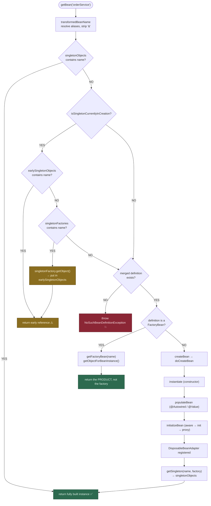

# IoC Container & ApplicationContext — The Complete Interview Guide

> **Level:** Beginner → Advanced
> **Interview Frequency:** ★★★★★ (asked in almost every Spring interview, usually as "explain the IoC container")
> **Prerequisites:** [01 · Spring Boot Fundamentals](../01-Spring-Boot-Fundamentals/README.md) · [README](../README.md)
> **Last Updated:** 2026

> **Target stack:** Spring Boot 3.3+ · Spring Framework 6.1+ · Java 17+ · Jakarta EE 10

---

## 📋 Table of Contents
- [0. TL;DR — The 30-Second Answer](#0-tldr--the-30-second-answer)
- [1. What & Why — The Problem This Solves](#1-what--why--the-problem-this-solves)
- [2. Mental Model — The One Picture](#2-mental-model--the-one-picture)
- [3. Deep Dive — Theory (Beginner → Advanced)](#3-deep-dive--theory-beginner--advanced)
  - [3.1 Beginner Level](#31-beginner-level)
  - [3.2 Intermediate Level](#32-intermediate-level)
  - [3.3 Advanced Level](#33-advanced-level)
  - [3.4 Expert Level](#34-expert-level)
- [4. Internal Working Mechanism](#4-internal-working-mechanism)
- [5. Step-by-Step Execution Flow](#5-step-by-step-execution-flow)
- [6. Visualizations](#6-visualizations)
- [7. Production-Level Use Cases & Real Industry Examples](#7-production-level-use-cases--real-industry-examples)
- [8. Worked Examples (with Output + Dry Run)](#8-worked-examples-with-output--dry-run)
- [9. Code from Scratch — Production-Grade](#9-code-from-scratch--production-grade)
- [10. Common Mistakes & Gotchas](#10-common-mistakes--gotchas)
- [11. Performance Considerations](#11-performance-considerations)
- [12. Security Considerations](#12-security-considerations)
- [13. Best Practices](#13-best-practices)
- [14. Hands-On Exercises & Code Challenges](#14-hands-on-exercises--code-challenges)
- [15. Interview Q&A — Level-wise](#15-interview-qa--level-wise)
  - [🟢 Beginner](#-beginner)
  - [🟡 Intermediate](#-intermediate)
  - [🔴 Advanced / Senior](#-advanced--senior)
  - [⚫ Expert / Principal](#-expert--principal)
- [16. Scenario-Based & Real-Experience Scenarios](#16-scenario-based--real-experience-scenarios)
- [17. Counter-Questions, Tricky Questions & Follow-Ups](#17-counter-questions-tricky-questions--follow-ups)
- [18. Frequently Asked Production Issues & Debugging Scenarios](#18-frequently-asked-production-issues--debugging-scenarios)
- [19. Architecture Design Questions](#19-architecture-design-questions)
- [20. Rapid-Fire MCQs](#20-rapid-fire-mcqs)
- [21. Cheat Sheet / One-Page Summary](#21-cheat-sheet--one-page-summary)
- [22. Real-World Production Notes](#22-real-world-production-notes)
- [23. Follow-up Learning](#23-follow-up-learning)

---

## 0. TL;DR — The 30-Second Answer

- **IoC means the container creates your dependencies, not you.** The inversion is in the *creation* direction (`new OrderService(new PaymentClient())` → the container does it), **not** in the control flow of your business method.
- **`BeanFactory` is the DI container; `ApplicationContext` is the container's facade.** `BeanFactory` gives you `getBean()`. `ApplicationContext` adds lifecycle management, **event publishing**, resource loading (`@Value` from files), internationalisation (`MessageSource`), **AOP integration** (auto-proxy creator registration) and environment access.
- **Everything the container knows about a bean lives in a `BeanDefinition`** — a *metadata* record, not an instance. 12 attributes matter: class name, scope, lazy flag, `dependsOn`, `initMethod`, `destroyMethod`, `factoryBeanName`, `factoryMethodName`, `autowireMode`, constructor args, property values, and the `abstract` flag.
- **`DefaultListableBeanFactory` keeps three singleton caches**, and the middle one is the secret to circular dependencies: `singletonObjects` (finished) → `earlySingletonObjects` (**partially built, exposed early**) → `singletonFactories` (a `ObjectFactory` that can still build it).
- **`getBean(name)` resolution order:** check the singleton cache → check the early-reference cache → look up the merged `BeanDefinition` → if it is a `FactoryBean`, resolve the product → otherwise `createBean` → `doCreateBean` → `instantiate` → `populate` → `initialize` → wrap in a proxy → cache.
- **The container publishes events** through `ApplicationEventPublisher`, fans them out with an `EventMulticaster`, and lets you subscribe with `@EventListener`. This is the sanctioned way to decouple modules — **but** a synchronous in-process event bus is *not* a message broker.
- **`@EventListener` ordering is controlled by `@Order`** on the listener method; `ApplicationListener` beans are ordered by `@Order`/`Ordered` on the class.
- **Do not call `getBean()` from business code.** That is the *service locator* anti-pattern: it hides the dependency, defeats AOP proxies, and makes unit tests need a container. Use constructor injection; when you truly need laziness, use `ObjectProvider<T>` or `@Lazy`.
- **`ApplicationContext` is hierarchical.** A child context can see the parent's beans, which is how you keep a `parent` context for shared infrastructure and a `child` context for feature-specific beans.
- **Boot 2.1+ (and therefore Boot 3.x) sets `spring.main.allow-bean-definition-overriding=false` by default.** A duplicate bean name now fails fast with `BeanDefinitionOverrideException` instead of silently replacing the first definition — a deliberate defence against ambiguous wiring.

---

## 1. What & Why — The Problem This Solves

**The problem.** Without a container, every object graph is assembled by hand, at the point of use:

```java
// ❌ THE MANUAL WORLD — 40 services, 40 `new` expressions, in EVERY caller
public class OrderController {
    private final OrderService orderService = new OrderService(
            new PaymentClient(new RestClient.Builder()),
            new InventoryClient(new OkHttpClient()),
            new OrderRepository(new JdbcTemplate(dataSource)));
}
```

```text
   ❌ WHAT BREAKS WITHOUT A CONTAINER
   ────────────────────────────────────────────────────────────────
   ① NO SUBSTITUTION   — you cannot swap PaymentClient for a fake
                         without touching the controller's source.
   ② NO LIFECYCLE      — who closes the HTTP client? Who opens the
                         connection pool? Who runs the schema migration?
   ③ NO CROSS-CUTTING  — transactions, metrics, retry, audit logging
                         would have to be threaded through every
                         constructor by hand.
   ④ NO CENTRAL VIEW    — "which beans exist?" has no answer.
   ⑤ EAGER COST        — every `new` runs at class-load of the caller,
                         even if the dependency is never used.
```

**The solution.** The container owns the *object graph*. It knows what to build, in what
order, with what collaborators, and it hands you a fully-wired instance.

```java
// ✅ THE CONTAINER WORLD — the controller states WHAT it needs, not HOW
@Service
public class OrderService {
    private final PaymentClient paymentClient;   // ← injected, not constructed
    private final OrderRepository orderRepository;

    public OrderService(PaymentClient paymentClient, OrderRepository orderRepository) {
        this.paymentClient = paymentClient;
        this.orderRepository = orderRepository;
    }
}
```

**The analogy that interviewers like.** A `BeanFactory` is a **factory of objects**;
an `ApplicationContext` is the **whole factory floor** — it also runs the quality control
(`BeanPostProcessor`), dispatches the events (the event bus), manages the wiring diagram
(the `BeanDefinition` registry), and at end of shift it turns off the machines in the
right order (`DisposableBean`).

> 💡 **The interviewer is listening for one distinction.** IoC does **not** mean your
> method calls are inverted — the *control flow* of `placeOrder()` is still yours. It
> means the **creation and wiring of collaborators** is inverted: the container asks for
> dependencies and hands them to you. If you answer "IoC means the framework calls your
> method", you have inverted the wrong thing.

---

## 2. Mental Model — The One Picture

```text
   THE SPRING CONTAINER, IN ONE PICTURE
   ═════════════════════════════════════

   ┌──────────────────────────────────────────────────────────────────────────┐
   │                        ApplicationContext                                │
   │   (facade: lifecycle · events · resources · i18n · environment · AOP)     │
   │                                                                          │
   │   ┌────────────────────────────────────────────────────────────────┐      │
   │   │                     DefaultListableBeanFactory                 │      │
   │   │                   (the actual DI container)                    │      │
   │   │                                                                │      │
   │   │   beanDefinitionMap ─────────────────────────┐                 │      │
   │   │   "orderService"  → BeanDefinition            │  METADATA      │      │
   │   │   "paymentClient" → BeanDefinition            │  (recipes)     │      │
   │   │                                                │                │      │
   │   │   singletonObjects      ── fully built ✅      │                │      │
   │   │   earlySingletonObjects ── half built ⚠️       │  INSTANCES     │      │
   │   │   singletonFactories    ── "build me" 🔧       │                │      │
   │   │                                                │                │      │
   │   │   getBean("orderService") ─────────────────────┘                │      │
   │   └────────────────────────────────────────────────────────────────┘      │
   │                                                                          │
   │   ┌───────────────┐  ┌──────────────┐  ┌─────────────────────────────┐    │
   │   │ BeanPostProc. │  │ EventMulti-  │  │ Environment / MessageSource │    │
   │   │ (AOP, @Async, │  │ caster (the  │  │ (properties, i18n)         │    │
   │   │  @Valid, ...) │  │ in-proc bus) │  │                             │    │
   │   └───────────────┘  └──────────────┘  └─────────────────────────────┘    │
   └──────────────────────────────────────────────────────────────────────────┘
```

**What to look at:** the split between **recipes** (`BeanDefinition` — metadata, cheap,
serialisable) and **instances** (the three singleton caches — the actual objects). Spring
keeps them apart on purpose: you can register 400 definitions without creating a single
bean, which is exactly what makes **lazy initialisation** and **condition evaluation**
possible.

---

## 3. Deep Dive — Theory (Beginner → Advanced)

### 3.1 Beginner Level

**The three interfaces you must know by sight.**

| Interface | Role | Key methods |
|---|---|---|
| `BeanFactory` | The **DI container** | `getBean(String)`, `getBean(Class<T>)`, `containsBean(String)` |
| `ListableBeanFactory` | A factory that can be **enumerated** | `getBeanDefinitionNames()`, `getBeanNamesForType(Class)`, `getBeanDefinition(String)` |
| `HierarchicalBeanFactory` | A factory with a **parent** | `getParentBeanFactory()` |
| `ConfigurableListableBeanFactory` | Both, plus **mutation** | `registerSingleton`, `destroySingleton`, `setBeanPostProcessors` |
| `ApplicationContext` | The **facade** over all of the above | everything above + `publishEvent`, `getEnvironment`, `getMessage` |

`ApplicationContext` (declared in `org.springframework.context`) **extends**
`BeanFactory` and adds six responsibilities that `BeanFactory` deliberately does not have:

| Added capability | Interface | Why it is not in `BeanFactory` |
|---|---|---|
| Lifecycle management | `Lifecycle` | `BeanFactory` is just a lookup; it does not know about "start/stop" |
| Event publication | `ApplicationEventPublisher` | Events are a *context*-level concern |
| Resource loading | `ResourcePatternResolver` | `@Value("classpath:...")` needs a resource strategy |
| Internationalisation | `MessageSource` | Message resolution belongs to the app, not the container |
| Environment access | `EnvironmentCapable` | Profiles & properties are app-level configuration |
| AOP auto-proxy registration | *(internal)* | The context installs `AbstractAutoProxyCreator` |

**The `BeanDefinition` — the container's metadata record.** A `BeanDefinition` says
*how to build* a bean, not *what the bean is*. Twelve attributes do all the work:

| # | Attribute | Getter | Meaning |
|---|---|---|---|
| 1 | Class | `getBeanClassName()` | The concrete type to instantiate |
| 2 | Scope | `getScope()` | `singleton` (default), `prototype`, `request`, `session`, `application`, `websocket` |
| 3 | Lazy flag | `isLazyInit()` | Create on first `getBean()`, not at startup |
| 4 | Dependencies | `getDependsOn()` | Bean names that must be **initialised first** |
| 5 | Init method | `getInitMethodName()` | Custom init callback (`@Bean(initMethod=...)`) |
| 6 | Destroy method | `getDestroyMethodName()` | Custom destroy callback (`@Bean(destroyMethod=...)`) |
| 7 | Factory bean | `getFactoryBeanName()` | The `FactoryBean` that produces this bean |
| 8 | Factory method | `getFactoryMethodName()` | The method on the factory that produces it |
| 9 | Autowire mode | `getAutowireMode()` | `AUTOWIRE_NO` / `BY_NAME` / `BY_TYPE` / `CONSTRUCTOR` |
| 10 | Constructor args | `getConstructorArgumentValues()` | Positional/indexed constructor injection |
| 11 | Property values | `getPropertyValues()` | Setter/field injection values |
| 12 | Abstract | `isAbstract()` | A template definition, never instantiated |

```java
// ✅ Reading a definition — this is legal, stable API
BeanDefinition bd = context.getBeanFactory().getBeanDefinition("orderService");
bd.getScope();            // "singleton"
bd.isLazyInit();          // false
bd.getDependsOn();        // String[] { "paymentClient" }
```

**The three ways a `BeanDefinition` gets into the container:**

| Reader | Class | Source of definitions |
|---|---|---|
| Annotation reader | `AnnotatedBeanDefinitionReader` | `@Component`-annotated classes you register explicitly |
| Classpath scanner | `ClassPathBeanDefinitionScanner` | Scans packages for `@Component`/`@Service`/`@Repository`/`@Controller` |
| XML reader | `XmlBeanDefinitionReader` | `*.xml` bean definitions |
| Registrar | `BeanDefinitionRegistryPostProcessor` | Programmatic registration at startup |

All of them write into the same place: the `BeanDefinitionRegistry`, whose
implementation inside `DefaultListableBeanFactory` is `beanDefinitionMap`.

### 3.2 Intermediate Level

**`ApplicationContext` types and when each is used.**

| Context class | Use case | Created by |
|---|---|---|
| `AnnotationConfigApplicationContext` | Plain Java, `@Configuration` driven | You, in a test or a CLI app |
| `ClassPathXmlApplicationContext` | Legacy XML configuration | You (rarely — XML is legacy) |
| `GenericApplicationContext` | A generic, **non-web** context you drive yourself | `new GenericApplicationContext()` + `register()` + `refresh()` |
| `GenericWebApplicationContext` | Base for web contexts | Subclassed |
| `ServletWebServerApplicationContext` | **The Boot servlet context** (embedded Tomcat) | `SpringApplication` |
| `AnnotationConfigWebApplicationContext` | Web + Java config, without Boot's server | `WebApplicationContextUtils` (legacy) |
| `ReactiveWebServerApplicationContext` | **The Boot reactive context** (Netty) | `SpringApplication` |

```text
   THE CONTEXT CLASS HIERARCHY (abridged)
   ══════════════════════════════════════

   AbstractApplicationContext                    ← implements ApplicationContext
     │  implements: EnvironmentCapable, ListableBeanFactory, HierarchicalBeanFactory,
     │              MessageSource, ApplicationEventPublisher, ResourcePatternResolver
     ├─ GenericApplicationContext
     │    ├─ AnnotationConfigApplicationContext
     │    ├─ GenericWebApplicationContext
     │    │    ├─ AnnotationConfigWebApplicationContext
     │    │    └─ ServletWebServerApplicationContext   ← Boot 3 servlet apps
     │    └─ GenericReactiveWebApplicationContext
     │         └─ ReactiveWebServerApplicationContext  ← Boot 3 reactive apps
     └─ AbstractXmlApplicationContext
          └─ ClassPathXmlApplicationContext
```

**How `SpringApplication` picks the context.** It calls
`WebApplicationType.deduceFromClasspath()`, which checks for marker classes in this order:

1. `org.springframework.web.reactive.DispatcherHandler` present **and**
   `org.springframework.web.servlet.DispatcherServlet` **absent** → `REACTIVE`
2. `org.springframework.web.servlet.DispatcherServlet` present **and**
   `org.springframework.web.context.ConfigurableWebApplicationContext` present → `SERVLET`
3. Otherwise → `NONE` (a plain `AnnotationConfigApplicationContext`)

```java
// ✅ Override the deduction when you need to
@SpringBootApplication(scanBasePackages = "com.example.billing")
public class BillingApplication {
    public static void main(String[] args) {
        SpringApplication app = new SpringApplication(BillingApplication.class);
        app.setWebApplicationType(WebApplicationType.SERVLET);   // force it
        app.run(args);
    }
}
```

> ⚠️ **A real trap.** If both `spring-boot-starter-web` (servlet) and
> `spring-boot-starter-webflux` (reactive) are on the classpath, Boot **starts as
> SERVLET** — because `DispatcherServlet` wins the deduction. You get a Tomcat server
> that serves a WebFlux stack. Boot prints
> `"Spring MVC found on classpath, which is incompatible with Spring WebFlux."`
> only in some configurations; the reliable fix is to **remove one starter**.

**The event system.** Five types you must be able to name:

| Type | Role |
|---|---|
| `ApplicationEvent` | The base class (`extends EventObject`); forces a `source` |
| `PayloadApplicationEvent<T>` | Wraps **any** object as an event (Spring 4.2+) |
| `ApplicationListener<E>` | The interface for a listener bean |
| `ApplicationEventPublisher` | The publishing side — implemented by `ApplicationContext` |
| `EventMulticaster` | The fan-out engine — `SimpleApplicationEventMulticaster` by default |

```java
// ✅ Any object can be an event since Spring 4.2
public record OrderPlacedEvent(String orderId, BigDecimal amount) {}

// Publisher
applicationContext.publishEvent(new OrderPlacedEvent("ORD-1001", new BigDecimal("249.99")));

// Listener — two styles
@Component
public class FraudScorer implements ApplicationListener<OrderPlacedEvent> {
    @Override public void onApplicationEvent(OrderPlacedEvent event) { /* … */ }
}

@Component
public class NotificationSender {
    @EventListener
    public void onOrderPlaced(OrderPlacedEvent event) { /* … */ }
}
```

**`@EventListener` ordering** uses `AnnotationAwareOrderComparator`, so `@Order` on the
listener *method* controls it:

```java
@Component
public class OrderPlacedListeners {

    @EventListener
    @Order(10)                                   // runs FIRST
    public void reserveStock(OrderPlacedEvent e) { /* … */ }

    @EventListener
    @Order(20)                                   // runs SECOND
    public void chargeCard(OrderPlacedEvent e) { /* … */ }
}
```

**Listener discovery** happens in `EventListenerMethodProcessor` (a
`BeanFactoryPostProcessor`). At *`postProcessBeanFactory`* time it scans every bean's
methods for `@EventListener` and registers a `GenericApplicationListener` for each. That
means the listener methods must be on beans that **exist by the time the
`BeanFactoryPostProcessor` phase runs** — a listener registered *later* (e.g. dynamically
at runtime) will not be picked up by `@EventListener`.

### 3.3 Advanced Level

**`DefaultListableBeanFactory` internals — the real data structures.**

```java
public class DefaultListableBeanFactory extends AbstractAutowireCapableBeanFactory {

    /** Map of bean definitions, keyed by bean name. */
    private final Map<String, BeanDefinition> beanDefinitionMap = new ConcurrentHashMap<>(256);

    /** Map of merged bean definitions (parent + child definitions combined). */
    private final Map<String, BeanDefinition> mergedBeanDefinitions = new ConcurrentHashMap<>(256);

    /** List of bean definition names, in registration order. */
    private final List<String> beanDefinitionNames = new ArrayList<>(256);

    /** Map of manually registered singletons (not backed by a definition). */
    private final Map<String, Object> manualSingletonNames = new ConcurrentHashMap<>(16);
    ...
}
```

And in the superclass `DefaultSingletonBeanRegistry`:

```java
/** Cache of singleton objects: bean name → fully built instance. */
private final Map<String, Object> singletonObjects = new ConcurrentHashMap<>(256);

/** Cache of early singleton objects: bean name → partially built instance (circular refs). */
private final Map<String, Object> earlySingletonObjects = new ConcurrentHashMap<>(16);

/** Cache of singleton factories: bean name → ObjectFactory that can still build it. */
private final Map<String, ObjectFactory<?>> singletonFactories = new HashMap<>(16);
```

**Why `beanDefinitionMap` is a `ConcurrentHashMap` but `beanDefinitionNames` is an
`ArrayList`.** The map is read on every single `getBean()` — it must be lock-free.
The name list is only mutated during registration and read during enumeration, and
`DefaultListableBeanFactory` synchronises the mutations on `this` beanFactory. So the
hot path is concurrent, and the cold path is not. This is the kind of detail that
separates a 3-year candidate from a 5-year one.

**The `BeanDefinition` hierarchy** — you rarely need `RootBeanDefinition` by name, but
you should recognise it:

```
AbstractBeanDefinition
   └── RootBeanDefinition          ← a *complete*, self-contained definition
        └── ScannedGenericBeanDefinition  ← produced by the classpath scanner
```

**`BeanDefinitionRegistry`** is the write side:

```java
public interface BeanDefinitionRegistry extends BeanFactoryPostProcessor {
    void registerBeanDefinition(String beanName, BeanDefinition beanDefinition);
    void removeBeanDefinition(String beanName);
    BeanDefinition getBeanDefinition(String beanName);
    String[] getBeanDefinitionNames();
    boolean containsBeanDefinition(String beanName);
    int getBeanDefinitionCount();
}
```

**`BeanFactoryPostProcessor` vs `BeanPostProcessor`** — the single most-confused pair in
Spring interviews:

| | `BeanFactoryPostProcessor` | `BeanPostProcessor` |
|---|---|---|
| Operates on | **Definitions** (metadata) | **Instances** (objects) |
| Runs | Before any bean is instantiated | After each bean is instantiated |
| Can change | Scope, lazy flag, property values, class | The object itself (wrap in a proxy) |
| Canonical use | `PropertySourcesPlaceholderConfigurer`, `ConfigurationClassPostProcessor` | `AbstractAutoProxyCreator`, `AutowiredAnnotationBeanPostProcessor` |

**`Environment` and `EnvironmentCapable`.** `ApplicationContext` is `EnvironmentCapable`
because `getEnvironment()` exposes the merged `PropertySources`:

```java
public interface ConfigurableEnvironment extends Environment, ConfigurablePropertyResolver {
    MutablePropertySources getPropertySources();
    void setActiveProfiles(String... profiles);
    void addActiveProfile(String profile);
}
```

The standard property source order in `StandardEnvironment` (highest first):
1. `systemProperties` (JVM `-D` flags)
2. `systemEnvironment` (OS env vars)
3. `applicationConfig` (`application.yml` / `application.properties`) — added by Boot
4. `@TestPropertySource` / `@SpringBootTest(properties=…)` — added by the test context
5. **Command-line arguments** (`--server.port=9090`) — added by Boot as `commandLineArgs`
6. `random` (`RandomValuePropertySource`)
7. Profile-specific documents (`application-{profile}.yml`)

**Boot's `SpringApplication` adds two more** at the top of the list in `prepareEnvironment`:
`configurationProperties` (the `spring.config.*` mechanism) and `commandLineArgs`.

### 3.4 Expert Level

**`getBean` resolution, in exact order.** `AbstractBeanFactory.doGetBean(String name,
Class<T> requiredType, Object[] args, boolean typeCheckOnly)`:

1. `transformedBeanName(name)` — resolve **bean name aliases** and strip the `&` prefix
   used for `FactoryBean` products.
2. `getSingleton(beanName)` — hit in `singletonObjects`? Return the finished instance.
3. `getSingleton(beanName, true)` — is the bean **currently in creation**? Look in
   `earlySingletonObjects`; if absent, ask `singletonFactories` for the early reference.
   *This is the circular-dependency escape hatch.*
4. `getFactoryBean(beanName, ...)` — is this a `FactoryBean`? If so, get the factory
   itself, then `getObjectForBeanInstance` unwraps the product.
5. No merged definition yet? → `getMergedLocalBeanDefinition(beanName)` →
   `getBeanDefinition(beanName)` → **`NoSuchBeanDefinitionException`** if absent.
6. If the definition is a `RootBeanDefinition` with `isAbstract()` → error.
7. `getSingletonFactory(beanName, mbd)` — a previously registered `ObjectFactory`?
   Call `getObjectForBeanInstance(...)`.
8. `mbd.isSingleton()` → create a `singletonFactory` that will call `createBean`.
9. `bean = createBean(beanName, mbd, args)` → `AbstractAutowireCapableBeanFactory.createBean`
   → `doCreateBean`.
10. `getObjectForBeanInstance(beanName, bean, mbd)` — unwrap `FactoryBean` products.
11. `getSingleton(beanName, singletonFactory)` — put into `singletonObjects`.

**`doCreateBean` — the heart of the container.** `AbstractAutowireCapableBeanFactory`:

```text
  1. resolveBeforeInstantiation()
        → InstantiationAwareBeanPostProcessor.postProcessBeforeInstantiation()
          (a proxy can be returned here and the real object is never created)

  2. resolveMergedBeanDefinition()          → the merged BeanDefinition

  3. applyMergedBeanDefinitionPostProcessors()
        → MergedBeanDefinitionPostProcessor.postProcessMergedBeanDefinition()
          (e.g. AnnotationConfigUtils' AutowiredAnnotationBeanPostProcessor registers
           the injection metadata)

  4. createBeanInstance()
        → resolveConstructorFromBeanPostProcessors()
        → autowireConstructor(...)  OR  instantiateBean(...)  (no-arg)

  5. populateBean()                         → @Autowired fields, @Value, setter injection

  6. initializeBean()
        → invokeAwareMethods()              → BeanNameAware, BeanClassLoaderAware, BeanFactoryAware
        → applyBeanPostProcessorsBeforeInitialization()  → Aware callbacks via ApplicationContextAwareProcessor
        → invokeInitMethods()               → afterPropertiesSet(), then custom init-method
        → applyBeanPostProcessorsAfterInitialization()   → *** PROXY CREATED HERE ***

  7. registerDisposableBeanIfNecessary()   → @PreDestroy / DisposableBean / destroy-method
```

**`BeanPostProcessor` ordering matters more than most people realise.** The container
sorts them so that the **`BeanPostProcessor`s that create proxies run LAST**, after the
ones that inject dependencies. That is why
`AutowiredAnnotationBeanPostProcessor` (which injects `@Autowired`) runs *before*
`AbstractAutoProxyCreator` (which wraps the bean), and why
`InfrastructureAdvisorAutoProxyCreator` (transactions) must run **after**
`AnnotationAwareAspectJAutoProxyCreator` (AspectJ aspects) — otherwise the transaction
advisor would be applied to the aspect proxy and the aspect would never see the
transaction boundary.

**`ApplicationContext` hierarchy.** A child context sees the parent's beans:

```text
   parent ApplicationContext
   ├── dataSource          (shared infrastructure)
   ├── securityContext
   └── child ApplicationContext
       ├── orderService    (feature-specific)
       └── ← can see dataSource from the parent, but the parent CANNOT see orderService
```

The rules: `getBean` falls back to `getParentBeanFactory()`; a child **overrides** a
parent bean of the same name; **events propagate UP** (a child's events reach the
parent's listeners, but not the other way round); and `destroy()` closes the child
first.

**`AbstractApplicationContext.refresh()` — the 12-step lifecycle.** This is the single
most valuable list in this chapter:

```text
  1. prepareRefresh()               → set startup time, init property sources, env
  2. obtainFreshBeanFactory()       → the DefaultListableBeanFactory
  3. prepareBeanFactory()           → set the BeanPostProcessor/BeanFactoryPostProcessor "names"
  4. postProcessBeanFactory()       → ★ BeanFactoryPostProcessor + BDRPP run here
  5. registerBeanPostProcessors()   → ★ BeanPostProcessors are INSTANTIATED here
  6. initMessageSource()            → i18n
  7. initApplicationEventMulticaster()
  8. onRefresh()                    → ★ Spring Boot's ServletWebServerApplicationContext
                                        creates the embedded Tomcat HERE
  9. registerListeners()            → ★ ContextRefreshedEvent is published here
 10. finishBeanFactoryInitialization() → ★ pre-instantiate all non-lazy singletons
 11. finishRefresh()                → ★ LifecycleProcessor.onRefresh(), ContextStartedEvent
 12. resetCommonCaches()            → clear caches, publish ContextStoppedEvent
```

> 🔑 **The number interviewers want.** `finishBeanFactoryInitialization()` (step 10) is
> where **every non-lazy singleton is created**. That is why a broken dependency fails
> the *application*, not the first request — and why `spring.main.lazy-initialization=true`
> moves the failure to the first request that touches the bean.

---

## 4. Internal Working Mechanism

**The call chain for `context.getBean(OrderService.class)`:**

```text
ApplicationContext.getBean(Class<T>)
  └─ AbstractApplicationContext.getBean(String, Class<T>, Object...)
       └─ AbstractBeanFactory.getBean(String)                [resolve alias, '&' prefix]
            └─ AbstractBeanFactory.doGetBean(name, type, args, false)
                 ├─ 1. transformedBeanName(name)               → resolve aliases
                 ├─ 2. getSingleton(name)                      → singletonObjects  (fast path)
                 ├─ 3. getSingleton(name, allowEarlyRef=true)  → earlySingletonObjects / singletonFactories
                 ├─ 4. getFactoryBean(name, mbd)               → FactoryBean path
                 ├─ 5. getMergedLocalBeanDefinition(name)     → mergedBeanDefinitions cache
                 │       └─ getBeanDefinition(name)            → beanDefinitionMap  ← NoSuchBeanDefinitionException
                 ├─ 6. rootBeanDefinition.isAbstract() check
                 ├─ 7. getSingletonFactory(name, mbd)          → previously registered factory
                 ├─ 8. createBean(name, mbd, args)             → AbstractAutowireCapableBeanFactory
                 │       └─ doCreateBean(name, mbd, args)
                 │            ├─ resolveBeforeInstantiation()  → InstantiationAwareBeanPostProcessor
                 │            ├─ applyMergedBeanDefinitionPostProcessors()
                 │            ├─ createBeanInstance()          → constructor or no-arg
                 │            ├─ populateBean()                → @Autowired, @Value
                 │            ├─ initializeBean()
                 │            │    ├─ invokeAwareMethods()      → BeanName/BeanClassLoader/BeanFactoryAware
                 │            │    ├─ postProcessBeforeInitialization()
                 │            │    ├─ invokeInitMethods()       → InitializingBean + init-method
                 │            │    └─ postProcessAfterInitialization()  → ★ PROXY CREATED
                 │            └─ registerDisposableBeanIfNecessary()
                 ├─ 9. getObjectForBeanInstance()              → unwrap FactoryBean product
                 └─ 10. getSingleton(name, singletonFactory)   → singletonObjects
```

**Where each extension point plugs in:**

| Extension point | Interface you implement | Hooked where | May legally change |
|---|---|---|---|
| Definition registration | `BeanDefinitionRegistryPostProcessor` | `refresh()` step 4, **before** `ConfigurationClassPostProcessor` finishes | Add/remove **definitions** |
| Definition mutation | `BeanFactoryPostProcessor` | `refresh()` step 4 | Mutate **definitions** (scope, lazy, property values) |
| Instance post-processing | `BeanPostProcessor` | `doCreateBean()` steps 1 & 6 | Wrap/replace the **instance** |
| Lifecycle | `InitializingBean` / `SmartInitializingSingleton` / `SmartLifecycle` | `initializeBean()` / step 10 / step 11 | Run code at a defined moment |
| Destruction | `DisposableBean` / `@PreDestroy` | `destroySingletons()` | Release resources |
| Eventing | `ApplicationListener` / `@EventListener` | `registerListeners()` + runtime | React to events |
| AOP | `AbstractAutoProxyCreator` (a `BeanPostProcessor`) | `postProcessAfterInitialization()` | Wrap the instance in a proxy |

**The event publication chain:**

```text
publishEvent(Object event)
  └─ AbstractApplicationContext.publishEvent(Object)
       └─ if event instanceof ApplicationEvent → publishEvent((ApplicationEvent) event)
            └─ getApplicationEventMulticaster().multicastEvent(event, getType(event))
                 └─ SimpleApplicationEventMulticaster.multicastEvent(...)
                      ├─ for each ApplicationListener<?> listener in getApplicationListeners(event, type)
                      │    └─ listener.onApplicationEvent(event)     ← synchronous, same thread
                      └─ if a taskExecutor is set → executor.execute(...)
```

---

## 5. Step-by-Step Execution Flow

**The flow of a Boot application from `main()` to a served request** (the parts this
chapter owns):

1. `SpringApplication.run(App.class, args)` → `new SpringApplication(...)` → `SpringApplicationRunListeners` → `ApplicationStartingEvent`.
2. `prepareEnvironment()` → builds the `Environment`, adds `commandLineArgs` and
   `configurationProperties` property sources, applies the active profile.
3. `createApplicationContext()` → `ApplicationContextFactory` →
   **`ServletWebServerApplicationContext`** (deduced from the classpath).
4. `prepareContext()` → applies the `ApplicationContextInitializer`s, sets the
   `ApplicationStartup`, loads `banner`, and **registers the `BeanDefinition`s of the
   `@SpringBootApplication` class** via `AnnotatedBeanDefinitionReader`.
5. `refresh()` → the 12 steps above.
   - **Step 4:** `ConfigurationClassPostProcessor` runs — it parses `@Configuration`
     classes, executes `@ComponentScan` (which registers *more* definitions), processes
     `@Import`/`@ImportSelector`/`@ImportBeanDefinitionRegistrar`, and evaluates
     `@Bean` methods. Then `BeanDefinitionRegistryPostProcessor`s run.
   - **Step 5:** the `BeanPostProcessor`s are instantiated — notably
     `AutowiredAnnotationBeanPostProcessor`, `CommonAnnotationBeanPostProcessor`
     (`@PostConstruct`/`@PreDestroy`), `AnnotationAwareAspectJAutoProxyCreator`, and
     `InfrastructureAdvisorAutoProxyCreator` (transactions).
   - **Step 8:** Boot's `ServletWebServerApplicationContext.onRefresh()` creates the
     embedded Tomcat and starts it on the configured port.
   - **Step 9:** `ContextRefreshedEvent` is published — this is the first moment your
     `@EventListener` beans can safely assume everything is wired.
   - **Step 10:** `preInstantiateSingletons()` — every non-lazy, non-abstract singleton
     is created, populated, initialised and proxied. **This is where 80% of "application
     fails to start" errors come from.**
6. `afterRefresh()` → `ApplicationReadyEvent` (and `ApplicationStartedEvent` before it).
7. The main thread returns; Tomcat's worker threads serve requests.

**The flow of `getBean("orderService")` for an already-created singleton:**

1. `transformedBeanName` → canonical name.
2. `getSingleton` → `singletonObjects` hit → return the **fully built** instance.
3. Return to the caller.

**The flow of `getBean("orderService")` for a lazy bean not yet created:**

1. Steps 1–5 as above; no cache hit, definition found.
2. `createBean` → `doCreateBean` → instantiate → populate → initialize → proxy.
3. `getSingleton(name, factory)` → `beforeSingletonCreation(name)` (adds to
   `singletonsCurrentlyInCreation`; **throws `BeanCurrentlyInCreationException` if it
   is already there**) → `singletonFactory.getObject()` → `afterSingletonCreation(name)` →
   `addSingleton(name, obj)` → into `singletonObjects`.

---

## 6. Visualizations

### 6.1 The `BeanFactory` hierarchy (Mermaid)

```mermaid
graph TD
    BeanFactory["BeanFactory<br/>getBean(name) · getBean(type)"]
    ListableBeanFactory["ListableBeanFactory<br/>getBeanDefinitionNames()<br/>getBeanNamesForType()"]
    HierarchicalBeanFactory["HierarchicalBeanFactory<br/>getParentBeanFactory()"]
    ConfigurableBeanFactory["ConfigurableBeanFactory<br/>addBeanPostProcessor()"]
    ConfigurableListableBeanFactory["ConfigurableListableBeanFactory<br/>registerSingleton()"]
    AutowireCapableBeanFactory["AutowireCapableBeanFactory<br/>autowireBean()"]
    SingletonBeanRegistry["SingletonBeanRegistry<br/>getSingleton() · registerSingleton()"]

    BeanFactory --> ListableBeanFactory
    BeanFactory --> HierarchicalBeanFactory
    BeanFactory --> ConfigurableBeanFactory
    ListableBeanFactory --> ConfigurableListableBeanFactory
    ConfigurableBeanFactory --> ConfigurableListableBeanFactory
    ConfigurableListableBeanFactory --> AutowireCapableBeanFactory
    ConfigurableBeanFactory --> SingletonBeanRegistry

    AbstractBeanFactory["AbstractBeanFactory<br/>★ the real template method"]
    DefaultListableBeanFactory["DefaultListableBeanFactory<br/>★ beanDefinitionMap"]
    AbstractAutowireCapableBeanFactory["AbstractAutowireCapableBeanFactory<br/>★ doCreateBean()"]
    DefaultSingletonBeanRegistry["DefaultSingletonBeanRegistry<br/>★ the 3 singleton caches"]

    AbstractBeanFactory --> DefaultListableBeanFactory
    DefaultSingletonBeanRegistry --> AbstractBeanFactory
    AbstractBeanFactory --> AbstractAutowireCapableBeanFactory
    DefaultListableBeanFactory --> AbstractAutowireCapableBeanFactory

    ApplicationContext["ApplicationContext<br/>★ the facade"]
    AbstractApplicationContext["AbstractApplicationContext<br/>★ refresh()"]
    GenericApplicationContext["GenericApplicationContext"]
    AnnotationConfigApplicationContext["AnnotationConfigApplicationContext"]
    ServletWebServerApplicationContext["ServletWebServerApplicationContext<br/>(Boot servlet)"]
    ReactiveWebServerApplicationContext["ReactiveWebServerApplicationContext<br/>(Boot reactive)"]

    ApplicationContext --> AbstractApplicationContext
    AbstractApplicationContext --> GenericApplicationContext
    GenericApplicationContext --> AnnotationConfigApplicationContext
    GenericApplicationContext --> ServletWebServerApplicationContext
    GenericApplicationContext --> ReactiveWebServerApplicationContext

    classDef iface fill:#1f4e79,stroke:#0d2b45,color:#e8f1fb
    classDef impl fill:#2d6a4f,stroke:#123d2c,color:#e6f4ec
    classDef boot fill:#7f4f24,stroke:#4a2e14,color:#fdf0e2
    class BeanFactory,ListableBeanFactory,HierarchicalBeanFactory,ConfigurableBeanFactory,ConfigurableListableBeanFactory,AutowireCapableBeanFactory,SingletonBeanRegistry iface
    class AbstractBeanFactory,DefaultListableBeanFactory,AbstractAutowireCapableBeanFactory,DefaultSingletonBeanRegistry,AbstractApplicationContext,GenericApplicationContext impl
    class ApplicationContext,AnnotationConfigApplicationContext,ServletWebServerApplicationContext,ReactiveWebServerApplicationContext boot
```



**Caption:** Blue = the *interfaces* you program against. Green = the *implementations*
that do the work. Orange = the context family. The key structural fact: `ApplicationContext`
**is a** `BeanFactory` (it extends it) — it is not a wrapper *around* one, and it is not
a separate concept.

### 6.2 `DefaultListableBeanFactory` internal maps (ASCII)

```text
   DefaultListableBeanFactory — WHAT IS ACTUALLY IN MEMORY
   ════════════════════════════════════════════════════════

   ┌─── DEFINITIONS (recipes) ──────────────────────────────────────────────┐
   │                                                                       │
   │   beanDefinitionMap : ConcurrentHashMap<String, BeanDefinition>       │
   │   ┌──────────────────┬──────────────────────┬───────────────────┐     │
   │   │ "orderService"   │ "paymentClient"      │ "dataSource"      │     │
   │   │ ─────────────    │ ──────────────       │ ───────────       │     │
   │   │ class=OrderSvc  │ class=PaymentClient  │ class=HikariDS    │     │
   │   │ scope=singleton │ scope=singleton      │ scope=singleton   │     │
   │   │ lazy=false      │ lazy=false           │ lazy=false        │     │
   │   │ dependsOn=[]    │ dependsOn=[]         │ dependsOn=[]      │     │
   │   │ ctorArgs=[...]  │ ctorArgs=[...]       │ ctorArgs=[...]    │     │
   │   │ propValues={}   │ propValues={}        │ propValues={}     │     │
   │   └──────────────────┴──────────────────────┴───────────────────┘     │
   │                                                                       │
   │   mergedBeanDefinitions : ConcurrentHashMap<String, BeanDefinition>    │
   │   └─ parent + child definitions combined, cached per name            │
   │                                                                       │
   │   beanDefinitionNames : ArrayList<String>                            │
   │   └─ ["orderService", "paymentClient", "dataSource"]  (registration    │
   │      order — used by getBeanDefinitionNames() and by Boot's reports) │
   └───────────────────────────────────────────────────────────────────────┘

   ┌─── INSTANCES (built objects) ───────── DefaultSingletonBeanRegistry ───┐
   │                                                                       │
   │   ① singletonObjects : ConcurrentHashMap<String, Object>              │
   │      └─ "dataSource" → HikariDataSource@1a2b   ✅ FULLY BUILT         │
   │                                                                       │
   │   ② earlySingletonObjects : ConcurrentHashMap<String, Object>         │
   │      └─ "orderService" → OrderService@3c4d      ⚠️ HALF BUILT         │
   │         (exposed to break a circular dependency)                      │
   │                                                                       │
   │   ③ singletonFactories : HashMap<String, ObjectFactory<?>>            │
   │      └─ "paymentClient" → ObjectFactory@5e6f     🔧 "CALL ME TO BUILD" │
   │                                                                       │
   │   registeredSingletons : LinkedHashSet<String>   (creation order)      │
   │   disposableBeans      : Map<String, DisposableBean> (shutdown order)  │
   │   dependentBeanMap     : Map<String, Set<String>> (destroy dependents  │
   │                                                   BEFORE the bean)    │
   └───────────────────────────────────────────────────────────────────────┘

   ★ THE THREE-LEVEL SINGLTON CACHE — WHY IT MATTERS
   ─────────────────────────────────────────────────
   getSingleton(name, allowEarlyReference):
       1. singletonObjects.get(name)         → HIT  = fully built, done
       2. (only if "in creation")
          earlySingletonObjects.get(name)     → HIT  = circular dependency escape
          singletonFactories.get(name).get()  → MISS = ask the factory to build it
```

**Caption:** The container holds **two different kinds of state**. `beanDefinitionMap`
holds *recipes* (cheap, always present, safe to serialise). The three singleton caches
hold *products* (expensive, created on demand). The middle cache — `earlySingletonObjects`
— exists for exactly one reason: to hand out a half-built object when two beans depend
on each other.

### 6.3 `getBean` resolution flow (Mermaid flowchart)



**Caption:** Follow the **green** path for a warm bean (two map lookups). The **yellow**
path is the circular-dependency escape. The **red** path is the only place
`NoSuchBeanDefinitionException` is thrown from — which is why the exception message
almost always means "the definition was never registered", not "the class is missing".

### 6.4 Context refresh + event publication (Mermaid sequence diagram)

```mermaid
sequenceDiagram
    autonumber
    participant M as main()
    participant SA as SpringApplication
    participant CTX as ServletWebServerApplicationContext
    participant BF as DefaultListableBeanFactory
    participant BPP as BeanPostProcessors
    participant L as @EventListener bean

    M->>SA: run(App.class, args)
    SA->>SA: prepareEnvironment() — build Environment
    SA->>CTX: createApplicationContext()
    SA->>CTX: prepareContext() — register @SpringBootApplication definition
    CTX->>BF: refresh()

    rect rgb(240, 245, 250)
        Note over CTX,BF: refresh() step 4 — definitions phase
        CTX->>BF: invokeBeanFactoryPostProcessors()
        BF->>BF: ConfigurationClassPostProcessor — @ComponentScan, @Import, @Bean
        BF->>BF: BeanDefinitionRegistryPostProcessor — register extra definitions
    end

    rect rgb(245, 250, 240)
        Note over CTX,BPP: refresh() step 5 — post-processors instantiated
        CTX->>BPP: registerBeanPostProcessors()
    end

    rect rgb(250, 245, 240)
        Note over CTX,BPP: refresh() step 8-11 — beans & events
        CTX->>CTX: onRefresh() — start embedded Tomcat
        CTX->>CTX: registerListeners()
        CTX->>BF: finishBeanFactoryInitialization() — pre-instantiate singletons
        BF->>BPP: postProcessBeforeInitialization / postProcessAfterInitialization
        CTX->>CTX: finishRefresh() — publish ContextRefreshedEvent
    end

    CTX-->>L: deliver ContextRefreshedEvent (synchronous, same thread)
    SA->>SA: afterRefresh() — publish ApplicationReadyEvent
    SA-->>M: run() returns; Tomcat serves requests

    Note over M,CTX: later — a request handler publishes a domain event
    M->>CTX: publishEvent(new OrderPlacedEvent(...))
    CTX->>CTX: getApplicationEventMulticaster().multicastEvent(...)
    CTX-->>L: listener.onOrderPlaced(event) — @Order(10) first
```

**Caption:** Note the **ordering**: the `BeanPostProcessor`s are *instantiated* at step 5
but the beans themselves are created at step 10. The `ContextRefreshedEvent` is
published **before** `ApplicationReadyEvent` and after the singletons exist — which is
why a `ContextRefreshedEvent` listener may safely use every bean.

---

## 7. Production-Level Use Cases & Real Industry Examples

**1. Banking — a shared infrastructure context with per-tenant feature contexts.**
A core banking platform runs one `parent` context holding the `DataSource`, the
`SecurityContext` and the audit infrastructure, and creates a **child** context per
tenant module. The child sees the parent's beans (no re-wiring of the `DataSource`),
but a tenant-specific `FeeCalculator` stays invisible to the parent. This keeps a
400-bean monorepo's wiring explicit and prevents a tenant module from accidentally
overriding a shared infrastructure bean.

**2. E-commerce — the container as the configuration registry for a rules engine.**
At startup, a `BeanDefinitionRegistryPostProcessor` reads `pricing-rules.yml` from the
classpath and registers one `@Component`-equivalent bean definition per rule tier.
40k orders/min peak, 3 tiers, and the pricing rules change per release without a
recompile. The container is doing what a hand-rolled factory would do, but with
dependency injection, lifecycle and observability for free.

**3. SaaS — `ApplicationContext` as an in-process event bus for domain fan-out.**
`OrderPlacedEvent` is published in the request thread; `InventoryReservation`,
`LoyaltyPointsAccrual` and `NotificationEmail` subscribe with `@EventListener`. At
2,000 orders/second with 3 listeners each, the synchronous bus costs ~40 µs of listener
time per event — acceptable, but it **serialises** the listeners behind the request.
Above ~500 events/second the team moves to Kafka (see the
**08 · Microservices with Spring Boot** folder) and keeps
`@EventListener` only for in-process, non-critical reactions.

**4. Ad-tech — a `BeanDefinitionRegistryPostProcessor` that wires tenants at runtime.**
A multi-tenant ad server registers a `TenantContext` bean definition per tenant at
boot from a `tenants.yml`, each with a constructor argument (tenant id, endpoint,
budget). 1,200 tenants → 1,200 definitions, all created lazily so boot stays under
**4 seconds** even though the tenant list is large.

**5. Logistics — the container drives the retry/timeout policy through bean definitions.**
Each downstream carrier gets its own `CarrierClient` bean with different timeouts.
Changing a timeout is a configuration change, not a code change, because the timeout
lives in the `BeanDefinition`'s property values.

> 💡 **The production lesson.** The container's real value at scale is not
> "less boilerplate" — it is that **the object graph is data**. Everything the container
> knows is introspectable (`getBeanDefinitionNames()`, `getBeanDefinition(name)`),
> which is what makes it possible to write a health check, a bean-graph dump, or an
> automated wiring audit.

---

## 8. Worked Examples (with Output + Dry Run)

### 8.1 Worked Example 1 — Registering a bean programmatically

**Problem.** You need a `TenantDataSource` whose JDBC URL comes from configuration, and
the set of tenants is only known at runtime (read from a properties file). Component
scanning cannot express this, because the *number* of beans is dynamic.

**Code.**

```java
package com.example.registry;

import org.slf4j.Logger;
import org.slf4j.LoggerFactory;
import org.springframework.beans.BeansException;
import org.springframework.beans.factory.config.BeanDefinition;
import org.springframework.beans.factory.config.ConfigurableListableBeanFactory;
import org.springframework.beans.factory.support.BeanDefinitionBuilder;
import org.springframework.beans.factory.support.BeanDefinitionRegistry;
import org.springframework.beans.factory.support.BeanDefinitionRegistryPostProcessor;
import org.springframework.context.EnvironmentAware;
import org.springframework.core.env.Environment;
import org.springframework.stereotype.Component;

/**
 * Registers one {@link TenantDataSource} bean definition per tenant found in
 * "tenants.properties". Runs BEFORE any singleton is instantiated, so the
 * definitions are guaranteed to exist by the time the context is refreshed.
 */
@Component
public class TenantDataSourceRegistrar implements BeanDefinitionRegistryPostProcessor, EnvironmentAware {

    private static final Logger log = LoggerFactory.getLogger(TenantDataSourceRegistrar.class);

    private Environment environment;

    @Override
    public void setEnvironment(Environment environment) {
        this.environment = environment;
    }

    @Override
    public void postProcessBeanDefinitionRegistry(BeanDefinitionRegistry registry) throws BeansException {
        String[] tenants = environment.getProperty("app.tenants", "").split(",");
        for (String tenant : tenants) {
            String name = tenant.trim();
            if (name.isEmpty()) {
                continue;
            }
            BeanDefinition definition = BeanDefinitionBuilder
                    .genericBeanDefinition(TenantDataSource.class)
                    .addConstructorArgValue(name)                                   // ctor arg #1
                    .addConstructorArgValue(environment.getProperty("app." + name + ".jdbc-url"))
                    .addPropertyValue("maxPoolSize", 5)                             // setter value
                    .setLazyInit(true)                                              // create on first use
                    .getBeanDefinition();

            registry.registerBeanDefinition("tenantDataSource_" + name, definition);
            log.info("Registered tenant DataSource definition for '{}'", name);
        }
    }

    @Override
    public void postProcessBeanFactory(ConfigurableListableBeanFactory beanFactory) throws BeansException {
        // Nothing to mutate — all work happens in the registry phase.
    }
}
```

```java
package com.example.registry;

/** A tiny data-source holder so the example stays self-contained. */
public class TenantDataSource {

    private final String tenant;
    private final String jdbcUrl;
    private int maxPoolSize = 10;

    public TenantDataSource(String tenant, String jdbcUrl) {
        this.tenant = tenant;
        this.jdbcUrl = jdbcUrl;
    }

    public void setMaxPoolSize(int maxPoolSize) {
        this.maxPoolSize = maxPoolSize;
    }

    public String getTenant()       { return tenant; }
    public String getJdbcUrl()      { return jdbcUrl; }
    public int getMaxPoolSize()     { return maxPoolSize; }

    @Override
    public String toString() {
        return "TenantDataSource{tenant='" + tenant + "', jdbcUrl='" + jdbcUrl + "', maxPoolSize=" + maxPoolSize + "}";
    }
}
```

`src/main/resources/application.properties`:

```properties
app.tenants=acme,globex
app.acme.jdbc-url=jdbc:postgresql://db.internal:5432/acme
app.globex.jdbc-url=jdbc:postgresql://db.internal:5432/globex
```

**Actual expected output.**

```text
2026-01-14 09:12:33.101 INFO  [main] c.e.registry.TenantDataSourceRegistrar : Registered tenant DataSource definition for 'acme'
2026-01-14 09:12:33.104 INFO  [main] c.e.registry.TenantDataSourceRegistrar : Registered tenant DataSource definition for 'globex'
2026-01-14 09:12:33.412 INFO  [main] c.example.Application          : Started Application in 1.842 seconds (process running for 2.113)
2026-01-14 09:12:33.998 INFO  [main] c.example.Application          : tenantDataSource_acme   → TenantDataSource{tenant='acme', jdbcUrl='jdbc:postgresql://db.internal:5432/acme', maxPoolSize=5}
2026-01-14 09:12:33.999 INFO  [main] c.example.Application          : tenantDataSource_globex → TenantDataSource{tenant='globex', jdbcUrl='jdbc:postgresql://db.internal:5432/globex', maxPoolSize=5}
```

**Dry run.**

1. `main()` → `SpringApplication.run(...)` → `refresh()` → **step 4**:
   `invokeBeanFactoryPostProcessors()`.
2. The container finds `TenantDataSourceRegistrar` (it is a `@Component`, so the scanner
   registered it as a definition in step 4a) and, because it implements
   `BeanDefinitionRegistryPostProcessor`, calls
   `postProcessBeanDefinitionRegistry(registry)`.
3. `setEnvironment(...)` was already called (the container injects the `Environment`
   because the registrar implements `EnvironmentAware`).
4. `environment.getProperty("app.tenants")` reads `"acme,globex"` → `split(",")` →
   `["acme", "globex"]`.
5. For `"acme"`: `BeanDefinitionBuilder.genericBeanDefinition(TenantDataSource.class)`
   creates a `RootBeanDefinition` with `beanClass = TenantDataSource`. The two
   `addConstructorArgValue` calls become entries in `constructorArgumentValues`
   (indexed 0 and 1). `addPropertyValue("maxPoolSize", 5)` adds to `propertyValues`.
   `setLazyInit(true)` marks it lazy.
6. `registry.registerBeanDefinition("tenantDataSource_acme", definition)` writes into
   `beanDefinitionMap`.
7. Same for `"globex"` → `tenantDataSource_globex`.
8. **Step 10** — `preInstantiateSingletons()`: both beans are `lazyInit=true`, so they
   are **skipped**. Startup is unaffected.
9. The `ApplicationRunner` then calls `context.getBean("tenantDataSource_acme")` → the
   cache misses → `doCreateBean` → constructor `( "acme", "jdbc:postgresql://..." )`
   → `populateBean` sets `maxPoolSize = 5` → `initializeBean` → cached.
10. The `toString()` prints `maxPoolSize=5`, proving the **setter** value from
    `propertyValues` was applied.

**Takeaway.** `BeanDefinitionRegistryPostProcessor` is the sanctioned way to create
beans whose **number or identity** is only known at runtime. Use
`BeanFactoryPostProcessor` when you need to **mutate** existing definitions instead.

---

### 8.2 Worked Example 2 — Publishing and listening to an application event, with ordering

**Problem.** When an order is placed, three things must happen **in a defined order**:
reserve stock → charge the card → send the e-mail. You want them decoupled from the
order service, but you still need ordering guarantees.

**Code.**

```java
package com.example.order.events;

import java.math.BigDecimal;
import java.time.Instant;

/** A plain record — since Spring 4.2 any object can be an event. */
public record OrderPlacedEvent(String orderId, BigDecimal amount, Instant occurredAt) {

    public static OrderPlacedEvent of(String orderId, String amount) {
        return new OrderPlacedEvent(orderId, new BigDecimal(amount), Instant.now());
    }
}
```

```java
package com.example.order.events;

import org.slf4j.Logger;
import org.slf4j.LoggerFactory;
import org.springframework.context.event.EventListener;
import org.springframework.core.annotation.Order;
import org.springframework.stereotype.Component;

@Component
public class OrderPlacedListeners {

    private static final Logger log = LoggerFactory.getLogger(OrderPlacedListeners.class);

    @EventListener
    @Order(10)                                   // 1st
    public void reserveStock(OrderPlacedEvent event) {
        log.info("[order={}] reserveStock   amount={}", event.orderId(), event.amount());
    }

    @EventListener
    @Order(20)                                   // 2nd
    public void chargeCard(OrderPlacedEvent event) {
        log.info("[order={}] chargeCard     amount={}", event.orderId(), event.amount());
    }

    @EventListener
    @Order(30)                                   // 3rd
    public void sendEmail(OrderPlacedEvent event) {
        log.info("[order={}] sendEmail      amount={}", event.orderId(), event.amount());
    }
}
```

```java
package com.example.order;

import com.example.order.events.OrderPlacedEvent;
import org.springframework.context.ApplicationEventPublisher;
import org.springframework.stereotype.Service;

@Service
public class OrderService {

    private final ApplicationEventPublisher publisher;

    public OrderService(ApplicationEventPublisher publisher) {
        this.publisher = publisher;
    }

    public String place(String orderId, String amount) {
        // ... business work ...
        publisher.publishEvent(OrderPlacedEvent.of(orderId, amount));
        return orderId;
    }
}
```

**Actual expected output.**

```text
2026-01-14 09:15:02.331 INFO  [http-nio-8080-exec-1] c.o.events.OrderPlacedListeners : [order=ORD-1001] reserveStock   amount=249.99
2026-01-14 09:15:02.334 INFO  [http-nio-8080-exec-1] c.o.events.OrderPlacedListeners : [order=ORD-1001] chargeCard     amount=249.99
2026-01-14 09:15:02.337 INFO  [http-nio-8080-exec-1] c.o.events.OrderPlacedListeners : [order=ORD-1001] sendEmail      amount=249.99
```

**Dry run.**

1. `orderService.place("ORD-1001", "249.99")` runs on the Tomcat worker thread
   `http-nio-8080-exec-1`.
2. `publisher.publishEvent(...)` — the injected `ApplicationEventPublisher` **is** the
   `ApplicationContext` (injected by `ApplicationContextAwareProcessor`).
3. `AbstractApplicationContext.publishEvent(Object)` sees that the payload is *not* an
   `ApplicationEvent`, so it wraps it:
   `new PayloadApplicationEvent<>(this, event)`.
4. `multicastEvent(applicationEvent, OrderPlacedEvent.class)` resolves the
   `ResolvableType` of the payload and finds every listener for
   `PayloadApplicationEvent<OrderPlacedEvent>`.
5. `EventListenerMethodProcessor` had registered a `GenericApplicationListener` per
   `@EventListener` method during `postProcessBeanFactory`.
6. The listeners are sorted by `AnnotationAwareOrderComparator` → `reserveStock` (10),
   `chargeCard` (20), `sendEmail` (30).
7. Each listener is invoked **on the same thread** — note the thread name in the log is
   still `http-nio-8080-exec-1`. The response is not sent until all three return.
8. If `chargeCard` throws, `sendEmail` never runs (there is no "after" advice) — the
   exception propagates to the caller of `place(...)`.

**Takeaway.** The in-process event bus is **synchronous and ordered**, which makes it
great for "must happen in this order, in the same transaction" reactions and terrible
for "slow, retriable, best-effort" work. For the latter, use `@Async` or a broker.

---

### 8.3 Worked Example 3 — Inspecting `BeanDefinition`s at runtime

**Problem.** You need a startup report: what beans exist, what scope are they in, are
they lazy, and what do they depend on? This is the difference between "it works on my
machine" and a wiring audit you can diff between releases.

**Code.**

```java
package com.example.audit;

import java.util.Arrays;
import org.slf4j.Logger;
import org.slf4j.LoggerFactory;
import org.springframework.beans.factory.config.BeanDefinition;
import org.springframework.boot.ApplicationArguments;
import org.springframework.boot.ApplicationRunner;
import org.springframework.beans.factory.config.ConfigurableListableBeanFactory;
import org.springframework.stereotype.Component;

@Component
public class BeanDefinitionAuditor implements ApplicationRunner {

    private static final Logger log = LoggerFactory.getLogger(BeanDefinitionAuditor.class);

    private final ConfigurableListableBeanFactory beanFactory;

    public BeanDefinitionAuditor(ConfigurableListableBeanFactory beanFactory) {
        this.beanFactory = beanFactory;
    }

    @Override
    public void run(ApplicationArguments args) {
        int total = beanFactory.getBeanDefinitionCount();
        log.info("--- BeanDefinition audit: {} definitions ---", total);
        for (String name : beanFactory.getBeanDefinitionNames()) {
            BeanDefinition bd = beanFactory.getBeanDefinition(name);
            log.info("  {} | scope={} | lazy={} | abstract={} | dependsOn={}",
                    name,
                    bd.getScope(),
                    bd.isLazyInit(),
                    bd.isAbstract(),
                    Arrays.toString(bd.getDependsOn()));
        }
    }
}
```

**Actual expected output.**

```text
2026-01-14 09:18:44.902 INFO  [main] c.e.audit.BeanDefinitionAuditor   : --- BeanDefinition audit: 6 definitions ---
2026-01-14 09:18:44.903 INFO  [main] c.e.audit.BeanDefinitionAuditor   :   tenantDataSourceRegistrar | scope=singleton | lazy=false | abstract=false | dependsOn=[]
2026-01-14 09:18:44.903 INFO  [main] c.e.audit.BeanDefinitionAuditor   :   tenantDataSource_acme | scope=singleton | lazy=true | abstract=false | dependsOn=[]
2026-01-14 09:18:44.903 INFO  [main] c.e.audit.BeanDefinitionAuditor   :   tenantDataSource_globex | scope=singleton | lazy=true | abstract=false | dependsOn=[]
2026-01-14 09:18:44.904 INFO  [main] c.e.audit.BeanDefinitionAuditor   :   orderService | scope=singleton | lazy=false | abstract=false | dependsOn=[]
2026-01-14 09:18:44.904 INFO  [main] c.e.audit.BeanDefinitionAuditor   :   orderPlacedListeners | scope=singleton | lazy=false | abstract=false | dependsOn=[]
2026-01-14 09:18:44.904 INFO  [main] c.e.audit.BeanDefinitionAuditor   :   beanDefinitionAuditor | scope=singleton | lazy=false | abstract=false | dependsOn=[]
```

**Dry run.**

1. `ApplicationRunner.run(...)` is invoked by `SpringApplication.callRunners(...)`
   **after** the context is refreshed and **after** `ApplicationReadyEvent`.
2. `ConfigurableListableBeanFactory` is injected by type — the container finds exactly
   one candidate (the `DefaultListableBeanFactory` of the current context).
3. `getBeanDefinitionCount()` → `beanDefinitionMap.size()` → **6**.
4. `getBeanDefinitionNames()` returns the names in **registration order**
   (`beanDefinitionNames` is an `ArrayList`): the registrar first (registered by the
   scanner), then the two dynamically registered definitions, then the component-scanned
   beans.
5. `getBeanDefinition(name)` returns the `BeanDefinition` from `beanDefinitionMap`.
6. `tenantDataSource_acme` shows `lazy=true` — that is the `setLazyInit(true)` from
   Worked Example 1.
7. `orderService` shows `dependsOn=[]` — note that `dependsOn` is **not** the same
   thing as "its dependencies". `dependsOn` is an explicit ordering hint
   (`@DependsOn("auditLogger")`); the *actual* injection graph is recorded separately in
   `DefaultSingletonBeanRegistry.dependenciesForBeanMap`.

**Takeaway.** `BeanDefinition` is a **first-class, inspectable artifact**. Use
`getBeanDefinitionNames()` + `getBeanDefinition(name)` to build wiring audits, startup
reports and — crucially — **tests that assert a bean exists with the expected scope**.

---

## 9. Code from Scratch — Production-Grade

A small, production-shaped module: an `ApplicationContext` bootstrapper that is safe
to use in a CLI, a test, or a Boot app, plus a health reporter that uses the container
as its source of truth.

```java
package com.example.bootstrap;

import java.util.Map;
import org.springframework.beans.factory.config.ConfigurableListableBeanFactory;
import org.springframework.context.ConfigurableApplicationContext;
import org.springframework.context.annotation.AnnotationConfigApplicationContext;

/**
 * Creates and owns an {@link ConfigurableApplicationContext}.
 *
 * <p>Why a wrapper instead of calling {@code new AnnotationConfigApplicationContext(...)}
 * inline: a context MUST be closed. If it is not, every singleton that holds a socket,
 * a thread pool or a file handle leaks for the lifetime of the JVM. This class makes
 * "close the context" the default by implementing {@link AutoCloseable}.
 */
public final class ApplicationContextHolder implements AutoCloseable {

    private final ConfigurableApplicationContext context;

    private ApplicationContextHolder(ConfigurableApplicationContext context) {
        this.context = context;
    }

    public static ApplicationContextHolder create(Class<?>... componentClasses) {
        AnnotationConfigApplicationContext context = new AnnotationConfigApplicationContext();
        // Register BEFORE refresh: beans registered after refresh would bypass
        // the BeanPostProcessor pipeline and would not be proxied.
        for (Class<?> componentClass : componentClasses) {
            context.register(componentClass);
        }
        context.refresh();
        return new ApplicationContextHolder(context);
    }

    public <T> T getBean(Class<T> type) {
        return context.getBean(type);
    }

    public <T> T getBean(String name, Class<T> type) {
        return context.getBean(name, type);
    }

    public void publishEvent(Object event) {
        context.publishEvent(event);
    }

    /** Counts the beans that were actually instantiated — useful for leak detection. */
    public int instantiatedSingletonCount() {
        ConfigurableListableBeanFactory beanFactory = context.getBeanFactory();
        return beanFactory.getSingletonCount();
    }

    @Override
    public void close() {
        // Closes the context → destroySingletons() → @PreDestroy / DisposableBean.
        context.close();
    }
}
```

```java
package com.example.bootstrap;

import java.util.LinkedHashMap;
import java.util.Map;
import org.springframework.beans.factory.config.BeanDefinition;
import org.springframework.beans.factory.config.ConfigurableListableBeanFactory;
import org.springframework.context.ConfigurableApplicationContext;
import org.springframework.stereotype.Component;

/**
 * A health probe that reports the container's wiring state.
 *
 * <p>Register it with {@code @ConditionalOnMissingBean} in a Boot app so that a
 * platform-provided probe can be replaced without touching the consuming code.
 */
@Component
public class ContainerHealthProbe {

    private final ConfigurableListableBeanFactory beanFactory;

    public ContainerHealthProbe(ConfigurableApplicationContext context) {
        this.beanFactory = context.getBeanFactory();
    }

    public Map<String, Object> snapshot() {
        Map<String, Object> report = new LinkedHashMap<>();
        report.put("definitions", beanFactory.getBeanDefinitionCount());
        report.put("singletonsInstantiated", beanFactory.getSingletonCount());

        Map<String, String> scopes = new LinkedHashMap<>();
        for (String name : beanFactory.getBeanDefinitionNames()) {
            BeanDefinition definition = beanFactory.getBeanDefinition(name);
            scopes.merge(definition.getScope(), "1", (a, b) -> String.valueOf(Integer.parseInt(b) + 1));
        }
        report.put("byScope", scopes);
        return report;
    }
}
```

```java
package com.example.bootstrap;

public final class BootstrapDemo {

    public static void main(String[] args) {
        // try-with-resources guarantees the context is closed even if the body throws.
        try (ApplicationContextHolder holder = ApplicationContextHolder.create(ContainerHealthProbe.class)) {
            ContainerHealthProbe probe = holder.getBean(ContainerHealthProbe.class);
            System.out.println(probe.snapshot());
        }
        // On exit, the context is closed → destroySingletons() → every
        // @PreDestroy / DisposableBean.destroy() has already run.
    }
}
```

**Expected output of the demo.**

```text
{definitions=1, singletonsInstantiated=1, byScope={singleton=1}}
```

**Why the comments say what they say.**

- *"Register BEFORE refresh"* — a bean registered **after** `refresh()` does not go
  through `BeanPostProcessor`s, so it will **not** be proxied. A `@Transactional` bean
  registered late silently loses its transaction advice.
- *"close the context"* — `DefaultSingletonBeanRegistry.destroySingletons()` destroys
  the beans in **reverse creation order**, honouring the dependency graph
  (`dependentBeanMap`). Skipping it leaks connections and thread pools.
- *"implementing `AutoCloseable`"* — makes the correct usage the easy usage.

---

## 10. Common Mistakes & Gotchas

### ❌ Mistake 1 — Calling `getBean()` from business code (service locator)

```java
// ❌ The service-locator anti-pattern
@Service
public class OrderService {
    @Autowired private ApplicationContext context;      // 💀 dependency on the container

    public Order place(String sku) {
        PaymentClient client = context.getBean(PaymentClient.class);   // hidden dependency
        return new Order(client.charge(sku));
    }
}
```

**Why it breaks:** the dependency is now *invisible* in the constructor, so
(1) a unit test cannot construct `OrderService` without a context; (2) the field is
`null` in a plain `new OrderService()`; (3) `context.getBean(PaymentClient.class)`
returns the **proxy**, but the call site has no idea a proxy is involved — which
matters when someone later adds `@Transactional` to `PaymentClient`; (4) it defeats
`@Lazy` reasoning and circular-dependency analysis.

**✅ FIX** — constructor injection. If you genuinely need an optional/lazy dependency,
use `ObjectProvider<T>`:

```java
@Service
public class OrderService {
    private final ObjectProvider<PaymentClient> paymentClients;

    public OrderService(ObjectProvider<PaymentClient> paymentClients) {
        this.paymentClients = paymentClients;
    }

    public Order place(String sku) {
        PaymentClient client = paymentClients.getIfAvailable();   // null-safe, lazy
        if (client == null) {
            throw new IllegalStateException("No PaymentClient configured");
        }
        return new Order(client.charge(sku));
    }
}
```

---

### ❌ Mistake 2 — Assuming `@Autowired` on a field is "cleaner" than the constructor

```java
// ❌ Fields are mutable, the object is half-constructed until Spring injects
@Service
public class OrderService {
    @Autowired private PaymentClient paymentClient;
    @Autowired private OrderRepository orderRepository;
}
```

**Why it breaks:** between `new OrderService()` and the injection, the object is
**invalid** — any code that runs in that window (a constructor, a field initialiser, a
`@PostConstruct` on another bean that touches this one) sees `null`. It also hides
the dependency from the reader and from tools like `jdeps`. The industry rule since
Spring 4.3 is: **if a class has exactly one constructor, you do not need
`@Autowired` at all.**

**✅ FIX**

```java
@Service
public class OrderService {
    private final PaymentClient paymentClient;
    private final OrderRepository orderRepository;

    public OrderService(PaymentClient paymentClient, OrderRepository orderRepository) {
        this.paymentClient = paymentClient;
        this.orderRepository = orderRepository;
    }
}
```

---

### ❌ Mistake 3 — Expecting `@EventListener` to be asynchronous

```java
// ❌ The listener runs on the PUBLISHING thread — synchronously
@EventListener
public void onOrderPlaced(OrderPlacedEvent event) {
    restTemplate.postForObject(SLOW_FRAUD_URL, event, String.class);   // blocks the request
}
```

**Why it breaks:** `SimpleApplicationEventMulticaster` invokes listeners **in the
caller's thread**. A 400 ms fraud-service call now sits inside your HTTP request
thread, inside your transaction, holding a database connection. A downstream timeout
becomes *your* timeout.

**✅ FIX** — make the listener explicitly asynchronous and give it its own executor:

```java
@Bean("applicationEventExecutor")
public TaskExecutor applicationEventExecutor() {
    ThreadPoolTaskExecutor executor = new ThreadPoolTaskExecutor();
    executor.setCorePoolSize(4);
    executor.setMaxPoolSize(16);
    executor.setQueueCapacity(500);
    executor.setThreadNamePrefix("events-");
    executor.initialize();
    return executor;
}
```

```java
@EventListener
@Async("applicationEventExecutor")
public void onOrderPlaced(OrderPlacedEvent event) { /* now off the request thread */ }
```

> ⚠️ **`@Async` has a catch.** The listener must be invoked through the **proxy**.
> A `@EventListener` method on the same bean that publishes the event (self-invocation)
> will run **synchronously** — see
> [04 · AOP & Proxy Mechanics](./04-AOP-Proxy-Mechanics-and-Spring-Modules.md).

---

### ❌ Mistake 4 — Assuming the container closes your sockets

```java
// ❌ The container manages the BEAN's lifecycle, not the resources the bean opened
@Service
public class ReportService {
    private final Socket socket;      // opened by hand in the constructor
}
```

**Why it breaks:** `destroySingletons()` calls `@PreDestroy` / `DisposableBean.destroy()`
on the **bean**. If the bean opened the socket itself and does not close it in a
destroy callback, the socket stays open until the JVM exits.

**✅ FIX** — expose the socket (or the client) as a **bean**, and let the container
own it. Then the container closes it in the right order.

---

### ❌ Mistake 5 — Relying on `@DependsOn` for "the other bean must be fully ready"

```java
// ⚠️ dependsOn guarantees INITIALISATION ORDER, not "ready to serve traffic"
@Bean
@DependsOn("kafkaTemplate")
public OrderService orderService(KafkaTemplate<String, String> kafkaTemplate) { /* … */ }
```

**Why it breaks:** `dependsOn` makes the container create and *initialise* the
dependency first. It does **not** mean the Kafka broker is reachable, nor that the
consumer group has joined, nor that the connection pool has been validated. If you
need "the system is actually usable", that is a **readiness probe**, not a bean
ordering.

---

### ❌ Mistake 6 — Forgetting that `getBean()` on a `FactoryBean` returns the *product*

```java
// ❌
Object raw = context.getBean("paymentClientFactory");     // → the FACTORY, not the client
```

**✅ FIX** — `getBean("paymentClientFactory")` returns the **product**
(`getObject()`), and `getBean("&paymentClientFactory")` returns the **factory**
itself. The `&` prefix is the escape hatch, and `DefaultListableBeanFactory
.transformedBeanName()` is where it is stripped.

---

### ❌ Mistake 7 — Registering a bean after `refresh()`

```java
// ❌ Registered after refresh → no BeanPostProcessors → NO PROXY → @Transactional is dead
context.getBeanFactory().registerSingleton("lateService", new LateService());
```

**Why it breaks:** the `BeanPostProcessor` pipeline only runs for beans created through
`createBean()`. A manually registered singleton is inserted straight into
`singletonObjects`.

**✅ FIX** — register a `BeanDefinition` during the
`BeanDefinitionRegistryPostProcessor` phase instead (see Worked Example 1).

---

## 11. Performance Considerations

| Concern | Measurement | Guidance |
|---|---|---|
| **Startup time** | `ApplicationStartedEvent` timestamp; Boot's `"Started Application in X seconds"` | Eager singleton creation dominates. `spring.main.lazy-initialization=true` defers it — but moves failures to the first request. |
| **Bean-definition count** | `beanFactory.getBeanDefinitionCount()` | A count above ~1,500 usually means component scanning is too wide. |
| **`getBean` hot path** | Two `ConcurrentHashMap` lookups on the hit path | The hit path is already O(1) and lock-free — do **not** cache beans in static fields to "optimise" it. |
| **Component-scan cost** | `ClassPathBeanDefinitionScanner` walks every class in the package | Narrow `scanBasePackages`, or exclude large third-party packages. |
| **Event fan-out cost** | Micrometer timer on `publishEvent` | Synchronous listeners add up: 3 listeners × 40 µs = 120 µs per event, on the request thread. |
| **Memory** | `singletonObjects` holds every eagerly-created bean | Prototype beans are *not* retained — but they are also never destroyed (§14 of chapter 03). |
| **Lock contention** | `DefaultSingletonBeanRegistry.getSingleton(name, factory)` synchronises on `singletonObjects` | The lock is held **only during singleton creation**, and it is the *global* singleton lock. A slow singleton creation blocks every other singleton creation. |
| **Reflection cost** | `ReflectionUtils` in `populateBean` | Cached in `AnnotationConfigUtils`; the real cost is at startup, not at request time. |

**The two numbers that matter in production.**

1. **Startup**: a Boot app should reach `"Started Application"` in **under 10 seconds**
   on a modest instance. Above 30 seconds, the usual causes are (a) too many eager
   singletons, (b) a `static` initialiser doing I/O, (c) a blocking `@PostConstruct`.
2. **First-request latency**: the first call to a lazy bean pays the creation cost on
   the request thread — often 50–300 ms for a bean that opens a connection pool. If
   that matters, warm it up in an `ApplicationRunner` or `SmartLifecycle`.

**Tuning knobs.**

```yaml
spring:
  main:
    lazy-initialization: true      # default false — defer all singletons
    allow-bean-definition-overriding: false   # default false in Boot 2.1+
    allow-circular-references: false          # default false in Boot 2.6+
  jmx:
    enabled: true                  # default true — JMX beans for the container
```

> ⚠️ **A note on `spring.main.lazy-initialization=true`.** It is a **diagnostic**, not a
> production default. It hides wiring errors until runtime, and it moves a classpath
> problem (a missing bean) from "the app did not start" to "the 3 a.m. request failed".

---

## 12. Security Considerations

| Risk | How it shows up | Defence |
|---|---|---|
| **Over-broad component scanning** | A `@Component` in a third-party package gets registered | Pin `scanBasePackages` explicitly; exclude untrusted jars. |
| **Bean-name collisions / override** | A dependency jar registers `utils` and your app also registers `utils` | Boot 2.1+ defaults `allow-bean-definition-overriding=false` → fail fast. Keep it false. |
| **Service locator leaking the container** | Business code holds an `ApplicationContext` and can fetch *any* bean | Ban `ApplicationContext` injection in business packages via an ArchUnit rule. |
| **Unvalidated `@Value` from external config** | `${DB_PASSWORD}` injected into a bean from an env var | Use `Environment` + typed `@ConfigurationProperties` with validation, not raw `@Value`. |
| **Secrets in `BeanDefinition` metadata** | `toString()` of a definition leaks property values | Never log a whole `BeanDefinition`; log the name, scope and flags only. |
| **Event bus as an amplifier** | One `publishEvent` fans out to 20 listeners → a 2-second request | Cap listener fan-out; make slow listeners `@Async`; monitor `publishEvent` latency. |
| **Arbitrary bean instantiation** | An attacker who can call `getBean(Class)` can instantiate any bean in the context | Do not expose `getBean` over HTTP; never map user input to bean names (`getBean(userInput)` is an **RCE-shaped** bug). |
| **Child context privilege escalation** | A feature child context overrides a parent's security bean | Keep security beans in the parent; do not let child contexts redefine them. |

**The one that really bites.**

```java
// ❌ NEVER — remote code execution shaped
@GetMapping("/invoke")
public Object invoke(@RequestParam String beanName) {
    return applicationContext.getBean(beanName);   // 💀 instantiates ANY bean
}
```

An attacker can name `jdbcTemplate`, `dataSource`, or — with the right classpath — any
`@Component` whose constructor has a side effect. The fix is simple and non-negotiable:
**bean names must never come from user input.**

**Defensive configuration.**

```java
@Configuration
@EnableWebSecurity
public class SecurityConfig {

    @Bean
    SecurityFilterChain filterChain(HttpSecurity http) throws Exception {
        return http
            .authorizeHttpRequests(auth -> auth
                .requestMatchers("/actuator/health").permitAll()
                .requestMatchers("/actuator/**").hasRole("OPS")   // never expose the bean graph
                .anyRequest().authenticated())
            .build();
    }
}
```

> ⚠️ **Never expose the container's internals over HTTP.** There is no actuator endpoint
> that dumps `getBeanDefinitionNames()` — do not write one.

---

## 13. Best Practices

1. **One constructor, no `@Autowired`.** Since Spring 4.3, a single constructor is
   implicitly the injection point. Multiple constructors → annotate one with
   `@Autowired`.
2. **Constructor-inject everything; `final` fields.** Immutability is free, and a
   `null` dependency becomes impossible.
3. **Never inject `ApplicationContext` into business logic.** If you need it, inject
   `ObjectProvider<T>` or the narrow interface you actually want.
4. **Declare bean dependencies with `dependsOn` only for *ordering*, not *readiness*.**
5. **Prefer `@EventListener` over `ApplicationListener`** — less boilerplate, and it
   supports `@Order` and `payloads`/`condition`.
6. **Use `@Order` on listener methods** whenever two listeners touch the same
   aggregate; otherwise the ordering is the (arbitrary) bean-name order.
7. **Register dynamic beans with `BeanDefinitionRegistryPostProcessor`**, never with
   `registerSingleton` after refresh.
8. **Keep `spring.main.allow-bean-definition-overriding=false`.** If you need to
   override a bean, do it explicitly with `@Primary` or a `BeanDefinitionRegistryPostProcessor`.
9. **Audit the wiring in a test**: assert that
   `context.getBeanNamesForType(X.class)` contains exactly the beans you expect.
   This catches "registered twice" bugs before production.
10. **Log the bean count at startup** in a non-prod profile. A sudden jump of 200
    beans between releases is a red flag.
11. **Close the context.** In tests, use `@SpringBootTest` (which closes it) or
    try-with-resources; in CLI apps, `context.close()` in a `finally`.
12. **Prefer `ObjectProvider<T>` over `@Lazy` on the injection point.** `@Lazy` injects
    a **proxy**; `ObjectProvider` defers the *lookup*. The former changes the type
    semantics, the latter does not.

---

## 14. Hands-On Exercises & Code Challenges

### Exercise 1 — Print every bean definition of a running context

**Steps.**
1. Create a Boot app with at least one `@Component`, one `@Service` and one `@Bean`
   method.
2. Add an `ApplicationRunner` that prints `beanFactory.getBeanDefinitionNames()`, the
   scope and the lazy flag of each.
3. Start the app and capture the output.
4. Now add `spring.main.lazy-initialization=true` and start it again.

**Acceptance criteria.**
- The first run prints the bean names **and** shows `lazy=false` for every bean.
- The second run shows `lazy=true` for every bean.
- You can explain, from the output, why the startup time changed.

**Stretch goal.** Print the `beanClassName` too, and sort the list by class name to
spot duplicates.

---

### Exercise 2 — Register a bean dynamically

**Steps.**
1. Write a `BeanDefinitionRegistryPostProcessor` that registers a
   `FeatureToggle` bean definition whose *name* comes from a property
   `app.features=alpha,beta`.
2. Register one `FeatureToggle` bean per feature, each with a constructor argument
   (the feature name) and `lazyInit=true`.
3. Write an `ApplicationRunner` that resolves each by name and prints it.
4. Delete the property and confirm the app still starts with zero feature beans.

**Acceptance criteria.**
- The startup log shows one "Registered feature bean" line per feature.
- The runner prints exactly the registered features, with the correct constructor
  argument injected.
- Removing the property produces **zero** extra beans and no error.

**Stretch goal.** Make the registrar fail fast (throw) if a feature name contains
anything other than `[a-z0-9-]`.

---

### Exercise 3 — Trace the event bus end-to-end

**Steps.**
1. Add three `@EventListener` methods with `@Order(10/20/30)`.
2. Publish a `PayloadApplicationEvent` from a REST endpoint.
3. Log the **thread name** in each listener.
4. Add `@Async` to one of them and re-run.

**Acceptance criteria.**
- Without `@Async`, all three log the **same** thread as the request.
- With `@Async`, the third listener logs a **different** thread.
- You can state, in one sentence, what `@Async` costs (an extra thread hop, a lost
  thread-local context, and the loss of the exception propagation to the publisher).

**Stretch goal.** Replace `@Async` with an explicit `TaskExecutor` on the
`ApplicationEventMulticaster` and measure the difference with a slow listener.

---

### Code Challenge 1 — A wiring auditor that fails the build on ambiguity

**Problem.** Write a test that fails when two beans of the same type exist in the
context without an explicit disambiguation.

**Acceptance criteria.**
- The test starts an `ApplicationContext` with two `@Component`s implementing
  `PaymentGateway`.
- It asserts that resolving `PaymentGateway` throws `NoUniqueBeanDefinitionException`.
- After adding `@Primary` to one of them, the test asserts the resolution succeeds
  and returns the `@Primary` bean.
- The test uses `assertThatThrownBy(...).isInstanceOf(NoUniqueBeanDefinitionException.class)`
  from AssertJ — no try/catch.

**Stretch goal.** Extend the test to also detect **two beans with the same name** and
assert that `BeanDefinitionOverrideException` is thrown.

---

### Code Challenge 2 — A `BeanDefinitionRegistryPostProcessor` that applies a default to every bean

**Problem.** Every bean in the application must have `maxPoolSize`-style defaults
applied to its `BeanDefinition` before instantiation — without touching each class.

**Acceptance criteria.**
- The post-processor implements `BeanDefinitionRegistryPostProcessor` and mutates
  definitions in `postProcessBeanFactory`.
- It only touches beans whose definition has **no** explicit value for the property
  (it must not overwrite an explicit one).
- It skips abstract definitions and definitions of framework infrastructure beans
  (`org.springframework`).
- A test proves that a bean defined without the property gets the default, and a bean
  defined **with** the property keeps its own value.

**Stretch goal.** Make the default configurable per-bean via a naming convention, e.g.
`default.maxPoolSize.<beanName>`.

---

## 15. Interview Q&A — Level-wise

### 🟢 Beginner

**Q: What is the IoC container?**
**A:** It is the object graph manager that creates your beans, injects their
dependencies, manages their lifecycle and hands them to you. The inversion is in the
**creation** direction: instead of your code calling `new PaymentClient()`, the
container calls the constructor and passes the result to you. The control flow of your
business methods is unchanged — IoC does not invert *that*.

**Q: What is the difference between `BeanFactory` and `ApplicationContext`?**
**A:** `BeanFactory` is the **DI container** — it knows how to find and create beans.
`ApplicationContext` is the **facade** on top of it and adds six things `BeanFactory`
deliberately does not have: lifecycle management, event publishing, resource loading
(`@Value` from files), internationalisation (`MessageSource`), environment access, and
AOP auto-proxy registration. `ApplicationContext` *extends* `BeanFactory` — it is not a
wrapper around one.

**Q: What is a `BeanDefinition`?**
**A:** The container's metadata record for a bean — a *recipe*, not an instance. It
holds the class name, scope, lazy flag, `dependsOn`, init/destroy method names,
`FactoryBean` coordinates, autowire mode, constructor arguments and property values.
Beans are described first and instantiated later, which is what makes lazy
initialisation and conditional registration possible.

**Q: How do you get a bean from the container?**
**A:** `context.getBean(OrderService.class)` resolves by type, or
`context.getBean("orderService")` by name. But in application code you should almost
never do this — you should **declare** the dependency in the constructor so the
container injects it. Calling `getBean()` from business code is the service-locator
anti-pattern.

**Q: What are the two common ways to declare a bean?**
**A:** Annotations — `@Component`/`@Service`/`@Repository`/`@Controller` on a class,
picked up by component scanning, or `@Bean` on a method inside a `@Configuration`
class. Both end up as a `BeanDefinition` in `beanDefinitionMap`; the difference is
*who* registers it and *how much control* you have (a `@Bean` method gives you
explicit constructor arguments and a lifecycle callback).

**Q: What is the difference between `singleton` and `prototype` scope?**
**A:** A singleton is created once, cached in `singletonObjects` and shared. A
prototype is created **every single time it is requested** and the container keeps **no
reference** to it — which is why the container also cannot destroy it. That is the
prototype-in-singleton leak, covered in
[03 · Bean Scopes](./03-Bean-Scopes-Component-Scanning-and-Configuration.md).

### 🟡 Intermediate

**Q: Explain `getBean()`'s resolution path.**
**A:** `doGetBean` first checks `singletonObjects` (finished instance), then
`earlySingletonObjects`/`singletonFactories` (the circular-dependency path), then
resolves the merged `BeanDefinition` from `mergedBeanDefinitions`/`beanDefinitionMap`
— throwing `NoSuchBeanDefinitionException` if it is absent. If the definition is a
`FactoryBean`, it resolves the factory and returns the *product*. Otherwise it calls
`createBean` → `doCreateBean` → instantiate → populate → initialise → proxy, and
finally caches the instance in `singletonObjects`.

**Q: What is the three-level singleton cache and why does it exist?**
**A:** `singletonObjects` holds fully built singletons; `earlySingletonObjects` holds
partially built singletons exposed early to break circular dependencies;
`singletonFactories` holds `ObjectFactory` instances that can still build the bean.
The middle level exists so that when bean A is being created and needs bean B, and B
needs A, A can hand out its not-yet-initialised instance. It only works for
**singletons** with **setter/field** injection.

**Q: What is the difference between `BeanFactoryPostProcessor` and `BeanPostProcessor`?**
**A:** A `BeanFactoryPostProcessor` operates on **definitions** and runs before any
bean is instantiated — it can change scope, the lazy flag or property values. A
`BeanPostProcessor` operates on **instances** and runs after each bean is created — it
can wrap the instance (that is how AOP proxies are made). The classic examples are
`PropertySourcesPlaceholderConfigurer` (definitions) and
`AutowiredAnnotationBeanPostProcessor` (instances).

**Q: How does `ApplicationContext` differ from a plain `BeanFactory` at runtime?**
**A:** The context runs a **12-step `refresh()`** that does far more than bean
creation: it prepares the `Environment`, runs the `BeanFactoryPostProcessor` phase,
instantiates the `BeanPostProcessor`s, sets up the `MessageSource` and the
`EventMulticaster`, starts the embedded web server (in Boot), publishes
`ContextRefreshedEvent`, pre-instantiates the non-lazy singletons, and finally starts
the `Lifecycle` beans.

**Q: How does the event system work?**
**A:** `ApplicationContext.publishEvent(Object)` wraps a non-`ApplicationEvent` payload
in a `PayloadApplicationEvent` and hands it to the `EventMulticaster`
(`SimpleApplicationEventMulticaster` by default). The multicaster finds every
matching `ApplicationListener` and `@EventListener` method — the latter discovered by
`EventListenerMethodProcessor` during the `BeanFactoryPostProcessor` phase — sorts
them with `AnnotationAwareOrderComparator`, and invokes them **synchronously on the
publishing thread**.

**Q: What is `BeanDefinitionRegistryPostProcessor` for?**
**A:** It is the only extension point that can **add or remove `BeanDefinition`s**
before any bean is instantiated. `ConfigurationClassPostProcessor` (which handles
`@ComponentScan`, `@Import` and `@Bean` methods) is itself one of these. You use it
when the *number* of beans is only known at runtime — for example, one `DataSource`
per tenant.

### 🔴 Advanced / Senior

**Q: Trace the full lifecycle of a singleton bean, in order.**
**A:** `resolveBeforeInstantiation` (an `InstantiationAwareBeanPostProcessor` may
return a proxy and short-circuit everything) → `applyMergedBeanDefinitionPostProcessors`
→ `createBeanInstance` (constructor) → `populateBean` (`@Autowired`, `@Value`) →
`invokeAwareMethods` (`BeanNameAware`, `BeanClassLoaderAware`, `BeanFactoryAware`) →
`postProcessBeforeInitialization` (this is where `ApplicationContextAwareProcessor`
delivers `EnvironmentAware`, `ResourceLoaderAware`, `ApplicationEventPublisherAware`,
`MessageSourceAware`, `ApplicationContextAware`) → `afterPropertiesSet` (`InitializingBean`)
→ the custom `init-method` → `postProcessAfterInitialization` (**the proxy is created
here**) → the bean is registered as disposable.

**Q: Why does the AOP proxy get created *after* the dependency injection?**
**A:** Because the proxy must wrap a **fully populated** object — otherwise the target
would have `null` fields. `AbstractAutoProxyCreator` is a `BeanPostProcessor`, and the
container sorts post-processors so that the injection-related ones
(`AutowiredAnnotationBeanPostProcessor`) run before the proxying ones. A second reason
is correctness of `postProcessAfterInitialization`: the returned value is the one the
container caches, so the **proxy**, not the target, ends up in `singletonObjects`.

**Q: How is `BeanDefinitionOverrideException` possible in Boot 3, and why is it on by
default?**
**A:** Two `BeanDefinition`s with the same name — typically one from your code and one
from a library, or two overlapping `@ComponentScan`s — used to silently overwrite each
other, and the winner was a matter of registration order. Boot 2.1 flipped
`spring.main.allow-bean-definition-overriding` to `false`; in Boot 3 that is still the
default, so the second registration throws `BeanDefinitionOverrideException` and the
context fails to start. Failing fast at boot is the right trade, because a silently
replaced bean is a production incident with no stack trace.

**Q: Why does `ApplicationContext` support a parent/child hierarchy?**
**A:** To share infrastructure (a `DataSource`, security components) across several
child contexts without duplicating beans, while keeping feature-specific beans
isolated. The rules: `getBean` falls back to the parent; a child **overrides** a
parent bean of the same name; **events propagate upward** only; and `close()` destroys
the child before the parent.

**Q: What happens if a bean fails to initialise during `preInstantiateSingletons()`?**
**A:** The exception propagates out of `finishBeanFactoryInitialization()`,
`refresh()` fails, and `SpringApplication.run()` calls `handleRunFailure()` →
`context.close()` → `destroySingletons()` → every already-created bean gets its
`@PreDestroy`/`DisposableBean.destroy()` called. The application exits with a
`BeanCreationException` and, in Boot, the failure analyser prints an
"`APPLICATION FAILED TO START`" description.

### ⚫ Expert / Principal

**Q: `BeanFactory` is described as a "DI container". Is it an IoC container? What is
the precise distinction?**
**A:** The precise distinction is between **object-graph management** and **control
flow**. `BeanFactory` inverts the *creation* direction: it owns the recipes and the
lifecycle, and it injects collaborators. It does **not** invert control flow — your
`placeOrder()` method still calls `paymentClient.charge()` in the order you wrote it.
Spring's AOP is where control flow *is* inverted (an `@Around` advice can skip the
target method entirely), but that is AOP, not DI. The classic Fowler formulation —
"the container supplies the objects rather than the objects constructing their
dependencies" — is about creation, which is exactly what `BeanFactory` does.

**Q: `getSingleton(name, singletonFactory)` synchronises on the `singletonObjects`
monitor. Is that a scalability problem?**
**A:** It is a *global* creation lock, so yes — but it is held **only while a singleton
is being created**, and singleton creation happens **once per bean per context**. The
critical detail is that the *hit* path (`getSingleton(name)`) does **not** take the
lock: it is a plain `ConcurrentHashMap.get()`. So the steady-state cost is lock-free.
The real risk is different: a singleton whose creation blocks (a network call in a
constructor, a `@PostConstruct` that waits on a broker) will hold the **global** lock
and stall every other bean's creation. That is why blocking work belongs in
`@PostConstruct`-free beans, in an `ApplicationRunner`, or in a `SmartLifecycle` with a
bounded timeout.

**Q: Why is `beanDefinitionNames` an `ArrayList` and not a `ConcurrentHashMap`'s key
set?**
**A:** Because registration is a **cold-path, write-mostly** operation and enumeration
needs a **stable, ordered** view. An `ArrayList` gives O(1) indexed access and cheap
iteration, and the factory synchronises the mutations on itself. The hot path —
resolving a bean by name — uses `beanDefinitionMap`, which is a `ConcurrentHashMap`
for lock-free reads. The design principle: **the structure is chosen for the access
pattern that dominates**, not for uniformity. The same reasoning explains why
`singletonObjects` and `earlySingletonObjects` are concurrent maps while
`singletonFactories` is a plain `HashMap` — it is only mutated while the singleton
lock is held.

**Q: A bean is registered by a `BeanDefinitionRegistryPostProcessor` and it works. A
bean registered by `registerSingleton` after `refresh()` and it does not get proxied.
Why, precisely?**
**A:** Because the proxy is created by a `BeanPostProcessor`
(`AbstractAutoProxyCreator.postProcessAfterInitialization`), and `BeanPostProcessor`s
are only invoked on the `createBean` path. `registerSingleton` writes the instance
directly into `DefaultSingletonBeanRegistry.singletonObjects` — no instantiation, no
post-processing, no proxy. The general rule: **anything that must be a proxy
(`@Transactional`, `@Async`, `@Cacheable`, `@Secured`) must be created through the
container's normal bean lifecycle**, which means a `BeanDefinition` registered *before*
refresh, never a raw instance registered after it.

**Q: How would you make the container's state observable in production without
exposing it?**
**A:** Three layers, in increasing order of power. (1) **Actuator** — `/actuator/beans`
lists bean definitions and their dependencies (never enabled publicly). (2) **A
`BeanDefinitionRegistryPostProcessor` or an `ApplicationRunner`** that publishes the
bean count, the scope histogram and the singleton count to Micrometer — cheap,
safe, and enough to catch a 200-bean regression. (3) **A custom `BeanPostProcessor`
that records per-bean creation time and duration**, exposed as a histogram tagged by
bean name — this is how you find the one bean whose `@PostConstruct` takes 900 ms.
The design rule: **publish aggregates, not the graph**; the graph itself is an
information-disclosure risk.

---

## 16. Scenario-Based & Real-Experience Scenarios

### Scenario 1 — "The app started yesterday and today it does not start"

**The situation.** A Spring Boot service in a payments team deploys cleanly for three
weeks. After a dependency bump (one line in `pom.xml`, a patch-level bump of a shared
internal library), the app fails to start in staging with
`BeanDefinitionOverrideException`.

**Your first move.** Read the *whole* error, not the first line:

```text
***************************
APPLICATION FAILED TO START
***************************
Description:

The bean 'com.acme.ledger.internal.LedgerClient' could not be registered.
The bean is already defined in ... 
Action:
Consider renaming the class or the bean name, or enabling 'spring.main.allow-bean-definition-overriding'
```

**The trap.** The tempting fix is to set
`spring.main.allow-bean-definition-overriding=true` — the message even suggests it.
That **re-enables silent shadowing**: from now on, whichever definition is registered
last wins, and the winner depends on classpath scan order. You would have converted a
loud failure into a silent, order-dependent behaviour change.

**The resolution.** Find out *why* the bean is defined twice:

```bash
# 1. Which jar contains the class?
mvn dependency:tree -Dincludes=com.acme:ledger-client

# 2. Is the library itself a @Component, or is your app scanning its package?
jar tf ~/.m2/repository/com/acme/ledger-client/2.4.1/ledger-client-2.4.1.jar | grep LedgerClient
```

The real cause: the shared library had started publishing its beans as
`@Component`s, and the application was scanning `com.acme` — which includes the
library's package — while the library *also* declared its own
`@Configuration` with `@ComponentScan`. Two scans, two definitions, same name.

The fix was to **narrow the scan** to the application's own package:

```java
@SpringBootApplication(scanBasePackages = "com.acme.payments")
```

**The lesson.** A duplicate-bean failure is a *symptom of a scanning problem*, not a
bean-naming problem. Narrowing the scan fixed both the duplicate **and** a startup
slowdown caused by scanning 1,400 classes from four libraries.

---

### Scenario 2 — "A new feature broke order placement, but only under load"

**The situation.** An e-commerce team adds a fraud-scoring listener:

```java
@Component
public class FraudScorer {
    @EventListener
    public void onOrderPlaced(OrderPlacedEvent event) {
        fraudClient.score(event);        // 300–900 ms, p99
    }
}
```

Unit tests pass. In staging, order placement p99 goes from **90 ms to 950 ms**.
Throughput drops from 1,200 req/s to 260 req/s.

**Your first move.** Check whether the listener is on the request thread. Look at the
thread name in the logs, or add a timer:

```java
@EventListener
public void onOrderPlaced(OrderPlacedEvent event) {
    Timer.Sample sample = Timer.start();
    try {
        fraudClient.score(event);
    } finally {
        sample.stop(Timer.builder("fraud.score").register(meterRegistry));
    }
}
```

The metric shows `fraud.score` with a p99 of **870 ms** and the tag
`thread=http-nio-8080-exec-*`.

**The trap.** The naive conclusion is "the fraud service is slow, so cache it". But
the deeper problem is **architectural**: the listener runs **inside the request
thread, inside the transaction**, holding a database connection for 900 ms. Even a
perfect cache would leave the fan-out serialised behind the request.

**The resolution.** Two changes:

1. Make the listener asynchronous with a **bounded** executor so it cannot exhaust
   the request thread pool:
   `@Async("fraudExecutor")` with `corePoolSize=8, maxPoolSize=24, queueCapacity=200`.
2. Move the fraud call **before** the transaction opens, so no connection is held
   during the HTTP call.

**The lesson.** An in-process event bus is a **synchronous, thread-blocking** mechanism.
Adding a listener to a hot path is a **latency** change, not just a functional change.
The review rule: *every `@EventListener` on a request path must declare its latency
budget.*

---

### Scenario 3 — "The integration test passes, the app does not start"

**The situation.** A logistics team has a `@SpringBootTest` that passes in CI. The
same jar fails to start in the Kubernetes pod with
`NoSuchBeanDefinitionException: No qualifying bean of type 'com.acme.carrier.CarrierRegistry'`.

**Your first move.** Look at the *difference* between the test and production. The
classic cause: the test's `@SpringBootTest` uses a **slice** or a `@MockBean` that
supplies the missing bean; production has nothing.

```bash
# 1. Does the bean exist as a definition in the running app?
curl -s localhost:8080/actuator/beans | jq '.contexts.application.beans | keys[] | select(test("Carrier"))'

# 2. Is the class even on the classpath in prod?
kubectl exec deploy/logistics -- sh -c 'unzip -l app.jar | grep CarrierRegistry'
```

**The trap.** The team almost adds `@MockBean` to production code to "fix" it — which
would mean the app starts but the feature is broken at runtime (the mock returns
`null`).

**The resolution.** The real cause: `CarrierRegistry` lives in the `carrier-client`
module and is annotated `@Component`, but that module's package is **outside** the
application's scan base. The test worked because `@SpringBootTest` on a different
module scanned differently.

The fix was to add an explicit `@Import(CarrierRegistry.class)` (or move the class into
a scanned package) — and to add a **smoke test** that boots the *real* application
context with no mocks:

```java
@Test
void contextLoads() {
    new SpringApplicationBuilder(LogisticsApplication.class).run();
}
```

**The lesson.** A `@SpringBootTest` that passes proves nothing if it differs from
production's wiring. Add a **no-mock context load test** and, better, assert the
*shape* of the container:

```java
@Test
void carrierRegistryIsRegistered() {
    assertThat(context.getBeanNamesForType(CarrierRegistry.class)).isNotEmpty();
}
```

---

## 17. Counter-Questions, Tricky Questions & Follow-Ups

### CQ1. "Isn't `new OrderService(new PaymentClient())` simpler than a container?"

- **Naive answer:** "Yes, the container is overkill for a small app."  ← *true, and it
  misses why the container exists at all*
- **The trap:** The trap is treating this as a "simplicity vs framework" debate. The
  container does not replace `new` — it replaces the **repetition of `new`** and, more
  importantly, adds the four things hand-wiring cannot give you: **lifecycle**
  (who closes the connection pool), **cross-cutting concerns** (transactions, metrics,
  retries) applied consistently, **conditional wiring** (the bean exists only when the
  profile matches), and **introspection** (you can list the beans).
- **Expert answer:** The honest answer is that a container earns its keep when you
  have *at least one* of those four. A three-class script does not need Spring; a
  200-bean service with 30 Kafka consumers and 12 datasources cannot practically be
  hand-wired, because nobody can hold the dependency graph in their head. The
  engineering judgement: **use the container where the graph is complex enough that
  hand-wiring becomes a correctness risk**, and do not fight the framework where it
  is not. The interview payoff is the *trade-off* statement: the container costs you
  startup time, reflection, an implicit runtime dependency, and a stack trace that
  goes through proxy frames — and it buys you decoupling, testability and lifecycle
  safety.

### CQ2. "You said `ApplicationContext` adds events. Isn't that just a `MessageBus`?"

- **Naive answer:** "Yes, it's an in-process event bus."  ← *true, and it hides the
  constraints that matter*
- **The trap:** The trap is treating "event bus" as a feature rather than a
  **constraint set**. The Spring event bus is **synchronous**, **in-process**,
  **same-thread**, and **not transactional** in any way you can rely on. It has no
  retry, no dead-letter queue, no persistence, no redelivery, and no isolation from the
  publisher's transaction — a listener that throws rolls back the publisher's
  transaction unless you catch it.
- **Expert answer:** The precise difference is *durability and delivery guarantee*.
  Spring's `ApplicationEventPublisher` gives you **at-most-once, in-memory, synchronous
  delivery within one JVM**. Kafka gives you **at-least-once, durable, cross-service
  delivery with replay**. The right tool depends on the failure you are tolerating:
  if losing the event means losing money or an audit record, use a broker; if losing it
  means a missing "thank you" e-mail, use the in-process bus (and mark the listener
  `@Async` so it does not block). A senior answer also mentions the middle ground:
  `@TransactionalEventListener(phase = AFTER_COMMIT)` so the reaction only happens if
  the transaction actually committed.

### CQ3. "If the container is so powerful, why does Spring still let you call `getBean()`?"

- **Naive answer:** "For flexibility / for optional dependencies."  ← *true, and it
  misses that the API exists mainly for infrastructure code*
- **The trap:** The trap is assuming `getBean()` is a normal application API. It is
  overwhelmingly an **infrastructure** API: framework post-processors, test fixtures,
  `ApplicationListener` implementations, `CommandLineRunner`s that resolve
  conditionally, and legacy code that predates injection. Using it in business logic
  is what the Spring team calls the **service locator** pattern and explicitly
  discourages.
- **Expert answer:** The precise reason `getBean()` still exists is that the container
  cannot always know what you need at compile time: the type may be an optional
  integration, the bean may be created by a framework you do not control, or the
  lookup may need to happen at *runtime* (a plugin loaded later). Spring's sanctioned
  escapes are `ObjectProvider<T>` (typed, lazy, optional) and `ObjectFactory<T>`.
  The deeper design point: `getBean()` at runtime is **not** the same as injection
  because it **decouples the dependency from the constructor signature** — which means
  the compiler no longer verifies the dependency exists, and the unit test no longer
  needs to supply it. The rule a reviewer enforces: **`getBean()` may appear in
  configuration/framework code; it may not appear in a service.**

### CQ4. "You said component scanning is expensive. How expensive, really?"

- **Naive answer:** "It reads every class on the classpath."  ← *false, and it
  overstates it in a way that leads to the wrong fix*
- **The trap:** The trap is believing the scanner walks the **whole classpath**. It
  does not. `ClassPathBeanDefinitionScanner` walks only the **base packages** you
  gave it, and it uses the ASM metadata reader (`CachingMetadataReaderFactory`) to
  read the class file **without loading the class** — no static initialisers run, no
  `Class.forName`. The real cost is therefore **I/O plus ASM parsing of the classes in
  the scanned packages**, and the numbers are: ~1,000 classes ≈ 200–400 ms,
  ~10,000 classes ≈ 2–4 s, with roughly 1–3 ms per class.
- **Expert answer:** The accurate picture: the scan cost is proportional to the number
  of **classes in the scanned packages**, not to the classpath size. The costs are
  (1) the classpath scan itself — one directory listing per package, cached by the
  JVM's `URLClassLoader`; (2) ASM metadata parsing per class — the dominant cost;
  (3) one `BeanDefinition` object per candidate. The correct fixes, in order of
  preference: **narrow `basePackages`** (usually the biggest win, and it also fixes
  the duplicate-bean problem from Scenario 1); **exclude filters** for large
  third-party packages; **`spring.main.lazy-initialization=true`** (does *not* reduce
  scan cost — it only defers instantiation, and the scan still happens); and
  `spring-context-indexer` (the `META-INF/spring.components` index) which lets Spring
  skip the classpath walk entirely. The interview payoff: knowing that the scan does
  **not** load classes, and therefore does **not** run static initialisers — which
  surprises people who expect a scan to trigger side effects.

### CQ5. "Is `ApplicationContext` thread-safe? Can I create beans at runtime?"

- **Naive answer:** "Yes, the context is thread-safe."  ← *half true, and the missing
  half is the trap*
- **The trap:** The container's *reads* are thread-safe (`ConcurrentHashMap`s, the
  singleton lock). But **registering a new bean definition at runtime is NOT safe
  against concurrent reads** — `DefaultListableBeanFactory` documents that
  `registerBeanDefinition` is not meant to be called concurrently with `getBean`, and
  the `beanDefinitionNames` list mutation is synchronised on the factory, so a
  concurrent `getBeanDefinitionNames()` can observe a name whose definition is not yet
  fully visible.
- **Expert answer:** The precise contract: the container is designed for **many
  concurrent readers, one mutator at startup**. After `refresh()` completes, the bean
  definitions are effectively frozen; runtime registration is an *undocumented*
  extension point that most teams should avoid because (a) it bypasses the
  `BeanPostProcessor` pipeline unless you register a *definition* before refresh, and
  (b) it invalidates the "the graph is known" invariant that caching, AOP and
  transaction attribute lookup rely on. If you truly need dynamic behaviour, the
  supported patterns are (a) a `FactoryBean` whose `getObject()` decides at call time,
  or (b) a `SmartInitializingSingleton` that registers listeners at startup, or
  (c) `@RefreshScope` in Boot, which rebuilds a bean on refresh while keeping the
  proxy stable.

### CQ6. "Why does `ApplicationContext` implement `ListableBeanFactory`? Isn't listing
beans a debugging feature?"

- **Naive answer:** "For debugging and tooling."  ← *true, and it misses the
  architectural consequence*
- **The trap:** The trap is treating "listable" as a harmless convenience. The
  consequence is that the container must **eagerly know every bean definition**, and
  more importantly it must keep **both** the definitions *and* the instances — which
  is why `getBeanNamesForType(Class)` may need to **instantiate** beans to answer
  accurately (it uses `getType()` where possible and falls back to
  `FactoryBean.getObjectType()`), and why type queries can be surprisingly expensive
  on a cold container.
- **Expert answer:** The precise reason `ListableBeanFactory` exists is that the
  container is the **registry of the application domain**: MVC's
  `RequestMappingHandlerMapping` scans it for `@RequestMapping` methods, the
  transaction infrastructure scans it for `@Transactional`, the validation
  infrastructure scans it for constraint annotations, and Boot's actuator scans it for
  the `/beans` report. Without a listable registry, none of those could work. The
  performance point that matters: **`getBeanNamesForType` on a cold container can
  trigger bean creation** if the type cannot be determined from the definition — which
  is why framework code calls it during startup, once, and caches the result. The
  expert framing: listability is a **feature with a cost**, and the cost is paid at
  startup.

### CQ7. "You mentioned `EnvironmentCapable`. What is the `Environment` actually for?"

- **Naive answer:** "It holds properties from `application.yml`."  ← *true, and it
  is much narrower than the real abstraction*
- **The trap:** The trap is thinking of `Environment` as a properties bag. The real
  abstraction is a **layered, profile-aware, type-conversion-aware property source
  chain** — `PropertySourcesPropertyResolver` walks an ordered list of
  `PropertySource`s, resolves `${...}` placeholders **recursively** (including
  defaults like `${PORT:8080}`), and converts the result to the target type via the
  `ConversionService`.
- **Expert answer:** The `Environment` is what makes Spring applications
  **12-factor**: the same jar runs in dev, staging and prod because the *code* has no
  environment in it — the `Environment` supplies it. It carries three orthogonal
  concerns: **property sources** (an ordered, overridable chain), **profiles**
  (`@Profile("prod")`, `spring.profiles.active`), and **type conversion**
  (`@Value("${server.port:8080}")` → `int`). The expert addition is that
  `Environment` is also the **abstraction that makes `@ConfigurationProperties`
  binding work**, and that `EnvironmentCapable` exists so that *any* bean — not just
  the context — can reach the environment without holding a container reference
  (`EnvironmentAware`, or injecting `Environment` directly). The practical trap worth
  naming: **profile-specific documents only load if the profile is active**, so a
  missing `application-prod.yml` silently falls back to the default document.

### CQ8. "If `getBean()` returns the proxy, what happens if the bean does not implement
any interface and is `final`?"

- **Naive answer:** "CGLIB is used, so `final` breaks it."  ← *correct, and it misses
  the third option*
- **The trap:** The trap is thinking there are only two proxy strategies. There is a
  third: **no proxy at all**. `DefaultAopProxyFactory` falls back to
  `ObjenesisCglibAopProxy` → `CglibAopProxy`, and if the class is `final` the proxy
  creation **fails** at runtime with
  `AopConfigException: Could not generate CGLIB subclass of class ... because it is final`.
  But if the bean needs no advice at all, no proxy is created and `final` is harmless.
- **Expert answer:** The precise rule set: (1) if the target implements **at least one
  interface**, `DefaultAopProxyFactory` uses a **JDK dynamic proxy**; (2) otherwise it
  uses **CGLIB**, which requires a **non-final class** and a **visible constructor**
  (Spring's Objenesis support means a no-arg constructor is *not* strictly required —
  Objenesis instantiates without calling a constructor — but a private constructor
  still blocks subclassing); (3) if no advice applies to the bean, **no proxy is
  created** and the raw instance is returned. The expert answer also names the
  failure mode precisely: the error appears **only when the first advice is applied**,
  so a `final` class with `@Transactional` works in every test that does not exercise
  the transaction and fails in production on the first transactional call. That is why
  the rule is: **never proxy a `final` class; put the `@Transactional` boundary on a
  non-final bean that calls the final one.**

### CQ9. "What is the difference between a bean *alias* and a bean *name*?"

- **Naive answer:** "An alias is another name for the same bean."  ← *correct, and it
  misses the resolution-order consequence*
- **The trap:** The trap is treating them as interchangeable. They are not: the
  **canonical name** is the key in `beanDefinitionMap` and in `singletonObjects`; the
  alias is resolved by `SimpleAliasRegistry` **before** the lookup, and `transformedBeanName()`
  returns the canonical name. That means: an alias **never appears** in
  `getBeanDefinitionNames()`, and `getBean(alias)` and `getBean(canonical)` return the
  **same instance** — but the name you passed determines which
  `BeanDefinition` metadata you see if you ever get it by name.
- **Expert answer:** The precise mechanism: `SimpleAliasRegistry` maintains a
  `Map<String, String> aliasMap`; `AbstractBeanFactory.doGetBean` calls
  `transformedBeanName(name)`, which (a) strips a leading `&` for `FactoryBean`
  products and (b) resolves the alias chain to the canonical name. The consequences
  that matter in production: (1) **an alias cannot be used to register a second
  definition** — `registerBeanDefinition("aliasName", …)` throws because the alias is
  already mapped; (2) `getBeanDefinitionNames()` will **not** list the alias, so
  tooling that enumerates definitions sees only the canonical name; (3) `&name` is
  *not* an alias — it is the prefix that asks for the **factory** instead of the
  product, and it is handled separately in `transformedBeanName`. The practical use
  case is giving a long bean a short, stable name for XML/`@Qualifier` lookups
  without renaming the class.

### CQ10. "You said `finishBeanFactoryInitialization()` creates every non-lazy
singleton. What happens if one of them throws?"

- **Naive answer:** "The application fails to start."  ← *correct, and it misses the
  cleanup half*
- **The trap:** The trap is stopping at "it fails". The interesting part is **what
  has already happened**: the singleton registry may hold **dozens of already-created
  beans** (a `DataSource` with an open connection pool, a `ScheduledExecutorService`
  with 20 running threads, a Kafka producer with a live network socket). If the
  context is not closed, those leak — and in a **test** you get a hung JVM.
- **Expert answer:** The precise sequence: `doCreateBean` fails → the exception
  propagates → `AbstractAutowireCapableBeanFactory.createBean` removes the
  partially-created singleton from the cache (`removeSingleton`) → `refresh()` unwinds
  → `AbstractApplicationContext.refresh()`'s `catch` block calls `destroyBeans()` →
  `DefaultSingletonBeanRegistry.destroySingletons()` → every registered
  `DisposableBeanAdapter` runs in **reverse creation order**, honouring
  `dependentBeanMap` (dependents destroyed **before** their dependencies). In
  `SpringApplication.run()`, `handleRunFailure()` additionally closes the context and
  reports the failure. The expert addition: this is exactly why a failing
  `@PostConstruct` in a bean that depends on a `DataSource` can leave you with a
  "connection pool leak" warning — because the `DataSource` bean was already created
  and registered as disposable, and the cleanup is what closes it. If the cleanup
  itself fails, you see a `DisposableBeanAdapter` destroy warning in the log — which
  is a *second* failure worth reading.

---

## 18. Frequently Asked Production Issues & Debugging Scenarios

### Issue 1 — `NoSuchBeanDefinitionException` at startup

**Symptom.**

```text
org.springframework.beans.factory.NoSuchBeanDefinitionException:
No qualifying bean of type 'com.acme.payments.PaymentGateway' available:
expected at least 1 bean which qualifies as autowire candidate.
```

**Diagnostic commands.**

```bash
# 1. What does the container actually know?
curl -s localhost:8080/actuator/beans | jq '.contexts.application.beans | keys[] | select(test("Payment"))'

# 2. Is the class on the classpath at all?
unzip -l app.jar | grep 'PaymentGateway.class'

# 3. Was it scanned? Ask the scanner directly:
#    ApplicationContextRunner + ClassPathBeanDefinitionScanner in a test
```

**Expected signal.** The `/actuator/beans` output contains **no** key matching
`Payment`, and `unzip -l` **does** contain the class. That combination means *the class
is present but was never registered* → the problem is **scanning**, not the classpath.

**The four causes, and how to tell them apart.**

| # | Cause | Discriminating signal |
|---|---|---|
| 1 | The class is **not in a scanned package** (or has no stereotype annotation) | `/actuator/beans` has no entry; the class *is* in the jar |
| 2 | A `@Conditional`/`@Profile` excluded it | The bean exists in a profile that is not active; check `spring.profiles.active` |
| 3 | **Multiple** candidates | The exception is `NoUniqueBeanDefinitionException` (a **subclass** of `NoSuchBeanDefinitionException`) — read the *actual* class name in the stack trace |
| 4 | Name lookup typo, or `FactoryBean` confusion | The error mentions a **name**, not a type; `getBean("&x")` returns the factory |

**Fix.** For cause 1, widen `scanBasePackages` or annotate the class. For cause 3,
add `@Primary` or `@Qualifier`. For cause 2, activate the profile. For cause 4, fix
the name.

> 🔑 **The expert detail.** `NoUniqueBeanDefinitionException` **extends**
> `NoSuchBeanDefinitionException`. So "catch `NoSuchBeanDefinitionException`" silently
> catches the "too many beans" case too. Always read the concrete class name in the
> stack trace before diagnosing.

---

### Issue 2 — `BeanDefinitionOverrideException` after a dependency bump

**Symptom.**

```text
org.springframework.beans.factory.BeanDefinitionOverrideException:
The bean 'com.acme.ledger.LedgerClient' could not be registered.
The bean is already defined in file [LedgerClient.class]
```

**Diagnostic commands.**

```bash
# 1. Which dependency introduced the duplicate?
mvn dependency:tree -Dincludes=com.acme:ledger-client

# 2. Is the class itself a @Component, or is it scanned twice?
jar tf ledger-client-2.4.1.jar | grep -i 'LedgerClient'
javap -v -cp ledger-client-2.4.1.jar com.acme.ledger.LedgerClient | grep -i 'RuntimeVisibleAnnotations'

# 3. How many @ComponentScan / @SpringBootApplication classes exist?
grep -rn "@ComponentScan\|@SpringBootApplication" src/main/java
```

**Expected signal.** `javap -v` shows the class carries `@Component` (or
`@ComponentScan` is present inside the library jar), and the grep finds **two** scan
roots. That confirms: *two scans, one class, one name*.

**Fix.** Narrow the application's `scanBasePackages` to its own package, or exclude the
library's package with `@ComponentScan(excludeFilters = @Filter(type = FilterType.REGEX, pattern = "com\\.acme\\.ledger\\..*"))`.
**Do not** set `allow-bean-definition-overriding=true`.

---

### Issue 3 — `ClassNotFoundException` / `NoClassDefFoundError` during scanning

**Symptom.**

```text
java.lang.ClassNotFoundException: com.acme.legacy.LegacyGateway
	at org.springframework.context.annotation.ClassPathScanningCandidateComponentProvider.scanCandidateComponents(...)
```

**Diagnostic commands.**

```bash
# 1. Is the class in the jar that is on the runtime classpath?
unzip -l app.jar | grep -i 'LegacyGateway'
./mvnw dependency:build-classpath -Dmdep.outputFile=cp.txt

# 2. Is the class referenced but the JAR missing? (NoClassDefFoundError case)
jcmd <pid> VM.classloader_stats | head -30

# 3. For the "Cannot load class" form:
grep -rn "Cannot load class" logs/app.log
```

**Expected signal.** The class is **absent** from the jar but the **scanner still
found it** — which happens when the scan reads **stale metadata** from
`META-INF/spring.components` (the `spring-context-indexer` artifact) or when the
build output directory (`target/classes`) contains a **stale `.class`** from a deleted
source file. The classic reproduction:

```bash
# The stale-class reproduction
rm -rf target/classes && ./mvnw clean package   # the fix
```

**Fix.** A clean build. If it persists, the class is genuinely missing from the
artifact — check the module's `pom.xml` for `<scope>provided</scope>` (provided
dependencies are **not** packaged) or for a `<dependency>` declared in the wrong
module.

> 🔑 **The diagnostic distinction.** `ClassNotFoundException` **during scanning** means
> the scanner found a *candidate* whose class it could not load — usually a **stale
> build artifact** or an **indexer** pointing at a class from a jar that is no longer
> present. `NoClassDefFoundError` **at request time** means the class was loadable at
> startup but a *transitive* dependency of it is missing.

---

## 19. Architecture Design Questions

### 19.1 Design a multi-tenant container architecture for a SaaS platform

**The prompt.** "We have 1,200 enterprise tenants. Each tenant needs its own
`DataSource`, its own feature flags, and its own rate limits. One application,
one deployment. How do you structure the Spring context?"

**Reference design.**

```text
┌────────────────────────────────────────────────────────────────────────────┐
│ PARENT CONTEXT  (shared infrastructure, created once)                     │
│  ├─ MetricsConfig, TracingConfig, JacksonConfig, SecurityConfig           │
│  ├─ DataSourceRoutingRegistry  (routes by tenant id, holds N DataSources) │
│  └─ FeatureFlagService  (reads a single Redis/DB, filters per tenant)     │
└────────────────────────────────────────────────────────────────────────────┘
                    ▲                    ▲
     ┌──────────────┘                    └──────────────┐
┌────┴───────────────────────┐        ┌───────────────┴─────────────────┐
│ CHILD CONTEXT: tenant "acme"│        │ CHILD CONTEXT: tenant "globex" │
│  ├─ AcmeFeeCalculator        │        │  ├─ GlobexFeeCalculator         │
│  └─ AcmeInvoiceFormatter     │        │  └─ GlobexInvoiceFormatter      │
└──────────────────────────────┘        └─────────────────────────────────┘
```

**Data flow.** A `TenantContext` is resolved from the request (JWT claim or host
header) by a `TenantResolver` — a `HandlerInterceptor` or a `OncePerRequestFilter`.
The resolver sets a `ThreadLocal` tenant id **before** the controller runs. A
`DataSource` is a single `AbstractRoutingDataSource` whose `determineCurrentLookupKey()`
reads the `ThreadLocal` and selects from a `Map<String, DataSource>` populated at
startup by a `BeanDefinitionRegistryPostProcessor` (one `DataSource` **definition** per
tenant, all `lazyInit=true`).

**Trade-offs the interviewer wants to hear.**

1. **One context vs one context per tenant.** 1,200 child contexts means 1,200
   `BeanFactory`s — memory (each holds its own definition map, ~200 KB overhead each
   ≈ 240 MB) and startup cost. The alternative (a single context + a routing
   `DataSource` + tenant-scoped services held in a `Map`) is the pragmatic answer for
   1,200 tenants; per-tenant contexts only make sense in the low tens.
2. **Per-tenant context isolation vs a routing layer.** Isolation gives you
   "tenant A's bean graph cannot see tenant B's beans" — a real security property.
   A routing `DataSource` does not: a bug in tenant resolution leaks data across
   tenants. That is the trade-off: **isolation costs memory and startup; routing costs
   correctness**.
3. **`ThreadLocal` tenant context vs a scoped bean.** `ThreadLocal` is fast but is
   **not** safe with `@Async` or reactive operators (the context does not propagate).
   Boot 3's `spring.threads.virtual.enabled=true` plus `ContextPropagatingTaskDecorator`
   makes this manageable; reactive apps must use Reactor's `Context`.
4. **Bean explosion.** 1,200 `DataSource` **definitions** is fine; 1,200 *eagerly
   created* `DataSource`s is not (1,200 × 5 connections = 6,000 DB connections).
   `lazyInit=true` + a pool-size cap per tenant is mandatory.
5. **The failure mode to design for.** A tenant whose database is unreachable must not
   take down the other 1,199. That requires per-tenant circuit breaking, per-tenant
   timeouts, and a **per-tenant readiness** view.

**The honest expert note.** "I would start with **one context and a routing
`DataSource`**, and only introduce per-tenant child contexts if the isolation
requirement becomes a hard security constraint. The 1,200-context design looks more
'correct' on a whiteboard and is a memory and startup disaster in practice."

---

### 19.2 Design the startup and shutdown sequence for a service that owns external
resources

**The prompt.** "Our service holds a Kafka consumer, a Postgres connection pool, an
S3 client and a Redis client. It must start cleanly, fail fast if a dependency is
unreachable, and shut down without dropping in-flight messages or leaking
connections. Design it."

**Reference design.**

```text
STARTUP
  ① refresh()                      → definitions + BeanPostProcessors
  ② preInstantiateSingletons()     → DataSource, Redis, S3 clients created
  ③ onRefresh()                    → embedded Tomcat starts  ← WEB SERVER IS UP
  ④ ApplicationReadyEvent          → your listeners run
  ⑤ SmartLifecycle.start()         → Kafka consumer starts polling  ← LAST

FAILURE MODES
  ✗ ② fails (DB unreachable)  → context never starts, Tomcat never opens a port ✅
  ✗ ⑤ fails (Kafka unreachable) → app is up but not consuming → readiness must be DOWN

SHUTDOWN
  ⑥ SIGTERM received
  ⑦ server.shutdown → graceful → Tomcat stops accepting, drains in-flight requests
  ⑧ SmartLifecycle.stop()          → Kafka consumer stops polling + commits offsets
  ⑨ DisposableBean.destroy()       → connection pools closed (reverse order)
```

**Trade-offs the interviewer wants to hear.**

1. **Which dependencies are "hard" vs "soft".** The `DataSource` must be reachable at
   startup (fail fast — a service that accepts traffic it cannot serve is worse than a
   service that is down). The Kafka broker may be temporarily unavailable, so the
   consumer must start **after** the app is ready and must retry with backoff.
   `SmartLifecycle` with `isAutoStartup=true` and a `phase` is exactly the tool.
2. **`SmartLifecycle` vs `ApplicationRunner` vs `CommandLineRunner`.** `SmartLifecycle`
   participates in the **`LifecycleProcessor`**, so it is **started and stopped in
   phase order** and is **stopped before** the singletons are destroyed — that
   ordering guarantee is the whole point. `ApplicationRunner` runs *after* the context
   is refreshed but has **no** shutdown counterpart. `CommandLineRunner` is the same,
   and it is *before* `ApplicationReadyEvent`.
3. **Graceful shutdown budget.** `server.shutdown=graceful` +
   `spring.lifecycle.timeout-per-shutdown-phase=30s` gives in-flight requests 30
   seconds. Kafka's consumer `close()` must therefore run **before** the pool is
   destroyed but **after** the HTTP server has drained.
4. **Draining.** The Kafka consumer should `pause()` the partitions, finish the
   in-flight batch, commit offsets, and only then `close()`. A `SmartLifecycle.stop()`
   that just closes the client loses at-least-once semantics.
5. **The failure-mode trap.** If the Kafka consumer is started in `onRefresh()`
   (step ③) and the broker is down, the app **still starts** and reports healthy —
   which is worse than failing fast. This is why consumers belong in step ⑤ and why
   readiness must include "consumer group joined".

---

## 20. Rapid-Fire MCQs

**1.** What is the actual difference between `BeanFactory` and `ApplicationContext`?
- A) `ApplicationContext` is faster
- B) `ApplicationContext` adds lifecycle, events, resources, i18n, environment and AOP integration on top of `BeanFactory`
- C) `BeanFactory` is deprecated
- D) `ApplicationContext` only works with XML

**2.** Where does a `BeanDefinition` live inside the container?
- A) In a static `Map` on the JVM
- B) In `beanDefinitionMap`, a `ConcurrentHashMap<String, BeanDefinition>` inside `DefaultListableBeanFactory`
- C) In the `singletonObjects` map
- D) In `ApplicationContext` itself

**3.** Which cache holds a **partially constructed** singleton used to break a
circular dependency?
- A) `singletonObjects`
- B) `earlySingletonObjects`
- C) `singletonFactories`
- D) `mergedBeanDefinitions`

**4.** A bean is registered with `registerSingleton()` **after** `refresh()`. What
happens?
- A) It is proxied normally
- B) It is created but **not** processed by `BeanPostProcessor`s, so no AOP proxy is applied
- C) It throws `BeanDefinitionOverrideException`
- D) It is created lazily on first access

**5.** Which class performs the component scan?
- A) `AnnotatedBeanDefinitionReader`
- B) `ClassPathBeanDefinitionScanner`
- C) `ConfigurationClassPostProcessor`
- D) `DefaultListableBeanFactory`

**6.** `@EventListener` methods are invoked…
- A) On a dedicated event thread
- B) Asynchronously, always
- C) **Synchronously, on the publishing thread**
- D) Only after the transaction commits

**7.** `NoUniqueBeanDefinitionException` is a subclass of…
- A) `BeanCreationException`
- B) `IllegalStateException`
- C) **`NoSuchBeanDefinitionException`**
- D) `BeansException` only

**8.** In Boot 3, the default value of `spring.main.allow-bean-definition-overriding`
is…
- A) `true`
- B) **`false`**
- C) `null`
- D) It depends on the profile

**9.** Which step of `refresh()` pre-instantiates the non-lazy singletons?
- A) `prepareBeanFactory()`
- B) `registerBeanPostProcessors()`
- C) `finishBeanFactoryInitialization()`
- D) `finishRefresh()`

**10.** `ApplicationContext.publishEvent(new OrderPlacedEvent(...))` with a plain record
payload results in…
- A) An `IllegalArgumentException`
- B) The record being wrapped in a **`PayloadApplicationEvent`**
- C) The record being ignored because it is not an `ApplicationEvent`
- D) A `ClassCastException`

**11.** What is the default scope of a `@Bean` method?
- A) `prototype`
- B) `singleton`
- C) `request`
- D) `lazy`

**12.** Which interface exposes the bean's **definition metadata**?
- A) `SingletonBeanRegistry`
- B) `BeanDefinitionRegistry`
- C) `ApplicationEventPublisher`
- D) `EnvironmentCapable`

**13.** The `Environment` in a Boot app reads `application.yml` from…
- A) A `PropertySource` in the `MutablePropertySources` chain
- B) A static field
- C) The classpath manifest
- D) `systemEnvironment` only

**14.** `getBean("&someFactoryBean")` returns…
- A) The product of the factory
- B) **`The factory bean itself`**
- C) `null`
- D) An `IllegalStateException`

**15.** Which extension point can **add new bean definitions**?
- A) `BeanPostProcessor`
- B) `BeanFactoryPostProcessor`
- C) `BeanDefinitionRegistryPostProcessor`
- D) `ApplicationListener`

### Answer Key

| # | Answer | One-line reason |
|---|--------|-----------------|
| 1 | **B** | `ApplicationContext` **extends** `BeanFactory` and adds six container-level services. |
| 2 | **B** | `beanDefinitionMap` in `DefaultListableBeanFactory` is the definition registry. |
| 3 | **B** | `earlySingletonObjects` holds half-built singletons exposed for circular refs. |
| 4 | **B** | Manual singletons bypass `createBean`, so no post-processors — **and no proxy** — run. |
| 5 | **B** | `ClassPathBeanDefinitionScanner` walks the base packages for `@Component` candidates. |
| 6 | **C** | `SimpleApplicationEventMulticaster` invokes listeners on the caller's thread. |
| 7 | **C** | Catching `NoSuchBeanDefinitionException` therefore also catches "too many beans". |
| 8 | **B** | Boot 2.1+ defaults to `false` so duplicate names fail fast. |
| 9 | **C** | `finishBeanFactoryInitialization()` calls `preInstantiateSingletons()`. |
| 10 | **B** | Since Spring 4.2 any object can be an event, wrapped in `PayloadApplicationEvent`. |
| 11 | **B** | `singleton` is the default scope for both `@Component` and `@Bean`. |
| 12 | **B** | `BeanDefinitionRegistry` is the write/read side of definitions. |
| 13 | **A** | `StandardEnvironment` holds an ordered `MutablePropertySources` chain. |
| 14 | **B** | The `&` prefix is stripped by `transformedBeanName()` and asks for the factory. |
| 15 | **C** | `BeanDefinitionRegistryPostProcessor` can register definitions before instantiation. |

> 📌 **Three tricky ones to re-read:** **Q4** (the proxy trap), **Q7** (the exception
> hierarchy) and **Q14** (the `&` prefix).

---

## 21. Cheat Sheet / One-Page Summary

| Area | Fact |
|---|---|
| **Container** | `BeanFactory` = DI container · `ApplicationContext` = facade (extends it) |
| **Extra on the context** | lifecycle · events · resources · i18n · environment · AOP integration |
| **Definition store** | `DefaultListableBeanFactory.beanDefinitionMap` (`ConcurrentHashMap`) |
| **Merged definitions** | `mergedBeanDefinitions` — parent + child combined, cached |
| **Definition names** | `beanDefinitionNames` — `ArrayList`, registration order |
| **3 singleton caches** | `singletonObjects` (done) · `earlySingletonObjects` (half-built) · `singletonFactories` (build me) |
| **Registry** | `DefaultSingletonBeanRegistry` — also holds `dependentBeanMap` for destroy order |
| **Resolution path** | `doGetBean` → `getSingleton` → `getBeanDefinition` → `createBean` → `doCreateBean` |
| **Creation steps** | `resolveBeforeInstantiation` → `applyMergedBeanDefinitionPostProcessors` → `createBeanInstance` → `populateBean` → `initializeBean` |
| **Proxy creation** | In `postProcessAfterInitialization` — **after** injection |
| **`BeanDefinition` attrs** | class · scope · lazy · dependsOn · initMethod · destroyMethod · factoryBean · factoryMethod · autowireMode · ctorArgs · propertyValues · abstract |
| **Readers** | `AnnotatedBeanDefinitionReader` · `ClassPathBeanDefinitionScanner` · `XmlBeanDefinitionReader` |
| **Context types** | `AnnotationConfigApplicationContext` · `GenericApplicationContext` · `ServletWebServerApplicationContext` (Boot servlet) · `ReactiveWebServerApplicationContext` (Boot reactive) |
| **Boot type deduction** | servlet `DispatcherServlet` present → SERVLET; reactive only if servlet is **absent** |
| **Refresh steps** | 12, ending with `preInstantiateSingletons()` (step 10) and `LifecycleProcessor.onRefresh()` (step 11) |
| **Event types** | `ApplicationEvent` · `PayloadApplicationEvent<T>` · `ApplicationListener<E>` · `ApplicationEventPublisher` · `EventMulticaster` |
| **Listener discovery** | `EventListenerMethodProcessor` during the `BeanFactoryPostProcessor` phase |
| **Listener ordering** | `@Order` on the method → `AnnotationAwareOrderComparator` |
| **Event delivery** | **Synchronous**, same thread, ordered; `@Async` to detach |
| **Extension points** | `BeanDefinitionRegistryPostProcessor` (add definitions) → `BeanFactoryPostProcessor` (mutate definitions) → `BeanPostProcessor` (wrap instances) |
| **Boot defaults** | `allow-bean-definition-overriding=false` (2.1+) · `allow-circular-references=false` (2.6+) |
| **Anti-pattern** | `getBean()` in business code = service locator → use `ObjectProvider<T>` |

---

## 22. Real-World Production Notes

| Knob / Behaviour | Default | When to change it |
|---|---|---|
| `spring.main.allow-bean-definition-overriding` | `false` | **Never** to "fix" a duplicate-bean error — narrow the scan instead. |
| `spring.main.allow-circular-references` | `false` | Only to unblock an emergency; fix the design (extract an interface or use `@Lazy`). |
| `spring.main.lazy-initialization` | `false` | Turn **on** to diagnose a slow startup; leave **off** in production so failures surface at boot. |
| `spring.jmx.enabled` | `true` | Disable in restricted environments; it opens JMX endpoints that expose bean internals. |
| `spring.main.banner-mode` | `console` | `off` in CI to keep logs clean. |
| `spring.main.register-shutdown-hook` | `true` | Keep on — it closes the context on SIGTERM, running `@PreDestroy`. |
| `ApplicationContext` hierarchy | flat | Use a child context only for genuine feature isolation or per-tenant isolation. |
| `EventMulticaster` | `SimpleApplicationEventMulticaster` (sync) | Set a `TaskExecutor` on it, or use `@Async`, when listeners exceed ~5 ms. |
| `beanDefinition` count | — | Investigate above ~1,500: usually a too-wide component scan. |
| Startup budget | — | Target **< 10 s**; profile with `-Dspring.context.exit` or `ApplicationStartup` (Boot 3) for per-phase timings. |
| `ApplicationStartup` | `BufferingApplicationStartup` | Use `ApplicationStartup` to get **per-phase startup timings** in Boot 3 (`spring.boot.application.startup.buffering.limit`). |
| Destroy order | reverse creation order + dependency graph | Register `dependsOn` to force a specific destruction order. |

**The three metrics to put on a dashboard.**

| Metric | Type | Alert on |
|---|---|---|
| `spring.context.beans` | gauge | A jump of > 100 between releases |
| `spring.context.startup.time` | timer | p95 > 15 s |
| `application.event.publish` (custom timer) | timer | p99 > 50 ms (a slow listener) |

---

## 23. Follow-up Learning

**Next in this folder**

- → [02 · Dependency Injection & Bean Lifecycle](./02-Dependency-Injection-and-Bean-Lifecycle.md) —
  how the container actually *wires* a bean and every callback it fires.
- → [03 · Bean Scopes, Component Scanning & Configuration](./03-Bean-Scopes-Component-Scanning-and-Configuration.md) —
  scopes, scanning filters, `@Configuration` full vs lite mode, `FactoryBean`, the three
  extension points.
- → [04 · AOP, Proxy Mechanics & Spring Modules](./04-AOP-Proxy-Mechanics-and-Spring-Modules.md) —
  how the proxy is created, and why self-invocation breaks `@Transactional`.

**Related folders**

- [01 · Spring Boot Fundamentals](../01-Spring-Boot-Fundamentals/README.md) — how Boot
  *builds* the context (`SpringApplication`, auto-configuration).
- [03 · Spring MVC](../03-Spring-MVC/README.md) — `DispatcherServlet` is itself a
  container-managed bean; the MVC strategies read the bean registry.
- [04 · Spring Data JPA & Hibernate](../04-Spring-Data-JPA-Hibernate/README.md) —
  `EntityManagerFactory` is a bean; the transaction advisor is a `BeanPostProcessor`.

**Source pointers (Spring Framework 6.1)**

| Class | Package | Why read it |
|---|---|---|
| `DefaultListableBeanFactory` | `org.springframework.beans.factory.support` | The maps, the 3 caches |
| `AbstractBeanFactory.doGetBean` | `org.springframework.beans.factory.support` | The resolution path |
| `AbstractAutowireCapableBeanFactory.doCreateBean` | `org.springframework.beans.factory.support` | The lifecycle |
| `DefaultSingletonBeanRegistry` | `org.springframework.beans.factory.support` | Early references, destroy order |
| `AbstractApplicationContext.refresh` | `org.springframework.context.support` | The 12 steps |
| `SimpleApplicationEventMulticaster` | `org.springframework.context.event` | Synchronous fan-out |

---

**Next Chapter:** → [02 · Dependency Injection & Bean Lifecycle](./02-Dependency-Injection-and-Bean-Lifecycle.md)
**Previous Chapter:** ← [Spring Core & Framework Index](./README.md)
**Standard followed:** [../STANDARD.md](../STANDARD.md) · **Updated:** 2026
