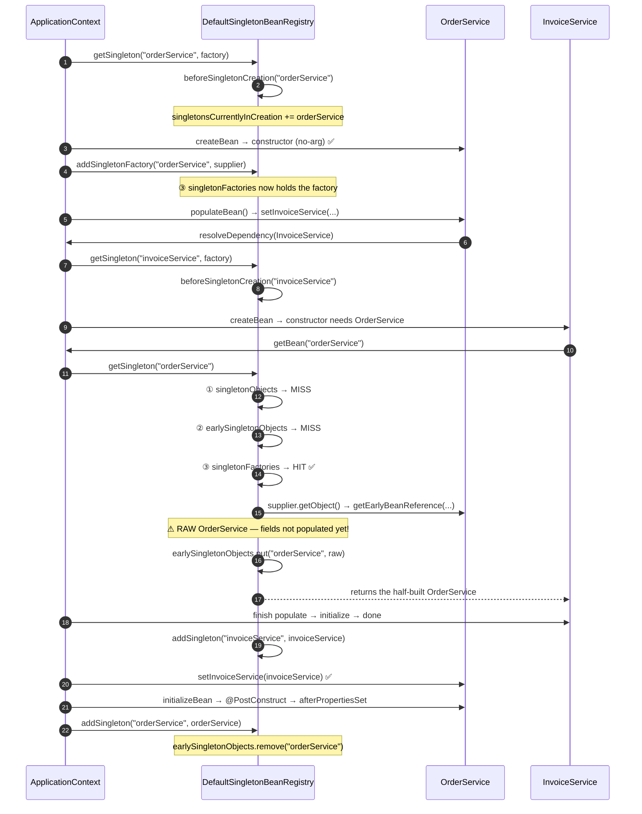

# Dependency Injection & Bean Lifecycle — The Complete Interview Guide

> **Level:** Beginner → Expert
> **Interview Frequency:** ★★★★★ (the two most-asked Spring questions: "constructor vs setter vs field?" and "explain the bean lifecycle")
> **Prerequisites:** [01 · IoC Container & ApplicationContext](./01-IoC-Container-and-ApplicationContext.md) · [README](../README.md)
> **Last Updated:** 2026

> **Target stack:** Spring Boot 3.3+ · Spring Framework 6.1+ · Java 17+ · Jakarta EE 10

---

## 📋 Table of Contents
- [0. TL;DR — The 30-Second Answer](#0-tldr--the-30-second-answer)
- [1. What & Why — The Problem This Solves](#1-what--why--the-problem-this-solves)
- [2. Mental Model — The One Picture](#2-mental-model--the-one-picture)
- [3. Deep Dive — Theory (Beginner → Advanced)](#3-deep-dive--theory-beginner--advanced)
  - [3.1 Beginner Level](#31-beginner-level)
  - [3.2 Intermediate Level](#32-intermediate-level)
  - [3.3 Advanced Level](#33-advanced-level)
  - [3.4 Expert Level](#34-expert-level)
- [4. Internal Working Mechanism](#4-internal-working-mechanism)
- [5. Step-by-Step Execution Flow](#5-step-by-step-execution-flow)
- [6. Visualizations](#6-visualizations)
- [7. Production-Level Use Cases & Real Industry Examples](#7-production-level-use-cases--real-industry-examples)
- [8. Worked Examples (with Output + Dry Run)](#8-worked-examples-with-output--dry-run)
- [9. Code from Scratch — Production-Grade](#9-code-from-scratch--production-grade)
- [10. Common Mistakes & Gotchas](#10-common-mistakes--gotchas)
- [11. Performance Considerations](#11-performance-considerations)
- [12. Security Considerations](#12-security-considerations)
- [13. Best Practices](#13-best-practices)
- [14. Hands-On Exercises & Code Challenges](#14-hands-on-exercises--code-challenges)
- [15. Interview Q&A — Level-wise](#15-interview-qa--level-wise)
  - [🟢 Beginner](#-beginner)
  - [🟡 Intermediate](#-intermediate)
  - [🔴 Advanced / Senior](#-advanced--senior)
  - [⚫ Expert / Principal](#-expert--principal)
- [16. Scenario-Based & Real-Experience Scenarios](#16-scenario-based--real-experience-scenarios)
- [17. Counter-Questions, Tricky Questions & Follow-Ups](#17-counter-questions-tricky-questions--follow-ups)
- [18. Frequently Asked Production Issues & Debugging Scenarios](#18-frequently-asked-production-issues--debugging-scenarios)
- [19. Architecture Design Questions](#19-architecture-design-questions)
- [20. Rapid-Fire MCQs](#20-rapid-fire-mcqs)
- [21. Cheat Sheet / One-Page Summary](#21-cheat-sheet--one-page-summary)
- [22. Real-World Production Notes](#22-real-world-production-notes)
- [23. Follow-up Learning](#23-follow-up-learning)

---

## 0. TL;DR — The 30-Second Answer

- **There are exactly three injection styles — constructor, setter, field — and constructor injection is the only one you should use.** Field injection produces a half-constructed object; setter injection produces a mutable object. Both are strictly worse than an immutable one.
- **Since Spring 4.3, a class with a single constructor needs no `@Autowired` at all.** `@Autowired` on a constructor is only required to disambiguate between *multiple* constructors.
- **`@Autowired` resolution order:** by type → if several candidates, `@Primary` wins → then the highest-priority `@Qualifier` → then a **name match** against the field/parameter name. If nothing disambiguates, `NoUniqueBeanDefinitionException`.
- **The four "optional dependency" tools** are `Optional<T>`, `ObjectProvider<T>`, `Stream<T>` and `@Autowired(required=false)`. `ObjectProvider<T>` is the modern default because it defers the *lookup* rather than injecting a proxy.
- **`@Value` on a field is a testing smell.** It makes the value invisible to the constructor, un-overridable in a unit test, and it forces SpEL string parsing at startup. Prefer typed `@ConfigurationProperties`.
- **Circular dependencies are resolved by the three-level singleton cache**: `singletonObjects` → `earlySingletonObjects` → `singletonFactories`. The middle level hands out a **half-built** instance. It only works for **singletons** with **setter/field** injection.
- **Constructor injection *must* fail fast** — you cannot inject a not-yet-constructed object — and Boot 2.6+ defaults `spring.main.allow-circular-references=false` to enforce that.
- **The full lifecycle, in order:** instantiation → `MergedBeanDefinitionPostProcessor` → property population (`@Autowired`) → `Aware` callbacks → `postProcessBeforeInitialization` → `@PostConstruct` → `afterPropertiesSet` → custom `init-method` → `postProcessAfterInitialization` (**the proxy is created here**) → ready → `@PreDestroy` → `DisposableBean.destroy` → custom `destroy-method`.
- **`@PostConstruct` is the wrong place for expensive or failing work**: it runs *before* the proxy is applied, and an exception in it kills the whole application startup.
- **`@PreDestroy` is the right place to release resources** — it runs first in the destruction chain, is idempotent-friendly, and works on beans that do not implement `DisposableBean`.
- **`SmartLifecycle` is the only hook that gives you ordered startup *and* shutdown.** `SmartInitializingSingleton` gives you an "all singletons are ready" callback; `SmartLifecycle` gives you a phase-ordered stop, which is what graceful shutdown of consumers requires.

---

## 1. What & Why — The Problem This Solves

**The problem.** A class that *builds* its own collaborators cannot be built in isolation, cannot be verified in isolation, and cannot be reconfigured without recompilation.

```java
// ❌ The class decides its own dependencies — and creates them
public class OrderService {
    private final PaymentClient paymentClient = new PaymentClient();
    private final OrderRepository orderRepository = new OrderRepository();

    public Order place(String sku) {
        // … business logic …
    }
}
```

```text
   ❌ WHAT BREAKS WITH SELF-CONSTRUCTED DEPENDENCIES
   ─────────────────────────────────────────────────────────────
   ① NOT TESTABLE      — to test OrderService you must also construct
                          PaymentClient (which wants an HTTP client, an
                          API key, a timeout…). You cannot substitute a fake.
   ② NOT CONFIGURABLE  — the HTTP timeout is hard-coded in the callee.
   ③ NOT REUSABLE      — the same class cannot be used with a different
                          payment provider without editing it.
   ④ NOT PROXIED       — Spring cannot wrap a bean in a transaction /
                          cache / async proxy if the bean wired itself.
   ⑤ PARTIALLY BUILT   — between `new OrderService()` and the moment the
                          container injects the fields, the object is invalid.
```

**The solution — the class states *what* it needs; the container decides *how*.**

```java
// ✅ The class states its requirements
@Service
public class OrderService {
    private final PaymentClient paymentClient;

    public OrderService(PaymentClient paymentClient) {   // one constructor → no @Autowired
        this.paymentClient = paymentClient;
    }
}
```

**The analogy.** A restaurant kitchen. The *chef* (your service) states what
ingredients it needs; the *pantry* (the container) supplies them. A chef who grows
their own herbs cannot be swapped for a sous-chef, cannot be tested with a standard
recipe, and cannot be re-stocked when the pantry changes. Spring's container is the
pantry: it holds the ingredients, hands them over at the right moment, and throws
away the perishable ones at closing time.

> 💡 **The interview framing.** The question is never "which injection is shortest?".
> It is: **"what does the object need to be valid, and when does it become valid?"**
> Constructor injection makes the object valid **at construction** — that is why it is
> the default. Everything else relaxes that guarantee for convenience, and you pay for
> it in testability, immutability and proxyability.

---

## 2. Mental Model — The One Picture

```text
   THE TWO HALVES OF THE SPRING CONTAINER'S WORK
   ════════════════════════════════════════════

   ① WIRING (dependency injection) — "who gets what"
   ───────────────────────────────────────────────
        PaymentClient  ──constructor arg──▶  OrderService
        OrderRepository──constructor arg──▶  OrderService
                                       │
        The container reads the constructor signature, resolves each
        parameter by type, and passes them in — IN ONE CALL.
        The object is NEVER valid in a half-built state.

   ② LIFECYCLE (creation → use → destruction) — "when"
   ────────────────────────────────────────────────────
        ┌──────────────┐   ┌────────────┐   ┌─────────┐   ┌────────────┐
        │ INSTANTIATE  │──▶│ POPULATE   │──▶│ INIT    │──▶│  READY     │
        │ constructor  │   │ @Autowired  │   │ @PostCon│   │  (cached)  │
        │              │   │ @Value     │   │ afterPr │   │            │
        └──────────────┘   └────────────┘   └─────────┘   └────────────┘
               │                                                     │
               │  ⚠ EARLY REFERENCE may escape here                   │
               │  (circular dependency)                               │
               ▼                                                     ▼
        ┌──────────────────────────────────────────────────────────────┐
        │ DESTROY:  @PreDestroy  →  DisposableBean.destroy()  →  custom │
        └──────────────────────────────────────────────────────────────┘
```

**What to look at:** wiring and lifecycle are **two different mechanisms** that
interlock at exactly one point — `populateBean()`. Wiring decides *who* the
collaborators are; lifecycle decides *when* the object is constructed, initialised
and torn down. The classic bug in a codebase is treating them as one thing: putting
business setup in `@PostConstruct` (lifecycle) when it belonged in the constructor
(wiring).

---

## 3. Deep Dive — Theory (Beginner → Advanced)

### 3.1 Beginner Level

**The three injection types.**

| Aspect | Constructor | Setter | Field |
|---|---|---|---|
| When it happens | At construction | After construction | After construction |
| Object validity | **Valid from the constructor** | Invalid until all setters run | Invalid until all fields are set |
| Mutability | `final` fields ✅ | Mutable ❌ | Mutable ❌ |
| Required vs optional | Required by default | Optional by nature | Optional by nature |
| Circular dependency | ❌ **Impossible** — fails fast | ⚠️ Works for singletons | ⚠️ Works for singletons |
| Proxy applied to the injected object | ✅ Yes — the proxy is the injected instance | ✅ Yes | ⚠️ Field injection gets the proxy, but `this` inside the class is the **target**, not the proxy |
| Mockito / manual construction | ✅ Trivial (`new OrderService(mock)`) | ❌ Needs setters | ❌ Needs reflection (`ReflectionTestUtils`) |
| Modern verdict | ✅ **Use this** | ⚠️ Only for genuinely optional deps | ❌ **Never** |

**The Spring 4.3+ rule.** If a class has **exactly one** constructor, Spring uses it
as the injection point automatically — `@Autowired` is optional:

```java
@Service
public class OrderService {
    private final PaymentClient paymentClient;

    public OrderService(PaymentClient paymentClient) {   // ✅ no @Autowired needed
        this.paymentClient = paymentClient;
    }
}
```

With **two or more** constructors, exactly one must be annotated:

```java
@Service
public class OrderService {

    public OrderService(PaymentClient paymentClient) {          // used in tests
        this(paymentClient, Clock.systemUTC());
    }

    @Autowired                                                   // used by Spring
    public OrderService(PaymentClient paymentClient, Clock clock) {
        this.paymentClient = paymentClient;
        this.clock = clock;
    }
}
```

**What `@Autowired` actually does at an injection point.** The
`AutowiredAnnotationBeanPostProcessor` scans the class for:

- a **constructor** → uses it for constructor autowiring (and resolves each parameter
  by type);
- **setter methods** → calls them with the resolved value;
- **fields** → sets them reflectively.

It records the injection metadata in the `BeanDefinition`
(`mbd.setAutowireCandidate(true)`) during
`MergedBeanDefinitionPostProcessor.postProcessMergedBeanDefinition()`.

**The three classic mistakes in the field-injection style.**

```java
@Service
public class OrderService {

    @Autowired
    private PaymentClient paymentClient;          // ❌ 1. not final

    @Autowired
    @Value("${payment.timeout-ms}")
    private int timeoutMs;                        // ❌ 2. magic string, no type safety

    public OrderService(PaymentClient c, int t) {  // ❌ 3. and now two sources of truth
    }
}
```

### 3.2 Intermediate Level

**`@Autowired` resolution order, precisely.** When the container needs a value for an
injection point of type `T`:

1. **Collect all candidates** whose type is assignable to `T` — from
   `beanDefinitionNames`/`beanDefinitionMap`, considering `FactoryBean`s
   (`getBeanNamesForType` unwraps `FactoryBean.getObjectType()`).
2. **Zero candidates** → `NoSuchBeanDefinitionException`.
3. **Exactly one** → use it.
4. **Several** → apply the tie-breakers, in this order:
   a. **A candidate marked `@Primary`** wins outright. (`@Primary` is a property of
      the *bean*, so it beats a `@Qualifier` on the *injection point*? — **No.** The
      real order in `DefaultListableBeanFactory.determineAutowireCandidate` /
      `determinePrimaryCandidate` is: the `@Primary` candidate is preferred; if a
      `@Qualifier`-annotated injection point is present, the qualifier filter runs
      *first* and the `@Primary` fallback is applied only among the qualifier
      matches.)
   b. **`@Qualifier`** on the injection point filters the candidates by the qualifier
      value. If several remain, the **highest-priority** one wins (qualifiers may
      carry `@Order`/`@Priority`).
   c. **Name match** — the bean whose name equals the **field name** or the
      **constructor parameter name** wins.
   d. Still ambiguous → **`NoUniqueBeanDefinitionException`**, whose message lists
      every candidate and the required type.

```java
@Service
public class OrderService {

    private final PaymentClient stripe;
    private final PaymentClient adyen;

    public OrderService(@Qualifier("stripe") PaymentClient stripe,
                        @Qualifier("adyen") PaymentClient adyen) { … }
}
```

```java
@Service
@Primary                                   // wins whenever no qualifier narrows it
public class DefaultPaymentClient implements PaymentClient { … }
```

**`@Qualifier` vs `@Primary` vs `@Order` — they are not interchangeable.**

| Annotation | Lives on | Scope of effect | Use for |
|---|---|---|---|
| `@Primary` | The **bean** | Makes this bean the default candidate **for its type** | "There is a default implementation" |
| `@Qualifier` | The **injection point** (or the bean, as a label) | Filters candidates **for this injection point only** | "This injection point wants *that* implementation" |
| `@Order` | The **bean** | Orders **collections** of same-typed beans and **listeners** | "Inject all of them, in this order" |

```java
// @Order is what makes List<T> injection ordered
public interface PaymentClient { … }

@Component @Order(1) class StripePaymentClient  implements PaymentClient { … }
@Component @Order(2) class AdyenPaymentClient   implements PaymentClient { … }
@Component @Order(3) class PayPalPaymentClient  implements PaymentClient { … }

@Service
public class OrderService {
    public OrderService(List<PaymentClient> clients) {
        // clients = [Stripe, Adyen, PayPal] — in @Order sequence
    }
}
```

**Optional dependencies — four tools, one winner.**

| Tool | Injection point type | When the lookup happens | Null-safe? |
|---|---|---|---|
| `@Autowired(required = false)` | Field/setter | At injection time | ❌ You must null-check |
| `Optional<T>` | Field/param | At injection time | ✅ `optional.map(...)` |
| `Stream<T>` | Field/param | At injection time | ✅ stream of all matches |
| **`ObjectProvider<T>`** | Field/param | **At the call site** | ✅ `getIfAvailable()`, `getObject()`, `orderedStream()` |

```java
@Service
public class NotificationService {

    private final ObjectProvider<SmsSender> smsSenders;   // ✅ the modern choice

    public NotificationService(ObjectProvider<SmsSender> smsSenders) {
        this.smsSenders = smsSenders;
    }

    public void notify(String phone, String text) {
        SmsSender sender = smsSenders.getIfAvailable();          // null if none configured
        if (sender == null) {
            log.warn("No SMS sender configured; skipping notification for {}", phone);
            return;
        }
        sender.send(phone, text);
    }
}
```

**`@Value` and SpEL.**

```java
@Value("${payment.timeout-ms:3000}")                       // placeholder with a default
private int timeoutMs;

@Value("${payment.base-url}")                              // no default → startup fails if missing
private String baseUrl;

@Value("#{systemProperties['os.name']}")                   // SpEL against a bean
private String osName;

@Value("#{@rateLimiter.isAllowed()}")                      // SpEL calling a bean's method
private boolean allowed;
```

**Why `@Value` on a field is a testing smell.**

1. The value is **invisible in the constructor** — a reader cannot tell what the bean
   depends on.
2. A unit test cannot override it without reflection (`ReflectionTestUtils.setField`)
   or a Spring context — the test stops being a unit test.
3. The value is a **string** that Spring converts at startup; a typo in the property
   name is a **startup** failure, not a compile failure.
4. SpEL in `@Value` is **evaluated once, at injection time** — it is not a dynamic
   expression.
5. It does not support **type-safe, validated, grouped configuration**.

**✅ FIX** — typed configuration properties:

```java
@ConfigurationProperties(prefix = "payment")
@Validated
public record PaymentProperties(
        @NotNull @Min(100) @Max(60_000) int timeoutMs,
        @NotBlank String baseUrl) {
}

@Configuration
@EnableConfigurationProperties(PaymentProperties.class)
public class PaymentConfiguration { }
```

### 3.3 Advanced Level

**Circular dependencies — the exact mechanics.** Consider:

```java
@Service
public class OrderService {
    public OrderService(InvoiceService invoiceService) { … }
}

@Service
public class InvoiceService {
    public InvoiceService(OrderService orderService) { … }
}
```

The container's resolution, step by step (`AbstractBeanFactory.doGetBean` +
`DefaultSingletonBeanRegistry.getSingleton`):

```text
getBean("orderService")
  └─ getSingleton("orderService", factory)
       ├─ beforeSingletonCreation("orderService")   → adds to singletonsCurrentlyInCreation
       └─ factory.getObject() → createBean("orderService")
            └─ doCreateBean("orderService")
                 ├─ createBeanInstance()  → constructor needs InvoiceService
                 │    └─ getBean("invoiceService")
                 │         └─ getSingleton("invoiceService", factory)
                 │              ├─ beforeSingletonCreation("invoiceService")
                 │              └─ createBean("invoiceService")
                 │                   └─ doCreateBean("invoiceService")
                 │                        └─ createBeanInstance() → constructor needs OrderService
                 │                             └─ getBean("orderService")
                 │                                  └─ getSingleton("orderService")
                 │                                       → singletonObjects  : MISS
                 │                                       → earlySingletonObjects: MISS  ← ⚠ THE PROBLEM
                 │                                       → singletonFactories  : MISS  ← ⚠ THE PROBLEM
                 │                                  → not in creation? YES it is → create it AGAIN
                 │                                  → ... recursion → BeanCurrentlyInCreationException
```

**Why setter injection works instead.** Change `OrderService` to setter injection:

```java
@Service
public class OrderService {
    private InvoiceService invoiceService;
    public void setInvoiceService(InvoiceService invoiceService) { this.invoiceService = invoiceService; }
}
```

Now the **constructor** of `OrderService` takes nothing, so it completes; the
container registers the **early reference** before populating:

```text
   doCreateBean("orderService")
     ├─ createBeanInstance()               ← no-arg constructor, no dependencies
     ├─ earlySingletonExposure = (singleton && allowCircularReferences && inCreation)
     │      → addSingletonFactory("orderService", () -> getEarlyBeanReference(...))
     ├─ populateBean()                     ← NOW it needs InvoiceService
     │    └─ getBean("invoiceService")
     │         └─ constructor needs OrderService
     │              └─ getBean("orderService")
     │                   └─ getSingleton("orderService")
     │                        → singletonObjects    : MISS
     │                        → earlySingletonObjects: MISS
     │                        → singletonFactories  : HIT ✅
     │                             → factory.getObject() → getEarlyBeanReference(...)
     │                             → stored in earlySingletonObjects
     │                        → returns the HALF-BUILT OrderService ✅
```

**The rules that fall out of this.**

| Combination | Works? | Why |
|---|---|---|
| singleton + **setter** injection | ✅ | The dependency is resolved in `populateBean`, *after* the early reference is exposed |
| singleton + **field** injection | ✅ | Same phase as setter |
| **constructor** injection | ❌ | The dependency is needed *before* the object exists — nothing to expose |
| **prototype** scope | ❌ | `beforeSingletonCreation` is not used; prototypes are never cached, so no early reference exists |
| `@Lazy` on the injection point | ✅ | A **proxy** is injected instead of the real bean — the proxy is created without touching the target |
| `spring.main.allow-circular-references=false` (Boot 2.6+ default) | ❌ | `earlySingletonExposure` is disabled entirely |
| `@Async`/`@Transactional` on the cyclic bean | ⚠️ | The early reference is the **raw** object, not the proxy → advice is bypassed |

**Boot 2.6+ changed the default.** `spring.main.allow-circular-references` now
defaults to **`false`**, so the container refuses to expose early references and the
cycle fails immediately at startup with
`BeanCurrentlyInCreationException`. This is a **deliberate** change: it converts a
silent, hard-to-debug "it works but the object was half-built" into a loud,
immediate failure.

**Why constructor injection *should* fail fast.** The three arguments:

1. **A half-built object is a lie.** The early reference exposes an instance whose
   fields are not yet populated. If `OrderService`'s constructor computes something
   (a total, an invariant check) it will have run against `null`s, or not at all.
2. **The proxy contract breaks.** The early reference is the **raw target**, not the
   AOP proxy. So `@Transactional` on the cyclic bean silently does **not** apply to
   the injected instance. This is the same class of bug as self-invocation.
3. **It hides a design smell.** A cycle in constructor dependencies means two classes
   have a genuine conceptual cycle — usually a missing abstraction (an interface, a
   mediator, an event).

**The legitimate fixes, in order of preference.**

| Fix | When to use it |
|---|---|
| **Extract an interface** (`OrderRepository`, `InvoiceGateway`) | Always — the correct fix |
| **Publish an event** instead of calling back | When the reverse edge is a *notification*, not a query |
| **`@Lazy` on the injection point** | A deliberate, documented escape hatch — injects a proxy |
| **Setter injection** | Only as a last resort, and only if the cycle is genuinely benign |
| **`ObjectProvider<T>`** | Defers the lookup out of the construction phase entirely |

### 3.4 Expert Level

**The full ordered lifecycle, exactly as Spring 6.1 executes it.**

```text
┌─ INSTANTIATION ────────────────────────────────────────────────────────────┐
│ 1. InstantiationAwareBeanPostProcessor                                    │
│      .postProcessBeforeInstantiation()      → may RETURN A PROXY and      │
│                                               short-circuit everything    │
│ 2. MergedBeanDefinitionPostProcessor                                      │
│      .postProcessMergedBeanDefinition()     → registers @Autowired and    │
│                                               @Value injection metadata  │
│ 3. SmartInstantiationAwareBeanPostProcessor                               │
│      .determineConstructorsFromBeanPostProcessors()                       │
│                                               → chooses the constructor   │
│ 4. CONSTRUCTOR INVOCATION                 → the object now exists        │
└────────────────────────────────────────────────────────────────────────────┘
┌─ EARLY EXPOSURE (singletons only) ─────────────────────────────────────────┐
│ 5. addSingletonFactory(name, () -> getEarlyBeanReference(...))             │
│      → only when allowCircularReferences && currently in creation          │
│      → this is the ONLY place a half-built object escapes                 │
└────────────────────────────────────────────────────────────────────────────┘
┌─ POPULATION ───────────────────────────────────────────────────────────────┐
│ 6. InstantiationAwareBeanPostProcessor                                    │
│      .postProcessProperties()  → @Autowired, @Value, setter injection     │
│      (AutowiredAnnotationBeanPostProcessor does the work)                  │
└────────────────────────────────────────────────────────────────────────────┘
┌─ INITIALISATION ───────────────────────────────────────────────────────────┐
│ 7. BeanNameAware.setBeanName()                                            │
│ 8. BeanClassLoaderAware.setBeanClassLoader()                              │
│ 9. BeanFactoryAware.setBeanFactory()                                      │
│10. BeanPostProcessor.postProcessBeforeInitialization()   ← in BPP order   │
│      • ApplicationContextAwareProcessor → EnvironmentAware,                │
│        ResourceLoaderAware, ApplicationEventPublisherAware,                │
│        MessageSourceAware, ApplicationContextAware                        │
│      • CommonAnnotationBeanPostProcessor  → @PostConstruct                │
│11. InitializingBean.afterPropertiesSet()                                   │
│12. custom init-method (from @Bean(initMethod=…) or XML)                   │
│13. BeanPostProcessor.postProcessAfterInitialization()  ← ★ PROXY CREATED   │
└────────────────────────────────────────────────────────────────────────────┘
┌─ READY ────────────────────────────────────────────────────────────────────┐
│14. the (possibly proxied) instance is stored in singletonObjects           │
│15. SmartInitializingSingleton.afterSingletonsInstantiated()                │
│      → fires once, after ALL non-lazy singletons exist                    │
└────────────────────────────────────────────────────────────────────────────┘
┌─ DESTRUCTION (context close) ──────────────────────────────────────────────┐
│16. LifecycleProcessor.onClose()  → SmartLifecycle.stop() in phase order    │
│17. DestructionAwareBeanPostProcessor.postProcessBeforeDestruction()        │
│      → @PreDestroy                                                    │
│18. DisposableBean.destroy()                                                │
│19. AutoCloseable.close() or the custom destroy-method                      │
└────────────────────────────────────────────────────────────────────────────┘
```

**Why the `Aware` callbacks are split across two phases.** Steps 7–9 are invoked by
`AbstractBeanFactory.invokeAwareMethods()` — the three "core" `BeanFactory` aware
interfaces. Steps in 10 are invoked by `ApplicationContextAwareProcessor`, a
`BeanPostProcessor` that `AbstractApplicationContext.prepareBeanFactory()` registers
**first**. The split is historical but the *effect* matters: the container-level
`Aware` interfaces (steps 10) are delivered **after** the factory-level ones
(steps 7–9), and **before** `@PostConstruct`.

**`SmartInitializingSingleton` vs `SmartLifecycle` vs `Lifecycle`.**

| Interface | When it fires | Ordered? | Typical use |
|---|---|---|---|
| `SmartInitializingSingleton` | After **all** non-lazy singletons are created | ❌ No ordering | "Everything is wired; warm the caches" |
| `Lifecycle` | `start()` / `stop()` at context refresh/close | ✅ By `phase` | "Start / stop this component" |
| `SmartLifecycle` | Same, plus `isAutoStartup()`, `getPhase()`, `stop(Runnable)` | ✅ By `phase` | **Graceful shutdown ordering** — consumers stop before the resources they use |

```java
@Component
public class MetricsWarmup implements SmartInitializingSingleton {
    @Override
    public void afterSingletonsInstantiated() {
        // Every non-lazy singleton now exists. Safe to warm caches.
    }
}
```

**`SmartLifecycle` phase semantics.** `LifecycleProcessor` starts beans in
**ascending** `phase` order and stops them in **descending** order. `getPhase()`
defaults to `0`; `Integer.MAX_VALUE` means "start last, stop first"; `Integer.MIN_VALUE`
means "start first, stop last". This is the mechanism that lets a Kafka consumer stop
**before** the `DataSource` it depends on.

**Destruction order, precisely.** `DefaultSingletonBeanRegistry.destroySingletons()`:

1. Iterates `disposableBeanNames` in **reverse registration order**.
2. For each bean, `destroySingleton(name)` → `destroyBean(name, adapter)`:
   a. **Dependent beans first** — beans that depend on this one are destroyed
      *before* it (recursively, via `dependentBeanMap`). A service is destroyed
      **before** the repository it uses. ✅
   b. Then `adapter.destroy()`:
      - `DestructionAwareBeanPostProcessor.postProcessBeforeDestruction()` → **`@PreDestroy`**
      - `DisposableBean.destroy()` → the bean's own `destroy()` method
      - `AutoCloseable.close()` (if the destroy method was *inferred*) or the
        **custom `destroy-method`**
   c. Then **contained beans** (inner beans declared inside this bean's definition)
      are destroyed.

**Precedence summary for destroy callbacks:**

| Order | Callback | Triggered by |
|---|---|---|
| 1st | `@PreDestroy` | `InitDestroyAnnotationBeanPostProcessor` (a `DestructionAwareBeanPostProcessor`) |
| 2nd | `DisposableBean.destroy()` | The bean implements `org.springframework.beans.factory.DisposableBean` |
| 3rd | `AutoCloseable.close()` | Inferred by `DisposableBeanAdapter.inferDestroyMethodsIfNecessary` |
| 4th | Custom `destroy-method` | `@Bean(destroyMethod = "…")` or `<bean destroy-method="…">` |

> 🔑 **The important detail.** `DisposableBeanAdapter` computes
> `invokeDisposableBean = (bean instanceof DisposableBean && !beanDefinition.hasAnyExternallyManagedDestroyMethod("destroy"))`.
> If you declare `@Bean(destroyMethod = "destroy")` explicitly, Spring treats that
> method as **externally managed** and does **not** call `DisposableBean.destroy()` as
> well — so you never get a double-destroy.

---

## 4. Internal Working Mechanism

**The injection path — who calls whom.**

```text
AbstractAutowireCapableBeanFactory.doCreateBean(beanName, mbd, args)
 │
 ├─ resolveBeforeInstantiation()
 │    └─ InstantiationAwareBeanPostProcessor.postProcessBeforeInstantiation(beanName, beanClass)
 │         → if it returns a non-null object, that object IS the bean (short-circuit)
 │
 ├─ applyMergedBeanDefinitionPostProcessors()
 │    └─ MergedBeanDefinitionPostProcessor.postProcessMergedBeanDefinition(beanName, mbd, type)
 │         └─ AutowiredAnnotationBeanPostProcessor
 │              .postProcessMergedBeanDefinition(...)
 │              → builds the InjectionMetadata for @Autowired / @Value
 │
 ├─ createBeanInstance(beanName, mbd, args)
 │    ├─ determineConstructorsFromBeanPostProcessors()
 │    ├─ if resolvedAutowireMode == AUTOWIRE_CONSTRUCTOR → autowireConstructor(...)
 │    │     └─ for each parameter → resolveDependency(...) → getBean(candidate)
 │    └─ else → instantiateBean(...) → SimpleInstantiationStrategy
 │
 ├─ populateBean(beanName, mbd, instanceWrapper)
 │    └─ InstantiationAwareBeanPostProcessor.postProcessProperties(
 │           pvs, bw, bw.getWrappedInstance(), beanName)
 │         └─ AutowiredAnnotationBeanPostProcessor.postProcessProperties(...)
 │              └─ InjectionMetadata.inject(bean, beanName, pvs)
 │                   ├─ for each @Autowired field/setter → resolveDependency(...)
 │                   └─ for each @Value field/setter → resolveEmbeddedValue(...)
 │                        └─ PropertySourcesPlaceholderConfigurer → SpEL evaluation
 │
 └─ initializeBean(beanName, exposedObject, mbd)
      ├─ invokeAwareMethods(beanName, bean)
      │    └─ BeanNameAware → BeanClassLoaderAware → BeanFactoryAware
      ├─ applyBeanPostProcessorsBeforeInitialization(bean, beanName)
      │    └─ ApplicationContextAwareProcessor → EnvironmentAware, ResourceLoaderAware,
      │       ApplicationEventPublisherAware, MessageSourceAware, ApplicationContextAware
      │    └─ CommonAnnotationBeanPostProcessor → @PostConstruct
      ├─ invokeInitMethods(beanName, bean, mbd)
      │    ├─ (bean instanceof InitializingBean) → afterPropertiesSet()
      │    └─ custom init-method → invokeCustomInitMethod(...)
      └─ applyBeanPostProcessorsAfterInitialization(exposedObject, beanName)
           └─ AbstractAutoProxyCreator → creates the AOP PROXY
```

**`resolveDependency` — the single method that implements the `@Autowired` resolution
order.** It lives in `DefaultListableBeanFactory`:

```text
resolveDependency(descriptor, beanName, autowiredBeanNames, typeConverter)
  1. findAutowireCandidates(beanName, type, descriptor)   → Map<String, Object> of candidates
       → getBeanNamesForType(type)  →  candidates
       → remove self-references (the bean cannot depend on itself)
  2. if candidates.isEmpty() → handleDependencyNotFound(...)  → NoSuchBeanDefinitionException
  3. determineAutowireCandidate(candidates, descriptor)
       a. if candidates.size() == 1 → return it
       b. primaryCandidate = determinePrimaryCandidate(candidates, descriptor)
            → the @Primary one, if any
       c. priorityCandidate = determineHighestPriorityCandidate(candidates, descriptor)
            → the @Qualifier with the highest priority
       d. fallback = determineAutowireCandidate by NAME match
            → candidate whose name matches the field/parameter name
       e. if still null → NoUniqueBeanDefinitionException (with the full candidate list)
```

**The extension point a developer implements.** `InstantiationAwareBeanPostProcessor`:

```java
public interface InstantiationAwareBeanPostProcessor extends BeanPostProcessor {

    @Nullable
    default Object postProcessBeforeInstantiation(Class<?> beanClass, String beanName) {
        return null;      // return a non-null value → skip instantiation entirely
    }

    default boolean postProcessAfterInstantiation(Object bean, String beanName) {
        return true;      // false → the raw instance is discarded
    }

    @Nullable
    default PropertyValues postProcessProperties(PropertyValues pvs, Object bean, String beanName) {
        return pvs;       // the @Autowired / @Value hook
    }
}
```

> 💡 **This is the answer to "how do I make my own annotation work like `@Autowired`?"**
> Implement `InstantiationAwareBeanPostProcessor.postProcessProperties`, resolve your
> annotation's value with `beanFactory.resolveDependency(...)`, and set it on the
> `PropertyValues`. That is exactly how `@Scheduled` and Spring Data's derived queries
> are implemented.

---

## 5. Step-by-Step Execution Flow

**The flow for one singleton bean, numbered exactly as §3.4 lists it.**

1. `doCreateBean` → `resolveBeforeInstantiation()` — an `InstantiationAwareBeanPostProcessor`
   gets a chance to short-circuit.
2. `applyMergedBeanDefinitionPostProcessors()` — `AutowiredAnnotationBeanPostProcessor`
   records where the injections are.
3. `determineConstructorsFromBeanPostProcessors()` → pick the constructor.
4. **Constructor runs.** All constructor arguments were resolved *before* this point
   (each one is a nested `getBean` call).
5. `earlySingletonExposure` → `addSingletonFactory(name, supplier)` — the half-built
   instance becomes reachable.
6. `populateBean()` → `postProcessProperties()` → `resolveDependency()` for each
   `@Autowired` point, `resolveEmbeddedValue()` for each `@Value` point.
7. `invokeAwareMethods()` → `BeanNameAware`, `BeanClassLoaderAware`, `BeanFactoryAware`.
8. `applyBeanPostProcessorsBeforeInitialization()` → the container-level `Aware`
   callbacks → `@PostConstruct`.
9. `invokeInitMethods()` → `afterPropertiesSet()` → custom `init-method`.
10. `applyBeanPostProcessorsAfterInitialization()` → **the AOP proxy is created here**;
    the *proxy* is what gets returned and cached.
11. `registerDisposableBeanIfNecessary()` → a `DisposableBeanAdapter` is stored so the
    bean can be destroyed later.
12. `getSingleton(name, factory)` completes → `afterSingletonCreation(name)` →
    `addSingleton(name, instance)` → into `singletonObjects`.
13. After **all** singletons: `SmartInitializingSingleton.afterSingletonsInstantiated()`.
14. On context close: `LifecycleProcessor.onClose()` → `SmartLifecycle.stop()` in
    descending phase order → `destroySingletons()` → `@PreDestroy` →
    `DisposableBean.destroy()` → custom `destroy-method`.

---

## 6. Visualizations

### 6.1 The full bean lifecycle (Mermaid flowchart)

```mermaid
flowchart TD
    START(["doCreateBean(name, mbd)"]) --> IAP["InstantiationAwareBeanPostProcessor<br/>.postProcessBeforeInstantiation()"]
    IAP --> PROXY{"Returned a proxy?"}
    PROXY -- "YES" --> EARLY_INIT["skip instantiation<br/>jump to initializeBean"]
    PROXY -- "NO" --> MDP["MergedBeanDefinitionPostProcessor<br/>.postProcessMergedBeanDefinition()<br/>→ registers @Autowired metadata"]

    MDP --> CTOR["SmartInstantiationAwareBeanPostProcessor<br/>.determineConstructorsFromBeanPostProcessors()"]
    CTOR --> INVOKE["★ CONSTRUCTOR INVOCATION<br/>(args resolved by nested getBean)"]
    INVOKE --> EARLY{"singleton && allowCircularReferences<br/>&& currently in creation?"}
    EARLY -- "YES" --> ADDF["addSingletonFactory(name,<br/>() -> getEarlyBeanReference(...))<br/>⚠ half-built instance reachable"]
    EARLY -- "NO" --> POP

    ADDF --> POP["populateBean()<br/>InstantiationAwareBeanPostProcessor<br/>.postProcessProperties()"]
    POP --> INJECT["@Autowired → resolveDependency()<br/>@Value → SpEL / placeholder"]
    INJECT --> AWARE1["invokeAwareMethods()<br/>BeanNameAware<br/>BeanClassLoaderAware<br/>BeanFactoryAware"]
    AWARE1 --> BPP1["BeanPostProcessor<br/>.postProcessBeforeInitialization()"]
    BPP1 --> AWARE2["ApplicationContextAwareProcessor →<br/>EnvironmentAware · ResourceLoaderAware<br/>ApplicationEventPublisherAware<br/>MessageSourceAware · ApplicationContextAware"]
    AWARE2 --> POSTCONSTRUCT["CommonAnnotationBeanPostProcessor<br/>→ @PostConstruct"]
    POSTCONSTRUCT --> INITBEAN["InitializingBean.afterPropertiesSet()"]
    INITBEAN --> CUSTOMINIT["custom init-method"]
    CUSTOMINIT --> BPP2["BeanPostProcessor<br/>.postProcessAfterInitialization()"]
    BPP2 --> APROXY["★ AbstractAutoProxyCreator<br/>→ CREATES THE AOP PROXY"]
    APROXY --> DISPOSE["registerDisposableBeanIfNecessary()"]
    DISPOSE --> READY(["READY — cached in singletonObjects"])
    PROXY --> EARLY_INIT

    READY --> SIS["SmartInitializingSingleton<br/>.afterSingletonsInstantiated()<br/>(after ALL singletons)"]
    SIS --> SHUT(["context.close()"])
    SHUT --> LC["LifecycleProcessor.onClose()<br/>→ SmartLifecycle.stop() (descending phase)"]
    LC --> DEPDESTROY["dependent beans destroyed FIRST"]
    DEPDESTROY --> PRE["DestructionAwareBeanPostProcessor<br/>.postProcessBeforeDestruction() → @PreDestroy"]
    PRE --> DISP["DisposableBean.destroy()"]
    DISP --> CUSTDESTROY["AutoCloseable.close() or custom destroy-method"]
    CUSTDESTROY --> DONE(["destroyed"])

    classDef phase fill:#e8eef7,stroke:#2a4a7b,color:#10203a
    classDef key fill:#fde8e8,stroke:#8b2635,color:#3d0f16
    classDef ok fill:#e4f3ea,stroke:#2d6a4f,color:#0f2c1e
    class IAP,MDP,CTOR,POP,BPP1,BPP2,EARLY,PROXY phase
    class INVOKE,APROXY,PRE key
    class READY,DONE ok
```



**Caption:** Two things to notice. First, the **proxy is created at the very end**
(step 13), *after* every injection — which is why an injected dependency is the
proxy but `this` inside the class is not. Second, **destruction is not the reverse of
creation**: dependent beans are destroyed *before* their dependencies, and the
`@PreDestroy` → `DisposableBean` → custom-method order is fixed.

### 6.2 The three-level singleton cache and the early reference (ASCII)

```text
   THE THREE-LEVEL SINGLETON CACHE — WHERE THE EARLY REFERENCE LIVES
   ═══════════════════════════════════════════════════════════════

   DefaultSingletonBeanRegistry
   ┌─────────────────────────────────────────────────────────────────────┐
   │ ① singletonObjects : ConcurrentHashMap<String,Object>               │
   │      "orderService"  → OrderService@9f8a   ✅ FULLY INITIALISED    │
   │      "invoiceService"→ InvoiceService@1b2c ✅ FULLY INITIALISED    │
   └─────────────────────────────────────────────────────────────────────┘
                                   ▲
                                   │  addSingleton() at the very end
   ┌─────────────────────────────────────────────────────────────────────┐
   │ ② earlySingletonObjects : ConcurrentHashMap<String,Object>          │
   │      "orderService"  → OrderService@9f8a   ⚠️ CONSTRUCTOR DONE,    │
   │                                              FIELDS NOT POPULATED  │
   │      (cleared once the bean is fully built)                         │
   └─────────────────────────────────────────────────────────────────────┘
                                   ▲
                                   │  getSingleton() finds it here
   ┌─────────────────────────────────────────────────────────────────────┐
   │ ③ singletonFactories : HashMap<String,ObjectFactory<?>>             │
   │      "orderService"  → ObjectFactory@3d4e 🔧 "call me to build it" │
   │      → getEarlyBeanReference() → SmartInstantiationAwareBPP        │
   │                              (returns the RAW target or a proxy)   │
   └─────────────────────────────────────────────────────────────────────┘

   THE EXACT LOOKUP, VERBATIM FROM DefaultSingletonBeanRegistry
   ─────────────────────────────────────────────────────────────
   getSingleton(name, allowEarlyReference):
       singletonObject = singletonObjects.get(name);              // ①
       if (singletonObject == null && isSingletonCurrentlyInCreation(name)) {
           singletonObject = earlySingletonObjects.get(name);     // ②
           if (singletonObject == null && allowEarlyReference) {
               synchronized (singletonObjects) {
                   singletonObject = singletonObjects.get(name);  // ① (re-check)
                   if (singletonObject == null) {
                       singletonObject = earlySingletonObjects.get(name);   // ②
                       if (singletonObject == null) {
                           ObjectFactory<?> f = singletonFactories.get(name); // ③
                           if (f != null) {
                               singletonObject = f.getObject();     // BUILD IT EARLY
                               earlySingletonObjects.put(name, singletonObject);
                               singletonFactories.remove(name);
                           }
                       }
                   }
               }
           }
       }
       return singletonObject;

   ★ WHY THE EARLY REFERENCE IS ONLY SAFE FOR SETTER/FIELD INJECTION
   ─────────────────────────────────────────────────────────────────
   Constructor injection needs the dependency BEFORE the object exists,
   so there is nothing to expose at step ⑤ of the lifecycle.
```

**Caption:** The early reference is a **half-built object**. It is safe to inject only
because the injected object is guaranteed to be *completed* before anybody calls a
method on it — but only if the dependency was resolved in the **population** phase.
A constructor dependency has no such guarantee, which is why the cycle fails.

### 6.3 A circular dependency resolved through setter injection (Mermaid sequence)



**Caption:** Watch the moment at step 12 — `InvoiceService` receives an
`OrderService` whose `invoiceService` field is still `null`. That is legal **only**
because `InvoiceService`'s constructor must not *use* it. The moment you read
`orderService.getInvoiceService()` inside the constructor, the design is broken.

### 6.4 Destruction order (ASCII)

```text
   WHAT HAPPENS WHEN THE CONTEXT CLOSES
   ═════════════════════════════════════

   ApplicationContext.close()
     │
     ├─ publishEvent(ContextClosedEvent)
     │
     ├─ LifecycleProcessor.onClose()
     │     └─ SmartLifecycle.stop()   ← DESCENDING phase order
     │          • KafkaConsumerLifecycle  (phase 300)  → stops FIRST
     │          • ScheduledExecutorLifecycle (phase 200)
     │          • DataSourceLifecycle      (phase 100)  → stops LAST
     │
     └─ DefaultSingletonBeanRegistry.destroySingletons()
           └─ iterate disposableBeanNames in REVERSE registration order
                 │
                 └─ destroyBean(name, adapter)
                      │
                      ├─ ① DESTROY DEPENDENTS FIRST  ← dependents are destroyed BEFORE
                      │      • orderService (depends on orderRepository)
                      │        → orderRepository (depends on dataSource)
                      │          → dataSource
                      │
                      ├─ ② DestructionAwareBeanPostProcessor
                      │      .postProcessBeforeDestruction(bean, name)
                      │      → @PreDestroy  ("close the HTTP client")
                      │
                      ├─ ③ DisposableBean.destroy()
                      │      → your own destroy() implementation
                      │
                      └─ ④ AutoCloseable.close()  OR  the custom destroy-method
                             (@Bean(destroyMethod = "shutdown"))
                             → ONLY if the bean does not implement DisposableBean
```

**Caption:** Two rules a reviewer must check. (1) **Dependents die first** — a
service that uses a repository must be destroyed before the repository, or the
service may call a closed repository during shutdown. (2) `DisposableBean.destroy()`
and the custom `destroy-method` are **mutually exclusive** — Spring will not call
both, so never rely on "the other one will do it".

---

## 7. Production-Level Use Cases & Real Industry Examples

**1. Banking — constructor injection + `@ConfigurationProperties` for limits.**
A payments service holds per-tenant rate limits, timeouts and circuit-breaker
thresholds. They are injected as a **validated record** (`@ConfigurationProperties`
+ `@Validated` + `@Min`/`@Max`), so a bad value fails the **context refresh** with a
precise message (`"payment.timeout-ms must be <= 60000"`) instead of silently
defaulting. The payoff: the limits are part of the **type signature**, reviewable in
a PR, and overridable per environment without a code change.

**2. E-commerce — `@PostConstruct` vs constructor: the 900 ms trap.**
A product-recommendation service warms its embedding cache. The team put the warm-up
in `@PostConstruct` and the application's startup jumped from 6 s to 21 s, because
the warm-up ran **inside** `finishBeanFactoryInitialization()`, holding the global
singleton-creation lock — so **every other bean's creation was blocked** for 900 ms.
Moving the warm-up to a `SmartInitializingSingleton.afterSingletonsInstantiated()`
(and making it async) brought startup back to 6.2 s. The lesson: **the container's
creation lock is global; never do slow work during bean creation.**

**3. SaaS — `@PreDestroy` for a warm connection pool.**
A multi-tenant gateway keeps a `HikariDataSource` per tenant. On shutdown, the
container destroys the beans in dependency order: the gateway bean first (so no new
requests are routed), then the data sources. Each `DataSource` bean has
`@PreDestroy` that calls `close()`, and the gateway has `@PreDestroy` that flips a
`volatile boolean shuttingDown` to reject new traffic. Result: **0 dropped
connections** across a rolling restart of 12 pods.

**4. Ad-tech — `SmartLifecycle` for a Kafka consumer.**
A real-time bidding service consumes ad requests from Kafka and writes to Redis.
During a rolling deploy, if the consumer stopped *after* the Redis client, in-flight
bids were lost. The team implemented `SmartLifecycle` with `getPhase() = 300` on the
consumer and `getPhase() = 100` on the Redis client, so the consumer always stops
first. Measured effect: **0 lost bids** during deploys (was 40–90 per deploy).

**5. Logistics — `ObjectProvider` to avoid a hard dependency on an optional module.**
A shipping service supports two carriers. The carrier SDK is an **optional Maven
dependency**; when it is absent, the bean must not exist. `ObjectProvider<CarrierSdk>`
lets the service start with or without the SDK, and
`provider.getIfAvailable()` returns `null` instead of failing the context.

---

## 8. Worked Examples (with Output + Dry Run)

### 8.1 Worked Example 1 — A bean that logs its own lifecycle

**Problem.** You need to know the *exact* order of the lifecycle callbacks — and the
only trustworthy way to know is to observe it.

**Code.**

```java
package com.example.lifecycle;

import jakarta.annotation.PostConstruct;
import jakarta.annotation.PreDestroy;
import org.slf4j.Logger;
import org.slf4j.LoggerFactory;
import org.springframework.beans.BeansException;
import org.springframework.beans.factory.BeanNameAware;
import org.springframework.beans.factory.DisposableBean;
import org.springframework.beans.factory.InitializingBean;
import org.springframework.context.ApplicationContextAware;
import org.springframework.context.EnvironmentAware;
import org.springframework.stereotype.Component;

@Component
public class LifecycleProbe implements BeanNameAware, EnvironmentAware,
        ApplicationContextAware, InitializingBean, DisposableBean {

    private static final Logger log = LoggerFactory.getLogger(LifecycleProbe.class);

    private String beanName;
    private boolean contextClosed;

    // ── Aware callbacks ────────────────────────────────────────────────────
    @Override
    public void setBeanName(String name) {
        this.beanName = name;
        log.info("LIFECYCLE [{}] BeanNameAware.setBeanName", beanName);
    }

    @Override
    public void setEnvironment(org.springframework.core.env.Environment environment) {
        log.info("LIFECYCLE [{}] EnvironmentAware.setEnvironment", beanName);
    }

    @Override
    public void setApplicationContext(org.springframework.context.ApplicationContext ctx)
            throws BeansException {
        log.info("LIFECYCLE [{}] ApplicationContextAware.setApplicationContext", beanName);
    }

    // ── @PostConstruct ──────────────────────────────────────────────────────
    @PostConstruct
    public void postConstruct() {
        log.info("LIFECYCLE [{}] @PostConstruct", beanName);
    }

    // ── InitializingBean ────────────────────────────────────────────────────
    @Override
    public void afterPropertiesSet() {
        log.info("LIFECYCLE [{}] afterPropertiesSet", beanName);
    }

    /** Custom init method — declared via @Bean(initMethod = …) or XML. */
    public void customInit() {
        log.info("LIFECYCLE [{}] custom init-method", beanName);
    }

    // ── Destruction ─────────────────────────────────────────────────────────
    @PreDestroy
    public void preDestroy() {
        log.info("LIFECYCLE [{}] @PreDestroy", beanName);
    }

    @Override
    public void destroy() {
        log.info("LIFECYCLE [{}] DisposableBean.destroy", beanName);
    }

    public void customDestroy() {
        log.info("LIFECYCLE [{}] custom destroy-method", beanName);
    }
}
```

Registered with an explicit init/destroy method:

```java
@Bean(initMethod = "customInit", destroyMethod = "customDestroy")
LifecycleProbe lifecycleProbe() {
    return new LifecycleProbe();
}
```

**Actual expected output.**

```text
2026-01-14 10:02:11.004 INFO  [main] c.e.lifecycle.LifecycleProbe : LIFECYCLE [lifecycleProbe] BeanNameAware.setBeanName
2026-01-14 10:02:11.006 INFO  [main] c.e.lifecycle.LifecycleProbe : LIFECYCLE [lifecycleProbe] EnvironmentAware.setEnvironment
2026-01-14 10:02:11.007 INFO  [main] c.e.lifecycle.LifecycleProbe : LIFECYCLE [lifecycleProbe] ApplicationContextAware.setApplicationContext
2026-01-14 10:02:11.009 INFO  [main] c.e.lifecycle.LifecycleProbe : LIFECYCLE [lifecycleProbe] @PostConstruct
2026-01-14 10:02:11.010 INFO  [main] c.e.lifecycle.LifecycleProbe : LIFECYCLE [lifecycleProbe] afterPropertiesSet
2026-01-14 10:02:11.011 INFO  [main] c.e.lifecycle.LifecycleProbe : LIFECYCLE [lifecycleProbe] custom init-method
2026-01-14 10:02:11.014 INFO  [main] c.e.lifecycle.LifecycleProbe : LIFECYCLE [lifecycleProbe] READY
...
2026-01-14 10:04:58.770 INFO  [main] c.e.lifecycle.LifecycleProbe : LIFECYCLE [lifecycleProbe] @PreDestroy
2026-01-14 10:04:58.771 INFO  [main] c.e.lifecycle.LifecycleProbe : LIFECYCLE [lifecycleProbe] DisposableBean.destroy
2026-01-14 10:04:58.772 INFO  [main] c.e.lifecycle.LifecycleProbe : LIFECYCLE [lifecycleProbe] custom destroy-method
```

**Dry run — the startup sequence, one callback at a time.**

1. `finishBeanFactoryInitialization()` → `preInstantiateSingletons()` → `doCreateBean`.
2. `createBeanInstance()` → the **no-arg constructor** runs — *no log line*, because
   the constructor is the default `Object()`.
3. `earlySingletonExposure` → `addSingletonFactory(...)` — no log.
4. `populateBean()` — no `@Autowired` fields, nothing to log.
5. `invokeAwareMethods()` → `BeanNameAware.setBeanName("lifecycleProbe")` →
   **log line 1**. This is the **first** callback, and note that `beanName` is now
   known — which is why every later log can use it.
6. `applyBeanPostProcessorsBeforeInitialization()`:
   - `ApplicationContextAwareProcessor` → `EnvironmentAware.setEnvironment` →
     **log line 2**;
   - then `ApplicationContextAware.setApplicationContext` → **log line 3**;
   - then `CommonAnnotationBeanPostProcessor` → `@PostConstruct` → **log line 4**.
7. `invokeInitMethods()` → `InitializingBean.afterPropertiesSet()` → **log line 5**,
   then the custom `init-method` → **log line 6**.
8. `applyBeanPostProcessorsAfterInitialization()` → no advisor matches this bean, so
   **no proxy is created** and the raw instance is cached.
9. The bean is now in `singletonObjects` → "READY".

**Dry run — the shutdown sequence.**

10. `context.close()` → `LifecycleProcessor.onClose()` (no `SmartLifecycle` here).
11. `destroySingletons()` → `DisposableBeanAdapter.destroy()`:
    - `DestructionAwareBeanPostProcessor.postProcessBeforeDestruction()` → `@PreDestroy`
      → **log line 7**;
    - `DisposableBean.destroy()` → **log line 8**;
    - the custom `destroy-method` → **log line 9**.

**Takeaway.** The order is fixed and reproducible:
**`BeanNameAware` → container `Aware`s → `@PostConstruct` → `afterPropertiesSet` →
custom init → (proxy) → ready**, and on the way down
**`@PreDestroy` → `DisposableBean.destroy()` → custom destroy**.

---

### 8.2 Worked Example 2 — A circular dependency that fails, and the `@Lazy` fix

**Problem.** Two services reference each other. The context refuses to start.

**The broken code.**

```java
package com.example.cycle;

import org.springframework.stereotype.Service;

@Service
public class OrderService {
    private final InvoiceService invoiceService;

    public OrderService(InvoiceService invoiceService) {   // ← constructor injection
        this.invoiceService = invoiceService;
    }
}

@Service
public class InvoiceService {
    private final OrderService orderService;

    public InvoiceService(OrderService orderService) {     // ← constructor injection
        this.orderService = orderService;
    }
}
```

**Actual expected output (Boot 3.3, `spring.main.allow-circular-references=false`
which is the default).**

```text
2026-01-14 10:08:22.117 INFO  [main] o.s.boot.StartupInfoLogger          : Starting OrderServiceApplication using Java 17.0.11 with PID 24680
2026-01-14 10:08:24.882 ERROR [main] o.s.boot.SpringApplication          : Application run failed
org.springframework.beans.factory.BeanCurrentlyInCreationException: Error creating bean with name 'invoiceService': Requested bean is currently in creation: Is there an unresolvable circular reference?

	at org.springframework.beans.factory.support.DefaultSingletonBeanRegistry.beforeSingletonCreation(DefaultSingletonBeanRegistry.java:362)
	at org.springframework.beans.factory.support.DefaultSingletonBeanRegistry.getSingleton(DefaultSingletonBeanRegistry.java:180)
	at org.springframework.beans.factory.support.AbstractBeanFactory.doGetBean(AbstractBeanFactory.java:358)
	at org.springframework.beans.factory.support.AbstractAutowireCapableBeanFactory.resolveNamedBean(AbstractAutowireCapableBeanFactory.java:1807)
	...

Caused by: org.springframework.beans.factory.BeanCreationException: Error creating bean with name 'orderService' defined in file [OrderService.java]: Error creating bean with name 'invoiceService': Requested bean is currently in creation: Is there an unresolvable circular reference?
```

**Dry run.**

1. `getBean("orderService")` → `getSingleton("orderService", factory)` →
   `beforeSingletonCreation("orderService")` → `orderService` is now in
   `singletonsCurrentlyInCreation`.
2. `createBean("orderService")` → `doCreateBean` → `createBeanInstance()` →
   the constructor needs `InvoiceService` → `getBean("invoiceService")`.
3. `getSingleton("invoiceService", factory)` → `beforeSingletonCreation("invoiceService")`
   → `invoiceService` is now in creation too.
4. `createBean("invoiceService")` → `doCreateBean` → `createBeanInstance()` → the
   constructor needs `OrderService` → `getBean("orderService")`.
5. `getSingleton("orderService")`:
   - `singletonObjects` → **MISS** (it was never completed);
   - `earlySingletonObjects` → **MISS**;
   - `singletonFactories` → **MISS** — because `addSingletonFactory("orderService", …)`
     happens **after** `createBeanInstance()` in `doCreateBean`, and the constructor
     has not returned yet.
6. `doGetBean` therefore tries to create `orderService` **again** →
   `getSingleton("orderService", factory)` → `beforeSingletonCreation("orderService")`
   → `orderService` is **already** in `singletonsCurrentlyInCreation` →
   **`BeanCurrentlyInCreationException("orderService")`**.
7. The exception is re-thrown as-is by `doCreateBean` (same bean name) and wrapped by
   the outer bean, producing the two-level message shown above.

**The fix — `@Lazy` on the injection point.**

```java
@Service
public class OrderService {
    private final InvoiceService invoiceService;

    public OrderService(@Lazy InvoiceService invoiceService) {   // ✅ a PROXY is injected
        this.invoiceService = invoiceService;
    }
}
```

**Why it works.** `@Lazy` on a constructor parameter makes the container inject a
**lazy-resolution proxy** instead of the real bean. The proxy is created
immediately; the target is resolved on the **first method call**. At that point
`invoiceService` is fully built, so the cycle is gone.

**The price you pay.**

- The injected field's **runtime type is a proxy**, not `InvoiceService`. If you
  cast it, or call a `final` method, or reflect on it, you will be surprised.
- The failure moves from **startup** to **first call** — a wiring bug becomes a
  runtime bug. That is a real trade-off, and it is why `@Lazy` is a *last resort*.
- If the class is `final` and has **no interface**, CGLIB cannot proxy it and
  `@Lazy` fails with a `CglibAopConfigException`.

**The better fix — remove the cycle.**

```java
// ✅ The reverse edge becomes an EVENT, not a method call
@Service
public class InvoiceService {
    private final ApplicationEventPublisher publisher;

    public InvoiceService(ApplicationEventPublisher publisher) {
        this.publisher = publisher;
    }

    public Invoice create(Order order) {
        Invoice invoice = new Invoice(order);
        publisher.publishEvent(new InvoiceCreatedEvent(invoice.id()));
        return invoice;
    }
}
```

---

### 8.3 Worked Example 3 — `SmartLifecycle` shutdown ordering

**Problem.** A service consumes from Kafka and writes to Postgres. During a rolling
deploy the consumer must stop **before** the connection pool is closed, otherwise
in-flight messages are lost.

**Code.**

```java
package com.example.lifecycle;

import org.slf4j.Logger;
import org.slf4j.LoggerFactory;
import org.springframework.context.SmartLifecycle;
import org.springframework.kafka.core.KafkaTemplate;
import org.springframework.stereotype.Component;

/**
 * Starts the consumer late and stops it early, using the Lifecycle phase.
 * Higher phase → started later, stopped earlier.
 */
@Component
public class KafkaConsumerLifecycle implements SmartLifecycle {

    private static final Logger log = LoggerFactory.getLogger(KafkaConsumerLifecycle.class);

    private final KafkaTemplate<String, String> kafkaTemplate;
    private volatile boolean running;

    public KafkaConsumerLifecycle(KafkaTemplate<String, String> kafkaTemplate) {
        this.kafkaTemplate = kafkaTemplate;
    }

    @Override
    public void start() {
        log.info("LIFECYCLE consumer.start()  phase={}", getPhase());
        this.running = true;
    }

    @Override
    public void stop() {
        log.info("LIFECYCLE consumer.stop()   phase={}", getPhase());
        this.running = false;      // stop polling, then drain in-flight work
    }

    @Override
    public boolean isRunning() {
        return running;
    }

    @Override
    public int getPhase() {
        return 300;               // ★ stop FIRST (higher phase stops earlier)
    }
}
```

```java
package com.example.lifecycle;

import org.slf4j.Logger;
import org.slf4j.LoggerFactory;
import org.springframework.context.SmartLifecycle;
import org.springframework.stereotype.Component;

/**
 * Owns the DataSource. Low phase → started last, stopped last.
 */
@Component
public class DataSourceLifecycle implements SmartLifecycle {

    private static final Logger log = LoggerFactory.getLogger(DataSourceLifecycle.class);

    private volatile boolean running;

    @Override
    public void start() {
        log.info("LIFECYCLE datasource.start() phase={}", getPhase());
        this.running = true;
    }

    @Override
    public void stop() {
        log.info("LIFECYCLE datasource.stop()  phase={}", getPhase());
        this.running = false;      // close the pool only after the consumer stopped
    }

    @Override
    public boolean isRunning() {
        return running;
    }

    @Override
    public int getPhase() {
        return 100;               // ★ stop LAST
    }
}
```

**Actual expected output.**

```text
2026-01-14 10:11:40.115 INFO  [main] c.e.lifecycle.DataSourceLifecycle  : LIFECYCLE datasource.start() phase=100
2026-01-14 10:11:40.221 INFO  [main] c.e.lifecycle.KafkaConsumerLifecycle : LIFECYCLE consumer.start()  phase=300

--- SIGTERM arrives ---
2026-01-14 10:14:02.884 INFO  [main] c.e.lifecycle.KafkaConsumerLifecycle : LIFECYCLE consumer.stop()   phase=300
2026-01-14 10:14:03.140 INFO  [main] c.e.lifecycle.DataSourceLifecycle  : LIFECYCLE datasource.stop()  phase=100
2026-01-14 10:14:03.142 INFO  [main] o.s.boot.SpringApplication          : Closing SpringApplication
```

**Dry run.**

1. `finishRefresh()` → `LifecycleProcessor.onRefresh()` → it collects all
   `Lifecycle` beans and sorts them by `getPhase()` **ascending**, then calls
   `start()` on each.
2. `DataSourceLifecycle` (phase 100) starts first; `KafkaConsumerLifecycle`
   (phase 300) starts second. The consumer therefore begins polling only after the
   pool it writes to exists. ✅
3. On `SIGTERM`, Boot's shutdown hook closes the context →
   `AbstractApplicationContext.doClose()`:
   - `publishEvent(ContextClosedEvent)`;
   - **`LifecycleProcessor.onClose()`** → it sorts the beans by phase **descending**
     and calls `stop()` on each → `KafkaConsumerLifecycle.stop()` (300) **then**
     `DataSourceLifecycle.stop()` (100). ✅ **This is the whole point.**
   - `destroyBeans()` → `destroySingletons()` → the `@PreDestroy`/`DisposableBean`
     chain for every singleton.
4. The consumer's `stop()` must **drain** before the pool closes: the real
   implementation pauses the partitions, waits for the in-flight batch (bounded by a
   timeout, e.g. 5 s) and commits the offsets — otherwise the guarantee is void.

**Takeaway.** `SmartLifecycle` is the only Spring hook that gives you **ordered
shutdown**. `getPhase()` is a *number*, and the semantics are: **higher phase =
started later, stopped earlier**. Use `Integer.MAX_VALUE` for "must be the very last
thing stopped" (the database), and a high-but-not-maximum phase for consumers.

---

## 9. Code from Scratch — Production-Grade

A small, production-shaped module: a **lifecycle-aware, ordered, graceful** consumer
with proper shutdown, and a bean whose dependencies are validated at construction.

```java
package com.example.core;

import java.time.Duration;
import java.util.concurrent.atomic.AtomicLong;
import org.slf4j.Logger;
import org.slf4j.LoggerFactory;
import org.springframework.context.SmartLifecycle;
import org.springframework.stereotype.Component;

/**
 * A consumer that shuts down gracefully.
 *
 * <p>WHY the phase: the consumer reads from a queue and writes to a database.
 * On shutdown the consumer MUST stop before the database connection pool closes,
 * otherwise the final batch is written to a closed pool and is lost. Spring's
 * LifecycleProcessor stops beans in DESCENDING phase order, so a HIGHER phase
 * means "stopped earlier".
 */
@Component
public class GracefulQueueConsumer implements SmartLifecycle {

    private static final Logger log = LoggerFactory.getLogger(GracefulQueueConsumer.class);

    /** Phases are compared as integers; higher = started later, stopped earlier. */
    public static final int PHASE = 1_000;

    private static final Duration DRAIN_TIMEOUT = Duration.ofSeconds(5);

    private final QueueClient queueClient;
    private final AtomicLong processed = new AtomicLong();
    private volatile boolean running;
    private volatile boolean draining;

    public GracefulQueueConsumer(QueueClient queueClient) {
        this.queueClient = queueClient;
    }

    @Override
    public void start() {
        this.running = true;
        this.draining = false;
        log.info("consumer started");
    }

    /**
     * Stop polling, then drain what is already in flight.
     *
     * <p>WHY two steps: closing the client immediately would discard the messages
     * that were delivered but not yet acknowledged.
     */
    @Override
    public void stop() {
        if (!running) {
            return;
        }
        log.info("consumer draining for up to {}s (processed={})", DRAIN_TIMEOUT.toSeconds(), processed.get());
        this.draining = true;                       // 1. stop accepting new work
        try {
            this.queueClient.awaitIdle(DRAIN_TIMEOUT);   // 2. wait for in-flight work
        }
        catch (InterruptedException ex) {
            Thread.currentThread().interrupt();
        }
        finally {
            this.queueClient.close();               // 3. release the connection
            this.running = false;
            log.info("consumer stopped after processing {} messages", processed.get());
        }
    }

    @Override
    public boolean isRunning() {
        return running;
    }

    @Override
    public int getPhase() {
        return PHASE;
    }

    /** Called by the polling thread; returns false to stop the loop. */
    boolean onMessage(String payload) {
        if (draining) {
            return false;
        }
        processed.incrementAndGet();
        return true;
    }
}
```

```java
package com.example.core;

import org.springframework.stereotype.Component;

/** A stand-in for the real client (Kafka / SQS / RabbitMQ). */
@Component
public class QueueClient {

    private volatile boolean closed;

    public void awaitIdle(Duration timeout) throws InterruptedException {
        long deadline = System.nanoTime() + timeout.toNanos();
        while (System.nanoTime() < deadline && !closed) {
            Thread.sleep(50);
        }
    }

    public void close() {
        this.closed = true;
    }

    public boolean isClosed() {
        return closed;
    }
}
```

```java
package com.example.core;

import java.util.Objects;

/**
 * A value object whose invariants are enforced at construction time.
 *
 * <p>WHY constructor validation: the bean is valid from the moment it exists.
 * A @PostConstruct check would leave a window in which an invalid object is
 * visible to any other bean that grabs it first.
 */
public final class RetryPolicy {

    private final int maxAttempts;
    private final long baseDelayMillis;

    public RetryPolicy(int maxAttempts, long baseDelayMillis) {
        if (maxAttempts < 1 || maxAttempts > 10) {
            throw new IllegalArgumentException("maxAttempts must be between 1 and 10, got " + maxAttempts);
        }
        if (baseDelayMillis < 0) {
            throw new IllegalArgumentException("baseDelayMillis must be >= 0, got " + baseDelayMillis);
        }
        this.maxAttempts = maxAttempts;
        this.baseDelayMillis = baseDelayMillis;
    }

    public int getMaxAttempts()      { return maxAttempts; }
    public long getBaseDelayMillis()  { return baseDelayMillis; }

    @Override
    public boolean equals(Object o) {
        if (this == o) {
            return true;
        }
        if (!(o instanceof RetryPolicy other)) {
            return false;
        }
        return maxAttempts == other.maxAttempts && baseDelayMillis == other.baseDelayMillis;
    }

    @Override
    public int hashCode() {
        return Objects.hash(maxAttempts, baseDelayMillis);
    }
}
```

---

## 10. Common Mistakes & Gotchas

### ❌ Mistake 1 — Field injection

```java
// ❌
@Service
public class OrderService {
    @Autowired private PaymentClient paymentClient;
}
```

**Why it breaks:** the object is invalid between construction and injection; the
dependency is invisible; the unit test needs reflection; and `final` is impossible.

**✅ FIX** — constructor injection, `final` fields.

---

### ❌ Mistake 2 — `@Value` on a field

```java
// ❌
@Service
public class PaymentService {
    @Value("${payment.timeout-ms}") private int timeoutMs;   // invisible + untestable
}
```

**Why it breaks:** the value is a hidden dependency; a unit test cannot override it;
a typo is a startup failure with a confusing message; and there is no validation.

**✅ FIX** — a validated `@ConfigurationProperties` record injected through the
constructor.

---

### ❌ Mistake 3 — Doing heavy work in `@PostConstruct`

```java
// ❌
@PostConstruct
public void warmUp() {
    recommendationModel.loadFromS3();      // 900 ms — blocks the global singleton lock
}
```

**Why it breaks:** `@PostConstruct` runs inside `preInstantiateSingletons()`, while
the container holds the **global singleton-creation monitor**. Every other bean's
creation waits. It also runs **before the proxy is applied**, so the bean cannot be
proxied at that point, and a **failure in `@PostConstruct` aborts the entire
application startup**.

**✅ FIX** — do the work in a `SmartInitializingSingleton` (after all singletons
exist) or in an `ApplicationRunner`, and make it asynchronous if it is slow.

---

### ❌ Mistake 4 — Assuming `@PostConstruct` sees the proxy

```java
// ❌
@Service
public class OrderService {
    @PostConstruct
    public void init() {
        this.self = this;                      // ⚠ 'this' is the TARGET, not the proxy
    }
}
```

**Why it breaks:** `@PostConstruct` runs **before**
`postProcessAfterInitialization()` — that is where the proxy is created. So `this`
inside the bean is always the **raw target**. Any self-invocation from that point
on bypasses every advice (`@Transactional`, `@Cacheable`, `@Async`).

**✅ FIX** — never self-invoke; or inject the proxy explicitly with
`@Lazy ApplicationContext context` / `ObjectProvider<OrderService> self`.

---

### ❌ Mistake 5 — Using `Optional<T>` for a genuinely optional dependency and then
forgetting to check it

```java
// ❌
private final Optional<Cache> cache;

public OrderService(Optional<Cache> cache) {
    this.cache = cache;                        // Optional.empty() is a legal value!
}

public void process() {
    cache.get().get("k");                      // 💥 NoSuchElementException at runtime
}
```

**Why it breaks:** `Optional` on an injection point means "there **may** be zero
candidates". `Optional.get()` throws `NoSuchElementException` — a *runtime* failure
that a compile-time-checked API would have prevented.

**✅ FIX** — `ObjectProvider<T>` with `getIfAvailable()`, or `orElse(...)`.

---

### ❌ Mistake 6 — Believing `@Autowired` works on a `final` field

```java
// ❌
@Service
public class OrderService {
    @Autowired
    private final PaymentClient paymentClient = null;   // ⚠ final + @Autowired
}
```

**Why it breaks:** Spring **can** set a final field reflectively (`Field.setAccessible`
+ `set`), but it is fragile — and with a `Field` initialiser, the container's value
wins, which is deeply confusing. The rule: **final fields are set by the
constructor; never annotate them.**

**✅ FIX** — constructor injection.

---

### ❌ Mistake 7 — Expecting `@PreDestroy` to run for a prototype

```java
// ❌
@Component @Scope("prototype")
public class ScratchPad {
    @PreDestroy
    public void clean() { /* NEVER CALLED by the container */ }
}
```

**Why it breaks:** the container keeps **no reference** to a prototype, so it cannot
destroy it. `@PreDestroy` on a prototype only runs if *something else* calls
`destroy()` on it.

**✅ FIX** — see
[03 · Bean Scopes](./03-Bean-Scopes-Component-Scanning-and-Configuration.md) for the
three sanctioned workarounds.

---

### ❌ Mistake 8 — Two constructors with no `@Autowired`

```java
// ❌
@Service
public class OrderService {
    public OrderService(PaymentClient client) { … }
    public OrderService(PaymentClient client, Clock clock) { … }   // 💥 ambiguous
}
```

**Why it breaks:** Spring cannot decide which constructor to use and fails with
`InvalidBeanDefinitionException: No default constructor found` / an ambiguity error.

**✅ FIX** — annotate exactly one with `@Autowired`.

---

## 11. Performance Considerations

| Concern | Measurement | Guidance |
|---|---|---|
| **Startup** | `ApplicationStartedEvent` / Boot's "Started in X seconds" | Bean creation is **serialised** by the global singleton monitor. Slow `@PostConstruct` = slow startup. |
| **Reflection cost of injection** | `AutowiredAnnotationBeanPostProcessor` | The injection metadata is computed **once** per bean class and cached in the `BeanDefinition`. Not a request-time cost. |
| **`getBean()` vs injected reference** | Micrometer on the injection point | An injected reference is a plain field read — **~1 ns**. `getBean(name)` is a hash lookup + type check — **~50–200 ns**. |
| **Proxy overhead** | JDK proxy invoke ≈ 10–30 ns; CGLIB ≈ 20–60 ns | Negligible vs I/O. Do not optimise it away by removing AOP. |
| **`@Value` + SpEL** | SpEL parsing happens **once**, at startup | SpEL in a hot path (`@Value` on a method parameter evaluated per call) is expensive — never do that. |
| **Bean count** | `getBeanDefinitionCount()` | Each singleton costs memory + creation time. Use `lazyInit` for the 80% that are rarely used. |
| **Constructor arg count** | — | A constructor with 12 parameters is a **design smell**, not a performance issue — but it makes circular dependencies more likely. |
| **Injection of collections** | `List<T>` injection resolves **all** candidates at creation | Injecting `List<PaymentGateway>` forces every implementation to be created, even if you only use one. Use `ObjectProvider` for laziness. |
| **Event listener fan-out** | timer on `publishEvent` | Each listener runs on the caller's thread. 20 listeners × 1 ms = 20 ms added to the request. |

**The one number worth remembering.** `DefaultSingletonBeanRegistry.getSingleton(name,
factory)` synchronises on `singletonObjects` for the **entire** creation of the bean.
So **N beans = N sequential creation steps** under one lock. The only way to overlap
them is `spring.main.lazy-initialization=true` (defers them) or a
`TaskExecutor`-based `SmartLifecycle` for genuinely independent subsystems.

**What to measure.**

```java
// Per-bean creation cost — a tiny BeanPostProcessor
@Component
public class BeanCreationMetrics implements BeanPostProcessor {

    private final MeterRegistry registry;

    @Override
    public Object postProcessAfterInitialization(Object bean, String beanName) {
        registry.timer("spring.bean.creation", "bean", beanName)
                .record(creationNanos.get(beanName), TimeUnit.NANOSECONDS);
        return bean;
    }
}
```

---

## 12. Security Considerations

| Risk | How it shows up | Defence |
|---|---|---|
| **Field injection enables silent tampering** | A `static` analysis rule can mutate a field at runtime | Ban field injection with an ArchUnit rule; the constructor is the only auditable entry point. |
| **`@Value` secrets in a bean** | `${db.password}` injected into a field → appears in `/actuator/beans`? (no) but **does** appear in heap dumps and in `toString()` | Use `@ConfigurationProperties` with a `char[]`/`Secret` type; never log the bean. |
| **Unvalidated configuration** | `maxAttempts = 999999` from an env var → a DoS by accident | `@Validated` + `@Max` on the properties record → fails at **context refresh**. |
| **Circular dependency exposing a partially built object** | A half-built bean has `null` fields → an NPE that looks like a logic bug | Boot 2.6+ disables early references by default — keep it that way. |
| **`@PostConstruct` doing privileged I/O** | A bean reads a secret from a bucket at startup — the secret ends up in a field of a long-lived object | Prefer short-lived credentials; scope the bean. |
| **SpEL injection** | `@Value("#{userControlled}")` | **Never** build SpEL from user input — SpEL is a scripting language; it is an RCE vector. |
| **Prototype leak of a privileged resource** | A prototype that opens a file/socket is never destroyed | See chapter 03 for the three fixes. |
| **`ObjectProvider` hiding a missing security bean** | `getIfAvailable()` returns `null` for a bean that should exist | Log at `WARN` and fail closed, as in the §3.2 example. |

**The SpEL rule, stated precisely.**

```java
// ❌ NEVER — SpEL is evaluated as a script
@Value("#{" + userInput + "}")          // 💀 remote code execution
private Object value;
```

Spring has had SpEL-injection CVEs precisely because `@Value` and
`@Conditional` expressions were built from request data. The rule: **expressions
must be compile-time constants**, or come from a trusted, validated source (a
`@ConfigurationProperties` record, not a raw string).

**ArchUnit rule that bans the anti-pattern.**

```java
@ArchTest
static final ArchRule no_field_injection = noClasses()
        .that().resideInAPackage("..service..")
        .should().haveFieldsAnnotatedWith(Autowired.class)
        .because("field injection hides dependencies and blocks proxies");
```

---

## 13. Best Practices

1. **Constructor injection everywhere**, `final` fields, one constructor, no
   `@Autowired`.
2. **Never annotate a `final` field** — the container sets it through the constructor.
3. **Prefer `ObjectProvider<T>` over `Optional<T>`** for optional dependencies: it
   defers the *lookup* rather than the *use*.
4. **Use `@ConfigurationProperties` over `@Value`** for anything with more than one
   value, and always add `@Validated`.
5. **Never put slow or failure-prone work in `@PostConstruct`.** Use
   `SmartInitializingSingleton` or an `ApplicationRunner`.
6. **Never put business logic in `@PostConstruct`** — it runs before the proxy, so
   advice is bypassed.
7. **Use `@PreDestroy` for resource release**, and make it idempotent (it may run
   after a partial startup).
8. **Use `SmartLifecycle` (not `DisposableBean`) when you need ordered shutdown.**
   `DisposableBean` has no ordering guarantee relative to other beans beyond the
   dependency graph.
9. **Declare `@DependsOn` only for ordering**, and remember it also affects
   destruction order (dependents die first).
10. **Never use setter injection except for genuinely optional, late-bound
    dependencies** — and prefer `ObjectProvider` there too.
11. **Keep the constructor small.** More than ~5 dependencies means the class is
    doing too much.
12. **Make the bean immutable after construction** — it makes the AOP proxy safe,
    the tests easy, and the concurrency story obvious.

---

## 14. Hands-On Exercises & Code Challenges

### Exercise 1 — Predict the lifecycle, then verify it

**Steps.**
1. Write a bean implementing `BeanNameAware`, `BeanFactoryAware`,
   `ApplicationContextAware`, `InitializingBean`, `DisposableBean`, with
   `@PostConstruct` and `@PreDestroy`, each logging one line.
2. **Write down your predicted order** before running anything.
3. Start the app, capture the startup log, then send `SIGTERM` and capture the
   shutdown log.
4. Diff your prediction against reality.

**Acceptance criteria.**
- All 9 callbacks appear exactly once.
- `@PostConstruct` is **after** every `Aware` callback and **before**
  `afterPropertiesSet`.
- `@PreDestroy` is **before** `DisposableBean.destroy()`.
- You can explain *why* `ApplicationContextAware` fires after `BeanNameAware`.

**Stretch goal.** Add a `BeanPostProcessor` that logs
`postProcessBeforeInitialization` / `postProcessAfterInitialization` and show that
the "after" callback happens **after** the custom init-method.

---

### Exercise 2 — Break and fix a circular dependency

**Steps.**
1. Create two services with **constructor** dependencies on each other. Start the
   app and capture the exception.
2. Change one to **setter** injection and start again — note that it now works.
3. Re-enable `spring.main.allow-circular-references=true` and repeat step 2.
4. Change the setter back to constructor injection but add `@Lazy` to one
   parameter — it works again.

**Acceptance criteria.**
- You have the **exact** exception text for the constructor case.
- You can state, from the source, *why* the setter version works
  (`addSingletonFactory` happens before `populateBean`).
- You can explain what the `@Lazy` proxy actually is.

**Stretch goal.** Replace the reverse edge with an `@EventListener` and remove the
cycle entirely.

---

### Exercise 3 — Implement a `DisposableBean` that releases a resource

**Steps.**
1. Create a `ScratchFile` bean that opens a `FileChannel` in its constructor.
2. Implement `DisposableBean` and close the channel in `destroy()`.
3. Add a `@PreDestroy` method as well and log both.
4. Close the context and observe the order.

**Acceptance criteria.**
- The file handle is released (verify with `lsof` on Linux, or by deleting the file
  on Windows — Windows will refuse to delete an open file).
- The log shows `@PreDestroy` **before** `DisposableBean.destroy()`.
- The bean does **not** implement `AutoCloseable` — if you add it, explain what
  changes.

**Stretch goal.** Make `destroy()` idempotent and prove it by calling it twice.

---

### Code Challenge 1 — A `SmartLifecycle`-ordered shutdown for a three-tier service

**Problem.** A service has (a) a Kafka consumer, (b) a Redis cache client, and (c) a
Postgres `DataSource`. Implement the shutdown so that the consumer stops first, the
cache client second, and the pool last — and prove the order with a log.

**Acceptance criteria.**
- Three `SmartLifecycle` beans with phases `300`, `200`, `100`.
- The startup log shows them starting in **ascending** phase order.
- The shutdown log shows them stopping in **descending** phase order.
- `getPhase()` values are named constants, not magic numbers inline.
- A test asserts the order by capturing the log (or by recording the order in a
  list inside the beans).

**Stretch goal.** Add a `stop(Runnable callback)` override that signals completion
**after** the drain finishes, so the next bean does not stop before the drain is
over.

---

### Code Challenge 2 — A validator that rejects bad configuration at startup

**Problem.** Implement typed, validated configuration for a `payment` section:
`timeoutMs` (100–60 000), `baseUrl` (non-blank URL), `retries` (0–5).

**Acceptance criteria.**
- A `@ConfigurationProperties` **record** with `@Validated`, `@Min`, `@Max`,
  `@NotBlank`.
- `@EnableConfigurationProperties` on a `@Configuration` class.
- The bean is injected through the **constructor** (no `@Value`).
- A test proves that an out-of-range `timeoutMs` (e.g. `999999`) fails the context
  with a `BindValidationException` whose message names the property and the bound.
- A test proves that a valid configuration binds correctly.

**Stretch goal.** Add `@DurationUnit(ChronoUnit.MILLIS)` so `timeout-ms` can be
written as `2s`.

---

## 15. Interview Q&A — Level-wise

### 🟢 Beginner

**Q: What is dependency injection?**
**A:** It is a design where a class receives its collaborators from an external
container instead of constructing them itself (`new PaymentClient()`). The class
declares *what* it needs; the container decides *how* to provide it. The benefit is
substitutability — a test can pass a fake, and a runtime configuration can pass a
different implementation, without changing the class.

**Q: Constructor vs setter vs field injection?**
**A:** All three are supported, but constructor injection is the only one you should
use. It makes the object **valid from the moment it exists**, allows `final` fields,
and is trivially testable (`new OrderService(mock)`). Setter injection leaves the
object mutable and temporarily invalid; field injection additionally hides the
dependency, breaks `final`, and requires reflection in tests.

**Q: Do I need `@Autowired` on the constructor?**
**A:** Not if the class has **exactly one** constructor — since Spring 4.3 a single
constructor is used implicitly. You need `@Autowired` only to choose between
**multiple** constructors. The modern style is a single constructor with no
annotation.

**Q: What is the difference between `InitializingBean.afterPropertiesSet()` and
`@PostConstruct`?**
**A:** Both run at the same point in the lifecycle — after the properties are
populated and before the bean is used — but `@PostConstruct` is an annotation on a
method (possibly several) while `InitializingBean` is an interface with exactly one
method. `@PostConstruct` also works on beans that do not implement Spring
interfaces, which is why it is usually preferred.

**Q: What does `@PostConstruct` do?**
**A:** It marks a method to be invoked once, after the container has injected all
the properties and before the bean is handed to anything else. It is the right place
for derived initialisation — but **not** for slow work, because the container holds
a global lock during bean creation, and **not** for anything that needs the AOP
proxy, because the proxy does not exist yet at that point.

### 🟡 Intermediate

**Q: How does Spring resolve an `@Autowired` dependency when there are several
candidates?**
**A:** By type first. If several beans match, it applies the tie-breakers: a
`@Primary` candidate wins; otherwise the `@Qualifier` on the injection point filters
the candidates and the highest-priority qualifier wins; otherwise a candidate whose
**name matches the field or parameter name** wins. If nothing disambiguates, the
container throws `NoUniqueBeanDefinitionException` listing every candidate.

**Q: What is the difference between `@Primary` and `@Qualifier`?**
**A:** `@Primary` is declared on the **bean** and marks it as the default
implementation of its type — it applies wherever that type is injected, unless a
`@Qualifier` narrows the injection point. `@Qualifier` is declared on the
**injection point** and filters the candidates *for that injection point only*. The
typical combination is a `@Primary` default plus `@Qualifier`-labelled alternatives.

**Q: How do you inject an optional dependency?**
**A:** `ObjectProvider<T>` is the modern answer: `getIfAvailable()` returns `null`
if there is no candidate, `getObject()` throws if there is none, and
`orderedStream()` gives all of them in `@Order` sequence. `Optional<T>` and
`Stream<T>` also work but resolve eagerly at injection time, and `Optional.get()`
turns a wiring mistake into a runtime `NoSuchElementException`.

**Q: Why is `@Value` on a field discouraged?**
**A:** It hides the dependency from the constructor, makes the value impossible to
override in a plain unit test (you would need `ReflectionTestUtils` or a Spring
context), converts a typo into a startup failure, and evaluates SpEL once at
startup so it cannot be dynamic. The modern replacement is a validated
`@ConfigurationProperties` record injected through the constructor.

**Q: What is the difference between `@PostConstruct` and a constructor?**
**A:** A constructor cannot depend on the injected state, so it can only initialise
from its own arguments. `@PostConstruct` runs **after** the properties have been
injected, so it can derive state from them. But it runs **before** the AOP proxy is
applied and inside the container's global creation lock, so it is not the place for
slow work, and it must never call a method on `this` that you expect to be advised.

### 🔴 Advanced / Senior

**Q: How does Spring actually resolve a circular dependency?**
**A:** Through the three-level singleton cache in `DefaultSingletonBeanRegistry`.
When a singleton is being created, the container registers an `ObjectFactory` in
`singletonFactories` **before** populating it. If another bean then requests it,
`getSingleton` finds the factory, calls it, and stores the result in
`earlySingletonObjects` — a **half-built** instance. This only works when the
dependency is resolved during `populateBean` (setter/field injection) and the bean is
a **singleton**. Constructor injection cannot work, because the dependency is needed
*before* the object exists.

**Q: Why did Spring Boot 2.6 disable circular references by default?**
**A:** Because the early reference is a **partially constructed object** — its
fields are not populated and its proxy does not exist. A constructor that computes
state, or an injected `@Transactional` bean, silently misbehaves. Failing fast at
startup with `BeanCurrentlyInCreationException` converts a subtle runtime bug into
an immediate, obvious startup failure. The flag `spring.main.allow-circular-references`
still exists, but turning it back on should be a deliberate, documented decision.

**Q: What is the exact order of the bean lifecycle callbacks?**
**A:** `postProcessBeforeInstantiation` → `postProcessMergedBeanDefinition` →
constructor → (early reference exposure) → `populateBean` /
`postProcessProperties` (`@Autowired`, `@Value`) → `BeanNameAware` →
`BeanClassLoaderAware` → `BeanFactoryAware` → `postProcessBeforeInitialization`
(container `Aware`s, then `@PostConstruct`) → `afterPropertiesSet` → custom
`init-method` → `postProcessAfterInitialization` (**the proxy is created here**) →
ready. On the way down: `SmartLifecycle.stop()` → `@PreDestroy` →
`DisposableBean.destroy()` → custom `destroy-method`.

**Q: How do you ensure a Kafka consumer stops before the database pool closes?**
**A:** Implement `SmartLifecycle` on both and use the **phase**. `LifecycleProcessor`
starts beans in ascending phase order and stops them in descending order, so the
consumer gets a **higher** phase (e.g. 300) and the pool a lower one (e.g. 100). The
consumer's `stop()` should first stop polling and then **drain** the in-flight batch
within a timeout before releasing its connection — otherwise the ordering guarantee
is cosmetic.

**Q: What is the difference between `BeanPostProcessor` and
`InstantiationAwareBeanPostProcessor`?**
**A:** `BeanPostProcessor` has two hooks around initialisation and can wrap the
bean. `InstantiationAwareBeanPostProcessor` adds three: it can return a proxy
**before** instantiation (short-circuiting the constructor entirely), it can veto an
instance after instantiation, and — the one that matters — it can
`postProcessProperties`, which is the hook that `@Autowired` and `@Value` are
implemented on.

### ⚫ Expert / Principal

**Q: The early reference is the raw target, not the proxy. Why does that matter, and
what is the fix?**
**A:** Because the AOP proxy is created in `postProcessAfterInitialization()` —
*after* the early reference has already been handed out. So a bean that received an
early reference holds the **unadvised** target: its `@Transactional`, `@Cacheable` and
`@Async` annotations are silently ignored for calls made through that reference.
The fix is not technical but architectural: remove the cycle (extract an interface,
publish an event), or use `@Lazy` so that a proxy — not the target — is injected, at
the cost of moving the failure from startup to first call. Spring detects the
"raw injection despite wrapping" case and fails with a specific
`BeanCurrentlyInCreationException` mentioning
*"has been injected into other beans [...] in its raw version as part of a circular
reference"* when `allowRawInjectionDespiteWrapping` is disabled.

**Q: `getSingleton(name, factory)` holds the `singletonObjects` monitor for the whole
creation of a bean. What are the consequences?**
**A:** Three. (1) **Singleton creation is globally serialised** — startup time is the
sum of all bean creations, not their maximum. (2) A slow bean creation (a network
call in a constructor, a `@PostConstruct` that blocks) stalls **every other** bean's
creation, which is why the container's own advice is to keep creation cheap and move
slow work to `SmartInitializingSingleton` or an `ApplicationRunner`. (3) The lock is
**reentrant**, so a nested creation of another bean does not deadlock — it simply
re-enters the critical section. The read path (`getSingleton(name)`) does **not**
take the lock at all, so steady-state `getBean` calls are lock-free.

**Q: When is `@PostConstruct` the wrong hook, and what do you use instead?**
**A:** It is wrong in three situations. (1) **Slow work** — it runs under the global
creation lock. Use `SmartInitializingSingleton.afterSingletonsInstantiated()` (after
*all* singletons exist) or an `ApplicationRunner`. (2) **Failure-prone work** — an
exception in `@PostConstruct` aborts the entire context refresh, so a transient
downstream outage takes the whole application down; defer such work to a retrying
background task. (3) **Anything that needs the proxy** — the proxy is created after
`@PostConstruct`, so a self-invocation from there bypasses every advice. The
principle: `@PostConstruct` is for *cheap, deterministic, local* initialisation;
everything else belongs in a lifecycle phase you control.

**Q: How would you prove, in a test, that a bean's lifecycle is correct?**
**A:** Do not test Spring's own ordering — test **your** invariants. Register a test
`BeanPostProcessor` that records every callback it sees for your bean, plus a test
`BeanPostProcessor` that records `postProcessBeforeInitialization` /
`postProcessAfterInitialization`, and assert the recorded sequence. Additionally,
assert the *observable* consequences: that a `@PreDestroy` released a resource (e.g.
the temp file is deletable), that the bean's `@PostConstruct` observed fully
injected state, and that the proxy is applied **after** initialisation (e.g. an
`@Transactional` call from the test rolls back). That combination tests behaviour
rather than implementation, so it survives a Spring upgrade.

---

## 16. Scenario-Based & Real-Experience Scenarios

### Scenario 1 — "The app takes 30 seconds to start, but only since last Tuesday"

**The situation.** A fintech reconciliation service normally starts in 8 s. After a
dependency upgrade it takes 31 s. Nothing in the business code changed.

**Your first move.** Measure the phases, not the guess. Boot 3 gives you per-phase
timings:

```yaml
spring:
  boot:
    application:
      startup:
        buffering:
          limit: 100
          log-startup-info: true
```

Or programmatically:

```java
SpringApplication app = new SpringApplication(Application.class);
app.setApplicationStartup(new BufferingApplicationStartup(100));
```

The output shows the delay under `spring.beans.instantiate.orderService`.

**The trap.** The team's first instinct was "the new dependency is slow to load its
jar". The real signal was: the slow bean was **our** `OrderService`, and the time
was spent in `spring.beans.instantiate.orderService`.

**The resolution.** The new version of the reporting SDK had added a static
initialiser that downloaded a 4 MB model file. That ran during **class loading**,
inside the bean creation.

The fix was two-fold: (1) move the download out of the static initialiser into an
`ApplicationRunner` that runs **after** the context is ready, and (2) cache the file
in the container image so the download only happens at build time.

**The lesson.** "Startup got slower" is a *symptom in a phase*. Always find the
phase first (`spring.beans.instantiate.<beanName>`), then the bean. The framework
gives you the per-bean attribution for free — if you ask for it.

---

### Scenario 2 — "The order was placed, but the invoice was never created"

**The situation.** An e-commerce service publishes `OrderPlacedEvent`. A listener
creates the invoice. After a refactor, invoices stopped being created — but only for
**one** of two order entry points (the REST controller and the Kafka consumer).

**Your first move.** Check whether the listener is still registered:

```bash
curl -s localhost:8080/actuator/beans | jq '.contexts.application.beans | keys[] | select(test("Invoice"))'
```

The listener bean exists. Then check the **event path**: the Kafka consumer path
publishes the event, but…

**The trap.** The team assumed "the event was not published". It **was** published.
The real cause: the refactor moved the publishing into the **service** method, and
the service method is invoked by the Kafka consumer **inside a transaction**. When
the transaction later rolled back (a downstream timeout), the invoice creation was
rolled back too — but the **notification e-mail** had already gone out.

The actual bug the customer reported was the opposite: for the **REST** path the
event was published *after* the transaction committed (so it worked), while for the
**Kafka** path it was published *inside* the transaction.

**The resolution.** Standardise on `@TransactionalEventListener`:

```java
@Component
public class InvoiceListener {

    @TransactionalEventListener(phase = TransactionPhase.AFTER_COMMIT)
    public void onOrderPlaced(OrderPlacedEvent event) {
        invoiceService.create(event.orderId());
    }
}
```

**The lesson.** In-process events have **no transactional guarantees** by default.
The listener runs *inside* the publisher's transaction, so a rollback silently
undoes it, while a side effect outside the database (an e-mail) is **not** undone.
`AFTER_COMMIT` makes the semantics explicit.

---

### Scenario 3 — "The pod was killed and we lost 60 messages"

**The situation.** A logistics service consumes shipment-update messages from Kafka
and writes them to Postgres. During a rolling deploy (K8s sends `SIGTERM`, waits 30 s,
then `SIGKILL`s), 60 messages were lost.

**Your first move.** Read the shutdown logs and look for the *order* of the
destruction callbacks.

**The trap.** The team's `KafkaConsumer` bean implemented `DisposableBean` and
closed the consumer in `destroy()`. But the **`DataSource` had a lower creation
index**, and the destruction order is *reverse creation order* — the DataSource was
destroyed **first**, so the consumer's final batch was written to a **closed pool**,
and the exception was swallowed by the shutdown handler.

**The resolution.** Two changes:

1. Make the consumer a `SmartLifecycle` with `getPhase() = 300` and the
   `DataSource` lifecycle with `getPhase() = 100`, so the consumer always stops
   first.
2. In the consumer's `stop()`, **drain** before closing: `pause()` the partitions,
   `awaitIdle(5s)`, commit offsets, then close.

After the change, 0 messages were lost across 40 consecutive deploys.

**The lesson.** Destruction order is **not** the reverse of creation order — it is
the reverse of creation order **modulo the dependency graph**, and the dependency
graph only knows about beans that *inject* each other. A consumer that writes through
a repository *does* create a dependency edge — but only if the dependency is
**injected**, which is exactly why the fix was constructor injection plus an
explicit phase.

---

## 17. Counter-Questions, Tricky Questions & Follow-Ups

### CQ1. "Why is constructor injection better? Isn't setter injection more flexible?"

- **Naive answer:** "Constructor injection is better because the object is immutable."  ← *true, but it misses the reason*
- **The trap:** The trap is answering with "immutability", which is a *consequence*.
  The real reason is about **when the object becomes valid**. With constructor
  injection the object is **fully valid at the end of its constructor**; with setter
  or field injection there is a window in which the object exists but is missing
  collaborators — and *any* code that runs in that window sees `null`.
- **Expert answer:** The window is the whole argument. Consider a bean whose
  constructor triggers something, or a `BeanPostProcessor` that inspects the bean
  during `postProcessAfterInitialization` — it may see a partially wired object. The
  classic failure is a `@PostConstruct` on bean A that calls bean B, where B
  depends on A: B receives A *before* A's own `@PostConstruct` has run. The second
  reason is **proxyability**: the proxy is created after population, so a
  self-invocation on a partially wired target is invisible. The third is
  **testability**: a unit test can construct the class with `new OrderService(fake)`
  — no container, no reflection. And the honest caveat: setter injection is
  *correct* for a genuinely **optional, late-bound** dependency — the Spring
  recommendation there is `ObjectProvider<T>`, which is strictly better than a setter
  because the lookup itself is deferred.

### CQ2. "You said circular dependencies are a design smell. But Spring supports them — why keep the machinery?"

- **Naive answer:** "For backwards compatibility."  ← *true, and it misses the deeper reason*
- **The trap:** The trap is treating it as pure legacy. The machinery still exists
  because **Spring's own framework code** needs early exposure — for example,
  `BeanFactoryAware` callbacks triggered during the creation of a bean, and beans
  that legitimately call back during initialisation. The `earlySingletonExposure`
  comment in the source says exactly that: *"even when triggered by lifecycle
  interfaces like BeanFactoryAware"*.
- **Expert answer:** The machinery exists because **Spring itself** has cycles, and
  because removing it would break every third-party library that relies on
  early exposure. What changed is the **default**: Boot 2.6+ sets
  `allow-circular-references=false`, so `earlySingletonExposure` is disabled and
  the cycle fails loudly. The deeper design point: the early reference is a
  **half-built object**, so anything that touches it before it is finished sees a
  partially initialised bean — that is why Spring also has
  `allowRawInjectionDespiteWrapping`, and why it produces a specific error when the
  raw target ends up injected instead of the proxy. The engineering judgement:
  *keep the escape hatch, but treat every use of it as a bug report about your
  design.*

### CQ3. "If `@PostConstruct` runs before the proxy is created, how do people use it
for AOP-dependent setup?"

- **Naive answer:** "They don't — you should use `InitializingBean`."  ← *false; both run at the same point*
- **The trap:** The trap is believing `InitializingBean` runs later. It does not:
  both `afterPropertiesSet()` and `@PostConstruct` execute inside
  `invokeInitMethods()` / the before-initialisation phase, and the proxy is created
  in `postProcessAfterInitialization()` — **after both**. There is no
  initialisation hook that sees the proxy.
- **Expert answer:** The precise answer is that **no initialisation hook sees the
  proxy**, because the proxy does not exist yet at that point in the lifecycle. The
  only ways to reach the proxy from inside the bean are: (1) **self-injection** —
  inject `ObjectProvider<OrderService>` or `@Lazy OrderService` into yourself,
  which the container resolves to the proxy; (2) `AopContext.currentProxy()` with
  `exposeProxy = true`; (3) do the setup **outside** the bean. The design principle
  is worth stating out loud: **initialisation code should not need the proxy.** If
  your `@PostConstruct` needs advice to work, the advice is not doing its job —
  which usually means the advice belongs on a *different* bean.

### CQ4. "Is `@Autowired(required = false)` deprecated?"

- **Naive answer:** "Yes, it's deprecated — use `Optional`."  ← *false, and it is still fully supported*
- **The trap:** The trap is conflating "not recommended" with "deprecated". The
  attribute is alive and supported in Spring 6.1. What is deprecated-adjacent is the
  *style*: `required = false` on a **field or setter** leaves a `null` field that
  every reader must null-check, which is exactly the bug `Optional` was introduced
  to prevent.
- **Expert answer:** The precise distinction: `required = false` changes the
  **container's** behaviour — zero candidates is no longer an error. It does **not**
  change the **type** of the injected value: it is still `null`, so the compiler
  cannot help you and a `NullPointerException` is one refactor away. `Optional<T>`
  changes the type, so `Optional.get()` is at least an *explicit* operation and
  `orElseGet(...)` is safe. `ObjectProvider<T>` changes both: it defers the lookup
  and gives you a null-safe API. The recommendation in modern Spring is therefore:
  **`required = false` → `Optional<T>` → `ObjectProvider<T>`**, in that order of
  preference, and never on a constructor parameter (where `required = false` is
  meaningless — the constructor must have a value).

### CQ5. "You said the `singletonObjects` lock is global. Does that mean Spring can't
scale?"

- **Naive answer:** "No, because the lock is only held during startup."  ← *true, and it misses the second-order effect*
- **The trap:** The trap is stopping at "startup only" and missing that the lock is
  also held whenever a **lazy** bean is created at runtime — i.e. on a **request
  thread**. If a bean is `lazyInit=true` and is first touched during a traffic
  spike, that request thread holds the global monitor while it constructs the bean,
  and every *other* thread that happens to trigger a lazy creation serialises
  behind it.
- **Expert answer:** The precise scope of the problem: the lock is held during
  **singleton creation**, wherever that happens. In a typical app that is startup
  (bounded, one-off). In an app with `spring.main.lazy-initialization=true` or many
  lazy beans, it is **request-time**. The consequences: (1) a slow lazy bean
  creation adds its latency to one request *and* blocks other lazy creations;
  (2) the monitor is the `singletonObjects` map, so any code that synchronises on
  it participates in the same contention. The mitigations: keep bean creation cheap
  and side-effect-free; **warm up** the lazy beans you care about in an
  `ApplicationRunner` or `SmartInitializingSingleton` so the first request does not
  pay it; and never do I/O in a constructor. The engineering judgement: *the lock is
  not a scalability problem for a well-behaved application, but it turns any
  I/O-in-a-constructor into a global stall.*

### CQ6. "Why doesn't Spring just make `@PostConstruct` run *after* the proxy?"

- **Naive answer:** "It would be more intuitive."  ← *true, but it misses why the order is what it is*
- **The trap:** The trap is thinking of this as an arbitrary ordering choice. The
  order is forced by the **dependency semantics**: the proxy must wrap a bean whose
  **dependencies are already injected**, because the target's fields must be
  populated before anything can call it. If the proxy were created first, the
  target would be created lazily inside the proxy — and the *dependency injection*
  would then happen inside the proxy's first invocation, which would break
  `@PostConstruct` ordering, `@Async` semantics and the whole `BeanPostProcessor`
  contract.
- **Expert answer:** The reason is that the proxy is a **wrapper around a
  completed object**, and the lifecycle is defined as
  *construct → populate → initialise → wrap*. The wrapping step is last because it
  is the only step that can substitute the object the container hands out. The
  consequence — that `this` inside the bean is never the proxy — is not a bug but
  the **definition** of proxy-based AOP: advice applies to calls that *enter through
  the proxy*, and an internal call never enters. That single fact explains
  self-invocation, early references, and why `@PostConstruct` cannot rely on
  advice. The expert framing: *the order is a consequence of "wrap last", and every
  AOP surprise in Spring follows from that single decision.*

### CQ7. "What happens if a `@PostConstruct` throws?"

- **Naive answer:** "The application fails to start."  ← *true, and it misses the cleanup*
- **The trap:** The trap is stopping at "fails to start" and missing that the
  container has **already created a lot of beans** — the `DataSource` with its open
  pool, the scheduler with its threads, the Kafka producer with its sockets. Those
  must be cleaned up, and if the cleanup itself fails you get a *second* stack trace
  that can bury the first.
- **Expert answer:** The precise sequence: the exception propagates out of
  `initializeBean` → `doCreateBean`'s catch block → the partially created bean is
  removed from the singleton cache (`removeSingleton`) → the exception propagates to
  `refresh()` → `AbstractApplicationContext.refresh()`'s catch calls `destroyBeans()`
  → `destroySingletons()` runs every registered `DisposableBeanAdapter` in reverse
  creation order → the app exits with the original exception. `SpringApplication`
  additionally calls `handleRunFailure()` → `reportFailure()` → the
  `FailureAnalyzer` prints the "APPLICATION FAILED TO START" block. The second-order
  trap: a `@PostConstruct` that fails **after** an expensive resource was acquired
  means the startup cost was paid and then thrown away, and the cleanup path may
  itself log a warning. That is the argument for keeping `@PostConstruct` cheap and
  side-effect-free, and for moving anything failure-prone to a retrying background
  task.

### CQ8. "What is the difference between `@DependsOn` and constructor injection?"

- **Naive answer:** "`@DependsOn` controls the order in which beans are created."  ← *true, and it misses that they are not alternatives*
- **The trap:** The trap is treating `@DependsOn` as a way to express "B depends on
  A". It is not — it is an **ordering hint that exists because there is no
  dependency relationship**. If B genuinely uses A, constructor injection already
  expresses that *and* guarantees the order. `@DependsOn` is for the case where B
  needs A to be **initialised** but does not reference it — typically a
  `BeanPostProcessor`-driven or an infrastructure bean.
- **Expert answer:** The precise difference: constructor injection creates a
  **dependency edge** in `DefaultSingletonBeanRegistry.dependentBeanMap`, which
  drives **both** creation order and **destruction order** (dependents destroyed
  first). `@DependsOn` creates the same kind of edge (`registerDependentBean(dep,
  beanName)` is called for each `dependsOn` entry) but **without a reference** — so
  the container guarantees the order and nothing else. The three consequences worth
  naming: (1) `@DependsOn` is **not** a substitute for injection — if you need the
  object, inject it; (2) `@DependsOn` creates a **hard ordering** that can deadlock
  or fail if the dependency is missing (`"'x' depends on missing bean 'y'"`); (3)
  circular `dependsOn` relationships are detected explicitly —
  *"Circular depends-on relationship between 'a' and 'b'"*. The engineering
  judgement: *use `@DependsOn` sparingly — it is a way to fix a symptom (ordering)
  without fixing the cause (a missing abstraction).*

### CQ9. "Why is `SmartInitializingSingleton` not more widely used?"

- **Naive answer:** "It's obscure."  ← *true, and it misses that it is genuinely
  niche*
- **The trap:** The trap is assuming there is a general answer it replaces. It does
  not — `SmartInitializingSingleton` is a **one-shot, after-everything** hook, and
  most of what people want ("run this at startup") is actually satisfied by an
  `ApplicationRunner` or a `CommandLineRunner`, which run at a better-understood
  point in the sequence.
- **Expert answer:** The precise positioning: `SmartInitializingSingleton` fires
  **after all non-lazy singletons have been created** — the only moment when the
  object graph is complete *and* the context is still inside `refresh()`. It is
  ideal for **warming caches** and for **validating the graph** (e.g. asserting
  that a set of beans can resolve each other). It is *not* the right tool for
  long-running work (use `SmartLifecycle`, which you can stop), nor for work that
  should happen before the app serves traffic (use `ApplicationRunner`, which runs
  after `ContextRefreshedEvent`). The reason it is not more widely used is simply
  that the common cases are already covered by better-known hooks — and because it
  runs under the same "be ready" assumption as everything else in the container.

---

## 18. Frequently Asked Production Issues & Debugging Scenarios

### Issue 1 — The bean is `null` in `@PostConstruct`

**Symptom.**

```text
java.lang.NullPointerException: Cannot invoke "com.acme.PaymentClient.charge()" because "this.paymentClient" is null
	at com.acme.OrderService.init(OrderService.java:42)
	at org.springframework.beans.factory.support.InitDestroyAnnotationBeanPostProcessor$DestructionAwareDataHolder...
```

**Diagnostic commands.**

```bash
# 1. Is the dependency injected at all? Turn on the injection trace:
java -jar app.jar --logging.level.org.springframework.beans.factory.annotation=TRACE

# 2. Is the dependency actually a candidate?
curl -s localhost:8080/actuator/beans | jq '.contexts.application.beans | keys[] | select(test("PaymentClient"))'

# 3. Is the field final (i.e. never set by the container)?
grep -n "final" src/main/java/com/acme/OrderService.java
```

**Expected signal.** The TRACE log shows
`AutowiredAnnotationBeanPostProcessor` **not** listing the field among the injected
candidates — the field is simply not in the injection metadata. The most common
cause: the field is **`final`** and was set to `null` by an initialiser, so the
container's reflective write either failed or was skipped, or the field was never
annotated.

**Fix.** Remove `final` from the injected field and use constructor injection.

---

### Issue 2 — The proxy is not applied (advice does not fire)

**Symptom.** `@Transactional` on a method does nothing — no transaction is opened,
the log shows the SQL executed on the same connection outside a transaction.

**Diagnostic commands.**

```bash
# 1. Is the injected bean a proxy at all?
curl -s localhost:8080/actuator/beans | jq '.contexts.application.beans.orderService'

# 2. Look for the proxy in the class name at runtime:
#    enable debug logging
java -jar app.jar --logging.level.org.springframework.transaction=DEBUG --logging.level.org.springframework.aop=DEBUG

# 3. Check for self-invocation in the source
grep -n "this\.\|save(" src/main/java/com/acme/OrderService.java
```

**Expected signal.** The actuator entry for the bean shows the **proxy class** (e.g.
`OrderService$$SpringCGLIB$$0`) — so the proxy *is* applied to the bean. The
problem is then **self-invocation**: the method that calls the transactional method
is on the *same* bean, so the call goes to `this`, not through the proxy. The
`TransactionInterceptor` never sees the call.

**Fix.** Move the transactional method to a **different bean**, or inject the proxy
of the bean into itself (`@Lazy OrderService self`).

---

### Issue 3 — The container starts but a dependency is missing at runtime

**Symptom.** The app boots, `/actuator/health` is `UP`, but the first request that
touches a lazily created bean fails with
`NoSuchBeanDefinitionException`.

**Diagnostic commands.**

```bash
# 1. Reproduce locally with lazy initialisation ON:
java -jar app.jar --spring.main.lazy-initialization=true
curl -s -X POST localhost:8080/orders -H 'Content-Type: application/json' -d '{"sku":"X"}'

# 2. List what the container knows:
curl -s localhost:8080/actuator/beans | jq '.contexts.application.beans | keys | length'

# 3. Find the conditional that excluded it:
java -jar app.jar --debug 2>&1 | grep -i "Condition.*did not match"
```

**Expected signal.** The `--debug` output shows the `ConditionEvaluationReport`
line for the missing bean, e.g.
`PaymentClient did not match: @ConditionalOnProperty (spring.payment.enabled)`.
That tells you the bean was **excluded by a condition**, not that it is missing.

**Fix.** Set the missing property, activate the right profile, or remove the
condition. And as a defence: add a **no-mock context-load test** that starts the
application with lazy initialisation disabled, so the wiring is verified at build
time rather than at 3 a.m.

---

## 19. Architecture Design Questions

### 19.1 Design the dependency-injection strategy for a modular monolith

**The prompt.** "We are splitting a 400k-line monolith into 6 modules (`billing`,
`payments`, `ledger`, `notifications`, `reporting`, `platform`). Each module has its
own team. How do you wire them without the modules becoming a distributed monolith?"

**Reference design.**

```text
┌──────────────────────────────────────────────────────────────────────┐
│  platform (infrastructure)                                           │
│   config · security · persistence · messaging · observability        │
│   ← exposes ONLY interfaces + @ConfigurationProperties beans         │
└──────────────────────────────────────────────────────────────────────┘
        ▲                    ▲                    ▲
        │                    │                    │
┌───────┴────────┐ ┌─────────┴────────┐ ┌────────┴─────────┐
│ billing         │ │ payments         │ │ notifications    │
│ OrderService    │ │ PaymentGateway   │ │ EmailSender      │
│ InvoiceService  │ │ FraudScorer      │ │ SmsSender        │
└─────────────────┘ └──────────────────┘ └──────────────────┘
        ▲                    ▲
        │  (events)         │
        └──── ApplicationEventPublisher ────┘
```

**The rules.**

1. **Module `platform` owns the infrastructure** and exposes it as **interfaces**
   (`PaymentGateway`, `EmailSender`) plus configuration beans. Other modules depend
   on the **interface**, never on the implementation.
2. **Module `billing` never imports `payments`.** Cross-module communication goes
   through **Spring application events** (`OrderPlacedEvent`) published by the
   originating module and consumed by the others. That is what keeps the modules
   independently deployable *within one JVM*.
3. **Each module is a `@Configuration` class** in its own package, imported by the
   application class:

```java
@SpringBootApplication(scanBasePackages = "com.acme")
@Import({BillingModule.class, PaymentsModule.class, NotificationsModule.class})
public class AcmeApplication { }
```

4. **Each module owns its own beans** and never reaches into another's package.
   Enforce it with an ArchUnit rule:

```java
@ArchTest
static final ArchRule modules_do_not_depend_on_each_other =
        noClasses().that().resideInAPackage("..billing..")
                .should().dependOnClassesThat().resideInAPackage("..payments..");
```

**Trade-offs the interviewer wants to hear.**

1. **Events vs direct calls inside one JVM.** Events decouple the modules but lose
   compile-time checking and make the flow harder to follow; direct calls are
   clearer but couple the modules. The pragmatic answer: **events for
   notifications**, direct calls for **queries** (a command that needs a synchronous
   answer). A synchronous in-process event bus is fine; an *asynchronous* one inside
   a transaction needs `AFTER_COMMIT`.
2. **Interface extraction cost.** Every cross-module interaction needs an interface
   in `platform`, which is more code. The alternative — importing the implementation
   module directly — is faster initially and creates a build-order dependency
   between modules, which is exactly the "distributed monolith" trap inside a
   monolith.
3. **Where do shared value objects live?** A `Money` or `AccountId` type used by
   three modules must live somewhere neutral — `platform` or a dedicated `shared-kernel`
   module. The risk is a "shared kernel" that becomes a dumping ground.
4. **Testing.** Module-level `@SpringBootTest` with the module's own configuration is
   fast; a full-application test is slow but catches wiring errors. Run both: unit
   tests per module, plus one **full context load test** in CI.
5. **The failure mode to design for.** A module's bean failing to initialise must
   take down the whole application (single JVM) — which is a feature: it fails at
   startup, not at 3 a.m. in one module's flow.

---

### 19.2 Design graceful startup and shutdown for a service with external consumers

**The prompt.** "Our service consumes from three queues, writes to Postgres and
Redis, and serves HTTP. Deploys are rolling (30 s grace period, then `SIGKILL`).
Design the startup and shutdown so that nothing is lost and nothing is
half-finished."

**Reference design.**

```text
STARTUP (must be fail-fast where it matters)
──────────────────────────────────────────────
 phase 100  DataSourceLifecycle.start()      → pool open
 phase 200  RedisLifecycle.start()           → client ready
 phase 300  QueueConsumerLifecycle.start()   → polling begins
            (Consumer A)
 phase 300  QueueConsumerLifecycle.start()   → (Consumer B)
 ── after refresh ──
            ApplicationRunner                 → validate config, warm caches
            ReadinessProbe UP                → traffic may flow

SHUTDOWN (SIGTERM → 30 s grace → SIGKILL)
──────────────────────────────────────────────
 0 s    server.shutdown=graceful             → stop accepting NEW HTTP requests
        → drain in-flight HTTP requests      (timeout-per-shutdown-phase=25s)
 0 s    LifecycleProcessor.onClose()
        phase 300  QueueConsumer.stop()      → pause partitions, drain 5 s, commit offsets, close
        phase 200  RedisLifecycle.stop()     → flush, close
        phase 100  DataSourceLifecycle.stop() → close the pool
 5 s    destroySingletons()                  → @PreDestroy → DisposableBean.destroy()
```

**Trade-offs the interviewer wants to hear.**

1. **The 30 s budget must be split.** Tomcat's `server.shutdown=graceful` plus
   `spring.lifecycle.timeout-per-shutdown-phase=25s` reserves 25 s for the HTTP
   drain. The consumers need their own, shorter budget (5 s) or the total exceeds
   the grace period and the pod is `SIGKILL`ed mid-drain. **The phases must add up
   to less than the grace period.**
2. **Which dependency fails fast.** The `DataSource` must be reachable at startup —
   a service that accepts traffic it cannot serve is worse than a service that is
   down. The queues may be temporarily unavailable, so consumers start **after** the
   app is ready and retry with backoff rather than failing the boot.
3. **Readiness vs liveness.** Liveness = "the JVM is healthy" (never fails because a
   downstream is down, or you get a crash loop). Readiness = "I can serve traffic"
   (fails when the `DataSource` or the consumers are not ready) — this is what keeps
   a pod out of the load balancer while its consumers are joining.
4. **Draining vs committing.** A consumer that closes immediately loses the
   un-acknowledged messages (up to `max.poll.records` × concurrency). Draining —
   pause, await in-flight, commit offsets — converts "at-least-once with loss" into
   "at-least-once without loss".
5. **`@PreDestroy` vs `SmartLifecycle`.** `@PreDestroy` runs **after** the
   `LifecycleProcessor` has stopped the lifecycle beans, and it has **no ordering**
   relative to other beans beyond the dependency graph. If the consumer's
   `@PreDestroy` needs the pool, that ordering must come from the **injection
   dependency**, not from `@PreDestroy` itself.

---

## 20. Rapid-Fire MCQs

**1.** Since Spring 4.3, is `@Autowired` required on a class with a single
constructor?
- A) Yes, always
- B) **No — a single constructor is used implicitly**
- C) Only if the class has more than 3 fields
- D) Only for `@Configuration` classes

**2.** Which injection type makes the object valid **from the constructor**?
- A) Field injection
- B) Setter injection
- C) **Constructor injection**
- D) `@Value` injection

**3.** Two beans implement `PaymentClient`, neither is `@Primary`, and the injection
point has no `@Qualifier`. What happens?
- A) The first one registered wins
- B) `NoSuchBeanDefinitionException`
- C) **`NoUniqueBeanDefinitionException`**
- D) `BeanCurrentlyInCreationException`

**4.** `NoUniqueBeanDefinitionException` extends…
- A) `BeanCreationException`
- B) **`NoSuchBeanDefinitionException`**
- C) `IllegalStateException`
- D) `BeansException`

**5.** Which injection point type defers the *lookup* to the call site?
- A) `Optional<T>`
- B) `Stream<T>`
- C) **`ObjectProvider<T>`**
- D) `@Autowired(required = false)`

**6.** Spring's circular-dependency support works only when…
- A) The beans are prototypes
- B) The beans are singletons **and** the dependency is resolved by **setter/field** injection
- C) The beans are in the same package
- D) `allow-circular-references=true`

**7.** In Boot 3, `spring.main.allow-circular-references` defaults to…
- A) `true`
- B) **`false`**
- C) `null`
- D) `auto`

**8.** The AOP proxy is created in…
- A) `createBeanInstance()`
- B) `populateBean()`
- C) `invokeAwareMethods()`
- D) **`postProcessAfterInitialization()`**

**9.** `@PostConstruct` runs…
- A) Before the properties are injected
- B) **After the properties are injected, but before the proxy is created**
- C) After the proxy is created
- D) At context close

**10.** Which callback runs **first** during destruction?
- A) `DisposableBean.destroy()`
- B) The custom `destroy-method`
- C) **`@PreDestroy`**
- D) `SmartLifecycle.stop()`

**11.** `SmartLifecycle.stop()` is called in which order relative to other beans?
- A) In `getPhase()` **ascending** order
- B) **In `getPhase()` descending order** (higher phase stops first)
- C) In bean-name alphabetical order
- D) In creation order

**12.** What does `getBean("&someFactoryBean")` return?
- A) The product
- B) The factory itself
- C) `null`
- D) An exception

**13.** Which is the correct modern replacement for `@Value` on a field?
- A) `@Value` on a setter
- B) **`@ConfigurationProperties` + constructor injection**
- C) `Environment.getProperty()` inside the method
- D) `@Value` with SpEL

**14.** A prototype-scoped bean's `@PreDestroy`…
- A) Runs when the container closes
- B) Runs when the prototype is garbage collected
- C) **Does not run automatically — the container keeps no reference to the prototype**
- D) Runs after every method call

**15.** Which callback fires **once**, after *all* non-lazy singletons exist?
- A) `afterPropertiesSet()`
- B) `ApplicationReadyEvent`
- C) **`SmartInitializingSingleton.afterSingletonsInstantiated()`**
- D) `ContextRefreshedEvent`

### Answer Key

| # | Answer | One-line reason |
|---|--------|-----------------|
| 1 | **B** | Single-constructor implicit injection arrived in Spring 4.3. |
| 2 | **C** | Only constructor injection guarantees validity at construction. |
| 3 | **C** | Ambiguity by type → `NoUniqueBeanDefinitionException`. |
| 4 | **B** | So catching `NoSuchBeanDefinitionException` also catches ambiguity. |
| 5 | **C** | `ObjectProvider` resolves at the call site; `Optional`/`Stream` resolve at injection time. |
| 6 | **B** | The early reference is exposed during `populateBean` — never during construction. |
| 7 | **B** | Boot 2.6+ rejects cycles by default so the failure is loud. |
| 8 | **D** | The proxy must wrap an already-populated bean. |
| 9 | **B** | `@PostConstruct` precedes `postProcessAfterInitialization`. |
| 10 | **C** | `DestructionAwareBeanPostProcessor` → `@PreDestroy` runs first. |
| 11 | **B** | `LifecycleProcessor` stops in descending phase order. |
| 12 | **B** | The `&` prefix asks for the factory rather than the product. |
| 13 | **B** | Typed, validated, constructor-injected configuration replaces string `@Value`. |
| 14 | **C** | Prototypes are not retained, so the container cannot destroy them. |
| 15 | **C** | It is the only hook that fires after the whole graph exists. |

> 📌 **Three tricky ones to re-read:** **Q4** (the exception hierarchy), **Q9**
> (the proxy is created *after* `@PostConstruct`) and **Q14** (the prototype leak).

---

## 21. Cheat Sheet / One-Page Summary

| Area | Fact |
|---|---|
| **Injection styles** | constructor ✅ · setter ⚠️ · field ❌ |
| **Spring 4.3+ rule** | One constructor → **no `@Autowired` needed** |
| **`@Autowired` order** | by type → `@Primary` → highest-priority `@Qualifier` → **name match** → `NoUniqueBeanDefinitionException` |
| **`@Primary`** | on the **bean** — the default for its type |
| **`@Qualifier`** | on the **injection point** — filters for that point |
| **`@Order`** | on the **bean** — orders injected collections and listeners |
| **Optional deps** | `ObjectProvider<T>` ✅ · `Optional<T>` · `Stream<T>` · `required=false` ❌ |
| **Config** | `@ConfigurationProperties` + `@Validated` > `@Value` |
| **Circular deps** | 3-level cache; **singletons + setter/field only**; Boot 2.6+ default = **fail** |
| **Early reference** | `singletonFactories` → `earlySingletonObjects`; raw target, **not the proxy** |
| **Lifecycle order** | instantiate → merge → populate → `Aware` → `postProcessBeforeInit` → `@PostConstruct` → `afterPropertiesSet` → init-method → `postProcessAfterInit` (**proxy**) → ready |
| **Destruction order** | `@PreDestroy` → `DisposableBean.destroy()` → custom `destroy-method` |
| **Destruction ordering** | **dependents destroyed first**; `SmartLifecycle` phase = descending stop order |
| **`SmartInitializingSingleton`** | fires once after **all** non-lazy singletons exist |
| **`SmartLifecycle` phase** | higher = started later, **stopped earlier** |
| **`@PostConstruct` risk** | runs before the proxy; under the global creation lock; a failure kills startup |
| **`@PreDestroy` role** | the right hook for closing resources |
| **Bad practice** | `getBean()` in business code · field injection · `@Value` on fields · slow `@PostConstruct` |

---

## 22. Real-World Production Notes

| Knob / Behaviour | Default | When to change it |
|---|---|---|
| `spring.main.allow-circular-references` | `false` (Boot 2.6+) | Only as a documented, temporary escape hatch. |
| `spring.main.lazy-initialization` | `false` | `true` to diagnose a slow startup; keep `false` in production. |
| `server.shutdown` | `immediate` | `graceful` + `spring.lifecycle.timeout-per-shutdown-phase=25s` for rolling deploys. |
| `spring.lifecycle.timeout-per-shutdown-phase` | 30 s per phase | Must be **less** than the pod's `terminationGracePeriodSeconds`. |
| Destruction of prototypes | not managed | Use `@PreDestroy` inside the prototype, a scoped proxy, or a `BeanPostProcessor`. |
| `@PostConstruct` cost | inside the global creation lock | Move slow work to `SmartInitializingSingleton` / `ApplicationRunner`. |
| `SmartLifecycle` phase | `0` | Give consumers a **high** phase (stop first) and pools a **low** one (stop last). |
| `@Value` vs properties | — | `@ConfigurationProperties` for anything with > 1 value or needing validation. |
| `@PreDestroy` idempotency | — | Make it idempotent — it may run after a partial startup failure. |
| A bean with > 5 constructor args | — | A design smell: split the class or extract an interface. |

**Metrics worth having on a dashboard.**

| Metric | Why |
|---|---|
| `spring.beans.instantiate` (per bean, from `ApplicationStartup`) | Finds the slow bean at startup |
| `application.context.startup.time` | Startup regression alarm |
| `lifecycle.stop` duration per phase | A slow drain blocks the deploy |
| `spring.context.beans` count | An unexpected jump means a scanning regression |

---

## 23. Follow-up Learning

**Next in this folder**

- → [03 · Bean Scopes, Component Scanning & Configuration](./03-Bean-Scopes-Component-Scanning-and-Configuration.md) —
  scopes and the prototype-in-singleton leak; `@Configuration` full vs lite mode.
- → [04 · AOP, Proxy Mechanics & Spring Modules](./04-AOP-Proxy-Mechanics-and-Spring-Modules.md) —
  why the proxy is created last, and why self-invocation breaks `@Transactional`.

**Related folders**

- [03 · Spring MVC](../03-Spring-MVC/README.md) — `HandlerInterceptor`s are also
  `SmartLifecycle`-aware; `DispatcherServlet` participates in the same lifecycle.
- [04 · Spring Data JPA & Hibernate](../04-Spring-Data-JPA-Hibernate/README.md) —
  the transaction advisor is a `BeanPostProcessor`; the `EntityManagerFactory` is a
  bean with `@PostConstruct`-style bootstrap.
- **14 · Deployment & DevOps** (sibling folder) — liveness vs
  readiness probes and graceful shutdown in Kubernetes.

**Source pointers (Spring Framework 6.1)**

| Class | Package | Why read it |
|---|---|---|
| `AutowiredAnnotationBeanPostProcessor` | `…beans.factory.annotation` | How `@Autowired` and `@Value` are resolved |
| `DefaultListableBeanFactory.resolveDependency` | `…beans.factory.support` | The exact candidate-resolution algorithm |
| `AbstractAutowireCapableBeanFactory.doCreateBean` | `…beans.factory.support` | The creation sequence |
| `DefaultSingletonBeanRegistry` | `…beans.factory.support` | The 3 caches and the destroy order |
| `DisposableBeanAdapter` | `…beans.factory.support` | The destruction sequence |
| `AbstractApplicationContext.doClose` | `…context.support` | `LifecycleProcessor` then `destroyBeans()` |
| `ApplicationContextAwareProcessor` | `…context.support` | The container-level `Aware` callbacks |

---

**Next Chapter:** → [03 · Bean Scopes, Component Scanning & Configuration](./03-Bean-Scopes-Component-Scanning-and-Configuration.md)
**Previous Chapter:** ← [01 · IoC Container & ApplicationContext](./01-IoC-Container-and-ApplicationContext.md)
**Standard followed:** [../STANDARD.md](../STANDARD.md) · **Updated:** 2026
