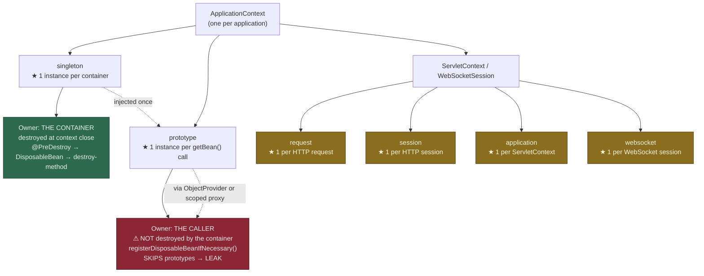
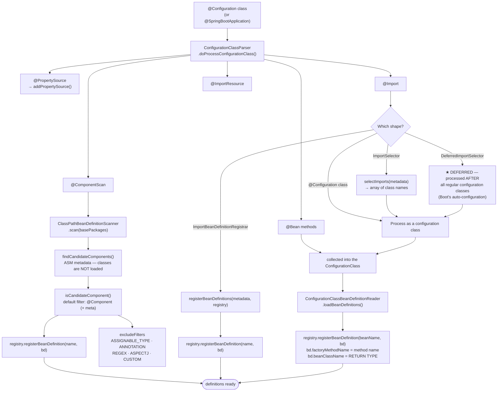
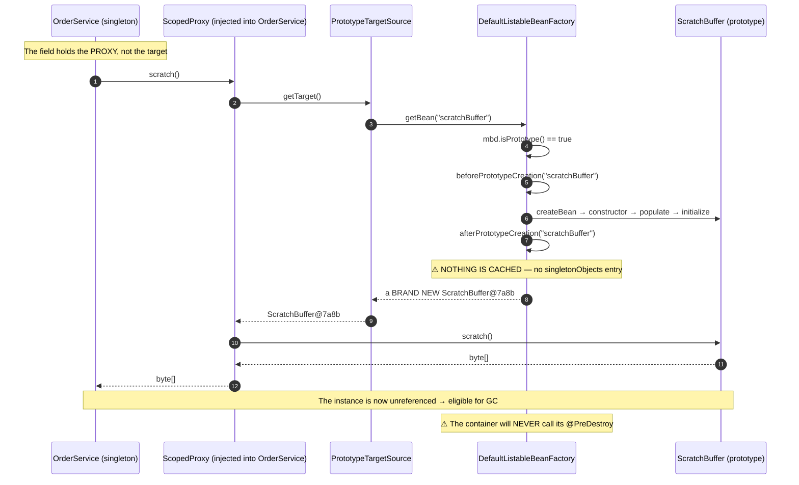

# Bean Scopes, Component Scanning & Configuration — The Complete Interview Guide

> **Level:** Intermediate → Expert
> **Interview Frequency:** ★★★★★ ("what are the bean scopes?", "why is my bean registered twice?", "what does `proxyBeanMethods = false` do?")
> **Prerequisites:** [01 · IoC Container & ApplicationContext](./01-IoC-Container-and-ApplicationContext.md) · [02 · DI & Bean Lifecycle](./02-Dependency-Injection-and-Bean-Lifecycle.md)
> **Last Updated:** 2026

> **Target stack:** Spring Boot 3.3+ · Spring Framework 6.1+ · Java 17+ · Jakarta EE 10

---

## 📋 Table of Contents
- [0. TL;DR — The 30-Second Answer](#0-tldr--the-30-second-answer)
- [1. What & Why — The Problem This Solves](#1-what--why--the-problem-this-solves)
- [2. Mental Model — The One Picture](#2-mental-model--the-one-picture)
- [3. Deep Dive — Theory (Beginner → Advanced)](#3-deep-dive--theory-beginner--advanced)
  - [3.1 Beginner Level](#31-beginner-level)
  - [3.2 Intermediate Level](#32-intermediate-level)
  - [3.3 Advanced Level](#33-advanced-level)
  - [3.4 Expert Level](#34-expert-level)
- [4. Internal Working Mechanism](#4-internal-working-mechanism)
- [5. Step-by-Step Execution Flow](#5-step-by-step-execution-flow)
- [6. Visualizations](#6-visualizations)
- [7. Production-Level Use Cases & Real Industry Examples](#7-production-level-use-cases--real-industry-examples)
- [8. Worked Examples (with Output + Dry Run)](#8-worked-examples-with-output--dry-run)
- [9. Code from Scratch — Production-Grade](#9-code-from-scratch--production-grade)
- [10. Common Mistakes & Gotchas](#10-common-mistakes--gotchas)
- [11. Performance Considerations](#11-performance-considerations)
- [12. Security Considerations](#12-security-considerations)
- [13. Best Practices](#13-best-practices)
- [14. Hands-On Exercises & Code Challenges](#14-hands-on-exercises--code-challenges)
- [15. Interview Q&A — Level-wise](#15-interview-qa--level-wise)
  - [🟢 Beginner](#-beginner)
  - [🟡 Intermediate](#-intermediate)
  - [🔴 Advanced / Senior](#-advanced--senior)
  - [⚫ Expert / Principal](#-expert--principal)
- [16. Scenario-Based & Real-Experience Scenarios](#16-scenario-based--real-experience-scenarios)
- [17. Counter-Questions, Tricky Questions & Follow-Ups](#17-counter-questions-tricky-questions--follow-ups)
- [18. Frequently Asked Production Issues & Debugging Scenarios](#18-frequently-asked-production-issues--debugging-scenarios)
- [19. Architecture Design Questions](#19-architecture-design-questions)
- [20. Rapid-Fire MCQs](#20-rapid-fire-mcqs)
- [21. Cheat Sheet / One-Page Summary](#21-cheat-sheet--one-page-summary)
- [22. Real-World Production Notes](#22-real-world-production-notes)
- [23. Follow-up Learning](#23-follow-up-learning)

---

## 0. TL;DR — The 30-Second Answer

- **There are six standard scopes** — `singleton`, `prototype`, `request`, `session`, `application`, `websocket` — and the deciding question is always **"who owns the lifecycle of this object?"**
- **The container manages destruction only for non-prototype beans.** `AbstractBeanFactory.registerDisposableBeanIfNecessary()` literally starts with `if (!mbd.isPrototype() && requiresDestruction(bean, mbd))` — so a prototype's `@PreDestroy` **never runs automatically**.
- **The prototype-in-singleton trap:** a singleton that holds a prototype holds a **strong reference** to it, which prevents GC — and the container will never destroy it. Three fixes: put `@PreDestroy` inside the prototype itself, use a **scoped proxy** (`@Scope(value = "prototype", proxyMode = ScopedProxyMode.TARGET_CLASS)`), or write a `BeanPostProcessor` that tracks prototypes.
- **`@Lazy` means two different things.** On a bean *definition* it means "do not create at startup"; on an *injection point* it means "inject a proxy that resolves the target on first use". The second is what breaks circular dependencies.
- **Component scanning is `ClassPathBeanDefinitionScanner`** and it is **additive** — two overlapping `@ComponentScan`s register the same class twice, producing `BeanDefinitionOverrideException` in Boot 2.1+.
- **`@ComponentScan` filters** are `ASSIGNABLE_TYPE`, `ANNOTATION`, `REGEX`, `ASPECTJ` and `CUSTOM`; `useDefaultFilters = false` disables `@Component`/`@Entity`/`@Named` auto-detection.
- **`@Configuration(proxyBeanMethods = true)` (the default)** CGLIB-subclasses the configuration class so that an inter-`@Bean` call returns the **container-managed singleton**. With `false` ("lite mode") the call returns a **new instance** every time — which is a bug factory.
- **`@Configuration` ≠ `@Component`.** Only `@Configuration` is CGLIB-enhanced and only `@Configuration` supports `@Bean` methods.
- **The three extension points, in execution order:** `BeanDefinitionRegistryPostProcessor` (add definitions) → `BeanFactoryPostProcessor` (mutate definitions) → `BeanPostProcessor` (wrap instances). Only the first may **add** beans; only the last may **replace** them.
- **`FactoryBean`** produces a *product* from a *factory*. `getBean("x")` returns the product; `getBean("&x")` returns the factory. `getBeanNamesForType()` matches the factory's own type, not the product's.
- **`@Import` has three shapes** — a `@Configuration` class, an `ImportSelector` (returns class names), or an `ImportBeanDefinitionRegistrar` (registers definitions programmatically). Boot's auto-configuration uses a `DeferredImportSelector`.

---

## 1. What & Why — The Problem This Solves

**The problem — three separate problems, often confused.**

```text
   ❌ PROBLEM 1 — "HOW MANY INSTANCES?"
   ──────────────────────────────────────
   A stateless service used by 40 request threads: 1 instance or 40?
   A per-request report builder: 1 or 40?
   → the SCOPE answers it, and the scope answers "who destroys it".

   ❌ PROBLEM 2 — "HOW DOES THE CONTAINER KNOW ABOUT MY BEANS?"
   ──────────────────────────────────────────────────────────────
   400 classes, 4 jars, 6 modules. Who decides what becomes a bean?
   → SCANNING answers it, and every extra scan root is another chance
     to register the same class twice.

   ❌ PROBLEM 3 — "HOW DO I WIRE A BEAN THAT THE FRAMEWORK OWNS?"
   ────────────────────────────────────────────────────────────
   I need a bean whose type comes from a config file, or whose
   dependencies are computed. @Component cannot express that.
   → CONFIGURATION answers it: @Bean methods, @Import, Importers.
```

**The solution.**

| Problem | Spring mechanism | Who owns the instance |
|---|---|---|
| "How many instances?" | **Scope** (`@Scope`) | The container (singleton) / the caller (prototype) / the request (request/session) |
| "What becomes a bean?" | **Component scanning** (`@ComponentScan`) | The scanner |
| "How do I wire it?" | **Configuration** (`@Configuration`, `@Bean`, `@Import`) | The developer |

**What breaks without the scope concept.** If every bean were a singleton, a bean that
holds request state would **leak between users** — the classic "user A sees user B's
data" bug. If every bean were a prototype, the container could not cache anything,
every `getBean` would allocate, and the proxy/AOP machinery would be pointless.
The scope is the contract between *the container* and *the caller* about who owns the
object.

**What breaks without the scanning/configuration split.** Component scanning is
**convenient but implicit**: you cannot see, from the code, that a class will become a
bean. Configuration is **explicit but verbose**: you write a method per bean. Real
codebases use both — scanning for your own domain classes, configuration for
infrastructure where you need control over construction.

> 💡 **The interview framing.** The three topics in this chapter are one idea seen
> from three sides: **the container's registry is data, and every mechanism here is a
> way to write to that data.** Scopes are a field on the definition, scanning is a
> bulk write, `@Import` is an explicit write, and the three extension points are
> hook-based writes. Once you frame it that way, the "which one do I use?" question
> disappears.

---

## 2. Mental Model — The One Picture

```text
   THE CONTAINER'S REGISTRY — AND THE THREE WAYS TO WRITE TO IT
   ═══════════════════════════════════════════════════════════

                        ┌──────────────────────────────────────────┐
                        │        BeanDefinitionRegistry            │
                        │   beanDefinitionMap (ConcurrentHashMap)  │
                        └──────────────────────────────────────────┘
                          ▲            ▲              ▲
        ① BULK WRITE      │            │              │   ③ HOOK WRITE
        (scanning)        │            │              │
   ┌────────────────────┐ │  ┌──────────────────┐   │  ┌────────────────────────────┐
   │ @ComponentScan     │ │  │ @Configuration   │   │  │ BeanDefinitionRegistry      │
   │ ClassPathBeanDef-  │ │  │ @Bean methods    │   │  │   PostProcessor             │
   │ initionScanner     │ │  │ @Import          │   │  │ BeanFactoryPostProcessor    │
   │                    │ │  │ ImportSelector   │   │  │ BeanPostProcessor           │
   │ default filters:   │ │  │ ImportBeanDef-   │   │  │                            │
   │ @Component         │ │  │ initionRegistrar │   │  │ ② ONE WRITE                │
   │ (+ @Service etc.)  │ │  │                  │   │  │                            │
   └────────────────────┘ │  └──────────────────┘   │  └────────────────────────────┘
                          │            │              │
                          └────────────┴──────────────┘
                                       │
                                 (BeanDefinition)
                                       │
                     ┌─────────────────┴──────────────────┐
                     │  scope  ·  lazyInit  ·  dependsOn  │
                     │  initMethod · destroyMethod         │
                     │  factoryBean · autowireMode         │
                     └─────────────────┬──────────────────┘
                                       │
                          ┌────────────┴────────────┐
                          │   WHO OWNS THE INSTANCE? │
                          └────────────┬────────────┘
        ┌──────────────┬──────────────┼──────────────┬───────────────┐
        ▼              ▼              ▼              ▼               ▼
   singleton      prototype        request        session        application
   container      CALLER          request        session        servlet ctx
   destroys it    destroys it     destroys it    destroys it     destroys it
   ✅             ❌ LEAK          ✅             ✅              ✅
```

**What to look at:** the **scope** field on the definition decides **who destroys the
object**. Everything else on the definition (lazy flag, destroy method, factory) is
about *how* it is created and torn down. And the three extension points sit on the
**right-hand** side of the diagram — they are *hooks*, not *declarations*, which is
exactly why they are more powerful and more dangerous.

---

## 3. Deep Dive — Theory (Beginner → Advanced)

### 3.1 Beginner Level

**The six scopes.**

| Scope | Bean name | Instances | Who creates | Who destroys | Typical use |
|---|---|---|---|---|---|
| `singleton` | `SCOPE_SINGLETON` | **1** per container | The container | **The container** (`@PreDestroy` → `DisposableBean` → destroy-method) | Services, repositories, config |
| `prototype` | `SCOPE_PROTOTYPE` | **1 per request** | The container (a *new* one each time) | ⚠️ **Nobody** — the container keeps no reference | Request-scoped builders, per-operation helpers |
| `request` | `SCOPE_REQUEST` | 1 per HTTP request | The servlet container | The servlet container | Request-scoped data holders |
| `session` | `SCOPE_SESSION` | 1 per HTTP session | The servlet container | The servlet container (on session expiry) | Session-scoped data holders |
| `application` | `SCOPE_APPLICATION` | 1 per `ServletContext` | The servlet container | The servlet container | Servlet-context-scoped beans |
| `websocket` | `SCOPE_WEBSOCKET` | 1 per WebSocket session | The WebSocket container | The WebSocket container | Per-connection state |

```java
@Component
@Scope(value = ConfigurableBeanFactory.SCOPE_PROTOTYPE)   // "prototype"
public class OrderDraft {
    // …
}
```

```java
// The web scopes are registered by the web context itself:
request     → org.springframework.web.context.request.RequestContextHolder
session     → org.springframework.web.context.request.SessionScope
application → org.springframework.web.context.request.ApplicationScope
websocket   → org.springframework.web.socket.context.WebSocketScope
```

**`singleton` vs `prototype` — the one distinction that matters.**

```java
@Service                                   // singleton — ONE instance for the whole app
public class PaymentGateway { … }

@Component
@Scope("prototype")
public class OrderValidator { … }        // a NEW instance every time it is injected
```

> ⚠️ **The trap everyone falls into.** "Prototype" does **not** mean "one instance per
> injection point". It means **one instance per `getBean()` call**. If a singleton
> injects a prototype, the prototype is created **once**, at the singleton's creation
> time, and then **held forever** — so it behaves like a singleton with extra steps.
> To get a fresh instance per use, inject `ObjectProvider<T>` (or a scoped proxy).

**`@Lazy` — two meanings, one annotation.**

```java
// ① LAZY INITIALISATION — on the bean definition
@Component
@Lazy                                        // ✅ not created at startup
public class ExpensiveReportService { … }

// ② LAZY RESOLUTION — on the injection point
@Service
public class OrderService {
    public OrderService(@Lazy AuditService auditService) { … }   // a PROXY is injected
}
```

| | `@Lazy` on the bean | `@Lazy` on the injection point |
|---|---|---|
| Effect | The bean is not created during `preInstantiateSingletons()` | A **proxy** is injected; the target is resolved on first call |
| Startup | Faster | Unchanged |
| Failure timing | The first request that touches it | The first call that touches it |
| Breaks circular deps? | ❌ No | ✅ **Yes** |
| Type at the injection point | The real type | A **proxy** (CGLIB subclass or JDK proxy) |

### 3.2 Intermediate Level

**The prototype-in-singleton trap — the exact mechanism.**

```java
@Service
public class ReportService {
    private final ScratchBuffer buffer;      // ← prototype, injected once

    public ReportService(ScratchBuffer buffer) {
        this.buffer = buffer;                // created ONCE, at ReportService's creation
    }
}
```

Two separate problems, often conflated:

1. **Semantics.** You asked for a prototype and got a singleton. Two concurrent
   requests share the same `ScratchBuffer` — a **data race**.
2. **The leak.** The singleton holds a **strong reference** to the prototype, so the
   prototype can never be garbage collected, and the container will **never** destroy
   it — `registerDisposableBeanIfNecessary()` skips prototypes explicitly.

```java
// Spring Framework 6.1 — AbstractBeanFactory.registerDisposableBeanIfNecessary()
protected void registerDisposableBeanIfNecessary(String beanName, Object bean, RootBeanDefinition mbd) {
    if (!mbd.isPrototype() && requiresDestruction(bean, mbd)) {   // ← ★ PROTOTYPES SKIPPED
        if (mbd.isSingleton()) {
            registerDisposableBean(beanName, new DisposableBeanAdapter(bean, beanName, mbd, …));
        }
        else {
            Scope scope = this.scopes.get(mbd.getScope());
            scope.registerDestructionCallback(beanName, new DisposableBeanAdapter(bean, beanName, mbd, …));
        }
    }
}
```

**The three sanctioned fixes.**

| # | Fix | How | Trade-off |
|---|---|---|---|
| **1** | **Destroy it yourself** | Put `@PreDestroy` **inside the prototype** and have the *owner* call it, or use `try/finally` | Manual, easy to forget |
| **2** | **Scoped proxy** | `@Scope(value = "prototype", proxyMode = ScopedProxyMode.TARGET_CLASS)` | The injected type becomes a proxy; the target is created per method call |
| **3** | **A `BeanPostProcessor`** | Track created prototypes in a list; destroy them on context close | Container-level, but you own the bookkeeping |

```java
// ✅ FIX 2 — the scoped proxy
@Component
@Scope(value = ConfigurableBeanFactory.SCOPE_PROTOTYPE,
      proxyMode = ScopedProxyMode.TARGET_CLASS)
public class ScratchBuffer implements AutoCloseable {
    @Override public void close() { /* release the native buffer */ }
}
```

```java
// ✅ FIX 3 — a BeanPostProcessor that tracks prototypes
@Component
public class PrototypeDestroyTracker implements BeanPostProcessor, DisposableBean {

    private final List<Object> prototypes = new ArrayList<>();

    @Override
    public Object postProcessAfterInitialization(Object bean, String beanName) {
        if (beanFactory.isPrototype(beanName)) {   // needs the factory
            prototypes.add(bean);
        }
        return bean;
    }

    @Override
    public void destroy() {
        prototypes.forEach(p -> { if (p instanceof AutoCloseable c) { try { c.close(); } catch (Exception ignored) { } } });
        prototypes.clear();
    }
}
```

**How `@Lazy` breaks a circular dependency.** `@Lazy` on an injection point makes
the container inject a **lazy-resolution proxy**:

```text
  WITHOUT @Lazy (constructor injection)
  ────────────────────────────────────────
  createBean(A) → constructor → needs B → createBean(B) → constructor → needs A
                  → A is not yet exposed → BeanCurrentlyInCreationException 💥

  WITH @Lazy
  ───────────
  createBean(A) → constructor → needs B → inject a LAZY PROXY for B  ← no real B yet
                  → A completes ✅
  ...later, first call to proxy.someMethod():
                  → proxy resolves B for real → createBean(B) → constructor → needs A
                  → A is fully built and cached → ✅
```

**The proxy-target-source mechanics.** A lazy/scope proxy is not a plain JDK proxy —
it delegates to a `TargetSource`:

| `TargetSource` | Behaviour |
|---|---|
| `SingletonTargetSource` | Always returns the same instance (used by the `singleton` scope's scoped proxy) |
| `PrototypeTargetSource` | Calls `getBean()` on **every** method invocation — a new instance per call |
| `SimpleThreadLocalTargetSource` | One instance per thread (the `request` scope) |
| `DelegatingTargetSource` | Chains two sources (used by the `request`/`session` scopes) |

`ScopedProxyFactoryBean` + `ScopedProxyUtils` create the proxy and register a
`TargetSource` that resolves the *real* bean on demand.

### 3.3 Advanced Level

**Component scanning — the machinery.**

```java
@ComponentScan(
    basePackages = "com.acme.billing",              // or basePackageClasses = Marker.class
    nameGenerator = AnnotationBeanNameGenerator.class,
    useDefaultFilters = true,
    includeFilters = { @Filter(type = FilterType.REGEX, pattern = "com\\.acme\\.billing\\.api\\..*") },
    excludeFilters = { @Filter(type = FilterType.ASSIGNABLE_TYPE, classes = { GeneratedDto.class }) }
)
public class BillingModule { }
```

| `FilterType` | Matches on | Typical use |
|---|---|---|
| `ANNOTATION` | The presence of an annotation (including meta-annotations) | Register only `@Handler`-annotated classes |
| `ASSIGNABLE_TYPE` | `type.isAssignableFrom(candidate)` | Register all implementations of an interface |
| `REGEX` | The **fully-qualified class name** against a regex | Include/exclude by package pattern |
| `ASPECTJ` | An AspectJ expression | Advanced, needs `aspectjweaver` on the classpath |
| `CUSTOM` | Your own `TypeFilter` implementation | Fully custom rules |

```text
   WHAT THE DEFAULT FILTERS MATCH
   ────────────────────────────────
   useDefaultFilters = true registers:
     • @Component          (and every meta-annotated stereotype:
                            @Service, @Repository, @Controller,
                            @Configuration, @RestController)
     • @jakarta.persistence.Entity
     • @jakarta.annotation.ManagedBean
     • @jakarta.inject.Named
   useDefaultFilters = false → ONLY your includeFilters apply.
```

**The "why is my bean registered twice?" problem.** Component scanning is
**additive**, and the same class can be reached by two different scan roots:

```text
   @SpringBootApplication  on com.acme.app          → scans com.acme.app
   @ComponentScan("com.acme") on com.acme.app.config → scans com.acme  (including com.acme.app!)
                                                            ↑
                        the SAME class is scanned twice → two BeanDefinitions, one name
                        → BeanDefinitionOverrideException (Boot 2.1+ default)
```

**Other ways to get a duplicate.**

| Cause | Symptom |
|---|---|
| Two overlapping `@ComponentScan`s | `BeanDefinitionOverrideException` for the same bean name |
| A `@Configuration` class **and** a `@ComponentScan` that reaches it | The configuration class is registered twice |
| The same library on the classpath twice (two versions) | Same as above |
| A `@Component` in a package scanned by **two** Boot applications in the same JVM | Same as above |
| An XML `<context:component-scan>` plus an annotation scan | Same as above |

> 💡 **The most common real cause.** `@SpringBootApplication` already contains a
> `@ComponentScan`. Adding your own `@ComponentScan("com.acme")` on top of it
> **widens** the scan to the parent package, which almost always re-scans your own
> application package. Fix: use `@ComponentScan` with **exclude filters**, or move
> the scanning to a **separate `@Configuration` class** that is `@Import`ed, and keep
> `@SpringBootApplication`'s own scan narrow.

**Configuration — `@Configuration` vs `@Component`.**

| | `@Component` | `@Configuration` |
|---|---|---|
| Registers a bean | ✅ | ✅ |
| Supports `@Bean` methods | ❌ (they are ignored) | ✅ |
| CGLIB-enhanced | ❌ | ✅ by default (`proxyBeanMethods = true`) |
| Inter-`@Bean` call returns | — | The **container-managed singleton** (full mode) or a **new instance** (lite mode) |

**Full mode vs lite mode.**

```java
@Configuration(proxyBeanMethods = true)      // ★ DEFAULT — "full mode"
public class PaymentConfiguration {

    @Bean
    public PaymentGateway gateway() {
        return new StripePaymentGateway(httpClient());     // ← calls another @Bean method
    }

    @Bean
    public HttpClient httpClient() {
        return new HttpClient();
    }
}
```

In **full mode**, `gateway()` is intercepted by the CGLIB subclass: the internal call
`httpClient()` returns the **same singleton** the container created. The container
knows that `gateway` *depends on* `httpClient` and creates it first.

```java
@Configuration(proxyBeanMethods = false)     // "lite mode"
public class PaymentConfiguration { … }
```

In **lite mode** the class is **not** proxied: `httpClient()` inside `gateway()` is a
plain method call that creates a **new** `HttpClient`. The container still registers
both beans, but the object graph contains **two** `HttpClient` instances — one
created by the container, one created by the direct call.

**`@Bean` method semantics.**

```java
@Bean
public PaymentGateway gateway(HttpClient httpClient) { … }
// ↑ the parameter is resolved as a DEPENDENCY by the container
//   → the container creates httpClient first and injects it
//   → gateway() can therefore be called directly in a unit test
```

| Aspect | Rule |
|---|---|
| Return type | The **declared** return type is what the container uses for type matching |
| Parameters | Resolved as dependencies, exactly like constructor injection |
| Method name | The **bean name** (unless `@Bean("customName")`) |
| `initMethod` / `destroyMethod` | `@Bean(initMethod = "…", destroyMethod = "…")` |
| Default `destroyMethod` | **`"(inferred)"`** → `close()` or `shutdown()` is called if the bean has one |
| Default `destroyMethod = ""` | Disables the inference |

> ⚠️ **The double-close trap.** Because the default is `(inferred)`, a `@Bean`
> returning an `AutoCloseable` is closed **automatically** at shutdown. If you also
> write `@Bean(destroyMethod = "close")`, the inference is skipped (the method is
> then "externally managed") — so you get **one** call, not two. But if you write a
> custom `destroyMethod = "shutdown"` **and** the bean implements `AutoCloseable`,
> Spring calls `shutdown()` **and** `close()`. Know which one you configured.

**`FactoryBean`.**

```java
public class PaymentClientFactory implements FactoryBean<PaymentClient> {

    @Override public PaymentClient getObject() { /* build or fetch the product */ }
    @Override public Class<?> getObjectType() { return PaymentClient.class; }
    @Override public boolean isSingleton() { return true; }
}
```

| Lookup | Returns |
|---|---|
| `getBean("paymentClientFactory")` | The **product** (`getObject()`) |
| `getBean("&paymentClientFactory")` | The **factory** itself |
| `getBeanNamesForType(PaymentClient.class)` | Includes the factory's bean name (matched via `getObjectType()`) |
| `getBeanNamesForType(PaymentClientFactory.class)` | Includes the factory's bean name |

`FactoryBean` is the framework's own idiom for "a bean whose *construction* is
special" — `SqlSessionFactoryBean`, `ProxyFactoryBean`, `LocalContainerEntityManagerFactoryBean`
all use it.

### 3.4 Expert Level

**The three extension points, precisely.**

| | `BeanDefinitionRegistryPostProcessor` | `BeanFactoryPostProcessor` | `BeanPostProcessor` |
|---|---|---|---|
| Operates on | **Definitions** | **Definitions** | **Instances** |
| May **add** definitions? | ✅ Yes | ❌ No | ❌ No |
| May **remove** definitions? | ✅ Yes | ❌ No | ❌ No |
| May change scope / lazy / property values? | ✅ | ✅ | ❌ |
| May **replace the instance**? | ❌ | ❌ | ✅ |
| Runs | `refresh()` step 4, **before** any bean exists | `refresh()` step 4 | during `doCreateBean`, per bean |
| Canonical example | `ConfigurationClassPostProcessor` | `PropertySourcesPlaceholderConfigurer` | `AutowiredAnnotationBeanPostProcessor`, `AbstractAutoProxyCreator` |

**The execution order inside `invokeBeanFactoryPostProcessors()`.**

```text
 1. BeanDefinitionRegistryPostProcessor beans, in order:
      a. those implementing PriorityOrdered      → FIRST
      b. those implementing Ordered              → then
      c. the rest (registration order)           → then
    For each: postProcessBeanDefinitionRegistry(registry)  THEN  postProcessBeanFactory(beanFactory)

 2. BeanFactoryPostProcessor beans (NOT already processed as a BDRPP), in order:
      a. PriorityOrdered
      b. Ordered
      c. the rest

 3. Then (still in refresh()): registerBeanPostProcessors()
      → the BeanPostProcessor beans are INSTANTIATED here
      → they are then applied to every bean as it is created
```

**Why `ConfigurationClassPostProcessor` runs first.** It is registered manually by
`AnnotationConfigUtils.registerAnnotationConfigProcessors(registry)` **before**
refresh, and it implements `PriorityOrdered`. It must parse every `@Configuration`
class — resolving `@ComponentScan`, `@Import`, `@Bean` methods and `@PropertySource` —
**before** any other post-processor can look at the definitions, because those
definitions may not exist yet.

**`@Import` — the three shapes.**

| Shape | Mechanism | Example |
|---|---|---|
| A `@Configuration` class | The imported class is processed as a configuration class | `@Import(PaymentConfiguration.class)` |
| An `ImportSelector` | Returns an **array of class names** to import | `@Import(DatabaseAutoConfigurationSelector.class)` |
| An `ImportBeanDefinitionRegistrar` | **Registers bean definitions** programmatically | `@Import(TenantRegistrar.class)` |

```java
public interface ImportSelector {
    String[] selectImports(AnnotationMetadata importingClassMetadata);
}

public interface ImportBeanDefinitionRegistrar {
    void registerBeanDefinitions(AnnotationMetadata importingClassMetadata,
                                 BeanDefinitionRegistry registry);
}
```

**`DeferredImportSelector`** — a special `ImportSelector` whose selections are
processed **after** all regular configuration classes have been processed. Boot's
`AutoConfigurationImportSelector` is a `DeferredImportSelector`, which is *why*
auto-configuration can `@Conditional` on beans contributed by the user's own
`@Configuration` classes: the user's beans are registered **first**.

```java
public class TenantRegistrar implements ImportBeanDefinitionRegistrar {

    @Override
    public void registerBeanDefinitions(AnnotationMetadata metadata, BeanDefinitionRegistry registry) {
        // Register one bean definition per tenant found in the environment.
        for (String tenant : tenants()) {
            registry.registerBeanDefinition("tenant_" + tenant, definitionFor(tenant));
        }
    }
}
```

**`@ComponentScan` vs `@Import` vs auto-configuration — when to use which.**

| Mechanism | Use for |
|---|---|
| `@ComponentScan` | Your own domain classes (`@Service`, `@Repository`, `@Controller`) |
| `@Import` of a `@Configuration` class | A module you control; explicit and reviewable |
| `@Import` + `ImportBeanDefinitionRegistrar` | Dynamic registration — the number of beans is not known statically |
| `@Import` + `ImportSelector` | Choosing between implementations **by condition** |
| Auto-configuration (`AutoConfiguration.imports`) | Framework-level, `@Conditional`-gated defaults |

**`@Configuration` class ordering.** `@Configuration` classes are processed in a
specific order (`ConfigurationClassParser` sorts by `@Order` on the class), because
one configuration class may `@Import` another and the imported one's `@Bean` methods
must be visible. **`@DependsOn` between configuration classes** forces the ordering
explicitly.

**`@Bean` method and `@Configuration` CGLIB — the "lite" escape hatch.** Spring Boot
3.2+ added `proxyBeanMethods = false` to `@Configuration`, and Spring Boot
auto-configuration uses it heavily — auto-configuration classes are typically
"lite" because they are processed by the `ConfigurationClassPostProcessor` at a
stage where the CGLIB enhancement may not be desirable, and because lite mode is
**faster** (no CGLIB subclass is generated for the configuration class).

---

## 4. Internal Working Mechanism

**How a class becomes a bean — the scanning path.**

```text
ApplicationContext.refresh()
  └─ invokeBeanFactoryPostProcessors()
       └─ ConfigurationClassPostProcessor.postProcessBeanDefinitionRegistry(registry)
            └─ processConfigBeanDefinitions(registry)
                 └─ ConfigurationClassParser.doProcessConfigurationClass(configClass)
                      ├─ process @PropertySource            → add PropertySource
                      ├─ process @ComponentScan             → ComponentScanAnnotationParser
                      │     └─ ClassPathScanningCandidateComponentProvider.scan(basePackages)
                      │          ├─ findCandidateComponents()   → ASM metadata, no class loading
                      │          ├─ isCandidateComponent()      → AnnotationTypeFilter(@Component)
                      │          └─ registerBeanDefinitions()   → registry.registerBeanDefinition(…)
                      ├─ process @Import                    → ImportSelector / ImportBeanDefinitionRegistrar
                      ├─ process @Bean methods              → collect into the ConfigurationClass
                      └─ process @ImportResource
       └─ ConfigurationClassPostProcessor.postProcessBeanFactory(beanFactory)
            └─ ConfigurationClassBeanDefinitionReader.loadBeanDefinitions()
                 └─ for each @Bean method → registry.registerBeanDefinition(beanName, bd)
```

**How a `FactoryBean` is resolved — `getObjectForBeanInstance`.**

```text
getObjectForBeanInstance(beanName, beanInstance, mbd)
  ├─ if (!(beanInstance instanceof FactoryBean)) → return beanInstance          (normal bean)
  ├─ if (BeanFactoryUtils.isFactoryDereference(name)) → return beanInstance     (the "&name" form)
  ├─ if (mbd != null) {
  │      FactoryBean<?> factory = (FactoryBean<?>) beanInstance;
  │      if (mbd.isSingleton() && factory.isSingleton()) {
  │          // the PRODUCT is cached under a name derived from the factory's name
  │          return getSingleton(BeanFactoryUtils.transformedBeanName(name), () -> factory.getObject());
  │      }
  │      return factory.getObject();      // ← a NEW product on every call
  │  }
  └─ return getSingleton(…, () -> ((FactoryBean<?>) beanInstance).getObject());
```

**How scopes are applied — `AbstractBeanFactory.doGetBean`.**

```text
  if (mbd.isSingleton())      → getSingleton(beanName, () -> createBean(...))       // cached
  else if (mbd.isPrototype()) → beforePrototypeCreation(beanName)
                                 prototype = createBean(...)
                                 afterPrototypeCreation(beanName)                     // NOT cached
  else                        → scope.get(beanName, () -> createBean(...))           // request/session/…
                                 // the Scope implementation owns the instance
                                 // and registers the destruction callback
```

**How the scoped proxy resolves the target.**

```text
  proxy.someMethod()
    → InterceptedMethodInvocation
         → AopContext / ScopedProxyFactoryBean's TargetSource.getTarget()
              → PrototypeTargetSource.getTarget()
                   → beanFactory.getBean(beanName)   // ← a NEW instance EVERY call
              → target.someMethod()
```

---

## 5. Step-by-Step Execution Flow

**The flow from `@SpringBootApplication` to a registered bean definition.**

1. `SpringApplication.run()` → `prepareContext()` → the `@SpringBootApplication`
   class is registered as a bean definition by `AnnotatedBeanDefinitionReader`.
2. `refresh()` → `invokeBeanFactoryPostProcessors()`.
3. `ConfigurationClassPostProcessor` (a `PriorityOrdered`
   `BeanDefinitionRegistryPostProcessor`) parses the configuration class:
   - `@SpringBootApplication` is meta-annotated with `@SpringBootConfiguration`
     (→ `@Configuration`) and `@ComponentScan` (with `useDefaultFilters = true`).
   - `@ComponentScan` → `ClassPathBeanDefinitionScanner` walks the base packages and
     registers a `BeanDefinition` per candidate.
   - `@Import` → `ImportSelector`s are invoked, then
     `ImportBeanDefinitionRegistrar`s register their definitions.
   - `@Bean` methods are collected into the `ConfigurationClass`.
4. `ConfigurationClassBeanDefinitionReader` turns each collected `@Bean` method into
   a `BeanDefinition` whose `factoryMethodName` is the method name and whose
   `beanClassName` is the method's **return type**.
5. Other `BeanDefinitionRegistryPostProcessor`s run (e.g. a custom registrar).
6. Other `BeanFactoryPostProcessor`s run (e.g.
   `PropertySourcesPlaceholderConfigurer`).
7. `registerBeanPostProcessors()` — the `BeanPostProcessor` beans are instantiated.
8. `finishBeanFactoryInitialization()` → `preInstantiateSingletons()`:
   - for each non-lazy, non-abstract singleton → `getBean(name)` → `doCreateBean`;
   - **prototype** beans are **not** pre-instantiated (there is no reason to create
     them and nothing would cache them);
   - `SmartInitializingSingleton.afterSingletonsInstantiated()` fires at the end.

**The flow of a scoped-proxy lookup at request time.**

1. `orderService.getDraft()` — the injected field is a **proxy**.
2. The proxy's `MethodInterceptor` resolves the target via the `TargetSource`.
3. `PrototypeTargetSource.getTarget()` → `beanFactory.getBean("orderDraft")`.
4. `doGetBean` → `mbd.isPrototype()` → `beforePrototypeCreation` → `createBean` →
   a **new** instance → `afterPrototypeCreation`. **Nothing is cached.**
5. The method is invoked on the new instance, and the instance becomes eligible for
   GC as soon as the caller drops it.

---

## 6. Visualizations

### 6.1 The six scopes and who owns the instance (Mermaid)



**Caption:** The single structural fact: **`prototype` is the only scope the container
does not destroy**. Every other scope has a registered destruction callback. The
dotted arrows show the two ways a prototype normally enters a singleton's life —
directly injected (the trap) or resolved per call (the fix).

### 6.2 The three extension points and their execution order (ASCII)

```text
   refresh() — WHAT HAPPENS, IN ORDER
   ═════════════════════════════════════

   ┌─ STEP 4 — invokeBeanFactoryPostProcessors() ─────────────────────────┐
   │                                                                       │
   │  ┌─────────────────────────────────────────────────────────────────┐  │
   │  │ BeanDefinitionRegistryPostProcessor                             │  │
   │  │  ● PriorityOrdered  → ConfigurationClassPostProcessor  ★ FIRST  │  │
   │  │  ● Ordered          → your custom BDRPP                         │  │
   │  │  ● unordered        → your custom BDRPP                         │  │
   │  │                                                                 │  │
   │  │  postProcessBeanDefinitionRegistry(registry)  ← ADD/REMOVE      │  │
   │  │  postProcessBeanFactory(beanFactory)          ← MUTATE          │  │
   │  │  ✅ MAY add a new BeanDefinition                                 │  │
   │  └─────────────────────────────────────────────────────────────────┘  │
   │                          ↓                                           │
   │  ┌─────────────────────────────────────────────────────────────────┐  │
   │  │ BeanFactoryPostProcessor                                        │  │
   │  │  ● PriorityOrdered  → PropertySourcesPlaceholderConfigurer       │  │
   │  │  ● Ordered          → your custom BFPP                          │  │
   │  │                                                                 │  │
   │  │  postProcessBeanFactory(beanFactory)            ← MUTATE ONLY    │  │
   │  │  ❌ MAY NOT add a BeanDefinition                                 │  │
   │  └─────────────────────────────────────────────────────────────────┘  │
   └───────────────────────────────────────────────────────────────────────┘
                                      ↓
   ┌─ STEP 5 — registerBeanPostProcessors() ──────────────────────────────┐
   │  ┌─────────────────────────────────────────────────────────────────┐  │
   │  │ BeanPostProcessor  (INSTANTIATED here, APPLIED per bean later)  │  │
   │  │  ● AutowiredAnnotationBeanPostProcessor  → @Autowired / @Value  │  │
   │  │  ● CommonAnnotationBeanPostProcessor      → @PostConstruct      │  │
   │  │  ● AnnotationAwareAspectJAutoProxyCreator → AOP proxy (aspect)  │  │
   │  │  ● InfrastructureAdvisorAutoProxyCreator → AOP proxy (tx)       │  │
   │  │                                                                 │  │
   │  │  postProcessBeforeInitialization(bean) / postProcessAfter…(bean)│  │
   │  │  ✅ MAY return a DIFFERENT object (a proxy)                     │  │
   │  └─────────────────────────────────────────────────────────────────┘  │
   └───────────────────────────────────────────────────────────────────────┘
                                      ↓
   ┌─ STEP 10 — preInstantiateSingletons() ──────────────────────────────┐
   │  for each non-lazy, non-abstract singleton → doCreateBean(...)       │
   │      create → populate → initialize → ★ PROXY CREATED HERE          │
   │  prototypes are NOT pre-instantiated                                 │
   └───────────────────────────────────────────────────────────────────────┘
```

**Caption:** Read the "MAY" column top to bottom — it is a **strictly decreasing**
power set. The top box can change **what beans exist**; the bottom box can change
**what a bean is**. A `BeanPostProcessor` cannot add a bean, and a
`BeanFactoryPostProcessor` cannot replace an instance. Putting a `@Bean` method in a
`BeanPostProcessor` is a classic mistake — the definition is added *after* the
scanning phase, so it may never be registered.

### 6.3 `ConfigurationClassPostProcessor` parsing (Mermaid flowchart)



**Caption:** The critical ordering fact is the **dashed path**: `DeferredImportSelector`
selections are processed **after** every ordinary configuration class. That is
precisely what allows a Boot auto-configuration to be `@ConditionalOnMissingBean` on
a bean that **your** `@Configuration` class contributed — your bean is registered
first, so the condition sees it and the auto-configuration backs off.

### 6.4 Full mode vs lite mode — inter-`@Bean` calls (ASCII)

```text
   @Configuration(proxyBeanMethods = true)   ★ DEFAULT — "FULL MODE"
   ═══════════════════════════════════════════════════════════════
   The configuration class is CGLIB-subclassed. Every call to an
   @Bean method from INSIDE the class is intercepted.

     container.getBean("paymentGateway")
            │
            ▼
     ┌──────────────────────┐   CGLIB interceptor
     │ PaymentConfiguration$│──────▶ intercepts the internal call
     │  @Bean gateway()     │          │
     │    return new Stripe(│          ▼
     │        httpClient()); │    "return the CONTAINER's singleton
     └──────────────────────┘      'httpClient' bean"
            │
            ▼
     StripePaymentGateway ──▶ HttpClient@1111   ← ONE instance, container-managed
     (singleton)                    ▲
                                   └── the SAME object the container holds

     Container state:  httpClient → HttpClient@1111
                       paymentGateway → StripePaymentGateway@2222 (uses @1111) ✅


   @Configuration(proxyBeanMethods = false)  — "LITE MODE"
   ═══════════════════════════════════════════════════════════════
   The class is NOT proxied. An internal @Bean call is a plain
   Java method call → it EXECUTES the @Bean method again.

     container.getBean("paymentGateway")
            │
            ▼
     ┌──────────────────────┐
     │ PaymentConfiguration │   no interception
     │  @Bean gateway()     │
     │    return new Stripe(│──▶ new HttpClient@7777   ← A SECOND INSTANCE
     │        httpClient()); │      (created by the direct call,
     └──────────────────────┘       NOT container-managed)

     Container state:  httpClient → HttpClient@1111   ← unused by the gateway!
                       paymentGateway → StripePaymentGateway@2222 (uses @7777) ⚠️

     ⚠️ TWO HttpClient instances → two connection pools, doubled memory,
        and the bean you configured with @Bean(httpClient) is IGNORED.
```

**Caption:** Lite mode is not "worse" — it is **honest**: it tells you that the
configuration class is a plain object, not a container participant. It is the right
choice when the configuration class is **large** (CGLIB subclassing has a cost) or
when the inter-`@Bean` calls are **not** meant to return singletons. The rule: if
one `@Bean` method calls another, use **full mode**; if the configuration class is
just a bag of independent factories, use **lite mode**.

### 6.5 A scoped proxy resolving a prototype at request time (Mermaid sequence)



**Caption:** The whole point of the scoped proxy in one picture. The **singleton**
holds a **proxy**, the proxy resolves a **fresh** instance per call, and nothing is
cached — which is exactly why the *caller* owns the instance and must release it.
Contrast with the direct injection of a prototype into a singleton, where the
prototype is created **once**, held for the lifetime of the application, and never
destroyed.

---

## 7. Production-Level Use Cases & Real Industry Examples

**1. Banking — request scope for the current principal's context.**
A payments service stores the authenticated principal and the correlation id in a
request-scoped bean. Controllers inject it directly:

```java
@Component
@Scope(value = WebApplicationContext.SCOPE_REQUEST, proxyMode = ScopedProxyMode.TARGET_CLASS)
public class RequestPrincipal { … }
```

The servlet container creates **one per request** and destroys it at the end of the
request. The alternative — a `ThreadLocal` — leaks into pooled threads and breaks
under `@Async` and virtual threads. The scoped bean is **safe by construction**.

**2. E-commerce — a prototype "price calculator" per checkout.**
A checkout flow computes prices with a `PriceCalculator` that accumulates
line-item state. It must be **fresh per checkout**, but the service that uses it is a
singleton. The fix: `@Scope(value = "prototype", proxyMode = ScopedProxyMode.TARGET_CLASS)`
plus `ObjectProvider<PriceCalculator>` in the service. Before the fix, 40 concurrent
checkouts shared **one** calculator and produced **wrong totals** — a
cross-customer data leak that was caught by an auditor, not by a test.

**3. SaaS — component scanning narrowed to kill a duplicate-bean failure.**
A platform serving 300 tenants imported two vendor jars, both of which shipped
`@Component` classes under `com.vendor.shared`. The application scanned
`com.acme` (to catch the vendors) and **also** had `@SpringBootApplication` on
`com.acme.app` (which scanned `com.acme.app`). Overlap → duplicate beans. The fix
was to make the scan explicit and narrow:

```java
@ComponentScan(
    basePackages = "com.acme.app",
    excludeFilters = @ComponentScan.Filter(type = FilterType.REGEX, pattern = "com\\.vendor\\..*")
)
```

Startup also dropped from 9.4 s to 3.1 s, because the scan no longer walked the
vendor jars.

**4. Ad-tech — an `ImportBeanDefinitionRegistrar` for tenant-specific endpoints.**
A multi-tenant ad server registers one `BidderClient` definition per bidder from
`bidders.yml` at startup. 480 bidders → 480 definitions, all `lazyInit = true`.
Because the registrar runs at definition time (before instantiation), the beans are
created only when a tenant actually uses them — the first request for a bidder
pays ~3 ms, and the other 479 bidders cost nothing.

**5. Logistics — lite-mode configuration for startup speed.**
A monolith with 180 `@Bean` methods in 22 configuration classes took 4.8 s to start.
Switching the **auto-generated** configuration classes to
`@Configuration(proxyBeanMethods = false)` removed 22 CGLIB subclasses and cut
startup to 4.1 s. The 6 classes where one `@Bean` method calls another were left in
full mode — a deliberate, measured trade.

---

## 8. Worked Examples (with Output + Dry Run)

### 8.1 Worked Example 1 — A `FactoryBean` wrapping a third-party client

**Problem.** You need to wrap a vendor SDK client (`com.vendor.sdk.Payments`) in
your own interface, and you need Spring to manage its lifecycle.

**Code.**

```java
package com.example.factory;

import org.springframework.beans.factory.FactoryBean;

public interface PaymentClient {
    String charge(String orderId, long cents);
}
```

```java
package com.example.factory;

import com.vendor.sdk.Payments;          // third-party class
import org.springframework.beans.factory.FactoryBean;

/**
 * Exposes the vendor SDK as a Spring bean.
 *
 * <p>getObject()     → the PRODUCT the application injects
 * <p>getObjectType() → the product's type, used for type matching BEFORE creation
 * <p>isSingleton()   → whether the product is cached
 */
public class VendorPaymentClientFactory implements FactoryBean<PaymentClient> {

    private final String apiKey;
    private Payments vendorClient;

    public VendorPaymentClientFactory(String apiKey) {
        this.apiKey = apiKey;
    }

    @Override
    public PaymentClient getObject() {
        if (vendorClient == null) {
            vendorClient = new Payments(apiKey);        // expensive: opens a socket
        }
        return new PaymentClient() {
            @Override
            public String charge(String orderId, long cents) {
                return vendorClient.charge(orderId, cents);
            }
        };
    }

    @Override
    public Class<?> getObjectType() {
        return PaymentClient.class;      // ★ lets the container match by type
    }

    @Override
    public boolean isSingleton() {
        return true;                     // the product is cached under the factory's name
    }
}
```

```java
package com.example.factory;

import org.springframework.context.annotation.Bean;
import org.springframework.context.annotation.Configuration;

@Configuration
public class PaymentConfiguration {

    @Bean
    public VendorPaymentClientFactory vendorPaymentClientFactory() {
        return new VendorPaymentClientFactory("sk_live_9f3a");
    }
}
```

**Actual expected output.**

```text
2026-01-15 11:04:22.118 INFO  [main] c.e.factory.TypeInspector : bean 'vendorPaymentClientFactory' → type = com.example.factory.VendorPaymentClientFactory (a FactoryBean)
2026-01-15 11:04:22.119 INFO  [main] c.e.factory.TypeInspector : getBean("vendorPaymentClientFactory")      → com.example.factory.PaymentClient@6b1c  (the PRODUCT)
2026-01-15 11:04:22.119 INFO  [main] c.e.factory.TypeInspector : getBean("&vendorPaymentClientFactory")     → com.example.factory.VendorPaymentClientFactory@2d3e  (the FACTORY)
2026-01-15 11:04:22.120 INFO  [main] c.e.factory.TypeInspector : getBeanNamesForType(PaymentClient)      → [vendorPaymentClientFactory]
2026-01-15 11:04:22.120 INFO  [main] c.e.factory.TypeInspector : getBeanNamesForType(VendorPaymentClientFactory) → [vendorPaymentClientFactory]
2026-01-15 11:04:22.121 INFO  [main] c.e.factory.TypeInspector : same instance on 2nd getBean? true
```

The inspector that produced it:

```java
package com.example.factory;

import java.util.Arrays;
import org.slf4j.Logger;
import org.slf4j.LoggerFactory;
import org.springframework.boot.ApplicationArguments;
import org.springframework.boot.ApplicationRunner;
import org.springframework.context.ApplicationContext;
import org.springframework.stereotype.Component;

@Component
public class TypeInspector implements ApplicationRunner {

    private static final Logger log = LoggerFactory.getLogger(TypeInspector.class);

    private final ApplicationContext context;

    public TypeInspector(ApplicationContext context) {
        this.context = context;
    }

    @Override
    public void run(ApplicationArguments args) {
        log.info("bean 'vendorPaymentClientFactory' → type = {} (a FactoryBean)",
                context.getBean("vendorPaymentClientFactory").getClass().getName());

        log.info("getBean(\"vendorPaymentClientFactory\")  → {}  (the PRODUCT)",
                context.getBean("vendorPaymentClientFactory").getClass().getName());
        log.info("getBean(\"&vendorPaymentClientFactory\") → {}  (the FACTORY)",
                context.getBean("&vendorPaymentClientFactory").getClass().getName());

        log.info("getBeanNamesForType(PaymentClient)            → {}",
                Arrays.toString(context.getBeanNamesForType(PaymentClient.class)));
        log.info("getBeanNamesForType(VendorPaymentClientFactory) → {}",
                Arrays.toString(context.getBeanNamesForType(VendorPaymentClientFactory.class)));

        Object first = context.getBean("vendorPaymentClientFactory");
        Object second = context.getBean("vendorPaymentClientFactory");
        log.info("same instance on 2nd getBean? {}", first == second);
    }
}
```

**Dry run.**

1. `PaymentConfiguration` is parsed → the `@Bean` method
   `vendorPaymentClientFactory()` becomes a `BeanDefinition` with
   `factoryMethodName = "vendorPaymentClientFactory"` and
   `beanClassName = VendorPaymentClientFactory`.
2. `getBean("vendorPaymentClientFactory")` → `doGetBean` → the definition's class is a
   `FactoryBean`, so the container creates the **factory** and then calls
   `getObjectForBeanInstance` → `factory.getObject()` → the **product** (an anonymous
   `PaymentClient`).
3. Because `isSingleton()` returns `true`, the **product** is cached under the
   factory's transformed bean name → the second `getBean` returns the *same* product
   → `same instance on 2nd getBean? true`.
4. `getBean("&vendorPaymentClientFactory")` → `BeanFactoryUtils.isFactoryDereference`
   sees the `&` prefix → returns the **factory** itself, un-unwrapped.
5. `getBeanNamesForType(PaymentClient.class)` → the container calls
   `getObjectType()` on the factory → `PaymentClient.class` → the factory's bean name
   **matches**. This is why implementing `getObjectType()` correctly matters: without
   it, the container must *instantiate* the factory to learn the type, which is slow
   and can have side effects.

**Takeaway.** A `FactoryBean` registers **two** things conceptually: the factory
(under its own name) and the product (under the same name, but resolved by
`getObject()`). `getBeanNamesForType` reports the **factory's** name for both
queries — so type-based injection of `PaymentClient` works, and the code that wants
the factory must use `&name`.

---

### 8.2 Worked Example 2 — An `ImportBeanDefinitionRegistrar` reading a properties file

**Problem.** You need one bean definition per entry in `tenants.properties`. The
number is not known at compile time.

**Code.**

```java
package com.example.tenants;

import java.util.Properties;
import org.springframework.beans.factory.config.BeanDefinition;
import org.springframework.beans.factory.support.BeanDefinitionBuilder;
import org.springframework.beans.factory.support.BeanDefinitionRegistry;
import org.springframework.context.annotation.ImportBeanDefinitionRegistrar;
import org.springframework.core.env.Environment;
import org.springframework.core.io.ClassPathResource;
import org.springframework.core.type.AnnotationMetadata;

public class TenantRegistrar implements ImportBeanDefinitionRegistrar {

    private final Environment environment;

    public TenantRegistrar(Environment environment) {
        this.environment = environment;
    }

    @Override
    public void registerBeanDefinitions(AnnotationMetadata metadata, BeanDefinitionRegistry registry) {
        Properties tenants = load("tenants.properties");
        for (String name : tenants.stringPropertyNames()) {
            BeanDefinition definition = BeanDefinitionBuilder
                    .genericBeanDefinition(TenantClient.class)
                    .addConstructorArgValue(name)
                    .addConstructorArgValue(tenants.getProperty(name))
                    .setLazyInit(true)
                    .getBeanDefinition();
            registry.registerBeanDefinition("tenantClient_" + name, definition);
        }
    }

    private Properties load(String path) {
        Properties properties = new Properties();
        try (var in = new ClassPathResource(path).getInputStream()) {
            properties.load(in);
        }
        catch (java.io.IOException ex) {
            throw new IllegalStateException("Cannot read " + path, ex);
        }
        return properties;
    }
}
```

```java
package com.example.tenants;

@Configuration
@Import(TenantRegistrar.class)
public class TenantConfiguration { }
```

**Actual expected output.**

```text
2026-01-15 11:09:40.221 INFO  [main] c.e.tenants.TenantReporter : tenantClient_acme    → TenantClient{tenant='acme', endpoint='https://acme.api.example.com'}
2026-01-15 11:09:40.222 INFO  [main] c.e.tenants.TenantReporter : tenantClient_globex  → TenantClient{tenant='globex', endpoint='https://globex.api.example.com'}
2026-01-15 11:09:40.222 INFO  [main] c.e.tenants.TenantReporter : tenantClient_initech  → TenantClient{tenant='initech', endpoint='https://initech.api.example.com'}
```

**Dry run.**

1. `ConfigurationClassParser` sees `@Import(TenantRegistrar.class)` on
   `TenantConfiguration`. `TenantRegistrar` implements `ImportBeanDefinitionRegistrar`,
   so the parser **instantiates it** and calls
   `registerBeanDefinitions(metadata, registry)`.
   (Because it needs the `Environment`, the registrar takes it as a constructor
   argument and the parser resolves it from the bean factory — this is the supported
   way to give a registrar access to the environment.)
2. `load("tenants.properties")` reads three entries.
3. For each entry, a `BeanDefinition` is built with the constructor arguments and
   `lazyInit(true)`, then registered as `tenantClient_<name>`.
4. Because the definitions are **lazy**, `preInstantiateSingletons()` skips them —
   startup is unaffected.
5. The `TenantReporter` (an `ApplicationRunner`) resolves each by name on demand:
   `context.getBean("tenantClient_acme")` → `doCreateBean` → the constructor receives
   the tenant name and the endpoint → the instance is created and cached (singleton
   scope) → `toString()` prints both constructor arguments.

**Takeaway.** An `ImportBeanDefinitionRegistrar` is the **programmatic** counterpart
of `@ComponentScan`: both write into the same `BeanDefinitionRegistry`, at the same
phase, with the same consequences (definitions exist before any bean is created).

---

### 8.3 Worked Example 3 — The prototype destruction leak, and the fix

**Problem.** A prototype allocates a native buffer. Nobody ever frees it.

**The leaking code.**

```java
package com.example.leak;

import org.springframework.context.annotation.Scope;
import org.springframework.stereotype.Component;

@Component
@Scope("prototype")
public class NativeBuffer {

    private final byte[] memory = new byte[8 * 1024 * 1024];   // 8 MB of heap

    @jakarta.annotation.PreDestroy
    public void release() {
        // The container NEVER calls this for a prototype.
        System.out.println("NativeBuffer released");
    }
}
```

```java
package com.example.leak;

import org.springframework.stereotype.Service;

@Service
public class BufferService {

    private final NativeBuffer buffer;      // ← created ONCE, held FOREVER

    public BufferService(NativeBuffer buffer) {
        this.buffer = buffer;
    }

    public byte[] scratch() {
        return buffer.memory;
    }
}
```

**Actual expected output.**

```text
2026-01-15 11:14:02.117 INFO  [main] c.e.leak.LeakDemo : prototype created: NativeBuffer@1a2b
2026-01-15 11:14:02.118 INFO  [main] c.e.leak.LeakDemo : context closed
2026-01-15 11:14:02.119 INFO  [main] c.e.leak.LeakDemo : prototypes released: 0     ← ★ NOTHING WAS RELEASED
```

**Dry run.**

1. `BufferService` is created at startup. Its constructor parameter `NativeBuffer` is
   a prototype, so `doGetBean` takes the `mbd.isPrototype()` branch:
   `beforePrototypeCreation` → `createBean` → `afterPrototypeCreation`. **The instance
   is not cached** — but `BufferService` keeps it in a field.
2. `preInstantiateSingletons()` finishes. `BufferService` is in `singletonObjects`;
   the `NativeBuffer` instance is referenced only by `BufferService`'s field.
3. `context.close()` → `destroySingletons()` → only the **singleton** beans are
   destroyed. `registerDisposableBeanIfNecessary` never registered a
   `DisposableBeanAdapter` for the prototype (the guard is
   `!mbd.isPrototype() && requiresDestruction(bean, mbd)`), so the prototype's
   `@PreDestroy` is never invoked.
4. The "prototypes released: 0" counter confirms it.

**The fix — a scoped proxy plus `ObjectProvider`.**

```java
package com.example.leak;

import org.springframework.beans.factory.config.ConfigurableBeanFactory;
import org.springframework.context.annotation.Scope;
import org.springframework.context.annotation.ScopedProxyMode;
import org.springframework.stereotype.Component;

@Component
@Scope(value = ConfigurableBeanFactory.SCOPE_PROTOTYPE,
      proxyMode = ScopedProxyMode.TARGET_CLASS)
public class ScopedNativeBuffer {

    private final byte[] memory = new byte[8 * 1024 * 1024];

    @jakarta.annotation.PreDestroy
    public void release() {
        System.out.println("ScopedNativeBuffer released");
    }

    public byte[] scratch() {
        return memory;
    }
}
```

```java
@Service
public class BufferService {

    private final ObjectProvider<ScopedNativeBuffer> buffers;   // ✅ resolved per call

    public BufferService(ObjectProvider<ScopedNativeBuffer> buffers) {
        this.buffers = buffers;
    }

    public byte[] scratch() {
        ScopedNativeBuffer buffer = buffers.getObject();   // a NEW instance each call
        byte[] data = buffer.scratch();
        buffer.release();                                  // the CALLER owns it now
        return data;
    }
}
```

**Actual expected output (fixed).**

```text
2026-01-15 11:16:41.220 INFO  [main] c.e.leak.LeakDemo : prototype created: ScopedNativeBuffer@3c4d
2026-01-15 11:16:41.221 INFO  [main] c.e.leak.LeakDemo : prototype created: ScopedNativeBuffer@5e6f
2026-01-15 11:16:41.221 INFO  [main] c.e.leak.LeakDemo : prototypes released: 2     ← ✅ BOTH RELEASED
```

**Takeaway.** The scoped proxy fixes the *semantics* (a new instance per call), but
the **destruction is still the caller's job** — a prototype is never destroyed by the
container. The complete fix is therefore: **scoped proxy + `ObjectProvider` +
explicit release** (or a `try/finally`). The alternative is fix #3 from §3.2 — a
`BeanPostProcessor` that tracks and closes the prototypes at context close — which
suits "the container owns it" semantics but is heavier.

---

## 9. Code from Scratch — Production-Grade

A production-shaped module: a **scan configuration** that is explicit and
testable, plus a **prototype tracker** that fixes the leak properly.

```java
package com.example.config;

import org.springframework.context.annotation.ComponentScan;
import org.springframework.context.annotation.Configuration;
import org.springframework.context.annotation.FilterType;
import org.springframework.stereotype.Component;

/**
 * The application's explicit scan configuration.
 *
 * <p>WHY explicit: @SpringBootApplication already contains a @ComponentScan. Adding
 * a second, wider @ComponentScan re-scans the application's own package and produces
 * duplicate bean definitions (BeanDefinitionOverrideException in Boot 2.1+).
 * Declaring the scan here — with narrow base packages and an explicit exclusion —
 * makes the wiring visible in code review.
 */
@Configuration
@ComponentScan(
        basePackages = "com.example.app.service",
        useDefaultFilters = true,
        excludeFilters = {
                // Generated DTOs live in the same package but are not beans.
                @ComponentScan.Filter(
                        type = FilterType.ASSIGNABLE_TYPE,
                        classes = GeneratedDto.class),
                // Do not pick up anything from the vendor packages.
                @ComponentScan.Filter(
                        type = FilterType.REGEX,
                        pattern = "com\\.vendor\\..*")
        })
public class ApplicationScanConfiguration {
}
```

```java
package com.example.config;

import java.util.ArrayList;
import java.util.Collections;
import java.util.List;
import org.slf4j.Logger;
import org.slf4j.LoggerFactory;
import org.springframework.beans.BeansException;
import org.springframework.beans.factory.DisposableBean;
import org.springframework.beans.factory.config.BeanFactory;
import org.springframework.beans.factory.config.BeanPostProcessor;
import org.springframework.beans.factory.config.ConfigurableListableBeanFactory;
import org.springframework.stereotype.Component;

/**
 * Tracks prototype-scoped beans so they can be released when the context closes.
 *
 * <p>WHY this exists: the container does NOT destroy prototypes
 * (AbstractBeanFactory.registerDisposableBeanIfNecessary skips them explicitly), so
 * a prototype that holds a native resource leaks for the lifetime of the JVM.
 *
 * <p>WHY a plain ArrayList and not a concurrent one: this BeanPostProcessor runs on
 * the thread that creates the bean, and destroy() runs on the shutdown thread.
 * The list is therefore guarded by its own monitor.
 */
@Component
public class PrototypeResourceTracker implements BeanPostProcessor, DisposableBean {

    private static final Logger log = LoggerFactory.getLogger(PrototypeResourceTracker.class);

    private final ConfigurableListableBeanFactory beanFactory;
    private final List<Object> tracked = new ArrayList<>();

    public PrototypeResourceTracker(ConfigurableListableBeanFactory beanFactory) {
        this.beanFactory = beanFactory;
    }

    @Override
    public Object postProcessAfterInitialization(Object bean, String beanName) throws BeansException {
        if (beanFactory.getBeanDefinition(beanName).isPrototype()) {
            synchronized (tracked) {
                tracked.add(bean);
            }
        }
        return bean;
    }

    @Override
    public void destroy() throws Exception {
        List<Object> snapshot;
        synchronized (tracked) {
            snapshot = new ArrayList<>(tracked);
            tracked.clear();
        }
        for (Object bean : snapshot) {
            if (bean instanceof AutoCloseable closeable) {
                try {
                    closeable.close();
                    log.info("Released prototype resource {}", bean.getClass().getSimpleName());
                }
                catch (Exception ex) {
                    // Never let one failing close() prevent the others from being released.
                    log.warn("Failed to release prototype resource {}", bean.getClass().getSimpleName(), ex);
                }
            }
        }
    }
}
```

```java
package com.example.config;

import org.springframework.beans.factory.config.ConfigurableListableBeanFactory;
import org.springframework.stereotype.Component;

/**
 * A prototype that owns an external resource.
 *
 * <p>NOTE the comment on release(): the container will not call it. Either the
 * caller releases it, or the PrototypeResourceTracker does at context close.
 */
@Component
@org.springframework.context.annotation.Scope(
        value = org.springframework.beans.factory.config.ConfigurableBeanFactory.SCOPE_PROTOTYPE)
public class ScratchFile {

    private final java.io.File file;
    private boolean released;

    public ScratchFile() {
        try {
            this.file = java.io.File.createTempFile("scratch-", ".tmp");
        }
        catch (java.io.IOException ex) {
            throw new IllegalStateException("Cannot create scratch file", ex);
        }
    }

    public java.io.File file() {
        return file;
    }

    public void release() {
        if (!released) {
            released = true;
            if (file.exists() && !file.delete()) {
                throw new IllegalStateException("Cannot delete " + file);
            }
        }
    }
}
```

**Why the comments say what they say.**

- *"a plain ArrayList and not a concurrent one"* — the list is guarded by its own
  monitor; a `ConcurrentLinkedQueue` would be simpler and equally correct.
- *"Never let one failing close() prevent the others"* — a `destroy()` that throws
  aborts the remaining cleanup. Catch per-bean.
- *"the container will not call it"* — this is the fact the whole class exists to
  work around.

---

## 10. Common Mistakes & Gotchas

### ❌ Mistake 1 — Injecting a prototype into a singleton and expecting a new one

```java
// ❌
@Service
public class ReportService {
    private final ScratchBuffer buffer;         // ONE instance, created at startup

    public ReportService(ScratchBuffer buffer) { this.buffer = buffer; }
}
```

**Why it breaks:** the prototype is created when the singleton is created and then
held forever. Two concurrent requests share it — a data race — and it is never
destroyed.

**✅ FIX** — `ObjectProvider<T>` (resolve per call) or a scoped proxy.

---

### ❌ Mistake 2 — `@ComponentScan` on top of `@SpringBootApplication`

```java
// ❌
@SpringBootApplication
@ComponentScan("com.acme")                      // re-scans com.acme.app
public class AcmeApplication { }
```

**Why it breaks:** `@SpringBootApplication` already scans the application's own
package. Widening the scan re-registers those classes → `BeanDefinitionOverrideException`.

**✅ FIX** — narrow `@SpringBootApplication(scanBasePackages = "com.acme.app")`, or
use an explicit `@ComponentScan` with **exclude filters** on a separate
`@Configuration` class.

---

### ❌ Mistake 3 — `@Component` on a class with `@Bean` methods

```java
// ❌
@Component
public class PaymentConfiguration {
    @Bean
    public PaymentGateway gateway() { … }      // IGNORED — @Bean needs @Configuration
}
```

**Why it breaks:** `@Bean` methods are only processed on `@Configuration` classes.
On a plain `@Component` the method is just a method — no bean is registered for it.

**✅ FIX** — use `@Configuration`.

---

### ❌ Mistake 4 — Lite mode + inter-`@Bean` calls

```java
// ❌
@Configuration(proxyBeanMethods = false)
public class PaymentConfiguration {
    @Bean public PaymentGateway gateway() { return new Stripe(gatewayConfig()); }  // ⚠ new instance
    @Bean public GatewayConfig gatewayConfig() { return new GatewayConfig(); }
}
```

**Why it breaks:** in lite mode `gatewayConfig()` is a plain method call — it
**executes the method again** and returns a **different** object than the
container-managed `gatewayConfig` bean. The configuration you tuned is ignored.

**✅ FIX** — keep full mode when one `@Bean` method calls another; or inject the
dependency as a **method parameter** instead:

```java
@Bean
public PaymentGateway gateway(GatewayConfig config) { return new Stripe(config); }
```

---

### ❌ Mistake 5 — Assuming `@Value` on a prototype works as expected

```java
// ❌
@Component @Scope("prototype")
public class RequestContext {
    @Value("${user.name}") private String userName;   // resolved ONCE, at creation
}
```

**Why it breaks:** the value is resolved when the prototype is created. If the
prototype is created once and held, the "request" data is frozen at that moment.

**✅ FIX** — request-scoped beans get their data from the request, not from
`@Value`; or use a scoped proxy so a fresh instance (and a fresh `@Value`
resolution) is created per use.

---

### ❌ Mistake 6 — Believing `@Lazy` on the bean makes it thread-safe

```java
// ❌
@Component @Lazy
public class MutableCache { … }
```

**Why it breaks:** `@Lazy` only changes **when** the bean is created. The bean is
still a **singleton** — one instance shared by all threads. Laziness is not a
concurrency strategy.

**✅ FIX** — use a thread-safe implementation, or a request scope, or an
`ObjectProvider` with per-call instances.

---

### ❌ Mistake 7 — A `@Bean` method returning `null` or a `void`

```java
// ❌
@Bean
public void configure() { … }        // void @Bean methods are not supported
```

**Why it breaks:** a `@Bean` method must return the object. A `void` method
registers nothing useful and Spring logs a warning; returning `null` produces a
`NullBean` placeholder.

**✅ FIX** — make the method return the bean, or use an `InitializingBean` /
`BeanPostProcessor` for side effects.

---

## 11. Performance Considerations

| Concern | Measurement | Guidance |
|---|---|---|
| **Scan cost** | `ApplicationStartup` (`spring.beans.instantiate` / `spring.boot.application.starting`) | Proportional to the **classes in the scanned packages**. Narrow the base packages. |
| **CGLIB cost of `@Configuration`** | Startup time delta when switching to `proxyBeanMethods = false` | One subclass per configuration class. Use lite mode for large configuration classes. |
| **Prototype overhead** | Allocation per `getBean` | A prototype is a **new allocation plus a full lifecycle** every time — 10× the cost of a cache hit. |
| **Scoped proxy overhead** | ~20–60 ns per call (CGLIB) | Acceptable; it buys correctness. |
| **`getBeanNamesForType` cost** | Can **instantiate** beans if the type cannot be determined from the definition | Always implement `getObjectType()` on a `FactoryBean`; avoid `getBeanNamesForType` in a hot path. |
| **`@Lazy` startup gain** | `Started Application in X seconds` | Real but modest; the beans are merely deferred, not eliminated. |
| **Bean count** | `getBeanDefinitionCount()` | Above ~1,500, suspect the scan width. |
| **`@Configuration` ordering** | Startup time | Configuration classes are sorted by `@Order`; a wrong order can cause repeated work. |
| **Type matching** | `getBeanNamesForType` over 400 beans | O(n) per call plus type resolution — never call it per request. |

**The two numbers to remember.**

| Metric | Healthy | Symptom |
|---|---|---|
| Bean definitions | 200–800 for a mid-size service | > 1,500 → the scan is too wide |
| Startup time | < 10 s | > 30 s → look at `spring.beans.instantiate.*` |

**A note on `spring.main.lazy-initialization=true`.** It defers **singleton
creation**, not the **scan** — the scan still walks every package and registers
every definition. So it fixes a slow *instantiation* problem, not a slow *scanning*
problem. For the latter, narrow the scan or use the `spring-context-indexer`
artifact (which writes `META-INF/spring.components` and lets Spring skip the
classpath walk).

---

## 12. Security Considerations

| Risk | How it shows up | Defence |
|---|---|---|
| **Over-broad scanning** | A `@Component` in a third-party jar (sometimes with an auto-configured client) becomes a bean | Pin `basePackages`; use `excludeFilters`; audit the vendor jars you depend on. |
| **Duplicate bean shadowing** | One of two same-named beans wins silently (when overriding is enabled) | Keep `spring.main.allow-bean-definition-overriding=false`. |
| **Prototype holding a privileged handle** | A prototype that holds a `DataSource` or a `SecurityContext` is never destroyed | Use the tracker/`@PreDestroy` fix; never put credentials in a prototype. |
| **Request scope leaking into a singleton** | A singleton captures a request-scoped bean via a scoped proxy and uses it later, on another request | Never hold a scoped proxy in a field of a long-lived object; use `ObjectProvider` and resolve **inside** the request. |
| **`@Value` from an untrusted source** | A property injected from an env var controlled by a user | Validate with `@ConfigurationProperties` + `@Validated`; never evaluate SpEL from configuration. |
| **A `FactoryBean` hiding a dangerous type** | `getObjectType()` lies about the type, so type-based injection picks it up | Keep `getObjectType()` accurate; review `FactoryBean`s like any other bean. |
| **Registrar registering beans from an untrusted file** | An `ImportBeanDefinitionRegistrar` reads a file an attacker can write | Validate the file's path and contents; register only known types. |
| **Lite mode bypassing configuration** | In lite mode, a `@Bean` method's internal call ignores the configured instance, so a "hardened" bean may be replaced by a default one | Keep full mode for security-sensitive configuration. |

**The request-scope trap, spelled out** — it is the most common Spring security bug:

```java
// ❌ A singleton holding a request-scoped proxy
@Service
public class AuditService {
    private final CurrentUser user;      // a scoped proxy

    public void auditAsync() {
        CompletableFuture.runAsync(() -> {
            user.name();                  // ⚠ resolves in a DIFFERENT request (or fails)
        });
    }
}
```

**✅ FIX** — resolve the scoped bean **inside** the request, or pass the value, not
the proxy, to the async task.

---

## 13. Best Practices

1. **Default to `singleton`.** Reach for `prototype` only when you can name the
   reason ("a fresh instance per operation") — and then use `ObjectProvider` or a
   scoped proxy.
2. **Never inject a prototype directly into a singleton.** Use `ObjectProvider<T>`
   (lazy, per-call) or `@Scope(..., proxyMode = TARGET_CLASS)`.
3. **Never put a request-scoped bean into a field of a long-lived object.**
4. **Keep the scan explicit.** Set `scanBasePackages` deliberately; use
   `excludeFilters` for generated code and vendor packages.
5. **Never combine `@SpringBootApplication` with a wider `@ComponentScan`.**
6. **Use `@Configuration(proxyBeanMethods = false)` for configuration classes whose
   `@Bean` methods do not call each other** — it is a real startup win.
7. **Never call another `@Bean` method directly in lite mode.** Take it as a method
   parameter instead.
8. **Use `@Import` for modules, `@ComponentScan` for your own domain classes.**
9. **Use an `ImportBeanDefinitionRegistrar` only when the number of beans is dynamic**;
   prefer a `FactoryBean` when you only need a custom construction.
10. **Implement `getObjectType()` on every `FactoryBean`** — it keeps type matching
    cheap and side-effect free.
11. **Use `PriorityOrdered`/`Ordered` on your post-processors** so their position is
    explicit rather than accidental.
12. **Remember the power ordering:** BDRPP may add beans, BFPP may only mutate,
    BPP may only replace instances.

---

## 14. Hands-On Exercises & Code Challenges

### Exercise 1 — Full mode vs lite mode, observed

**Steps.**
1. Create a configuration class with two `@Bean` methods where one calls the other,
   and print the identity hash codes of both objects.
2. Run it with `proxyBeanMethods = true`; note the hashes.
3. Switch to `proxyBeanMethods = false`; run again; note the hashes.
4. Add a third `@Bean` method that takes the second one as a **parameter** and
   re-run in lite mode.

**Acceptance criteria.**
- Full mode: the same `hashCode` appears in both places (the container's instance).
- Lite mode: **different** hashes (two instances).
- Lite mode + method parameter: the same hash as the container's bean.
- You can explain each difference in one sentence.

**Stretch goal.** Measure the startup-time difference between the two modes with 50
`@Bean` methods.

---

### Exercise 2 — Write a `BeanDefinitionRegistryPostProcessor` that mutates every
definition

**Steps.**
1. Write a `BeanDefinitionRegistryPostProcessor` whose
   `postProcessBeanFactory` iterates `beanFactory.getBeanDefinitionNames()` and sets
   a property value on every definition that has a `paymentClient` property.
2. Print before and after for one definition.
3. Verify with `/actuator/beans` that the change took effect.
4. Add an `excludeFilters`-style skip for framework beans (`org.springframework.*`).

**Acceptance criteria.**
- The post-processor mutates **definitions**, not instances.
- Framework beans are skipped.
- The change is visible in the actuator output.

**Stretch goal.** Do the same with a `BeanPostProcessor` instead, and explain the
difference in *when* the change lands (definition time vs instance time).

---

### Exercise 3 — Observe the prototype leak

**Steps.**
1. Create a prototype bean that prints in its constructor and in `@PreDestroy`.
2. Inject it into a singleton.
3. Start and close the context; observe that `destroy` is **never** printed.
4. Switch the singleton to `ObjectProvider<T>` and call `getObject()` twice; observe
   two constructor calls.
5. Add a `BeanPostProcessor` tracker and confirm both instances are released at
   close.

**Acceptance criteria.**
- The `@PreDestroy` output is absent in step 3 and present in step 5.
- Two distinct instances are produced in step 4.
- You can point at the exact line in `AbstractBeanFactory` that causes it.

**Stretch goal.** Show that the same happens for a **request-scoped** bean in a
servlet environment — and that the servlet container *does* destroy it.

---

### Code Challenge 1 — A `FactoryBean` for a third-party SDK with lifecycle
integration

**Problem.** Wrap a vendor SDK client so that: (a) the SDK is created lazily (only
when first used), (b) the SDK is closed at context shutdown, and (c) type-based
injection of your own interface works.

**Acceptance criteria.**
- A `FactoryBean<T>` implementation with `getObject()`, `getObjectType()` and
  `isSingleton()`.
- The SDK is constructed on the **first** `getObject()` call, not when the factory
  bean itself is created.
- `getObjectType()` returns your interface, so `getBeanNamesForType(YourInterface)`
  finds it **without** instantiating the factory.
- The SDK's `close()` is invoked at context shutdown (via the SDK implementing
  `AutoCloseable`, which the `DisposableBeanAdapter` infers).
- A test asserts the SDK is not constructed until the first business call.

**Stretch goal.** Support **two** SDK variants behind the same interface with
`@Conditional` on the factory.

---

### Code Challenge 2 — An `ImportBeanDefinitionRegistrar` that registers beans from
a properties file

**Problem.** Register one `TenantClient` bean definition per entry in
`tenants.properties`, with a constructor argument for the tenant id and the
endpoint, all `lazyInit = true`.

**Acceptance criteria.**
- The registrar implements `ImportBeanDefinitionRegistrar`.
- One definition per property, named `tenantClient_<name>`.
- Every definition is `lazyInit = true`.
- The registrar **fails fast** with a clear message if the file is missing.
- A test starts the context and asserts the exact number of definitions and their
  names.

**Stretch goal.** Make the registrar support a `tenants-<profile>.properties`
override and log which file was used.

---

## 15. Interview Q&A — Level-wise

### 🟢 Beginner

**Q: What bean scopes does Spring support?**
**A:** Six standard scopes: `singleton` (one per container), `prototype` (a new one
per `getBean` call), `request`, `session` and `application` (the servlet/web
scopes), and `websocket`. You can also register a **custom** scope by implementing
`org.springframework.beans.factory.config.Scope`. The deciding question is always
"who owns this object's lifecycle".

**Q: What is the difference between `singleton` and `prototype`?**
**A:** A singleton is created once, cached in `singletonObjects` and shared by
every caller; the container destroys it at shutdown. A prototype is created **every
time it is requested** and the container keeps **no reference** to it — which is why
the container also never destroys it. That asymmetry is the single most important
consequence of the difference.

**Q: What does `@Lazy` do?**
**A:** Two different things depending on where it is placed. On a **bean
definition**, it means "do not create this bean at startup; create it on first
use". On an **injection point**, it means "inject a proxy that resolves the real
bean on the first method call" — which is also how `@Lazy` breaks circular
dependencies.

**Q: What is the difference between `@Component` and `@Configuration`?**
**A:** Both register a bean, but only `@Configuration` supports `@Bean` methods, and
only `@Configuration` classes are CGLIB-enhanced so that a call from one `@Bean`
method to another returns the container-managed singleton rather than a new
object.

**Q: What is a `FactoryBean`?**
**A:** A bean whose product is produced by another object. `getBean("x")` returns
the **product** (`getObject()`), while `getBean("&x")` returns the **factory**. It
is the framework's idiom for a bean with special construction — the vendor SDK
wrapper in this chapter, or Spring's own `SqlSessionFactoryBean`.

### 🟡 Intermediate

**Q: What happens if you inject a prototype into a singleton?**
**A:** The prototype is created **once**, when the singleton is created, and then
held by the singleton forever — so it behaves like a singleton with extra steps and
a leak: the container never destroys it, because
`registerDisposableBeanIfNecessary` explicitly skips prototypes. The fix is
`ObjectProvider<T>` (resolve per call) or a scoped proxy.

**Q: Why doesn't the container destroy prototype beans?**
**A:** Because it does not keep a reference to them. A prototype is created on
demand, handed to the caller, and the container's job is done — holding a reference
would defeat the point of the scope and leak memory. The consequence is that
prototype beans must clean up after themselves: `@PreDestroy` inside the prototype
plus an explicit release by the owner, or a `BeanPostProcessor` that tracks them.

**Q: What is `proxyBeanMethods = false` and when would you use it?**
**A:** It puts the `@Configuration` class into **lite mode**: the class is not
CGLIB-enhanced, so a call from one `@Bean` method to another is a plain Java call
that creates a **new** instance rather than returning the container-managed
singleton. You use it when the configuration class's `@Bean` methods do not call
each other — it saves generating a subclass and it is faster. Spring Boot's
auto-configuration classes are typically lite for that reason.

**Q: Why is my bean registered twice?**
**A:** The usual cause is **overlapping component scans**: `@SpringBootApplication`
already scans the application's package, and an additional wider `@ComponentScan`
re-scans it. The second registration of the same bean name fails with
`BeanDefinitionOverrideException` (Boot 2.1+ defaults
`allow-bean-definition-overriding` to `false`). Fixes: narrow `scanBasePackages`, or
use explicit `excludeFilters` on a separate configuration class.

**Q: What is the difference between `@Primary` and `@Qualifier` again?**
**A:** `@Primary` is on the **bean** and marks it as the default for its type;
`@Qualifier` is on the **injection point** and filters the candidates for that
point only. Use `@Primary` for "there is a sensible default" and `@Qualifier` for
"this particular place needs that particular one".

### 🔴 Advanced / Senior

**Q: Explain the three extension points and their order.**
**A:** `BeanDefinitionRegistryPostProcessor` runs first and is the only one that may
**add or remove** `BeanDefinition`s; `BeanFactoryPostProcessor` runs next and may
only **mutate** existing definitions (scope, lazy flag, property values); and
`BeanPostProcessor` runs per bean as it is created and may only **replace the
instance** (that is how proxies are made). Within the definition phase, the
ordering is `PriorityOrdered` → `Ordered` → unordered, and
`ConfigurationClassPostProcessor` is `PriorityOrdered` so it runs before everything
else — which is necessary because the definitions it produces must exist before any
other post-processor can look at them.

**Q: How does `@Import` work, and what are the three shapes?**
**A:** `@Import` can import a `@Configuration` class (processed as a configuration
class), an `ImportSelector` (which returns an array of class names to import), or
an `ImportBeanDefinitionRegistrar` (which registers `BeanDefinition`s
programmatically). A `DeferredImportSelector` is processed **after** all ordinary
configuration classes — that is exactly how Boot's auto-configuration can be
`@ConditionalOnMissingBean` on beans the application contributed itself.

**Q: How do you prevent a prototype from leaking?**
**A:** Three options. (1) Give the prototype its own `@PreDestroy` and make the
**owner** release it — the caller owns a prototype, so the caller releases it.
(2) Use a scoped proxy (`proxyMode = TARGET_CLASS`) with an `ObjectProvider` so a
fresh instance is resolved per call, and release it in a `try/finally`. (3) Write a
`BeanPostProcessor` that tracks prototype instances and closes them at context
shutdown. Option 3 is the only one that gives the *container* ownership back, and
it is the right choice when the prototype is created by the framework.

**Q: What is the difference between `getBeanNamesForType` and `getBeanNamesForType`
with `allowEagerInit = false`?**
**A:** `getBeanNamesForType` may **instantiate** beans to determine their type when
the type cannot be read from the definition — for example a `FactoryBean` whose
`getObjectType()` returns `null`. The `allowEagerInit = false` variant only
considers the definition metadata and the `FactoryBean`'s declared type, so it is
safe to call during startup and in a hot path. The practical rule: always implement
`getObjectType()` correctly, and prefer the non-eager variant when you are only
filtering.

### ⚫ Expert / Principal

**Q: A `@Configuration` class in lite mode calls its own `@Bean` method. What
exactly goes wrong, and is it always a bug?**
**A:** In lite mode the configuration class is not proxied, so the internal call is
an ordinary Java method invocation that **executes the `@Bean` method again** and
returns a **second** instance. The container still registers the first instance
under the bean's name, so the application ends up with two objects: the
container-managed one (which every other bean receives) and the one the internal
call produced (which only the caller sees). That is usually a bug — a second
connection pool, a second cache, a silently ignored configuration block. It is
*not* a bug when the method is a **factory helper** whose result is deliberately
private to the configuration class — the classic example is a `@Bean` method that
builds a value object for another `@Bean` method's parameter. The distinction is
whether the intermediate object is meant to be **shared** (then it must be a
`@Bean` and the mode must be full) or **private** (then it should not be a `@Bean`
at all, or the mode must be lite).

**Q: `registerDisposableBeanIfNecessary` skips prototypes. But `SmartLifecycle` and
the web scopes do get destruction callbacks. Is the container inconsistent?**
**A:** No — the distinction is **ownership**. The container destroys what it
*retains*. A singleton is retained in `singletonObjects`, so it is registered as
disposable. The `request`, `session` and `application` scopes are backed by a
`Scope` implementation that owns the instance and calls
`scope.registerDestructionCallback(...)` when the request/session/ServletContext
ends. A prototype is retained by **nobody** — the container creates it, hands it
over and forgets it — so there is nothing to destroy it *with*. The design is
consistent: **the destroyer is whoever holds the reference**. That is also why the
"prototype leak" is not a Spring bug but a consequence of the scope's contract, and
why the correct fix is to make the *owner* release the prototype (or to give the
owner a proxy that creates a fresh one).

**Q: Component scanning uses ASM metadata reading, so classes are not loaded. What
does that buy, and what does it cost?**
**A:** It buys **startup speed and safety**: the scanner can decide that a class is
a candidate (it has `@Component`) without initialising it, so no static initialiser
runs and no class is loaded that the application will not use. The cost is that
**the scanner cannot read anything that is not in the class file's annotations** —
so `@Conditional` on a method, a generic type argument resolved at runtime, or a
value computed in a static block are **invisible** to the scanner. A class whose
eligibility depends on runtime state must therefore be registered explicitly (via a
registrar or a `FactoryBean`), not scanned. A second cost: `getBeanNamesForType`
on a scanned definition can still trigger eager initialisation if the type cannot
be resolved from the metadata, which is the reason `allowEagerInit = false`
exists.

**Q: Design a bean registration strategy for a plugin system where plugins are
added at runtime.**
**A:** Two layers. **Static layer** — each plugin ships a
`META-INF/spring/org.springframework.boot.autoconfigure.AutoConfiguration.imports`
file (or an `@Import` registrar) and is discovered through the normal
`DeferredImportSelector` mechanism; the plugin's beans are registered at startup
with `@Conditional` guards. **Dynamic layer** — for plugins that arrive *after*
startup, register a `BeanDefinition` at runtime through a
`BeanDefinitionRegistryPostProcessor`-like path is **not** safe (the definition
phase has passed), so the supported pattern is a **stable proxy bean** created at
startup whose `TargetSource` resolves the real plugin bean lazily — a
`FactoryBean` whose `getObject()` looks up the plugin by name and returns `null` or
a no-op when it is absent. The trade-off: the dynamic layer gives you hot-plugging
at the cost of an indirection and a "the plugin may not be there" contract that
every consumer must handle; the static layer gives you a clean, typed graph at the
cost of a restart. Most systems choose the static layer for anything with
dependencies and the dynamic layer for isolated, optional features.

---

## 16. Scenario-Based & Real-Experience Scenarios

### Scenario 1 — "Users are seeing each other's data"

**The situation.** A ticketing system starts returning another user's ticket details
about once every 4,000 requests. Reproducible only under concurrency. No exception,
no log entry.

**Your first move.** Look for **shared mutable state** in a singleton. The grep that
finds it:

```bash
grep -rn "@Scope" src/main/java | grep -v "prototype"     # any non-singleton scope?
grep -rn "private final\|private " src/main/java/com/acme/ticket | grep -i "cache\|session\|user"
```

**The trap.** The team's first hypothesis was a database isolation problem — a full
day was spent on connection-pool settings. The real cause was a **prototype injected
into a singleton**.

**The resolution.** The offending code:

```java
@Service
public class TicketLookup {
    private final TicketScratchPad scratchPad;   // @Scope("prototype")
    ...
}
```

`TicketScratchPad` held a `Map<String, Ticket>` that was populated per request and
never cleared. Because the singleton held it forever, request A's cached ticket was
served to request B.

The fix was `ObjectProvider<TicketScratchPad>` plus a `try/finally` that clears the
map, and an ArchUnit rule that **forbids** injecting a prototype into a singleton
without an `ObjectProvider`.

**The lesson.** A prototype injected into a singleton is not a prototype — it is a
**shared singleton with a misleading name**. Whenever you see `@Scope("prototype")`,
check who holds it.

---

### Scenario 2 — "The application won't start after we added a vendor library"

**The situation.** A logistics team adds a vendor's "address validation" jar. The
application fails to start:

```text
org.springframework.beans.factory.BeanDefinitionOverrideException:
The bean 'com.vendor.sdk.AddressValidator' could not be registered.
The bean is already defined in file [AddressValidator.class]
```

**Your first move.** Find out **where each definition came from**.

```bash
# Which definitions exist, and where do they come from?
java -jar app.jar --debug 2>&1 | grep -i "AddressValidator"

# The bean definition's resource description is in the exception:
#   "defined in file [AddressValidator.class]" — look for the source in the jar
jar tf ~/.m2/repository/com/vendor/sdk/2.1.0/sdk-2.1.0.jar | grep AddressValidator
```

**The trap.** The vendor's support suggested setting
`spring.main.allow-bean-definition-overriding=true` — "so you can override their
default with yours". That would **silently** pick a winner based on scan order.

**The resolution.** The vendor's jar shipped a `@Component`-annotated class **and**
the application scanned `com.vendor` (to pick up their other beans). The fix:

```java
@ComponentScan(
    basePackages = "com.acme",
    excludeFilters = @ComponentScan.Filter(
        type = FilterType.ASSIGNABLE_TYPE,
        classes = com.vendor.sdk.AddressValidator.class)
)
```

The vendor's bean was excluded; the application's own implementation was used. The
team also asked the vendor to move their class out of the scanned package — the
vendor's fix shipped in 2.1.1.

**The lesson.** A vendor jar that ships `@Component` classes inside a package you
scan is a **latent collision**. The durable fix is a **narrow scan plus an explicit
exclusion list**, and a CI check that fails when a new jar adds `@Component`
classes.

---

### Scenario 3 — "Our startup time doubled after the last refactor"

**The situation.** A SaaS platform's startup went from 6.2 s to 12.8 s after a
refactor that "only moved configuration classes around". Nothing else changed.

**Your first move.** Get the per-phase timings.

```yaml
spring:
  boot:
    application:
      startup:
        buffering:
          limit: 200
```

The report shows the time under `spring.boot.application.starting` and
`spring.beans.instantiate.*`.

**The trap.** The team suspected the database. The timings showed the delay was in
`spring.beans.instantiate.configurationClass` — **configuration class processing**,
not bean instantiation.

**The resolution.** The refactor had moved 40 `@Bean` methods into a single
`@Configuration` class that **called other `@Bean` methods** internally. In full
mode that is fine (the proxy intercepts), but the refactor had also added
`proxyBeanMethods = false` "for performance" — so each internal call **created a
new object**, and 40 objects were being built and thrown away, several of them
opening a connection pool.

The fix: restore `proxyBeanMethods = true` on that class, and split the
configuration into four classes. Startup returned to 6.4 s.

**The lesson.** Lite mode is an **optimisation with a correctness precondition**: the
configuration class's `@Bean` methods must be **independent**. The measurement to
remember is `spring.beans.instantiate.*` — it tells you whether the time went into
*scanning/parsing* (configuration phase) or *creating objects* (instantiation).

---

## 17. Counter-Questions, Tricky Questions & Follow-Ups

### CQ1. "If the container doesn't destroy prototypes, isn't the `prototype` scope
broken?"

- **Naive answer:** "Yes, it's a Spring bug — prototypes should be destroyed."  ← *true-ish, and it misses the ownership contract*
- **The trap:** The trap is thinking "destroy" and "create" are symmetric operations
  the container must perform. They are not: the container destroys **what it
  retains**. It retains singletons (in `singletonObjects`), and it retains
  request/session/application instances **in their `Scope`**, which registers a
  destruction callback with the scope. A prototype is retained by **nobody** — so
  there is literally no reference from which a destructor could be called.
- **Expert answer:** The scope contract is "the caller owns the instance". That is
  not a gap in the framework; it is the **feature** that makes prototypes safe to
  create per operation without the container accumulating objects. The cost is that
  the caller must release anything the prototype acquired. The three correct
  responses, in order of preference: (1) make the prototype **not hold resources**
  (that is the real design goal — a prototype should be cheap and stateless);
  (2) if it must hold resources, give it a `@PreDestroy` and have the owner release
  it in a `try/finally`, or use a scoped proxy so the resolution is explicit;
  (3) if the container should own it, register a `BeanPostProcessor` that tracks and
  closes prototypes at shutdown. The engineering judgement: *a prototype that needs
  a destructor is usually a prototype that should have been a different design.*

### CQ2. "Why is `singleton` the default scope? Isn't that surprising?"

- **Naive answer:** "Because most beans are stateless."  ← *true, and it misses the deeper reason*
- **The trap:** The trap is treating the default as a performance choice. It is a
  **correctness** choice: the singleton scope is the only one where the container
  can guarantee "exactly one instance per container", which is what makes
  thread-safe singletons possible and what makes the proxying model work.
- **Expert answer:** The real reason is that `singleton` is the only scope where
  **identity is guaranteed**, and identity is what the rest of the framework is
  built on: an `@Transactional` proxy must be the *same* object for the whole
  container so that the transaction attributes are cached on it; a `Map` keyed by
  bean name assumes one instance; and a "one bean per container" guarantee is what
  makes a stateless service safe to share across 200 request threads. The secondary
  reason is performance: one allocation instead of one per request. The counter-argument
  — that `prototype` is safer for stateful beans — is answered by the real fix:
  **make your beans stateless**. Statelessness, not scope, is what makes sharing
  safe.

### CQ3. "You said `@ComponentScan` is additive. Then why doesn't `@SpringBootApplication`
just work?"

- **Naive answer:** "Because you added a second `@ComponentScan`."  ← *true, and it misses the general rule*
- **The trap:** The trap is treating this as a special case. The general rule is
  that **every scan root is additive and independent**: the container keeps a
  **set** of scan roots, and the union of what they match is what gets registered.
  `@SpringBootApplication` contributes one; your `@ComponentScan` contributes
  another; a library's auto-configuration may contribute a third. Overlap is
  always a duplicate.
- **Expert answer:** The precise mechanics: `ConfigurationClassParser` collects
  `@ComponentScan` metadata from every configuration class it processes and hands
  each to a `ClassPathScanningCandidateComponentProvider`. There is **no
  de-duplication** across scan roots — the scanner registers whatever it finds, and
  the registry's `registerBeanDefinition` is where the collision is detected
  (Boot's `allow-bean-definition-overriding=false` turns it into a hard error).
  The subtlety worth naming: **the same class can be registered under different
  names** if the two scan roots use different `nameGenerator`s — which hides the
  collision until you inject by type and get `NoUniqueBeanDefinitionException`.
  The rule: **one scan root per package tree, and make it explicit.**

### CQ4. "Is `proxyBeanMethods = false` safe for auto-configuration?"

- **Naive answer:** "Yes, that's what Boot uses."  ← *true, and it misses the precondition*
- **The trap:** The trap is that "Boot uses it" is not a blanket safety argument.
  It is safe **because auto-configuration classes are written to be independent** —
  each `@Bean` method takes its dependencies as **parameters**, never by calling
  another `@Bean` method.
- **Expert answer:** The precondition is exactly: **no `@Bean` method may call
  another `@Bean` method on the same class**. If that holds, lite mode is
  semantically identical to full mode, and it is faster (no CGLIB subclass is
  generated, no interceptor is invoked, and the container does not have to record
  the inter-bean dependency). If it does not hold, lite mode silently produces
  **different instances** — the classic symptom is "my configured timeout is
  ignored" or "there are two connection pools". Boot's own auto-configuration
  follows the rule strictly, which is why the pattern is: **dependencies as method
  parameters**. The interview line: *lite mode is not a different feature — it is
  the same feature with the inter-bean-call capability deliberately removed, and
  the removal is only safe if you never used that capability.*

### CQ5. "What exactly does a `BeanFactoryPostProcessor` still let me do that a
`BeanDefinitionRegistryPostProcessor` doesn't?"

- **Naive answer:** "Nothing — the BDRPP is strictly more powerful."  ← *true, and it misses a real difference*
- **The trap:** The trap is missing the **ordering** difference and the
  **mechanism** difference. A BDRPP is invoked **twice** — once with the registry
  (to add definitions) and once with the bean factory (to mutate them) — and it is
  invoked **before** `ConfigurationClassPostProcessor` finishes if it is
  `PriorityOrdered`, or after if it is unordered. A plain `BeanFactoryPostProcessor`
  is invoked **once**, with the bean factory, and always **after** all
  `BeanDefinitionRegistryPostProcessor`s.
- **Expert answer:** The precise differences. (1) **Timing** — a BDRPP's
  `postProcessBeanDefinitionRegistry` runs during the *definition* phase; a BFPP's
  `postProcessBeanFactory` runs at the end of that phase. (2) **Ordering relative
  to `ConfigurationClassPostProcessor`** — a `PriorityOrdered` BDRPP runs **before**
  it (so it can influence what is scanned), an unordered one runs **after**. (3)
  **The mutation surface** — the BFPP receives a `ConfigurableListableBeanFactory`
  and can do things the registry cannot: change a bean's `scope`, set the lazy
  flag, register an additional `BeanPostProcessor`, add a `PropertySourcesPlaceholderConfigurer`,
  or set the bean factory's `SerializationId`. So the practical split is:
  **add/remove definitions → BDRPP; reshape the factory and the existing
  definitions → BFPP**.

### CQ6. "Why does `getBeanNamesForType` sometimes create beans?"

- **Naive answer:** "It's a bug — it should only look at the definitions."  ← *false, and it is documented behaviour*
- **The trap:** The trap is assuming type matching is always metadata-only. It is
  metadata-only when the type is knowable from the definition — but for a
  `FactoryBean` whose `getObjectType()` returns `null`, the container must
  **instantiate the factory** to ask it.
- **Expert answer:** The precise mechanism: `doGetBeanNamesForType` first tries the
  definition's `beanClass` and `factoryMethod` return type; if the type is still
  unknown, it calls `getTypeForFactoryBean(beanName, mbd, allowInit)` — and
  `allowInit = true` (the default) permits **instantiating** the factory. The
  `allowEagerInit = false` variant forbids it and returns only the beans whose
  type is knowable statically. The practical consequences: (1) a `FactoryBean` with
  a slow or side-effecting constructor makes `getBeanNamesForType` slow and
  surprising — implement `getObjectType()`; (2) calling `getBeanNamesForType` in a
  `@PostConstruct` can cause **bean creation during creation**, which is a
  classic source of `BeanCurrentlyInCreationException`; (3) the non-eager variant
  is the right choice in a hot path or during startup.

### CQ7. "Is `FactoryBean` still worth using, or is it legacy?"

- **Naive answer:** "It's legacy — use `ObjectProvider` or a `@Bean` method."  ← *false, and it misses what `FactoryBean` uniquely does*
- **The trap:** The trap is conflating `FactoryBean` with "a custom way to create a
  bean", which `@Bean` methods already cover. What `@Bean` **cannot** do is make
  the container treat the **product** as the bean for *type matching* purposes.
  With a `@Bean` method, the container's type is the **method's return type**; with
  a `FactoryBean`, `getObjectType()` lets the container match the product's type
  even before the product exists.
- **Expert answer:** The unique value of `FactoryBean` is that it separates the
  **factory** from the **product** while letting the product be injected as if it
  were the bean. Three concrete uses: (1) **hiding a third-party type** — the
  application injects `PaymentClient`, not `com.vendor.sdk.Payments`; (2) **lazy
  products** — `getObject()` builds the product on first use, so a `FactoryBean` can
  defer an expensive construction; (3) **product lifetime control** —
  `isSingleton()` returning `false` makes every injection point get a fresh
  product, which is how Spring implements the `prototype` scope for a
  `FactoryBean`-produced object. It is also how the framework itself does it:
  `SqlSessionFactoryBean`, `LocalContainerEntityManagerFactoryBean`,
  `ProxyFactoryBean`. The engineering judgement: *use `@Bean` for "I want to
  control the construction"; use `FactoryBean` when the *type* the application
  depends on must differ from the type that builds it.*

### CQ8. "How do you know which beans are prototypes at runtime?"

- **Naive answer:** "Call `getBeanNamesForType` and look at the scope."  ← *true, but it misses the reliable way*
- **The trap:** The trap is using `beanFactory.getBeanDefinition(name).isPrototype()`
  as the source of truth. That works for definitions, but it says nothing about
  **scoped proxies**: a bean with `proxyMode = TARGET_CLASS` is a *singleton*
  definition whose **product** is a prototype. The proxy's target is resolved per
  call, but the definition's scope is still `singleton`.
- **Expert answer:** The reliable question is not "what is the scope of the
  definition?" but "**what instance will this injection point actually receive?**".
  The tooling for that is `ConfigurableBeanFactory.getType(...)` plus
  `ScopedProxyUtils.isScopedTarget(beanName)` — and, in practice,
  `AopUtils.isCglibProxy(bean)` on the injected object. The distinction matters
  because the two mechanisms solve **different** problems: a scoped proxy solves
  *when* the instance is created (per call), while the scope solves *who owns it*.
  A `prototype` definition without a proxy is the **trap** (one instance, held
  forever); a `prototype` definition **with** a proxy is the **fix** (a fresh
  instance per call, owned by the caller). The engineering judgement: *when you
  audit a codebase for prototype leaks, look for prototype definitions that are
  injected **directly** rather than through a provider or a proxy.*

### CQ9. "What is the point of `DeferredImportSelector` if `@Import` already works?"

- **Naive answer:** "It's for lazy loading."  ← *false, and it misses the ordering semantics*
- **The trap:** The trap is reading "deferred" as "loaded later at runtime". It is
  not — the definitions are still registered during the refresh. "Deferred" means
  **ordered later within the same phase**, after all ordinary configuration classes
  have been processed.
- **Expert answer:** The precise semantics: `ConfigurationClassParser` collects
  `ImportSelector` results in two passes — regular selectors first, deferred
  selectors at the end, in a **second** `processImports` round. That ordering is
  what makes Boot's auto-configuration work: an auto-configuration class can be
  `@ConditionalOnMissingBean(SomeBean.class)`, and for that condition to see the
  user's bean, the user's `@Configuration` class must be processed **first** — which
  it is, because the auto-configuration is deferred. Without deferral, the
  auto-configuration would be evaluated before the user's beans existed, the
  condition would match, and the user's bean would be **shadowed**. The general
  principle: **deferral is how you let one configuration layer depend on another
  layer's output.** The same mechanism is why Boot's auto-configuration is
  *ordered* by `@AutoConfigurationOrder`, and why user beans always win.

---

## 18. Frequently Asked Production Issues & Debugging Scenarios

### Issue 1 — `BeanDefinitionOverrideException` on startup

**Symptom.**

```text
org.springframework.beans.factory.BeanDefinitionOverrideException:
The bean 'com.vendor.sdk.AddressValidator' could not be registered.
The bean is already defined in file [AddressValidator.class]
```

**Diagnostic commands.**

```bash
# 1. Where do the definitions come from?
java -jar app.jar --debug 2>&1 | grep -i "AddressValidator"

# 2. Which jar contains the class, and is it annotated @Component?
jar tf ~/.m2/repository/com/vendor/sdk/2.1.0/sdk-2.1.0.jar | grep AddressValidator
javap -v -cp ~/.m2/repository/com/vendor/sdk/2.1.0/sdk-2.1.0.jar com.vendor.sdk.AddressValidator \
  | grep -A2 RuntimeVisibleAnnotations

# 3. How many scan roots are there?
grep -rn "@ComponentScan\|@SpringBootApplication\|@Import" src/main/java
```

**Expected signal.** `javap -v` shows `@Component` on the vendor class, **and** the
grep finds **two** scan roots that both reach `com.vendor`. That is the collision.

**Fix.** Narrow the scan (`scanBasePackages`) or add an explicit
`excludeFilters` entry with `ASSIGNABLE_TYPE`. **Do not** enable
`allow-bean-definition-overriding`.

---

### Issue 2 — The prototype's `@PreDestroy` never runs

**Symptom.** A prototype bean allocates a native buffer (or a file handle, or a
socket). After hours of traffic, the process RSS climbs until the container is
killed for exceeding its memory limit.

**Diagnostic commands.**

```bash
# 1. Confirm the definition's scope
curl -s localhost:8080/actuator/beans | jq '.contexts.application.beans | to_entries[]
       | select(.value.scope == "prototype") | .key'

# 2. Look for the leak in the heap
curl -s -o /tmp/heap.hprof localhost:8080/actuator/heapdump
jcmd <pid> GC.class_histogram | head -20
# Or with Eclipse MAT: open the hprof and look for the class's retained size.

# 3. Confirm the container never registers a destruction callback for it
#    (see AbstractBeanFactory.registerDisposableBeanIfNecessary — the !isPrototype() guard)
```

**Expected signal.** The histogram shows **one** instance of the prototype class
retained by the singleton that holds it — one instance, not one per request. That
confirms the "prototype injected into a singleton" pattern.

**Fix.** `ObjectProvider<T>` or a scoped proxy, plus explicit release; or the
`PrototypeResourceTracker` pattern from §9.

---

### Issue 3 — `@Bean` method returns a new object every call

**Symptom.** Two beans that should share a client have separate connection pools;
the metrics show twice the expected DB connections.

**Diagnostic commands.**

```bash
# 1. Confirm the configuration mode
grep -rn "proxyBeanMethods" src/main/java

# 2. Compare instance identity at runtime
curl -s localhost:8080/actuator/beans | jq '.contexts.application.beans | to_entries[]
       | select(.value.type | test("HttpClient"))'
```

**Expected signal.** `proxyBeanMethods = false` on a configuration class whose
`@Bean` methods call each other. Two entries with the same type and different
resources is the signature.

**Fix.** Either restore full mode, or (better) express the dependency as a
**method parameter**:

```java
@Bean
public PaymentGateway gateway(HttpClient httpClient) { return new Stripe(httpClient); }
```

**Stretch goal.** Measure the connection count before and after to prove the fix.

---

## 19. Architecture Design Questions

### 19.1 Design the bean-registration strategy for a modular monolith with a shared
kernel

**The prompt.** "We are splitting a monolith into 6 modules. Each module has its own
team and its own beans. Some beans must be shared across modules; some must be
strictly private; and a few must exist per tenant. Design the registration
strategy."

**Reference design.**

```text
┌───────────────────────────────────────────────────────────────────────┐
│ 1. SHARED KERNEL  —  @Configuration, imported explicitly               │
│                                                                       │
│    @Configuration(proxyBeanMethods = false)   ← lite: independent beans│
│    public class SharedKernelConfiguration {                            │
│        @Bean public Clock clock() { return Clock.systemUTC(); }        │
│        @Bean public ObjectMapper objectMapper() { … }                 │
│        @Bean public PaymentClient paymentClient() { … }               │
│    }                                                                   │
└───────────────────────────────────────────────────────────────────────┘
        ▲  @Import(SharedKernelConfiguration.class)  from each module
        │
┌───────┴───────────────────────────────────────────────────────────────┐
│ 2. MODULE BEANS  —  @ComponentScan per module, never overlapping        │
│                                                                       │
│    @Configuration                                                    │
│    @ComponentScan("com.acme.billing")      ← ONLY this module's pkg   │
│    public class BillingModuleConfiguration { }                         │
│                                                                       │
│    @ComponentScan("com.acme.payments")     ← ONLY this module's pkg   │
│    public class PaymentsModuleConfiguration { }                        │
└───────────────────────────────────────────────────────────────────────┘
        ▲
┌───────┴───────────────────────────────────────────────────────────────┐
│ 3. TENANT BEANS  —  registered programmatically at definition time      │
│                                                                       │
│    @Configuration                                                     │
│    @Import(TenantBeanRegistrar.class)                                 │
│    public class TenantModuleConfiguration { }                         │
│                                                                       │
│    // TenantBeanRegistrar registers tenantClient_<id> for each tenant, │
│    // all lazyInit = true                                              │
└───────────────────────────────────────────────────────────────────────┘
```

**Trade-offs the interviewer wants to hear.**

1. **Explicit `@Import` vs scanning for the shared kernel.** The shared kernel
   must be **explicitly imported** — otherwise each module's scan would register
   the shared beans again (duplicate definitions). Explicit imports make the
   dependency visible in code review; scanning makes it invisible.
2. **Disjoint scan roots.** Each module scans **only** its own package. This is
   enforceable with an ArchUnit rule ("no class in `..billing..` may depend on a
   class in `..payments..`") — which turns a naming convention into a build
   failure.
3. **Tenant beans as definitions, not as a routing layer.** Registering one
   definition per tenant (all lazy) gives you **type-safe, per-tenant injection**
   (`@Qualifier("tenant_acme")`), at the cost of one definition per tenant. For
   1,200 tenants that is fine; for 100,000 tenants it is not, and the answer
   becomes a routing layer (`AbstractRoutingDataSource` + a `ThreadLocal` tenant
   context) with the loss of type safety.
4. **Lite mode for the shared kernel.** The kernel's `@Bean` methods are
   independent, so lite mode is safe and saves 6 CGLIB subclasses.
5. **The failure mode.** Because the tenant definitions are lazy, a **misconfigured
   tenant** fails at the **first request for that tenant**, not at startup. If that
   is unacceptable, create the tenant definitions eagerly (and pay the startup
   cost) or validate them in an `ApplicationRunner`.

---

### 19.2 Design a hot-pluggable feature system where features can be enabled per
tenant at runtime

**The prompt.** "Each tenant can switch features on and off without a redeploy:
pricing rules, extra fraud checks, a different invoice template. Features bring
their own beans. Design it."

**Reference design.**

```text
   per-tenant feature state
   ─────────────────────────
   FeatureFlagStore (Redis)  ──▶  tenantId → Set<FeatureId>

   the feature's beans
   ────────────────────
   @Component @ConditionalOnProperty("features.pricing.v2.enabled")
   class V2PricingEngine implements PricingEngine { … }

   @Component
   class PricingEngineRouter implements PricingEngine {
       private final Map<FeatureId, PricingEngine> engines;
       private final FeatureFlagStore flags;
       private final TenantContext tenant;

       public Price price(Order o) {
           PricingEngine engine = flags.isEnabled(tenant.id(), V2)
                   ? engines.get(V2) : engines.get(V1);
           return engine.price(o);
       }
   }
```

**Trade-offs the interviewer wants to hear.**

1. **Which features get their own beans, and which get a strategy inside one
   bean.** A feature that needs **new collaborators** (a new client, a new
   repository) must be its own bean. A feature that only changes an algorithm
   should be a **strategy inside an existing bean** — otherwise every feature
   multiplies the bean graph and every feature switch becomes a wiring problem.
2. **Runtime switching vs restart.** A runtime switch cannot create a new bean
   (the definition phase has passed), so the switch must choose between **already
   registered** beans. That means the variants are registered **eagerly** (cost:
   startup time and memory) and selected at call time (cost: one map lookup).
3. **`@ConditionalOnProperty` is a startup-time switch.** It cannot express
   "enabled for tenant A only". For per-tenant variants, use **one** bean with a
   runtime router, not N beans with N conditions.
4. **The proxy trap.** If a feature's bean is proxied (`@Transactional`) and the
   router holds the **target** rather than the proxy, the advice is lost. Always
   inject through the interface and let the container proxy it.
5. **The blast radius.** A runtime flag that changes behaviour on the fly needs an
   audit trail (`who flipped it, when, for which tenant`) and a **kill switch** —
   which is why the flag store is usually append-only with a history.

---

## 20. Rapid-Fire MCQs

**1.** Which scope does the container **not** destroy automatically?
- A) `singleton`
- B) `session`
- C) **`prototype`**
- D) `application`

**2.** `registerDisposableBeanIfNecessary` skips prototypes because…
- A) Prototypes cannot implement `DisposableBean`
- B) **The container keeps no reference to a prototype, so there is nothing to destroy**
- C) `@PreDestroy` is not supported on prototypes
- D) Prototypes are created after `destroySingletons()` runs

**3.** Injecting a prototype into a singleton gives you…
- A) A new instance per method call
- B) **One instance, created when the singleton was created and held forever**
- C) `NoSuchBeanDefinitionException`
- D) A scoped proxy

**4.** `@Lazy` on an **injection point** injects…
- A) `null`
- B) `Optional<T>`
- C) **A proxy that resolves the real bean on first use**
- D) A `FactoryBean`

**5.** Which mechanism lets Spring break a constructor-injection circular
dependency?
- A) `spring.main.lazy-initialization`
- B) `spring.main.allow-circular-references=true`
- C) **`@Lazy` on the injection point**
- D) `@DependsOn`

**6.** `@Configuration(proxyBeanMethods = false)` means…
- A) The `@Bean` methods are ignored
- B) The configuration class is not proxied, so an inter-`@Bean` call returns a **new instance**
- C) `@Bean` methods are lazy
- D) The class is not scanned

**7.** `@ComponentScan` with `useDefaultFilters = false` means…
- A) No beans are registered
- B) **Only the beans matching your `includeFilters` are registered**
- C) The default filters become exclude filters
- D) The scan is lazy

**8.** `getBean("&myFactoryBean")` returns…
- A) The product
- B) **The factory bean itself**
- C) `null`
- D) The bean's scope

**9.** Which extension point may **add** new `BeanDefinition`s?
- A) `BeanPostProcessor`
- B) `BeanFactoryPostProcessor`
- C) **`BeanDefinitionRegistryPostProcessor`**
- D) `ApplicationListener`

**10.** `ConfigurationClassPostProcessor` runs…
- A) After all other post-processors
- B) **First, because it is `PriorityOrdered`**
- C) Only when a bean is requested
- D) After `preInstantiateSingletons()`

**11.** `DeferredImportSelector` selections are processed…
- A) At runtime, on the first request
- B) **After all ordinary configuration classes, in the same refresh**
- C) Never
- D) Only in tests

**12.** Which scope is backed by the servlet container?
- A) `singleton`
- B) `prototype`
- C) **`request`**
- D) `websocket` only

**13.** Two overlapping `@ComponentScan`s cause…
- A) A silent override
- B) **`BeanDefinitionOverrideException` (Boot 2.1+ default)**
- C) A `ClassNotFoundException`
- D) Nothing — duplicates are merged

**14.** `getBeanNamesForType` may **instantiate** a bean when…
- A) The bean is lazy
- B) **The type cannot be determined from the definition (e.g. a `FactoryBean` with a null `getObjectType()`)**
- C) The bean is a prototype
- D) Never

**15.** The `request` scope's destruction is performed by…
- A) The `ApplicationContext`
- B) **`Scope.registerDestructionCallback` — the servlet container ends the request**
- C) The garbage collector
- D) `@PreDestroy` only

### Answer Key

| # | Answer | One-line reason |
|---|--------|-----------------|
| 1 | **C** | Prototypes are explicitly skipped by the destruction registration. |
| 2 | **B** | The destroyer is whoever holds the reference; the container holds none. |
| 3 | **B** | The prototype is created once, at the singleton's creation, and held. |
| 4 | **C** | The proxy resolves the target on the first method invocation. |
| 5 | **C** | `@Lazy` injects a proxy, so the target is never needed at construction. |
| 6 | **B** | Lite mode removes the inter-bean-call interception — the method just runs again. |
| 7 | **B** | With no default filters, only your `includeFilters` match. |
| 8 | **B** | The `&` prefix asks for the factory rather than the product. |
| 9 | **C** | Only the registry-based post-processor may add definitions. |
| 10 | **B** | It must run first so the definitions it produces exist for everyone else. |
| 11 | **B** | Deferral is ordering, not laziness — it is what makes auto-configuration work. |
| 12 | **C** | `RequestScope` is backed by `ServletRequestAttributes`. |
| 13 | **B** | Duplicate names are a hard error when overriding is disabled. |
| 14 | **B** | The eager-init path instantiates a `FactoryBean` to ask for its type. |
| 15 | **B** | The scope owns the instance and registers the callback with the container. |

> 📌 **Three tricky ones to re-read:** **Q2** (why prototypes are skipped),
**Q10** (the `PriorityOrdered` ordering) and **Q11** (deferred ≠ lazy).

---

## 21. Cheat Sheet / One-Page Summary

| Area | Fact |
|---|---|
| **Scopes** | `singleton` · `prototype` · `request` · `session` · `application` · `websocket` |
| **Who destroys** | The container, **except `prototype`** (nobody destroys it) |
| **Prototype trap** | injected into a singleton → one instance, held forever, never destroyed |
| **Fixes** | `ObjectProvider<T>` · scoped proxy (`proxyMode = TARGET_CLASS`) · `BeanPostProcessor` tracker |
| **`@Lazy` on a bean** | "create on first use" |
| **`@Lazy` on a point** | "inject a proxy" — breaks circular dependencies |
| **Scanning class** | `ClassPathBeanDefinitionScanner` (ASM metadata — classes are not loaded) |
| **Default filters** | `@Component` (+ stereotypes), `@Entity`, `@ManagedBean`, `@Named` |
| **Filter types** | `ANNOTATION` · `ASSIGNABLE_TYPE` · `REGEX` · `ASPECTJ` · `CUSTOM` |
| **Duplicate beans** | overlapping scan roots → `BeanDefinitionOverrideException` |
| **`@Configuration`** | supports `@Bean`; CGLIB-enhanced by default |
| **Full vs lite** | full: inter-`@Bean` call → the container singleton; lite: → a **new instance** |
| **`@Bean` parameters** | resolved as dependencies by the container |
| **Default `destroyMethod`** | `"(inferred)"` → `close()`/`shutdown()` if present |
| **`FactoryBean`** | `getObject()` = product · `getObjectType()` = type · `isSingleton()` |
| **`&name`** | asks for the **factory** instead of the product |
| **Extension points** | BDRPP (add definitions) → BFPP (mutate definitions) → BPP (replace instance) |
| **Ordering** | `PriorityOrdered` → `Ordered` → unordered; `ConfigurationClassPostProcessor` first |
| **`@Import` shapes** | `@Configuration` · `ImportSelector` · `ImportBeanDefinitionRegistrar` |
| **`DeferredImportSelector`** | processed **after** ordinary configuration classes (Boot auto-config) |

---

## 22. Real-World Production Notes

| Knob / Behaviour | Default | When to change it |
|---|---|---|
| `spring.main.allow-bean-definition-overriding` | `false` | **Never** — narrow the scan instead. |
| `spring.main.lazy-initialization` | `false` | Diagnostic use; keep `false` in production. |
| `spring.main.lazy-initialization` + `@Lazy` | — | `@Lazy` on a *definition* defers creation; on a *point* it injects a proxy. |
| `proxyBeanMethods` | `true` | `false` for configuration classes whose `@Bean` methods are independent. |
| `scanBasePackages` | the app's own package | Pin it explicitly whenever the app shares a root with libraries. |
| `spring-context-indexer` | not included | Add it to cut the classpath scan on large applications. |
| `spring.main.banner-mode` | `console` | `off` in CI. |
| `spring.jmx.enabled` | `true` | Disable in restricted environments (it exposes bean internals). |
| Prototype destruction | not managed | Track prototypes with a `BeanPostProcessor`, or release them explicitly. |
| Bean definition count | — | Investigate above ~1,500. |
| `getBeanNamesForType` | eager init allowed | Use `allowEagerInit = false` in startup code and hot paths. |

**Metrics and reports to keep.**

| Signal | Why |
|---|---|
| `spring.context.beans` (gauge) | Catches a scan regression between releases |
| `spring.context.startup.time` (timer) | Startup regression alarm |
| `spring.beans.instantiate.*` (via `ApplicationStartup`) | Names the slow bean/configuration class |
| `spring.beans.instantiate.configurationClass` | Distinguishes a *scan* problem from an *instantiation* problem |

---

## 23. Follow-up Learning

**Next in this folder**

- → [04 · AOP, Proxy Mechanics & Spring Modules](./04-AOP-Proxy-Mechanics-and-Spring-Modules.md) —
  the proxy that `BeanPostProcessor`s create, and why scoped proxies and AOP proxies
  interact.

**Related folders**

- [01 · Spring Boot Fundamentals](../01-Spring-Boot-Fundamentals/README.md) —
  auto-configuration uses `DeferredImportSelector` and `@Conditional`; the
  `AutoConfiguration.imports` file.
- [03 · Spring MVC](../03-Spring-MVC/README.md) — `HandlerMapping` scans the
  container for `@RequestMapping` methods; the request scope is used by MVC
  argument resolvers.
- [04 · Spring Data JPA & Hibernate](../04-Spring-Data-JPA-Hibernate/README.md) —
  the `EntityManagerFactory` is created by a `FactoryBean`
  (`LocalContainerEntityManagerFactoryBean`).

**Source pointers (Spring Framework 6.1)**

| Class | Package | Why read it |
|---|---|---|
| `DefaultListableBeanFactory` | `…beans.factory.support` | `beanDefinitionMap`, the scope branch in `doGetBean` |
| `AbstractBeanFactory.registerDisposableBeanIfNecessary` | `…beans.factory.support` | The `!mbd.isPrototype()` guard |
| `ClassPathBeanDefinitionScanner` | `…context.annotation` | The scan itself |
| `ClassPathScanningCandidateComponentProvider` | `…context.annotation` | ASM metadata reading + filters |
| `ConfigurationClassPostProcessor` | `…context.annotation` | The configuration-class parser |
| `ConfigurationClassParser` | `…context.annotation` | `@ComponentScan`, `@Import`, deferred imports |
| `ConfigurationClassBeanDefinitionReader` | `…context.annotation` | `@Bean` → `BeanDefinition` |
| `ScopedProxyFactoryBean` / `ScopedProxyUtils` | `…aop.scope` | The scoped-proxy mechanics |

---

**Next Chapter:** → [04 · AOP, Proxy Mechanics & Spring Modules](./04-AOP-Proxy-Mechanics-and-Spring-Modules.md)
**Previous Chapter:** ← [02 · Dependency Injection & Bean Lifecycle](./02-Dependency-Injection-and-Bean-Lifecycle.md)
**Standard followed:** [../STANDARD.md](../STANDARD.md) · **Updated:** 2026
