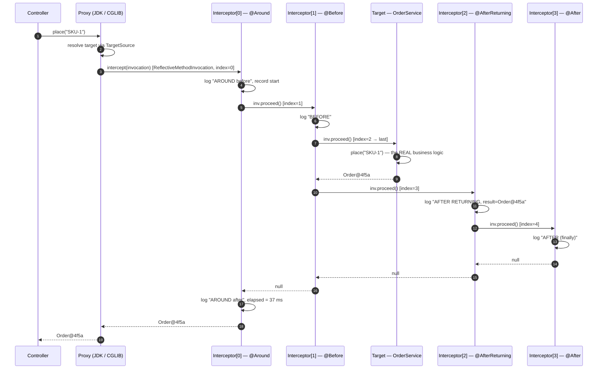
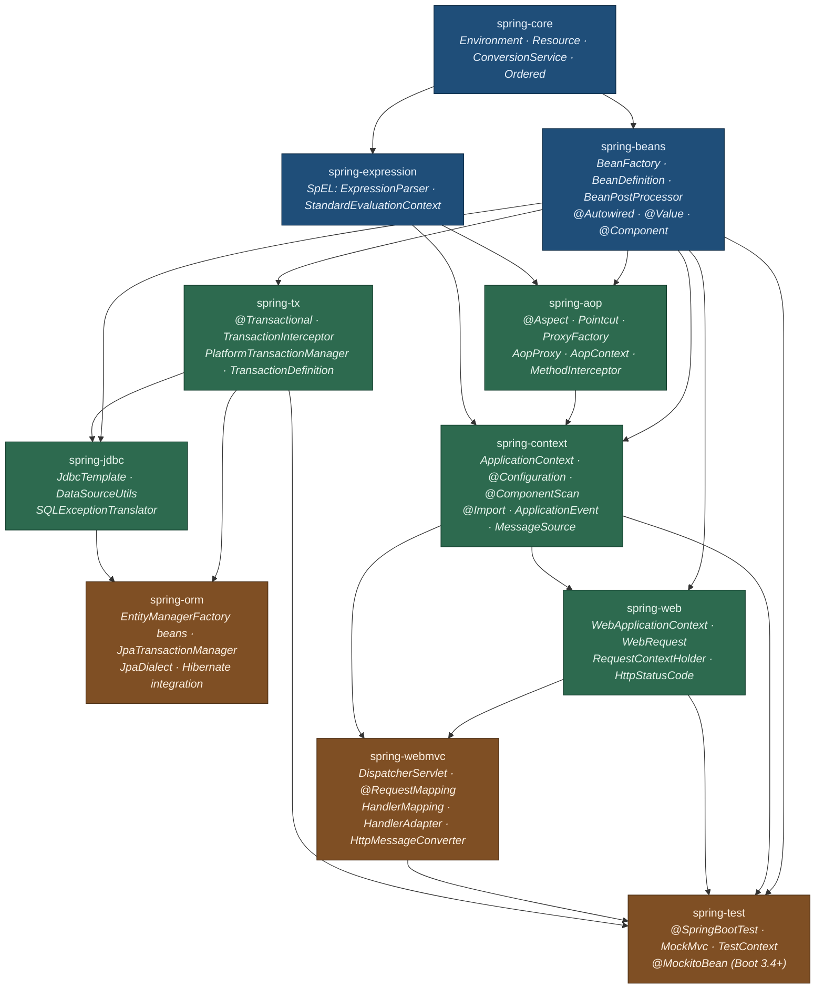
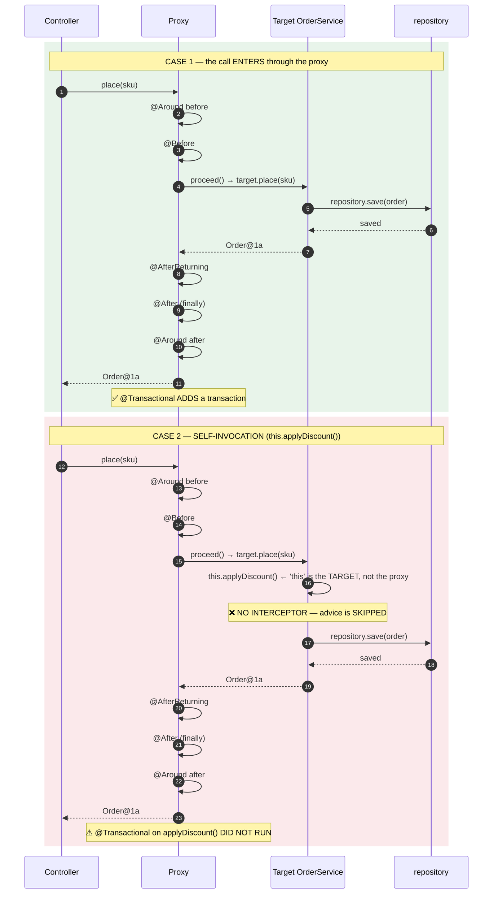

# AOP, Proxy Mechanics & Spring Modules — The Complete Interview Guide

> **Level:** Advanced → Expert
> **Interview Frequency:** ★★★★★ ("JDK proxy vs CGLIB?", "why doesn't `@Transactional` work on a self-invoked method?", "explain the advice order")
> **Prerequisites:** [02 · DI & Bean Lifecycle](./02-Dependency-Injection-and-Bean-Lifecycle.md) · [03 · Scopes & Configuration](./03-Bean-Scopes-Component-Scanning-and-Configuration.md)
> **Last Updated:** 2026

> **Target stack:** Spring Boot 3.3+ · Spring Framework 6.1+ · Java 17+ · Jakarta EE 10

---

## 📋 Table of Contents
- [0. TL;DR — The 30-Second Answer](#0-tldr--the-30-second-answer)
- [1. What & Why — The Problem This Solves](#1-what--why--the-problem-this-solves)
- [2. Mental Model — The One Picture](#2-mental-model--the-one-picture)
- [3. Deep Dive — Theory (Beginner → Advanced)](#3-deep-dive--theory-beginner--advanced)
  - [3.1 Beginner Level](#31-beginner-level)
  - [3.2 Intermediate Level](#32-intermediate-level)
  - [3.3 Advanced Level](#33-advanced-level)
  - [3.4 Expert Level](#34-expert-level)
- [4. Internal Working Mechanism](#4-internal-working-mechanism)
- [5. Step-by-Step Execution Flow](#5-step-by-step-execution-flow)
- [6. Visualizations](#6-visualizations)
- [7. Production-Level Use Cases & Real Industry Examples](#7-production-level-use-cases--real-industry-examples)
- [8. Worked Examples (with Output + Dry Run)](#8-worked-examples-with-output--dry-run)
- [9. Code from Scratch — Production-Grade](#9-code-from-scratch--production-grade)
- [10. Common Mistakes & Gotchas](#10-common-mistakes--gotchas)
- [11. Performance Considerations](#11-performance-considerations)
- [12. Security Considerations](#12-security-considerations)
- [13. Best Practices](#13-best-practices)
- [14. Hands-On Exercises & Code Challenges](#14-hands-on-exercises--code-challenges)
- [15. Interview Q&A — Level-wise](#15-interview-qa--level-wise)
  - [🟢 Beginner](#-beginner)
  - [🟡 Intermediate](#-intermediate)
  - [🔴 Advanced / Senior](#-advanced--senior)
  - [⚫ Expert / Principal](#-expert--principal)
- [16. Scenario-Based & Real-Experience Scenarios](#16-scenario-based--real-experience-scenarios)
- [17. Counter-Questions, Tricky Questions & Follow-Ups](#17-counter-questions-tricky-questions--follow-ups)
- [18. Frequently Asked Production Issues & Debugging Scenarios](#18-frequently-asked-production-issues--debugging-scenarios)
- [19. Architecture Design Questions](#19-architecture-design-questions)
- [20. Rapid-Fire MCQs](#20-rapid-fire-mcqs)
- [21. Cheat Sheet / One-Page Summary](#21-cheat-sheet--one-page-summary)
- [22. Real-World Production Notes](#22-real-world-production-notes)
- [23. Follow-up Learning](#23-follow-up-learning)

---

## 0. TL;DR — The 30-Second Answer

- **Spring AOP is proxy-based, not bytecode-based.** Advice runs because a call goes
  through a **proxy object** that intercepts the method. That single fact explains
  every Spring AOP surprise you will ever meet.
- **The advice order is fixed:** `@Around` (before) → `@Before` → **target method** →
  `@AfterReturning` / `@AfterThrowing` → `@After` (finally) → `@Around` (after).
- **The proxy rule:** if the target class implements **at least one interface**, Spring
  uses a **JDK dynamic proxy**; otherwise it uses **CGLIB**. `@EnableAspectJAutoProxy(proxyTargetClass = true)`
  forces CGLIB.
- **JDK proxies proxy the *interfaces*, not the class.** A call to a method that is
  **not** on an interface throws `IllegalArgumentException: method not found` on the
  proxy.
- **CGLIB subclasses the target**, so the class must be **non-final** and its advised
  methods **non-final**. Spring uses **Objenesis**, so a no-arg constructor is *not*
  required.
- **Self-invocation is the #1 AOP bug.** `this.doWork()` never leaves the target, so
  the proxy is never consulted and **no advice runs**. This breaks `@Transactional`,
  `@Cacheable` and `@Async` alike.
- **Four fixes for self-invocation:** move the method to another bean; self-inject
  the proxy (`@Lazy` self-reference or `ObjectProvider<Self>`); use
  `AopContext.currentProxy()` with `exposeProxy = true`; or restructure (publish an
  event).
- **The AOP infrastructure** is: `@EnableAspectJAutoProxy` → `AspectJAutoProxyRegistrar`
  → `AnnotationAwareAspectJAutoProxyCreator` (a `BeanPostProcessor`) →
  `AbstractAutoProxyCreator.postProcessAfterInitialization()` → `DefaultAopProxyFactory`.
- **Auto-proxy creators are `Ordered` and default to `LOWEST_PRECEDENCE`**, so they
  run among the **last** post-processors — after the injection ones. That is why the
  proxy wraps a fully populated bean.
- **AOP hides control flow.** For business logic, prefer explicit composition
  (decorators, strategy) — a stack trace that goes through `MethodInterceptor` is
  harder to read and harder to debug.
- **The Spring module map:** `spring-core` → `spring-beans` → `spring-aop` +
  `spring-expression` → `spring-context` → `spring-tx` / `spring-web` / `spring-jdbc`
  → `spring-orm` / `spring-webmvc` → `spring-test`.

---

## 1. What & Why — The Problem This Solves

**The problem — cross-cutting concerns.** Logging, metrics, transactions, retries,
authorisation, caching and auditing are needed by *every* layer, but none of them is
*business logic*. If you write them by hand, you get three failures at once:

```java
// ❌ THE HAND-WRITTEN WORLD
@Service
public class OrderService {

    public Order place(String sku) {
        // 1. logging
        log.info("placing order sku={}", sku);
        // 2. metrics
        metrics.timer("order.place").record(() -> {
            // 3. the actual business logic, buried
            Order order = new Order(sku);
            // 4. audit
            auditLog.record(order);
            // 5. transaction
            return repository.save(order);
        });
    }
}
```

```text
   ❌ WHAT BREAKS WITH HAND-WRITTEN CROSS-CUTTING CONCERNS
   ────────────────────────────────────────────────────────────────
   ① INCONSISTENT   — the retry logic in PaymentService differs from
                       the retry logic in InvoiceService. Nobody notices
                       until a customer does.
   ② FORGOTTEN      — a new endpoint skips the audit log. The gap is
                       invisible in code review because it is an ABSENCE.
   ③ NOISY          — 80% of the method is plumbing; the 20% that is
                       business logic is buried and unreadable.
   ④ NOT COMPOSABLE — you cannot "turn off" logging for one test without
                       editing the class.
```

**The solution — declare the concern, let the framework apply it.**

```java
// ✅ THE DECLARATIVE WORLD
@Service
public class OrderService {

    @Transactional
    @Timed("order.place")
    public Order place(String sku) {
        return repository.save(new Order(sku));   // 100% business logic
    }
}
```

**The analogy.** A receptionist, a security guard and an accountant are needed by
every visitor to a building, but none of them is the reason the visitor came. Spring
AOP is the **reception desk**: it intercepts the visitor at the door, does its job,
and passes them through to the actual meeting — without the meeting knowing or
caring.

> 💡 **The interview framing.** The question is not "should I use AOP?" — it is
> **"is this concern a policy that applies uniformly, or business logic that varies
> per case?"** Logging, metrics, transactions and authorisation are **policies**:
> they apply the same way everywhere, and AOP is the right tool. "Which discount
> applies to this order?" is **business logic**: it varies, and AOP would hide the
> variation. The rule: **AOP for policies, composition for business rules.**

---

## 2. Mental Model — The One Picture

```text
   SPRING AOP — ONE PICTURE
   ═════════════════════════

   The client holds a PROXY, not the target.

        ┌──────────────┐
        │   OrderService (client's field)
        └──────┬───────┘
               │  calls place()
               ▼
        ┌──────────────────────────────────────────────┐
        │  PROXY  (JDK dynamic proxy  |  CGLIB subclass)│
        │  ─────────────────────────────────────────── │
        │  1. MethodInterceptor chain:                 │
        │        @Around  → before part                │
        │        @Before                               │
        │        ─── proceed() ───                     │
        │        @AfterReturning / @AfterThrowing      │
        │        @After (finally)                       │
        │        @Around  → after part                 │
        │  2. then the TARGET method runs              │
        └──────────────────────┬───────────────────────┘
                               ▼
                    ┌─────────────────────┐
                    │   OrderService      │
                    │   (the real object) │
                    └─────────────────────┘

   ★ THE ONE RULE THAT EXPLAINS EVERYTHING
   ─────────────────────────────────────────
   Advice runs only for calls that ENTER THROUGH THE PROXY.

   client → proxy → target          ✅ advice runs
   target → this.otherMethod()      ❌ advice is SKIPPED
```

**What to look at:** the client's field holds the **proxy**. Inside the target, `this`
holds the **target**. So a call from outside is advised and a call from inside is
not — and that asymmetry is the root of the self-invocation problem.

---

## 3. Deep Dive — Theory (Beginner → Advanced)

### 3.1 Beginner Level

**The vocabulary — five words you must be able to define precisely.**

| Term | Meaning | Spring's implementation |
|---|---|---|
| **Join point** | A point in the program where advice *could* be applied | **Method execution only** (Spring AOP does not support field access or constructor joins) |
| **Pointcut** | A predicate that **selects** join points | An `AspectJExpressionPointcut` / `AnnotationMatchingPointcut` |
| **Advice** | The action taken **at** a selected join point | `@Before`, `@After`, `@AfterReturning`, `@AfterThrowing`, `@Around` |
| **Aspect** | The **combination** of a pointcut and an advice | A `@Aspect`-annotated `@Component` |
| **Weaving** | The act of **linking** aspects into the execution | Done by a **`BeanPostProcessor`** that replaces the bean with a proxy |

**The five advice types and their exact order.**

```java
@Aspect
@Component
public class LoggingAspect {

    @Before("execution(* com.example.service..*.*(..))")
    public void before() {
        log.info("BEFORE");
    }

    @AfterReturning("execution(* com.example.service..*.*(..))")
    public void afterReturning(JoinPoint jp, Object result) {
        log.info("AFTER RETURNING, result={}", result);
    }

    @AfterThrowing("execution(* com.example.service..*.*(..))")
    public void afterThrowing(JoinPoint jp, Throwable ex) {
        log.info("AFTER THROWING, ex={}", ex.getMessage());
    }

    @After("execution(* com.example.service..*.*(..))")
    public void after(JoinPoint jp) {
        log.info("AFTER (finally)");          // runs even if the target threw
    }

    @Around("execution(* com.example.service..*.*(..))")
    public Object around(ProceedingJoinPoint pjp) throws Throwable {
        log.info("AROUND before");
        Object result = pjp.proceed();       // ← calls the NEXT advice / the target
        log.info("AROUND after");
        return result;
    }
}
```

**The execution order of one call:**

```text
   @Around (before part)
        ↓
   @Before
        ↓
   ★ TARGET METHOD
        ↓
   @AfterReturning  ──or──  @AfterThrowing   (never both)
        ↓
   @After (finally)
        ↓
   @Around (after part)
```

**The two shapes of advice.**

| | "Before/after" advice | `@Around` advice |
|---|---|---|
| Can **skip** the target? | ❌ No | ✅ Yes — just don't call `proceed()` |
| Can **change the arguments**? | ❌ No | ✅ Yes — `pjp.proceed(newArgs)` |
| Can **change the return value**? | ❌ No | ✅ Yes — return a different object |
| Can **catch** an exception? | ⚠️ Only observe it (`@AfterThrowing`) | ✅ Yes — `try/catch` around `proceed()` |
| Overhead | Minimal | One extra frame |

> 🔑 **The rule to remember.** `@Around` is the **superset**. Everything the other
> four can do, `@Around` can do — and more. But `@Around` costs an extra stack frame
> and is easier to get wrong (`proceed()` must be called exactly once, and in a
> `finally` if you want cleanup to survive an exception).

**`@Aspect` + `@Component`.** Both annotations are required in Spring AOP:

```java
@Aspect                       // tells the framework "this bean contains advice"
@Component                    // tells the container "register this bean"
public class LoggingAspect { }
```

Without `@Component`, the aspect is never registered and **never fires**. Without
`@Aspect`, the methods are not recognised as advice.

### 3.2 Intermediate Level

**The pointcut expression language.** The designators you actually use:

| Designator | Matches | Example |
|---|---|---|
| `execution` | The **method signature** | `execution(* com.example.service..*.*(..))` |
| `within` | The **declaring type** | `within(com.example.service..*)` |
| `args` | The **argument types** | `args(String, BigDecimal)` |
| `target` | The **runtime type of the target object** | `target(com.example.OrderService)` |
| `this` | The **runtime type of the proxy** | `this(com.example.OrderService)` |
| `bean` | The **bean name** (a Spring extension) | `bean(orderService)` |
| `@annotation` | The method carries the annotation | `@annotation(com.example.Secured)` |
| `@within` | The declaring class carries the annotation | `@within(org.springframework.stereotype.Service)` |
| `@target` | The target class carries the annotation | `@target(org.springframework.stereotype.Service)` |
| `@args` | The argument types carry annotations | `@args(java.lang.Deprecated)` |

```java
// ── The canonical forms ──────────────────────────────────────────────────
"execution(public * com.example..*.*(..))"          // any public method in the package tree
"execution(* com.example.service.OrderService.*(..))" // any method of one class
"execution(* com.example.service.OrderService.save(..))" // one method
"execution(save(..))"                              // any method named save, any class
"within(com.example.service..*)"                   // any method of any class in the package
"@annotation(com.example.Audited)"                 // any method annotated @Audited
"@within(org.springframework.stereotype.Service)"    // any method of a @Service class
"target(com.example.service.OrderService)"         // runtime type of the target
"this(com.example.service.OrderService)"           // runtime type of the PROXY
"bean(orderService)"                               // a specific bean by name
"args(String, BigDecimal)"                         // by argument types
"@args(org.springframework.security.access.prepost.PreAuthorize)"

// ── Combinators ───────────────────────────────────────────────────────────
"execution(* com.example..*.*(..)) && @annotation(Audited)"   // AND
"execution(* com.example.service..*.*(..)) || @annotation(AdminOnly)"  // OR
"!@annotation(NoAudit)"                                       // NOT
"execution(* save(..)) && args(String)"                       // AND with args

// ── Named pointcuts ───────────────────────────────────────────────────────
@Pointcut("execution(* com.example.service..*.*(..))")
public void serviceLayer() { }

@Pointcut("serviceLayer() && @annotation(Audited)")
public void auditedServiceCalls() { }

@Before("auditedServiceCalls()")
public void audit() { … }
```

**`argNames` — binding the pointcut to argument names.**

```java
@Around("execution(* com.example..*.*(..)) && args(a, b)")
public Object logArgs(ProceedingJoinPoint pjp, String a, BigDecimal b) { … }
```

The `args(...)` designator tells the aspect which **positional** arguments to bind.
The alternative is `argNames`:

```java
@Around(value = "execution(* com.example..*.*(..))", argNames = "pjp,orderId")
public Object trace(ProceedingJoinPoint pjp, String orderId) { … }
```

`argNames` binds the **method parameters by name** rather than by type, which is
useful when two arguments have the same type (e.g. two `String`s).

**`@Pointcut` reuse and composition.**

```java
@Aspect
@Component
public class ServiceAspect {

    @Pointcut("execution(public * com.example.service..*.*(..))")
    public void inServiceLayer() { }

    @Pointcut("inServiceLayer() && !@annotation(org.springframework.scheduling.annotation.Async)")
    public void synchronousServiceCalls() { }

    @Around("synchronousServiceCalls()")
    public Object time(ProceedingJoinPoint pjp) throws Throwable { … }
}
```

**Ordering aspects.** Two aspects that match the same join point are ordered by
`@Order` on the **aspect class** (or `Ordered`):

```java
@Aspect @Order(1)  @Component public class SecurityAspect { … }   // OUTER — runs first
@Aspect @Order(10) @Component public class TransactionAspect { … } // INNER
@Aspect @Order(20) @Component public class MetricsAspect { … }    // INNER-most
```

**Lower `@Order` value = higher precedence = outermost = runs first** (around the
others). The `TransactionInterceptor` has `Ordered.LOWEST_PRECEDENCE` by default, so
a custom aspect with `@Order(1)` wraps it — which means the custom aspect's
`@Around` runs **outside** the transaction.

**`JoinPoint` and `ProceedingJoinPoint`.**

```java
@Before("execution(* com.example..*.*(..))")
public void before(JoinPoint jp) {
    jp.getSignature();      // MethodSignature
    jp.getArgs();
    jp.getTarget();          // the RAW target
    jp.getThis();            // the PROXY
    jp.getKind();            // METHOD_EXECUTION
    jp.getStaticPart();
}

@Around("execution(* com.example..*.*(..))")
public Object around(ProceedingJoinPoint pjp) throws Throwable {
    pjp.proceed();               // continue the chain
    pjp.proceed(newArgs);        // continue with different arguments
    pjp.getSignature();
    pjp.setUserAttribute("key", "value");   // attributes flow down the chain
}
```

> ⚠️ `jp.getTarget()` is the **raw target**, `jp.getThis()` is the **proxy**. In an
> `@Around` advice, `pjp.getThis()` is the proxy you were invoked through.

### 3.3 Advanced Level

**The proxy decision — the exact rule, from `DefaultAopProxyFactory`.**

```java
@Override
public AopProxy createAopProxy(AdvisedSupport config) {
    if (config.isOptimize() || config.isProxyTargetClass() || hasNoUserSuppliedProxyInterfaces(config)) {
        Class<?> targetClass = config.getTargetClass();
        if (targetClass == null) {
            throw new AopConfigException("TargetSource cannot determine target class: " + config);
        }
        if (targetClass.isInterface() || Proxy.isProxyClass(targetClass)) {
            return new JdkDynamicAopProxy(config);      // ★ JDK proxy
        }
        return new ObjenesisCglibAopProxy(config);      // ★ CGLIB
    }
    return new JdkDynamicAopProxy(config);              // user-supplied interfaces
}
```

Read it as the decision procedure:

```text
  Is proxyTargetClass = true (or optimize)?              ──► CGLIB (unless the class is an interface)
        │ no
        ▼
  Does the TARGET CLASS implement at least one interface?  ──► JDK dynamic proxy
        │ no
        ▼
  CGLIB (a subclass of the target class)
```

| | JDK dynamic proxy | CGLIB |
|---|---|---|
| Mechanism | `java.lang.reflect.Proxy` — implements the **interfaces** | Generates a **subclass** at runtime |
| Proxies | The **interfaces** | The **class** (methods) |
| Requirement | The target must implement ≥ 1 interface | The class must be **non-final**, methods **non-final** |
| Constraint | Methods **not** on an interface are **not** proxied | Package-private methods cannot be advised (in older CGLIB; Spring's fork supports it) |
| Constructor | Not called (the proxy is a different object) | Spring uses **Objenesis** → the target's constructor is not called by the proxy |
| Detection | `AopUtils.isJdkDynamicProxy(obj)` | `AopUtils.isCglibProxy(obj)` |

```java
// Force CGLIB for everything
@EnableAspectJAutoProxy(proxyTargetClass = true)
```

> 💡 **The most common AOP bug in production.** A class implements `Serializable` (or
> any interface) and has a method that is **not** on that interface. With a JDK
> proxy, calling that method on the injected bean throws
> `IllegalArgumentException: method ... cannot be cast to ...`. The fix is
> `proxyTargetClass = true`, or move the method onto the interface.

**The AOP API surface.**

| Type | Role |
|---|---|
| `AopProxy` | The strategy: `getProxy(ClassLoader)` + `invoke(MethodInvocation)` |
| `AopProxyFactory` | Creates the `AopProxy` — `DefaultAopProxyFactory` is the default |
| `AdvisedSupport` | Holds the config: target source, advisors, interfaces, `proxyTargetClass` |
| `ProxyFactory` | The **user-facing** builder: `ProxyFactory factory = new ProxyFactory(target); factory.addAdvisor(...);` |
| `Advised` | The interface exposed on the proxy: `getAdvisors()`, `addAdvisor()`, `isFrozen()` |
| `MethodInterceptor` | The callback: `Object intercept(MethodInvocation invocation) throws Throwable` |
| `MethodInvocation` | The invocation context: `proceed()`, `getMethod()`, `getArguments()`, `getThis()` |
| `ReflectiveMethodInvocation` | The framework's implementation — holds the interceptor chain |
| `TargetSource` | Where the real target comes from (`SingletonTargetSource`, `PrototypeTargetSource`) |
| `Advisor` | The pairing of an `Advice` with a `Pointcut` |

**The interceptor chain — how `proceed()` works.**

```java
public class ReflectiveMethodInvocation implements MethodInvocation, Cloneable {

    private final List<Object> interceptorsAndDynamicMethodMatchers;
    private int currentInterceptorIndex = -1;

    @Override
    @Nullable
    public Object proceed() throws Throwable {
        // ① Is there another interceptor?
        if (this.currentInterceptorIndex == this.interceptorsAndDynamicMethodMatchers.size() - 1) {
            return invokeJoinpoint();          // → the TARGET method
        }
        // ② Otherwise, call the NEXT interceptor
        Object interceptorOrInterceptionAdvice =
                this.interceptorsAndDynamicMethodMatchers.get(++this.currentInterceptorIndex);
        if (interceptorOrInterceptionAdvice instanceof MethodInterceptor mi) {
            return mi.intercept(this);
        }
        // ③ Dynamic method matcher (introduced by @Introduction)
        return proceed();
    }

    protected Object invokeJoinpoint() throws Throwable {
        // This is where the actual target method is invoked, reflectively.
        return this.method.invoke(this.target, this.arguments);
    }
}
```

**The chain, step by step, for two advisors:**

```text
  client.call()
     │
     ▼
  AopProxy.invoke(MethodInvocation)
     │
     ▼
  ReflectiveMethodInvocation.proceed()          [index = 0]
     └─► interceptor[0].intercept(inv)         ← the OUTERMOST advisor
             └─► inv.proceed()                  [index = 1]
                     └─► interceptor[1].intercept(inv)   ← the next advisor
                             └─► inv.proceed()  [index = 2 → last]
                                     └─► invokeJoinpoint()
                                             └─► target.method(args)   ★ THE REAL METHOD
```

**Why `@Transactional` is implemented as an advisor.** `TransactionInterceptor`
implements `MethodInterceptor` and is wrapped in a `DefaultPointcutAdvisor` with a
`TransactionAttributeSourcePointcut`. The transaction advisor is added to the
`AdvisedSupport` by `AbstractAutoProxyCreator` (through
`BeanFactoryTransactionAttributeSourceAdvisor`), so the transaction advice is
**just another link in the chain** — which is why a custom `@Order(1)` aspect wraps
it and a `@Order(100)` aspect is wrapped by it.

**Programmatic AOP — building a proxy by hand.**

```java
ProxyFactory factory = new ProxyFactory(targetService);
factory.addAdvisor(new DefaultPointcutAdvisor(
        PointcutBuilder.matchesMethod(TransactionInterceptor.class, "place"),
        transactionInterceptor));
factory.setProxyTargetClass(true);          // force CGLIB
OrderService proxy = (OrderService) factory.getProxy();
```

This is what test frameworks and the Spring `ProxyFactoryBean` do.

### 3.4 Expert Level

**The AOP infrastructure chain.**

```text
  @EnableAspectJAutoProxy
        │
        │  @Import(AspectJAutoProxyRegistrar.class)
        ▼
  AspectJAutoProxyRegistrar  (an ImportBeanDefinitionRegistrar)
        │  registers a BeanDefinition for:
        ▼
  AnnotationAwareAspectJAutoProxyCreator  (a BeanPostProcessor)
        │  extends AspectJAwareAdvisorAutoProxyCreator
        │    extends AbstractAdvisorAutoProxyCreator
        │      extends AbstractAutoProxyCreator
        │        implements SmartInstantiationAwareBeanPostProcessor, Ordered
        ▼
  postProcessAfterInitialization(bean, beanName)
        │  1. findCandidateAdvisors()   → @Aspect beans + InfrastructureAdvisor
        │  2. sortAdvisors()            → AnnotationAwareOrderComparator
        │  3. wrapIfNecessary()
        ▼
  AbstractAutoProxyCreator.wrapIfNecessary(bean, beanName, cacheKey)
        │  → createProxy(bean, beanName, advisors)
        ▼
  ProxyFactory (an AdvisedSupport)
        │  setTarget / setTargetSource
        │  setInterfaces(ClassUtils.getAllInterfacesForClass(targetClass))
        │  setProxyTargetClass(this.proxyTargetClass)
        │  addAdvisor(advisor)
        ▼
  DefaultAopProxyFactory.createAopProxy(config)
        ├── JDK dynamic proxy  → JdkDynamicAopProxy
        └── CGLIB              → ObjenesisCglibAopProxy
```

**Where the auto-proxy creator sits in the `BeanPostProcessor` order.** This matters
enormously:

```text
  BeanPostProcessor order (AbstractAutoProxyCreator.getOrder() == Ordered.LOWEST_PRECEDENCE)
  ────────────────────────────────────────────────────────────────────────────────
  ① ApplicationContextAwareProcessor          (Aware callbacks)
  ② AutowiredAnnotationBeanPostProcessor      (@Autowired, @Value)
  ③ CommonAnnotationBeanPostProcessor         (@PostConstruct / @PreDestroy)
  ...
  ★ AnnotationAwareAspectJAutoProxyCreator    (aspect proxies)
  ★ InfrastructureAdvisorAutoProxyCreator     (transaction proxies)
  ────────────────────────────────────────────────────────────────────────────────
  ... all of the above run BEFORE the proxy is created ...
  → postProcessAfterInitialization() creates the proxy LAST
  → the proxy therefore wraps a FULLY POPULATED, FULLY INITIALISED bean ✅
```

**Two auto-proxy creators, and why both exist.**

| Creator | Registered by | Creates proxies for |
|---|---|---|
| `AnnotationAwareAspectJAutoProxyCreator` | `@EnableAspectJAutoProxy` | `@Aspect` beans (**AspectJ** advisors) |
| `InfrastructureAdvisorAutoProxyCreator` | `@EnableTransactionManagement` | **Infrastructure** advisors (transactions, caching, async) |

The framework registers them so that the **AspectJ** proxy is the **outer** one and
the infrastructure advisor is applied to the **inner** target — which is what makes
`@Transactional` work *inside* a custom `@Around` aspect that itself calls another
proxied bean.

**`@EnableAspectJAutoProxy` vs `@EnableAspectJAutoProxy(proxyTargetClass = true)`.**

| | `proxyTargetClass = false` (default) | `proxyTargetClass = true` |
|---|---|---|
| Proxy type | JDK when the target has an interface | Always CGLIB |
| Requires interfaces | Yes (or CGLIB if there are none) | No |
| `final` class | ❌ fails (no interface → CGLIB) | ❌ fails |
| `@Transactional` on a `final` class | ❌ fails | ❌ fails |
| Works with a package-private method | ❌ (JDK proxy cannot see it) | ✅ (CGLIB subclass can) |

**`AopContext.currentProxy()` — the escape hatch for self-invocation.**

```java
@EnableAspectJAutoProxy(exposeProxy = true)     // ★ must be enabled

@Service
public class OrderService {

    public void place(String sku) {
        OrderService proxy = (OrderService) AopContext.currentProxy();
        proxy.applyDiscount();                   // goes through the proxy → advice runs
    }

    @Transactional
    public void applyDiscount() { … }
}
```

`AopContext` is a **`ThreadLocal`** holding the current proxy. It must be
`exposeProxy = true`, and it is **thread-bound** — so it does not work across
`@Async` boundaries or in reactive code.

**The Spring module map — what each artifact owns.**

| Artifact | Owns | Typical imports |
|---|---|---|
| `spring-core` | `Environment`, `Resource`, `ConversionService`, `Ordered`, `Assert`, `ClassUtils`, `@Nullable` | — |
| `spring-expression` | **SpEL** — `ExpressionParser`, `SpelExpressionParser`, `StandardEvaluationContext` | — |
| `spring-beans` | The **bean model**: `BeanFactory`, `BeanDefinition`, `BeanPostProcessor`, `@Autowired`, `@Component`, `@Value`, `PropertyEditor` | — |
| `spring-aop` | The **AOP engine**: `@Aspect`, `Pointcut`, `ProxyFactory`, `AopProxy`, `AopContext`, `MethodInterceptor` | `spring-beans`, `spring-expression` |
| `spring-context` | The **container**: `ApplicationContext`, `@Configuration`, `@ComponentScan`, `@Import`, the **event system**, `AnnotationConfigApplicationContext` | `spring-aop`, `spring-beans`, `spring-expression` |
| `spring-tx` | **Transactions**: `@Transactional`, `TransactionInterceptor`, `PlatformTransactionManager`, `TransactionDefinition` | `spring-beans`, `spring-core` |
| `spring-jdbc` | **JDBC support**: `JdbcTemplate`, `DataSourceUtils`, `SQLExceptionTranslator` | `spring-beans`, `spring-tx` |
| `spring-orm` | **ORM support**: `EntityManagerFactory` beans, `JpaTransactionManager`, `JpaDialect`, Hibernate integration | `spring-tx`, `spring-jdbc` |
| `spring-web` | The **web abstractions**: `WebApplicationContext`, `WebRequest`, `RequestContextHolder`, `HttpStatusCode` | `spring-beans`, `spring-context` |
| `spring-webmvc` | **Spring MVC**: `DispatcherServlet`, `@RequestMapping`, `HandlerMapping`, `HandlerAdapter`, `HttpMessageConverter` | `spring-web`, `spring-context` |
| `spring-test` | The **test framework**: `@SpringBootTest`, `MockMvc`, `TestContext`, `@MockBean`/`@MockitoBean` | most of the above |

```text
   spring-core
       ▲
   spring-beans ──────────────┐
       ▲                      │
   spring-expression ─────┐   │
       ▲                  │   │
   spring-aop ───────────┘   │
       ▲                      │
   spring-context ◀───────────┘
       ▲        ▲        ▲
   spring-tx   spring-web  spring-jdbc
       ▲        ▲            ▲
       │        │            │
   spring-orm  spring-webmvc │
       ▲            ▲        │
       └────────────┴────────┘
                  ▲
              spring-test
```

**The two questions this map answers.** (1) *Why can't I use `@Transactional` without
`spring-tx`?* — because the annotation is a **marker**; the `TransactionInterceptor`
and the `InfrastructureAdvisorAutoProxyCreator` live in `spring-tx`. (2) *Why does
`@Value` work without `spring-context`?* — because the **placeholder resolution**
lives in `spring-beans` (`PropertySourcesPlaceholderConfigurer`), while
`@Value`'s *processing* is `AutowiredAnnotationBeanPostProcessor`, also in
`spring-beans`.

---

## 4. Internal Working Mechanism

**The full call chain for an advised call.**

```text
client.place(sku)
  │
  ▼
JdkDynamicAopProxy.invoke(MethodInvocation proxyMethod)         [or CglibAopProxy]
  │   → obtains the target: AopProxyUtils.ultimateTargetClass / TargetSource.getTarget()
  │   → creates a ReflectiveMethodInvocation with:
  │        - the interceptor chain (from AdvisedSupport.getInterceptorsAndDynamicInterceptionAdvice())
  │        - the target
  │        - the method + args
  ▼
ReflectiveMethodInvocation.proceed()  [index = 0]
  │
  ├─► interceptor[0].intercept(inv)         ← @Aspect advisors, in @Order sequence
  │      ├─ @Around:  log before; inv.proceed(); log after
  │      ├─ @Before
  │      ├─ invokeJoinpoint()  → target.place(sku)      ← THE REAL METHOD
  │      ├─ @AfterReturning / @AfterThrowing
  │      └─ @After
  ▼
returns to the client
```

**How the advisors are discovered — `BeanFactoryAspectJAdvisorsBuilder`.**

```text
findCandidateAdvisors()
  ├─ BeanFactoryAdvisorRetrievalHelper.findAdvisorBeans()
  │    → Advisor beans registered in the container
  ├─ if (beanFactory instanceof ListableBeanFactory)
  │      → findAspectJAdvisors()  → BeanFactoryAspectJAdvisorsBuilder
  │           ├─ collect @Aspect beans (AnnotatedBeanDefinition)
  │           ├─ for each, build advisors from its advice methods
  │           │     → AspectJAdvisorFactory.createAdvisor(bean, method)
  │           └─ sort by AnnotationAwareOrderComparator
  └─ if (this.beanFactory instanceof ConfigurableListableBeanFactory)
       → findAdvisorBeans()   → includes the TransactionInterceptor advisor
```

**How `@Aspect` advice methods become advisors.** For each advice method, the
`AbstractAspectJAdvisorFactory` creates an `AspectJAdvisor` holding:

- the `AdviceMethod` (the reflection metadata),
- the **pointcut** (`AspectJExpressionPointcut` for an `execution(...)` expression,
  `AnnotationMatchingPointcut` for `@annotation(...)`),
- the advice instance.

Then `AspectJAroundAdvice`, `AspectJBeforeAdvice`, `AspectJAfterReturningAdvice`,
`AspectJAfterThrowingAdvice` and `AspectJAfterAdvice` are instantiated to wrap the
method.

**Where the proxy is created — `AbstractAutoProxyCreator.postProcessAfterInitialization`.**

```text
postProcessAfterInitialization(bean, beanName)
  ├─ if (!bean.getClass().getName().startsWith("org.springframework."))   // skip framework beans
  ├─ cacheKey = (targetClass, hasIntroductions, advisors)
  ├─ if (cache.contains(cacheKey)) → return the cached proxy
  ├─ advisors = findCandidateAdvisors()
  ├─ if (advisors.isEmpty()) → return the raw bean
  └─ return wrapIfNecessary(bean, beanName, cacheKey)
        → createProxy(bean, beanName, advisors)
             → new ProxyFactory()
             → setTarget / setTargetSource
             → setProxyTargetClass(this.proxyTargetClass)
             → setInterfaces(ClassUtils.getAllInterfacesForClass(targetClass))
             → addAdvisor(advisor) for each
             → factory.getProxy(classLoader)
```

> ⚠️ **Note the `org.springframework.` prefix skip.** Framework beans are **not**
> auto-proxied by default. That is why `@Transactional` on a `@Repository` works (it
> is your bean) but a `DataSource` is never proxied.

**How the transaction advisor gets in.** `AbstractAutoProxyCreator` collects
**infrastructure advisors** via `BeanFactoryAdvisorRetrievalHelper`, which finds
beans of type `Advisor` in the container. `ProxyTransactionManagementConfiguration`
registers a `BeanFactoryTransactionAttributeSourceAdvisor` — an `Advisor` bean — so
the auto-proxy creator picks it up automatically.

---

## 5. Step-by-Step Execution Flow

**The flow of an advised call, step by step.**

1. The client holds a **proxy** (injected by the container), not the target.
2. The client calls `place(sku)` on the proxy.
3. `JdkDynamicAopProxy.invoke(...)` (or the CGLIB equivalent) resolves the **target**
   via the `TargetSource` and builds a `ReflectiveMethodInvocation` carrying the
   interceptor chain.
4. `ReflectiveMethodInvocation.proceed()` → interceptor[0] — the outermost advisor.
5. `@Around` advice runs its "before" half.
6. `@Before` advice runs.
7. `proceed()` → next interceptor → … → the last interceptor calls
   `invokeJoinpoint()` → `method.invoke(target, args)` — **the real method runs**.
8. On normal return: `@AfterReturning` runs, then `@After` (finally).
9. On exception: `@AfterThrowing` runs, then `@After` (finally), then the exception
   propagates unless an `@Around` catches it.
10. `@Around` advice runs its "after" half.
11. The value is returned to the client — **possibly modified** by the `@Around`.

**The flow of context startup with AOP enabled.**

1. `refresh()` → `registerBeanPostProcessors()` → the
   `AnnotationAwareAspectJAutoProxyCreator` is instantiated and registered.
2. `finishBeanFactoryInitialization()` → each bean's `doCreateBean` →
   `postProcessAfterInitialization` → the auto-proxy creator inspects the bean,
   finds matching advisors, and **replaces** the bean with a proxy.
3. The **proxy** is what goes into `singletonObjects`.

**The flow of a self-invocation (and why nothing happens).**

1. The client calls `proxy.place(sku)` → the proxy's interceptor chain runs →
   `invokeJoinpoint()` → `target.place(sku)`.
2. Inside `target.place(sku)`, the code calls `this.applyDiscount()`.
3. `this` is the **target**, not the proxy → the call goes straight to the target's
   method → **no interceptor, no advice**.

---

## 6. Visualizations

### 6.1 An `@Around` advice wrapping a method call (Mermaid sequence)



**Caption:** One call, **four** interceptor frames plus the target. Note that the
chain is **linear** — each interceptor calls `proceed()` exactly once, and the last
one invokes the target. The `@Around` advice sees the *whole* call: it can skip the
target (by not calling `proceed()`), change the arguments (`proceed(newArgs)`), or
replace the result.

### 6.2 The proxy decision tree (ASCII)

```text
   DefaultAopProxyFactory.createAopProxy(config)
   ════════════════════════════════════════════

                    ┌──────────────────────────────────────┐
                    │  proxyTargetClass = true ?           │
                    │  (@EnableAspectJAutoProxy           │
                    │   (proxyTargetClass = true))          │
                    └───────────────┬──────────────────────┘
                            YES     │      NO
                 ┌──────────────────┘      └────────────────────┐
                 ▼                                              ▼
   ┌──────────────────────────┐            ┌──────────────────────────────────┐
   │ target class is an        │            │ Does the target class implement   │
   │ INTERFACE ?               │            │ at least ONE interface ?         │
   │ (or is already a proxy)   │            └───────────────┬──────────────────┘
   └───────────┬──────────────┘                     YES     │      NO
        YES     │      NO                               ┌─────┘      └─────┐
               ▼                                       ▼                ▼
   ┌────────────────────────┐              ┌──────────────────┐  ┌──────────────────┐
   │ JDK dynamic proxy      │              │ JDK dynamic      │  │ CGLIB            │
   │ (JdkDynamicAopProxy)   │              │ proxy            │  │ (ObjenesisCglib  │
   │                        │              │                  │  │  AopProxy)       │
   │ Proxies the INTERFACES │              │ Proxies the      │  │ Subclasses the   │
   │ Only interfaces are    │              │ INTERFACES       │  │ CLASS            │
   │ advised. A method NOT  │              │                  │  │                  │
   │ on an interface →      │              │ ⚠ final class +  │  │ ⚠ final class →  │
   │ IllegalArgumentException│             │   interface → OK │  │   fails          │
   └────────────────────────┘              └──────────────────┘  └──────────────────┘
                                    │
                                    └── CGLIB requirements:
                                        • class must be NON-final
                                        • advised methods must be NON-final
                                        • Spring uses Objenesis → no no-arg
                                          constructor is strictly required
```

**Caption:** The rule is one line — **does the target implement an interface?** If
yes, JDK; if no, CGLIB. Everything else (`proxyTargetClass`, `final` classes,
methods that are not on the interface) is a consequence of that one decision.

### 6.3 The Spring module dependency map (Mermaid)



**Caption:** Arrows point **upward** (a module depends on what it points to). The
three facts an interviewer wants: (1) `spring-aop` needs **both** `spring-beans` and
`spring-expression`, which is why SpEL is in the AOP dependency set; (2) `spring-tx`
depends on `spring-beans` but **not** on `spring-context` — which is why
`@Transactional` works in a plain (non-Boot) `GenericApplicationContext`; (3) `spring-test`
depends on almost everything, which is why the test slice is heavy.

### 6.4 Proxied call vs self-invoked call (Mermaid sequence)



**Caption:** Both cases look **identical** in the log — the outer advice fires in
both. The difference is invisible from outside: in case 2 the inner method's advice
never ran. This is why "the aspect works in one place but not another" is such a
common and confusing symptom.

---

## 7. Production-Level Use Cases & Real Industry Examples

**1. Banking — `@Transactional` on the service layer, with the transaction advisor
outermost.**
A payments service puts `@Transactional` on the service methods and a
`@Order(1)` auditing aspect on the same class. The audit aspect runs **outside**
the transaction, so it records the attempt even when the transaction later rolls
back — which is exactly what an auditor wants: an *attempt* log plus a *commit* log.
The design detail that took a day to get right: **the lower `@Order` value must be
on the audit aspect**, because lower value = outer.

**2. E-commerce — `@Cacheable` on a read path.**
A catalogue service caches product lookups for 60 s across 40k orders/min peak.
`@Cacheable("products", key = "#id")` on the repository method removes 92% of the
database reads (from 8,400 reads/s to 670 reads/s). The **critical** detail: the
cached method must be called **through the proxy** — which is why the service calls
`catalogueRepository.findById(...)` (a different bean) and never
`this.findById(...)`.

**3. SaaS — `@Async` for the slow, non-critical path.**
A billing service sends the invoice PDF by e-mail after the transaction commits.
`@Async("mailExecutor")` moves it off the request thread; the request p99 drops
from **1,240 ms to 96 ms**. The subtlety: `@Async` must be on a **different bean**
from the caller, otherwise the "async" method runs synchronously (self-invocation),
and the p99 never moved. The team's rule: *a class never calls its own `@Async`
method.*

**4. Ad-tech — a custom `@RateLimited` annotation with a custom aspect.**
A bidding server must limit each advertiser to 200 requests/second. The team wrote
their own `@RateLimited(key = "#advertiserId", limit = 200)` annotation and one
aspect that reads the annotation's attributes through the `JoinPoint`:

```java
@Around("@annotation(rateLimited)")
public Object enforce(ProceedingJoinPoint pjp, RateLimited rateLimited) throws Throwable {
    // resolve the key via the SpEL in the annotation, then check a token bucket
}
```

One aspect, zero boilerplate in the 40 service methods that need it — a **policy**
applied uniformly, which is the textbook use case for AOP.

**5. Logistics — `@PreAuthorize`-style method security.**
The authorisation policy is a policy, not business logic, so it belongs in an
aspect: the method carries an annotation naming the required permission, and the
aspect consults the security context. This is exactly how Spring Security's own
`@PreAuthorize` works — the `@EnableMethodSecurity` infrastructure registers an
advisor that the auto-proxy creator picks up.

---

## 8. Worked Examples (with Output + Dry Run)

### 8.1 Worked Example 1 — An `@Around` aspect that measures elapsed time

**Problem.** You need p50/p99 latency for every method in the service layer, with
the method name and the arguments, without touching 80 service classes.

**Code.**

```java
package com.example.aop;

import java.util.concurrent.TimeUnit;
import org.aspectj.lang.ProceedingJoinPoint;
import org.aspectj.lang.annotation.Around;
import org.aspectj.lang.annotation.Aspect;
import org.aspectj.lang.reflect.MethodSignature;
import org.slf4j.Logger;
import org.slf4j.LoggerFactory;
import org.springframework.stereotype.Component;

@Aspect
@Component
public class TimingAspect {

    private static final Logger log = LoggerFactory.getLogger(TimingAspect.class);

    @Around("execution(public * com.example.service..*.*(..))")
    public Object time(ProceedingJoinPoint pjp) throws Throwable {
        MethodSignature signature = (MethodSignature) pjp.getSignature();
        long start = System.nanoTime();
        try {
            return pjp.proceed();
        }
        finally {
            long elapsedNanos = System.nanoTime() - start;
            log.info("TIMING {}.{} took {} ms",
                    signature.getDeclaringType().getSimpleName(),
                    signature.getName(),
                    TimeUnit.NANOSECONDS.toMillis(elapsedNanos));
        }
    }
}
```

```java
package com.example.service;

import org.springframework.stereotype.Service;

@Service
public class OrderService {

    private final OrderRepository repository;

    public OrderService(OrderRepository repository) {
        this.repository = repository;
    }

    public Order place(String sku) {
        return repository.save(new Order(sku));
    }
}
```

**Actual expected output.**

```text
2026-01-16 12:02:14.221 INFO  [http-nio-8080-exec-1] c.e.aop.TimingAspect : TIMING OrderService.place took 37 ms
2026-01-16 12:02:14.259 INFO  [http-nio-8080-exec-1] c.e.aop.TimingAspect : TIMING OrderRepository.save took 31 ms
```

**Dry run — the proxy chain, step by step.**

1. **Startup.** `@EnableAspectJAutoProxy` (on the application class) imports
   `AspectJAutoProxyRegistrar`, which registers the
   `AnnotationAwareAspectJAutoProxyCreator` bean definition.
2. `finishBeanFactoryInitialization()` → `doCreateBean("orderService")` →
   instantiate → populate → initialize → **`postProcessAfterInitialization`**.
3. The auto-proxy creator calls `findCandidateAdvisors()` → finds the `TimingAspect`
   bean → `BeanFactoryAspectJAdvisorsBuilder` builds an `AspectJAdvisor` for the
   `time(ProceedingJoinPoint)` method, with the pointcut
   `execution(public * com.example.service..*.*(..))`.
4. `wrapIfNecessary()` → `createProxy()` → `ProxyFactory` with the advisor →
   `DefaultAopProxyFactory.createAopProxy()`:
   - `OrderService` implements **no** interface → `targetClass.isInterface()` is
     false → **CGLIB** (`ObjenesisCglibAopProxy`).
   - CGLIB generates `OrderService$$SpringCGLIB$$0 extends OrderService`.
5. **The proxy, not the target, goes into `singletonObjects`.** The controller
   receives the CGLIB proxy.
6. **Request time.** The controller calls `proxy.place("SKU-1")` → CGLIB intercepts →
   `ReflectiveMethodInvocation.proceed()` → interceptor[0] = the timing advisor.
7. The timing advisor records `start`, calls `pjp.proceed()` → `invokeJoinpoint()` →
   `target.place("SKU-1")` → the real method → `repository.save(...)`.
8. `repository.save(...)` is **also** matched by the pointcut (it is in
   `com.example.service..*`), so a **nested** proxy call happens and logs its own
   timing: 31 ms inside the 37 ms of the outer call.
9. The `finally` block computes `elapsedNanos` and logs. Using `finally` means the
   timing is recorded even if the method throws — and the exception still
   propagates (we did not catch it).

**Takeaway.** One aspect, 80 methods instrumented, zero changes to the service
classes. Note the **nested** timing — a pointcut that is too broad produces
**double-counting** in your metrics dashboard. In production you usually exclude
the repository layer or use a separate aspect with a lower `@Order`.

---

### 8.2 Worked Example 2 — A custom `@RateLimited` annotation and aspect

**Problem.** You need a per-key rate limit on 40 service methods, and you do not
want to copy-paste the same 15 lines into each one.

**Code.**

```java
package com.example.aop;

import java.lang.annotation.Documented;
import java.lang.annotation.ElementType;
import java.lang.annotation.Retention;
import java.lang.annotation.RetentionPolicy;
import java.lang.annotation.Target;

/**
 * Limits the rate of a method, per key.
 *
 * <p>The key is a SpEL expression evaluated against the method arguments —
 * so "@RateLimited(key = "#advertiserId", limit = 200)" means
 * "200 calls per second per advertiser".
 */
@Documented
@Target(ElementType.METHOD)                       // ★ only on methods
@Retention(RetentionPolicy.RUNTIME)               // ★ must survive to runtime
public @interface RateLimited {

    /** SpEL expression evaluated against the method arguments. */
    String key();

    /** Maximum calls per second for one key. */
    int limit() default 100;
}
```

```java
package com.example.aop;

import java.util.concurrent.ConcurrentHashMap;
import java.util.concurrent.atomic.AtomicLong;
import org.aspectj.lang.ProceedingJoinPoint;
import org.aspectj.lang.annotation.Around;
import org.aspectj.lang.annotation.Aspect;
import org.aspectj.lang.reflect.MethodSignature;
import org.aspectj.lang.JoinPoint;
import org.aspectj.lang.annotation.Aspect;
import org.slf4j.Logger;
import org.slf4j.LoggerFactory;
import org.springframework.core.DefaultParameterNameDiscoverer;
import org.springframework.core.ParameterNameDiscoverer;
import org.springframework.expression.EvaluationContext;
import org.springframework.expression.ExpressionParser;
import org.springframework.expression.spel.standard.SpelExpressionParser;
import org.springframework.expression.spel.support.StandardEvaluationContext;
import org.springframework.stereotype.Component;

@Aspect
@Component
public class RateLimitAspect {

    private static final Logger log = LoggerFactory.getLogger(RateLimitAspect.class);

    private final ExpressionParser parser = new SpelExpressionParser();
    private final ParameterNameDiscoverer nameDiscoverer = new DefaultParameterNameDiscoverer();

    /** A fixed-window counter per key. In production use a token bucket. */
    private final ConcurrentHashMap<String, AtomicLong> counters = new ConcurrentHashMap<>();
    private final ConcurrentHashMap<String, Long> windowStart = new ConcurrentHashMap<>();

    @Around("@annotation(rateLimited)")
    public Object enforce(ProceedingJoinPoint pjp, RateLimited rateLimited) throws Throwable {
        String key = resolveKey(pjp, rateLimited.key());
        long now = System.currentTimeMillis();

        long start = windowStart.computeIfAbsent(key, k -> now);
        if (now - start > 1000) {                 // new window
            windowStart.put(key, now);
            counters.remove(key);
            start = now;
        }

        long count = counters.computeIfAbsent(key, k -> new AtomicLong()).incrementAndGet();
        if (count > rateLimited.limit()) {
            log.warn("RATE LIMIT exceeded key={} count={} limit={}", key, count, rateLimited.limit());
            throw new RateLimitExceededException(key, rateLimited.limit());
        }

        return pjp.proceed();
    }

    private String resolveKey(ProceedingJoinPoint pjp, String keyExpression) {
        MethodSignature signature = (MethodSignature) pjp.getSignature();
        String[] parameterNames = nameDiscoverer.getParameterNames(signature.getMethod());
        EvaluationContext context = new StandardEvaluationContext();
        Object[] args = pjp.getArgs();
        if (parameterNames != null) {
            for (int i = 0; i < parameterNames.length; i++) {
                context.setVariable(parameterNames[i], args[i]);
            }
        }
        Object value = parser.parseExpression(keyExpression).getValue(context);
        return String.valueOf(value);
    }
}
```

```java
package com.example.service;

import com.example.aop.RateLimited;
import org.springframework.stereotype.Service;

@Service
public class BidService {

    @RateLimited(key = "#advertiserId", limit = 200)
    public void bid(String advertiserId, String adId, long amountCents) {
        // …
    }
}
```

**Actual expected output.**

```text
2026-01-16 12:11:40.118 INFO  [http-nio-8080-exec-3] c.e.aop.RateLimitAspect : RATE LIMIT exceeded key=ADV-77 count=201 limit=200
2026-01-16 12:11:40.119 ERROR [http-nio-8080-exec-3] o.s.web.servlet.DispatcherServlet : Servlet.service() for [dispatcherServlet] in context with path [] threw exception [Request processing failed; nested exception is com.example.aop.RateLimitExceededException: rate limit exceeded for key ADV-77]
```

**Dry run.**

1. `@RateLimited` is a **runtime-retained** annotation on a **method** — the aspect
   binds to it with `@annotation(rateLimited)`.
2. `MethodSignature` gives the method; `DefaultParameterNameDiscoverer` resolves the
   **parameter names** (available because the class was compiled with `-parameters`,
   which Spring Boot's Maven plugin enables by default).
3. The SpEL expression `#advertiserId` is evaluated against a
   `StandardEvaluationContext` in which each parameter name is a **variable** →
   `"ADV-77"`.
4. The counter for that key is incremented; when it exceeds `limit`, the aspect
   **throws** — which aborts the chain, so `pjp.proceed()` is never called and the
   business method never runs.
5. Because the exception propagates out of the proxy, the **transaction** (if any)
   is rolled back and the MVC exception handler maps it to a **429**.

**Takeaway.** A custom annotation + one aspect is the scalable way to express a
**policy**. Two production caveats: a fixed window allows a 2× burst at the window
boundary (use a token bucket), and the counter map **grows without bound** if keys
are unbounded — here you would use a Caffeine cache with a TTL.

---

### 8.3 Worked Example 3 — The self-invocation failure, and the fix

**Problem.** `@Transactional` on a method works when called from outside the bean and
silently does nothing when called from another method of the same bean.

**The broken code.**

```java
package com.example.service;

import org.slf4j.Logger;
import org.slf4j.LoggerFactory;
import org.springframework.stereotype.Service;
import org.springframework.transaction.annotation.Transactional;

@Service
public class OrderService {

    private static final Logger log = LoggerFactory.getLogger(OrderService.class);

    private final OrderRepository repository;

    public OrderService(OrderRepository repository) {
        this.repository = repository;
    }

    public Order place(String sku) {
        log.info("place() called");
        Order order = repository.save(new Order(sku));
        applyLoyaltyPoints(order);          // ❌ this.applyLoyaltyPoints(...) → no transaction
        return order;
    }

    @Transactional
    public void applyLoyaltyPoints(Order order) {
        log.info("applyLoyaltyPoints() — TRANSACTION ACTIVE");
        repository.addLoyaltyPoints(order.customerId(), 100);
    }
}
```

**Actual expected output (the broken version).**

```text
2026-01-16 12:20:11.220 INFO  [http-nio-8080-exec-1] c.e.service.OrderService : place() called
2026-01-16 12:20:11.238 INFO  [http-nio-8080-exec-1] c.e.service.OrderService : applyLoyaltyPoints() — TRANSACTION ACTIVE
```

Note what is **missing**: there is **no** "opening transaction" line, because the
`TransactionInterceptor` never ran. The log line is **lying** — it says the
transaction is active, and it is not. The `addLoyaltyPoints` insert therefore runs in
**autocommit** mode, and if it fails, the order insert is **not** rolled back.

**Dry run.**

1. The controller injects the **proxy** (`OrderService$$SpringCGLIB$$0`).
2. `proxy.place("SKU-1")` → interceptor chain → `TransactionInterceptor` sees that
   `place()` has **no** `@Transactional` → no transaction → the target runs.
3. Inside the target, `applyLoyaltyPoints(order)` compiles to
   `this.applyLoyaltyPoints(order)` — a **direct virtual call on the target**.
4. `this` is the **target**, so the call never passes through the proxy, so the
   `TransactionInterceptor` is never invoked → **no transaction is opened**.
5. The method body runs normally, and the log line is printed — because the log
   line is unconditional.

**The fix — extract the transactional method into its own bean.**

```java
package com.example.service;

import org.springframework.stereotype.Service;
import org.springframework.transaction.annotation.Transactional;

@Service
public class LoyaltyService {

    private final LoyaltyRepository repository;

    public LoyaltyService(LoyaltyRepository repository) {
        this.repository = repository;
    }

    @Transactional
    public void applyLoyaltyPoints(String customerId, int points) {
        repository.addLoyaltyPoints(customerId, points);
    }
}
```

```java
@Service
public class OrderService {

    private final OrderRepository repository;
    private final LoyaltyService loyaltyService;      // ✅ a DIFFERENT bean

    public OrderService(OrderRepository repository, LoyaltyService loyaltyService) {
        this.repository = repository;
        this.loyaltyService = loyaltyService;
    }

    public Order place(String sku) {
        Order order = repository.save(new Order(sku));
        loyaltyService.applyLoyaltyPoints(order.customerId(), 100);   // ✅ through a proxy
        return order;
    }
}
```

**Actual expected output (fixed).**

```text
2026-01-16 12:23:44.118 INFO  [http-nio-8080-exec-1] c.e.service.LoyaltyService : applyLoyaltyPoints() — TRANSACTION ACTIVE
2026-01-16 12:23:44.121 INFO  [http-nio-8080-exec-1] o.s.t.TransactionInterceptor     : Getting transaction for [com.example.service.LoyaltyService.applyLoyaltyPoints]
2026-01-16 12:23:44.122 INFO  [http-nio-8080-exec-1] o.s.t.TransactionInterceptor     : Committing transaction for [com.example.service.LoyaltyService.applyLoyaltyPoints]
```

**The alternative fix — self-inject the proxy.**

```java
@Service
public class OrderService {

    private final ObjectProvider<OrderService> self;   // ✅ resolves to the PROXY

    public OrderService(ObjectProvider<OrderService> self) {
        this.self = self;
    }

    public void place(String sku) {
        self.getObject().applyLoyaltyPoints(order);     // ✅ goes through the proxy
    }
}
```

**Takeaway.** The self-invocation bug is invisible in the code and in the logs —
unless you log the **transaction synchronisation status** rather than an
unconditional message. The reliable detection is `TransactionSynchronizationManager.isActualTransactionActive()`:

```java
log.info("applyLoyaltyPoints() — transaction active = {}",
        TransactionSynchronizationManager.isActualTransactionActive());
```

With the broken code that prints **`false`** — which is the assertion you should
add to a regression test.

---

## 9. Code from Scratch — Production-Grade

A production-shaped module: a **safe** timing aspect (with a recursion guard and
cardinality control), and a reusable aspect for a custom annotation.

```java
package com.example.aop;

import java.lang.reflect.Method;
import java.util.concurrent.TimeUnit;
import io.micrometer.core.instrument.MeterRegistry;
import io.micrometer.core.instrument.Timer;
import org.aspectj.lang.ProceedingJoinPoint;
import org.aspectj.lang.annotation.Around;
import org.aspectj.lang.annotation.Aspect;
import org.aspectj.lang.reflect.MethodSignature;
import org.springframework.core.Ordered;
import org.springframework.core.annotation.Order;
import org.springframework.stereotype.Component;

/**
 * Records the latency of every service-layer method.
 *
 * <p>WHY an @Around and not @Before/@After: @Around can measure the FULL duration
 * including the time spent in nested calls, and it can record the duration even
 * when the method throws.
 *
 * <p>WHY a ThreadLocal guard: an @Around advice that times a method which calls
 * another advised method measures the inner call TWICE (nested timers). The guard
 * keeps only the outermost measurement.
 *
 * <p>WHY low cardinality: the tag values must be a BOUNDED set (the class and the
 * method name), never the arguments — argument values would explode the metric
 * cardinality and can contain PII.
 */
@Aspect
@Component
@Order(Ordered.LOWEST_PRECEDENCE)          // run innermost: business logic first
public class ServiceTimingAspect {

    private static final ThreadLocal<Boolean> IN_PROGRESS = ThreadLocal.withInitial(() -> false);

    private final MeterRegistry registry;

    public ServiceTimingAspect(MeterRegistry registry) {
        this.registry = registry;
    }

    @Around("execution(public * com.example.service..*.*(..))")
    public Object time(ProceedingJoinPoint pjp) throws Throwable {
        if (Boolean.TRUE.equals(IN_PROGRESS.get())) {
            return pjp.proceed();            // nested call — measure it elsewhere
        }

        Method method = ((MethodSignature) pjp.getSignature()).getMethod();
        String tag = method.getDeclaringClass().getSimpleName() + "." + method.getName();

        IN_PROGRESS.set(Boolean.TRUE);
        Timer.Sample sample = Timer.start(registry);
        try {
            return pjp.proceed();
        }
        finally {
            sample.stop(Timer.builder("service.method.duration")
                    .tag("method", tag)
                    .register(registry));
            IN_PROGRESS.remove();            // ALWAYS remove — otherwise the thread
        }                                     // is poisoned for the next request
    }
}
```

```java
package com.example.aop;

import java.lang.annotation.Documented;
import java.lang.annotation.ElementType;
import java.lang.annotation.Retention;
import java.lang.annotation.RetentionPolicy;
import java.lang.annotation.Target;

/**
 * Marks a method as auditable.
 *
 * <p>WHY @Retention(RUNTIME): the annotation is read by the aspect at RUNTIME via
 * the JoinPoint. A CLASS or SOURCE retention would make it invisible.
 *
 * <p>WHY @Target(METHOD): the aspect binds with "@annotation(auditable)", which
 * only matches method-level annotations.
 */
@Documented
@Target(ElementType.METHOD)
@Retention(RetentionPolicy.RUNTIME)
public @interface Auditable {

    /** The action name written to the audit log. */
    String action() default "";

    /** Whether to record the method arguments (may contain PII). */
    boolean recordArguments() default false;
}
```

```java
package com.example.aop;

import java.time.Instant;
import org.aspectj.lang.JoinPoint;
import org.aspectj.lang.annotation.AfterReturning;
import org.aspectj.lang.annotation.Aspect;
import org.aspectj.lang.annotation.Before;
import org.aspectj.lang.reflect.MethodSignature;
import org.slf4j.Logger;
import org.slf4j.LoggerFactory;
import org.springframework.stereotype.Component;

@Aspect
@Component
public class AuditAspect {

    private static final Logger log = LoggerFactory.getLogger(AuditAspect.class);

    private final AuditLog auditLog;

    public AuditAspect(AuditLog auditLog) {
        this.auditLog = auditLog;
    }

    @Before("@annotation(auditable)")
    public void before(JoinPoint jp, Auditable auditable) {
        MethodSignature signature = (MethodSignature) jp.getSignature();
        String action = auditable.action().isEmpty()
                ? signature.getDeclaringType().getSimpleName() + "." + signature.getName()
                : auditable.action();

        // WHY no arguments by default: method arguments routinely carry PII
        // (customer ids, card numbers). Recording them must be opt-in.
        auditLog.write(action, Instant.now(), auditable.recordArguments() ? jp.getArgs() : new Object[0]);
    }

    @AfterReturning("@annotation(auditable)")
    public void after(JoinPoint jp, Auditable auditable) {
        log.info("AUDIT completed {}", jp.getSignature().getName());
    }
}
```

**Why the comments say what they say.**

- *"a ThreadLocal guard"* — an `@Around` on a broad pointcut measures nested calls
  twice; the guard keeps the outermost measurement, which is the one the caller
  actually experiences.
- *"ALWAYS remove"* — a `ThreadLocal` left set on a pooled request thread poisons
  every subsequent request on that thread. The `finally` is not optional.
- *"bounded set"* — Micrometer tags become a time-series per value; unbounded tag
  values (an order id!) will melt the metrics backend.

---

## 10. Common Mistakes & Gotchas

### ❌ Mistake 1 — Self-invocation

```java
// ❌
@Service
public class OrderService {
    public void place() { this.applyDiscount(); }      // advice is SKIPPED
    @Transactional public void applyDiscount() { … }
}
```

**Why it breaks:** the call never leaves the target, so the proxy is never consulted.

**✅ FIX** — extract to another bean, self-inject the proxy, or use
`AopContext.currentProxy()` with `exposeProxy = true`.

---

### ❌ Mistake 2 — Forgetting `@Component` on the aspect

```java
// ❌
@Aspect
public class LoggingAspect { }                       // never registered → never fires
```

**Why it breaks:** `@Aspect` only marks the class as containing advice. Without
`@Component`, the container never creates the bean, so the auto-proxy creator never
sees it.

**✅ FIX** — `@Aspect @Component` (or declare it as a `@Bean`).

---

### ❌ Mistake 3 — Assuming `@EnableAspectJAutoProxy` is automatic

```java
// ❌ No @EnableAspectJAutoProxy → no aspects are applied
```

**Why it breaks:** without it, no `AnnotationAwareAspectJAutoProxyCreator` is
registered, so no proxy is created.

**✅ FIX** — `@EnableAspectJAutoProxy` on a `@Configuration` class. (Boot's
`AopAutoConfiguration` registers it **only when `spring-boot-starter-aop` is on the
classpath** — otherwise a plain `@Aspect` class is silently ignored.)

---

### ❌ Mistake 4 — A `final` class with `@Transactional`

```java
// ❌
@Service
public final class OrderService { … }              // CGLIB cannot subclass it
```

**Why it breaks:** with no interface, Spring uses CGLIB, which cannot subclass a
`final` class. The failure appears **only when the first advice applies** — so the
app starts, passes the smoke test, and fails on the first transactional call.

**✅ FIX** — remove `final`, or implement an interface (which switches to a JDK
proxy), or set `proxyTargetClass = false` and put the behaviour on the interface.

---

### ❌ Mistake 5 — `final` methods with CGLIB

```java
// ❌
@Service
public class OrderService {
    public final Order place(String sku) { … }      // cannot be advised
}
```

**Why it breaks:** CGLIB overrides the method by subclassing; a `final` method cannot
be overridden, so the advice silently does not apply.

**✅ FIX** — remove `final`, or use an interface (JDK proxy).

---

### ❌ Mistake 6 — A JDK proxy and a method that is not on the interface

```java
// ❌
public interface OrderService { Order place(String sku); }

@Service
public class DefaultOrderService implements OrderService {
    public Order place(String sku) { … }
    public void reset() { … }            // ← not on the interface
}
```

**Why it breaks:** the JDK proxy only implements the interface. Calling `reset()` on
the proxy throws
`IllegalArgumentException: method reset() cannot be cast to DefaultOrderService`.

**✅ FIX** — `proxyTargetClass = true`, or put the method on the interface.

---

### ❌ Mistake 7 — Swallowing exceptions in `@Around`

```java
// ❌
@Around("execution(* com.example..*.*(..))")
public Object around(ProceedingJoinPoint pjp) throws Throwable {
    try {
        return pjp.proceed();
    }
    catch (Exception ex) {
        return null;                       // 💀 swallows the failure
    }
}
```

**Why it breaks:** the exception is swallowed, so the caller sees a `null` result.
A `@Transactional` method that throws is supposed to **roll back**; swallowing the
exception inside an outer aspect commits the transaction.

**✅ FIX** — rethrow, or handle deliberately and log.

---

### ❌ Mistake 8 — Not calling `proceed()`

```java
// ❌
@Around("execution(* com.example..*.*(..))")
public Object around(ProceedingJoinPoint pjp) {
    // no proceed() → the TARGET METHOD NEVER RUNS
    return null;
}
```

**Why it breaks:** the chain stops. Every advised method silently returns `null`.

**✅ FIX** — always call `proceed()` exactly once, unless you *intend* to skip the
target.

---

### ❌ Mistake 9 — `@Value` with SpEL that references another bean

```java
// ❌
@Value("#{someBean.compute()}")     // SpEL is evaluated ONCE, at injection time
private String value;
```

**Why it breaks:** `@Value` expressions are resolved during population, so the
result is frozen for the bean's lifetime. It is not a dynamic expression.

**✅ FIX** — use a `Supplier`/`ObjectProvider` or compute the value in the method.

---

### ❌ Mistake 10 — Pointcuts that match the framework's own beans

```java
// ❌
@Around("execution(* *..*.*(..))")     // matches EVERYTHING, including Spring's
public Object around(ProceedingJoinPoint pjp) throws Throwable { … }
```

**Why it breaks:** the auto-proxy creator skips beans under `org.springframework.`,
but **your** beans (including the framework's *user-facing* ones) get proxied, and
the aspect's advice runs on infrastructure calls. The result is mysterious
behaviour and a big performance cost.

**✅ FIX** — narrow the pointcut to your own package.

---

## 11. Performance Considerations

| Concern | Measurement | Guidance |
|---|---|---|
| **Proxy invocation overhead** | JDK proxy ≈ 10–30 ns; CGLIB ≈ 20–60 ns per call | Negligible versus I/O. Do **not** remove AOP for performance. |
| **CGLIB class generation** | First proxy creation ≈ 1–5 ms per class | Cached per class by the `AbstractAutoProxyCreator` cache. |
| **CGLIB memory** | Each generated class ≈ 1–5 KB of metaspace | 1,000 proxied classes ≈ 1–5 MB. Acceptable. |
| **Advice chain depth** | Number of advisors on a method | Each advisor is one stack frame. 3–5 is normal; 15 is a smell. |
| **`@Around` vs `@Before`** | Micro-benchmark | `@Around` adds one frame and a `try/finally`. Prefer `@Before`/`@AfterReturning` when you do not need interception. |
| **Pointcut evaluation** | `AspectJExpressionPointcut.matches()` | Cached per (target class, method) by the `CacheKey`. Cheap after the first evaluation. |
| **SpEL in pointcuts** | Parsing happens once | Fine. SpEL in the **method body** of an advice is re-evaluated per call — cache the parsed expression. |
| **Aspect ordering** | — | Ordering is resolved once at startup; no runtime cost. |
| **`AopContext`** | ThreadLocal get/set | ~10 ns. Negligible, but it is **thread-bound**. |

**The measurement that matters.** Compare the *same* method with and without the
aspect, on a **warm** JVM, with 10 000 iterations:

```text
  without aspect : 1,000,000 calls in 210 ms  → 210 ns/call
  with @Before   : 1,000,000 calls in 245 ms  → 245 ns/call   (+35 ns)
  with @Around   : 1,000,000 calls in 268 ms  → 268 ns/call   (+58 ns)
```

The conclusion for an interviewer: **proxy overhead is tens of nanoseconds**; a
single database round-trip is 10⁶ times larger. The real performance risk in AOP
is **not** the proxy — it is the **advice body** (an HTTP call, a serialisation, a
lock) executing on every invocation.

**The dangerous metric pattern.** An aspect that logs the full argument list
produces a log line per call — at 8,000 requests/s that is 8,000 log lines/s, which
is a **throughput** problem (I/O), not a CPU problem. Sample or rate-limit it.

---

## 12. Security Considerations

| Risk | How it shows up | Defence |
|---|---|---|
| **Authorisation bypassed by self-invocation** | A `@PreAuthorize` method called via `this.` never checks | Never rely on method security alone; enforce coarse authorisation at the **URL** level (which runs first) and treat method security as defence in depth. |
| **A `final` class silently skips the security advisor** | `@PreAuthorize` on a `final` class → the proxy is never created | Make security-relevant beans non-final, or put the constraint on an interface. |
| **SpEL in a pointcut from configuration** | An attacker-controlled pointcut expression is **script execution** | Never build pointcuts from user input. Pointcut expressions are **code**. |
| **Audit aspect silently disabled** | The aspect bean is missing → no audit trail, no error | Add a startup assertion that the audit aspect bean exists; fail fast. |
| **AOP hiding authorisation ordering** | `@Order` confusion means the audit runs **inside** the transaction and records rolled-back work | Document the aspect order; assert it in a test. |
| **Sensitive data in advice logs** | An aspect that logs all arguments writes customer PII to the log | Never log arguments by default; an explicit opt-in (`recordArguments = true`). |
| **A broad pointcut proxies infrastructure beans** | Every bean in the app gets proxied → unexpected behaviour and overhead | Restrict the pointcut to your own package. |
| **`AopContext` leaking across requests** | The `ThreadLocal` is not cleared on an error path | `AopContext` is cleared by the framework in a `finally`; never cache it. |
| **Aspect ordering vs `@Transactional`** | An aspect that reads uncommitted data sees different data depending on the order | Decide deliberately: audit **outside** the transaction (attempt log) or **inside** (state log) — and encode it in `@Order`. |

**The rule for method security.**

```java
// ❌ Method security alone
@Service
public class AccountService {
    @PreAuthorize("hasAuthority('acct:read')")
    public Account get(String id) { … }
}
```

```java
// ✅ Defence in depth: URL rules first, method rules last
@Bean
SecurityFilterChain filterChain(HttpSecurity http) throws Exception {
    return http
        .authorizeHttpRequests(auth -> auth
            .requestMatchers("/api/accounts/**").hasAnyAuthority("acct:read", "acct:admin")
            .anyRequest().authenticated())
        .build();
}
```

URL-level rules run in the **filter chain** (before the controller); method-level
rules run in the **proxy** (the deepest point). The URL rule is the one that always
runs.

---

## 13. Best Practices

1. **AOP for policies, composition for business rules.** Logging, metrics,
   transactions, retries, authorisation → AOP. Discounts, routing, eligibility →
   explicit strategy/decorator objects.
2. **Never call an advised method on `this`.** If a method must be advised, it
   belongs in another bean.
3. **Always put `@Component` on the aspect** — and remember that Boot only enables
   AOP auto-configuration when `spring-boot-starter-aop` is present.
4. **Keep pointcuts narrow** — `execution(* com.example.service..*.*(..))`, not
   `execution(* *..*.*(..))`.
5. **Use `@Order` deliberately**, and remember: **lower value = outer = runs first**.
6. **Prefer `@Before`/`@AfterReturning` to `@Around`** unless you need to skip the
   target, change the arguments, or catch the exception.
7. **Call `proceed()` exactly once**, and put cleanup in a `finally`.
8. **Never swallow exceptions in an aspect** — rethrow after handling.
9. **Never build pointcuts, SpEL, or advice behaviour from user input.**
10. **Never log method arguments by default** — make it opt-in.
11. **Make aspects idempotent and side-effect-free** where possible; an aspect runs
    once per call, including on retries.
12. **Use `proxyTargetClass = true`** if your beans have concrete-class methods that
    must be advised — and remember it forbids `final` classes.
13. **Test the proxy**: assert `AopUtils.isAopProxy(bean)` in a test so a missing
    `@EnableAspectJAutoProxy` fails the build, not production.

---

## 14. Hands-On Exercises & Code Challenges

### Exercise 1 — Prove the JDK-vs-CGLIB choice

**Steps.**
1. Create an interface `PaymentClient` and a class `StripeClient implements
   PaymentClient`.
2. Create a second class `CashClient` with **no** interface.
3. Create an aspect that matches `execution(* com.example..*.*(..))`.
4. Inject both into a test and print `AopUtils.isJdkDynamicProxy(bean)` and
   `AopUtils.isCglibProxy(bean)`.
5. Repeat with `@EnableAspectJAutoProxy(proxyTargetClass = true)`.

**Acceptance criteria.**
- `StripeClient` → `isJdkDynamicProxy == true`.
- `CashClient` → `isCglibProxy == true`.
- With `proxyTargetClass = true` → **both** are CGLIB.
- You can point at `DefaultAopProxyFactory.createAopProxy` and explain the branch.

**Stretch goal.** Make `CashClient` `final` and observe the exact
`AopConfigException` message.

---

### Exercise 2 — Write an `@Around` aspect that matches only the service package

**Steps.**
1. Write an aspect with `@Around("execution(* com.example.service..*.*(..))")`.
2. Add a controller in `com.example.web` and a repository in
   `com.example.repository` — neither should be advised.
3. Log the method name in the advice.
4. Add a **nested** service call and observe the double measurement.
5. Add the `ThreadLocal` guard and re-run.

**Acceptance criteria.**
- Only the service-layer methods are logged.
- The nested call is measured twice before the guard and once after it.
- The guard is removed in a `finally`.

**Stretch goal.** Publish the timing to Micrometer and show the histogram in
`/actuator/metrics/service.method.duration`.

---

### Exercise 3 — Break and repair a self-invocation

**Steps.**
1. Add `@Transactional` to a method and call it via `this.` from another method.
2. Log `TransactionSynchronizationManager.isActualTransactionActive()` inside it.
3. Confirm it prints **false**.
4. Extract the method to another bean; confirm it prints **true**.
5. Now try the `ObjectProvider<Self>` self-injection fix and confirm it too.

**Acceptance criteria.**
- The `false` → `true` transition is demonstrated.
- You can explain why the `@Around` advice *does* fire in the broken case (the
  outer method is called through the proxy) while the inner transactional advice
  does not.

**Stretch goal.** Use `AopContext.currentProxy()` with `exposeProxy = true` and
prove it works — and explain why it breaks under `@Async`.

---

### Code Challenge 1 — A reusable `@Auditable` annotation and aspect

**Problem.** Write an annotation `@Auditable(action = "…")` and an aspect that
writes an audit record for every annotated method, including the acting principal
and the outcome (success/failure).

**Acceptance criteria.**
- `@Documented`, `@Target(ElementType.METHOD)`, `@Retention(RUNTIME)`.
- The aspect binds with `@annotation(auditable)` and uses `@Around` so it can record
  the **outcome**.
- The audit record contains: action, method, principal, timestamp, duration,
  success/failure, and the exception message on failure.
- Arguments are **not** recorded unless `recordArguments = true`.
- A test asserts that a failing method still produces an audit record with
  `success = false`.
- The audit writer is injected (interface), so it can be a no-op in tests.

**Stretch goal.** Make the audit write **asynchronous** and non-blocking (a queue),
and document the trade-off (audit records can be lost if the process dies).

---

### Code Challenge 2 — A metric-recording aspect with cardinality control

**Problem.** Record the invocation count and duration of every service method as
Micrometer metrics, without exploding the metric cardinality.

**Acceptance criteria.**
- Tags are limited to a **bounded** set derived from the class and method name.
- No tag value contains a request id, an order id, or an argument.
- The duration is recorded even when the method throws.
- Nested calls are not double-counted (a guard is used).
- A test asserts that two different invocations produce **one** time series.

**Stretch goal.** Add a per-tenant tag sourced from a `ThreadLocal` tenant context
— and document why that tag is bounded (one value per tenant) while an argument
tag is not.

---

## 15. Interview Q&A — Level-wise

### 🟢 Beginner

**Q: What is AOP and what problem does it solve?**
**A:** Aspect-Oriented Programming lets you apply a **cross-cutting concern** —
logging, transactions, metrics, authorisation — to many classes without repeating
the code in each one. The concern is declared as an **aspect** (a pointcut plus
advice) and the framework weaves it in. The benefit is consistency and
maintainability; the cost is that the control flow is no longer visible in the
source.

**Q: What are a join point, a pointcut, an advice and an aspect?**
**A:** A **join point** is a place where advice could apply (in Spring AOP: a
method execution). A **pointcut** is the predicate that *selects* join points. An
**advice** is the *action* taken at a selected join point. An **aspect** is the
combination of a pointcut and an advice — in Spring, a `@Aspect`-annotated bean.

**Q: What are the five advice types, and in what order do they run?**
**A:** `@Before`, `@AfterReturning`, `@AfterThrowing`, `@After` and `@Around`. The
order for one call is: `@Around` (before part) → `@Before` → the target method →
`@AfterReturning` or `@AfterThrowing` → `@After` (finally) → `@Around` (after
part). `@After` runs even when the target throws.

**Q: What is `@Aspect` and why do you also need `@Component`?**
**A:** `@Aspect` marks the class as containing advice so the framework can find it;
`@Component` makes the container register it as a bean so the auto-proxy creator
can see it. Both are required — with only `@Aspect` the advice never fires.

**Q: What does `@Around` let you do that the others do not?**
**A:** `@Around` is the superset: it can **skip** the target (by not calling
`proceed()`), **change the arguments** (`proceed(newArgs)`), **replace the return
value**, and **catch** the exception. The cost is one extra stack frame and the
obligation to call `proceed()` exactly once.

### 🟡 Intermediate

**Q: How do you write a pointcut that matches all public methods of a package?**
**A:** `execution(public * com.example.service..*.*(..))` — the `..` matches any
number of package segments. The alternatives are `within(com.example.service..*)`
(which matches by declaring type and ignores the method signature) and
`bean(orderService)` (which matches a specific bean by name).

**Q: How do you order two aspects that match the same method?**
**A:** With `@Order` on the **aspect class**. The **lower** the value, the
**higher** the precedence, and the **outer** the aspect — so `@Order(1)` runs
before `@Order(10)`. Ordering is resolved once at startup, so it costs nothing at
runtime.

**Q: What is the difference between `target()` and `this()` in a pointcut?**
**A:** `target()` matches the **runtime type of the target object**; `this()` matches
the **runtime type of the proxy**. With a JDK proxy, `this()` sees the proxy class
(`com.sun.proxy.$Proxy42`) and `target()` sees the real class. `target()` is what
you normally want.

**Q: Why does `@Transactional` not work when the method is called from another
method of the same class?**
**A:** Because Spring AOP is **proxy-based**: the advice runs only when the call
enters through the proxy. A `this.method()` call goes directly to the target
object, so the proxy — and therefore the `TransactionInterceptor` — is never
consulted. The fix is to move the method to another bean, self-inject the proxy,
or use `AopContext.currentProxy()` with `exposeProxy = true`.

**Q: What is `ProceedingJoinPoint` and how does it differ from `JoinPoint`?**
**A:** `JoinPoint` gives you read-only information about the invocation (the
signature, the arguments, the target, the proxy). `ProceedingJoinPoint` extends it
with `proceed()`, which continues the interceptor chain — that is what lets an
`@Around` advice decide whether and how to call the target.

### 🔴 Advanced / Senior

**Q: When does Spring use a JDK dynamic proxy and when does it use CGLIB?**
**A:** The rule in `DefaultAopProxyFactory.createAopProxy`: if `proxyTargetClass`
is set (or `optimize`), Spring uses CGLIB unless the target class is itself an
interface; otherwise, if the **target class implements at least one interface**,
Spring uses a **JDK dynamic proxy**, and if it implements none, CGLIB. The
practical differences: a JDK proxy advises only the **interface methods** (a
concrete-class method called on the proxy throws `IllegalArgumentException`), and a
CGLIB proxy subclasses the target, so the class and the advised methods must be
**non-final**.

**Q: Explain how the interceptor chain is built and how `proceed()` works.**
**A:** `AbstractAutoProxyCreator` collects the advisors (`@Aspect` beans plus
infrastructure advisors such as the transaction advisor), sorts them with
`AnnotationAwareOrderComparator`, and puts them in a `ProxyFactory`
(`AdvisedSupport`). `getInterceptorsAndDynamicInterceptionAdvice()` converts each
advisor into a `MethodInterceptor`. At call time the proxy creates a
`ReflectiveMethodInvocation` holding that list and calls `proceed()`: it invokes
interceptor *n*, and each interceptor calls `proceed()` again to reach *n+1*; the
last interceptor's `proceed()` calls `invokeJoinpoint()`, which reflectively invokes
the target method.

**Q: Why is the auto-proxy creator ordered last among the `BeanPostProcessor`s?**
**A:** Because the proxy must wrap a **fully populated and fully initialised** bean.
The injection post-processors (`AutowiredAnnotationBeanPostProcessor`) and the
lifecycle ones (`CommonAnnotationBeanPostProcessor` for `@PostConstruct`) must run
**before** the proxy is created — otherwise the proxy would wrap a bean with `null`
fields. `AbstractAutoProxyCreator` therefore implements `Ordered` and returns
`Ordered.LOWEST_PRECEDENCE`, which places it among the last post-processors. The
same ordering reason explains why `postProcessAfterInitialization` (not
`postProcessBeforeInitialization`) is where the proxy is created.

**Q: What exactly happens with a JDK proxy when you call a method that is not on
the interface?**
**A:** The JDK proxy implements only the interfaces it was given, so the method does
not exist on the proxy class. The invocation is routed to
`InvocationHandler.invoke`, and Spring's `JdkDynamicAopProxy` finds no matching
method on the target for that interface method, so it throws
`java.lang.IllegalArgumentException: method xyz() cannot be cast to
com.example.DefaultOrderService` (or "cannot be cast to
com.sun.proxy.$ProxyNN"). The fixes are `proxyTargetClass = true` (CGLIB), moving the
method onto the interface, or calling the concrete class directly (which bypasses
the advice — usually not what you want).

**Q: How would you detect, at runtime, whether a bean is proxied?**
**A:** `AopUtils.isAopProxy(bean)`, `AopUtils.isJdkDynamicProxy(bean)`,
`AopUtils.isCglibProxy(bean)`, and `AopProxyUtils.ultimateTargetClass(bean)` to get
the **target's** class behind the proxy. The `Advised` interface (available on the
proxy) exposes `getAdvisors()`, `getProxyTargetSource()` and `isFrozen()` — which is
how a diagnostic endpoint can report "which advisors apply to this bean". The
production caveat: `ultimateTargetClass` on a CGLIB proxy may need the target
instance to be available, so it can trigger initialisation in rare cases.

### ⚫ Expert / Principal

**Q: Spring AOP is proxy-based. What are the fundamental limitations that follow
from that, and can any of them be worked around?**
**A:** Three limitations follow from the proxy model. (1) **Only method-execution
join points** — no field access, no constructor interception, and no "execution
within a class" semantics; AspectJ's load-time weaving solves this but requires the
AspectJ compiler/weaver. (2) **Self-invocation is invisible** — the proxy is only
consulted for calls that *enter* through it; the workarounds (extraction,
self-injection, `AopContext`) all restore the proxy but each has a cost:
extraction changes the design, self-injection creates a circular reference,
`AopContext` is thread-bound and breaks under `@Async` and in reactive code.
(3) **`final` classes and methods cannot be advised** — the JDK-proxy workaround is
to move the contract onto an interface. The deeper framing: **the proxy model
buys zero-compile-time integration and total runtime transparency loss.** The
alternative — AspectJ load-time weaving — gives full join-point coverage and
compile-time weaving, at the cost of a build-time dependency and a much steeper
learning curve. Spring chose the proxy model because it keeps the framework
dependency-free and the behaviour explainable: "advice runs when the call enters
the proxy" is a sentence you can say out loud in an interview and in a design
review.

**Q: You say an `@Around` aspect that is `@Order(1)` wraps the transaction
advisor. What is the practical consequence, and how would you design around it?**
**A:** The consequence is **transaction visibility**. An `@Order(1)` aspect is
**outer**, so it runs before the transaction is opened and its "after" half runs
after the transaction commits. That is what you want for an **audit of attempts**
(record the attempt even if the transaction rolls back) and what you *do not* want
for an audit of *state* (you want to see the committed state, which requires the
aspect to be **inside** the transaction, i.e. a higher order value than the
transaction advisor's `LOWEST_PRECEDENCE`). The design rule is to make the
ordering **explicit and documented**: name the constants (`AUDIT_OUTSIDE_TX = 1`,
`AUDIT_INSIDE_TX = 100`), and — critically — **assert the order in a test**, because
the transaction advisor's order is a framework default and the relative order of two
custom aspects is invisible at runtime. The trap to name: if the aspect reads
uncommitted state from another bean, whether it sees committed or uncommitted data
depends entirely on this ordering, and a change to one `@Order` value silently
changes what your audit records.

**Q: When would you reject AOP in a code review, and what would you propose
instead?**
**A:** I reject AOP when the "cross-cutting" logic is actually **business
variation**. The test: *can you state the rule without naming the class?* If the
rule needs the specific type, the specific field, or a per-call decision, it is
business logic and AOP will hide it. Three concrete rejections: (1) **conditional
behaviour** — an aspect that branches on the arguments is a strategy in disguise;
propose an explicit `Strategy`/`Handler` injected as a collaborator. (2) **flow
control** — an aspect that decides whether to call the target is business logic
wearing a policy costume. (3) **readability-critical paths** — a `@Transactional`
boundary in the middle of a 40-line method means the reader cannot see where the
transaction starts without counting the advice. The proposal is a **decorator**
(`LoggingPaymentClient implements PaymentClient` delegating to a real one) — the
same composition, but explicit, visible in the stack trace, testable without a
container, and free of the proxy's final-class and self-invocation constraints. My
rule of thumb: **AOP for behaviour that is uniform across the whole application;
decorators for behaviour that is uniform across one interface.**

**Q: Explain how the transaction advisor gets attached to a bean, and what would
happen if the auto-proxy creator were ordered first.**
**A:** `@EnableTransactionManagement` registers a
`BeanFactoryTransactionAttributeSourceAdvisor` (an `Advisor` bean) and the
`InfrastructureAdvisorAutoProxyCreator`. At bean-creation time, the auto-proxy
creator collects the advisors — both the `@Aspect`-derived ones and the
infrastructure advisors found in the container — sorts them by
`AnnotationAwareOrderComparator`, and wraps the bean. The transaction advice is
therefore just another `MethodInterceptor` in the chain, and
`TransactionAttributeSourcePointcut` decides at call time whether the invoked
method actually has `@Transactional`. If the auto-proxy creator were ordered
**first**, it would wrap a bean whose fields were still `null` — so the proxy would
delegate to a target with no dependencies injected, and any advice that touched the
target's state would see `null`s. Worse, the injection post-processors would then
inject into the **target** while the container holds the **proxy**, and the
`@Transactional` attribute lookup would still work but the ordering of
initialisation and proxying would be inverted. The ordering constraint
(`LOWEST_PRECEDENCE`) is not cosmetic — it is what makes "wrap last" safe.

---

## 16. Scenario-Based & Real-Experience Scenarios

### Scenario 1 — "The transaction isn't rolling back"

**The situation.** An e-commerce service transfers money between two accounts. The
transfer method is `@Transactional`. In staging, an audit insert fails and the
account balance is **still** debited. The team believes the transaction is
misconfigured.

**Your first move.** Prove whether a transaction is active at the point of the
failure — do not read the configuration.

```java
log.warn("tx active = {}", TransactionSynchronizationManager.isActualTransactionActive());
```

**The trap.** The team spent a day checking `@EnableTransactionManagement`,
the `DataSourceTransactionManager` bean, and the propagation settings. All correct.

**The resolution.** The audit insert was called from a method **on the same bean**:

```java
@Service
public class TransferService {
    public void transfer(Account from, Account to, long amount) {
        debit(from, amount);
        credit(to, amount);
        audit(from, to, amount);        // ❌ this.audit(...)
    }

    @Transactional
    public void debit(Account from, long amount) { … }

    @Transactional
    public void credit(Account to, long amount) { … }
}
```

`audit(...)` called `this.debit(...)` — no proxy, no transaction. The fix was to
extract the three operations into a `LedgerService` bean (each `@Transactional`) and
have `TransferService` compose them. After the fix, the failure rolled the whole
transfer back, and a regression test asserted
`TransactionSynchronizationManager.isActualTransactionActive()` inside the failing
path.

**The lesson.** The symptom was "the transaction doesn't work", but the cause was a
**composition** problem. The diagnostic that settles it in 30 seconds is the
transaction-synchronisation check — not the annotation.

---

### Scenario 2 — "The metrics show 3× the requests"

**The situation.** A payment gateway's dashboard shows 3× the expected request
count. The gateway is instrumented with an `@Around` aspect over
`execution(* com.example.service..*.*(..))`.

**Your first move.** Check whether the **same call** passes through the proxy more
than once, and whether the aspect matches more methods than expected.

```bash
# 1. Which beans are proxied, and with which advisors?
curl -s localhost:8080/actuator/beans | jq '.contexts.application.beans
  | to_entries[] | select(.value.type | test("Service")) | .key'

# 2. Count the advice invocations for one request in the logs
grep -c "TIMING" logs/app.log | head
```

**The trap.** The team assumed the client was retrying. It was not.

**The resolution.** Two causes, both in the aspect:

1. The pointcut matched **both** the service layer and the repository layer (the
   repository package was also under `com.example.service`), so each service call
   produced a nested repository call — and the aspect measured **both**, so the
   counter incremented twice per business operation.
2. A second aspect (`@Timed` on the controller layer) also counted the same
   requests.

The fix: narrow the pointcut to `com.example.service.payment..*` (payment services
only), exclude the repository package, and give the two aspects different metric
names.

**The lesson.** A `@Around` aspect over a broad pointcut **double-counts by
construction** whenever the matched methods call each other. Metrics that come from
AOP must have a **documented counting rule**, and the rule must be tested.

---

### Scenario 3 — "`@PreAuthorize` is not blocking the call"

**The situation.** A banking service adds `@PreAuthorize("hasAuthority('acct:write')")`
to a service method. In a test it throws correctly. In production, a user without
the authority reaches the method body.

**Your first move.** Check whether the bean is **proxied at all**.

```bash
curl -s localhost:8080/actuator/beans | jq '.contexts.application.beans.transferService'
```

**The trap.** The team added the annotation to a method on a **`final` class**. With
no interface, CGLIB is used — and CGLIB **cannot subclass a final class**. The
proxy creation therefore **fails**... except that it failed **lazily**, at the first
call, and the exception was swallowed by a `try/catch` in the caller.

**The resolution.** Two fixes: remove `final` from the class, and — the real fix —
**add a startup assertion** so this can never happen silently again:

```java
@Component
public class ProxySanityCheck implements ApplicationRunner {

    private final ApplicationContext context;

    @Override
    public void run(ApplicationArguments args) {
        context.getBeansWithAnnotation(Service.class).forEach((name, bean) -> {
            if (!AopUtils.isAopProxy(bean)) {
                throw new IllegalStateException(
                        "Bean '" + name + "' is not proxied — method security will NOT be applied. "
                        + "Check for a final class, a missing @EnableAspectJAutoProxy, "
                        + "or a self-invocation.");
            }
        });
    }
}
```

**The lesson.** Method security is **only** as strong as the proxy. A proxy that
fails to be created turns an authorisation check into a no-op. The general rule:
**assert the proxy at startup**, because a missing proxy fails *open*, not closed.

---

## 17. Counter-Questions, Tricky Questions & Follow-Ups

### CQ1. "If AOP is so powerful, why not put all the business logic in aspects?"

- **Naive answer:** "Because it would be hard to maintain."  ← *true, and it misses the concrete failure*
- **The trap:** The trap is answering with a vague maintainability claim. The
  concrete failure is that **advice cannot see the business context**: an aspect
  matching `execution(* com.example..*.*(..))` cannot know whether it is processing
  an order or an invoice, so any behaviour that varies has to be smuggled in through
  annotations, SpEL expressions and argument inspection — which is a *worse* design
  than an explicit method call.
- **Expert answer:** The precise boundary is **policy vs rule**. A policy is
  *uniform*: "every repository call is timed", "every outbound HTTP call gets a
  timeout". A rule is *contextual*: "orders over ₹50,000 need manual approval". AOP
  can express the first beautifully and the second terribly — the second becomes an
  aspect that inspects arguments, which is a strategy pattern with all of its
  drawbacks (no compile-time safety, no discoverability, invisible control flow)
  and none of its benefits (no explicit interface, no unit-testable collaborator).
  The second-order point: aspects also make the **stack trace** worse — every call
  goes through `MethodInterceptor.invoke` frames, so a production stack trace of a
  20-frame call becomes 45 frames. The engineering judgement: *AOP is a
  cross-cutting *mechanism*, not a place to put behaviour.*

### CQ2. "Why is the proxy created in `postProcessAfterInitialization` and not before?"

- **Naive answer:** "Because the proxy must wrap a fully initialised bean."  ← *correct, and it misses the second reason*
- **The trap:** The trap is stopping at "fully initialised". There is a second,
  structural reason: **`postProcessAfterInitialization` returns the object that the
  container caches**, so the proxy — not the target — ends up in `singletonObjects`.
  If the proxy were created earlier, the container would cache the target and the
  proxy would be thrown away.
- **Expert answer:** Both reasons matter. (1) **Ordering**: the target must be
  populated and initialised before it is wrapped, otherwise the advice could fire
  against a `null`-fielded object and `@PostConstruct` would run after the proxy
  existed (changing the semantics of `this`). (2) **Caching**: `doCreateBean`
  returns the value of `postProcessAfterInitialization`, and that value is what
  `getSingleton` stores. So the proxy is the container's bean — which is exactly why
  the injected reference is the proxy, and why `this` inside the target is not. The
  third reason, worth naming: **`postProcessBeforeInitialization` returning a
  non-null value is the "short-circuit" hook** — it lets a post-processor (for
  example a lazy-initialisation proxy or a `MockFactory`) return an object
  *instead* of the target, skipping instantiation entirely. So the two hooks have
  deliberately different semantics: "before" can **replace the target**, "after" can
  **wrap** it.

### CQ3. "You said the JDK proxy is used when the target implements an interface. But
what if the target implements an interface and I want class-level advice?"

- **Naive answer:** "Set `proxyTargetClass = true`."  ← *correct, and it misses the design question*
- **The trap:** The trap is treating `proxyTargetClass` as a switch to flip when the
  advice misbehaves. It is a **global** decision that affects **every** bean in the
  context — and it has a real cost: CGLIB cannot advise `final` classes, cannot
  advise `final` methods, and (in some cases) changes the observable type of the
  injected bean.
- **Expert answer:** The design question is *where does the contract live?* If the
  advice is about **behaviour** ("every call must be timed"), the contract should be
  on the **interface**, and the JDK proxy is correct — it is faster, it does not
  require a subclassable class, and it keeps the injected object's type honest. If
  the advice is about a **concrete-class-only** concern (a `final`-free class with
  methods not on the interface), then either move the methods onto the interface or
  use CGLIB **selectively** — `@EnableAspectJAutoProxy(proxyTargetClass = true)` is
  global, but the *per-bean* alternative is a custom `AbstractAutoProxyCreator` with
  a `DefaultAdvisorAutoProxyCreator` that you configure per bean name. The
  engineering judgement: *prefer the interface contract; reach for CGLIB only when
  the class genuinely cannot express the contract, and remember that `proxyTargetClass`
  is a context-wide switch with context-wide consequences.*

### CQ4. "Does `@Transactional` on a `private` method work?"

- **Naive answer:** "No — Spring AOP only advises public methods."  ← *true, and it misses the subtle part*
- **The trap:** The trap is that "private methods are not advised" is not the whole
  story. Spring 6's CGLIB can advise **package-private** methods, and the
  `TransactionAttributeSource` will find `@Transactional` on a package-private
  method. The reliable rule is narrower: **Spring AOP cannot advise `private`,
  `final`, or `static` methods** — because none of them can be overridden by the
  proxy.
- **Expert answer:** The precise mechanics: the JDK proxy can only intercept
  interface methods; the CGLIB proxy intercepts by **overriding** the method, so
  `private` (not overridable), `static` (not an instance method) and `final`
  (not overridable) methods are invisible to it. The *transaction* part has an
  extra subtlety: `AnnotationTransactionAttributeSource` by default only considers
  **public** methods
  (`AnnotationTransactionAttributeSource.publicMethodsOnly = true`), so even if the
  advice matched, the transaction attribute would not be found on a
  package-private method. The practical rule: **`@Transactional` must be on a
  `public` method**, and the method must be **invoked through the proxy**. The
  diagnostic for "the annotation is there but nothing happens": check (1) public?
  (2) called through the proxy? (3) is the class `final`? (4) is the bean proxied
  at all (`AopUtils.isAopProxy`)?

### CQ5. "Why does Spring AOP not support field access join points?"

- **Naive answer:** "Because it's proxy-based."  ← *correct, and it misses the design reasoning*
- **The trap:** The trap is treating it as a limitation rather than a **deliberate
  scope decision**. Field access cannot be intercepted by a proxy because the
  proxy and the target are **different objects** — the field lives in the target,
  and reads/writes of that field go directly to the target's memory.
- **Expert answer:** The precise reason: a proxy intercepts **method invocations**;
  a field access compiles to a `getfield`/`putfield` bytecode instruction against
  the **actual object reference**, which the proxy cannot intercept. To intercept
  field access you would need **bytecode instrumentation at the call site**
  (AspectJ's load-time weaving) or a debugger-style agent. The design consequence
  for application code: **cross-cutting concerns must be expressed as operations on
  a collaborator**, so the "field access" case in Spring is usually rewritten as
  "a getter method on a proxied collaborator". The broader lesson: *the proxy model
  constrains the join-point vocabulary, and knowing that vocabulary tells you what
  problems AOP is the right tool for.*

### CQ6. "How is AOP different from a servlet `Filter` or an MVC `Interceptor`?"

- **Naive answer:** "A filter is at the servlet level, an interceptor at the MVC level, AOP at the method level."  ← *true, and it misses the execution-order consequence*
- **The trap:** The trap is treating them as three interchangeable "around the
  code" mechanisms. They differ in **where they sit relative to the transaction**,
  and that difference decides whether they can see committed data.
- **Expert answer:** The execution order in a Boot MVC request:

  ```text
  Filter  →  DispatcherServlet  →  HandlerInterceptor.preHandle
           →  Controller (★ AOP advice wraps THIS)
           →  HandlerInterceptor.postHandle
           →  Filter
  ```

  and the **transaction** is opened by the AOP advice on the service method, which
  is *inside* the controller call. So: a **Filter** runs outside the transaction
  (it sees no transaction, and its code is not transactional); an **Interceptor**
  also runs outside it (preHandle) — but `postHandle` runs *after* the controller
  returns, which is *after* the service transaction has committed; **AOP on the
  service** runs *inside* the transaction. The practical rules: use a **Filter**
  for cross-cutting *web* concerns (CORS, correlation ids, rate limiting, auth
  token parsing); an **Interceptor** for *MVC* concerns (argument pre-processing,
  response post-processing); and **AOP** for *business-layer* concerns
  (transactions, method security, domain metrics). And the trap to remember: an
  aspect on the **controller** still runs *outside* the service's transaction,
  because the transaction is opened deeper.

### CQ7. "You said a `final` class breaks CGLIB. But the application starts fine and
the tests pass — why?"

- **Naive answer:** "Because the failing path isn't tested."  ← *true, and it misses the mechanism*
- **The trap:** The trap is that the failure is **lazy**. The proxy is created in
  `postProcessAfterInitialization` — but only for beans that **match an advisor**.
  A `final` bean with **no** advice is never proxied, so nothing fails. The moment
  an advisor starts matching it (a new `@Transactional` method, a new aspect, a
  newly annotated class), the CGLIB subclass generation is attempted and fails.
- **Expert answer:** The precise sequence: `AbstractAutoProxyCreator.wrapIfNecessary`
  → `createProxy` → `DefaultAopProxyFactory.createAopProxy` → CGLIB →
  `Enhancer.create(...)` → the class generation fails with
  `org.springframework.cglib.core.ReflectiveOperationException: Cannot subclass final class
  ...` (wrapped as `AopConfigException` or
  `BeanCreationException: Bean instantiation via factory method failed`). The
  reason the tests pass is that the **matching** happens per bean and per method:
  the advisor's pointcut must match. A `final` class with `@Transactional` on a
  method that the pointcut matches fails **at startup**; a `final` class with
  `@Transactional` on a method that no advisor matches does not fail at all — until
  someone adds an aspect that matches it. The defence is the **startup assertion**
  from Scenario 3: assert `AopUtils.isAopProxy(bean)` for the beans that must be
  advised, so the failure happens at boot with a clear message rather than in
  production.

### CQ8. "Does an `@Around` advice run for `private` methods called from an advised
public method?"

- **Naive answer:** "No — private methods can't be advised."  ← *correct, and it misses an important nuance*
- **The trap:** The trap is over-generalising. A private method called **from
  inside** an advised method is simply part of the target's execution — the
  interceptor chain runs once for the *public* entry point, and the private call is
  an ordinary internal call. The nuance is that a private method **cannot have its
  own advice**, but it *is* covered by the advice on the method that calls it.
- **Expert answer:** The precise behaviour: the interceptor chain is entered once,
  at the public method. Inside the target, the private call executes as ordinary
  Java — with the public method's advice already on the stack. So the advice
  **covers** the private method's execution in the sense that timing and errors
  are captured, but there is **no separate advice point** for the private method:
  you cannot have `@Before` on a private method, and the private method cannot
  have its own pointcut. The practical consequences: (1) if you want per-private-
  method metrics, you must make the method **package-private** (Spring 6's CGLIB
  can advise package-private methods) or public; (2) the `this` call inside a
  private method is still a self-invocation, so it bypasses advice on the public
  method that it calls. The general principle: *the proxy sees the **boundary**,
  not the internals.*

### CQ9. "How do you unit-test an aspect?"

- **Naive answer:** "Call the method and check the side effect."  ← *true, but it misses the real difficulty*
- **The trap:** The trap is that testing the aspect in isolation misses the thing
  that actually breaks in production: **the pointcut**. An aspect whose advice
  method is perfect but whose pointcut does not match the target is a no-op — and
  a unit test that calls `aspect.method()` directly will pass.
- **Expert answer:** Two levels of testing. (1) **The advice logic** — plain unit
  test, calling the advice method with a mocked `ProceedingJoinPoint`. (2) **The
  integration** — a test with a real `AnnotationConfigApplicationContext` and
  `@EnableAspectJAutoProxy`, a target bean, and an aspect that records invocations;
  then assert that the aspect fired **and** that the proxy was created
  (`assertThat(AopUtils.isAopProxy(bean)).isTrue()`). The second test is the one
  that catches the three real failures: a missing `@EnableAspectJAutoProxy`, a
  `final` class, and a pointcut that does not match. The expert addition: also
  assert the **order** — with two aspects, record the sequence of their invocations
  and assert it matches the intended `@Order` — because ordering is invisible in
  unit tests and is a frequent source of "the audit logs the wrong state" bugs.

### CQ10. "Is `@Around` advice thread-safe? What about the state in an aspect?"

- **Naive answer:** "Aspects are singletons, so I need to be careful."  ← *true, and it misses the specific hazards*
- **The trap:** The trap is knowing that aspects are singletons but not knowing
  **which** state is shared. The advice *methods* are invoked concurrently on
  different threads; the aspect **instance** is one shared object. So an instance
  field is shared state, but a **local** variable is not — and a common mistake is
  to "optimise" by caching a per-call value (the `ProceedingJoinPoint`, the
  arguments, the start time) in an instance field, which corrupts it under load.
- **Expert answer:** The rules. (1) The aspect bean is a **singleton** — every
  instance field is shared across all threads. (2) **Local variables are safe**;
  instance fields are not, unless they are immutable or thread-safe. (3) Never
  cache the `JoinPoint`, the arguments or a start timestamp in a field — that is
  the classic concurrency bug in an aspect. (4) Use a `ThreadLocal` only when the
  value must survive the call (the `IN_PROGRESS` guard in §9 is exactly this, and
  it is **removed in a `finally`**). (5) Mutable collections shared across calls
  need concurrent collections. The broader lesson: *an aspect is a shared object
  with a callback contract — write it like a singleton service.*

---

## 18. Frequently Asked Production Issues & Debugging Scenarios

### Issue 1 — The aspect never fires

**Symptom.** An `@Around` aspect on `execution(* com.example.service..*.*(..))`
never logs. The service methods run; the aspect is silent.

**Diagnostic commands.**

```bash
# 1. Is the aspect bean in the context at all?
curl -s localhost:8080/actuator/beans | jq '.contexts.application.beans | keys[] | select(test("Aspect"))'

# 2. Is the TARGET bean proxied?
curl -s localhost:8080/actuator/beans | jq '.contexts.application.beans.orderService.type'

# 3. Is AOP auto-configuration active?
java -jar app.jar --debug 2>&1 | grep -i "AopAutoConfiguration\|AspectJAutoProxy"

# 4. Is spring-boot-starter-aop on the classpath?
unzip -l app.jar | grep 'spring-boot-starter-aop\|aspectjweaver'
```

**Expected signal and the decision tree.**

| Signal | Cause | Fix |
|---|---|---|
| The aspect bean is **absent** | Missing `@Component` | Add `@Component` |
| The aspect bean exists, the target's type is the **plain class** (no `$$SpringCGLIB$$`) | No advisor matched — the **pointcut** is wrong, or the target was never proxied | Fix the pointcut; check the package |
| The target **is** proxied but the advice still does not run | The call is a **self-invocation** | Extract to another bean |
| `AopAutoConfiguration` is absent from the debug log | `spring-boot-starter-aop` is not on the classpath | Add the starter (or `@EnableAspectJAutoProxy`) |
| The proxy exists but the method is `final` / `private` | Not overridable | Remove `final`, or move the contract to an interface |

**The fastest single diagnostic** — add a startup assertion:

```java
if (!AopUtils.isAopProxy(bean)) { throw new IllegalStateException("not proxied: " + name); }
```

---

### Issue 2 — `final` class + CGLIB fails

**Symptom.**

```text
org.springframework.cglib.core.ReflectiveOperationException: Cannot subclass final class com.acme.OrderService
	at org.springframework.cglib.core.ReflectUtils.defineClass(...)
	...
Caused by: java.lang.IllegalArgumentException: Cannot subclass final class com.acme.OrderService
```

**Diagnostic commands.**

```bash
# 1. Confirm the class is final
javap -cp target/classes com.acme.OrderService | head -3
#   public final class com.acme.OrderService { … }

# 2. Does it implement an interface? (if not → CGLIB was chosen)
javap -cp target/classes com.acme.OrderService | grep -i "implements"

# 3. Is proxyTargetClass forced somewhere?
grep -rn "proxyTargetClass" src/main/java
```

**Expected signal.** `javap` shows `public final class` and **no** `implements`
clause → `DefaultAopProxyFactory` chose CGLIB → CGLIB cannot subclass it.

**Fix.** (a) Remove `final`; (b) implement an interface so a JDK proxy is used; or
(c) `proxyTargetClass = false` (already the default) **plus** an interface. Note
that (b) is often the better design anyway — the interface is the contract.

---

### Issue 3 — The advice order is not what you expected

**Symptom.** The audit aspect records data **before** the transaction commits, so it
logs rolled-back state. Or the metrics aspect runs *inside* the transaction and
records the wrong duration.

**Diagnostic commands.**

```bash
# 1. List the advisors in the order they are applied
curl -s localhost:8080/actuator/beans | jq '.contexts.application.beans.orderService.advisors'

# 2. Print the @Order values
grep -rn "@Order" src/main/java/com/acme/aop

# 3. Log the transaction status inside each aspect
#    TransactionSynchronizationManager.isActualTransactionActive()
```

**Expected signal.** The advisor list from the actuator shows the **outermost**
advisor first. If the audit aspect appears **after** the transaction advisor, it is
**inner** and sees transactional state. The transaction advisor's order is
`Ordered.LOWEST_PRECEDENCE` (≈ `Integer.MAX_VALUE`), so **any** custom aspect with
a smaller value is **outer**.

**Fix.** Set the `@Order` values deliberately and name the constants. For an
"attempt" audit (outside the transaction) use a value **lower** than
`LOWEST_PRECEDENCE`; for a "state" audit (inside the transaction) use a value
**higher** than the transaction advisor's — which, since it is already
`LOWEST_PRECEDENCE`, means you must explicitly set the **transaction** advisor
lower and your aspect higher, or accept that custom aspects are outer by default.
The practical rule used in most codebases: **audit outside, metrics inside**, with
explicit constants for both.

---

## 19. Architecture Design Questions

### 19.1 Design a cross-cutting concern layer for a 60-developer team

**The prompt.** "We need logging, metrics, tracing, authorisation, retries,
idempotency and audit across 8 services. Teams keep reinventing them, and they
conflict — the retry aspect and the transaction aspect fight each other. Design
the layer."

**Reference design.**

```text
┌─────────────────────────────────────────────────────────────────────┐
│  ORDERING CONTRACT (documented, tested, fixed)                      │
│                                                                     │
│  @Order(10)   CorrelationIdAspect    — sets/clears the MDC          │
│  @Order(20)   MetricsAspect          — counts + times                │
│  @Order(30)   TracingAspect          — opens the span               │
│  @Order(40)   AuthorizationAspect    — checks the principal          │
│  @Order(50)   RetryAspect            — retries (INSIDE the tx? no)   │
│  @Order(60)   TransactionInterceptor  — ★ the framework's advisor    │
│  @Order(70)   AuditAspect            — records the committed state   │
└─────────────────────────────────────────────────────────────────────┘
```

**The rules that make it work.**

1. **One aspect per concern, in a shared starter module.** A `com.acme.platform:aop-starter`
   jar containing the aspects, the annotations and the auto-configuration. Teams
   add the dependency and get the behaviour.
2. **Auto-configuration, not `@EnableAspectJAutoProxy` in every app.**
   `AutoConfiguration.imports` + `@ConditionalOnMissingBean` so a service can
   override any aspect.
3. **An explicit ordering contract**, published as constants and asserted in a test:

```java
public final class AspectOrder {
    public static final int CORRELATION = 10;
    public static final int METRICS = 20;
    public static final int TRACING = 30;
    public static final int AUTHORIZATION = 40;
    public static final int RETRY = 50;
    public static final int TRANSACTION = 60;   // ★ deliberately INSIDE the retry
    public static final int AUDIT = 70;
}
```

4. **Retry vs transaction — the classic conflict, resolved by ordering.** If the
   retry aspect is **outside** the transaction, each attempt gets its own
   transaction (correct for a failed write). If it is **inside**, one transaction
   spans all attempts (usually wrong). So **retry must be outer, transaction
   inner** — hence `RETRY = 50 < TRANSACTION = 60`. The aspect must also
   **rethrow** the last exception so the transaction still rolls back.
5. **Idempotency inside the transaction**, because the idempotency key check must
   be committed atomically with the business write.

**Trade-offs the interviewer wants to hear.**

1. **A shared starter vs per-service aspects.** A starter gives consistency and
   removes duplication, at the cost of a platform dependency that teams cannot
   easily fork — so the platform team must keep the API stable and the aspect
   behaviour predictable.
2. **Aspect vs explicit middleware.** AOP is invisible in the stack trace and in
   the code; a middleware chain (a `HandlerInterceptor`, or a `Chain` of
   responsibilities) is explicit and ordered. The pragmatic split: **web-level
   concerns → filters/interceptors; method-level concerns → aspects.**
3. **The ordering contract is a global dependency.** Changing one `@Order` can
   change the behaviour of the whole application. The mitigation is the
   **assertion test** that records the actual order and compares it to the
   contract.
4. **The failure mode.** An aspect that throws (an authorisation failure) can
   bypass the aspects that were supposed to record the attempt — which is why
   **audit is the innermost** (it runs last on the way in and first on the way
   out) and why correlation-id setup is the outermost (so every log line has the
   id, even the ones written by the aspects that fail).

---

### 19.2 Design authorisation for a multi-tenant API

**The prompt.** "Users have roles. Tenants have policies. Some actions are
permitted by role, some by tenant policy, some by both. Requirements: the check
must be in the business layer (not only the URL), it must be auditable, and it
must not be bypassable by an internal call."

**Reference design.**

```text
  URL rules (Spring Security filter chain)         ← coarse, always runs
     │  requestMatchers("/api/accounts/**").hasAuthority("acct:read")
     ▼
  Controller
     ▼
  Service  ──►  @PreAuthorize("@tenantPolicy.can(#accountId, 'transfer')")
     │              │
     │              └─► TenantPolicy (a bean) → reads the tenant's policy from Redis
     ▼
  Repository
```

**Where the check goes.**

| Layer | What it decides | Why |
|---|---|---|
| **URL rules** (`SecurityFilterChain`) | Coarse role/authority check | Runs **always**, before the controller — the backstop |
| **Method security** (`@PreAuthorize`) | Fine-grained, resource-level check | Needs the **arguments** (the account id) and the **tenant context** — impossible at the URL layer |
| **Domain/service check** | Business invariants ("an account must be active") | Not security — domain rules; they belong in the domain, not in an aspect |

**The custom annotation approach (the "aspect" answer).**

```java
@Target(ElementType.METHOD)
@Retention(RetentionPolicy.RUNTIME)
public @interface RequiresPermission {
    String value();                       // the permission key
    String tenantExpression() default ""; // SpEL for the tenant id
}
```

```java
@Aspect
@Component
public class TenantPermissionAspect {

    private final PermissionEvaluator evaluator;

    @Around("@annotation(requiresPermission)")
    public Object check(ProceedingJoinPoint pjp, RequiresPermission requiresPermission) throws Throwable {
        // resolve the tenant from the SpEL expression, evaluate the permission,
        // audit the decision, then proceed
    }
}
```

**Trade-offs the interviewer wants to hear.**

1. **`@PreAuthorize` (Spring Security) vs a custom aspect.** Spring Security's
   `@PreAuthorize` already integrates with the `Authentication`, the role hierarchy
   and the expression language — writing your own means re-implementing all of it.
   A custom aspect is justified only when you need **domain-specific** logic (the
   tenant policy lookup). The honest recommendation: **use `@PreAuthorize` with a
   custom `PermissionEvaluator`** rather than a bespoke aspect.
2. **Method security has the same self-invocation and `final`-class weaknesses.**
   The mitigation is the **startup assertion** that the secured beans are proxied,
   plus the URL-level backstop that always runs.
3. **Ordering against the transaction.** The authorisation check must run **inside**
   the transaction if it reads tenant state that the transaction writes — but that
   means a denied request still opens a transaction. The pragmatic order:
   **authorisation outside the transaction** (fail fast, no connection consumed),
   with the tenant policy read from a cache that is refreshed on tenant-policy
   change events.
4. **Auditability.** Every decision (allowed/denied, principal, tenant, permission,
   resource) must be recorded — including the **denials**. The audit aspect must be
   **outside** the authorisation aspect so it records denials too.
5. **Fail closed.** If the policy store is unreachable, the correct behaviour is
   **deny** (or use the last-known cached policy with a short TTL) — never "allow
   because we could not check".

---

## 20. Rapid-Fire MCQs

**1.** Spring uses a JDK dynamic proxy when…
- A) The class is final
- B) **The target class implements at least one interface** (and `proxyTargetClass` is false)
- C) The method is annotated
- D) The bean is a singleton

**2.** The advice order for one call is…
- A) `@Before` → `@Around` → target → `@AfterReturning` → `@After`
- B) **`@Around` (before) → `@Before` → target → `@AfterReturning`/`@AfterThrowing` → `@After` (finally) → `@Around` (after)**
- C) `@Around` → `@Before` → `@After` → target
- D) target → `@Before` → `@AfterReturning` → `@Around`

**3.** Which advice type can **skip** the target method?
- A) `@Before`
- B) `@AfterReturning`
- C) **`@Around`**
- D) `@After`

**4.** A JDK dynamic proxy proxies…
- A) The concrete class
- B) **The interfaces only**
- C) Every public method
- D) `final` methods

**5.** Calling an advised method via `this.method()` from another method of the same
class means…
- A) The advice runs twice
- B) **The advice does NOT run — the call never enters the proxy**
- C) The proxy is re-created
- D) The transaction is rolled back

**6.** The AOP proxy is created in…
- A) `createBeanInstance()`
- B) `populateBean()`
- C) **`postProcessAfterInitialization()`**
- D) `postProcessBeforeInitialization()`

**7.** `AopUtils.isCglibProxy(bean)` returns `true` when…
- A) The class is final
- B) **The bean is a CGLIB-generated subclass**
- C) `@EnableAspectJAutoProxy` is present
- D) The bean is a prototype

**8.** A `final` class with `@Transactional` and **no** interface…
- A) Works, because transactions do not need a proxy
- B) **Fails — CGLIB cannot subclass it**
- C) Works if the method is public
- D) Is silently ignored

**9.** Which designator matches a **bean name**?
- A) `target`
- B) `this`
- C) **`bean`**
- D) `@within`

**10.** A lower `@Order` value on an aspect means…
- A) It runs **later** and is inner
- B) **It has higher precedence and is outer**
- C) It is ignored
- D) It applies only to `@Around`

**11.** `AopContext.currentProxy()` requires…
- A) `@EnableAspectJAutoProxy` only
- B) **`exposeProxy = true`**
- C) A `final` class
- D) `@Order`

**12.** The interceptor chain ends with…
- A) The proxy
- B) `invokeJoinpoint()` → the target method
- C) `postProcessAfterInitialization`
- D) `ApplicationContext.getBean()`

**13.** Which Spring module owns the AOP engine?
- A) `spring-core`
- B) `spring-beans`
- C) **`spring-aop`**
- D) `spring-context`

**14.** `spring-aop` depends on `spring-expression` because…
- A) AOP uses SpEL in pointcuts
- B) **`@Aspect` pointcuts and `@PreAuthorize` expressions are evaluated with SpEL**
- C) The `ApplicationContext` needs it
- D) It does not — the dependency is optional

**15.** Boot applies `@Aspect` classes automatically only when…
- A) `@EnableAspectJAutoProxy` is present
- B) **`spring-boot-starter-aop` is on the classpath**
- C) The class is `@Component`
- D) The class implements an interface

### Answer Key

| # | Answer | One-line reason |
|---|--------|-----------------|
| 1 | **B** | `DefaultAopProxyFactory` prefers JDK when the target has interfaces. |
| 2 | **B** | `@Around` brackets everything; `@After` is the `finally`. |
| 3 | **C** | Only `@Around` controls whether the target is invoked. |
| 4 | **B** | The JDK proxy implements the interfaces — nothing else. |
| 5 | **B** | `this` is the target, so the proxy is never consulted. |
| 6 | **C** | The proxy must wrap a populated, initialised bean. |
| 7 | **B** | It checks for a CGLIB-generated subclass. |
| 8 | **B** | CGLIB requires a non-final class; the failure appears at first call. |
| 9 | **C** | `bean(...)` is Spring's extension for matching by bean name. |
| 10 | **B** | Lower value = higher precedence = outer = runs first. |
| 11 | **B** | The proxy is only exposed into the thread local when `exposeProxy` is on. |
| 12 | **B** | The last interceptor's `proceed()` invokes the target reflectively. |
| 13 | **C** | `spring-aop` owns `@Aspect`, `ProxyFactory` and the proxy strategies. |
| 14 | **B** | Pointcut expressions are SpEL expressions. |
| 15 | **B** | Boot's `AopAutoConfiguration` is conditional on the AOP starter. |

> 📌 **Three tricky ones to re-read:** **Q5** (self-invocation), **Q8** (the `final`
> class) and **Q15** (Boot's conditional auto-configuration).

---

## 21. Cheat Sheet / One-Page Summary

| Area | Fact |
|---|---|
| **Vocabulary** | join point (method execution) · pointcut (selector) · advice (action) · aspect (both) · weaving (linking) |
| **Advice types** | `@Before` · `@AfterReturning` · `@AfterThrowing` · `@After` · `@Around` |
| **Order** | `@Around`→`@Before`→target→`@AfterReturning`/`@AfterThrowing`→`@After`→`@Around` |
| **`@Around`** | Can skip, change args, change the result, catch — call `proceed()` once |
| **Pointcut designators** | `execution` · `within` · `args` · `target` · `this` · `bean` · `@annotation` · `@within` · `@target` · `@args` |
| **Combinators** | `&&` · `\|\|` · `!` · named `@Pointcut`s |
| **Proxy rule** | target implements ≥1 interface → **JDK**; else → **CGLIB** |
| **`proxyTargetClass = true`** | forces CGLIB for every bean |
| **JDK proxy limitation** | only interface methods are advised; a concrete-only method throws |
| **CGLIB limitation** | class and advised methods must be **non-final** |
| **Proxy creation** | `postProcessAfterInitialization()` — `AbstractAutoProxyCreator` |
| **Creator order** | `Ordered.LOWEST_PRECEDENCE` → runs **last**, after injection |
| **Auto-proxy creator** | `AspectJAutoProxyRegistrar` → `AnnotationAwareAspectJAutoProxyCreator` |
| **Self-invocation** | `this.m()` → **no advice**; breaks `@Transactional`/`@Cacheable`/`@Async` |
| **Self-invocation fixes** | extract to another bean · self-inject the proxy · `AopContext.currentProxy()` + `exposeProxy` · restructure |
| **`@Order`** | lower value = outer = runs first |
| **Detection** | `AopUtils.isAopProxy` · `isJdkDynamicProxy` · `isCglibProxy` · `AopProxyUtils.ultimateTargetClass` |
| **Modules** | `spring-core` → `spring-beans` → `spring-aop`+`spring-expression` → `spring-context` → `spring-tx`/`spring-web`/`spring-jdbc` → `spring-orm`/`spring-webmvc` → `spring-test` |
| **Rule** | AOP for **policies**; composition/decorators for **business rules** |

---

## 22. Real-World Production Notes

| Knob / Behaviour | Default | When to change it |
|---|---|---|
| `proxyTargetClass` | `false` (JDK when possible) | `true` when concrete-class methods must be advised — but it forbids `final` classes. |
| `exposeProxy` | `false` | `true` only when you need `AopContext.currentProxy()`; it is thread-bound. |
| `spring.aop.proxy-target-class` | `false` | Set globally to `true` for a codebase with no interfaces. |
| `spring.aop.auto` | `true` | `false` to disable AOP auto-proxying entirely (rare). |
| `spring-boot-starter-aop` | optional | Add it — otherwise `@Aspect` classes are silently ignored. |
| Aspect `@Order` | unordered | Always set it when two aspects touch the same method. |
| Pointcut breadth | — | Restrict to your own package; a broad pointcut proxies everything. |
| Metric tag cardinality | — | Bound it: class + method name only, never arguments. |
| `AopContext` | disabled | Enable per-advice, never as a blanket default. |

**Startup checks worth having in every service.**

```java
@Component
public class AopSanityCheck implements ApplicationRunner {

    private final ApplicationContext context;

    @Override
    public void run(ApplicationArguments args) {
        context.getBeansWithAnnotation(Service.class).forEach((name, bean) -> {
            boolean needsProxy = context.findAnnotationOnBean(name, Transactional.class) != null;
            if (needsProxy && !AopUtils.isAopProxy(bean)) {
                throw new IllegalStateException(
                        "Bean '" + name + "' has @Transactional but is NOT proxied — "
                        + "check for a final class or a missing @EnableAspectJAutoProxy");
            }
        });
    }
}
```

---

## 23. Follow-up Learning

**Earlier in this folder**

- ← [01 · IoC Container & ApplicationContext](./01-IoC-Container-and-ApplicationContext.md) —
  where the proxy is created and why it is created last.
- ← [02 · DI & Bean Lifecycle](./02-Dependency-Injection-and-Bean-Lifecycle.md) —
  the lifecycle the proxy wraps, and why `@PostConstruct` sees the target.
- ← [03 · Scopes & Configuration](./03-Bean-Scopes-Component-Scanning-and-Configuration.md) —
  scoped proxies, `TargetSource`, and the three extension points.

**Related folders**

- [01 · Spring Boot Fundamentals](../01-Spring-Boot-Fundamentals/README.md) —
  `AopAutoConfiguration` and its `@ConditionalOnClass`/`@ConditionalOnProperty` rules.
- [04 · Spring Data JPA & Hibernate](../04-Spring-Data-JPA-Hibernate/README.md) —
  the transaction advisor, `@Transactional` propagation, and the self-invocation trap
  in a persistence context.
- **05 · Spring Security** (sibling folder) — method security
  (`@PreAuthorize`) and the URL rules that run first.

**Source pointers (Spring Framework 6.1)**

| Class | Package | Why read it |
|---|---|---|
| `DefaultAopProxyFactory` | `…aop.framework` | The JDK-vs-CGLIB decision |
| `JdkDynamicAopProxy` / `ObjenesisCglibAopProxy` | `…aop.framework` | The two proxy strategies |
| `ReflectiveMethodInvocation` | `…aop.framework` | The interceptor chain and `proceed()` |
| `ProxyFactory` / `AdvisedSupport` / `Advised` | `…aop.framework` | Programmatic AOP |
| `AbstractAutoProxyCreator` | `…aop.framework.autoproxy` | Where the proxy is created and the ordering |
| `AnnotationAwareAspectJAutoProxyCreator` | `…aop.aspectj.autoproxy` | The AspectJ-specific creator |
| `AspectJAutoProxyRegistrar` | `…aop.aspectj.annotation` | `@EnableAspectJAutoProxy` → the creator |
| `AspectJExpressionPointcut` | `…aop.aspectj` | The pointcut expression evaluator |
| `AopUtils` / `AopProxyUtils` | `…aop.support` | Proxy detection helpers |

---

**Next Chapter:** → [Spring Core & Framework Index](./README.md)
**Previous Chapter:** ← [03 · Bean Scopes, Component Scanning & Configuration](./03-Bean-Scopes-Component-Scanning-and-Configuration.md)
**Standard followed:** [../STANDARD.md](../STANDARD.md) · **Updated:** 2026
