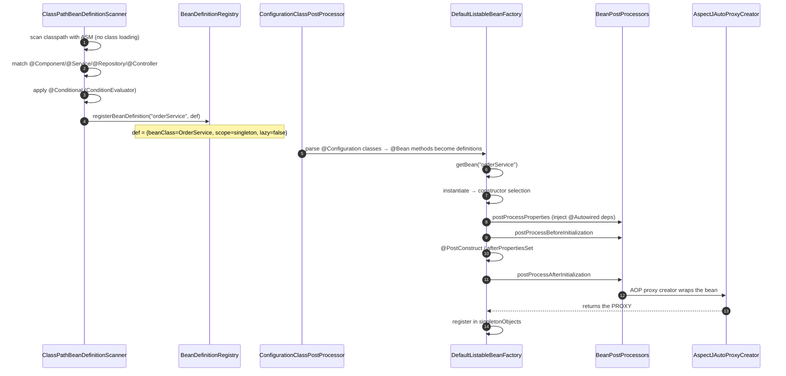

# 01 · The IoC Container: `BeanFactory` & `ApplicationContext`

> **Level:** Beginner → Advanced
> **Interview Frequency:** ★★★★★ (The single most Spring question, asked at every level)
> **Prerequisite:** [01 · Boot Fundamentals](../01-Spring-Boot-Fundamentals/README.md)
> **Last Updated:** 2026

---

## 📋 Table of Contents
- [0. TL;DR — The 30-Second Answer](#0-tldr--the-30-second-answer)
- [1. What & Why](#1-what--why)
- [2. Mental Model — the factory that builds everything](#2-mental-model--the-factory-that-builds-everything)
- [3. Deep Dive — Theory](#3-deep-dive--theory)
- [4. Internal Working Mechanism](#4-internal-working-mechanism)
- [5. Step-by-Step Execution Flow](#5-step-by-step-execution-flow)
- [6. Architecture Diagrams](#6-architecture-diagrams)
- [7. Production-Level Use Cases](#7-production-level-use-cases)
- [8. Code Examples — Production-Grade](#8-code-examples--production-grade)
- [9. Common Mistakes & Gotchas](#9-common-mistakes--gotchas)
- [10. Performance Considerations](#10-performance-considerations)
- [11. Security Considerations](#11-security-considerations)
- [12. Best Practices — The Checklist](#12-best-practices--the-checklist)
- [13. Hands-On Exercises](#13-hands-on-exercises)
- [14. Code Challenges](#14-code-challenges)
- [15. Scenario-Based Questions](#15-scenario-based-questions)
- [16. Interview Q&A — Level-wise](#16-interview-qa--level-wise)
- [17. Counter-Questions & Traps](#17-counter-questions--traps)
- [18. Tricky Interview Questions](#18-tricky-interview-questions)
- [19. Follow-Up Questions Asked by Interviewers](#19-follow-up-questions-asked-by-interviewers)
- [20. Real 3–5 Year Experience Scenarios](#20-real-35-year-experience-scenarios)
- [21. Frequently Asked Production Issues](#21-frequently-asked-production-issues)
- [22. Debugging Scenarios](#22-debugging-scenarios)
- [23. Architecture Design Questions](#23-architecture-design-questions)
- [24. Rapid-Fire MCQs](#24-rapid-fire-mcqs)
- [25. Cheat Sheet — One-Page Summary](#25-cheat-sheet--one-page-summary)
- [26. Real-World Production Notes](#26-real-world-production-notes)
- [27. Follow-up Learning](#27-follow-up-learning)

---

## 0. TL;DR — The 30-Second Answer

- **The IoC container is a *factory that owns the lifecycle* of your objects.** You declare *what*
  you need; the container decides *when*, *how*, and *in what order* to create them, wires the
  dependencies, and destroys them properly at shutdown.
- **`BeanFactory` is the core SPI**; **`ApplicationContext` is the enterprise interface** that
  *extends* it. `ApplicationContext IS-A BeanFactory` — everything a `BeanFactory` can do, the
  context can do, plus environment, events, resource loading, i18n and lifecycle.
- **Beans are described by `BeanDefinition`s** — *metadata* (class name, scope, lazy flag, property
  values, depends-on). The bean object doesn't exist yet.
- **`getBean()` is the only way to get a bean from a plain `BeanFactory`** — you pass the name or
  the type. `ApplicationContext` adds type-based lookup, `getBeansOfType`, and
  `@Autowired` by type.
- **The container's real work**: read `BeanDefinition`s → instantiate → populate properties →
  call init callbacks → apply `BeanPostProcessor`s (this is where AOP proxies are created) →
  register as a singleton.
- **Component scanning** is just a way of *generating* `BeanDefinition`s — `ClassPathBeanDefinitionScanner`
  walks the classpath and registers a definition for every `@Component`-ish annotation.
- **`@Component` is the stereotype root**; `@Service`, `@Repository`, `@Controller` are
  **semantic aliases** that add nothing functionally except special treatment for
  `@Repository` (exception translation) and `@Controller` (web awareness).
- **`ApplicationContext` is an `EventPublisher`** — `ApplicationEventPublisher` +
  `ApplicationListener` is the built-in mechanism for cross-cutting notifications (and the
  foundation of `ContextRefreshedEvent`, `ApplicationReadyEvent`, etc.).
- **The container is a *registry of singleton beans* by default** — `singleton` is the default
  scope, so a stateless service is shared across all request threads. **This is why beans must be
  thread-safe.**
- **The one sentence that wins interviews:** *"The container doesn't create your objects because you
  asked it to — it creates them because it knows the dependency graph, and it manages their whole
  lifecycle so you don't have to."*

---

## 1. What & Why

### The problem before IoC

```java
// The "manual DI" world
public class OrderController {
    private final OrderService service = new OrderService(
            new OrderRepository(new DataSource(), new EntityManagerFactory()));
    // ↑ new everywhere: no swapping, no testing, no lifecycle, no AOP, no transactions
}
```

Every class builds its own dependencies. Consequences:
- **Untestable** — you can't inject a fake without a constructor that takes one.
- **Rigid** — swapping the implementation means editing every caller.
- **No cross-cutting concerns** — no transactions, no caching, no metrics, no AOP, because those
  need a proxy and you have no proxy.
- **No lifecycle** — nothing is closed, nothing is initialised, nothing is disposed.

### What IoC gives you

```java
@Component
class OrderRepository {
    OrderRepository(DataSource ds, EntityManagerFactory emf) { ... }   // ← declares what it needs
}

@Service
class OrderService {
    OrderService(OrderRepository repo) { ... }                        // ← declares what it needs
}

@RestController
class OrderController {
    OrderController(OrderService svc) { ... }                         // ← declares what it needs
}
```

You now **declare dependencies, not construct them**. The container does the wiring, and — crucially
— it can wrap the objects in **proxies** to add transactions, caching, metrics, retries and security
checks *around* methods you didn't write.

### The analogy — a casting agency

> Imagine a theatre. The **actor** (your class) doesn't go around hiring other actors. It tells the
> agency: "I need someone who can play the Detective." The **agency** (the container) knows every
> actor, knows who can play whom, casts them, handles understudies (prototypes), and makes sure
> everyone leaves the building at the end of the show (destruction callbacks).
> The crucial part: the agency can also put a **dress rehearsal harness** on an actor
> (a proxy) that changes how the audience sees them behave — without the actor knowing.

---

## 2. Mental Model — the factory that builds everything

```text
                    ┌──────────────────────────────────────────┐
                    │        ApplicationContext                │
                    │  (IS-A BeanFactory + more)                │
                    ├──────────────────────────────────────────┤
                    │  BeanFactory                             │
                    │   ├─ beanDefinitions : Map<String, BeanDefinition>
                    │   ├─ singletonObjects  : Map<String, Object>
                    │   └─ getBean(nameOrType) → create-or-return  │
                    ├──────────────────────────────────────────┤
                    │  + Environment                          │
                    │  + ApplicationEventPublisher            │
                    │  + ResourcePatternResolver              │
                    │  + MessageSource (i18n)                 │
                    │  + Lifecycle (start/stop)               │
                    │  + BeanPostProcessor / BPP registry     │
                    └──────────────────────────────────────────┘
                                  │
              ┌───────────────────┼───────────────────┐
              ▼                   ▼                   ▼
        BeanDefinition      BeanPostProcessor     BeanFactory
        (metadata)          (instances)           PostProcessor
              │                                        │
              ▼                                        ▼
        "class=OrderService,                 "wrap it in a proxy so
         scope=singleton,                     @Transactional works"
         lazy=false, autowire=byType"
```

> **Caption:** Metadata in, instances out. The `BeanFactoryPostProcessor` edits the **metadata**
> before anything is built; the `BeanPostProcessor` decorates the **built objects**.

---

## 3. Deep Dive — Theory

### 3.1 The core interfaces (the SPI)

```java
public interface BeanFactory {
    String FACTORY_BEAN_PREFIX = "&";
    Object getBean(String name) throws BeansException;
    <T> T getBean(String name, Class<T> requiredType);
    <T> T getBean(Class<T> requiredType);
    <T> T getBean(String name, Object... args);
    <T> boolean isTypeMatch(String name, Class<?> typeToMatch);
    <T> T getBeanProvider(ResolvableType type);       // Spring 6.2+
    <T> ObjectProvider<T> getBeanProvider(Class<T> type);
}

public interface HierarchicalBeanFactory extends BeanFactory {
    BeanFactory getParentBeanFactory();
}

public interface ListableBeanFactory extends BeanFactory {
    int getBeanDefinitionCount();
    String[] getBeanDefinitionNames();
    <T> Map<String, T> getBeansOfType(Class<T> type);
    <T> Map<String, T> getBeansOfType(ResolvableType type);
    String[] getBeanNamesForType(Class<?> type);
    String[] getBeanNamesForType(ResolvableType type);
    boolean isSingleton(String name);
    boolean isPrototype(String name);
}

public interface ConfigurableListableBeanFactory extends ListableBeanFactory, AutowireCapableBeanFactory, ConfigurableBeanFactory {
    void ignoreDependencyType(Class<?> type);
    void addBeanPostProcessor(BeanPostProcessor bpp);
    void destroySingletons();
}

public interface ApplicationContext extends EnvironmentCapable, ListableBeanFactory, MessageSource, ApplicationEventPublisher, ResourcePatternResolver {
    ApplicationContext getParent();
    long getStartupDate();
    void publishEvent(Object event);
}
```

> **Caption:** `ApplicationContext` extends `ListableBeanFactory` (which extends `BeanFactory`) and
> adds `EnvironmentCapable`, `MessageSource`, `ApplicationEventPublisher` and
> `ResourcePatternResolver`. That's the "more" in "ApplicationContext is a BeanFactory with extra
> features".

### 3.2 `BeanDefinition` — the metadata

```java
public interface BeanDefinition extends AttributeAccessor {
    String SCOPE_SINGLETON   = "singleton";
    String SCOPE_PROTOTYPE   = "prototype";

    int SCOPE_SINGLETON_VALUE = 0;
    int SCOPE_PROTOTYPE_VALUE = 1;

    void setBeanClassName(String beanClassName);
    String getBeanClassName();
    void setScope(String scope);
    void setLazyInit(boolean lazyInit);
    void setDependsOn(String[] dependsOn);
    void setAutowireMode(int autowireMode);        // byName, byType, constructor, autodetect
    void setFactoryBeanName(String factoryBeanName);
    void setFactoryMethodName(String factoryMethodName);
    void setInitMethodName(String initMethodName);
    void setDestroyMethodName(String destroyMethodName);
    void setPropertyValues(MutablePropertyValues propertyValues);
    ConstructorArgumentValues getConstructorArgumentValues();
    // + parentName, aliases, init/destroy method names, attribute map, description
}
```

**Implementations you'll meet:**

| Class | Used for |
|-------|----------|
| `RootBeanDefinition` | A bean with a full definition (the "top level" one) |
| `ChildBeanDefinition` | A bean that inherits from a parent definition |
| `GenericBeanDefinition` | A generic, mutable definition (used by `AnnotatedBeanDefinitionReader`) |
| `AnnotatedGenericBeanDefinition` | A definition read from an annotated class (holds the `Class` directly) |
| `ScannedGenericBeanDefinition` | A definition produced by the classpath scanner |

### 3.3 `BeanDefinitionRegistry` — where definitions live

```java
public interface BeanDefinitionRegistry {
    void registerBeanDefinition(String beanName, BeanDefinition beanDefinition);
    void removeBeanDefinition(String beanName);
    BeanDefinition getBeanDefinition(String beanName);   // throws NoSuchBeanDefinitionException
    BeanDefinition[] getBeanDefinitionNames();
    boolean containsBeanDefinition(String beanName);
    int getBeanDefinitionCount();
    void registerAlias(String beanName, String alias);
}
```

`DefaultListableBeanFactory` implements **both** `BeanDefinitionRegistry` and
`ConfigurableListableBeanFactory` — it *is* the container's storage.

### 3.4 `BeanFactoryPostProcessor` vs `BeanPostProcessor` (the classic)

```text
┌───────────────────────────────────────────────────────────────────────┐
│  BeanFactoryPostProcessor                                             │
│  • Operates on BeanDefinition (metadata)                              │
│  • Runs BEFORE any bean is instantiated                                │
│  • Can MODIFY the definition (change the class, scope, properties)   │
│  • Cannot touch the live object (it doesn't exist yet)               │
│                                                                       │
│  Examples:                                                            │
│    PropertySourcesPlaceholderConfigurer  (resolves ${...})            │
│    ConfigurationClassPostProcessor        (parses @Configuration)      │
│    CustomBeanDefinitionRegistryPostProcessor                          │
└───────────────────────────────────────────────────────────────────────┘
                              │
                              ▼
┌───────────────────────────────────────────────────────────────────────┐
│  BeanPostProcessor                                                    │
│  • Operates on Bean INSTANCES                                         │
│  • Runs AFTER instantiation & property population                     │
│  • Can RETURN A DIFFERENT OBJECT (a proxy!)                           │
│                                                                       │
│  Examples:                                                            │
│    AutowiredAnnotationBeanPostProcessor (injects @Autowired fields)    │
│    AnnotationAwareAspectJAutoProxyCreator  (creates AOP proxies)     │
│    InitDestroyAnnotationBeanPostProcessor (@PostConstruct/@PreDestroy)│
│    ApplicationContextAwareProcessor                                    │
└───────────────────────────────────────────────────────────────────────┘
```

### 3.5 The nine `BeanPostProcessor` stages

```java
public interface BeanPostProcessor {
    // Called right after the bean is INSTANTIATED (before property injection)
    default Object postProcessBeforeInitialization(Object bean, String beanName) { return bean; }

    // Called after ALL BeanPostProcessors' before-initialization
    default boolean requiresDestruction(Object bean) { return false; }

    // Called after @PostConstruct / InitializingBean — THIS is where proxies are made
    default Object postProcessAfterInitialization(Object bean, String beanName) { return bean; }

    default void postProcessBeforeDestruction(Object bean, String beanName) {}
}
```

The full lifecycle around a single bean:

```text
 1. instantiate()               ← constructor runs here
 2. populateBean()              ← @Autowired fields/setters injected
 3. BeanPostProcessor#postProcessBeforeInitialization
 4. @PostConstruct              ← CommonAnnotationBeanPostProcessor
 5. InitializingBean#afterPropertiesSet
 6. custom init-method
 7. BeanPostProcessor#postProcessAfterInitialization   ← ★ PROXY CREATED HERE
 8. (bean is now in use)
 9. @PreDestroy                 ← DestructionAwareBeanPostProcessor
10. DisposableBean#destroy
11. custom destroy-method
```

### 3.6 Component scanning

```java
@ComponentScan(basePackages = "com.acme.shop",
               includeFilters = @Filter(type = FilterType.ANNOTATION, classes = Controller.class),
               excludeFilters = @Filter(type = FilterType.ASSIGNABLE_TYPE, classes = NoScan.class))
```

**How it works:**
1. `ClassPathBeanDefinitionScanner` uses an `AnnotatedBeanDefinitionReader`'s
   `ClassPathScanningCandidateComponentProvider`.
2. The provider uses an `ASM` metadata reader to read the class **without loading it** — checking
   for `@Component` (and meta-annotations like `@Service`, `@Repository`, `@Controller`).
3. For each candidate, it calls the `excludeFilters`, then the `includeFilters`, then
   `ConditionEvaluator` — the **same `@Conditional` machinery** as auto-configuration.
4. It calls `registerBeanDefinition(beanName, definition)`.

**Bean naming:** the default name generator is `AnnotationBeanNameGenerator` → the **short class
name with the first letter lowercased**. Two classes with the same simple name in different
packages collide → `ConflictingBeanDefinitionException`. Fix: `@Component("myName")` or a custom
`BeanNameGenerator`.

### 3.7 The stereotype annotations

```java
@Component          // the root stereotype
├── @Service        // @Component + semantic meaning
├── @Repository     // @Component + ExceptionTranslationPostProcessor
├── @Controller     // @Component + web awareness
├── @RestController // @Controller + @ResponseBody
├── @Configuration  // @Component + @Bean methods (proxyBeanMethods=true)
└── @ConfigurationProperties  // not a stereotype — binds properties
```

**`@Repository` is special:** `PersistenceExceptionTranslationPostProcessor` (auto-configured by
`@EnableTransactionManagement`/Boot's JPA auto-config) wraps the bean in a proxy that translates
JPA/Hibernate exceptions into Spring's `DataAccessException` hierarchy. That's why
`@Repository` on a JPA repository gives you `DataIntegrityViolationException` instead of a raw
`ConstraintViolationException`.

### 3.8 `ApplicationContext` events

```java
public interface ApplicationEventPublisher {
    void publishEvent(Object event);       // wraps non-ApplicationEvent in a PayloadApplicationEvent
    default void publishEvent(ApplicationEvent event) { publishEvent((Object) event); }
}
```

**Key events:**

| Event | When |
|-------|------|
| `ContextRefreshedEvent` | After `refresh()` completes — all singletons created |
| `ContextStartedEvent` | After `start()` |
| `ContextStoppedEvent` | After `stop()` |
| `ContextClosedEvent` | After `close()` — before destruction |
| `ApplicationStartedEvent` | After the context is created and before runners |
| `ApplicationReadyEvent` | **After** the runners and the web server are up |
| `ApplicationFailedEvent` | On a startup failure |
| `AvailabilityChangeEvent` | Readiness/liveness state changes |

```java
@Component
class OrderEventListener {

    @EventListener
    public void onOrderPlaced(OrderPlacedEvent event) { ... }

    @EventListener
    @Async                                   // ← run it on a different thread
    public void onOrderPlacedAsync(OrderPlacedEvent event) { ... }

    @EventListener
    @TransactionalEventListener(phase = TransactionPhase.AFTER_COMMIT)
    public void onOrderCommitted(OrderPlacedEvent event) { ... }   // ← only after the tx commits
}
```

> 💡 **`@TransactionalEventListener` is the correct way to publish to Kafka** — publishing inside a
> transaction means the message goes out even if the transaction rolls back. See ch. 09.

### 3.9 `ApplicationContextAware` and friends

```java
public interface ApplicationContextAware {
    void setApplicationContext(ApplicationContext context) throws BeansException;
}
```

Implemented by `ApplicationContextAwareProcessor` (a `BeanPostProcessor`). Variants:
`BeanNameAware`, `BeanClassLoaderAware`, `ResourceLoaderAware`, `EnvironmentAware`,
`EmbeddedValueResolverAware`, `MessageSourceAware`, `ApplicationEventPublisherAware`.

**Use `ApplicationContextAware` sparingly** — it's a *service locator* antipattern that hides
dependencies and breaks unit testing. Use constructor injection. The legitimate uses: getting the
environment, a `MessageSource`, or the `BeanFactory` for a dynamic lookup.

### 3.10 `ObjectProvider` — the safe way to look up beans

```java
@Component
class NotificationService {
    private final ObjectProvider<SmsSender> smsSender;   // ← may be absent

    public NotificationService(ObjectProvider<SmsSender> smsSender) {
        this.smsSender = smsSender;
    }

    public void notify(String phone) {
        SmsSender sender = smsSender.getIfAvailable();   // null if not present
        if (sender != null) { sender.send(phone); }
    }
}
```

`ObjectProvider` gives you:
- `getIfAvailable()` / `getIfAvailable(Supplier)`
- `getIfUnique()` / `getIfUnique(Supplier)`
- `getObject()` / `getObject(Supplier, args)`
- `getObjectNames()` / `getIfAvailable()` (stream)
- `orderedStream()`

This is the **right** answer to "I need this bean only if it's there".

---

## 4. Internal Working Mechanism

### 4.1 `DefaultListableBeanFactory.getBean()` — the whole path

```text
getBean("orderService")
  │
  ├─ 1. getBean(name) → transformedBeanName (handles "&" factory-bean prefix)
  ├─ 2. getSingleton(beanName)          ← already created? return it
  │       └─ (also checks the parent factory)
  ├─ 3. getBeanDefinition(merged)       ← merge parent + child definitions
  ├─ 4. if sharedInstance != null → getObjectForBeanInstance
  ├─ 5. if not a prototype and not a currently-created-creation → return the cached singleton
  │
  ├─ 6. BEFORE CREATION
  │       └─ resolveBeforeInstantiation(beanName, mbdToUse)  → InstantiationAwareBeanPostProcessor
  │            (e.g. @Autowired constructor resolution: SmartInstantiationAwareBeanPostProcessor)
  │
  ├─ 7. CREATE THE BEAN
  │       └─ doCreateBean(beanName, mbdToUse, args)
  │            ├─ createBeanInstance()  ← ★ constructor selection & instantiation
  │            ├─ populateBean()         ← ★ property injection
  │            └─ initializeBean()       ← ★ init callbacks + BeanPostProcessors
  │
  ├─ 8. registerSingleton (if singleton scope)
  └─ 9. return the (possibly proxied) bean
```

### 4.2 Constructor selection — `createBeanInstance()`

```text
1. If there's a resolved instance supplier / factory method → use it
2. If the bean has a @Autowired constructor:
      a. If there are ≥2 constructors and no default → use the @Autowired one
      b. If there are ≥2 constructors AND a default one → the DEFAULT wins
         (unless exactly one is annotated @Autowired)
      c. If exactly one constructor → use it (even without @Autowired)
3. Else if a no-arg constructor exists → use it
4. Else → fall back to the "primary constructor" (Kotlin / record-style) or fail
```

> **Caption:** This is the *constructor autowiring* rule that surprises people: **with two
> constructors and a no-arg one, the no-arg wins** unless one is explicitly `@Autowired`.

### 4.3 `populateBean()` — property injection

```text
1. applyPropertyValues(mbd, bw, pvs)      ← from the <property> tags / @Value in the XML
2. for each BeanPostProcessor:
     postProcessPropertiesFromValues(bw, mbd)   ← @Value, @ConfigurationProperties
3. if bw is a InstantiationAwareBeanPostProcessor:
     bw.postProcessProperties(...)  ← AutowiredAnnotationBeanPostProcessor:
                                       injects @Autowired fields and setters
4. resolveDependency(...) for each dependency
     ├─ find candidate beans by type
     ├─ apply @Primary
     ├─ apply @Qualifier
     ├─ apply the value's @Priority / Ordered
     └─ if multiple remain and none is marked required=false → NoUniqueBeanDefinitionException
```

### 4.4 `resolveDependency()` — how a type becomes a bean

```text
1. findAutowireCandidates(beanName, type, descriptor)
     → getBeanNamesForType(type)          ← uses the type hierarchy + generics matching
     → filter out "not a candidate" (e.g. the bean itself)
2. if 0 candidates:
     → if the dependency is @Nullable / required=false → null
     → else NoSuchBeanDefinitionException
3. if 1 candidate → use it
4. if >1 candidate:
     → apply @Primary on the bean definition or the factory method
     → else apply @Qualifier on the dependency or the candidate
     → else fall back to the bean name matching the dependency name
     → else NoUniqueBeanDefinitionException
```

> **Caption:** The `ListableBeanFactory.getBeanNamesForType()` call is the expensive part of
> autowiring — it's why type lookups are cached and why generic-aware matching exists.

### 4.5 The `DefaultListableBeanFactory` cache

```text
  allBeanDefinitionNames : List<String>          → name → definition
  beanDefinitionMap      : Map<String, BeanDefinition>
  singletonObjects       : Map<String, Object>   → name → the SINGLETON (possibly a proxy!)
  singletonFactories      : Map<String, ObjectFactory>
  earlySingletonObjects  : Map<String, Object>   → for circular references
  prototypeFactories      : Map<String, ObjectFactory<?>>
  typeConverterCache     : Map<Class<?>, Object>
  allBeanNamesByType     : Map<Class<?>, String[]>
  singletonNames          : Set<String>
  disposableBeans         : Map<String, Object>
```

> **Caption:** `singletonObjects` holds the **proxy**, not the target. When you
> `getBean("orderService")` you get the proxy; the target object is inside it. This is why
> `AopUtils.isAopProxy(bean)` is true, and why `bean.getClass()` is not your class.

---

## 5. Step-by-Step Execution Flow

### 5.1 From `@Component` to a usable bean



### 5.2 The context hierarchy

```text
              ┌──────────────────────────────────────┐
              │  Root WebApplicationContext           │
              │  (holds @ComponentScan of the app)    │
              └───────────────┬──────────────────────┘
                              │ parent
              ┌───────────────▼──────────────────────┐
              │  ServletWebServerApplicationContext  │  ← the "servlet" context
              │  (DispatcherServlet's context)       │
              └───────────────┬──────────────────────┘
                              │ parent
              ┌───────────────▼──────────────────────┐
              │  ManagementWebServerApplicationContext│ ← only if management.server.port is set
              └──────────────────────────────────────┘
```

**Bean lookup goes child → parent.** If both define a bean with the same name, the **child wins**
and the parent's is hidden. This is how Spring Boot's management context isolates actuator beans
from the main app (and why a `SecurityFilterChain` in the parent may not apply to the management
port — a classic gotcha!).

---

## 6. Architecture Diagrams

### 6.1 The container's data flow

```text
  SOURCE                    METADATA                        INSTANCES
  ──────                    ────────                        ─────────

  @Component class    ──►   BeanDefinition   ──►  BeanPostProcessor   ──►  singletonObjects
  @Bean method        ──►   (in the registry)    (Before/After Init)     (the PROXY is stored)
  XML <bean>          ──►         │                                      │
  FactoryBean         ──►         │                                      ▼
                                   │                              ApplicationContext
  BeanFactoryPostProcessor ───────┘ (modifies the definition)     .getBean(name)
                                                                    │
                                                                    ▼
                                                            your code gets the proxy
```

### 6.2 Bean scopes

```text
  singleton  ──► ONE instance per container. THE DEFAULT.
                 ⚠ Shared across all threads → must be thread-safe.

  prototype  ──► A NEW instance every time getBean() is called.
                 ⚠ No lifecycle callbacks (@PostConstruct DOES run, @PreDestroy does NOT).
                 ⚠ Never inject a prototype into a singleton without ObjectProvider.

  request    ──► One per HTTP request (ServletRequestScope).
  session    ──► One per HttpSession.
  application ──► One per ServletContext.
  websocket  ──► One per WebSocket session.

  @Scope("custom") → custom Scope implementation (e.g. a per-request cache)
```

### 6.3 The lifecycle, precisely

```text
  ┌─ CONSTRUCTION ─────────────────────────────────────────────┐
  │  • constructor (or @Bean factory method)                    │
  │  • ⚠ constructor injection happens HERE (the only safe DI)  │
  └─────────────────────────────────────────────────────────────┘
                              ▼
  ┌─ POPULATION ───────────────────────────────────────────────┐
  │  • <property> values                                        │
  │  • @Value injection                                         │
  │  • @Autowired FIELD / SETTER injection  ← ⚠ avoid            │
  └─────────────────────────────────────────────────────────────┘
                              ▼
  ┌─ INITIALIZATION ───────────────────────────────────────────┐
  │  • BeanPostProcessor#postProcessBeforeInitialization        │
  │  • @PostConstruct                                           │
  │  • InitializingBean#afterPropertiesSet                      │
  │  • custom init-method                                       │
  │  • BeanPostProcessor#postProcessAfterInitialization  ★PROXY  │
  └─────────────────────────────────────────────────────────────┘
                              ▼
                    ┌─ IN USE (container-managed) ┐
                              ▼
  ┌─ DESTRUCTION ──────────────────────────────────────────────┐
  │  • @PreDestroy                                              │
  │  • DisposableBean#destroy                                   │
  │  • custom destroy-method                                    │
  │  • (AutoCloseable#close is used as a default destroy method)│
  └─────────────────────────────────────────────────────────────┘
```

---

## 7. Production-Level Use Cases

| Context | Pattern | Why |
|---------|---------|-----|
| **Singleton services** | Stateless services (no mutable fields) | A singleton shared by all threads — any mutable state is a race condition |
| **Request-scoped beans** | `@RequestScope` for a per-request cache/context | Avoids a `ThreadLocal` leak; works with virtual threads |
| **Prototype + `ObjectProvider`** | Optional collaborators (a `SmsSender` that may not exist) | No hard dependency; no eager instantiation |
| **Dynamic lookup** | `ApplicationContext.getBeansOfType(X.class)` for a plugin registry | Extensibility without a compile-time dependency |
| **Event-driven** | `ApplicationEventPublisher` for domain events inside a service | Decouples the producer from consumers; `AFTER_COMMIT` for reliable publication |
| **Multi-tenant** | A request-scoped `TenantContext` | Per-request isolation without `ThreadLocal` cleanup bugs |
| **Feature toggles** | `ObjectProvider<FeatureToggles>` with a `@ConditionalOnProperty` implementation | The feature can be absent |
| **Testing** | `@MockBean` / `@MockitoBean` replaces a bean in the context | Tests the wiring, not just the logic |

---

## 8. Code Examples — Production-Grade

### 8.1 The `BeanFactory` in isolation (unit-testable, no Spring)

```java
public class OrderServiceUnitTest {

    private final OrderService service;

    @BeforeEach
    void setUp() {
        // The plain container: no Spring, no annotations
        DefaultListableBeanFactory factory = new DefaultListableBeanFactory();
        factory.registerSingleton("orderRepository", new InMemoryOrderRepository());
        service = factory.getBean(OrderService.class);   // autowiring by type
    }

    @Test
    void should_place_order() {
        // ...
    }
}
```

> **Caption:** `DefaultListableBeanFactory` implements `AutowireCapableBeanFactory`, so
> `getBean(OrderService.class)` performs **autowiring by type** even without annotations. This is a
> fast, dependency-free way to test a service's wiring.

### 8.2 A `BeanFactoryPostProcessor` that customises definitions

```java
@Component
public class EntityScanCustomiser implements BeanFactoryPostProcessor {

    private final Environment env;

    public EntityScanCustomiser(Environment env) { this.env = env; }

    @Override
    public void postProcessBeanFactory(ConfigurableListableBeanFactory beanFactory) {
        // Find the auto-configured entityManagerFactory and adjust it
        for (String name : beanFactory.getBeanDefinitionNames()) {
            BeanDefinition def = beanFactory.getBeanDefinition(name);
            if (def.getBeanClassName() != null
                && def.getBeanClassName().contains("LocalContainerEntityManagerFactoryBean")) {
                def.getPropertyValues().add("packagesToScan", "com.acme.shop.domain");
            }
        }
    }
}
```

### 8.3 A `BeanPostProcessor` that guards every service method

```java
@Component
public class SlowMethodLogger implements BeanPostProcessor {

    private static final Logger log = LoggerFactory.getLogger(SlowMethodLogger.class);

    @Override
    public Object postProcessAfterInitialization(Object bean, String beanName) {
        Class<?> targetClass = AopProxyUtils.ultimateTargetClass(bean);
        if (!targetClass.getPackageName().startsWith("com.acme.service")) return bean;

        return Proxy.newProxyInstance(
                targetClass.getClassLoader(),
                new Class<?>[]{targetClass},          // ⚠ JDK proxy → only public methods
                (proxy, method, args) -> {
                    long start = System.nanoTime();
                    try {
                        return method.invoke(bean, args);
                    } finally {
                        long ms = (System.nanoTime() - start) / 1_000_000;
                        if (ms > 100) {
                            log.warn("Slow call {}.{} took {} ms",
                                     targetClass.getSimpleName(), method.getName(), ms);
                        }
                    }
                });
    }
}
```

> **Caption:** A `BeanPostProcessor` returning a proxy is exactly how Spring implements `@Transactional`,
> `@Async` and `@Cacheable`. Note the pitfall: a JDK proxy only exposes **public** methods of the
> interfaces — the real framework uses CGLIB to proxy the class.

### 8.4 A domain event, published and consumed correctly

```java
// ① the event
public record OrderPlacedEvent(Long orderId, String customerId, BigDecimal total) { }

// ② publish it INSIDE the service
@Service
public class OrderService {

    private final OrderRepository repository;
    private final ApplicationEventPublisher events;

    public OrderService(OrderRepository repository, ApplicationEventPublisher events) {
        this.repository = repository;
        this.events = events;
    }

    @Transactional
    public Order place(CreateOrderCommand cmd) {
        Order order = repository.save(Order.from(cmd));
        events.publishEvent(new OrderPlacedEvent(order.getId(), cmd.customerId(), order.getTotal()));
        return order;   // the listener runs synchronously, inside the transaction
    }
}
```

```java
// ③ consume it AFTER the commit — this is the correct place to send a Kafka message
@Component
public class OrderPlacedListener {

    private final KafkaTemplate<String, OrderPlacedEvent> kafka;

    public OrderPlacedListener(KafkaTemplate<String, OrderPlacedEvent> kafka) {
        this.kafka = kafka;
    }

    @TransactionalEventListener(phase = TransactionPhase.AFTER_COMMIT)
    public void on(OrderPlacedEvent event) {
        kafka.send("orders.placed", String.valueOf(event.orderId()), event);
    }
}
```

### 8.5 `ObjectProvider` for optional collaborators

```java
@Component
public class NotificationService {

    private final ObjectProvider<SmsSender> smsSender;
    private final ObjectProvider<PushSender> pushSender;

    public NotificationService(ObjectProvider<SmsSender> smsSender,
                               ObjectProvider<PushSender> pushSender) {
        this.smsSender = smsSender;
        this.pushSender = pushSender;
    }

    public void notify(Customer customer) {
        smsSender.ifAvailable(s -> s.send(customer.phone(), "Your order is confirmed"));
        pushSender.ifAvailable(p -> p.send(customer.deviceToken(), "Your order is confirmed"));
    }
}
```

### 8.6 Getting the context without the service-locator smell

```java
// ✅ Preferred: inject what you need
@Component
public class FeatureFlags {
    private final Environment env;                       // for property access
    private final MessageSource messageSource;           // for i18n

    public FeatureFlags(Environment env, MessageSource messageSource) {
        this.env = env;
        this.messageSource = messageSource;
    }
}
```

```java
// ⚠ Acceptable when you genuinely need dynamic lookup
@Component
public class PluginRegistry implements ApplicationEventListener<ContextRefreshedEvent> {

    private final ApplicationContext ctx;
    private final List<Plugin> plugins = new ArrayList<>();

    public PluginRegistry(ApplicationContext ctx) { this.ctx = ctx; }

    @Override
    public void onApplicationEvent(ContextRefreshedEvent event) {
        ctx.getBeansOfType(Plugin.class).values().forEach(plugins::add);
    }

    public void runAll() { plugins.forEach(Plugin::run); }
}
```

---

## 9. Common Mistakes & Gotchas

| # | ❌ Wrong | ✅ Right | Why |
|---|----------|----------|-----|
| 1 | Field injection (`@Autowired` on a field) | Constructor injection | Immutable, testable, and required for `@PostConstruct` ordering |
| 2 | Injecting a `prototype` into a `singleton` | Inject `ObjectProvider<T>` and call `getObject()` per use | The prototype is created **once** at injection time and reused — a classic bug |
| 3 | A singleton bean with mutable state | Make it stateless, or use a request scope | The singleton is shared by all request threads |
| 4 | Calling `ApplicationContext.getBean()` inside business logic | Inject the dependency | Service-locator antipattern; untestable; hides the dependency |
| 5 | Expecting `@PostConstruct` to run for a prototype | It runs; `@PreDestroy` does **not** | The container doesn't track prototype instances |
| 6 | Two classes with the same simple name in different packages | `@Component("uniqueName")` | `ConflictingBeanDefinitionException` |
| 7 | A `@Bean` method calling another `@Bean` method in a non-proxied config | Keep `proxyBeanMethods = true` (the default) or pass the dependency as a parameter | Without the proxy, you get **two** instances |
| 8 | `@Autowired` on a `static` field | Don't | Static fields aren't managed by the container |
| 9 | Assuming `@Autowired` fields are injected before the constructor | No — field injection happens **after** the constructor | A constructor that reads an `@Autowired` field sees `null` |
| 10 | Relying on the `@Autowired` "required=false" default | Set it explicitly | `required=false` + a missing bean = `null` injected, and a NPE later |
| 11 | Publishing an event for a side effect inside a transaction | `@TransactionalEventListener(AFTER_COMMIT)` | Otherwise the side effect happens even if the tx rolls back |
| 12 | Using `@EventListener` for a slow operation | `@Async` + a bounded executor | It runs on the caller's thread by default |
| 13 | Assuming a bean in the parent context is visible to the child | It is (child → parent lookup) — but the **management context** is a *child*, so parent beans are visible to it | The common bug is the reverse (a child bean is not visible to the parent) |
| 14 | `@Scope("singleton")` on a `@Bean` method that returns a new object | Remove the method | A singleton `@Bean` method is called once and its result cached |

---

## 10. Performance Considerations

| Aspect | Impact | Guidance |
|--------|--------|----------|
| **`getBeanNamesForType`** | Scans all definitions; **expensive** | Cached in `allBeanNamesByType`; invalidated on definition changes. Avoid calling it in a hot path |
| **Autowiring at startup** | One type lookup per dependency | Fine at startup; a problem if you do it per request |
| **Type matching with generics** | Uses `ResolvableType` — slower than raw `Class` | Prefer `ObjectProvider<T>` with a concrete type over `ResolvableType` gymnastics |
| **Singleton vs prototype** | Prototype creation is expensive (a full bean lifecycle per call) | Avoid prototypes in hot paths |
| **`getBeansOfType` at startup** | Loads **all** matching beans | Do it once (in an event listener), not per request |
| **Bean count** | Thousands of definitions slow startup | Keep the component scan narrow; avoid registering definitions programmatically |
| **`@Lazy` on a dependency chain** | The first request pays the cost | Use it for genuinely optional/heavy beans |
| **`ApplicationEventPublisher`** | Synchronous by default — the listener runs on the caller's thread | Use `@Async` with a **bounded** executor for slow listeners |

---

## 11. Security Considerations

| Risk | Mitigation |
|------|-----------|
| **Singleton beans holding request state** | A field on a singleton is shared across users — a **data leak** | Keep singletons stateless; use request-scoped beans for per-request state |
| **Prototype injection into a singleton** | The prototype is created once and shared — the same leak | Use `ObjectProvider` |
| **`@RequestScope` + a thread pool** | The proxy resolves the scope per call — safe with Tomcat **and** virtual threads | Prefer `@RequestScope` over `ThreadLocal` |
| **Events carrying sensitive data** | A published event is handled by every listener, including ones you don't control | Don't publish PII in events; use IDs and re-fetch |
| **Service locator** | Hides dependencies, makes security review harder | Constructor injection only |
| **Dynamic bean lookup by a user-supplied name** | `getBean(userInput)` → bean definition injection | Never look up beans by unvalidated input |
| **Spring Boot Actuator `/beans`** | Reveals the internal structure | Restrict the endpoint |
| **`@PreDestroy` not running on a crash** | Resources leak | Use `try-with-resources` for non-container resources; ensure the JVM exits cleanly |

---

## 12. Best Practices — The Checklist

- [ ] **Constructor injection** for everything. Field injection only as a last resort.
- [ ] **Singletons must be stateless/thread-safe.** If a bean has mutable state, it's a bug.
- [ ] Use `ObjectProvider<T>` for **optional** dependencies.
- [ ] Use `@RequestScope` (not `ThreadLocal`) for per-request state.
- [ ] Never call `getBean()` in business logic — inject the dependency.
- [ ] Use `ApplicationEventPublisher` for **in-process** decoupling; use Kafka for cross-service.
- [ ] Publish events for **after-commit** side effects with `@TransactionalEventListener`.
- [ ] Keep the component scan narrow; avoid `basePackages = "com"` (scans the whole world).
- [ ] Give beans **unique names** when the simple name could collide.
- [ ] Prefer `@Service`/`@Repository` over raw `@Component` — they carry meaning and extra
      behaviour.
- [ ] Implement `DisposableBean`/`@PreDestroy` for anything holding a resource, and test that
      shutdown works.
- [ ] Remember: **`@PostConstruct` runs once per singleton**, and prototype beans get
      `@PostConstruct` but not `@PreDestroy`.

---

## 13. Hands-On Exercises

**🧪 Lab 1 — Watch the lifecycle**
1. Create a bean with a constructor, `@PostConstruct`, `InitializingBean.afterPropertiesSet()`, a
   custom `init-method`, and `@PreDestroy`.
2. Log the order of every callback.
3. Predict the order first — then verify.

**✅ Success signal:** You can state the exact 11-step order from memory.

**🧪 Lab 2 — The prototype trap**
1. Make a `@Component` with a prototype scope that increments a static counter in its constructor.
2. Inject it into a singleton and call it 3 times → the counter increments **once**.
3. Change to `ObjectProvider` and call `getObject()` 3 times → the counter increments 3 times.

**✅ Success signal:** You've *felt* the bug.

**🧪 Lab 3 — The `@Bean` method double-call**
1. Create a `@Configuration` class with a `@Bean` method that logs and returns a new object.
2. Inject it twice and call both → **one** instance (the CGLIB proxy intercepts).
3. Set `proxyBeanMethods = false` → **two** instances.

**✅ Success signal:** You can explain what the CGLIB proxy does and why it exists.

**🧪 Lab 4 — Bean definition surgery**
1. Write a `BeanFactoryPostProcessor` that prints every bean definition name and its scope.
2. Change the scope of one bean to `prototype` and observe the difference in `getBean()` calls.

**✅ Success signal:** You can see the metadata layer directly.

---

## 14. Code Challenges

### Challenge 1 — A dynamic plugin registry (medium)
**Goal:** Create a `Plugin` interface and a registry that discovers all `Plugin` beans at startup
and can run them, with:
- an `@Order`-based ordering,
- graceful handling of a plugin that throws (log and continue),
- and a test that registers 3 fake plugins.

**Hint:** `ApplicationListener<ContextRefreshedEvent>` + `getBeansOfType(Plugin.class)`.

### Challenge 2 — A `BeanPostProcessor` audit (hard)
**Goal:** Write a `BeanPostProcessor` that records, for every bean created: the bean name, the
target class, whether it was proxied, and the creation time. Expose it via an actuator endpoint.
**Test:** assert that a `@Transactional` service is reported as proxied.

**Hint:** use `AopUtils.isAopProxy(bean)` and `AopProxyUtils.ultimateTargetClass(bean)`.

### Challenge 3 — A "lazy but safe" optional dependency (medium)
**Goal:** Implement a feature that is only active when a bean is present, without a hard
dependency, and without failing at startup when it's absent. Write the test for both cases.

**Hint:** `ObjectProvider` + `@ConditionalOnProperty`.

---

## 15. Scenario-Based Questions

**S1.** *A singleton service has a field `private List<String> recentOrders = new ArrayList<>();`
Users occasionally see another user's orders. Diagnose and fix.*
>
> **Expected answer:** This is a **data race on a shared singleton** — the container creates one
> instance of the service and shares it across all request threads; a mutable `ArrayList` field is
> therefore shared state. (1) Diagnose: the field is not `final`, not thread-safe, and the bean is
> a singleton by default. (2) Fix options, in order of preference: (a) make the service
> **stateless** — the list is request data, so it belongs in the method or a request-scoped bean;
> (b) if it must be shared state, use a thread-safe structure (`ConcurrentLinkedQueue` or
> `CopyOnWriteArrayList`) and define the semantics; (c) if it's per-user, use
> `@RequestScope` (preferred over a `ThreadLocal`, which leaks with pooled threads).
> (3) Prevention: a static-analysis rule banning mutable fields on `@Service`/`@Component` beans
> (ArchUnit makes this a one-liner); a code-review checklist item; and a concurrency test.
> (4) Note that `@Transactional` does not protect this: the transaction is a *database* transaction,
> not a lock on the bean. This is exactly the kind of bug that unit tests miss — add a test that
> hammers the bean from many threads.

**S2.** *After upgrading Spring, the application fails to start with
`ConflictingBeanDefinitionException: Scope 'null' for bean 'x' conflicts with existing bean of the
same name`. What happened?*
>
> **Expected answer:** Two `BeanDefinition`s with the same name were registered. Common causes:
> (1) A **composite `BeanFactory`** — e.g. an XML context plus an annotation config both defining
> the same bean; (2) A library's auto-configuration defining a bean whose **name** collides with
> yours — the auto-config is registered *after* your beans, and since Boot 2.1 auto-configured
> definitions do not override user definitions, you get this exception; (3) A `BeanDefinition`
> registered programmatically in a `BeanFactoryPostProcessor` that runs twice; (4) A **parent/child
> context** where the child defines a bean with the same name as the parent's — normally the child
> wins silently, but a *conflicting scope* between parent and child is an error.
> **Diagnosis:** the exception message gives the two source locations (it names the resource that
> registered the first definition) — read it. Use `--debug` to see the condition report, and
> `ctx.getBeanDefinition("x")` to inspect the winner. **Fix:** rename one of the beans, exclude the
> conflicting auto-configuration, or (worst case) set
> `spring.main.allow-bean-definition-overriding=true` — which hides the real problem.

**S3.** *A service is injected into a `singleton` and holds a reference to a `prototype` bean. The
prototype's state is shared. How would you have caught this in code review?*
>
> **Expected answer:** The **static analysis route** is the professional answer: an ArchUnit rule
> like "a bean must not depend on a bean with a wider scope" — ArchUnit can express this
> precisely: `noClasses().that().areAnnotatedWith(Service.class).should().dependOnClassesThat()
> .areAnnotatedWith(Component.class).and().haveRawAnnotation`… practically, you'd write a rule
> that flags a `prototype`-scoped bean injected into a `singleton`-scoped one. The **review
> checklist** route: "does this dependency have a wider or equal scope?" The **test** route: a
> concurrency test that calls the method from two threads with different inputs and asserts
> isolation. And the **design** route: if you need a fresh instance per use, inject
> `ObjectProvider<T>` and call `getObject()` at the point of use — the container then creates a new
> instance per call, which is the intent.

---

## 16. Interview Q&A — Level-wise

### 🟢 Beginner
**Q: What is the Spring IoC container?**
**A:** The `ApplicationContext` — a container that creates, configures, wires and manages the
lifecycle of your beans (objects). You declare the dependencies; the container resolves them.

**Q: What is a bean?**
**A:** An object managed by the Spring container — created by it, dependency-injected, lifecycle
callbacks invoked, and destroyed by it. Typically declared with `@Component`, `@Service`,
`@Repository`, `@Controller` or a `@Bean` method.

**Q: `BeanFactory` vs `ApplicationContext`?**
**A:** `BeanFactory` is the core SPI for managing beans. `ApplicationContext` **extends** it and
adds enterprise features: `Environment` integration, event publishing, resource loading (i18n),
and lifecycle management. In practice you always use the `ApplicationContext`.

**Q: What is `BeanDefinition`?**
**A:** The metadata describing a bean — its class, scope, lazy flag, property values, init/destroy
methods, and dependencies. It's what the container uses to create the bean; the bean object
doesn't exist until `getBean` is called.

### 🟡 Intermediate
**Q: What is the difference between `BeanFactoryPostProcessor` and `BeanPostProcessor`?**
**A:** A `BeanFactoryPostProcessor` operates on **`BeanDefinition`s (metadata)** before any bean is
instantiated — e.g. `PropertySourcesPlaceholderConfigurer` resolves `${...}` placeholders, and
`ConfigurationClassPostProcessor` parses `@Configuration` classes. A `BeanPostProcessor` operates on
**bean instances** after creation and property injection — e.g.
`AutowiredAnnotationBeanPostProcessor` injects `@Autowired` fields, and
`AnnotationAwareAspectJAutoProxyCreator` creates AOP proxies (this is how `@Transactional` works).

**Q: Explain the bean lifecycle.**
**A:** Instantiation (constructor) → property population (`@Autowired`, `<property>`) →
`BeanPostProcessor#postProcessBeforeInitialization` → `@PostConstruct` →
`InitializingBean#afterPropertiesSet` → custom init-method →
`BeanPostProcessor#postProcessAfterInitialization` (where proxies are created) → [in use] →
`@PreDestroy` → `DisposableBean#destroy` → custom destroy-method.

**Q: What is component scanning?**
**A:** The mechanism that discovers `@Component`-annotated classes and registers them as bean
definitions. `ClassPathBeanDefinitionScanner` walks the classpath (using ASM to read metadata
without loading classes), applies exclude/include filters, evaluates `@Conditional`, and registers
the definitions with the `BeanDefinitionRegistry`. The scan root is the package of the class
annotated with `@ComponentScan` (or the `@SpringBootApplication` class).

**Q: What are the bean scopes?**
**A:** `singleton` (default — one instance per container), `prototype` (a new instance per
`getBean`), `request`, `session`, `application` (servlet scopes) and `websocket`. Scoping is
managed by a `Scope` implementation; the container calls `scope.get(name, objectFactory)`.

### 🔴 Advanced / Senior
**Q: Why is field injection discouraged?**
**A:** Four reasons. (1) **Immutability** — the field can't be `final`. (2) **Testability** — you
can't construct the object without a container (constructor injection works with a plain `new`).
(3) **Hidden dependencies** — the class's real collaborators aren't visible in its constructor, so
the API lies about what it needs. (4) **Ordering fragility** — field injection happens *after* the
constructor, so a constructor that uses an injected field sees `null`, and `final` fields can't be
injected at all. Constructor injection also makes the object safe to publish and easy to test with
plain `new`.

**Q: What happens when two beans of the same type exist and one is `@Primary`?**
**A:** The `@Primary` bean wins during autowiring by type. The resolution order in
`DefaultListableBeanFactory.determinePrimaryCandidate` → `determineHighestPriorityCandidate` (the
`@Priority`/Ordered value) → `determineHighestPriorityCandidate` falls back to the **bean name
matching the dependency name** (the "by-name fallback"). If no candidate can be chosen, you get
`NoUniqueBeanDefinitionException` listing all candidates — the error message is the debugging tool.
`@Qualifier` narrows the choice explicitly and is the better fix when several beans of the same
type are legitimate.

**Q: How does Spring handle circular dependencies?**
**A:** For **singletons** with **setter/field** injection, the container can inject an "early
reference" (a `FactoryBean`-aware proxy) into the other bean, so the cycle resolves — this is
`allowCircularReferences`. It does **not** work for **constructor** injection (the constructor
needs a fully built object) or for **prototypes**. Spring Boot **disables** circular references by
default since 2.6 (`spring.main.allow-circular-references=false`) because they are usually a design
smell — the correct fix is to extract an interface into a third bean.

**Q: What is the difference between `@Bean` and `@Component`?**
**A:** `@Component` marks a class as a bean; the container instantiates it with a constructor. `@Bean`
marks a **method** whose return value is a bean — it lets you use a third-party class you can't
annotate, or build the object imperatively. A `@Bean` method in a `@Configuration` class is
**proxied** (CGLIB) so that the container can guarantee the *same* instance is returned on every
call (that's what `proxyBeanMethods = true` does). Setting it to `false` removes the proxy — a
legitimate optimisation when the method has no dependencies on other `@Bean` methods.

### ⚫ Expert / Principal
**Q: Design the bean architecture for a multi-tenant, multi-module application.**
> **Answer structure:** (1) **Scope the module boundaries** — each module is a jar with its own
> `@Configuration`; the app imports them explicitly (`@Import` or a `@ComponentScan` per module) so
> the scan root stays narrow. (2) **Context hierarchy** — one root context for the app, one child
> context per module only if isolation is genuinely needed (rare, and it complicates
> `@Transactional` and event propagation). (3) **Scope policy** — singletons for stateless
> services; request scope for tenant context; prototype only for genuinely stateful, short-lived
> collaborators (always via `ObjectProvider`). (4) **Bean naming** — a strict convention
> (`service-`, `client-`) plus an ArchUnit rule to prevent collisions. (5) **Lifecycle ordering** —
> `SmartLifecycle` phases for components that must start before the web server (cache warm-up) and
> stop after it (graceful drain). (6) **Events** — in-module via `ApplicationEventPublisher`,
> cross-module via a published interface + `ObjectProvider` to avoid a cycle. (7) **Testing** —
> a `DefaultListableBeanFactory` for unit tests, a sliced `@SpringBootTest` for module tests, and
> Testcontainers for the persistence boundary. (8) **Guardrails** — an ArchUnit rule banning
> `ApplicationContext` injection into `@Service` classes, and a rule banning mutable fields in
> singletons.

---

## 17. Counter-Questions & Traps

### CQ1. "Isn't the IoC container just a fancy factory? Why not use `Supplier`?"
- **Naive answer:** "It does the same thing."  ← misses the point
- **The trap:** A `Supplier` gives you an object; the container gives you an object **plus** a
> lifecycle, cross-cutting proxies, transactions, and a dependency graph.
- **Expert answer:** The container's value is that it can **substitute a proxy** for your object and
> add behaviour *around* it. `@Transactional` is impossible with a plain `Supplier` because the
> container needs to know the call is happening and open a transaction around it — and it needs to
> know the *dependency graph* to wire things without you writing it.

### CQ2. "Why does the container store the *proxy* in the singleton map and not the target?"
- **Naive answer:** "It doesn't matter."  ← it does
- **The trap:** If it stored the target, `getBean()` would return the un-proxied object and
> transactions/caching would silently stop working.
- **Expert answer:** The singleton map holds the **proxy** so every consumer gets the decorated
> behaviour. The target lives inside the proxy's `TargetSource`. That's why
> `ctx.getBean(X.class) instanceof X` is true but `X.class != bean.getClass()`.

### CQ3. "If the container creates all singletons at startup, what happens if one bean fails?"
- **Naive answer:** "The app fails to start."  ← correct but shallow
- **The trap:** The *exact* behaviour matters: `finishBeanFactoryInitialization` →
> `preInstantiateSingletons` → the exception is wrapped in `BeanCreationException` and
> **propagates**, aborting the refresh. The context is then closed, and `ApplicationFailedEvent`
> is published. **Beans created before the failure are destroyed** during the rollback.
- **Expert answer:** This is a **fail-fast by design** behaviour: a broken dependency should stop
> the deployment, not surface as a 500 later. The escape hatches are `@Lazy` (defer the failure to
> the first request) or a `HealthIndicator` (report it without crashing) — and the choice depends on
> whether the dependency is *optional* or *critical*.

### CQ4. "Why is `getBean()` on a prototype not thread-safe?"
- **Naive answer:** "Because prototypes are new each time."  ← not the reason
- **The trap:** The reason is that the container doesn't track prototype instances for destruction,
> so anything they allocate (threads, connections, file handles) leaks.
- **Expert answer:** The container creates a prototype, injects it, and **forgets it**. There is no
> `@PreDestroy` callback and no `DisposableBean.destroy()`. If a prototype holds a resource, you must
> manage it yourself — or use a request scope, where the container does clean up.

### CQ5. "Can I get a bean by type? What if there are two?"
- **Naive answer:** "Yes, and it throws if there are two."  ← correct
- **The trap:** The way to disambiguate is not just `@Primary` — the full chain is `@Primary` →
> `@Priority`/`Ordered` → `@Qualifier` → **the bean name matching the field name**.
- **Expert answer:** `ctx.getBean(X.class)` throws `NoUniqueBeanDefinitionException` and its message
> lists all candidates and their bean names — use that list. The professional fix is to make the
> dependency explicit: `@Qualifier("stripeSender")` on the injection point, or better, inject a
> `Map<String, Sender>` and select by key at runtime.

### CQ6. "Why doesn't `@Component` on an abstract class work?"
- **Naive answer:** "Because it's abstract."  ← right, but the mechanism is interesting
- **The trap:** The scanner uses ASM to read metadata; an abstract class is a valid candidate
> definition-wise, but the **instantiation** fails later when the container tries to create it.
- **Expert answer:** The scanner can exclude abstract classes via the default
> `excludeFilters` (`AbstractTypeHierarchyFilter` for `@Component` scanning) — so it's excluded at
> scan time, not instantiation time. A concrete subclass annotated with `@Component` is a separate
> bean.

### CQ7. "Is `ApplicationContext` thread-safe?"
- **Naive answer:** "Yes, it's a singleton."  ← wrong reasoning, right answer
- **The trap:** "It's a singleton" is not why it's thread-safe. It's thread-safe because its
> internal collections are appropriately concurrent (`ConcurrentHashMap` for the singleton maps,
> `CopyOnWriteArrayList` for the BPP lists) and the bean creation path is **synchronised** on the
> bean name.
- **Expert answer:** The container is designed for concurrent access; the *beans* it hands out are
> not necessarily thread-safe. The `synchronized (this.singletonMutex)` in `getSingleton` ensures
> only one thread creates a given singleton. But a singleton **bean** with mutable state is shared
> and must be thread-safe by the *developer's* design.

### CQ8. "What's the difference between `getBean(Class)` and `getBeansOfType(Class)`?"
- **Naive answer:** "One returns one, the other returns all."  ← right
- **The trap:** `getBeansOfType` **instantiates** all matching beans (it's not a metadata-only query),
> which can trigger expensive `@PostConstruct` work and failures.
- **Expert answer:** If you only need the *names*, use `getBeanNamesForType` — it doesn't
> instantiate. `getBeansOfType` is for "give me all the plugins" at startup. And in modern code,
> prefer constructor injection of a `List<T>` (Spring injects all matching beans into the list) over
> a manual lookup.

### CQ9. "Why is `ApplicationContext` injection into a service a smell?"
- **Naive answer:** "It's not testable."  ← true but incomplete
- **The trap:** The deeper problem is that it **hides the dependency** — a reader can't see what the
> class needs, and the compiler can't help.
- **Expert answer:** It's a **service locator** antipattern: the class now has a hidden dependency on
> the container, so it can't be constructed outside Spring, its collaborators are resolved at
> runtime (failures move from startup to the call site), and unit tests need a container. The
> legitimate exceptions are genuinely dynamic lookups (plugin registries, multi-tenant resolution) —
> and even then, `ObjectProvider` or an explicit interface is usually better.

### CQ10. "How would you find every bean of a type without instantiating them?"
- **Naive answer:** "`getBeanNamesForType`."  ← correct
- **The trap:** It can still be expensive (it does the same type-matching work), and it **does**
> instantiate beans that have already been created.
- **Expert answer:** `getBeanNamesForType(ResolvableType.forClassWithGenerics(X.class, String.class))`
> for generic-aware matching. Spring 6.2 added `getBeanProvider(...)` for lazy, type-safe lookup
> without eagerly resolving. And remember `getBeanNamesForType` includes `FactoryBean`-produced
> objects only if `allowEagerInit` is set — by default it does **not** initialise a
> `FactoryBean` just to determine its type.

---

## 18. Tricky Interview Questions

**T1. "What happens if a `@Bean` method returns `null`?"**
> Spring registers a `NullBean` for that name. Injecting it yields `null` (and
> `getBean(name)` returns `null`, not an exception). A common cause: a `@ConditionalOnMissingBean`
> that matched, or a factory that legitimately has nothing to return.

**T2. "What is a `FactoryBean`?"**
> A bean whose *product* is another object. `getObject()` returns the product; the `FactoryBean`
> itself is what the container manages. Used for proxies, ORM `SessionFactory`-like objects, and
> JDK dynamic proxies. `getBean("x")` gives the product; `getBean("&x")` gives the `FactoryBean`.

**T3. "What is `&` (the `FACTORY_BEAN_PREFIX`)?"**
> `getBean("&myFactoryBean")` returns the `FactoryBean` itself instead of its product.

**T4. "Does `getBean` on a prototype run the `BeanPostProcessor`s?"**
> Yes — the full lifecycle runs (instantiation, injection, `@PostConstruct`, BPPs). Only
> **destruction** callbacks are skipped, because the container doesn't track the instance.

**T5. "What is the difference between `BeanDefinition` scope and the runtime scope?"**
> They're the same thing in practice. The definition's scope string is looked up in the
> `ScopeRegistry`; the `Scope` implementation decides whether to return a singleton or create a
> new one.

**T6. "Can a `BeanPostProcessor` be registered after the context is refreshed?"**
> Technically yes (`ConfigurableListableBeanFactory.addBeanPostProcessor`), but the beans already
> created won't be affected, and it's not recommended. `BeanPostProcessor`s are meant to be
> registered **during** the refresh, which is why they must be defined in a way that can be
> detected early (static `@Bean` methods or `BeanDefinitionRegistryPostProcessor`).

**T7. "What is `MergedBeanDefinition` and why does it exist?"**
> When a child context has a bean with the same name as a parent's, the two definitions are
> **merged** — the child's properties override the parent's, and the parent's acts as the template.
> This is how `<bean parent="...">` works in XML.

**T8. "Why does `@Autowired` on a setter work but `@Autowired` on a final field not?"**
> A `final` field can only be assigned in the constructor, and field injection happens after
> construction — so the compiler rejects it. Constructor injection is the only way to have a
> `final` dependency.

**T9. "What is `SmartInstantiationAwareBeanPostProcessor`?"**
> An extension of `InstantiationAwareBeanPostProcessor` that gets a chance to **choose the
> constructor** (`determineCandidateConstructors`) and to resolve the bean *before* it is
> instantiated. `AutowiredAnnotationBeanPostProcessor` is one — it implements
> `@Autowired` constructor selection.

**T10. "Can the container resolve a dependency on a bean that is defined later?"**
> Yes, if it's a **singleton** — the container resolves the definition and creates it on demand
> (recursively). Circular **constructor** injection is the exception: it fails with
> `BeanCurrentlyInCreationException` because neither object can be constructed first.

---

## 19. Follow-Up Questions Asked by Interviewers

**F1** (after "what is the IoC container?") → *"What is the difference between the container and a
plain factory?"*
→ Lifecycle management, dependency graphs, cross-cutting proxies (transactions, caching, security),
scoping, event publishing, and the ability to *substitute* a decorated object without the code
knowing.

**F2** (after "explain the lifecycle") → *"Which step creates the AOP proxy?"*
→ `postProcessAfterInitialization` — the last `BeanPostProcessor` step, and therefore **after**
`@PostConstruct`. This is why a `@PostConstruct` method cannot call a `@Transactional` method on
its own bean (the proxy isn't in place yet, and the target isn't fully initialised).

**F3** (after "what is a `BeanDefinition`?") → *"Can you have a definition without a bean?"*
→ Yes — a definition is metadata; the bean exists only after instantiation. Lazy beans are the
common case.

**F4** (after "component scanning") → *"How do you exclude a class from scanning?"*
→ `excludeFilters` on `@ComponentScan` (by annotation, type, or a custom `TypeFilter`), or simply
> don't annotate it with a stereotype — or put it in a package outside the scan root.

**F5** (after "scopes") → *"What happens if a singleton depends on a prototype?"*
→ The prototype is instantiated **once** at injection time and effectively becomes a singleton —
> usually a bug. Use `ObjectProvider` to get a fresh instance per use, or reconsider the design.

---

## 20. Real 3–5 Year Experience Scenarios

**R1. "A production incident: users see data from other users. The team says 'it's a caching issue'."**
> **Ideal answer:** Don't accept the label — find the *sharing mechanism*. Data leaks in Spring
> usually come from exactly three places: (1) **A singleton bean with mutable state** — the most
> common; a field on a `@Service` is shared across all requests. (2) **An in-memory cache with a
> wrong key** — a cache keyed by something that isn't tenant/user-specific (e.g. a product catalogue
> is fine, but a cache keyed by `page` number is not). (3) **A `static` field** or a
> `ThreadLocal` that leaked between pooled threads. The **method**: (a) reproduce with a
> concurrency test that runs the endpoint for user A and user B in parallel and asserts isolation;
> (b) grep for mutable fields on `@Service`/`@Component`/`@Repository` classes — an ArchUnit rule
> makes this a build failure; (c) audit the cache keys for tenant/user scope; (d) check for
> `static` mutable state; (e) check that `@RequestScope`/`ThreadLocal` usage clears the context
> (`finally`). Then **fix**: make services stateless, scope the cache keys, replace `ThreadLocal`
> with `@RequestScope`. And **prevent**: an ArchUnit rule
> ("no non-final, non-static fields in `@Service`"), a leak-detection test suite, and a code
> review checklist item. The senior habit: **assume a leak is a shared singleton until proven
> otherwise**, because that's the case in ~80 % of incidents.

**R2. "You need to refactor a 40-service monolith's DI wiring to support per-tenant behaviour. The
constraint: no big-bang rewrite."**
> **Ideal answer:** Introduce a **request-scoped `TenantContext`** as the single source of truth,
> populated by a filter that resolves the tenant from the request (a JWT claim, a subdomain, or a
> header validated against a trusted source). Then (1) migrate services **one at a time** from
> reading a `ThreadLocal`/static to injecting `TenantContext` — the old path stays working via an
> adapter, so you can migrate incrementally. (2) Any component that must be tenant-scoped becomes
> **`@RequestScope`**; anything that caches tenant data must key by tenant id. (3) Use
> `ObjectProvider<TenantContext>` in components that run outside a request (scheduled jobs, Kafka
> consumers) where the tenant comes from the message instead. (4) Roll out behind a feature flag
> (read both, compare, log differences) to catch inconsistencies before cutting over. (5) Add
> **multi-tenant tests** — the same test running for two tenants in the same JVM — as the safety
> net. (6) Audit every cache and every `@Scheduled` task: both are tenant-blind by default.

**R3. "A third-party library registers a bean that clashes with yours. The library is a hard
dependency. How do you fix it without forking?"**
> **Ideal answer:** In order of preference: (1) **Rename your bean** — the cheapest fix, if the
> name isn't part of a public contract. (2) **Exclude the library's auto-configuration**:
> `spring.autoconfigure.exclude=com.vendor.LibraryAutoConfiguration` — and re-create only the bean
> you actually need. (3) **Wrap it in your own bean** of a different type, so the clash never
> happens: define `VendorClient` (yours) that delegates to the library's bean injected by
> `@Qualifier("vendorClient")`. (4) **Use a `BeanDefinitionRegistryPostProcessor`** to rename the
> library's definition before the clash is detected — an advanced but legitimate technique.
> (5) Last resort: `spring.main.allow-bean-definition-overriding=true` — which *hides* the
> conflict; only acceptable if you've verified which definition wins and that the winner is
> correct. The senior answer adds: **report it upstream** (most libraries accept a
> `@ConditionalOnMissingBean` fix), and **pin the library version** until they do — because
> "whichever definition wins" is an unstable contract that will break on the next upgrade.

---

## 21. Frequently Asked Production Issues

| Symptom | Cause | Diagnosis | Fix |
|---------|-------|-----------|-----|
| `NoSuchBeanDefinitionException` | Type not registered, or a `@Profile`/`@Conditional` excluded it | `--debug` report; `getBeanNamesForType` | Fix the scan root or the condition |
| `NoUniqueBeanDefinitionException` | Multiple candidates | Read the message — it lists them | `@Primary`, `@Qualifier`, or rename |
| `BeanCurrentlyInCreationException` | Circular dependency | The stack shows the cycle | Extract an interface; don't re-enable circular refs |
| `ConflictingBeanDefinitionException` | Same bean name registered twice | The message names the first source | Rename, or exclude the conflicting auto-config |
| `BeanDefinitionOverrideException` | A definition overrode another | The message names both | Avoid; or set `allow-bean-definition-overriding` knowingly |
| `UnsatisfiedDependencyException` | A dependency couldn't be resolved | The cause chain names the type | Fix the missing bean |
| Data leaking between users | A mutable singleton field | Concurrency test | Make it stateless / `@RequestScope` |
| The `@PostConstruct` method sees `null` in a field | Field injection happens *after* the constructor | Move logic to the constructor or use constructor injection | Constructor injection |
| A prototype's state is shared | It was injected into a singleton | Check the scope | `ObjectProvider` |
| The context closes but a thread keeps running | `@PreDestroy` didn't stop it | Check the destroy callbacks | Implement `DisposableBean` / `@PreDestroy` |

---

## 22. Debugging Scenarios

**D1. "A bean is missing. Where do I start?"**
1. `ctx.getBeanNamesForType(X.class)` — is it registered at all?
2. If empty: check the **component-scan root** (the package of the `@SpringBootApplication`
   class) and the stereotype annotation.
3. If empty: check the **active profiles** and any `@Profile`/`@Conditional` on the class.
4. Run with `--debug` and grep the condition report for the class.
5. Check for a **type mismatch**: the bean is `X` but you inject `Y` (an interface it doesn't
   implement) — `getBeanNamesForType` handles interfaces, but a **generic** injection like
   `List<X>` needs a resolvable type.
6. Check the **classpath**: is the module even in the jar?

**D2. "The bean exists but has the wrong state."**
1. Is it a **prototype** injected into a singleton? → shared state.
2. Is it a **singleton** with a mutable field? → shared state.
3. Was it created **before** the configuration you expected? → check the bean creation order.
4. Is `@PostConstruct` running **after** something reads the bean? → constructor-time reads see a
   half-built object.
5. Is there **two** contexts (main + management) and you're looking at the wrong one?

**D3. "How do I see the whole bean graph?"**
```java
// Names + classes only (no instantiation of new beans)
for (String name : ctx.getBeanDefinitionNames()) {
    BeanDefinition def = ctx.getBeanFactory().getBeanDefinition(name);
    log.info("{} -> {} scope={} lazy={}",
             name, def.getBeanClassName(), def.getScope(), def.isLazyInit());
}
```
Or use the actuator's `/actuator/beans` (restricted) in a non-prod environment. For a visual
graph, `spring-bean-validator` or `BeanGraph` tooling can be used, but the definition dump is
usually enough.

**D4. "The application context closes slowly at shutdown."**
1. Add a log to each `DisposableBean`/`@PreDestroy` to find the slow one.
2. Common causes: a pool waiting for connections, a `ScheduledExecutorService` that isn't
   shut down, a non-daemon thread, a `SmartLifecycle` with a long `stop()`.
3. `Thread.print` during shutdown shows non-terminated threads.
4. Remember the JVM's shutdown hook: give it a budget
   (`spring.lifecycle.timeout-per-shutdown-phase=20s`).

---

## 23. Architecture Design Questions

**Q1. 🏗️ Design the bean/module architecture for a monolith being split into modules.**
> **Answer structure:** (1) **Module = a Maven/Gradle module** with an explicit public API (its
> exported packages) and an `spring.factories`-style auto-configuration or an explicit
> `@Import`. (2) **Strict dependency direction** — domain modules depend on nothing; application
> modules depend on domain; adapters depend on application. Enforce with **ArchUnit** rules in the
> build. (3) **No cross-module `BeanDefinition` reach-through** — a module must not register beans
> in another module's package. (4) **Events across module boundaries** — publish a domain event and
> let the other module listen, rather than calling across. (5) **Shared kernel** — a small
> `shared-kernel` module with value objects only, no beans with behaviour. (6) **Testing** — each
> module tested with its own slice; an ArchUnit test asserting the dependency rules. (7) **Migration
> path** — the monolith's `@ComponentScan` root covers the modules; as you extract, the module
> becomes a dependency and the scan narrows.

**Q2. 🏗️ Design a plugin mechanism for a Spring Boot product where third parties add functionality.**
> **Answer structure:** (1) **SPI interface** in the core (`Plugin` with `name()`, `start()`,
> `stop()`, `order()`), implemented in separate jars. (2) **Discovery** — the core injects
> `List<Plugin>` (Spring collects all beans of the type) or uses `ObjectProvider<Plugin>`;
> no manual scanning. (3) **Isolation** — each plugin runs in the same JVM but must be
> self-contained; give it a `PluginContext` with limited access rather than the `ApplicationContext`.
> (4) **Lifecycle** — implement `SmartLifecycle` so plugins start after the context and stop before
> it, in `order()` sequence. (5) **Failure isolation** — wrap each plugin's `start()` in a
> try/catch; one bad plugin must not kill the app; record failures and expose them in a health
> indicator. (6) **Configuration** — a `Map<String, PluginProperties>` bound via
> `@ConfigurationProperties` so each plugin is configured by its own key. (7) **Security** — plugins
> are trusted code (they run in your process): vet them, pin versions, and never load them
> dynamically from an untrusted source. (8) **Testing** — a test that registers fake plugins and
> asserts the ordering and the failure isolation.

**Q3. 🏗️ How would you make the container safe for a multi-threaded, virtual-thread runtime?**
> **Answer structure:** (1) **Avoid `ThreadLocal`** — replace it with `@RequestScope` (which the
> container resolves per call, not per thread) or pass the context explicitly. With virtual
> threads, a `ThreadLocal` still works but the values are per-*virtual*-thread and never cleaned
> up if the virtual thread is abandoned. (2) **Singletons must be immutable** — virtual threads
> multiply concurrency, so any shared mutable state is a much higher risk. (3) **Blocking is
> acceptable** on virtual threads — but the *singleton* beans they call still need to be
> thread-safe. (4) **`@Async` executors** — with virtual threads, use a virtual-thread-per-task
> executor instead of a bounded platform pool. (5) **Scope support** — `SimpleThreadScope` is
> thread-local; `RequestScope` is the right choice. (6) **Connection pools** — HikariCP is sized for
> *connections*, not threads; with virtual threads, keep the pool small and let the threads queue on
> it. (7) **MDC** — `ThreadLocal` based; with virtual threads MDC still propagates via
> `ThreadLocal` inheritance if you use the right executor, but the **clean-up** semantics change
> — use `ScopedValue` (Java 21 preview) or an explicit try/finally.

---

## 24. Rapid-Fire MCQs

**1.** `ApplicationContext` is a:
A) `BeanFactory` implementation  B) A subclass/extension of `BeanFactory`  C) Unrelated to `BeanFactory`  D) A `BeanPostProcessor`
**✅ B** — `ApplicationContext extends ListableBeanFactory extends BeanFactory`.

**2.** A `BeanDefinition` holds:
A) The live bean  B) Metadata about the bean  C) The bean class only  D) The injected dependencies
**✅ B**

**3.** `BeanFactoryPostProcessor` operates on:
A) Bean instances  B) `BeanDefinition`s  C) The environment  D) Requests
**✅ B**

**4.** `BeanPostProcessor` can return:
A) `null`  B) A different object (a proxy)  C) A `BeanDefinition`  D) `void` only
**✅ B**

**5.** The default bean scope is:
A) prototype  B) singleton  C) request  D) session
**✅ B**

**6.** The default bean name for `@Component class OrderService` is:
A) `OrderService`  B) `orderService`  C) `com.acme.OrderService`  D) `order-service`
**✅ B** — the simple class name, first letter lowercased.

**7.** Which creates the AOP proxy?
A) `postProcessBeforeInitialization`  B) `postProcessAfterInitialization`  C) The constructor  D) `initializeBean`
**✅ B**

**8.** `@PostConstruct` runs:
A) Before the constructor  B) After property injection, before `afterPropertiesSet`  C) After `afterPropertiesSet`  D) At shutdown
**✅ B** — the order is: constructor → property population → `postProcessBeforeInitialization` → `@PostConstruct` → `afterPropertiesSet` → init-method → `postProcessAfterInitialization`.

**9.** `@PreDestroy` runs for a **prototype** bean:
A) Yes  B) No  C) Only if Spring manages it  D) Only at JVM exit
**✅ B** — the container doesn't track prototype instances.

**10.** `ApplicationContext.getBean()` on a prototype returns:
A) The same instance  B) A new instance each time  C) `null`  D) An exception
**✅ B**

**11.** Two beans of the same type; one is `@Primary`. Which is injected?
A) The first by name  B) The `@Primary` one  C) An exception  D) Random
**✅ B**

**12.** The resolution order for a prototype injected into a singleton:
A) A new prototype per call  B) One instance created at injection, then reused  C) An exception  D) A new one per thread
**✅ B** — the classic bug. Use `ObjectProvider`.

**13.** `getBeansOfType(X.class)`:
A) Returns names only  B) Instantiates all matching beans  C) Returns `null` if none  D) Only works on `BeanFactory`
**✅ B**

**14.** `getBeanNamesForType(X.class)`:
A) Instantiates the beans  B) Returns names without instantiating  C) Requires a `ListableBeanFactory`  D) Both B and C
**✅ D**

**15.** The default component-scan root is:
A) The classpath root  B) The package of the `@ComponentScan`/`@SpringBootApplication` class  C) `com.acme`  D) All jars
**✅ B**

**16.** `@Repository` is special because:
A) It creates a transaction  B) It enables exception translation to `DataAccessException`  C) It makes the bean a singleton  D) It enables AOP
**✅ B**

**17.** `ContextRefreshedEvent` is published:
A) Before beans are created  B) After `refresh()` completes  C) On shutdown  D) Per request
**✅ B**

**18.** `ApplicationReadyEvent` is published:
A) After the context is refreshed and the runners have run  B) Before the web server starts  C) On the first request  D) Before bean creation
**✅ A**

**19.** `ObjectProvider<T>` is used for:
A) Lazy beans  B) Optional dependencies  C) Prototype injection  D) Both A and B
**✅ D**

**20.** Spring Boot's default for `spring.main.allow-circular-references` (2.6+) is:
A) `true`  B) `false`  C) `null`  D) `strict`
**✅ B**

---

## 25. Cheat Sheet — One-Page Summary

```text
┌──────────────────────────────────────────────────────────────────────────────┐
│  THE IoC CONTAINER                                                          │
├──────────────────────────────────────────────────────────────────────────────┤
│  BeanFactory         = core SPI (getBean, definitions, singleton cache)     │
│  ApplicationContext  = BeanFactory + Environment + Events + Resources + i18n│
│  ListableBeanFactory  = + getBeanNamesForType / getBeansOfType               │
│  ConfigurableListableBeanFactory = + register definitions, add BPPs          │
│  BeanDefinitionRegistry = where definitions are stored                       │
├──────────────────────────────────────────────────────────────────────────────┤
│  BFP (definitions)  → runs FIRST:  @Configuration parsing, ${} resolution  │
│  BPP (instances)    → runs SECOND: @Autowired injection, AOP PROXY creation  │
├──────────────────────────────────────────────────────────────────────────────┤
│  LIFECYCLE                                                                   │
│   constructor → populate(@Autowired) → postProcessBeforeInitialization      │
│   → @PostConstruct → afterPropertiesSet → init-method                       │
│   → postProcessAfterInitialization ★PROXY★ → [use]                          │
│   → @PreDestroy → destroy() → destroy-method                                │
├──────────────────────────────────────────────────────────────────────────────┤
│  SCOPES: singleton(default, MUST be thread-safe) · prototype(new per get,   │
│  NO @PreDestroy) · request · session · application                          │
├──────────────────────────────────────────────────────────────────────────────┤
│  STEREOTYPES: @Component → @Service · @Repository(+exception translation)  │
│                @Controller → @RestController                               │
├──────────────────────────────────────────────────────────────────────────────┤
│  EVENTS: ApplicationEventPublisher · @EventListener · @Async                 │
│          @TransactionalEventListener(AFTER_COMMIT) for reliable side effects  │
├──────────────────────────────────────────────────────────────────────────────┤
│  ⚠ FIELD INJECTION = avoid (not final, not testable, hides deps)            │
│  ⚠ PROTOTYPE in SINGLETON = shared state bug → use ObjectProvider           │
│  ⚠ getBean() in business logic = service locator antipattern               │
└──────────────────────────────────────────────────────────────────────────────┘
```

---

## 26. Real-World Production Notes

- **A singleton service with a mutable field is a latent data leak.** Make it a build-time rule
  (ArchUnit) rather than a review-time rule.
- **`@PreDestroy` matters.** Anything holding a socket, a thread, or a file handle must release
  it, or the app won't shut down cleanly on a rolling deploy.
- **Prototype beans are a leak waiting to happen** — the container forgets them.
- **The container is a great place to enforce architecture** — an `ArchUnit` rule
  ("no `@Service` may depend on `javax.servlet`") is cheaper than a code review.
- **`@TransactionalEventListener(AFTER_COMMIT)`** is the correct hook for publishing to Kafka.
- **Startup failures are a feature.** Resist the urge to wrap everything in `@Lazy` — a pod that
  starts with a broken dependency is a silent 500 generator.
- **Beware the management context**: it's a *child* of the main context, so parent beans are
  visible to it (including your `SecurityFilterChain`) — but a bean defined in the management
  context is **not** visible to the main app.

---

## 27. Follow-up Learning

- → [02 · Dependency Injection](./02-Dependency-Injection.md) — constructor/setter/field injection,
  qualifiers, and the full resolution algorithm.
- → [03 · Bean Lifecycle & Scopes](./03-Bean-Lifecycle-and-Scopes.md) — the full lifecycle, scopes,
  and lazy initialisation.
- → [04 · AOP & Proxies](../02-Spring-Core/04-AOP-and-Proxies.md) — how the proxy is created and
  what it breaks.
- → [01 · Boot Internals](../01-Spring-Boot-Fundamentals/01-Architecture-and-Internals.md) —
  `refresh()` and the container bootstrap.

---
**Next Chapter:** → [02 · Dependency Injection](./02-Dependency-Injection.md)
**Previous Chapter:** ← [Topic 01 · Spring Boot Fundamentals](../01-Spring-Boot-Fundamentals/README.md)
