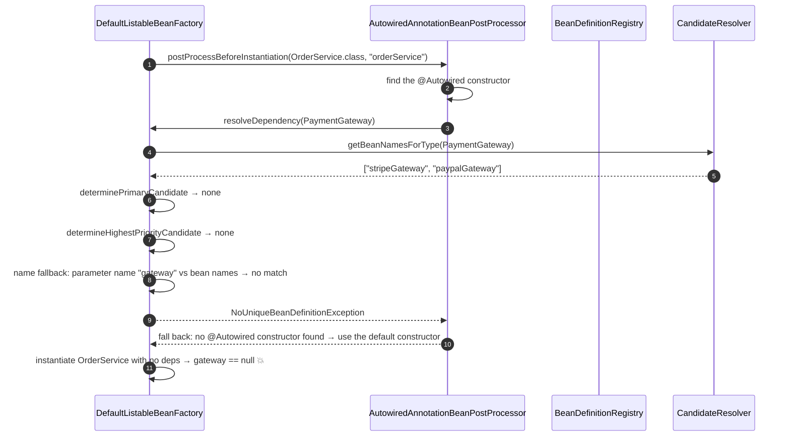
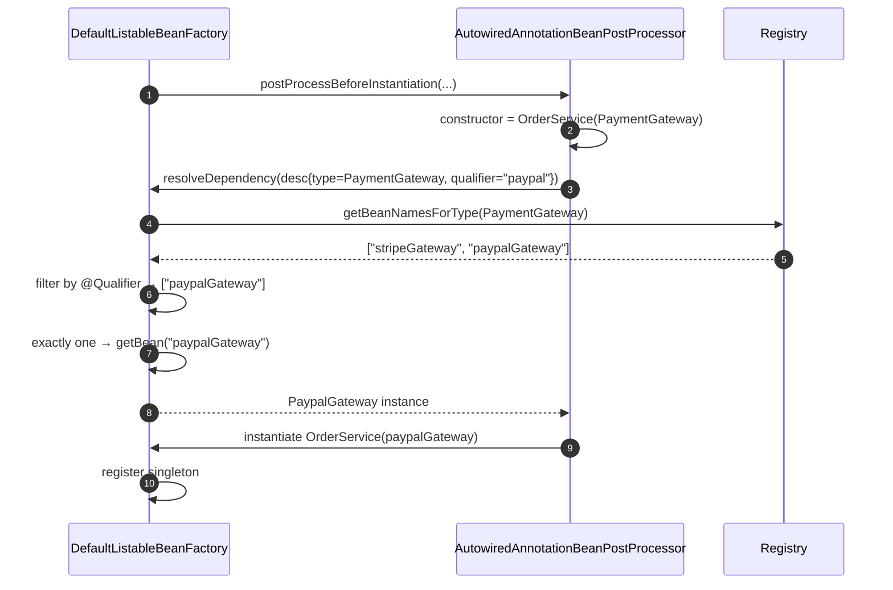

# 02 · Dependency Injection: The Complete Picture

> **Level:** Beginner → Advanced
> **Interview Frequency:** ★★★★★ (Asked at every level; the *depth* is what separates a 2-year from a 5-year candidate)
> **Prerequisite:** [01 · IoC Container](./01-IoC-Container-and-ApplicationContext.md)
> **Last Updated:** 2026

---

## 📋 Table of Contents
- [0. TL;DR — The 30-Second Answer](#0-tldr--the-30-second-answer)
- [1. What & Why](#1-what--why)
- [2. Mental Model — supply and demand](#2-mental-model--supply-and-demand)
- [3. Deep Dive — Theory](#3-deep-dive--theory)
- [4. Internal Working Mechanism](#4-internal-working-mechanism)
- [5. Step-by-Step Execution Flow](#5-step-by-step-execution-flow)
- [6. Architecture Diagrams](#6-architecture-diagrams)
- [7. Production-Level Use Cases](#7-production-level-use-cases)
- [8. Code Examples — Production-Grade](#8-code-examples--production-grade)
- [9. Common Mistakes & Gotchas](#9-common-mistakes--gotchas)
- [10. Performance Considerations](#10-performance-considerations)
- [11. Security Considerations](#11-security-considerations)
- [12. Best Practices — The Checklist](#12-best-practices--the-checklist)
- [13. Hands-On Exercises](#13-hands-on-exercises)
- [14. Code Challenges](#14-code-challenges)
- [15. Scenario-Based Questions](#15-scenario-based-questions)
- [16. Interview Q&A — Level-wise](#16-interview-qa--level-wise)
- [17. Counter-Questions & Traps](#17-counter-questions--traps)
- [18. Tricky Interview Questions](#18-tricky-interview-questions)
- [19. Follow-Up Questions Asked by Interviewers](#19-follow-up-questions-asked-by-interviewers)
- [20. Real 3–5 Year Experience Scenarios](#20-real-35-year-experience-scenarios)
- [21. Frequently Asked Production Issues](#21-frequently-asked-production-issues)
- [22. Debugging Scenarios](#22-debugging-scenarios)
- [23. Architecture Design Questions](#23-architecture-design-questions)
- [24. Rapid-Fire MCQs](#24-rapid-fire-mcqs)
- [25. Cheat Sheet — One-Page Summary](#25-cheat-sheet--one-page-summary)
- [26. Real-World Production Notes](#26-real-world-production-notes)
- [27. Follow-up Learning](#27-follow-up-learning)

---

## 0. TL;DR — The 30-Second Answer

- **DI is the mechanism by which the container supplies a bean's collaborators.** DI is the *means*;
  IoC is the *principle*.
- **Three injection styles:**
  1. **Constructor** — the container picks the constructor and resolves its parameters. ✅ **Use this.**
  2. **Setter** — inject after construction, for **optional/mutable** dependencies. ⚠️ Use sparingly.
  3. **Field** (`@Autowired` on a field) — reflection-based, after construction. ❌ Avoid.
- **Resolution is always *by type first*.** `NoUniqueBeanDefinitionException` when there are several
  candidates; the disambiguators, in order, are: `@Primary` → `@Priority`/`Ordered` → `@Qualifier`
  → **the field/parameter name matching the bean name**.
- **`@Qualifier` is the surgical tool.** `@Primary` picks a default; `@Qualifier` picks a specific
  one. When you have two `PaymentProcessor` beans, `@Primary` is wrong — it's a hidden default
  that will be used by every other injection point.
- **Injection points, not just fields:** constructor parameters, setter parameters, **field**,
  **method parameters** (a "lookup" of any number of beans), and **collection injection**
  (`List<T>`, `Set<T>`, `Map<String,T>`) — Spring resolves *all* matching beans into the collection.
- **`ObjectProvider<T>`** is the modern, safe way to express an *optional* dependency — it defers
  resolution and gives you `getIfAvailable()`.
- **`@Value` injects a single value; `@ConfigurationProperties` binds a whole, typed, validated
  group.** Use properties for configuration, constructor injection for collaborators.
- **Circular dependencies** work for setter/field injection (singleton only) but **not** for
  constructor injection — Spring Boot disables them by default since 2.6.
- **The resolution algorithm is deterministic and worth memorising** — it explains most
  `NoUniqueBeanDefinitionException` bugs.
- **The killer sentence:** *"Constructor injection makes the dependency explicit, the object
  immutable, and the failure happen at startup instead of at the moment of use."*

---

## 1. What & Why

### Without DI

```java
public class OrderService {
    private final PaymentGateway gateway = new StripePaymentGateway(new HttpClient());
    private final NotificationService notifier = new EmailNotificationService(new SmtpClient());
    // ⚠ Hard-wired, untestable, un-swappable
}
```

### With DI

```java
@Service
public class OrderService {
    private final PaymentGateway gateway;          // ← depends on the ABSTRACTION
    private final NotificationService notifier;

    public OrderService(PaymentGateway gateway, NotificationService notifier) {
        this.gateway = gateway;
        this.notifier = notifier;
    }
}
```

The class now says *"I need a `PaymentGateway`"* — not *"I need a `StripePaymentGateway` built with
an `HttpClient`"*. The container decides which implementation. That single change buys you:

| Benefit | Concretely |
|---------|-----------|
| **Testability** | `new OrderService(fakeGateway, fakeNotifier)` — no Spring in the unit test |
| **Substitutability** | Swap Stripe for Adyen with a property (`@ConditionalOnProperty`) |
| **AOP** | The container can proxy the bean to add transactions, caching, retries, metrics |
| **Fail-fast** | A missing dependency fails at **startup**, not at 3 a.m. under load |
| **Testability of configuration** | `@MockBean` / `@MockitoBean` replaces a real collaborator |

### The interviewer trap

> "What's the difference between DI and IoC?"
>
> **Weak answer:** "They're the same."  ← technically defensible, intellectually lazy
>
> **Strong answer:** **IoC is the principle** — the *control* of object creation and wiring is
> *inverted*: the container controls it instead of your code. **DI is one technique for achieving
> IoC** — the container supplies the dependencies. But DI can be done *without* a container (a
> hand-rolled DI container, or a plain constructor call in a test), and IoC can be achieved *without*
> DI (a service locator, or a framework that calls your factory methods). So: **DI is a means,
> IoC is the goal**; and *inversion of control* is the general principle whose most common
> instantiation in Spring is *dependency injection*.

---

## 2. Mental Model — supply and demand

```text
   DEMAND                               SUPPLY
   ───────                              ──────
   "I need a PaymentGateway"      ←      the container scans its registry
                                         for beans of type PaymentGateway
                                          │
                    ┌────────────────────┼────────────────────┐
                    ▼                    ▼                    ▼
              0 candidates?         1 candidate          2+ candidates
                    │                    │                    │
                    ▼                    ▼                    ▼
         required=true →        inject it          @Primary → @Priority
         NoSuchBeanDef…         ✅                  → @Qualifier → name match
         required=false                             → NoUniqueBeanDefinition
         → inject null
```

> **Caption:** The container is a **type-based registry with a deterministic tie-breaking rule**.
> Every DI mystery is answered by asking: *how many candidates were there, and which rule fired?*

---

## 3. Deep Dive — Theory

### 3.1 The three injection styles

#### ① Constructor injection

```java
@Service
public class OrderService {
    private final PaymentGateway gateway;
    private final Repository repo;

    @Autowired                                        // optional in Spring 4.3+ if there's ONE constructor
    public OrderService(PaymentGateway gateway, Repository repo) {
        this.gateway = gateway;
        this.repo = repo;
    }
}
```

**Rules:**
- **One** constructor → no `@Autowired` needed (Spring 4.3+).
- **Multiple** constructors → exactly one must be annotated `@Autowired`, **or** there must be a
  default (no-arg) constructor, **or** the resolution fails.
- With multiple constructors and a no-arg one present, **the no-arg wins** unless one is
  `@Autowired` — a genuinely surprising rule.

**Pros:** immutability (`final`), required dependencies are explicit, the object is usable
immediately after construction (no half-built state), failures at startup, trivially unit-testable.
**Cons:** none for a normal number of dependencies; many constructor params can be a smell.

#### ② Setter injection

```java
@Service
public class OrderService {
    private PaymentGateway gateway;   // ← mutable, optional

    @Autowired(required = false)
    public void setGateway(PaymentGateway gateway) { this.gateway = gateway; }
}
```

**Use for:** genuinely optional collaborators, or a dependency that must be re-settable
(reconfiguration, a test double swapped in at runtime).

**Cons:** the object is **invalid between construction and the setter call**; if the setter is never
called (because the bean is absent), the object silently has `null`.

#### ③ Field injection

```java
@Service
public class OrderService {
    @Autowired
    private PaymentGateway gateway;      // ❌ avoid
}
```

**Cons (all real):**
- The field **can't be `final`** → the object is mutable.
- The object is **half-constructed** between the constructor and the injection.
- **Hidden dependencies** — the class's API doesn't reveal what it needs.
- **Hard to unit-test** — you can't `new` it.
- It **breaks with `final` fields** (the compiler prevents it) and with **`@ConfigurationProperties`**
  ordering subtleties.
- It makes **circular dependencies** possible, which hides a design problem.

**The one legitimate use of field injection in production:** `@Autowired` on a `Logger`? — no, use
the SLF4J API. Honestly: **there isn't a good one.** Some teams allow it for
`@Value`-injected constants.

### 3.2 The resolution algorithm (`DefaultListableBeanFactory`)

```text
resolveDependency(dependencyDescriptor) →
  1. findAutowireCandidates(beanName, type, descriptor)
       └─ getBeanNamesForType(type, allowEagerInit, allowFactoryBeanInit)
       └─ filter: exclude self-references, exclude "resolvable=false" definitions
  2. if no candidates:
       └─ if descriptor.isRequired() → NoSuchBeanDefinitionException
       └─ else → null
  3. if exactly one candidate → return it
  4. if multiple → determineAutowireCandidate():
       a. determinePrimaryCandidate()   → a bean marked @Primary (on the class or the @Bean method)
       b. determineHighestPriorityCandidate() → @Priority / Ordered / @Order on the bean
       c. fallback: the bean whose NAME equals the dependency name
          (field name / constructor parameter name)  ← "by-name fallback"
       d. otherwise → NoUniqueBeanDefinitionException
```

> **Caption:** Step 4c is the one people forget: if you have `class CardGateway` and `class PaypalGateway`
> and inject into a field named `paypalGateway`, Spring picks the bean named `paypalGateway` — no
> `@Qualifier` needed. But it **requires the parameter name to be retained in the bytecode**
> (`-parameters` compiler flag, which Spring Boot's Maven plugin sets by default).

### 3.3 `@Qualifier` — the precise tool

```java
@Component("stripePaymentGateway")
class StripeGateway implements PaymentGateway { ... }

@Component("paypalPaymentGateway")
class PaypalGateway implements PaymentGateway { ... }

@Service
public class OrderService {
    public OrderService(@Qualifier("paypalPaymentGateway") PaymentGateway gateway) { ... }
}
```

**`@Qualifier` also narrows the *type*:** you can use a custom annotation to express a *role*:

```java
@Qualifier
@Retention(RetentionPolicy.RUNTIME)
@Target({ElementType.FIELD, ElementType.PARAMETER, ElementType.METHOD})
public @interface PrimaryPaymentGateway { }

@Component
class StripeGateway implements PaymentGateway { }

@Service
public class OrderService {
    public OrderService(@PrimaryPaymentGateway PaymentGateway gateway) { ... }
}
```

> 💡 **Meta-annotation trick:** `@Qualifier` is itself meta-annotated with `@Target` and
> `@Retention`, so you can create your own qualifiers — and Spring resolves a custom qualifier
> **by its annotation type**, so any bean annotated with `@PrimaryPaymentGateway` matches it.
> This is the cleanest way to express "the default implementation of this role".

### 3.4 Collection & map injection

```java
@Service
public class SearchService {

    // ⚠ ORDER MATTERS: the container injects all matching beans, sorted by @Order/Ordered
    private final List<Index> indexes;

    // ⚠ A Set: beans with the same @Order value are REMOVED (deduplicated by order value)
    private final Set<Validator> validators;

    // A Map: bean name → bean
    private final Map<String, RateLimiter> limiters;

    public SearchService(List<Index> indexes, Set<Validator> validators,
                         Map<String, RateLimiter> limiters) {
        this.indexes = indexes;
        this.validators = validators;
        this.limiters = limiters;
    }
}
```

**Rules and gotchas:**
- `List<T>` — all matching beans, **sorted** by `@Order`/`Ordered` (ascending). If **no** bean
  matches, the list is **empty** (no exception).
- `Set<T>` — same, but Spring **removes duplicates that have the same order value** (a quirk: two
  beans with order `0` and two with order `1` → only one of each survives). Use `List` unless you
  genuinely want that.
- `Map<String, T>` — all matching beans keyed by **bean name**. An empty map if none match.
- `Optional<T>` — the single bean, or `Optional.empty()`. **Fails if there is more than one** — it
  doesn't do "the first".

> **Caption:** Collection injection is the idiomatic **plugin/extensibility** mechanism in Spring:
> the core defines the SPI, the extensions implement it, and the core never knows about them.

### 3.5 `ObjectProvider<T>` — optional dependencies, done right

```java
@Component
public class NotificationService {

    private final ObjectProvider<SmsSender> sms;
    private final ObjectProvider<PushSender> push;

    public NotificationService(ObjectProvider<SmsSender> sms, ObjectProvider<PushSender> push) {
        this.sms = sms;
        this.push = push;
    }

    public void notify(Customer c) {
        sms.ifAvailable(s -> s.send(c.phone(), "Confirmed"));
        push.ifAvailable(p -> p.send(c.token(), "Confirmed"));

        // All of them, ordered:
        sms.orderedStream().forEach(SmsSender::sendAll);

        // A default when absent:
        SmsSender sender = sms.getIfAvailable(() -> new NoopSmsSender());

        // All bean NAMES (no instantiation):
        String[] names = sms.getIfAvailableNames();  // Spring 6.2+: getObjectNames()
    }
}
```

**Why it's better than `@Autowired(required = false)`:**
- `required = false` → the field is `null`; you must null-check **everywhere**, and the compiler
  doesn't help.
- `ObjectProvider` → the **absence is part of the type**, so the intent is explicit and the
  provider is a first-class object you can pass around.

### 3.6 `@Value` — injecting a single property

```java
@Component
public class MailConfig {

    @Value("${mail.host}")
    private String host;                 // ❌ field

    public MailConfig(@Value("${mail.host}") String host) {   // ✅
        this.host = host;
    }

    @Value("${mail.port:587}")                    int port;       // default value
    @Value("${mail.timeout:30s}")            Duration timeout;  // Boot's conversion service
    @Value("${mail.retry:3}")                     int retries;
    @Value("${app.urls}")                   List<String> urls;   // comma-separated
    @Value("${app.${env}.url}")               String envUrl;      // nested placeholder
    @Value("#{systemProperties['java.version']}") String javaVersion;  // SpEL
    @Value("${T(java.time.Duration).ofSeconds(5)}") Duration five;    // SpEL
}
```

**Key facts:**
- `@Value` uses the **`PropertySourcesPlaceholderConfigurer`** to resolve `${...}`.
- It supports **SpEL** inside `#{}`.
- It supports **type conversion** via the `ApplicationConversionService` (so `Duration`,
  `DataSize`, `List`, `enum`, etc. work).
- **Nested placeholders** `${app.${env}.url}` are resolved recursively.
- **Defaults** use `:` — but note `${a:b:c}` means default `"b:c"`, so a default containing a colon
  must be escaped as `${a\:b}`.
- **You cannot inject a `List` of complex objects** — only simple types or a delimited string.

### 3.7 `@ConfigurationProperties` — the modern approach

```java
@ConfigurationProperties(prefix = "app.payment")
@Validated
public record PaymentProperties(

        @NotBlank String provider,                       // validated at STARTUP
        @Min(1) @Max(100) int timeoutSeconds,
        @NotNull Duration connectTimeout,
        @Valid List<GatewayConfig> gateways,             // ⚠ @Valid for nested validation
        @DefaultValue("sandbox") Environment env
) {
    public record GatewayConfig(@NotBlank String id, @NotNull URI endpoint) {}
}
```

```java
@EnableConfigurationProperties(PaymentProperties.class)   // or @ConfigurationPropertiesScan
@SpringBootApplication
public class App { }
```

**Why it's better than `@Value`:**
| Aspect | `@Value` | `@ConfigurationProperties` |
|--------|----------|----------------------------|
| **Type safety** | String → converted at injection | Typed at compile time |
| **Validation** | None (or a manual `@PostConstruct` check) | JSR-380, **at startup** |
| **IDE support** | Poor — the key is a string literal | Full metadata (`spring-configuration-metadata.json`) |
| **Grouping** | One annotation per field | One object for the whole group |
| **Relaxed binding** | ❌ Not applied (`@Value` needs the exact key) | ✅ `payment.provider` → `provider` |
| **Lists/maps** | Comma-separated strings | Real `List<T>` / `Map<String,T>` |
| **Defaults** | `${key:default}` in the string | `DefaultValue`, or just the Java default |
| **Metadata** | None | Auto-generated for IDEs and documentation |

> 💡 **The "relaxed binding" trap:** `@Value("${app.payment.provider}")` needs the *exact* key.
> `@ConfigurationProperties(prefix = "app.payment")` binds `app.payment.provider`, `APP_PAYMENT_PROVIDER`,
> and `app.payment.PROVIDER` — all equivalent. This surprises people who use `@Value` with
> environment variables.

### 3.8 Method injection & `@Lookup`

**Method injection** — inject into an arbitrary method (rare, but useful for a "setup" call):

```java
@Component
public class ReportRenderer {
    private Clock clock;

    @Autowired
    public void configure(Clock clock) { this.clock = clock; }
}
```

**`@Lookup`** — inject a *method call result* (Spring Cloud Context, or Spring's `@Lookup` in
Spring 6.1+ for "prototype in a singleton"):

```java
@Component
public class OrderProcessor {
    @Lookup
    public OrderValidator createValidator() { return new OrderValidator(); }
}
```

Each call to `createValidator()` returns a **fresh instance** — this is the sanctioned way to get a
prototype from a singleton.

### 3.9 Lazy injection

```java
@Component
public class ReportService {
    private final ObjectProvider<ExpensiveEngine> engine;

    public ReportService(ObjectProvider<ExpensiveEngine> engine) { this.engine = engine; }

    public Report generate() {
        return engine.getObject().run();     // ← created on first use
    }
}
```

or

```java
@Lazy
@Component
public class ExpensiveEngine { ... }
```

**What `@Lazy` actually does:**
- On the **injection point**: a **lazy-resolution proxy** is injected; the target is created on the
  first method call. This breaks the circular-dependency problem (the proxy is injected, not the
  target).
- On the **bean definition**: the bean isn't created during `preInstantiateSingletons`; it's
  created on first `getBean`.

> ⚠ **The gotcha:** a `@Lazy` proxy means `bean.getClass()` is a proxy class, and **the target
> isn't created until the first call** — so a failure in the target's constructor moves from startup
> to runtime. This is exactly the "fail fast" property that DI was supposed to give you.

### 3.10 The `BeanPostProcessor` behind injection

`AutowiredAnnotationBeanPostProcessor` is the `BeanPostProcessor` that performs injection. It
implements `MergedBeanDefinitionPostProcessor` (so it can see `@Autowired` metadata) and
`InstantiationAwareBeanPostProcessor` (so it can inject **before** the properties are set and
**after** the object is instantiated but **before** `@PostConstruct`).

```java
public interface InstantiationAwareBeanPostProcessor extends BeanPostProcessor {
    @Nullable
    default Object postProcessBeforeInstantiation(Class<?> beanClass, String beanName) { return null; }
    default boolean postProcessAfterInstantiation(Object bean, String beanName) { return true; }
    default void postProcessProperties(Object bean, String beanName) { }
}
```

- `postProcessBeforeInstantiation` → the hook for **constructor injection** (the processor can
  supply a fully constructed object and skip instantiation entirely).
- `postProcessAfterInstantiation` → returning `false` **skips** the standard property population.
- `postProcessProperties` → where **field/setter** injection happens.

---

## 4. Internal Working Mechanism

### 4.1 Where injection happens in the lifecycle

```text
 1. instantiate()                            ← constructor runs
 2. postProcessBeforeInstantiation()         ← ★ CONSTRUCTOR injection resolved here
 3. populateBean()
      ├─ applyPropertyValues()               ← <property> XML values
      └─ postProcessProperties()             ← ★ FIELD / SETTER injection here
 4. postProcessBeforeInitialization()
 5. @PostConstruct → afterPropertiesSet → init-method
 6. postProcessAfterInitialization()         ← ★ AOP PROXY created here
```

> **Caption:** Constructor injection is resolved *before* instantiation completes (the processor
> resolves the constructor's arguments and, if it can, supplies the instance). Field/setter
> injection happens *after* instantiation, in `postProcessProperties`.

### 4.2 `getBeanNamesForType()` — the expensive part

```java
public String[] getBeanNamesForType(ResolvableType type, boolean includeNonSingletons,
                                    boolean allowEagerInit) {
    String[] result = doGetBeanNamesForType(ResolvableType.forRawClass(type.getRawClass()), ...);
    // 1. walk all bean definitions
    // 2. for each: check the class, the FactoryBean type, the generics
    // 3. CACHE the result in allBeanNamesByType
    // 4. clearBeanTypeCache() whenever a definition changes
}
```

**Cost drivers:**
- The number of bean definitions (a big app = 500+ definitions).
- **Generics matching** — `ResolvableType` resolution is significantly slower than a raw `Class`
  check.
- `allowEagerInit` — when `true` (the default for `getBean(Class)`), a `FactoryBean` may be
  **instantiated** just to learn its type. `getBeanNamesForType` uses `allowEagerInit=false` by
  default to avoid that.

**Optimisation:** the result is cached in `allBeanNamesByType` and invalidated on any definition
change. This is why **registering bean definitions at runtime** (in a
`BeanFactoryPostProcessor` or a `BeanDefinitionRegistryPostProcessor`) is expensive — it clears the
cache.

### 4.3 Circular dependency resolution

```text
Constructor injection cycle:
   A(B b)  ←→  B(A a)
   → BeanCurrentlyInCreationException ("is not eligible for getting processed by all
     BeanPostProcessors") — you cannot proxy a half-constructed object

Setter / field injection cycle (singleton only):
   1. create A → add "early reference" to singletonFactories
   2. populate A → needs B → create B
   3. populate B → needs A → getEarlyBeanReference(A)
        → A isn't fully initialised → the container creates a PROXY (if AOP applies) or
          returns the raw early reference
   4. B completes → A completes
   ⚠ Boot 2.6+ sets spring.main.allow-circular-references=false by default
```

> **Caption:** The circular-dependency "support" is a **latent bug generator**: it works only for
> singletons, it produces partially-initialised objects, and the "fix" hides a design problem
> (usually a missing interface).

---

## 5. Step-by-Step Execution Flow

### 5.1 Resolving a constructor parameter



### 5.2 A successful resolution with a qualifier



---

## 6. Architecture Diagrams

### 6.1 The DI graph at runtime

```text
   ┌──────────────────────────────────────────────────────────────────┐
   │  DefaultListableBeanFactory                                     │
   │                                                                  │
   │   beanDefinitionMap                                             │
   │   ┌──────────────────┬──────────────────┬────────────────────┐   │
   │   │ orderService     │ stripeGateway    │ paypalGateway      │   │
   │   │ class=OrderSvc   │ class=StripeGw   │ class=PaypalGw     │   │
   │   │ scope=singleton  │ primary=true     │ qualifier=paypal  │   │
   │   └──────────────────┴──────────────────┴────────────────────┘   │
   │                                                                  │
   │   singletonObjects                                              │
   │   ┌──────────────────┬──────────────────┬────────────────────┐   │
   │   │ OrderService     │ StripeGateway    │ PaypalGateway      │   │
   │   │   └──→ PaymentGateway ──┘ (field)   │                   │   │
   │   └──────────────────┴──────────────────┴────────────────────┘   │
   └──────────────────────────────────────────────────────────────────┘
```

### 6.2 The resolution decision tree

```text
              dependency: PaymentGateway
                          │
                          ▼
        getBeanNamesForType(PaymentGateway)
                          │
        ┌─────────────────┼─────────────────┐
        ▼                 ▼                 ▼
      empty             one              several
        │                 │                 │
   required?         inject it       @Primary present?
        │                 │                 ├── yes → inject it
   yes → throw          │                 └── no
   no  → null           │                      ▼
                                       @Priority / Ordered?
                                        ├── yes → inject it
                                        └── no
                                             ▼
                                    name == parameter name?
                                     ├── yes → inject it
                                     └── no → NoUniqueBeanDefinitionException
```

### 6.3 Injection style comparison

```text
  CONSTRUCTOR            SETTER                 FIELD
  ───────────            ──────                 ─────
  object fully built ✅   object built, then      object built, then
  deps assigned          deps assigned           deps assigned
  can be final ✅         mutable ⚠               mutable ⚠
  unit-testable ✅       easy                     hard ❌ (needs a container)
  startup failure ✅      startup failure         startup failure
  circular deps ❌        circular deps ⚠         circular deps ⚠
  many deps → long ctor  ok for optional         ok for @Value only
```

---

## 7. Production-Level Use Cases

| Use case | Technique | Notes |
|----------|-----------|-------|
| **Multi-implementation strategy** (payment, notification) | `@Qualifier` per injection point | Don't use `@Primary` for this — it hides intent |
| **Optional integration** (Slack only if configured) | `ObjectProvider<SlackSender>` + `@ConditionalOnProperty` | Avoid `required=false` + null checks |
| **Plugin/extensibility** | `List<Spi>` injection | The core doesn't know the plugins; order via `@Order` |
| **Configuration** | `@ConfigurationProperties` + `@Validated` | Startup validation, type safety, metadata |
| **Strategy selection at runtime** | `Map<String, Strategy>` | Select by key; a `Map` injection is the natural fit |
| **Test doubles** | `@MockitoBean` / `@MockBean` | Replaces the bean in the context — the wiring is still tested |
| **Circular dependency (rare)** | `@Lazy` on one side | Prefer extracting an interface |
| **Multi-tenancy** | `ObjectProvider<TenantContext>` | Works outside a request (jobs, consumers) |
| **Feature flags** | `@ConditionalOnProperty` on the implementation | The consumer injects the *interface* |
| **Resolving a bean by name at runtime** | `ObjectProvider.getObject(name, type)` | Avoid `getBean(String)` with user input |

---

## 8. Code Examples — Production-Grade

### 8.1 The canonical constructor-injection service

```java
@Service
@Transactional(readOnly = true)
public class OrderService {

    private final OrderRepository repository;
    private final PaymentGateway paymentGateway;
    private final Clock clock;

    public OrderService(OrderRepository repository,
                        PaymentGateway paymentGateway,
                        Clock clock) {
        this.repository = repository;
        this.paymentGateway = paymentGateway;
        this.clock = clock;
    }

    @Transactional
    public Order place(CreateOrderCommand cmd) {
        Order order = Order.from(cmd, clock.instant());
        repository.save(order);
        paymentGateway.charge(order.getId(), order.getTotal());
        return order;
    }
}
```

### 8.2 Multiple implementations with `@Qualifier`

```java
// ── The SPI ─────────────────────────────────────────────────────────
public interface NotificationSender {
    String channel();
    void send(String recipient, String message);
}

// ── Implementations ─────────────────────────────────────────────────
@Component("emailNotificationSender")
class EmailNotificationSender implements NotificationSender {
    public String channel() { return "email"; }
    public void send(String recipient, String message) { /* ... */ }
}

@Component("smsNotificationSender")
class SmsNotificationSender implements NotificationSender {
    public String channel() { return "sms"; }
    public void send(String recipient, String message) { /* ... */ }
}

// ── Custom qualifier (a "role") ─────────────────────────────────────
@Qualifier
@Retention(RetentionPolicy.RUNTIME)
@Target({ElementType.FIELD, ElementType.PARAMETER, ElementType.METHOD})
public @interface PrimaryChannel { }

// ── The consumer ────────────────────────────────────────────────────
@Service
public class OrderNotifier {

    private final NotificationSender defaultSender;
    private final Map<String, NotificationSender> byChannel;

    public OrderNotifier(@PrimaryChannel NotificationSender defaultSender,
                         Map<String, NotificationSender> byChannel) {
        this.defaultSender = defaultSender;
        this.byChannel = byChannel;      // keyed by BEAN NAME
    }

    public void notify(Order order, String preferredChannel) {
        NotificationSender sender = byChannel.getOrDefault(preferredChannel, defaultSender);
        sender.send(order.customerId(), "Order " + order.getId() + " confirmed");
    }
}
```

> **Caption:** `Map<String, NotificationSender>` is keyed by the **bean name**
> (`emailNotificationSender`), not by `channel()`. If you want the `channel()` as the key, use a
> `BeanPostProcessor` to rewrite the map keys, or name the beans after the channel.

### 8.3 Plugin pattern with ordered injection

```java
public interface TaxRule {
    int order();                      // or use @Order on the implementations
    BigDecimal apply(Order order);
}

@Component
@Order(1)
class VatRule implements TaxRule { /* ... */ }

@Component
@Order(2)
class ReducedRateRule implements TaxRule { /* ... */ }

@Service
public class TaxCalculator {
    private final List<TaxRule> rules;   // Spring injects ALL, ordered by @Order

    public TaxCalculator(List<TaxRule> rules) { this.rules = rules; }

    public BigDecimal calculate(Order order) {
        return rules.stream()
                    .map(r -> r.apply(order))
                    .reduce(BigDecimal.ZERO, BigDecimal::add);
    }
}
```

### 8.4 Optional integration — the clean way

```java
@Component
@ConditionalOnProperty(name = "app.slack.enabled", havingValue = "true")
class SlackNotifier implements NotificationSender {
    public String channel() { return "slack"; }
    public void send(String recipient, String message) { /* ... */ }
}

@Service
public class NotificationService {

    private final ObjectProvider<NotificationSender> senders;

    public NotificationService(ObjectProvider<NotificationSender> senders) {
        this.senders = senders;
    }

    public void notifyAll(String recipient, String message) {
        // If Slack is disabled, its bean simply doesn't exist → no error
        senders.orderedStream().forEach(s -> s.send(recipient, message));
    }
}
```

### 8.5 Typed configuration with validation

```java
@ConfigurationProperties(prefix = "app.gateway")
@Validated
public record GatewayProperties(

        @NotBlank
        @Pattern(regexp = "https://.*", message = "must be HTTPS")
        URI endpoint,

        @NotNull
        @DurationMin(seconds = 1)
        @DurationMax(minutes = 5)
        Duration timeout,

        @Min(1) @Max(10)
        int maxRetries,

        @NotEmpty
        List<@Pattern(regexp = "[a-z]{2}-[A-Z]{2}") String> allowedRegions
) { }
```

```java
@SpringBootApplication
@EnableConfigurationProperties(GatewayProperties.class)
public class App {
    public static void main(String[] args) { SpringApplication.run(App.class, args); }
}
```

> **Caption:** With `@Validated` + JSR-380, a bad property makes the app **fail at startup** with a
> precise message — instead of failing at 3 a.m. when the feature is first used.

### 8.6 Injecting a `Clock` (the testability pattern)

```java
@Bean
Clock clock() { return Clock.systemUTC(); }          // production

@Service
public class TokenService {
    private final Clock clock;
    public TokenService(Clock clock) { this.clock = clock; }

    public boolean isExpired(Instant issuedAt, Duration ttl) {
        return clock.instant().isAfter(issuedAt.plus(ttl));
    }
}
```

```java
@Test
void should_expire() {
    Clock fixed = Clock.fixed(Instant.parse("2026-01-01T00:00:00Z"), ZoneOffset.UTC);
    var service = new TokenService(fixed);            // no Spring needed
    assertThat(service.isExpired(Instant.parse("2025-12-31T23:00:00Z"), Duration.ofMinutes(30))).isTrue();
}
```

### 8.7 A custom qualifier + `@Primary` for the default

```java
@Bean
@Primary
@ConditionalOnMissingBean
PaymentGateway defaultPaymentGateway(PaymentProperties props) {
    return switch (props.provider()) {
        case "stripe" -> new StripeGateway(props);
        case "paypal" -> new PaypalGateway(props);
    };
}
```

---

## 9. Common Mistakes & Gotchas

| # | ❌ Wrong | ✅ Right | Why |
|---|----------|----------|-----|
| 1 | Field injection | Constructor injection | Immutability, testability, explicitness |
| 2 | `@Primary` for "the default implementation" when several exist | `@Qualifier` per injection point | `@Primary` creates a hidden global default |
| 3 | Two beans, no qualifier, hoping the field name matches | `@Qualifier("beanName")` | The name fallback needs `-parameters` and matching names |
| 4 | `@Value("${a.b}")` for a group of settings | `@ConfigurationProperties` | No validation, no binding, no metadata |
| 5 | `@Autowired(required = false)` for an optional dep | `ObjectProvider<T>` | Explicit absence; no null checks scattered around |
| 6 | Injecting a `prototype` into a `singleton` | `ObjectProvider<T>` + `getObject()` per use | Otherwise the prototype is created once |
| 7 | Circular dependencies via setter injection | Extract an interface into a third bean | Boot disables them; the design is wrong |
| 8 | `@Value` on a `boolean` from a missing property | `${flag:false}` or a `boolean` field in properties | `@Value` without a default fails at startup |
| 9 | `@Value("${list}")` expecting a `List<ComplexObject>` | `@ConfigurationProperties` | `@Value` can't bind complex types |
| 10 | Relying on injection order | `@DependsOn` / `@Order` | Bean creation order is not a contract |
| 11 | Injecting `List<T>` and assuming registration order | Use `@Order` on the implementations | The order is by `@Order`, not by scan order |
| 12 | `@Autowired` on a `static` field | Don't | Static fields aren't managed |
| 13 | Using `Set<T>` for a list of rules | `List<T>` | `Set` dedupes by order value — you lose rules |
| 14 | `@Value("${a:b:c}")` expecting default `"c"` | `${a\:b\:c}` | Everything after the first `:` is the default |
| 15 | Injecting a `Map<String, T>` and assuming the key is the bean's `@Qualifier` | It is the **bean name** | A frequent, painful surprise |

---

## 10. Performance Considerations

| Aspect | Impact | Guidance |
|--------|--------|----------|
| **`getBeanNamesForType`** | O(number of definitions) with generics resolution | Cached; avoid at request time |
| **Field injection vs constructor** | Essentially identical at runtime | Constructor is faster to *fail* — prefer it for safety, not speed |
| **Early singleton creation** | All singletons are created at startup; DI is resolved then | Use `@Lazy` for genuinely optional/heavy graphs |
| **Proxy creation** | Each proxied bean costs a class-generation at startup | Avoid proxying the whole app |
| **Circular references** | Forces early-reference proxies — extra allocation and complexity | Remove them |
| **Large constructor graphs** | Deep graphs = long startup | Keep the graph shallow; use `ObjectProvider` to break cycles |
| **Reflection** | `@Autowired` uses reflection → slower than direct calls | Irrelevant after startup (the fields are set once) |
| **`ObjectProvider.getObject()` per call** | A lookup each time (cheap, but not free) | Cache the resolved instance in a `volatile` field if it's hot |

---

## 11. Security Considerations

| Risk | Mitigation |
|------|-----------|
| **Injected secrets in a singleton field** | The secret lives in memory for the app's lifetime | Use a `SecretProvider` bean that reads from a vault at call time, or rotate |
| **A `@Value`d password in a bean** | Visible in the heap, in `/actuator/env` (if exposed), and in a heap dump | Restrict `/actuator/env`; prefer a secret manager |
| **Qualifiers that select the wrong implementation** | A `@Qualifier("testGateway")` leaking into prod | Qualifiers are compile-time constants — a test bean in the main source set is a bug |
| **Injection of an unauthenticated client** | A `RestClient` without auth | Configure the client bean centrally with the credential, never per call site |
| **`ObjectProvider` hiding a missing security bean** | A security filter silently absent | Fail fast: use a required injection for security components |
| **Over-broad `List<T>` injection** | A plugin can add a bean that intercepts traffic | Restrict plugin loading to trusted sources |
| **`@Value` with a SpEL expression** | SpEL can call methods — a risk if the value is user-controlled | Never put user input into `@Value` |

---

## 12. Best Practices — The Checklist

- [ ] **Constructor injection only** (except `@Value` constants, if your team allows it).
- [ ] **`final` fields** for all constructor-injected dependencies.
- [ ] **`@Qualifier`** whenever more than one bean of a type exists — don't rely on `@Primary`.
- [ ] **`ObjectProvider<T>`** for optional dependencies, never `required = false`.
- [ ] **`@ConfigurationProperties` + `@Validated`** for configuration — never a wall of `@Value`.
- [ ] **Inject `Clock`** instead of calling `Instant.now()`.
- [ ] **Inject the interface**, not the implementation.
- [ ] **No circular dependencies.** If you have one, extract an interface.
- [ ] **Plugins via `List<Spi>`** with `@Order`.
- [ ] Keep the constructor **short**. > 7 parameters → group into a parameter object or split the
      class.
- [ ] **Never** inject `ApplicationContext` into a service.

---

## 13. Hands-On Exercises

**🧪 Lab 1 — The tie-breaker ladder**
1. Create three `PaymentGateway` beans: `stripe` (`@Primary`), `paypal` (`@Priority(1)`), `bank`.
2. Inject by type into a service → observe which one wins (`stripe`).
3. Remove `@Primary` → observe `@Priority` winning.
4. Remove `@Priority` → rename the field to `paypal` → observe the **name fallback** winning.
5. Rename the field to `xyz` → observe `NoUniqueBeanDefinitionException` and read its message.

**✅ Success signal:** You can predict the winner for any configuration without running it.

**🧪 Lab 2 — `@Value` vs properties**
1. Bind `app.gateway.timeout` as a `Duration` with `@Value` and prove that `"30"` (no unit) fails
   while `"30s"` works.
2. Do the same with `@ConfigurationProperties` and prove `"30"` works (the default unit is seconds
   for `Duration` in Boot's binder — check `spring-boot`'s `DurationStyle`).
3. Add a `@Min(1)` constraint and show that the app **fails at startup** with a clear message.

**✅ Success signal:** You understand the *binder* vs the *placeholder resolver* difference.

**🧪 Lab 3 — The prototype trap, again**
1. Inject a prototype into a singleton via constructor injection.
2. Call a method on it twice → the same instance.
3. Change to `ObjectProvider` and call `getObject()` twice → different instances.

**✅ Success signal:** You've internalised that DI resolves the dependency **once**.

**🧪 Lab 4 — Collection injection**
1. Implement three `TaxRule`s with different `@Order` values.
2. Inject `List<TaxRule>` and print the order → it's by `@Order`, not by class name or scan order.
3. Change to `Set<TaxRule>` and give two of them the **same** order → one disappears.

**✅ Success signal:** You know the `Set` dedup quirk.

---

## 14. Code Challenges

### Challenge 1 — A strategy registry (medium)
**Goal:** Build a `NotificationService` that dispatches to a sender by channel name, where the
channel is chosen at runtime from a request parameter.
**Requirements:**
- Senders are discovered automatically (no manual registration).
- Adding a new sender = adding a class, no changes to the service.
- Unknown channel → a clear, typed exception.
- A unit test that proves a new sender is picked up with **zero** changes to the service.

**Hint:** `Map<String, NotificationSender>` injection; the key is the bean name.

### Challenge 2 — A safe `@ConfigurationProperties` migration (hard)
**Goal:** You have 40 `@Value` fields across a codebase. Migrate them to
`@ConfigurationProperties` groups.
**Requirements:**
- Group by prefix.
- Add validation to each group.
- Write a test that asserts the app **fails to start** when a property is invalid.
- Support both the old and new keys during the transition (use
  `spring.config` or a `PropertyMapper`).

**Hint:** `Binder`, `@ConfigurationPropertiesScan`, `ApplicationContextRunner`.

### Challenge 3 — Break a circular dependency properly (medium)
**Goal:** `A` needs `B`; `B` needs `A`. Refactor so there is **no** circular dependency and
**no** `@Lazy`.
**Requirements:** introduce an interface or an event; keep the public API of `A` and `B`
unchanged; add a test.

**Hint:** the classic answer is an application event or a third collaborator.

---

## 15. Scenario-Based Questions

**S1.** *You join a project. `OrderService` has 11 `@Autowired` fields, one of which is
`@Autowired(required = false)` and is null-checked in 4 places. A new requirement adds a
dependency. What do you do?*
>
> **Expected answer:** (1) **Diagnose the smell first** — 11 dependencies is a **class that does too
> many things** (SRP violation), and the nullable field means the object has **two valid states**.
> (2) **Refactor incrementally**, not in one PR: convert field injection to constructor injection
> first (mechanical, safe, and it makes the null-check problem visible), then group the
> dependencies into cohesive collaborators (e.g. `PaymentOperations`, `NotificationOperations`),
> then replace the nullable dependency with `ObjectProvider<T>` or the **Null Object pattern** (a
> `NoopPaymentGateway`) so there is exactly one valid state. (3) **Don't** just add a 12th field.
> (4) Add tests as you go — a constructor-injection refactor is trivially testable. (5) Mention
> **risk management**: do it in small PRs, keep the public API stable, and use the ArchUnit rule
> ("no `@Service` may have more than N fields" / "no field injection") to *prevent regression*.
> The senior point: **the 12th dependency is a symptom, not the problem** — the real problem is
> that the class has 4 reasons to change.

**S2.** *Production: `NoUniqueBeanDefinitionException` after a Spring Boot upgrade. The bean names
haven't changed. What happened?*
>
> **Expected answer:** A new bean of the same type was introduced — typically by an **upgraded
> library's auto-configuration** (a new starter, a new version of a persistence library) or by a
> **new class in your own code** that now satisfies the same interface. (1) Read the exception
> message: it lists **all the candidate bean names and their classes** — that's your diagnosis.
> (2) Use `--debug` to see the auto-configuration report and see which auto-config contributed the
> new bean. (3) **Fixes, in order**: (a) add `@Qualifier` to the injection point — the *most
> precise* fix; (b) add `@Primary` to the bean you want as the default — quick, but a hidden
> default; (c) exclude the offending auto-configuration
> (`spring.autoconfigure.exclude=...`) if you don't need it at all; (d) as a last resort,
> `spring.main.allow-bean-definition-overriding=true` — but that only applies to *definition
> overriding*, not to *type ambiguity*, so it often doesn't even fix it. (4) **Prevent**: in a
> library you own, always guard with `@ConditionalOnMissingBean`; in your own code, keep interfaces
> narrow so unrelated beans don't collide. (5) Also check whether the upgrade introduced a bean
> with a **different scope** — then you get a `ConflictingBeanDefinitionException` instead.

**S3.** *A `@Lazy` bean keeps a circular dependency working, but the team wants to remove
`@Lazy`. How?*
>
> **Expected answer:** `@Lazy` on a circular dependency works by injecting a **proxy**, so the
> cycle is broken at construction time — but it moves the failure from startup to the first call and
> hides the design flaw. The proper fixes, in order: (1) **Extract the shared abstraction** — if `A`
> and `B` both need `C`, create `C` and inject it into both (the classic "third bean" solution).
> (2) **Publish an event** — `A` publishes `OrderPlacedEvent` and `B` listens; no direct dependency
> at all. (3) **Introduce an interface** implemented by a "coordinator" that both depend on.
> (4) If the cycle is genuinely inherent (e.g. a parent-child bidirectional association), **use
> `ObjectProvider`**: inject `ObjectProvider<B>` into `A` and call `getObject()` lazily *at the
> point of use*, which breaks the *construction* cycle without a proxy on the class. (5) The
> **architectural** fix: the cycle usually signals that `A` and `B` are **one concept split in
> two** — consider merging them or extracting a shared kernel.

---

## 16. Interview Q&A — Level-wise

### 🟢 Beginner
**Q: What is dependency injection?**
**A:** A design pattern where an object receives its dependencies from an external source (the
Spring container) rather than constructing them itself. The container resolves the dependencies and
passes them in — via the constructor, a setter, or field injection.

**Q: What are the three types of injection?**
**A:** **Constructor** (the container picks the constructor and resolves the parameters — the
recommended one), **Setter** (for optional/mutable dependencies), and **Field** (reflection-based,
after construction — discouraged). The difference matters because it determines when the object
becomes valid and how testable it is.

**Q: What is `@Autowired`?**
**A:** The annotation that marks an injection point. With one constructor, `@Autowired` is optional;
with multiple, it's required on exactly one (or you need a default constructor).

### 🟡 Intermediate
**Q: How does Spring resolve a dependency when multiple beans of the same type exist?**
**A:** In this order: **`@Primary`** on a candidate → **`@Priority`/`Ordered`** on a candidate →
**the bean whose name matches the field/parameter name** → otherwise
`NoUniqueBeanDefinitionException`. `@Qualifier` on the injection point filters the candidates
before this process.

**Q: `@Autowired` vs `@Resource` vs constructor injection?**
**A:** `@Autowired` is Spring's, resolves **by type** first, with the qualifier/primary/name
fallbacks. `@Resource` is JSR-250 (Jakarta), resolves **by name first**, then by type — it's
JEE-specific and rarely needed in Boot. Constructor injection is the *style* to prefer: it makes
the dependency required and the object immutable.

**Q: What is the difference between `@Value` and `@ConfigurationProperties`?**
**A:** `@Value` injects a **single** property into one field/parameter, resolved by the
`PropertySourcesPlaceholderConfigurer`, without relaxed binding and without validation.
`@ConfigurationProperties` **binds a group of properties to a typed object**, with relaxed
binding, JSR-380 validation at startup, generated metadata for IDEs, and support for complex
`List`/`Map` values.

**Q: Can you inject a bean into a field of type `List<T>`?**
**A:** Yes — Spring injects **all** beans of type `T`, sorted by `@Order`/`Ordered`, into the list.
If none match, the list is empty (no error). The same works for `Set<T>` (with the same-order
dedup quirk) and `Map<String, T>` (keyed by **bean name**).

### 🔴 Advanced / Senior
**Q: Why is constructor injection better than field injection?**
**A:** (1) **Immutability** — the fields can be `final`. (2) **The object is fully valid after
construction** — no window where a dependency is `null`. (3) **Testability** — `new MyService(dep)`
works with no container. (4) **Explicit API** — the constructor *is* the contract; a reader can see
the dependencies. (5) **Fail-fast** — a missing dependency fails at startup in both cases, but with
constructor injection the failure is unambiguous ("no qualifying bean") and the object can never be
half-built. (6) **No circular dependency** — constructor cycles are impossible to satisfy, which
surfaces the design problem instead of hiding it. (7) **Final fields are safe to publish** across
threads (JMM safe publication).

**Q: How does Spring handle circular dependencies, and why are they disabled?**
**A:** For **singleton** beans with **setter/field** injection, the container puts an *early
reference* (a `FactoryBean`-aware singleton factory) in the map, so the cycle can be resolved with
a partially-initialised object. It **cannot** work for **constructor** injection (you can't proxy an
object whose constructor hasn't finished) or for **prototypes** (no shared instance to reference).
Spring Boot **disabled it by default in 2.6** (`spring.main.allow-circular-references=false`)
because it is usually a sign of a missing abstraction and can produce subtle
partially-initialised-object bugs.

**Q: What happens with a `prototype` bean injected into a `singleton`?**
**A:** The prototype is instantiated **once**, during the singleton's creation, and the singleton
holds that one instance — so the "prototype" silently behaves like a singleton, and its state is
shared across all threads. The fix: inject `ObjectProvider<T>` and call `getObject()` at each use
(spring creates a new instance per call), or use `@Lookup` (Spring 6.1+) to have a *method* return
a fresh instance, or use a request scope.

**Q: Explain `ObjectProvider` and when you'd use it.**
**A:** It's a programmatic, lazy, **optional** dependency handle. `getIfAvailable()` returns the bean
or `null`; `getIfAvailable(Supplier)` returns a default; `orderedStream()` gives all beans ordered;
`getObjectNames()` lists the names without instantiating. Use it for (a) optional integrations,
(b) getting a fresh prototype per call, (c) breaking a circular dependency, and (d) resolving a
bean by name/type at runtime. It's strictly better than `@Autowired(required = false)` because the
*absence* is explicit in the type and you don't sprinkle null checks.

**Q: How does Spring know which bean to inject when there are several?**
**A:** The candidate list comes from `getBeanNamesForType` (type + generics aware, cached). Then,
in order: a candidate marked `@Primary` (on the class or the `@Bean` method) → the candidate with
the highest `@Priority`/`Ordered`/`@Order` → the candidate whose **bean name matches the injection
point's name** (this requires the `-parameters` compiler flag) → otherwise
`NoUniqueBeanDefinitionException`, whose message lists every candidate.

### ⚫ Expert / Principal
**Q: Design the DI strategy for a codebase with 500 beans.**
> **Answer structure:** (1) **Conventions** — one stereotype per layer, constructor injection only,
> interfaces at module boundaries, no `ApplicationContext` injection. (2) **Enforcement** —
> **ArchUnit** rules: "no field injection in `@Service`", "no `@Service` may depend on
> `ApplicationContext`", "no class in the `web` package may depend on `persistence`", "no class may
> have more than N constructor parameters". (3) **Ambiguity** — a rule that no two beans of the
> same type may exist without an explicit `@Qualifier`; a custom check that scans bean definitions
> at startup and fails on ambiguity (a "strict mode" for a large codebase). (4) **Configuration** —
> `@ConfigurationProperties` groups with validation, and no `@Value` in the `web`/`service` layers
> (only in `config`). (5) **Startup performance** — 500 beans means a real `getBeanNamesForType`
> cost; keep the definitions lean, use `@Lazy` sparingly, and measure with
> `spring.main.lazy-initialization` (only in dev!). (6) **Testing** — a `DefaultListableBeanFactory`
> for unit tests, sliced tests for the layers, and a full-context smoke test that asserts the
> context loads (a "wiring test"). (7) **Evolution** — the ArchUnit rules are the *migration
> mechanism*: they turn the conventions from a review comment into a build failure.

---

## 17. Counter-Questions & Traps

### CQ1. "If DI is just passing arguments, why is it a big deal?"
- **Naive answer:** "It decouples the classes."  ← true but shallow
- **The trap:** Decoupling is the *visible* benefit; the *real* value is that it enables the
> container to **substitute a decorated object** (a proxy) without your code knowing.
- **Expert answer:** Because the container creates the object, it can hand out a **proxy** instead —
> and that's the mechanism behind `@Transactional`, `@Cacheable`, `@Async`, `@Retryable` and
> `@PreAuthorize`. A plain `Supplier<MyService>` can never give you that.

### CQ2. "Isn't setter injection more flexible? Why is it discouraged?"
- **Naive answer:** "Because fields are mutable."  ← partially right
- **The trap:** The real issue is the **window of invalidity** — between construction and the setter
> call, the object is in a state that its own methods might not tolerate.
- **Expert answer:** Setter injection is fine for genuinely optional or re-settable dependencies.
> The smell is using it for *required* dependencies: the object can't enforce its own invariants,
> the failure mode is a `NullPointerException` deep in a business method rather than a startup
> error, and the class ends up with a mutable identity. **Use constructor injection for required
> dependencies, setter only for optional ones.**

### CQ3. "What if I need to pick the implementation at runtime based on data?"
- **Naive answer:** "Use `@Qualifier`."  ← can't — qualifiers are static
- **The trap:** `@Qualifier` is resolved at **startup**, not per call.
- **Expert answer:** Inject **`Map<String, Strategy>`** and select by key at runtime (the key is the
> bean name), or inject `List<Strategy>` and select with a `filter` on a `supports(...)` method
> (a "chain of responsibility"). Both keep the container out of your business logic. The
> `Map` approach is the standard answer.

### CQ4. "Why does Spring need the `-parameters` compiler flag?"
- **Naive answer:** "For constructor injection."  ← incomplete
- **The trap:** The flag is what lets Spring **read the parameter names** — used for the
> by-name fallback, and for `@Value` on constructor parameters.
- **Expert answer:** Without it, the class file only has the *types* of the constructor
> parameters, so Spring can't tell that the parameter named `paypalGateway` should receive the bean
> named `paypalGateway`. Spring Boot's Maven/Gradle plugins set `-parameters` by default; if you
> build outside Boot's plugin, you must set it yourself, or the by-name fallback silently stops
> working.

### CQ5. "Is `@Autowired` on a field ever OK?"
- **Naive answer:** "Never."  ← dogmatic
- **The trap:** There are legitimate uses in frameworks and in `static` utility holders, and some
> teams use it for `@Value` constants.
- **Expert answer:** It's acceptable for **simple `@Value` constants** in a `@Component` and for
> certain framework patterns, but never for **collaborators** in a business service. The reason
> is not style: it's that field injection (a) makes the object untestable without a container,
> (b) permits a `null` collaborator, (c) hides the dependency from the API, and (d) prevents
> `final` fields. If a team enforces constructor injection via ArchUnit, the exceptions become
> explicit and rare.

### CQ6. "How do you inject a bean that might not exist?"
- **Naive answer:** "`@Autowired(required = false)`."  ← works, but poor
- **The trap:** The field is `null`; the compiler can't help; you must null-check everywhere.
- **Expert answer:** **`ObjectProvider<T>`** — `getIfAvailable()`, `getIfAvailable(Supplier)`,
> `orderedStream()`. It expresses optionality in the **type system**, it defers resolution (so
> the bean isn't created until needed), and `getIfAvailable(Supplier)` gives you a Null Object
> pattern for free. Spring 6.1 also added `@Nullable` on the injection point as a lighter-weight
> alternative when you really want a nullable field.

### CQ7. "What is the difference between `@Qualifier` and `@Primary`?"
- **Naive answer:** "`@Primary` is the default, `@Qualifier` picks one."  ← roughly right
- **The trap:** The trap is *using* `@Primary` where `@Qualifier` is right — it makes the choice
> **invisible at the injection site**, so a reader can't tell which implementation is used, and it
> affects *every* injection point of that type.
- **Expert answer:** `@Primary` answers *"which bean is the default for this type?"* — one global
> default. `@Qualifier` answers *"which bean does *this* injection point want?"* — a local,
> explicit choice. **Rule of thumb**: `@Primary` when there is genuinely one sensible default
> (e.g. a primary `Clock`); `@Qualifier` when the choice is a business decision that varies by
> call site.

### CQ8. "Does `@Value` support relaxed binding?"
- **Naive answer:** "Yes."  ← wrong
- **The trap:** This is a genuine, widely-hit difference. `@Value("${app.payment.provider}")`
> requires the **exact** key `app.payment.provider` in the property source. It does **not** find
> `APP_PAYMENT_PROVIDER` or `app.payment.PROVIDER`.
- **Expert answer:** No. `@Value` goes through the `PropertySourcesPlaceholderConfigurer`, which
> does an exact lookup against the `Environment`'s property sources. **Relaxed binding** is a
> feature of the **`Binder`** (used by `@ConfigurationProperties`), which applies
> `ConfigurationPropertyName` canonicalisation, and of the **system environment** source, where
> `APP_PAYMENT_PROVIDER` is mapped to `app.payment.provider` *only* when you go through the
> binder. So: for a single value that must come from an env var, prefer
> `@ConfigurationProperties`.

### CQ9. "What happens if a bean has two constructors, one annotated `@Autowired`?"
- **Naive answer:** "The annotated one is used."  ← right
- **The trap:** The rule is subtler with a **default (no-arg) constructor** present.
- **Expert answer:** The rule set is: (1) exactly one constructor → use it; (2) multiple, exactly
> one `@Autowired` → use it; (3) multiple, more than one `@Autowired` → **fail at startup**; (4)
> multiple, none `@Autowired`, and a **no-arg constructor exists** → **the no-arg is used** (the
> others are ignored!) — a genuine trap; (5) multiple, none `@Autowired`, no no-arg → fail.
> Case 4 is the one that bites people: the class silently loses its dependencies.

### CQ10. "Can DI create a memory leak?"
- **Naive answer:** "No."  ← wrong
- **The trap:** DI *reduces* leaks (no manual `new` of resource-holding collaborators), but it
> **introduces** its own: the container holds a strong reference to every singleton for the
> application's lifetime, and a **prototype injected into a singleton** is retained forever.
- **Expert answer:** Yes — the container's `singletonObjects` map is a strong-reference cache that
> lives for the app's lifetime, so a "singleton" that accumulates data is a leak. And a prototype
> captured by a singleton field is effectively a leaked singleton. The mitigation is the same as
> always: singletons must be stateless and bounded.

---

## 18. Tricky Interview Questions

**T1. "What is the difference between `@Inject` and `@Autowired`?"**
> `@Inject` is JSR-330 (Jakarta). It supports `Optional<T>` and a `Provider<T>` field, but **not**
> `@Qualifier` with a value (you need a custom qualifier annotation instead), and it has no
> `required=false`. Spring supports both; `@Autowired` is idiomatic in Boot.

**T2. "Can you inject a `BeanFactory`?"**
> Yes — it's a resolvable dependency and gives you `getBean(...)` without injecting the whole
> `ApplicationContext`. Still a service-locator smell, but a narrower one. Prefer
> `ObjectProvider`.

**T3. "Does Spring support injecting a `@Value` into a `final` field?"**
> No — field injection happens after construction, and `final` fields can only be assigned in the
> constructor. Use constructor injection: `MyBean(@Value("${x}") String x)`.

**T4. "What is `@Lazy` on an injection point, exactly?"**
> The container injects a **proxy** that resolves the target on first use. The target's
> constructor (and `@PostConstruct`) run at that point, not at startup.

**T5. "Can a `FactoryBean` be autowired?"**
> Yes — by type, the container resolves the **product** type. `getBean("&name")` gives the
> `FactoryBean` itself. `getBeanNamesForType` will **not** include a `FactoryBean` whose product
> type can't be determined without initialising it, unless `allowEagerInit=true`.

**T6. "What is `ObjectProvider` vs `Provider`?"**
> `Provider<T>` (JSR-330) has a single `get()`. `ObjectProvider<T>` is Spring's richer version:
> `getIfAvailable`, `getIfUnique`, `orderedStream`, `getObjectNames`, `getIfAvailable(Supplier)`.
> Prefer `ObjectProvider`.

**T7. "Does `@Autowired` work on a static method or a static field?"**
> A static field: no (not managed). A static `@Bean` method: yes, and it's the recommended way to
> create a `BeanPostProcessor` or `BeanFactoryPostProcessor` (they must be created early).

**T8. "What happens when a bean has a dependency on a bean of a *wider* scope?"**
> It just works (the narrower-scoped bean gets the wider one). The reverse (a singleton depending
> on a prototype) silently produces a shared prototype. The container warns about some cases in
> newer versions.

**T9. "Is `Map<String, T>` injection ordered?"**
> No — a `Map` is a `Map`; the iteration order is the map's own (usually the bean registration
> order, which is not a contract). If you need order, inject a `List<T>`.

**T10. "Can you inject a `Stream<T>`?"**
> Yes — `Stream<Plugin>` is injectable and is essentially `orderedStream()`. But a `Stream` is
> single-use; injecting it is a footgun. Use `ObjectProvider.orderedStream()` at the call site
> instead.

---

## 19. Follow-Up Questions Asked by Interviewers

**F1** (after "constructor vs field injection?") → *"What breaks if you use field injection in a
`@Configuration` class?"*
→ The `@Bean` methods may be invoked before the fields are injected (the configuration class is
itself a bean, and its `@Bean` methods can be called early during refresh) → `null` dependencies.
Constructor injection avoids this entirely.

**F2** (after "how does Spring resolve multiple candidates?") → *"What if I want a different one in
different places?"*
→ `@Qualifier` per injection point, or a `Map<String, T>` for a runtime choice.

**F3** (after "what's `ObjectProvider` for?") → *"Why not just `Optional<T>`?"*
→ `Optional<T>` **fails** if more than one bean matches (`NoUniqueBeanDefinitionException`), and
it doesn't support `orderedStream()` or the `Supplier` default. `ObjectProvider` is the Spring-idiomatic
superset.

**F4** (after "`@Value` vs `@ConfigurationProperties`") → *"How do you bind a `List` of complex
objects?"*
→ Only with `@ConfigurationProperties` — a `List<GatewayConfig>` field, validated with
`@Valid`. `@Value` can only produce a `List<String>` from a comma-separated string.

**F5** (after "circular dependencies") → *"How do you find them?"*
→ A startup error (or the proxy-based silent resolution). Tools: `spring.main.allow-circular-references=true`
to *surface* them as errors, an IDE inspection, or a static analysis rule. In a codebase, look for
two classes that reference each other in their field/constructor types.

---

## 20. Real 3–5 Year Experience Scenarios

**R1. "You're asked to add a new payment provider to a system with 3 existing ones, and 40
injection points already use `PaymentGateway`."**
>
> **Ideal answer:** (1) **Don't touch the 40 injection points** — that's the whole point of the
> abstraction. (2) Implement the new provider as a `@Component` implementing `PaymentGateway`. (3)
> The problem: now there are 4 beans of the type → **`NoUniqueBeanDefinitionException`** at startup.
> The fix depends on the existing design: if one bean was `@Primary`, the new one must not be
> primary (fine); if not, add `@Qualifier` to the 40 injection points (**expensive**) — better, add
> a **`@Primary` default** to the current default provider *once* (a one-line change) so the
> existing injection points keep working, and add `@Qualifier` only to the places that must use the
> new provider. (4) **Go further**: replace the hard-wired `PaymentGateway` dependency with a
> **registry** — inject `Map<String, PaymentGateway>` and select by a `provider` field stored on
> the order — so future providers need **zero** changes to callers. (5) Make the provider
> **config-driven**: `@ConditionalOnProperty(name="app.payment.provider", havingValue="stripe")` on
> each implementation, so exactly one is active at a time and the choice is configuration, not
> code. (6) **Roll out safely**: feature-flag the new provider, run it in shadow mode against
> real orders (log what it *would* do without charging), then enable it for a percentage of
> traffic. (7) **Tests**: a contract test (a shared abstract test class each provider must pass) —
> this is the real win, because a new provider now inherits the whole test suite.

**R2. "A team wants to migrate 200 `@Value` usages to `@ConfigurationProperties` over two
sprints. How do you plan it?"**
>
> **Ideal answer:** (1) **Inventory and group** — grep all `@Value` usages, group by prefix, and
> identify the *shape* of each group (a scalar, a list, a nested structure). (2) **Prioritise by
> risk** — start with the groups that have the most duplication and the most production impact
> (DB, payment, security). (3) **Create the properties record/class per group** with
> `@ConfigurationProperties(prefix = "...")` + `@Validated` + JSR-380 constraints, and register it
> via `@EnableConfigurationProperties` (or `@ConfigurationPropertiesScan`). (4) **Support both
> during the transition** — Spring Boot 3's `spring.config` / `PropertyMapper` or a
> `@DeprecatedConfigurationProperty` + `deprecation` mapping; the simplest practical approach is
> to keep the old key in `application.yml` pointing at the new one, or to bind the old key as a
> fallback in the new class. (5) **Change the injection points** — one file at a time, with the
> compiler guiding you. (6) **Validate at startup** — the moment you add `@Validated`, a missing or
> malformed property **fails the build**; this is where the real value is: the migration surfaces
> latent misconfigurations. (7) **Enforce with ArchUnit**: "no `@Value` outside the `config`
> package". (8) **Delete the old `@Value` fields** in a final sweep, and add a
> `spring-configuration-metadata.json` check in CI. (9) **Rollback plan**: keep each group in its
> own PR so a bad one can be reverted without unwinding the rest.

**R3. "A startup failure in production: `UnsatisfiedDependencyException` for
`RateLimitFilter` → `RateLimiter`. The bean is conditional on a property. The property is set in
Kubernetes as an env var."**
>
> **Ideal answer:** (1) **Read the whole exception chain** — the root cause names the exact
> dependency and the *reason* the candidate was excluded. A `NoSuchBeanDefinitionException` from a
> `@ConditionalOnProperty` usually says: *"expected a bean of type 'X' that could not be found"*
> — i.e. the condition wasn't met. (2) **Check the property is actually there**:
> `SPRING_APPLICATION_JSON`, env var naming (`APP_RATE_LIMIT_ENABLED=true` → relaxed binding
> requires the prefix to match: `app.rate-limit.enabled` → `APP_RATE_LIMIT_ENABLED` — note the
> **hyphen→underscore** and the fact that the *prefix* is part of the variable name), and, critically,
> **the profile**: a property in `application-prod.yml` is only visible if the `prod` profile is
> **active** — and the active profile may come from `SPRING_PROFILES_ACTIVE`, which is often
> **missing in the deployment** (the #1 cause). (3) Use the **actuator `/actuator/env`** endpoint
> (in a secure environment) or `--debug` to print the condition evaluation report, which shows
> exactly why each auto-configuration was or wasn't applied. (4) **The real fix**: make the
> environment explicit — set `SPRING_PROFILES_ACTIVE=prod` in the deployment, fail fast if the
> profile is unset (a `@Profile` check or a custom `EnvironmentPostProcessor`), and add a
> **startup smoke test** in CI that boots the app with the production profile and the production
> property set. (5) **Prevent**: an `ApplicationContextRunner` test per conditional bean, asserting
> it exists with the property on and doesn't with it off.

---

## 21. Frequently Asked Production Issues

| Symptom | Cause | Diagnosis | Fix |
|---------|-------|-----------|-----|
| `NoUniqueBeanDefinitionException` | Multiple candidates | Read the message — it lists them | `@Qualifier` / `@Primary` |
| `NoSuchBeanDefinitionException` | Missing bean or an unmet `@Conditional` | The chain names the type; `--debug` for the condition report | Fix the scan root, property, or profile |
| `UnsatisfiedDependencyException` | A dependency couldn't be resolved | The `Caused by` chain | Follow the chain to the root |
| `BeanCurrentlyInCreationException` | Circular dependency | The stack shows the cycle | Extract an interface; remove `@Lazy` |
| `NullPointerException` in a business method | A `required=false` field was never set | Find the `null` check | `ObjectProvider` or the Null Object pattern |
| The wrong implementation is used | `@Primary` won over your expectation | Check for `@Primary`/`@Priority`/name match | `@Qualifier` |
| `@Value` doesn't pick up the env var | No relaxed binding | Compare the exact key | Use `@ConfigurationProperties` |
| The app won't start after adding a validation constraint | A property is invalid | The message names the property and the constraint | Fix the config; add a default |
| A `Set<T>` injection has fewer elements than expected | Same-order dedup | Check the `@Order` values | Use `List<T>` |
| `Map<String,T>` keys aren't the expected ones | The key is the **bean name** | Print the map | Rename the beans or use a `BeanPostProcessor` |

---

## 22. Debugging Scenarios

**D1. "Which bean is actually injected?"**
```java
@Autowired ApplicationContext ctx;
...
log.info("Injected: {}", ctx.getBean(YourInterface.class).getClass().getName());
// The class name will be a PROXY, e.g. OrderService$$SpringCGLIB$$0
// Use:
log.info("Target: {}", AopProxyUtils.ultimateTargetClass(bean).getName());
```
Or add a startup dump:
```java
@EventListener(ApplicationReadyEvent.class)
public void dump() {
    ctx.getBeansOfType(PaymentGateway.class)
       .forEach((name, bean) -> log.info("{} -> {}", name, bean.getClass().getSimpleName()));
}
```

**D2. "Why isn't my bean picked up?"**
1. `ctx.getBeanNamesForType(X.class)` — empty?
2. Component-scan root: is the class under the `@SpringBootApplication` package?
3. Is the stereotype annotation present? (`@Component`/`@Service`/`@Repository`/`@Controller`)
4. Active profile + `@Profile`?
5. `@Conditional` — check the `--debug` report.
6. Is the module on the classpath?
7. Is the class excluded by an `excludeFilter`?

**D3. "Is this bean a proxy, and what is it proxying?"**
```java
AopUtils.isAopProxy(bean)                          // is it proxied at all?
AopUtils.isJdkDynamicProxy(bean)                   // interface-based?
AopProxyUtils.ultimateTargetClass(bean)             // the real target class
AopUtils.getTargetClass(bean)
// What advice applies:
((Advised) bean).getAdvisors()
```

**D4. "The injected object is the wrong instance / not the mock."**
- In tests, `@MockBean`/`@MockitoBean` replaces the bean in the context — but if the *consuming*
  bean was created **before** the mock was registered, it holds the original. Spring handles this
  via `MockBean` re-registration + `BeanPostProcessor` re-injection; with a `static` `@MockitoBean`
  it's reliable.
- Also check: a **constructor-captured** dependency is final — a mock can't be swapped after
  construction. That's a testing argument *for* setter injection in a few cases, but usually the
  answer is to construct the consumer in the test.

---

## 23. Architecture Design Questions

**Q1. 🏗️ Design the DI/architecture rules for a 10-engineer team on a 200-service codebase.**
> **Answer structure:** (1) **A written "dependency rule"** — layer boundaries (`controller →
> service → repository`), no upward dependencies, no cross-domain imports. (2) **Enforcement by
> ArchUnit**, not by review: layer rules, no-field-injection, no-`ApplicationContext`-in-`-service`,
> no-`@Value`-outside-`config`, "a `@Service` may not depend on a `@Controller`". (3) **A single
> `AppModule`/starter per bounded context** so teams can develop in parallel. (4) **Configuration
> centrally owned** — a `config` package per service, with `@ConfigurationProperties` and
> validation; **no ad-hoc `@Value`**. (5) **Cross-service calls** go through a **client module**
> with a `RestClient`/`WebClient` bean, never a raw `RestTemplate` built in the service. (6) **Test
> enforcement** — the ArchUnit rules run in the build; a violation is a **red build**, not a review
> comment. (7) **Migration** — introduce the rules with `ArchUnit` in "observe" mode (log the
> violations), fix the top offenders, then flip to "enforce". (8) **Ownership** — a
> `dependency-review` step in CI that flags new cross-module dependencies.

**Q2. 🏗️ Design a plugin/extension system for a Spring Boot product.**
> **Answer structure:** (1) **SPI in the core**, implemented in separate jars. (2) **Discovery** via
> `List<Spi>` injection (no manual scanning). (3) **Ordering** via `@Order`; the core defines the
> order semantics. (4) **Configuration** per plugin via a `Map<String, PluginProperties>` bound
> with `@ConfigurationProperties` (the core binds, the plugin reads its own key). (5) **Isolation** —
> give each plugin a narrow `PluginContext` (not the `ApplicationContext`); a plugin can register
> its own beans in a child context if it needs them. (6) **Lifecycle** — `SmartLifecycle` so
> plugins start after the context refreshes and stop before it closes, in order. (7) **Failure
> isolation** — a plugin that throws in `start()` must not kill the app: catch, log, and report it
> through a health indicator. (8) **Security** — plugins run in your process with your privileges;
> only load signed/trusted artifacts, and pin versions. (9) **Testing** — a fake plugin in the test
> sources; a test that asserts ordering and failure isolation.

**Q3. 🏗️ How would you support multi-tenancy in the DI layer?**
> **Answer structure:** (1) **A `TenantContext` bean, `@RequestScope`** — populated by an
> `OncePerRequestFilter` that resolves the tenant (JWT claim, subdomain, or a trusted header) and
> **validates** it (never trust a client-supplied tenant id for authorisation). (2) **Services stay
> tenant-agnostic** — they take the tenant from the context, so a service doesn't need a tenant
> parameter in every method. (3) **Non-request contexts** — jobs and Kafka consumers have no
> request; inject `ObjectProvider<TenantContext>` and set the tenant from the message, then clear
> it. (4) **Every query is tenant-scoped** — enforce it in the repository layer
> (`@FilterDef`/`@Where` in Hibernate, or a `Specification` that always adds
> `tenant_id = :tenant`), and **never** rely on the caller remembering. (5) **Every cache key
> includes the tenant** — the #1 multi-tenant data leak. (6) **A pooled `Connection`/schema
> strategy** — decide between a shared schema with a discriminator, a schema per tenant, or a
> database per tenant, and inject the right `DataSource` per tenant via an `AbstractRoutingDataSource`.
> (7) **Testing** — the same test run for two tenants in one JVM; a test that asserts no
> cross-tenant query is possible.

---

## 24. Rapid-Fire MCQs

**1.** The recommended injection style is:
A) Field  B) Setter  C) Constructor  D) `@Resource`
**✅ C**

**2.** Spring resolves dependencies:
A) By name  B) By type  C) By type then name  D) Randomly
**✅ B** — by type, with name as a *tie-breaker*.

**3.** With 2 beans of the same type and no qualifier, Spring throws:
A) `NullPointerException`  B) `NoSuchBeanDefinitionException`  C) `NoUniqueBeanDefinitionException`  D) `BeanCreationException`
**✅ C**

**4.** The tie-breaker order is:
A) `@Qualifier` → `@Primary` → name  B) `@Primary` → `@Priority` → name  C) `@Priority` → `@Primary` → name  D) name → `@Primary` → `@Qualifier`
**✅ B** — `@Qualifier` filters the candidates *before* this chain.

**5.** `@ConfigurationProperties` supports:
A) Only scalars  B) Complex nested objects  C) Only env vars  D) No validation
**✅ B**

**6.** `@Value` supports relaxed binding:
A) Yes  B) No  C) Only for env vars  D) Only in Boot 3
**✅ B**

**7.** Injecting `List<T>` when no bean of type `T` exists:
A) Throws  B) Injects an empty list  C) Injects `null`  D) Creates a proxy
**✅ B**

**8.** Injecting `Optional<T>` when two beans of type `T` exist:
A) Injects the first  B) Throws `NoUniqueBeanDefinitionException`  C) Injects `Optional.empty()`  D) Injects a proxy
**✅ B** — `Optional` does *not* disambiguate.

**9.** `Map<String, T>` injection is keyed by:
A) The `@Qualifier`  B) The bean name  C) `T.toString()`  D) The class simple name
**✅ B**

**10.** A prototype injected into a singleton is:
A) A new instance per call  B) Created once and shared  C) Rejected at startup  D) Proxied
**✅ B**

**11.** `@Autowired` on a field happens:
A) Before the constructor  B) After the constructor  C) During the constructor  D) At shutdown
**✅ B**

**12.** Constructor injection happens:
A) Before instantiation completes  B) After instantiation  C) After `@PostConstruct`  D) Lazily
**✅ A** — the arguments are resolved and the constructor is invoked with them.

**13.** A `Set<T>` injection removes beans with:
A) The same type  B) The same order value  C) The same name  D) Duplicated code
**✅ B**

**14.** `ObjectProvider.getIfAvailable()` returns:
A) A new instance  B) The bean, or `null`  C) An empty `Optional`  D) Throws
**✅ B**

**15.** Boot 2.6+ default for circular references:
A) Allowed  B) Disallowed  C) Only in dev  D) Only for prototypes
**✅ B**

**16.** `@Qualifier` on a field:
A) Selects by name  B) Filters candidates by the qualifier  C) Makes the bean lazy  D) Sets the scope
**✅ B**

**17.** The name-matching tie-breaker requires:
A) `@Component("name")`  B) The `-parameters` compiler flag  C) `@Qualifier`  D) XML configuration
**✅ B** — plus the parameter name matching the bean name.

**18.** `@Value("${a:b:c}")` yields:
A) `"b:c"`  B) `"c"`  C) `"a"`  D) An error
**✅ A** — everything after the *first* colon is the default.

**19.** `getBeanNamesForType`:
A) Instantiates the beans  B) Does not instantiate them  C) Only works on `ApplicationContext`  D) Both B and C
**✅ D** — it requires a `ListableBeanFactory`.

**20.** The best way to select an implementation at runtime:
A) `@Primary`  B) `@Qualifier`  C) Inject `Map<String, T>`  D) `getBean()` in a loop
**✅ C**

---

## 25. Cheat Sheet — One-Page Summary

```text
┌──────────────────────────────────────────────────────────────────────────────┐
│  DEPENDENCY INJECTION                                                        │
├──────────────────────────────────────────────────────────────────────────────┤
│  STYLES:  constructor ✅ (final, testable, fail-fast)                       │
│           setter ⚠ (optional/mutable only)                                   │
│           field ❌ (not final, hidden deps, untestable)                      │
├──────────────────────────────────────────────────────────────────────────────┤
│  RESOLUTION:  getBeanNamesForType → filter by @Qualifier →                  │
│    0 → NoSuchBeanDefinition (or null if required=false)                     │
│    1 → inject                                                              │
│    n → @Primary → @Priority/Ordered → name match → NoUniqueBeanDefinition   │
├──────────────────────────────────────────────────────────────────────────────┤
│  COLLECTIONS: List<T> (all, ordered) · Set<T> (dedup by order) ⚠            │
│               Map<String,T> (keyed by BEAN NAME) · Optional<T> (fails if >1)│
├──────────────────────────────────────────────────────────────────────────────┤
│  OPTIONAL:  ObjectProvider<T>  ✅  (not @Autowired(required=false))          │
│  FRESH PROTOTYPE:  ObjectProvider.getObject() per call, or @Lookup         │
├──────────────────────────────────────────────────────────────────────────────┤
│  CONFIG:  @Value (single, no relaxed binding, no validation)               │
│           @ConfigurationProperties + @Validated (groups, typed, startup)   │
├──────────────────────────────────────────────────────────────────────────────┤
│  ⚠ CIRCULAR DEPS: only singletons + setter/field; Boot 2.6+ OFF by default│
│  ⚠ PROTOTYPE in SINGLETON = shared state bug                                │
│  ⚠ ApplicationContext injection = service locator antipattern              │
└──────────────────────────────────────────────────────────────────────────────┘
```

---

## 26. Real-World Production Notes

- **The `-parameters` flag is a silent dependency.** If your build drops it, the by-name tie-breaker
  stops working and your app fails to start with `NoUniqueBeanDefinitionException` — after a
  dependency upgrade, with no code change. Pin it in your build.
- **`@Value` in a `@Configuration` class is evaluated at injection time**, so a property that is
  refreshed at runtime (via `spring-cloud-config` refresh) won't update the field. Use
  `@RefreshScope` or read from the `Environment` when you need live values.
- **A `Map<String, T>` injection creates a hard dependency on *all* beans of type `T`** — they are
  all instantiated. If one of them is heavy, this is a startup cost you didn't plan for.
- **`ObjectProvider` defers creation, which moves failures.** A broken optional bean now fails at
  first use, not at startup. If the bean is critical, use a required injection.
- **Startup time is a DI cost.** Every singleton is created, and every type lookup is a
  `getBeanNamesForType`. A 500-bean app with generic-heavy injections can add seconds. Measure with
  `spring.main.lazy-initialization=true` in dev to find the heavy beans, but **never in production**
  (it hides startup failures and moves them to the first request).
- **An ambiguity that appears after a dependency upgrade is not a coincidence.** It means the
> library now contributes another bean of a type you inject. Prefer `@Qualifier` over `@Primary` so
  the choice stays visible in the code.

---

## 27. Follow-up Learning

- → [03 · Bean Lifecycle & Scopes](./03-Bean-Lifecycle-and-Scopes.md) — where DI fits in the
  lifecycle, and the scope rules.
- → [04 · AOP & Proxies](./04-AOP-and-Proxies.md) — how the proxy is built, and what it breaks.
- → [03 · Configuration & Profiles](../01-Spring-Boot-Fundamentals/03-Configuration-and-Profiles.md)
  — the property sources behind `@Value` and `@ConfigurationProperties`.
- → [05 · Spring Security](../05-Spring-Security/README.md) — the filter chain's dependency on
  `SecurityContextHolder`.

---
**Next Chapter:** → [03 · Bean Lifecycle & Scopes](./03-Bean-Lifecycle-and-Scopes.md)
**Previous Chapter:** ← [01 · IoC Container](./01-IoC-Container-and-ApplicationContext.md)
