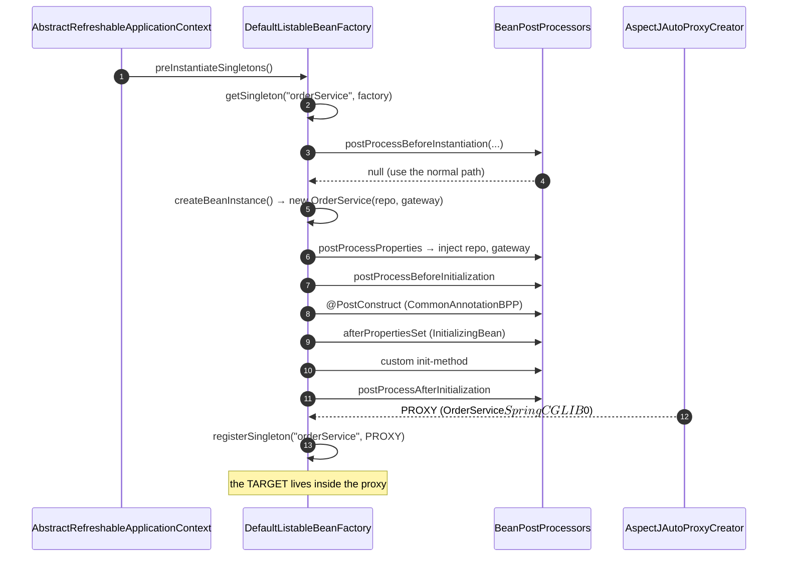
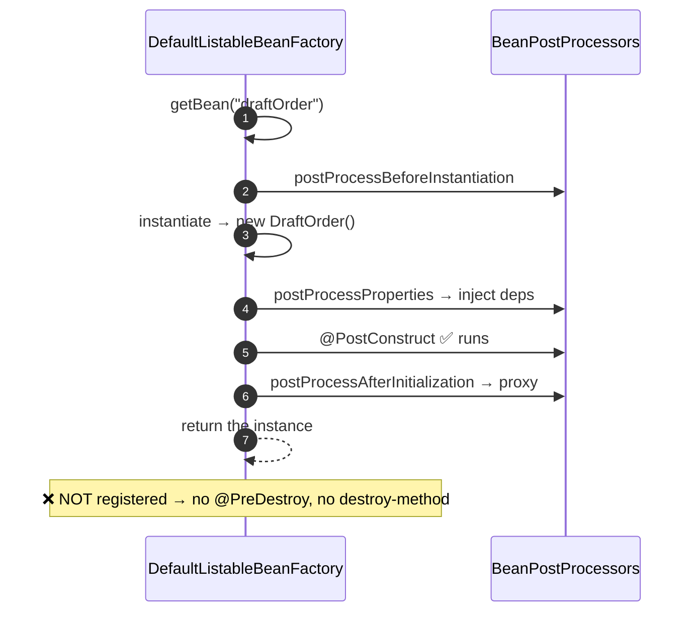
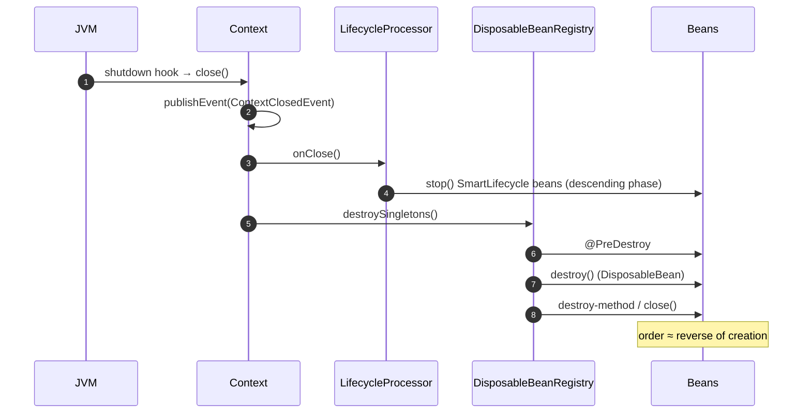

# 03 · Bean Lifecycle, Scopes & Lazy Initialisation

> **Level:** Intermediate → Advanced
> **Interview Frequency:** ★★★★☆ (Common as a "walk me through the lifecycle" question)
> **Prerequisite:** [01 · IoC Container](./01-IoC-Container-and-ApplicationContext.md) ·
> [02 · Dependency Injection](./02-Dependency-Injection.md)
> **Last Updated:** 2026

---

## 📋 Table of Contents
- [0. TL;DR — The 30-Second Answer](#0-tldr--the-30-second-answer)
- [1. What & Why](#1-what--why)
- [2. Mental Model — the life of a bean](#2-mental-model--the-life-of-a-bean)
- [3. Deep Dive — Theory](#3-deep-dive--theory)
- [4. Internal Working Mechanism](#4-internal-working-mechanism)
- [5. Step-by-Step Execution Flow](#5-step-by-step-execution-flow)
- [6. Architecture Diagrams](#6-architecture-diagrams)
- [7. Production-Level Use Cases](#7-production-level-use-cases)
- [8. Code Examples — Production-Grade](#8-code-examples--production-grade)
- [9. Common Mistakes & Gotchas](#9-common-mistakes--gotchas)
- [10. Performance Considerations](#10-performance-considerations)
- [11. Security Considerations](#11-security-considerations)
- [12. Best Practices — The Checklist](#12-best-practices--the-checklist)
- [13. Hands-On Exercises](#13-hands-on-exercises)
- [14. Code Challenges](#14-code-challenges)
- [15. Scenario-Based Questions](#15-scenario-based-questions)
- [16. Interview Q&A — Level-wise](#16-interview-qa--level-wise)
- [17. Counter-Questions & Traps](#17-counter-questions--traps)
- [18. Tricky Interview Questions](#18-tricky-interview-questions)
- [19. Follow-Up Questions Asked by Interviewers](#19-follow-up-questions-asked-by-interviewers)
- [20. Real 3–5 Year Experience Scenarios](#20-real-35-year-experience-scenarios)
- [21. Frequently Asked Production Issues](#21-frequently-asked-production-issues)
- [22. Debugging Scenarios](#22-debugging-scenarios)
- [23. Architecture Design Questions](#23-architecture-design-questions)
- [24. Rapid-Fire MCQs](#24-rapid-fire-mcqs)
- [25. Cheat Sheet — One-Page Summary](#25-cheat-sheet--one-page-summary)
- [26. Real-World Production Notes](#26-real-world-production-notes)
- [27. Follow-up Learning](#27-follow-up-learning)

---

## 0. TL;DR — The 30-Second Answer

- **The lifecycle has two halves: *initialisation* and *destruction*.** Initialisation is
  **mandatory and ordered**; destruction is **best-effort and may never run**.
- **The exact order (memorise this):**
  `constructor → property population (@Autowired) → postProcessBeforeInitialization →
  @PostConstruct → afterPropertiesSet (InitializingBean) → custom init-method →
  postProcessAfterInitialization (★ proxy created here ★) → [in use] → @PreDestroy →
  destroy (DisposableBean) → custom destroy-method`.
- **`@PostConstruct` runs *after* injection but *before* the AOP proxy is created** — so a
  `@PostConstruct` method cannot rely on the bean being transactional, and cannot call a
  `@Transactional` method on itself.
- **The `BeanPostProcessor` is where the magic happens**: `AutowiredAnnotationBeanPostProcessor`
  (injection), `AnnotationAwareAspectJAutoProxyCreator` (**the proxy**),
  `InitDestroyAnnotationBeanPostProcessor` (`@PostConstruct`/`@PreDestroy`),
  `ApplicationContextAwareProcessor` (the `Aware` callbacks).
- **Scopes:** `singleton` (default), `prototype`, `request`, `session`, `application`, `websocket`.
  **`prototype` beans get `@PostConstruct` but NOT `@PreDestroy`** — the container forgets them.
- **Scope rules:** a **wider-scoped** bean may depend on a **narrower-scoped** one, never the
  reverse. A singleton depending on a prototype silently shares one instance.
- **Lazy initialisation** (`@Lazy`, `spring.main.lazy-initialization=true`) defers creation to
  first use — it **moves startup failures to runtime**. Use it in dev for speed, never in prod.
- **`SmartLifecycle`** is the modern way to control start/stop ordering of components
  (connection pools, warm-up jobs, graceful drain) with a `getPhase()` number.
- **Destruction runs on JVM shutdown or `context.close()`** — it does **not** run on `kill -9`, on
  an OOM kill, or on a container eviction.

---

## 1. What & Why

A bean's lifecycle matters because **the container, not your code, controls when things happen**.
If you don't know the order, you'll write:

- an `@PostConstruct` that reads a field injected by a `BeanPostProcessor` that hasn't run yet,
- a `@PreDestroy` that assumes a transaction is still open (it isn't),
- a `@PostConstruct` that calls a `@Transactional` method on itself (silently non-transactional),
- a `DisposableBean` that assumes `@PreDestroy` already ran (it runs *after*).

**The lifecycle is also the framework's extension point.** If you understand the order, you know
*where* to hook in: `BeanPostProcessor` (decorate), `BeanFactoryPostProcessor` (metadata),
`SmartLifecycle` (ordered start/stop), `ApplicationListener` (event reactions).

---

## 2. Mental Model — the life of a bean

```text
   ┌─ CONCEPTION ───────────────────────────────────────────────────┐
   │  BeanDefinition created (metadata only)                        │
   │  • by @Component scanning, @Bean method, XML, or a registry     │
   └──────────────────────────┬─────────────────────────────────────┘
                              ▼
   ┌─ BIRTH ───────────────────────────────────────────────────────┐
   │  1. instantiate()          ← constructor                       │
   │  2. populateBean()         ← @Autowired, <property>            │
   │  3. postProcessBeforeInitialization                            │
   │  4. @PostConstruct                                             │
   │  5. afterPropertiesSet()   ← InitializingBean                  │
   │  6. init-method                                               │
   │  7. postProcessAfterInitialization  ★★ PROXY CREATED ★★        │
   └──────────────────────────┬─────────────────────────────────────┘
                              ▼
   ┌─ LIFE ───────────────────────────────────────────────────────┐
   │  The bean serves requests. For singletons it is created once  │
   │  during preInstantiateSingletons(); for prototypes on demand. │
   └──────────────────────────┬─────────────────────────────────────┘
                              ▼
   ┌─ DEATH ───────────────────────────────────────────────────────┐
   │  1. @PreDestroy                                               │
   │  2. destroy()             ← DisposableBean                     │
   │  3. destroy-method                                             │
   │  • NOT called for prototypes                                    │
   │  • NOT called on kill -9 / OOM-kill / SIGKILL                   │
   └────────────────────────────────────────────────────────────────┘
```

> **Caption:** **Conception → Birth → Life → Death.** The container is the *midwife* and the
> *estate manager*; your bean's constructor is the birth and the destroy callbacks are the will.

---

## 3. Deep Dive — Theory

### 3.1 The complete callback order

| # | Callback | Type | Runs for prototypes? | Notes |
|---|----------|------|---------------------|-------|
| 1 | **Constructor** | user | ✅ | Field injection hasn't happened yet |
| 2 | **`BeanPostProcessor#postProcessProperties`** | framework | ✅ | **Field/setter injection happens here** |
| 3 | **`postProcessBeforeInitialization`** | framework | ✅ | Before user init callbacks |
| 4 | **`@PostConstruct`** | user | ✅ | From `CommonAnnotationBeanPostProcessor` |
| 5 | **`InitializingBean#afterPropertiesSet`** | user | ✅ | |
| 6 | **custom `init-method`** | user | ✅ | e.g. `init()` or `destroyMethod = "shutdown"` |
| 7 | **`postProcessAfterInitialization`** | framework | ✅ | **★ The AOP proxy is created here** |
| 8 | **`@PreDestroy`** | user | ❌ | From `CommonAnnotationBeanPostProcessor` |
| 9 | **`DisposableBean#destroy`** | user | ❌ | |
| 10 | **custom `destroy-method`** | user | ❌ | Also `AutoCloseable#close` if no other is defined |

> **Caption:** Note steps 4→5→6 — **`@PostConstruct` runs *before* `afterPropertiesSet`**, which
> surprises people who expect the opposite.

### 3.2 The three "init" mechanisms compared

```java
// ① @PostConstruct — JSR-250 / jakarta.annotation
@PostConstruct
public void init() { ... }

// ② InitializingBean — Spring-specific interface
@Component
public class Foo implements InitializingBean {
    @Override public void afterPropertiesSet() { ... }
}

// ③ init-method — XML/annotation config
@Component
public class Foo {
    @InitMethod public void start() { ... }
}
```

| | `@PostConstruct` | `InitializingBean` | `init-method` |
|---|---|---|---|
| **Depends on** | `jakarta.annotation` | Spring core | Nothing |
| **Works outside Spring** | ✅ (any container) | ❌ | ❌ |
| **Multiple per class** | ❌ one | ❌ one | ✅ several (but the annotation is one) |
| **Inheritance** | Called for **each** class in the hierarchy? | Only the **most derived** | Depends on config |
| **Recommended** | ✅ **Yes** | Legacy | Rarely |

> **Professional answer:** Use **`@PostConstruct`**. It has no Spring dependency, so the class
> stays a plain Java class (and unit-testable outside Spring).

### 3.3 The three "destroy" mechanisms

```java
// ① @PreDestroy
@PreDestroy
public void shutdown() { ... }

// ② DisposableBean
@Component
public class Foo implements DisposableBean {
    @Override public void destroy() { ... }
}

// ③ destroyMethod — inferred!
@Component
public class Foo {
    public void close() { ... }     // ← Spring AUTOMATICALLY calls close() as the destroy method
}
```

> **Caption:** **The inferred destroy method** is a big one: Spring detects a public `close()` or
> `shutdown()` method on the bean and calls it automatically — no annotation needed. (You can turn
> this off with `@Bean(destroyMethod = "")`.)

### 3.4 `DisposableBean` and its pitfalls

```java
@Component
public class HikariWrapper implements DisposableBean {
    @Override
    public void destroy() {
        // ⚠ Called on the Spring shutdown hook thread, at container close.
        // ⚠ Must be fast and must not throw.
    }
}
```

**Rules:**
- Must be **idempotent** — it may be called after a failed startup.
- Must **not throw** — an exception in `destroy()` is logged but can mask other shutdown errors.
- Must not depend on other beans that may already be destroyed (destruction order is roughly the
  **reverse** of creation order, but it's not a strict guarantee across beans).
- **Not called for prototypes.**

### 3.5 `Aware` interfaces — the "tell me about the container" callbacks

```java
public interface Aware {
    void setBeanFactory(BeanFactory beanFactory) throws BeansException;
}
public interface BeanNameAware  { void setBeanName(String name); }
public interface BeanClassLoaderAware { void setBeanClassLoader(ClassLoader cl); }
public interface EnvironmentAware { void setEnvironment(Environment env); }
public interface ResourceLoaderAware { void setResourceLoader(ResourceLoader rl); }
public interface ApplicationEventPublisherAware { void setApplicationEventPublisher(…); }
public interface MessageSourceAware { void setMessageSource(MessageSource ms); }
public interface ApplicationContextAware { void setApplicationContext(ApplicationContext ctx); }
```

**Order:** `BeanFactoryAware` → `BeanNameAware` → `BeanClassLoaderAware` → `EnvironmentAware` →
`ResourceLoaderAware` → `ApplicationEventPublisherAware` → `MessageSourceAware` →
`ApplicationContextAware` → **`@PostConstruct`** → `InitializingBean`.

> ⚠ **`ApplicationContextAware` is a service-locator smell.** It's set by
> `ApplicationContextAwareProcessor`, a `BeanPostProcessor` — which is why it happens *before*
> `@PostConstruct`.

### 3.6 Scopes in detail

| Scope | Bean name | Lifetime | Destroyed? |
|-------|-----------|----------|-----------|
| `singleton` | `SingletonScope` (default) | One per container | ✅ |
| `prototype` | `PrototypeScope` | One per `getBean()` | ❌ |
| `request` | `RequestScope` | One per HTTP request | ✅ |
| `session` | `SessionScope` | One per `HttpSession` | ✅ |
| `application` | `ApplicationScope` | One per `ServletContext` | ✅ |
| `websocket` | `WebSocketScope` | One per WebSocket session | ✅ |
| `custom` | your `Scope` impl | your rules | your rules |

```java
@Component
@Scope(value = WebApplicationContext.SCOPE_REQUEST, proxyMode = ScopedProxyMode.TARGET_CLASS)
public class RequestUserContext {
    private String userId;                 // set by a filter
}
```

**`proxyMode` is mandatory for request/session scope** injected into a singleton — otherwise the
singleton holds a reference to a *single* instance created at startup (and the scope is ignored).

```java
public enum ScopedProxyMode {
    NONE,          // no proxy — only safe for direct (non-singleton) usage
    INTERFACES,    // JDK dynamic proxy — only interface methods are exposed
    TARGET_CLASS   // CGLIB proxy — the whole class is proxied
}
```

> **Caption:** `TARGET_CLASS` uses CGLIB, which **requires a non-final class with a non-final
> method** and a no-arg constructor (or Objenesis). `INTERFACES` requires the bean to implement
> an interface. This is the classic "my @RequestScope bean is null" cause.

### 3.7 Custom scopes

```java
public class TenantScope implements Scope {
    private final Map<String, Object> cache = new ConcurrentHashMap<>();
    private final ThreadLocal<String> currentTenant = new ThreadLocal<>();

    @Override
    public Object get(String name, ObjectFactory<?> objectFactory) {
        return cache.computeIfAbsent(currentTenant.get(), k -> objectFactory.getObject());
    }
    @Override
    public Object remove(String name) { return cache.remove(currentTenant.get()); }
    @Override public void registerDestructionCallback(String name, Runnable callback) { }
    @Override public Object resolveContextualObject(String key) { return null; }
    @Override public String getConversationId() { return currentTenant.get(); }
}
```

Register it:
```java
@Configuration
public class ScopeConfig {
    @Bean
    public Scope tenantScope() { return new TenantScope(); }

    @Bean
    @Scope(value = "tenant", proxyMode = ScopedProxyMode.TARGET_CLASS)
    public TenantContext tenantContext() { return new TenantContext(); }
}
```

> ⚠ A custom scope with a `ThreadLocal` has the classic **pooled-thread leak** problem — always
> clear it in a `finally` block.

### 3.8 Lazy initialisation

```java
// ① On a single bean
@Component
@Lazy
public class ExpensiveReportEngine { ... }

// ② On an injection point
@Service
public class ReportService {
    private final ObjectProvider<ExpensiveReportEngine> engine;
    ...
}

// ③ Globally (Boot 2.2+)
spring.main.lazy-initialization=true
```

**What `@Lazy` on a bean definition does:**
- The bean isn't created during `preInstantiateSingletons()`.
- It's created on the first `getBean()`.
- A **lazy-resolution proxy** is injected into dependents, so the dependency graph doesn't force
  creation.

**What `@Lazy` on an injection point does:**
- Injects a **proxy** that resolves the target on first method call.

**The trade-off:**

| | Eager (default) | Lazy |
|---|---|---|
| Startup time | Slower | Faster |
| Failure detection | **At startup** ✅ | At first request ❌ |
| Resource usage | All beans alive | Only what's used |
| First-request latency | Normal | **A spike** (creation cost) |
| Suitable for | Production | Dev/test only |

> ⚠ **`spring.main.lazy-initialization=true` in production is an anti-pattern**: it hides
> misconfiguration (a broken bean surfaces as a 500 on a random endpoint instead of a failed
> deployment) and creates a latency spike on the first hit of each endpoint. Some teams use it
> for *specific* cold-start-sensitive services with a deliberate warm-up — but that's a conscious
> trade-off, not a default.

### 3.9 `SmartLifecycle` — ordered start and stop

```java
@Component
public class CacheWarmup implements SmartLifecycle {

    private volatile boolean running;

    @Override public void start() { warm(); running = true; }
    @Override public void stop() { running = false; }
    @Override public boolean isRunning() { return running; }

    @Override
    public int getPhase() { return Integer.MAX_VALUE; }   // start LAST, stop FIRST
}
```

**Phase semantics:**
- On **startup**, beans start in **ascending phase order** (lowest first).
- On **shutdown**, beans stop in **descending phase order** (highest first).
- The **web server** starts in phase `Integer.MAX_VALUE - 1` (`WebServerStartStopLifecycle`) — so
  a bean with phase `Integer.MAX_VALUE` starts **after** the server is accepting requests. Use
  `Integer.MAX_VALUE - 2` to start **before** the web server.
- A `SmartLifecycle` bean that is `isRunning()` when the context closes will be stopped.

> **Caption:** Phases are the *only* supported way to order component startup. `@DependsOn`
> orders *bean creation*, not lifecycle start.

### 3.10 `Lifecycle` vs `SmartLifecycle` vs `DisposableBean`

| Interface | When | Purpose |
|-----------|------|---------|
| `Lifecycle` | `start()`/`stop()` | Simple start/stop, no ordering |
| `SmartLifecycle` | + `getPhase()`, `isAutoStartup()` | **Ordered** start/stop, participates in the context lifecycle |
| `DisposableBean` | `destroy()` | Resource release at shutdown |
| `AutoCloseable` | `close()` | Standard Java; auto-detected as a destroy method |

### 3.11 The shutdown sequence

```text
  JVM shutdown (SIGTERM) or context.close()
      │
      ▼
  ContextClosedEvent is published FIRST
      │
      ▼
  LifecycleProcessor.onClose()  → stops SmartLifecycle beans (descending phase)
      │
      ▼
  DisposableBeanAdapter → @PreDestroy → destroy() → destroy-method
      │   (in reverse creation order)
      ▼
  BeanFactory.destroySingletons()
      │
      ▼
  JVM exits (or the shutdown hook finishes)
```

**Boot's graceful shutdown:**
```yaml
server:
  shutdown: graceful
spring:
  lifecycle:
    timeout-per-shutdown-phase: 20s
```
With `graceful`, Tomcat stops accepting new connections and **waits for in-flight requests** to
complete before the context closes. Without it, in-flight requests are cut off.

---

## 4. Internal Working Mechanism

### 4.1 `AbstractAutowireCapableBeanFactory.doCreateBean()`

```text
doCreateBean(beanName, mbdToUse, args)
 ├─ 1. resolveBeanClass()             ← resolve the class name to a Class
 ├─ 2. resolveBeforeInstantiation()   ← ★ SmartInstantiationAwareBeanPostProcessor
 │                                       (constructor injection / early proxy)
 ├─ 3. if not resolved → instantiateBean()
 │       └─ createBeanInstance():
 │            a. determineConstructorsFromBeanPostProcessors()
 │            b. instantiate with the chosen constructor
 │            c. (factory method / supplier paths)
 ├─ 4. eagerlyCache???
 ├─ 5. populateBean()                 ← ★ @Autowired / <property>
 ├─ 6. initializeBean()               ← ★ the init callbacks
 │       a. invokeAwareMethods()      ← BeanNameAware, ApplicationContextAware, …
 │       b. applyBeanPostProcessorsBeforeInitialization()
 │       c. invokeInitMethods()       ← @PostConstruct → afterPropertiesSet → init-method
 │       d. applyBeanPostProcessorsAfterInitialization()   ← ★★ THE PROXY ★★
 └─ 7. registerDisposableBeanIfNecessary()  ← if it's a singleton
```

### 4.2 `invokeInitMethods()` — the exact order

```java
protected void invokeInitMethods(String beanName, Object bean, @Nullable MutablePropertyValues pvs) {
    if (bean instanceof Aware) {
        if (bean instanceof BeanNameAware) ((BeanNameAware) bean).setBeanName(beanName);
        if (bean instanceof BeanClassLoaderAware) …
        if (bean instanceof BeanFactoryAware) …
        if (bean instanceof EnvironmentAware) …
        if (bean instanceof ResourceLoaderAware) …
        if (bean instanceof ApplicationEventPublisherAware) …
        if (bean instanceof MessageSourceAware) …
        if (bean instanceof ApplicationContextAware) …
    }

    if (bean instanceof InitializingBean) {
        ((InitializingBean) bean).afterPropertiesSet();     // ⑤
    }

    if (invokeInitMethods) {
        String initMethodName = mbd.getInitMethodName();
        if (StringUtils.hasLength(initMethodName) && !(bean instanceof InitializingBean)
                && !mbd.isExternallyManagedInitMethod(initMethodName)) {
            invokeCustomInitMethod(beanName, bean, initMethodName);   // ⑥
        }
    }
}
```

> **Caption:** Note the `!(bean instanceof InitializingBean)` guard: if the bean implements
> `InitializingBean`, the **custom init method is NOT called** — you get one *or* the other.
> (`@PostConstruct` is separate and always runs, via a `BeanPostProcessor`.)

### 4.3 `registerDisposableBeanIfNecessary()`

```java
if (mbd.isSingleton() && !mbd.isExternallyManaged()) {   // ← singletons ONLY
    // 1. find @PreDestroy methods (via CommonAnnotationBeanPostProcessor)
    // 2. find DisposableBean / AutoCloseable
    // 3. find a custom destroy-method (or infer close()/shutdown())
    // 4. wrap in a DisposableBeanAdapter
    // 5. register in the DisposableBeans registry
}
```

> **Caption:** `mbd.isSingleton()` is the reason **`@PreDestroy` never runs for prototypes**.

### 4.4 The `BeanPostProcessor` chain — who does what

| `BeanPostProcessor` | Responsibility |
|---------------------|----------------|
| `ApplicationContextAwareProcessor` | The `Aware` callbacks |
| `AutowiredAnnotationBeanPostProcessor` | `@Autowired` injection, `@Value`, `@Lookup` |
| `CommonAnnotationBeanPostProcessor` | `@PostConstruct`, `@PreDestroy`, `@Resource` |
| `AnnotationAwareAspectJAutoProxyCreator` | **Creates the AOP proxy** |
| `PersistenceExceptionTranslationPostProcessor` | `@Repository` exception translation |
| `MethodValidationPostProcessor` | `@Validated` method validation |
| `ScheduledAnnotationBeanPostProcessor` | `@Scheduled` |
| `ConfigurationPropertiesBindingPostProcessor` | `@ConfigurationProperties` binding |
| `CacheInterceptor` (via the AOP creator) | `@Cacheable` |

> **Caption:** The order of `BeanPostProcessor`s matters. The AOP proxy creator must run **last**
> in `postProcessAfterInitialization` so the proxy wraps the fully-initialised target.

---

## 5. Step-by-Step Execution Flow

### 5.1 Singleton creation during `refresh()`



### 5.2 Prototype creation



### 5.3 Shutdown



---

## 6. Architecture Diagrams

### 6.1 The lifecycle as a state machine

```text
        ┌──────────┐
        │DEFINED   │  BeanDefinition exists, no object
        └────┬─────┘
             │ instantiate()
             ▼
        ┌──────────┐
        │INSTANTI- │  constructor done, deps NOT injected
        │ATED      │
        └────┬─────┘
             │ populateBean()
             ▼
        ┌──────────┐
        │POPULATED │  deps injected
        └────┬─────┘
             │ initializeBean()
             ▼
        ┌──────────┐
        │INITIALI- │  @PostConstruct done
        │ZED       │
        └────┬─────┘
             │ postProcessAfterInitialization()
             ▼
        ┌──────────┐
        │IN USE    │  (the PROXY is what's registered)
        └────┬─────┘
             │ context.close()
             ▼
        ┌──────────┐
        │DESTROYED │
        └──────────┘
```

### 6.2 Scope lifetimes vs. container lifetime

```text
  CONTAINER (application)
  ├──────────────────────────────────────────────────────┐
  │  singleton  ─────────────────────────►  [alive]     │  container lifetime
  │                                                      │
  │  request  ─────►  [per request]                      │
  │  session  ─────►  [per session]                      │
  │  prototype ─►  [per getBean]                         │  independent of the container
  └──────────────────────────────────────────────────────┘
```

### 6.3 Startup ordering with phases

```text
  phase 0        phase 10        phase MAX-2      phase MAX-1      phase MAX
  ───────        ────────        ──────────       ──────────      ────────
  Connection     Cache           Metrics          Web server       Health
  pool warm-up   warm-up         registration     starts           checks
     ▲              ▲               ▲                ▲                ▲
     └── starts in ascending order; stops in descending order ──┘
```

---

## 7. Production-Level Use Cases

| Use case | Mechanism | Notes |
|----------|-----------|-------|
| **Warm a cache at startup** | `SmartLifecycle` with a low phase | Start **before** the web server (`MAX_VALUE - 2`) |
| **Flush a buffer on shutdown** | `@PreDestroy` | Must be fast; must not throw |
| **Close an HTTP client** | `destroyMethod = "close"` (auto-detected) | |
| **Release a native resource** | `DisposableBean` | Consider `try-with-resources` instead |
| **Per-request user context** | `@RequestScope` + `proxyMode = TARGET_CLASS` | Prefer over `ThreadLocal` |
| **Graceful drain of in-flight work** | `server.shutdown=graceful` + `SmartLifecycle` | Set `timeout-per-shutdown-phase` |
| **Defer an optional integration** | `@Lazy` or `ObjectProvider` | Only for genuinely optional beans |
| **Faster local startup** | `spring.main.lazy-initialization=true` | **Dev only** |
| **Order-dependent components** | `SmartLifecycle#getPhase()` | The only supported ordering |
| **Start after the DB is ready** | A `SmartLifecycle` that checks the `DataSource` | Or a `HealthIndicator` + k8s readiness probe |

---

## 8. Code Examples — Production-Grade

### 8.1 A well-behaved bean with a full lifecycle

```java
@Component
@Slf4j
public class ReportCache implements InitializingBean, DisposableBean {

    private final Map<String, Report> cache = new ConcurrentHashMap<>();
    private ScheduledExecutorService warmer;

    @Override
    public void afterPropertiesSet() {
        // ⑤ runs AFTER @PostConstruct, AFTER injection
        warmer = Executors.newSingleThreadScheduledExecutor(r -> {
            Thread t = new Thread(r, "report-cache-warmer");
            t.setDaemon(true);
            return t;
        });
        warmer.scheduleWithFixedDelay(this::warm, 1, 10, TimeUnit.MINUTES);
        log.info("ReportCache initialised");
    }

    @Override
    public void destroy() {
        // ⑨ runs on shutdown; must be fast and must not throw
        if (warmer != null) {
            warmer.shutdownNow();
        }
        cache.clear();
    }
}
```

### 8.2 `@PostConstruct` + `@PreDestroy` (the modern style)

```java
@Component
@Slf4j
public class TokenIssuer {

    private SecretKey key;

    @PostConstruct
    void loadKey() {
        // Runs after injection, before the bean is used.
        // ⚠ If this throws, the app FAILS AT STARTUP — which is what you want for a key.
        this.key = loadFromVault();
        log.info("Token issuer key loaded (id={})", key.getAlgorithm());
    }

    @PreDestroy
    void revokeKey() {
        // Best-effort cleanup. Must not throw.
        try {
            vault.revoke(key.getId());
        } catch (Exception e) {
            log.warn("Could not revoke key during shutdown", e);
        }
    }
}
```

### 8.3 `SmartLifecycle` with a phase — start before the web server

```java
@Component
@Slf4j
public class ConfigurationWarmup implements SmartLifecycle {

    private final TenantConfigService tenantConfig;
    private volatile boolean running;

    public ConfigurationWarmup(TenantConfigService tenantConfig) {
        this.tenantConfig = tenantConfig;
    }

    @Override
    public void start() {
        log.info("Warming configuration for {} tenants", tenantConfig.count());
        tenantConfig.warmAll();
        running = true;
    }

    @Override
    public void stop() {
        running = false;
        log.info("Configuration warmup stopped");
    }

    @Override
    public boolean isRunning() { return running; }

    @Override
    public int getPhase() {
        // Start AFTER the datasource but BEFORE the web server accepts traffic.
        return Integer.MAX_VALUE - 2;
    }
}
```

### 8.4 Request-scoped context with a proxy

```java
@Component
@Scope(value = WebApplicationContext.SCOPE_REQUEST, proxyMode = ScopedProxyMode.TARGET_CLASS)
public class RequestUserContext {
    private String userId;
    private String tenantId;
    // getters/setters
}
```

```java
@Component
public class CurrentUserProvider {

    private final RequestUserContext context;      // ← a PROXY, resolved per request

    public CurrentUserProvider(RequestUserContext context) {
        this.context = context;
    }

    public String userId() { return context.getUserId(); }   // resolves the real bean now
}
```

> **Caption:** The `CurrentUserProvider` is a singleton holding a **proxy**. On each call, the
> proxy resolves the *current request's* `RequestUserContext`. This is the standard, thread-safe
> alternative to a `ThreadLocal`.

### 8.5 A custom tenant scope (with a leak-safe design)

```java
public class TenantScope implements Scope {

    private final Map<String, Object> instances = new ConcurrentHashMap<>();
    private final ThreadLocal<String> current = new ThreadLocal<>();

    public void setTenant(String tenantId) { current.set(tenantId); }

    public void clear() { current.remove(); }        // ← MUST be called in a finally block

    @Override
    public Object get(String name, ObjectFactory<?> factory) {
        String tenant = current.get();
        if (tenant == null) throw new IllegalStateException("No tenant in scope");
        return instances.computeIfAbsent(tenant, k -> factory.getObject());
    }

    @Override public Object remove(String name) { return instances.remove(current.get()); }
    @Override public void registerDestructionCallback(String name, Runnable callback) { }
    @Override public Object resolveContextualObject(String key) { return null; }
    @Override public String getConversationId() { return current.get(); }
}
```

```java
@Component
public class TenantContextFilter extends OncePerRequestFilter {
    private final TenantScope scope;

    @Override
    protected void doFilterInternal(HttpServletRequest req, HttpServletResponse res, FilterChain chain)
            throws ServletException, IOException {
        scope.setTenant(TenantResolver.resolve(req));
        try {
            chain.doFilter(req, res);
        } finally {
            scope.clear();          // ← critical on a pooled thread
        }
    }
}
```

### 8.6 Warm-up + graceful drain with `SmartLifecycle`

```java
@Component
@Slf4j
public class InFlightTracker implements SmartLifecycle {

    private final AtomicInteger inFlight = new AtomicInteger();
    private final CountDownLatch drained = new CountDownLatch(1);
    private volatile boolean running = true;

    public void enter() { inFlight.incrementAndGet(); }
    public void exit()  { if (inFlight.decrementAndGet() == 0) drained.countDown(); }

    @Override
    public void stop() {
        running = false;
        log.info("Waiting up to 20s for {} in-flight requests", inFlight.get());
        try {
            if (!drained.await(20, TimeUnit.SECONDS)) {
                log.warn("Shutdown timeout with {} requests still in flight", inFlight.get());
            }
        } catch (InterruptedException e) {
            Thread.currentThread().interrupt();
        }
    }

    @Override public boolean isRunning() { return running; }
    @Override public int getPhase() { return Integer.MAX_VALUE; }   // stop FIRST
}
```

> **Caption:** A phase of `Integer.MAX_VALUE` means "stop first, start last" — which is what you
> want for a component that must survive until everything else has finished.

---

## 9. Common Mistakes & Gotchas

| # | ❌ Wrong | ✅ Right | Why |
|---|----------|----------|-----|
| 1 | `@PostConstruct` calls a `@Transactional` method on itself | Do the work in a separate bean | The proxy doesn't exist yet at `@PostConstruct` time |
| 2 | `@PostConstruct` reads an `@Autowired` **field** | Constructor injection | Field injection happens *before* `@PostConstruct`, but *after* the constructor — so a **constructor** reading it sees `null` |
| 3 | Expecting `@PreDestroy` on a prototype | Use a request scope or manage it yourself | Prototypes aren't tracked |
| 4 | `@Scope("request")` without `proxyMode` | Add `proxyMode = TARGET_CLASS` | Without a proxy, the singleton captures one instance |
| 5 | `@Scope("request")` on a `final` class | Remove `final` | CGLIB needs to subclass it |
| 6 | A `final` method in a `proxyMode = TARGET_CLASS` bean | Make it non-final | CGLIB can't override final methods |
| 7 | `spring.main.lazy-initialization=true` in production | Accept a slower startup | Hides failures; adds first-request latency |
| 8 | `@PostConstruct` doing slow I/O | Move it to a `SmartLifecycle` or a `@Scheduled` job | It blocks startup |
| 9 | Throwing from `@PreDestroy` | Catch and log | It can mask other shutdown errors |
| 10 | Expecting `init-method` to run *and* `afterPropertiesSet` | Pick one | `init-method` is skipped if the bean implements `InitializingBean` |
| 11 | Depending on the bean-creation order for lifecycle | Use `SmartLifecycle#getPhase()` | Creation order ≠ start order |
| 12 | A `@PreDestroy` that calls another bean's method | Be defensive | The other bean may already be destroyed |
| 13 | `ThreadLocal` in a singleton | `@RequestScope` | `ThreadLocal` leaks on pooled threads |
| 14 | A `destroy()` that blocks for minutes | Cap it with a timeout | The shutdown hook has a budget |
| 15 | Assuming `@PostConstruct` runs for a lazily created bean at startup | It runs on first creation | Lazy beans are created on first use |

---

## 10. Performance Considerations

| Aspect | Impact | Guidance |
|--------|--------|----------|
| **Startup** | Every singleton is created at startup | Measure; use `@Lazy` for heavy optional beans (carefully) |
| **`@PostConstruct` cost** | Blocks startup | Keep it fast; move I/O to a `SmartLifecycle`/async |
| **Proxy creation** | CGLIB class generation per bean type at startup | Only proxy what needs it |
| **Request scope** | A lookup per method call on the proxy | Cache within a request |
| **Destruction** | Blocks shutdown | Cap with a timeout; `timeout-per-shutdown-phase` |
| **`preInstantiateSingletons`** | O(number of beans) | Keep the bean count sane |
| **Prototype creation** | Full lifecycle per `getBean()` | Use `ObjectProvider` sparingly in hot paths |
| **Custom scope `computeIfAbsent`** | A map lookup per call | Fine; watch for contention on a shared map |
| **`ThreadLocal`** | Fast, but leaks on pools | Prefer scopes; always clear in `finally` |

---

## 11. Security Considerations

| Risk | Mitigation |
|------|-----------|
| **`@PreDestroy` not running on `kill -9`** | Secrets/materials stay in memory until the process dies | Use short-lived credentials; OS-level isolation |
| **Secrets loaded in `@PostConstruct`** | The secret sits in a field for the app's lifetime | Prefer a provider that fetches on demand and caches with a TTL |
| **A `@PreDestroy` that logs a secret** | The log is a leak | Never log secrets |
| **A lazy bean's failure surfaces late** | A broken auth bean fails on the first request, not at deploy | Keep security beans eager |
| **`@PreDestroy` calling a remote service** | Shutdown now depends on a network call | Make it best-effort with a short timeout |
| **A request-scoped bean holding PII** | It lives for the request's life | Clear it in a `finally`; don't put it in a static |
| **Destruction order not guaranteed** | A bean may be destroyed while another still uses it | Guard with null checks and try/catch |

---

## 12. Best Practices — The Checklist

- [ ] Use **`@PostConstruct`/`@PreDestroy`** (not `InitializingBean`/`DisposableBean`) — no Spring
      dependency in the class.
- [ ] Keep `@PostConstruct` **fast and side-effect-light**; move heavy work to a
      `SmartLifecycle` or an async task.
- [ ] **Never** assume `@PreDestroy` will run — make cleanup idempotent and best-effort.
- [ ] **Request scope always needs `proxyMode`**, and the class must not be `final`.
- [ ] Prefer **`@RequestScope`** over `ThreadLocal`; if you must use `ThreadLocal`, clear it in a
      `finally` block.
- [ ] Use **`SmartLifecycle#getPhase()`** to control start/stop ordering, never bean-creation
      order.
- [ ] **Never** enable global lazy initialisation in production without a deliberate plan.
- [ ] Cap the shutdown time: `server.shutdown=graceful` +
      `spring.lifecycle.timeout-per-shutdown-phase`.
- [ ] Remember the inferred destroy method: a public `close()`/`shutdown()` is called
      automatically.
- [ ] A bean's `@PostConstruct` must not throw for optional setup — but **should** throw for
      required setup (fail fast).

---

## 13. Hands-On Exercises

**🧪 Lab 1 — Verify the exact order**
1. Create a bean implementing `BeanNameAware`, `ApplicationContextAware`, `InitializingBean`, and
   `DisposableBean`, with `@PostConstruct`, `@PreDestroy`, and a custom `init`/`destroy` method.
2. Log in every callback.
3. Compare your prediction to the actual order.

**✅ Success signal:** You can recite the 10-step order.

**🧪 Lab 2 — The proxy timing**
1. In a bean, log `AopUtils.isAopProxy(this)` inside the constructor, inside `@PostConstruct`,
   and in a business method.
2. Observe: `false` in the constructor and `@PostConstruct`; `true` in the business method.

**✅ Success signal:** You understand *why* `@PostConstruct` can't rely on the proxy.

**🧪 Lab 3 — Scope matrix**
1. Create beans in `singleton`, `prototype`, and `request` scopes, each with a UUID printed in
   its constructor.
2. Call them twice from a controller and compare the UUIDs.
3. For the request scope, hit the endpoint twice in two different requests.

**✅ Success signal:** You've *seen* the difference.

**🧪 Lab 4 — The prototype destroy gap**
1. Create a prototype bean with a `@PreDestroy` that logs.
2. `getBean()` it a few times, then close the context.
3. Observe that `@PreDestroy` **never runs**.

**✅ Success signal:** You know why and what to do instead (a request scope, or manual cleanup).

**🧪 Lab 5 — Lazy startup cost**
1. Add 10 slow beans (`Thread.sleep(500)` in `@PostConstruct`).
2. Measure startup with and without `spring.main.lazy-initialization=true`.
3. Then call one endpoint and measure the first-request latency.

**✅ Success signal:** You can articulate the trade-off in numbers.

---

## 14. Code Challenges

### Challenge 1 — A lifecycle-aware cache (medium)
**Goal:** Build a cache bean that:
- warms itself at startup, **before** the web server accepts traffic (`SmartLifecycle`, phase
  `MAX_VALUE - 2`);
- refreshes on a schedule;
- flushes on shutdown (`@PreDestroy`), with a cap on the flush time;
- reports its state to a health indicator.

**Test:** a `@SpringBootTest` that asserts `isRunning()` is true after startup, and a unit test for
the flush.

### Challenge 2 — A request-context without `ThreadLocal` (hard)
**Goal:** Implement per-request state (user id, tenant id, correlation id) so that a **singleton**
service can read it.
**Requirements:**
- No `ThreadLocal`.
- Works with Tomcat threads *and* virtual threads.
- Values are cleared automatically at the end of the request.

**Hint:** `@RequestScope` + `proxyMode = TARGET_CLASS`.

### Challenge 3 — A custom scope (hard)
**Goal:** Implement a `Scope` that returns **one instance per tenant** (not per thread).
**Requirements:** a `TenantContext` to identify the tenant; thread-safety; no leaks when the
tenant changes; a unit test with two tenants.

**Hint:** a `ConcurrentHashMap` keyed by tenant id, with the current tenant from a filter.

---

## 15. Scenario-Based Questions

**S1.** *A `@PostConstruct` method calls `this.processOrder(order)` — and `processOrder` is
`@Transactional`. The order is saved, but no transaction is used. Why?*
>
> **Expected answer:** Because at `@PostConstruct` time the bean is **not yet proxied**. The
> `AnnotationAwareAspectJAutoProxyCreator` creates the proxy in
> `postProcessAfterInitialization`, which runs **after** `@PostConstruct`. The `@PostConstruct`
> method executes on the **raw target object**, so the `@Transactional` interceptor is bypassed
> entirely — and there is not even a warning. (Related: if the `@PostConstruct` method is on
> **another** bean that is injected, that *other* bean may already be proxied, so it would work —
> confusing and inconsistent.) **Fix:** don't do transactional work in `@PostConstruct`. Move it
> to (a) an `ApplicationRunner`/`CommandLineRunner` (after startup, but before readiness is
> reported), (b) a `SmartLifecycle#start()`, or (c) an event listener with
> `@TransactionalEventListener(AFTER_COMMIT)`. **Prevention:** a static-analysis rule banning
> `@Transactional` methods called from `@PostConstruct`; a code-review checklist item; and an
> integration test asserting the transaction was actually active (e.g. that a rollback happened).

**S2.** *After a Spring Boot upgrade, the app starts but a `@RequestScope` bean is `null` inside a
singleton service.*
>
> **Expected answer:** (1) **Check the `proxyMode`.** Without it, the container injects the
> *actual* request-scoped instance into the singleton at **singleton creation time** (which happens
> outside a request) — the scope is effectively ignored, and the value is stale/null. (2) If
> `proxyMode` is set, the injected object is a **proxy** — so the field is never null, but the
> *target* resolution can fail if the bean is used outside a request (a background job, a
> `@Scheduled` method, a startup listener) → `IllegalStateException: No thread-bound request found`.
> (3) **Other upgrade causes:** the class became `final` (CGLIB can't subclass) → switch to
> `proxyMode = INTERFACES` or remove `final`; a method became `final` → the proxy can't override
> it; the bean now implements an interface and the default proxy mode changed. (4) **Diagnose:**
> log `AopUtils.isAopProxy(bean)` and `AopProxyUtils.ultimateTargetClass(bean)`; check whether the
> access happens off-request. (5) **Fix:** add `proxyMode = ScopedProxyMode.TARGET_CLASS`, remove
> `final`, and make sure off-request access goes through `ObjectProvider` (or the bean is
> explicitly created for that context).

**S3.** *The application takes 45 seconds to start. How do you find out why?*
>
> **Expected answer:** (1) **Measure the baseline** — `spring.main.log-startup-info=true` (Boot
> 2.4+) prints the startup timings per step; the "Started App in X seconds" line is not enough.
> (2) **Use the `BufferingApplicationStartup`** — `SpringApplication` with a
> `BufferingApplicationStartup` and the `StartupInfoLogger`, or the `ApplicationStartup` bean, and
> a `/actuator/startup` endpoint (BufferingApplicationStartup) to get a **per-bean-creation
> timeline** — the `beans` endpoint in Spring Boot 3 (`/actuator/startup`) shows exactly which bean
> took how long. (3) **Common causes, in order of likelihood:** (a) a slow `DataSource`/connection
> pool warm-up or a slow DB connection; (b) `@PostConstruct` doing network I/O (a remote config
> fetch, a schema check); (c) a large `ComponentScan` (thousands of classes) — narrow the scan
> roots; (d) `spring.jpa.hibernate.ddl-auto=update` in a big schema; (e) many beans + heavy
> constructor graphs; (f) classpath scanning for JPA entities and Spring Data repositories; (g)
> a slow `Random`/`SecureRandom` initialisation; (h) the app is doing a `@Scheduled` warm-up
> synchronously. (4) **Fixes:** move I/O out of `@PostConstruct` into an `ApplicationRunner` or a
> `SmartLifecycle` with a low phase; narrow the scan; use `ddl-auto=validate` with Flyway;
> configure the pool's `minimumIdle`/`connectionTimeout`; enable the **CDS (Class Data Sharing)**
> archive or **AOT** processing (GraalVM native image — the biggest win, 20–40 % faster startup and
> much lower memory). (5) **Measure again** and set a **budget** in CI (a startup-time test that
> fails the build if it regresses) — that's how you prevent a slow creep.

---

## 16. Interview Q&A — Level-wise

### 🟢 Beginner
**Q: What is the bean lifecycle?**
**A:** The sequence of phases a bean goes through: instantiation (constructor) → dependency
injection → initialization callbacks (`@PostConstruct`, `InitializingBean`, init-method) → use →
destruction callbacks (`@PreDestroy`, `DisposableBean`, destroy-method) when the context closes.

**Q: What does `@PostConstruct` do?**
**A:** It marks a method to be invoked **after** the bean is fully injected and **before** the
bean is used — the standard place to do one-time initialisation that depends on the injected
dependencies.

**Q: What is the difference between `@PostConstruct` and `InitializingBean`?**
**A:** Both run at the same point. `@PostConstruct` is a JSR-250 annotation from
`jakarta.annotation` and doesn't tie the class to Spring; `InitializingBean` is a Spring interface
that couples your class to the framework. Prefer the annotation.

### 🟡 Intermediate
**Q: Explain the full bean lifecycle in order.**
**A:** 1. **Constructor** — the object is created. 2. **Property population** — `@Autowired` fields
and setters are injected. 3. **`postProcessBeforeInitialization`**. 4. **`@PostConstruct`**. 5.
**`InitializingBean#afterPropertiesSet`**. 6. **Custom `init-method`**. 7.
**`postProcessAfterInitialization`** — *this is where the AOP proxy is created*. Then, at shutdown:
8. **`@PreDestroy`** → 9. **`DisposableBean#destroy`** → 10. **Custom `destroy-method`**.

**Q: What are the bean scopes?**
**A:** `singleton` (default — one per container), `prototype` (a new instance per `getBean`),
`request`/`session`/`application` (web scopes), and `websocket`. You can register a custom `Scope`.

**Q: What happens to a prototype bean's `@PreDestroy`?**
**A:** It is **never called**. The container creates prototype instances on demand and does not
keep a reference to them, so it can't destroy them later. If a prototype holds a resource, manage
it yourself or use a request scope.

**Q: What is the difference between a `BeanPostProcessor` and a `BeanFactoryPostProcessor`?**
**A:** A `BeanFactoryPostProcessor` modifies `BeanDefinition`s **before** any bean is instantiated
(e.g. `PropertySourcesPlaceholderConfigurer` resolving `${...}`, `ConfigurationClassPostProcessor`
parsing `@Configuration`). A `BeanPostProcessor` acts on bean **instances** after creation and
injection (e.g. `AutowiredAnnotationBeanPostProcessor`, the AOP proxy creator).

### 🔴 Advanced / Senior
**Q: Why is `postProcessAfterInitialization` the right place to create the AOP proxy?**
**A:** Because the proxy must wrap a **fully initialised** target: the constructor, the property
injection and the init callbacks must all have run, otherwise the proxy's target would be
half-built and calls into it during startup would be unsafe. It must also be the **last** step, so
that any other `BeanPostProcessor` (e.g. the auditing one) sees the real object. A consequence:
**`@PostConstruct` runs on the target, not on the proxy** — so `@PostConstruct` can't call
`@Transactional` methods on itself.

**Q: What's the difference between `@Lazy` on a bean and on an injection point?**
**A:** On the **bean definition**, it prevents the bean from being created during
`preInstantiateSingletons()`; it's created on the first `getBean()`. On the **injection point**, the
container injects a **lazy-resolution proxy** that creates the target on the first *method call* —
and this is also the trick that breaks circular dependencies. Both defer the creation; only the
injection-point variant also changes *when the dependency graph is resolved*.

**Q: How do you control the order in which components start?**
**A:** Implement `SmartLifecycle` and return a `getPhase()`. On startup, components start in
ascending phase order; on shutdown, in descending order. The web server starts at phase
`Integer.MAX_VALUE - 1`, so `Integer.MAX_VALUE - 2` starts before it and `Integer.MAX_VALUE` stops
first. `@DependsOn` orders *bean creation*, not *lifecycle start* — a common confusion.

**Q: When is `@PreDestroy` not called?**
**A:** (1) For **prototype** beans (the container doesn't track them). (2) On an **abrupt
termination** — `kill -9`, an OOM-kill, a container eviction with a short grace period, or a JVM
crash: the shutdown hook never runs. (3) If the **JVM exits normally without closing the context**
(rare in Boot, which registers a shutdown hook). (4) If an earlier bean's `destroy()` throws and
aborts the sequence (rare, but possible). This is why cleanup must be idempotent and
best-effort.

**Q: What happens to the bean order on shutdown?**
**A:** Spring destroys singletons in **reverse registration order**, which approximates reverse
creation order, but it is **not a guaranteed dependency order**. A bean's `@PreDestroy` can
therefore run after a dependency it uses has already been destroyed. This is a real source of
production errors (a `@PreDestroy` that flushes to a closed connection pool). Defensive coding is
required.

### ⚫ Expert / Principal
**Q: Design the startup/shutdown lifecycle for a service with a warm cache, a message consumer,
and an outbound HTTP client.**
> **Answer structure:** (1) **Model each as a `SmartLifecycle`** with an explicit phase: cache
> warm-up at `MAX_VALUE - 2` (before the web server), the message consumer at `MAX_VALUE - 1` (so it
> starts with the server), and the HTTP client at `0` (first). (2) **Stop order is the reverse** —
> the consumer stops first (stop taking new messages), then the server drains, then the client
> closes. (3) **Draining**: the consumer's `stop()` must finish the in-flight messages within the
> phase timeout, and the client's `close()` must happen only after the consumer has stopped. (4)
> **Timeouts**: `spring.lifecycle.timeout-per-shutdown-phase=20s` and a per-component timeout
> shorter than it. (5) **Idempotency**: every `stop()`/`destroy()` must be safe to call twice and
> must not throw. (6) **Failure isolation**: a component that fails to start should not necessarily
> kill the app — decide per component; report it via a health indicator and let the readiness
> probe fail. (7) **Observability**: log the phase transitions with timestamps so you can prove
> the ordering in production. (8) **Testing**: a test that asserts the start order and the stop
> order by recording the calls.

---

## 17. Counter-Questions & Traps

### CQ1. "Why does `@PostConstruct` run before `afterPropertiesSet`?"
- **Naive answer:** "Arbitrary."  ← technically true, unhelpful
- **The trap:** People expect the "framework" callback to run first.
- **Expert answer:** Because `@PostConstruct` is implemented by a **`BeanPostProcessor`**
  (`CommonAnnotationBeanPostProcessor#postProcessBeforeInitialization`), and all
  `postProcessBeforeInitialization` callbacks run before `invokeInitMethods` calls
  `afterPropertiesSet`. The order is an implementation detail, not a contract — but it's stable
  across Spring versions, so don't rely on the relative order of `@PostConstruct` and
  `afterPropertiesSet` in a way that matters. Use **one** mechanism, not two.

### CQ2. "Why doesn't `@PreDestroy` run for prototypes?"
- **Naive answer:** "Because Spring doesn't manage them."  ← close
- **The trap:** The *reason* is specific: the destruction callbacks are registered in
  `registerDisposableBeanIfNecessary()`, which is guarded by `mbd.isSingleton()`.
- **Expert answer:** Prototypes are created on demand and **not retained** by the container — it
> has no reference to destroy later, and keeping one would be a memory leak. The trade-off is
> explicit: the container manages the *lifecycle* of singletons only. For a stateful short-lived
> object, use a request scope (where the container does clean up) or manage the resource yourself.

### CQ3. "If the proxy is created after `@PostConstruct`, doesn't that break AOP for init methods?"
- **Naive answer:** "Yes, that's a known limitation."  ← unsatisfying
- **The trap:** The real answer is about *which* method you're calling.
- **Expert answer:** The `@PostConstruct` method itself is never advised (no `@Transactional`, no
> `@Async` on it). But if it calls a method on **another** bean that is proxied, that call **is**
> advised. And if the `@PostConstruct` method is on a bean that is *also* injected into others, the
> **proxied instance** they receive does have the advice. The only broken case is self-invocation
> on the raw target during `@PostConstruct` — and the fix is simply "don't do transactional work
> during initialisation".

### CQ4. "Does `@PostConstruct` run for a lazy bean at startup?"
- **Naive answer:** "Yes, it initialises the bean."  ← wrong
- **The trap:** The whole point of lazy is that nothing happens until first use.
- **Expert answer:** No. For a lazily-created bean, `@PostConstruct` runs when the bean is
> **first created** (i.e. on first use), not at startup. So a lazy bean's initialisation cost is
> paid on the first request that touches it — the classic "first request is slow" symptom.

### CQ5. "Why does the container store the proxy rather than the target?"
- **Naive answer:** "It doesn't matter."  ← it matters
- **The trap:** It changes the observable class of the bean.
- **Expert answer:** So that every consumer receives the decorated behaviour. The target is
> reachable via `AopProxyUtils.ultimateTargetClass(bean)` and `(Advised) bean).getTargetSource()`.
> This is also why `bean.getClass().getSimpleName()` shows `OrderService$$SpringCGLIB$$0` in logs
> and why `@Value` on a proxied bean's field can behave oddly (the field is on the target, the
> proxy delegates to it — that part is fine).

### CQ6. "How do I make a bean initialise in the background without blocking startup?"
- **Naive answer:** "`@Async` on `@PostConstruct`."  ← doesn't work
- **The trap:** `@Async` requires an **async-capable proxy**, and the proxy is created *after*
> `@PostConstruct` — so the annotation has no effect there.
- **Expert answer:** Use an `ApplicationRunner`/`CommandLineRunner` (runs after the context is
> refreshed, before `ApplicationReadyEvent`), or a `SmartLifecycle` with a phase, or
> `@EventListener(ApplicationReadyEvent.class)` with `@Async`. If the work must be *ready* before
> traffic, do it synchronously in a `SmartLifecycle` with a phase below the web server's.

### CQ7. "Can you guarantee `@PreDestroy` runs before the DB pool closes?"
- **Naive answer:** "Yes, destruction is in reverse order."  ← overstated
- **The trap:** Reverse *registration* order is an approximation, and the `DataSource` (Hikari) is
> usually closed by its own `destroy()` — the ordering is not a documented guarantee.
- **Expert answer:** Don't rely on it. Use a `SmartLifecycle` with a **lower phase** (so it stops
> *after* the pool) for anything that must talk to the DB during shutdown, and make the
> `@PreDestroy` defensive (null checks, try/catch, short timeouts).

### CQ8. "Why does my `@PreDestroy` not run when I kill the pod?"
- **Naive answer:** "Because the pod was killed."  ← incomplete
- **The trap:** A `SIGTERM` **does** trigger the shutdown hook; `SIGKILL` does not.
- **Expert answer:** Kubernetes sends `SIGTERM`, waits `terminationGracePeriodSeconds`, then sends
> `SIGKILL`. If the hook doesn't run, the grace period was too short for your shutdown work — so
> (a) make shutdown fast, (b) raise `terminationGracePeriodSeconds`, and (c) use
> `server.shutdown=graceful` so in-flight requests complete. If the process was OOM-killed or the
> node died, nothing runs at all — which is why cleanup must never be *required* for correctness.

### CQ9. "Why is my `@RequestScope` bean null in a `@Scheduled` task?"
- **Naive answer:** "Because there's no request."  ← right
- **The trap:** The proxy throws `IllegalStateException` rather than returning null — unless the
> bean was injected without a proxy, in which case it *is* null.
- **Expert answer:** There is no request scope outside a request. Inject `ObjectProvider<T>` and
> handle absence, or create a short-lived instance explicitly
> (`ObjectProvider.getObject()` outside a request throws for a request-scoped bean — so create it
> manually or use a different scope).

### CQ10. "Does the container guarantee the order of `@PreDestroy` across beans?"
- **Naive answer:** "Yes — reverse of creation."  ← approximately true, and the "approximately"
> is the point
- **The trap:** The order is by **registration**, and it can be affected by bean name ordering and
> dependency relationships, and it can change between Spring versions.
- **Expert answer:** Treat destruction order as **unspecified**. Use `SmartLifecycle` phases for
> anything order-sensitive — they give a *documented* contract for start and stop order.

---

## 18. Tricky Interview Questions

**T1. "Can a bean implement both `InitializingBean` and have a custom `init-method`?"**
> Yes, but the custom `init-method` is **skipped** (`invokeCustomInitMethod` is guarded by
> `!(bean instanceof InitializingBean)`). `@PostConstruct` still runs.

**T2. "What happens if `@PostConstruct` throws?"**
> The bean creation fails → `BeanCreationException` → the context refresh fails → the app does
> not start (unless the bean is lazy, in which case the failure moves to the first use). This is
> the correct behaviour for a *required* initialisation failure.

**T3. "Is `DisposableBean#destroy` called if the context fails to start?"**
> For beans that were already created, yes — `destroySingletons()` is called during the rollback
> of a failed refresh. So `destroy()` must tolerate being called on a partially-initialised bean.

**T4. "What is the difference between `@PreDestroy` and `AutoCloseable#close()`?"**
> Spring calls both — `@PreDestroy` first, then `DisposableBean#destroy`, then the custom
> destroy-method (which may be `close()`). If a bean implements `AutoCloseable` and has no other
> destroy method, Spring infers `close()`.

**T5. "How do you know the exact order Spring destroys beans?"**
> `DefaultSingletonBeanRegistry` keeps `disposableBeans` as a `LinkedHashMap` and destroys them in
> **reverse insertion order** — i.e. reverse of *creation* order, approximately. It's an
> implementation detail; don't build on it.

**T6. "Can a `@Bean` method have a `destroyMethod`?"**
> Yes: `@Bean(destroyMethod = "shutdown")`, or `destroyMethod = ""` to **disable** the inferred
> `close()`/`shutdown()` detection. This matters for a bean whose `close()` shouldn't be called.

**T7. "Does the `BeanPostProcessor` chain run for prototype beans?"**
> Yes — the full creation path (BPPs, `@PostConstruct`, proxying) runs. Only the **destruction**
> path is skipped.

**T8. "What is `isAutoStartup()` in `SmartLifecycle`?"**
> If `true` (the default), the bean is started automatically when the context refreshes. If
> `false`, you must call `start()` yourself.

**T9. "Why does `SmartLifecycle` have both `isRunning()` and `isAutoStartup()`?"**
> `isRunning()` is the *state*; `isAutoStartup()` is the *permission to start*. A component can be
> running but not auto-started, or auto-startable but not yet running.

**T10. "Can `@PostConstruct` be `private`?"**
> Yes — `CommonAnnotationBeanPostProcessor` invokes it reflectively with `setAccessible(true)`. It
> must not be `static` (except `@PreDestroy`? — no, `@PreDestroy` also can't be static).

---

## 19. Follow-Up Questions Asked by Interviewers

**F1** (after "explain the lifecycle") → *"Which step creates the transaction proxy?"*
→ `postProcessAfterInitialization`, the last step — after `@PostConstruct`. Hence the
`@PostConstruct`-can't-be-transactional rule.

**F2** (after "what are the scopes?") → *"Can a singleton depend on a request-scoped bean?"*
→ Yes, but **only through a proxy** (`proxyMode = TARGET_CLASS`); otherwise the singleton captures
one instance at startup. And the request-scoped bean is unusable outside a request.

**F3** (after "what is lazy initialisation?") → *"When would you use it in production?"*
→ Almost never as a blanket setting. Legit uses: an expensive, rarely-used subsystem (a reporting
engine, a ML model) that is genuinely optional, combined with a deliberate warm-up. Not as a way to
hide configuration errors.

**F4** (after "how do you control start order?") → *"What about beans that need the DB to be ready?"*
→ Either a `SmartLifecycle` that retries/waits for the `DataSource` to be healthy, or let the
orchestrator handle it: the app starts, reports **not ready** via the readiness probe until the
DB is reachable, and Kubernetes only routes traffic to ready pods.

**F5** (after "when is `@PreDestroy` skipped?") → *"How do you test cleanup?"*
→ Call `context.close()` in the test and assert the cleanup ran; or inject a mock and `verify()`
the close was called. Use `@DirtiesContext` in Spring tests to force a fresh context.

---

## 20. Real 3–5 Year Experience Scenarios

**R1. "The pod takes 40 s to become ready. The team suspects the DB connection pool."**
>
> **Ideal answer:** (1) **Measure before guessing** — enable
> `spring.main.log-startup-info=true` and expose `/actuator/startup` (needs
> `BufferingApplicationStartup`) to get a **per-bean creation timeline**. (2) **Look for the
> pattern**: if the time is a single large block, it's one bean; if it's spread, it's the number of
> beans. (3) **Common causes** and their fixes: (a) **`@PostConstruct` doing I/O** — a remote
> config fetch, a schema check, a token refresh. Fix: move to an `ApplicationRunner`/async and
> report not-ready until it completes. (b) **HikariCP `minimumIdle`** = the pool size → connecting
> N connections serially. Fix: `initializationFailTimeout`, `connectionTimeout`, and let it
> connect lazily. (c) **`ddl-auto=update`** on a large schema → fix: `validate` + Flyway/Liquibase.
> (d) **A wide `@ComponentScan`** → fix: narrow the scan roots, or use an
> `@Configuration` with explicit `@Import`s. (e) **A large entity scan** → fix: `@EntityScan` with
> explicit packages. (f) **A slow `SecureRandom`** → fix: a shared, pre-seeded instance. (g)
> **Cold JVM** (no CDS/appCDS) → fix: **AppCDS** or **AOT/native image** (the biggest single
> win: 20–40 % faster startup, ~50 % less memory). (h) **Classpath scanning in a shaded jar** →
> fix: keep the jar structure flat or use Spring Boot's layered jars. (4) **Make it durable**:
> add a **startup-time budget to CI** (a test that boots the app and fails if it exceeds N
> seconds) and a **readiness probe** that reflects the real dependency state. (5) **The senior
> framing:** "startup time" is a *symptom*; the metric that matters is **time-to-first-successful-
> request** and **readiness latency**, and sometimes the right answer is to make the app ready
> faster (async warm-up) rather than to start faster.

**R2. "After a deploy, some requests fail with 'connection pool exhausted' for the first two
minutes."**
>
> **Ideal answer:** (1) **Diagnose the pool**: HikariCP logs `Pool stats` (active, idle, pending);
> add `spring.datasource.hikari.register-mbeans=true` and watch via JMX, or expose the metrics
> (`hikaricp.connections.*` via Micrometer). (2) **The classic cause**: the app starts, accepts
> traffic, and the pool has `minimumIdle=10` but only creates connections on demand — under a
> thundering herd, 200 concurrent requests try to create 200 connections, the pool caps at 10, and
> the rest **wait** for `connectionTimeout` and then fail. (3) **Secondary cause**: a **leaked
> connection** — a `@Transactional` method that opens a stream/result set and doesn't close it, or
> a connection taken outside a transaction. Check `leakDetectionThreshold` (Hikari logs a stack
> trace for a connection held longer than the threshold — set it to 30 s in dev). (4) **Fixes**:
> (a) **Warm the pool at startup** — a `SmartLifecycle` that opens and closes `maximumPoolSize`
> connections (or set `minimumIdle = maximumPoolSize`); (b) **Fix the leak** — the real fix;
> (c) **Right-size the pool**: `pool size = DB max_connections / number of instances` — and remember
> with **virtual threads** the pool should be *small*, not large; (d) **Reduce the load** — the
> N+1 query problem is usually the true cause of high concurrent connection usage; (e) **Add a
> circuit breaker / fail fast** so requests get a clean 503 instead of a timeout; (f) **Set
> `connectionTimeout`** low (2–3 s) so failures are fast and the queue doesn't grow unboundedly.
> (5) **Prevent**: a load test in CI that asserts the pool never saturates; an alert on
> `hikaricp.connections.pending`.

**R3. "A `@PreDestroy` that flushes audit data to a Kafka topic is losing messages on deploy."**
>
> **Ideal answer:** (1) **Understand the mechanism**: on `SIGTERM`, the JVM runs the shutdown hook
> → `context.close()` → `@PreDestroy` → the Kafka producer's `close()` (which flushes). But the
> **order matters**: if the Kafka `KafkaTemplate`/producer bean is destroyed **before** the bean
> with the `@PreDestroy`, the flush uses a **closed producer** → `IllegalStateException` or a
> silent loss. (2) **Fix the ordering**: implement `SmartLifecycle` on the producer-holder with a
> **lower phase** so it stops *after* the flusher, or make the flusher a `SmartLifecycle` with a
> **higher phase** (stops earlier). (3) **Fix the root cause**: **don't rely on shutdown-time
> flushing** for data durability. Use the **outbox pattern**: write the audit record to the DB in
> the same transaction as the business data, and publish it asynchronously (a poller or CDC). Then
> a crash loses nothing. (4) **Make it idempotent and retriable** — a Kafka producer with
> `acks=all`, `enable.idempotence=true`, and a retry backoff, plus a transactional id if you need
> exactly-once. (5) **Give the shutdown a budget**: Kubernetes sends `SIGTERM` and waits
> `terminationGracePeriodSeconds` (default 30 s) — if the flush takes longer, `SIGKILL` arrives
> and everything is lost. Make the flush fast, or make it async and accept "best effort".
> (6) **Test it**: a test that publishes, closes the context, and asserts the message arrived
> (with an embedded Kafka or Testcontainers).

---

## 21. Frequently Asked Production Issues

| Symptom | Cause | Diagnosis | Fix |
|---------|-------|-----------|-----|
| `@PostConstruct` doesn't run | The bean is lazy and hasn't been created | Check for `@Lazy` | Expected; or remove `@Lazy` |
| `@PostConstruct` sees `null` in a field | The field is injected *after* the constructor but *before* `@PostConstruct` — so if it's `null`, the injection didn't happen for that bean | Log the field | Use constructor injection |
| `@PostConstruct` is not transactional | The proxy doesn't exist yet | — | Move the work to a runner/lifecycle |
| `@PreDestroy` never runs | Prototype scope, or abrupt kill | Check the scope | Use a request scope; handle SIGKILL |
| `@PreDestroy` throws | A dependency was already destroyed | Read the stack trace | Defensive code + `SmartLifecycle` phases |
| A request-scoped bean is `null` in a singleton | No proxy mode | Check `@Scope` attributes | Add `proxyMode = TARGET_CLASS` |
| A request-scoped bean throws outside a request | No request context | The stack trace | Use `ObjectProvider` |
| The app doesn't shut down | A non-daemon thread, or a slow `@PreDestroy` | `jstack` during shutdown | Daemon threads, timeouts, `timeout-per-shutdown-phase` |
| Startup is slow | See scenario R1 | `/actuator/startup` | Fix the hot bean |
| A bean's state persists between tests | The context is cached | — | `@DirtiesContext` |
| `BeanCreationNotAllowedException` | A bean was requested during shutdown | — | Guard with a lifecycle flag |

---

## 22. Debugging Scenarios

**D1. "Is my bean a proxy, and what advice is applied?"**
```java
log.info("class       = {}", bean.getClass().getName());
log.info("isAopProxy  = {}", AopUtils.isAopProxy(bean));
log.info("targetClass = {}", AopProxyUtils.ultimateTargetClass(bean).getName());
if (bean instanceof Advised advised) {
    advised.getAdvisors().forEach(a -> log.info("advisor: {}", a.getClass().getSimpleName()));
}
```

**D2. "Which bean took the longest to create?"**
```java
// application.yml
management:
  endpoints:
    web:
      exposure:
        include: startup
---
# Spring Boot 3: register the buffering startup
@Bean
ApplicationStartup applicationStartup() { return new BufferingApplicationStartup(1000); }
```
Then `GET /actuator/startup` returns a per-bean-creation timeline. Or enable
`spring.main.log-startup-info=true` for the phase-level timings.

**D3. "Is `@PreDestroy` actually being called?"**
1. Add a log line at the top of the method.
2. Check the scope (prototypes never get it).
3. Check that the process received a `SIGTERM` (not `SIGKILL`).
4. Check `terminationGracePeriodSeconds` — the app may be killed before the hook finishes.
5. In a test, call `context.close()` explicitly and assert the log.

**D4. "Why is my `@RequestScope` bean not a proxy?"**
```java
log.info("proxy? {}", AopUtils.isAopProxy(contextBean));
```
If `false`, the `@Scope` annotation is missing the `proxyMode` attribute, or the bean was injected
by type into a class where Spring resolved the *target* rather than the proxy.

**D5. "The context fails to refresh — which bean?"**
The exception chain names it: `UnsatisfiedDependencyException` → `NoSuchBeanDefinitionException`.
With `--debug`, the condition report shows why each auto-configuration was skipped. For a custom
`BeanFactoryPostProcessor`, add logging to find the phase it fails in.

---

## 23. Architecture Design Questions

**Q1. 🏗️ Design the startup/shutdown sequence for a Spring Boot service.**
> **Answer structure:** (1) **Phases**: `0` — infrastructure clients (HTTP, Redis) →
> `MAX_VALUE - 3` — DB pool validation and migrations (or a separate migration job in the
> pipeline) → `MAX_VALUE - 2` — cache warm-up and config load → `MAX_VALUE - 1` — the web server
> (Spring's default) → `MAX_VALUE` — background consumers and schedulers. (2) **Readiness** — a
> readiness probe that is `UP` only when the DB, the cache and the config are verified; a liveness
> probe that **never** checks external dependencies (a shared DB outage must not restart every
> pod). (3) **Shutdown** — the reverse order, with a `terminationGracePeriodSeconds` budget that
> covers in-flight requests; `server.shutdown=graceful`; consumers stop accepting before the
> listeners drain. (4) **Idempotency** — every `stop()` is safe to call twice. (5) **Observability**
> — log the phase transitions with timestamps; expose the lifecycle state in a health indicator.
> (6) **Testing** — a test that asserts the start and stop order.

**Q2. 🏗️ How would you make a service resilient to a slow or unavailable downstream dependency at
startup?**
> **Answer structure:** (1) **Never block startup on an optional dependency** — load the optional
> config asynchronously and mark the service not-ready until it's loaded. (2) **Required
> dependencies** (the DB) — let the context start, but report **not ready** via the readiness
> probe; the orchestrator retries. Some teams prefer to fail fast — the decision depends on
> whether a pod with no DB can serve *any* traffic (usually not). (3) **Timeouts everywhere** —
> every client has a connect and a read timeout, and the DB pool has a `connectionTimeout`. (4)
> **Circuit breakers** — Resilience4j around the optional dependency. (5) **Cached config with a
> TTL** — so a downstream outage doesn't block a restart. (6) **Degraded mode** — serve reads from
> a cache, fail writes. (7) **Reconciliation** — a scheduled job that retries the failed
> initialisation in the background.

**Q3. 🏗️ Design the resource lifecycle for a service that consumes from Kafka and writes to
PostgreSQL.**
> **Answer structure:** (1) **Beans**: the Kafka consumer factory (a `DefaultKafkaConsumerFactory`
> + a `ConcurrentKafkaListenerContainerFactory`), the producer (`KafkaTemplate`), the
> `DataSource` (Hikari), and the JPA `EntityManagerFactory`. (2) **Start order**: the producer and
> the pool first, then the consumer container last (so it doesn't start consuming before the
> writes can land) — implement `SmartLifecycle` phases or rely on the Kafka container's own
> `SmartLifecycle` (it uses a high phase). (3) **Stop order**: the consumer must stop **first**
> (stop pulling new records) and **drain** the in-flight ones (`ContainerProperties.setIdleBetweenPolls`,
> the container's `stop()` waits up to `shutdownTimeout`), then the producer flushes, then the pool
> closes. (4) **Transactions**: the consumer's `ContainerProperties` and the `KafkaTransactionManager`
> vs a DB transaction — for exactly-once, use the outbox pattern rather than trying to XA
> transactions across Kafka and Postgres. (5) **Idempotency**: a processed-message table or a
> dedup key, because at-least-once is the realistic delivery guarantee. (6) **Graceful degradation**:
> if the DB is down, the listener must not spin — back off and let the container's error handler
> park the record in a DLT. (7) **Testing**: Testcontainers (Kafka + Postgres) and a test that
> asserts the ordering and the DLT path.

---

## 24. Rapid-Fire MCQs

**1.** The order of initialisation callbacks is:
A) `@PostConstruct` → `afterPropertiesSet` → init-method  B) `afterPropertiesSet` → `@PostConstruct` → init-method  C) init-method → `@PostConstruct` → `afterPropertiesSet`  D) All in parallel
**✅ A**

**2.** The AOP proxy is created in:
A) The constructor  B) `postProcessBeforeInitialization`  C) `postProcessAfterInitialization`  D) `afterPropertiesSet`
**✅ C**

**3.** The default scope is:
A) prototype  B) singleton  C) request  D) session
**✅ B**

**4.** `@PreDestroy` runs for a prototype bean:
A) Yes  B) No  C) Only for singletons with resources  D) At JVM exit
**✅ B**

**5.** The recommended init callback is:
A) `InitializingBean`  B) `@PostConstruct`  C) `init-method`  D) `afterPropertiesSet`
**✅ B** — no Spring dependency in the class.

**6.** A request-scoped bean injected into a singleton requires:
A) `@Lazy`  B) `proxyMode`  C) `DisposableBean`  D) `SmartLifecycle`
**✅ B**

**7.** `SmartLifecycle` phases start in:
A) Descending order  B) Ascending order  C) Random  D) Alphabetical
**✅ B** — and stop in descending order.

**8.** The web server's phase is:
A) `0`  B) `Integer.MAX_VALUE`  C) `Integer.MAX_VALUE - 1`  D) `Integer.MIN_VALUE`
**✅ C**

**9.** `spring.main.lazy-initialization=true` moves failures:
A) To build time  B) To the first request  C) Nowhere  D) To shutdown
**✅ B**

**10.** A custom `init-method` is skipped when the bean:
A) Is `final`  B) Implements `InitializingBean`  C) Is a prototype  D) Is `@Lazy`
**✅ B**

**11.** `@PostConstruct` runs:
A) Before injection  B) After injection  C) After the proxy  D) At shutdown
**✅ B**

**12.** `ApplicationContextAware` is set:
A) Before `@PostConstruct`  B) After `@PostConstruct`  C) In the constructor  D) At shutdown
**✅ A**

**13.** Spring automatically infers a destroy method named:
A) `destroy`  B) `close`/`shutdown`  C) `stop`  D) `cleanup`
**✅ B**

**14.** A `final` class can be request-scoped with `proxyMode`:
A) `TARGET_CLASS`  B) `INTERFACES`  C) Both  D) Neither
**✅ B** — CGLIB can't subclass a final class; use an interface proxy.

**15.** Bean destruction order is:
A) Creation order  B) Reverse creation order  C) Alphabetical  D) Undefined
**✅ B** — approximately; treat it as unspecified.

**16.** A `BeanPostProcessor` runs for prototype beans:
A) Yes  B) No  C) Only `postProcessAfterInitialization`  D) Only in tests
**✅ A**

**17.** `SmartLifecycle.isRunning()` indicates:
A) Whether it will auto-start  B) Whether it is currently running  C) Its phase  D) Its scope
**✅ B**

**18.** `ApplicationRunner` runs:
A) Before the context refreshes  B) After the context refreshes, before `ApplicationReadyEvent`  C) After `ApplicationReadyEvent`  D) Only on shutdown
**✅ B**

**19.** `CommandLineRunner` vs `ApplicationRunner`:
A) Identical  B) The former receives the raw `String[] args`  C) The latter is deprecated  D) Both are deprecated
**✅ B**

**20.** A `ThreadLocal` in a singleton on a pooled thread:
A) Is safe  B) Leaks between requests  C) Is auto-cleared  D) Works only with virtual threads
**✅ B**

---

## 25. Cheat Sheet — One-Page Summary

```text
┌──────────────────────────────────────────────────────────────────────────────┐
│  BEAN LIFECYCLE                                                             │
├──────────────────────────────────────────────────────────────────────────────┤
│  CREATION                                                                    │
│   1 constructor → 2 populateBean(@Autowired) → 3 postProcessBeforeInit       │
│   → 4 @PostConstruct → 5 afterPropertiesSet → 6 init-method                │
│   → 7 postProcessAfterInitialization  ★★★ PROXY CREATED HERE ★★★            │
│  DESTRUCTION (singletons only)                                              │
│   8 @PreDestroy → 9 destroy() → 10 destroy-method / close()                │
│  ⚠ @PreConstruct runs on the TARGET (no proxy yet) → no @Transactional self  │
├──────────────────────────────────────────────────────────────────────────────┤
│  SCOPES  singleton(default, thread-safe) · prototype(new per get, NO        │
│  destroy) · request · session · application · websocket · custom           │
│  ⚠ request/session scope needs proxyMode=TARGET_CLASS                      │
├──────────────────────────────────────────────────────────────────────────────┤
│  LAZY:  @Lazy (bean) = defer creation · @Lazy (injection) = proxy          │
│  ⚠ spring.main.lazy-initialization=true is a DEV-ONLY setting              │
├──────────────────────────────────────────────────────────────────────────────┤
│  ORDERING:  SmartLifecycle#getPhase() — start ascending, stop descending    │
│  web server phase = Integer.MAX_VALUE - 1                                  │
│  @DependsOn orders CREATION, not START                                      │
├──────────────────────────────────────────────────────────────────────────────┤
│  ⚠ Prototype + @PreDestroy = never runs                                     │
│  ⚠ Destruction order is unspecified — use phases for anything order-critical │
│  ⚠ kill -9 / OOM-kill = no cleanup ever                                    │
└──────────────────────────────────────────────────────────────────────────────┘
```

---

## 26. Real-World Production Notes

- **`@PostConstruct` is the most common place to put blocking I/O.** Every second in it is a second
  of downtime on a rolling deploy. Move the work to an `ApplicationRunner` (async) or a
  `SmartLifecycle` and report readiness separately.
- **A `SmartLifecycle` phase is the only documented ordering contract.** Use it for anything
  involving consumers, warm-up, or shutdown draining.
- **A prototype bean's `@PreDestroy` never runs.** If a prototype holds a socket, it leaks. Use a
  request scope.
- **Don't trust the shutdown hook.** Kubernetes gives you `terminationGracePeriodSeconds` (30 s by
  default) and then `SIGKILL`s. Make the shutdown fit in the budget and treat cleanup as
  best-effort.
- **Lazy beans move the "first request is slow" problem to the caller.** If you must use lazy for a
  hot path, add a warm-up.
- **`@PreDestroy` that talks to the network is a liability.** The shutdown hook has a timeout, and
  a hung call can delay every pod's termination.

---

## 27. Follow-up Learning

- → [04 · AOP & Proxies](./04-AOP-and-Proxies.md) — the proxy created in step 7, and what it
  breaks (self-invocation!).
- → [02 · Dependency Injection](./02-Dependency-Injection.md) — where injection fits in the
  lifecycle.
- → [05 · Spring Security](../05-Spring-Security/README.md) — the filter chain and the
  `SecurityContextHolder` lifecycle.
- → [13 · Testing](../13-Testing/README.md) — `@DirtiesContext`, context caching, and testing
  lifecycle callbacks.

---
**Next Chapter:** → [04 · AOP & Proxies](./04-AOP-and-Proxies.md)
**Previous Chapter:** ← [02 · Dependency Injection](./02-Dependency-Injection.md)
