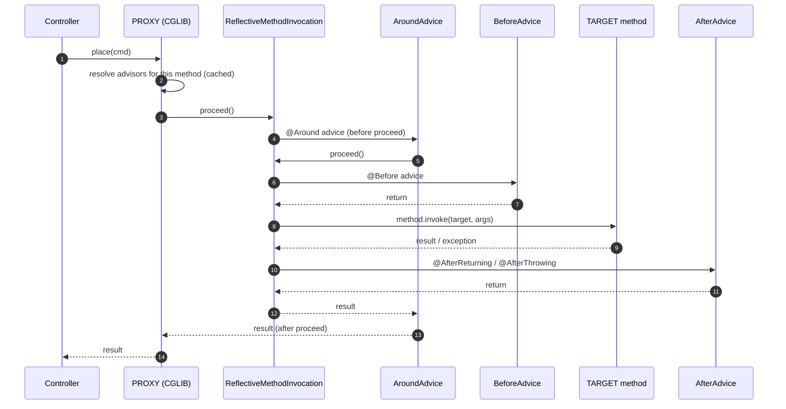
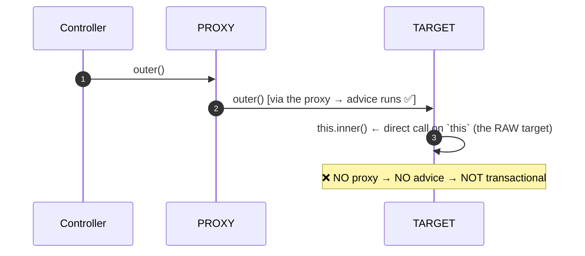

# 04 · AOP, Proxies & Weaving — The Complete Picture

> **Level:** Intermediate → Advanced
> **Interview Frequency:** ★★★★☆ (Very common as "how does @Transactional actually work?")
> **Prerequisite:** [01 · IoC Container](./01-IoC-Container-and-ApplicationContext.md) ·
> [03 · Bean Lifecycle](./03-Bean-Lifecycle-and-Scopes.md)
> **Last Updated:** 2026

---

## 📋 Table of Contents
- [0. TL;DR — The 30-Second Answer](#0-tldr--the-30-second-answer)
- [1. What & Why](#1-what--why)
- [2. Mental Model — the decorator pattern on steroids](#2-mental-model--the-decorator-pattern-on-steroids)
- [3. Deep Dive — Theory](#3-deep-dive--theory)
- [4. Internal Working Mechanism](#4-internal-working-mechanism)
- [5. Step-by-Step Execution Flow](#5-step-by-step-execution-flow)
- [6. Architecture Diagrams](#6-architecture-diagrams)
- [7. Production-Level Use Cases](#7-production-level-use-cases)
- [8. Code Examples — Production-Grade](#8-code-examples--production-grade)
- [9. Common Mistakes & Gotchas](#9-common-mistakes--gotchas)
- [10. Performance Considerations](#10-performance-considerations)
- [11. Security Considerations](#11-security-considerations)
- [12. Best Practices — The Checklist](#12-best-practices--the-checklist)
- [13. Hands-On Exercises](#13-hands-on-exercises)
- [14. Code Challenges](#14-code-challenges)
- [15. Scenario-Based Questions](#15-scenario-based-questions)
- [16. Interview Q&A — Level-wise](#16-interview-qa--level-wise)
- [17. Counter-Questions & Traps](#17-counter-questions--traps)
- [18. Tricky Interview Questions](#18-tricky-interview-questions)
- [19. Follow-Up Questions Asked by Interviewers](#19-follow-up-questions-asked-by-interviewers)
- [20. Real 3–5 Year Experience Scenarios](#20-real-35-year-experience-scenarios)
- [21. Frequently Asked Production Issues](#21-frequently-asked-production-issues)
- [22. Debugging Scenarios](#22-debugging-scenarios)
- [23. Architecture Design Questions](#23-architecture-design-questions)
- [24. Rapid-Fire MCQs](#24-rapid-fire-mcqs)
- [25. Cheat Sheet — One-Page Summary](#25-cheat-sheet--one-page-summary)
- [26. Real-World Production Notes](#26-real-world-production-notes)
- [27. Follow-up Learning](#27-follow-up-learning)

---

## 0. TL;DR — The 30-Second Answer

- **AOP is a way to implement cross-cutting concerns** (logging, transactions, security, caching,
  metrics, retries) **once**, separately from the business logic.
- **Spring AOP is proxy-based**, not bytecode-based. It works by **wrapping the bean in a proxy**
  that intercepts method calls. It does **not** modify your class.
- **Two proxy flavours:**
  - **JDK dynamic proxy** — implements the *interfaces*; only interface methods are advised.
    (`proxyTargetClass = false`, the default when the bean has interfaces).
  - **CGLIB proxy** — subclasses the *class*; all non-final public/protected methods can be
    advised. Requires a **non-final class**, a **non-final method**, and (usually) a **no-arg
    constructor** (or Objenesis).
- **Spring Boot 2.0+ defaults to CGLIB** (`spring.aop.proxy-target-class=true`) because most beans
  don't implement interfaces.
- **The #1 gotcha: self-invocation bypasses the proxy.** `this.otherMethod()` inside the target
  object calls the **raw method** — no advice runs. This is why `@Transactional` on a private or
  self-invoked method "doesn't work".
- **The advice order is a chain:** `@Around` wraps `@Before` → target → `@After` → `@AfterReturning`
  → `@AfterThrowing`. With multiple aspects, the order is by `@Order` (and `Ordered`).
- **`@Transactional` is AOP.** A `TransactionInterceptor` (a `MethodInterceptor`) starts a
  transaction, calls the method, commits or rolls back.
- **AOP in Spring only intercepts **Spring beans** proxied by the container** — a `new`-ed object
  is not advised.
- **Key terms:** `Aspect` (the advice class), `JoinPoint` (the execution point), `Pointcut` (which
  executions), `Advice` (what to do), `Weaving` (how the advice is applied — Spring uses a
  `BeanPostProcessor`).
- **The one-liner that wins interviews:** *"Spring AOP is a decorator implemented with a runtime
  proxy: the container substitutes a proxy object for your bean, and the proxy runs your advice
  around the real method — which is why anything that bypasses the proxy (self-invocation, `new`,
  a private method) escapes your advice."*

---

## 1. What & Why

### The problem

```java
@Service
public class OrderService {

    public Order place(CreateOrderCommand cmd) {
        log.info("Placing order for {}", cmd.customerId());      // ← logging
        long start = System.nanoTime();
        try {
            // ... 40 lines of business logic ...
        } finally {
            metrics.record("order.place", System.nanoTime() - start);   // ← metrics
        }
        // and somewhere: auditLog.record(...);  // ← audit
        // and: cache.invalidate(...);         // ← cache
    }

    public void cancel(Long id) {
        log.info("Cancelling order {}", id);                     // ← the SAME logging
        // ... and metrics, and audit ...
    }
}
```

Every method repeats the same noise. The business logic is buried.

### With AOP

```java
@Service
public class OrderService {
    public Order place(CreateOrderCommand cmd) { /* pure business logic */ }
    public void cancel(Long id) { /* pure business logic */ }
}

@Aspect
@Component
public class LoggingAspect {
    @Around("@annotation(com.acme.Logged)")
    public Object log(ProceedingJoinPoint pjp) throws Throwable {
        log.info("Entering {}#{}", pjp.getSignature().getDeclaringType().getSimpleName(),
                 pjp.getSignature().getName());
        try {
            return pjp.proceed();
        } finally {
            log.info("Exiting");
        }
    }
}
```

### The classic cross-cutting concerns in Spring

| Concern | Spring mechanism |
|---------|------------------|
| **Transactions** | `@Transactional` → `TransactionInterceptor` |
| **Security** | `@PreAuthorize` → `AuthorizationManagerBeforeMethodInterceptor` |
| **Caching** | `@Cacheable`/`@CacheEvict` → `CacheInterceptor` |
| **Async** | `@Async` → `AsyncExecutionInterceptor` |
| **Retry** | `@Retryable` (Spring Retry) → `RetryOperationsInterceptor` |
| **Rate limiting** | Resilience4j's `@RateLimiter` → a `MethodInterceptor` |
| **Validation** | `@Validated` → `MethodValidationPostProcessor` |
| **Metrics** | Micrometer's `@Timed`/`@Counted` → a `MethodInterceptor` |
| **Persistence exception translation** | `@Repository` → `PersistenceExceptionTranslationPostProcessor` |

> **Caption:** AOP is not a niche feature — it is the *mechanism* behind most of the annotations
> you use daily.

---

## 2. Mental Model — the decorator pattern on steroids

```text
   WITHOUT AOP                       WITH AOP

   ┌──────────────┐                 ┌──────────────┐   ┌──────────────┐
   │  Controller  │                 │  Controller  │──▶│  PROXY       │
   │              │                 └──────────────┘   │  ┌────────┐  │
   │ log();       │                 ┌──────────────┐   │  │ advice │  │
   │ metrics();   │                 │  Service     │──▶│  ├────────┤  │
   │ tx();        │                 └──────────────┘   │  │TARGET  │  │
   │ business();  │                 ┌──────────────┐   │  │ method │  │
   │ audit();     │                 │  Repository  │──▶│  └────────┘  │
   └──────────────┘                 └──────────────┘   └──────────────┘
```

> **Caption:** The container hands out the **proxy**, not the target. The proxy decides whether to
> run advice before/after calling the real method.

---

## 3. Deep Dive — Theory

### 3.1 The AOP vocabulary

| Term | Meaning | Spring type |
|------|---------|-------------|
| **Aspect** | A class that groups related advice | `@Aspect` class |
| **Advice** | The action taken at a join point | `@Before`, `@After`, `@Around`, … |
| **Join point** | A point in the program where advice can be applied | A **method execution** (Spring AOP only) |
| **Pointcut** | A predicate that selects join points | `@within`, `@annotation`, `execution(...)` |
| **Weaving** | How the advice is linked to the join points | A `BeanPostProcessor` (runtime proxy) |
| **Target** | The original object | Your `@Service` |
| **Proxy** | The object with the advice | CGLIB or JDK dynamic proxy |
| **Interceptor** | The advice implementation for one advice type | `MethodInterceptor` |

> 💡 **Spring AOP joins points are *method executions* only** — not field access, not constructor
> calls (except with AspectJ's `@Aspect` on a constructor... no, not even then). Full AspectJ
> supports field access and static initialisation.

### 3.2 The advice types and their execution order

```java
@Aspect
@Component
public class OrderAspect {

    @Before("execution(* com.acme.service.OrderService.*(..))")
    public void before(JoinPoint jp) { ... }

    @AfterReturning(pointcut = "execution(* com.acme.service.OrderService.place(..))",
                    returning = "result")
    public void afterReturning(JoinPoint jp, Object result) { ... }

    @AfterThrowing(pointcut = "execution(* com.acme.service.OrderService.*(..))",
                   throwing = "ex")
    public void afterThrowing(JoinPoint jp, Exception ex) { ... }

    @After("execution(* com.acme.service.OrderService.*(..))")
    public void after(JoinPoint jp) { ... }

    @Around("execution(* com.acme.service.OrderService.*(..))")
    public Object around(ProceedingJoinPoint pjp) throws Throwable {
        long start = System.nanoTime();
        try {
            return pjp.proceed();     // ← calls the next advice or the target
        } finally {
            metrics.record(System.nanoTime() - start);
        }
    }
}
```

**Execution order for a single method:**

```text
   ┌─ @Around (before proceed) ─────────────────────┐
   │    ┌─ @Before ──────────────────────────────┐   │
   │    │    ┌─ TARGET METHOD ────────────────┐   │   │
   │    │    └─────────────────────────────────┘   │   │
   │    │    ├─ @AfterReturning  (on success)   │   │
   │    │    └─ @AfterThrowing  (on exception)  │   │
   │    └─ @After (always) ──────────────────────┘   │
   └─ @Around (after proceed / in finally) ──────────┘
```

**With multiple aspects**, the order is by **`@Order`** (lower = outer = runs first):

```text
   @Order(1) TransactionAspect      ← outermost
      @Order(2) SecurityAspect
         @Order(3) CacheAspect
            @Order(4) LoggingAspect
               TARGET
```

> **The classic mistake:** putting `@Order` on the *aspect* vs on the *annotation* — Spring
> supports both (`Ordered` on the aspect class, and `Ordered` on the annotation type itself, e.g.
> `@Transactional(order = ...)`).

### 3.3 Pointcut expressions

```java
// ── Designators ─────────────────────────────────────────────────────────
execution(modifiers-pattern? ret-type-pattern declaring-type-pattern? method-name-pattern(param-pattern)?) ?
within(type-pattern)
target(type-pattern)
this(type-pattern)
args(param-pattern)
@annotation(type-pattern)
@within(type-pattern)
@target(type-pattern)
@args(param-pattern)
bean(beanId-pattern)
```

```java
// ── Examples ────────────────────────────────────────────────────────────
// Any public method on any class in the service package
execution(* com.acme.service..*.*(..))

// Any method on a specific class
execution(* com.acme.service.OrderService.place(..))

// Any method on any bean annotated with @Transactional
@annotation(org.springframework.transaction.annotation.Transactional)

// Any method on a bean whose class is annotated with @Service
within(@org.springframework.stereotype.Service *)

// Any method of any type implementing OrderRepository
target(com.acme.repository.OrderRepository)

// Any method whose first argument is a String
args(String)

// A specific bean by name
bean("orderService")

// Combine with && and || (and ! for negation)
@Around("execution(* com.acme..*.*(..)) && !execution(* com.acme..*Internal*.*(..))")
```

**Matching operators:** `*` (any characters except the package separator), `..` (any number of
packages), `+` (exactly one), `%` (any type in a type hierarchy).

> ⚠ **Performance:** a pointcut is **evaluated at runtime for every matching call** (though
> Spring caches the "which advisors apply to this method" result per `Method` in a cache). A
> **very broad** pointcut (e.g. `execution(* com.acme..*.*(..))`) is slower and, more importantly,
> **proxies more beans** — every matching bean gets a CGLIB proxy.

### 3.4 The advice annotations

```java
@Before("...")                              // before the target
@After("...")                               // after, always (like a finally)
@AfterReturning("...", returning = "r")    // only on normal return
@AfterThrowing("...", throwing = "e")      // only on exception
@Around("...")                              // around — the most powerful
@DeclareParents("...")                      // introduce new methods to the type
```

**`@Around` needs `proceed()`.** Forgetting it means the target method is **never called**.

**`@AfterThrowing` has a known gap:** it does **not** catch `Error` (only `Throwable` subtypes
that are `Exception`? — actually it catches `Throwable` but the parameter type must be
assignable). More importantly, an exception thrown in an `@Around` **before** `proceed()` is
**not** seen by an `@AfterThrowing` advice of the *same* aspect (it is seen by aspects further
out). Keep this in mind for error handling.

### 3.5 The `JoinPoint` API

```java
@Around("execution(* com.acme..*.*(..))")
public Object around(ProceedingJoinPoint pjp) throws Throwable {

    MethodSignature sig = (MethodSignature) pjp.getSignature();
    String method = sig.getDeclaringType().getSimpleName() + "#" + sig.getName();
    Object[] args = pjp.getArgs();
    Object target = pjp.getTarget();               // the raw target object
    Object proxy = pjp.getThis();                  // the proxy
    String kind = pjp.getKind();                   // METHOD_EXECUTION
    StaticPart sp = pjp.getStaticPart();           // the called method
    // ⚠ pjp.getSignature().getParameterNames() requires -parameters
}
```

### 3.6 JDK proxy vs CGLIB

| Aspect | JDK dynamic proxy | CGLIB |
|--------|-------------------|-------|
| **Basis** | Implements the bean’s interfaces | Subclasses the bean’s class |
| **Advises** | Interface methods only | All non-final, non-private methods |
| **Requires interfaces** | ✅ At least one | ❌ |
| **Requires a non-final class** | ❌ | ✅ |
| **Requires a non-final method** | ❌ | ✅ |
| **Requires a no-arg constructor** | ❌ | ⚠ Yes (or Objenesis) |
| **`proxyTargetClass`** | `false` | `true` |

**Spring Boot 2.0+ changed the default to CGLIB** (`spring.aop.proxy-target-class=true`) because
most Spring beans don't implement interfaces, and a JDK proxy would silently **not advise** them.

```java
// Force one or the other
@EnableAspectJAutoProxy(proxyTargetClass = true)   // CGLIB
@EnableAspectJAutoProxy(proxyTargetClass = false)  // JDK
spring.aop.proxy-target-class=false                  // global (JDK)
spring.aop.auto=true
```

> **Note:** `@Transactional` and `@Cacheable` etc. are usually applied via a
> `BeanPostProcessor` that decides the proxy type **per bean**: if the bean implements an
> interface, Spring may still use CGLIB when `proxyTargetClass=true` is set globally.

### 3.7 `@Aspect` vs `@EnableAspectJAutoProxy`

```java
@Configuration
@EnableAspectJAutoProxy           // registers AnnotationAwareAspectJAutoProxyCreator
public class AopConfig { }
```

- **`@EnableAspectJAutoProxy`** registers the `AspectJAutoProxyCreator` `BeanPostProcessor`.
- **The `@Aspect` annotation** marks a class as an aspect, but the `AspectJAutoProxyCreator`
  (or `@EnableAspectJAutoProxy`) must be present for it to be applied.
- **Boot does this for you** — `AopAutoConfiguration` registers it when `spring.aop.auto=true`
  (the default) and AspectJ is on the classpath.

```java
// Boot auto-configures this for you:
@ConditionalOnProperty(prefix = "spring.aop", name = "auto", havingValue = "true", matchIfMissing = true)
@ConditionalOnClass(EnableAspectJAutoProxy.class)
public class AopAutoConfiguration { ... }
```

### 3.8 Pointcut expressions as reusable annotations

```java
@Target(ElementType.METHOD)
@Retention(RetentionPolicy.RUNTIME)
public @interface Logged {
    String value() default "";
    boolean logArgs() default true;
    boolean logResult() default false;
}

@Aspect
@Component
public class LoggingAspect {

    @Around("@annotation(logged)")
    public Object around(ProceedingJoinPoint pjp, Logged logged) throws Throwable {
        MethodSignature sig = (MethodSignature) pjp.getSignature();
        log.info("→ {}.{}{}", sig.getDeclaringType().getSimpleName(), sig.getName(),
                 logged.logArgs() ? " args=" + Arrays.toString(pjp.getArgs()) : "");
        try {
            Object result = pjp.proceed();
            if (logged.logResult()) log.info("← result={}", result);
            return result;
        } catch (Throwable t) {
            log.error("✗ {}.{} failed", sig.getDeclaringType().getSimpleName(), sig.getName(), t);
            throw t;
        }
    }
}
```

> 💡 **Binding the annotation directly** (`@Around("@annotation(logged)")` with a `Logged logged`
> parameter) is the professional pattern — it gives the aspect access to the annotation's
> attributes.

### 3.9 `AspectJ` vs Spring AOP

| | Spring AOP | Full AspectJ |
|---|---|---|
| **Mechanism** | Runtime proxy | Compile-time / load-time **bytecode weaving** |
| **Join points** | Method execution only | Method execution, field access, constructor, static init |
| **Self-invocation** | ❌ broken | ✅ works (the code itself is woven) |
| **Final methods** | Not advised (CGLIB) | Advised (woven) |
| **Objects not managed by Spring** | ❌ not advised | ✅ advised |
| **Build complexity** | None | `aspectj-maven-plugin` / `aspectjweaver` |
| **Performance** | Proxy overhead | No proxy overhead |

> **Production answer:** use **Spring AOP** for everything; use **full AspectJ** only when you need
> field-access advice or advice on non-Spring objects — and then only with `aspectjweaver` +
> `spring-aspects` and the LTW agent.

### 3.10 The `AopContext` escape hatch (for self-invocation)

```java
@Service
public class OrderService {

    @Autowired private ApplicationContext ctx;

    public void place() {
        // Force the proxy to be used for the self-call
        OrderService self = ctx.getBean(OrderService.class);   // ← the PROXY
        self.notifyCustomer();       // ← advice runs ✅
    }

    @Transactional
    void notifyCustomer() { ... }
}
```

```java
// Better: use @EnableAspectJAutoProxy(exposeProxy = true)
@Service
public class OrderService {
    @Autowired private AopContext ctx;

    public void place() {
        OrderService self = ctx.getBean(OrderService.class);   // ← exposes the proxy
        self.notifyCustomer();
    }
}
```

> ⚠ Both are workarounds for a **design smell**. The better fix is to **split the class** (the
> classic "extract the collaborator" answer) or to accept the non-transactional behaviour
> deliberately.

---

## 4. Internal Working Mechanism

### 4.1 How the proxy is created

```text
postProcessAfterInitialization(bean, beanName)
  │
  ├─ AbstractAutoProxyCreator#postProcessAfterInitialization
  │     ├─ wrapIfNecessary(bean, beanName, cacheKey)
  │     │     ├─ 1. getAdvicesAndAdvisorsForBean(bean.getClass(), beanName, key)
  │     │     │       └─ findEligibleAdvisors() → findCandidateAdvisors()
  │     │     │             └─ findAdvisorsThatCanApply(advisor, targetClass, hasIntroductions)
  │     │     │                   └─ AopUtils.canApply(advisor, targetClass, hasIntroductions)
  │     │     │                         ├─ IntroductionAdvisor → matches the interfaces
  │     │     │                         └─ PointcutAdvisor → pointcut.getMethodMatcher()
  │     │     │                               .matches(method, targetClass)
  │     │     ├─ 2. if no advisors → return the original bean
  │     │     └─ 3. else → create the proxy
  │     │             ├─ JdkDynamicAopProxy (if interfaces && !proxyTargetClass)
  │     │             └─ CglibAopProxy     (otherwise)
  │     └─ the proxy wraps the bean in a TargetSource
  │
  └─ the PROXY is what gets registered in singletonObjects
```

### 4.2 The proxy's call path

```text
  client ──▶ PROXY.invoke(method, args)
                │
                ├─ 1. resolve the advisors for this method (cached)
                ├─ 2. build the interceptor chain:
                │       [AroundInterceptor] → [BeforeAdvice] → [TargetInvoker] → [AfterAdvice] → …
                ├─ 3. chain.proceed()  ← the reflective call to the real method
                └─ 4. return / throw
```

**The key object: `ReflectiveMethodInvocation`.**

```java
public class ReflectiveMethodInvocation implements ProxyMethodInvocation, Joinpoint {
    private final Object proxy;
    private final Object target;            // the RAW target
    private final Method method;
    private final Object[] arguments;
    private final List<Object> interceptorsAndDynamicMethodMatchers;
    private int currentInterceptorIndex = -1;

    public Object proceed() throws Throwable {
        // 1. if the current interceptor is a DynamicMethodInterceptor → it gets the last word
        // 2. else advance to the next interceptor
        // 3. if there are no more interceptors → invoke the target reflectively
        //    return this.method.invoke(this.target, this.arguments);
    }
}
```

### 4.3 `CglibAopProxy` — the subclass proxy

```text
  class OrderService$$SpringCGLIB$$0 extends OrderService {
      private final AdvisedSupport advised;   // holds the TargetSource + advisors

      @Override
      public Order place(CreateOrderCommand cmd) {
          // CGLIB routes the call to the interceptor:
          return CGLIB$SpringCGLIB$0$$Proxy$$0.place(this, cmd);
          // → DynamicAdvisedInterceptor.intercept(...) → the advice chain → super.place(...)
      }
  }
```

**CGLIB requirements:**
- The class must be **non-final**.
- The method must be **non-final** and **non-private**.
- The class needs a **no-arg constructor** (Spring uses **Objenesis** to bypass it, so this is
  usually fine — but a class with only a constructor that has side effects can misbehave because
  the constructor is called *twice*: once by Spring for the real instance, once by CGLIB for the
  proxy).

> ⚠ **The double-construction trap:** a class whose constructor increments a static counter, opens
> a socket, or registers itself somewhere will do it **twice** with CGLIB. Spring's
> `Objenesis` avoids the *second* constructor call, but only for CGLIB's own instantiation —
> some libraries still call it.

### 4.4 `JdkDynamicAopProxy` — the interface proxy

```text
  Proxy.newProxyInstance(loader, new Class[]{OrderService.class, Advised.class, DecoratingProxy.class},
      (proxy, method, args) -> {
          if (method.getDeclaringClass() == Advised.class) { ... }
          if (this.advised.exposeProxy) { ... }
          return this.advisedDispatcher.dispatch(proxy, method, args);
      });
```

- The proxy implements the bean's interfaces **plus** `SpringProxy` and `Advised`.
- `Advised` lets you inspect/modify the advisors at runtime (`((Advised) bean).getAdvisors()`).
- **Only interface methods are advised** — a call to a class-only method on the *proxy* goes
  straight to the target (via the `DecoratingProxy`/`TargetSource` fallback), **without** advice.

### 4.5 The advice chain construction

```java
public class DefaultAdvisorChainFactory {
    public List<Object> getInterceptorsAndDynamicInterceptionAdvice(
            Method method, Class<?> targetClass, List<Advisor> advisors) {
        List<Object> interceptorList = new ArrayList<>(advisors.size());
        Class<?> targetClassToUse = AopProxyUtils.ultimateTargetClass(targetClass);
        for (Advisor advisor : advisors) {
            if (advisor instanceof PointcutAdvisor pointcutAdvisor) {
                // 1. check the pointcut: does it match this method?
                if (!pointcutAdvisor.getPointcut().getMethodMatcher().matches(method, targetClassToUse)) {
                    continue;
                }
                // 2. get the advice
                MethodInterceptor[] interceptors = advisor.getAdvice().getInterceptors();
                for (MethodInterceptor interceptor : interceptors) {
                    interceptorList.add(new InterceptorAndDynamicMethodMatcher(interceptor,
                            pointcutAdvisor.getPointcut().getMethodMatcher()));
                }
            } else if (advisor instanceof IntroductionAdvisor introductionAdvisor) {
                interceptorList.add(...);
            }
        }
        return interceptorList;
    }
}
```

> **Caption:** The chain is rebuilt **per invocation** (the method→chain mapping is cached in a
> `Map<Method, List<Object>>` in `AdvisedSupport` for singleton-target proxies, guarded by a
> `ConcurrentHashMap`).

### 4.6 `@Transactional` — the anatomy of an advice

```java
@Aspect
public class TransactionAspect {
    @Around("@annotation(org.springframework.transaction.annotation.Transactional)")
    public Object invoke(TransactionAspectSupport.InvocationCallback invocation,
                         @Nullable TransactionInfo txInfo) throws Throwable {
        ...
    }
}
```

**The runtime path:**
```text
  proxy.invoke(place, cmd)
     │
     ▼
  TransactionInterceptor.invoke(method, args)
     │
     ├─ 1. get the TransactionAttributeSource → find the @Transactional metadata
     ├─ 2. determine the transaction manager (by the annotation's value, or by qualifier)
     ├─ 3. txManager.getTransaction(txDefinition)      ← BEGIN
     ├─ 4. RETURNS:  txManager.commit(txStatus)        ← COMMIT
     │           EXCEPTION: txManager.rollback(txStatus)← ROLLBACK
     └─ 5. rethrow the exception (after rollback)
```

---

## 5. Step-by-Step Execution Flow

### 5.1 The full AOP call



### 5.2 The self-invocation escape



---

## 6. Architecture Diagrams

### 6.1 The AOP stack

```text
┌─────────────────────────────────────────────────────────────────────────┐
│  YOUR CODE                                                                │
│    @Service OrderService { place(); notify(); }                          │
└───────────────────────────┬─────────────────────────────────────────────┘
                            │  container registers the PROXY, not the target
┌───────────────────────────▼─────────────────────────────────────────────┐
│  PROXY LAYER   (CGLIB subclass | JDK interface proxy)                   │
│    AopProxyFactory → AopProxy → AdvisedSupport                          │
└───────────────────────────┬─────────────────────────────────────────────┘
                            │
┌───────────────────────────▼─────────────────────────────────────────────┐
│  ADVISOR CHAIN                                                            │
│    TransactionInterceptor (@Transactional)                                │
│    AuthorizationManagerBeforeMethodInterceptor (@PreAuthorize)            │
│    CacheInterceptor (@Cacheable)                                          │
│    AsyncExecutionInterceptor (@Async)                                    │
│    MethodValidationInterceptor (@Validated)                              │
│    YOUR @Around aspect                                                    │
└───────────────────────────┬─────────────────────────────────────────────┘
                            │  proceed() down the chain
┌───────────────────────────▼─────────────────────────────────────────────┐
│  TARGET   OrderService.place()  ← the real business logic               │
└─────────────────────────────────────────────────────────────────────────┘
```

### 6.2 Two proxying mechanisms in Spring

```text
  ┌──────────────────────────────┐        ┌──────────────────────────────┐
  │  SPRING AOP                   │        │  ASPECTJ (LTW)               │
  │  BeanPostProcessor            │        │  ClassFileTransformer         │
  │  → creates a proxy            │        │  → rewrites the bytecode     │
  │  → advice lives in the proxy  │        │  → advice is woven INTO the  │
  │  → self-invocation escapes    │        │    method body               │
  │  → only Spring beans          │        │  → self-invocation works     │
  │  → only method execution      │        │  → any object                │
  └──────────────────────────────┘        └──────────────────────────────┘
```

### 6.3 Where advice sits relative to the transaction

```text
  @Order(10) LoggingAspect          ← outermost: logs the whole call
      @Order(20) MetricsAspect
          @Order(30) TransactionInterceptor   ← begins the tx
              @Order(40) CacheInterceptor
                  @Order(50) SecurityInterceptor
                      TARGET
```

> **Caption:** With the transaction **inside** the logging, the log includes the commit time. With
> the transaction **outside**, a slow commit is invisible to the log's timing. This is why
> `@Order` on the aspect class (or on the annotation) matters.

---

## 7. Production-Level Use Cases

| Use case | Mechanism | Notes |
|----------|-----------|-------|
| **Auditing (who changed what, when)** | An `@Aspect` + Spring Data JPA `@Auditable` | Combine both; the aspect can capture the request context |
| **Uniform logging / MDC** | An `@Aspect` that sets the MDC and clears it in a `finally` | The MDC must be cleared — `ThreadLocal` leak |
| **Metrics/timing on every service method** | An `@Aspect` + Micrometer | Prefer `@Observed` (Micrometer's observation API) — it gives a better name/tag model |
| **Rate limiting** | Resilience4j's `@RateLimiter` | Built on a `MethodInterceptor` |
| **Retries with backoff** | Spring Retry's `@Retryable` | **Only** on idempotent operations |
| **Masking sensitive data in logs** | An `@Aspect` that intercepts DTOs before logging | Be careful with PII |
| **Permission checks beyond `@PreAuthorize`** | An `@Aspect` with a custom annotation | Keep the check in the service layer, not only in the aspect |
| **Tenant enforcement** | An `@Aspect` on repository methods that adds a tenant filter | Defence in depth, in addition to the repository base class |
| **Feature-flagging a method** | An `@Aspect` reading a flag service | Provide a kill switch |
| **Cache warming / invalidation** | An `@Aspect` around repository writes | Prefer Spring's `@CacheEvict` where possible |
| **Tracing (OpenTelemetry)** | The Micrometer/OTel agent, or an `@Aspect` | Prefer the agent — it doesn't need code changes |

---

## 8. Code Examples — Production-Grade

### 8.1 A production logging + MDC aspect

```java
@Aspect
@Component
@Order(Ordered.HIGHEST_PRECEDENCE)      // outermost — see everything
@Slf4j
public class LoggingAspect {

    private static final Logger log = LoggerFactory.getLogger(LoggingAspect.class);

    @Around("@annotation(com.acme.Logged) || within(@com.acme.RestEndpoint *)")
    public Object logExecution(ProceedingJoinPoint pjp) throws Throwable {
        MethodSignature sig = (MethodSignature) pjp.getSignature();
        String name = sig.getDeclaringType().getSimpleName() + "." + sig.getName();
        String traceId = Optional.ofNullable(MDC.get("traceId")).orElse("-");
        long start = System.nanoTime();

        log.info("[{}] -> {}({})", traceId, name, summarise(sig.getParameterTypes()));
        try {
            Object result = pjp.proceed();
            long ms = (System.nanoTime() - start) / 1_000_000;
            log.info("[{}] <- {} in {} ms", traceId, name, ms);
            return result;
        } catch (Throwable t) {
            long ms = (System.nanoTime() - start) / 1_000_000;
            log.error("[{}] !! {} failed after {} ms", traceId, name, ms, t);
            throw t;
        }
    }

    private String summarise(Class<?>[] types) {
        return Arrays.stream(types).map(Class::getSimpleName).collect(Collectors.joining(", "));
    }
}
```

> ⚠ **Never log raw arguments** — they may contain PII or credentials. Log a *summary* (types, or
> a redacted view).

### 8.2 A custom annotation + aspect for authorisation

```java
@Target(ElementType.METHOD)
@Retention(RetentionPolicy.RUNTIME)
@Documented
public @interface RequiresPermission {
    String value();
}
```

```java
@Aspect
@Component
@Order(Ordered.HIGHEST_PRECEDENCE)   // run BEFORE @Transactional so we fail fast
@Slf4j
public class PermissionAspect {

    private final PermissionEvaluator evaluator;

    public PermissionAspect(PermissionEvaluator evaluator) {
        this.evaluator = evaluator;
    }

    @Around("@annotation(requiresPermission)")
    public Object check(ProceedingJoinPoint pjp, RequiresPermission requiresPermission)
            throws Throwable {
        Authentication auth = SecurityContextHolder.getContext().getAuthentication();
        if (auth == null || !evaluator.has(auth, requiresPermission.value())) {
            throw new AccessDeniedException(
                    "Missing permission: " + requiresPermission.value());
        }
        return pjp.proceed();
    }
}
```

> **Caption:** The `HIGHEST_PRECEDENCE` order is deliberate: a permission check should run
> **before** a transaction opens — you don't want to hold a DB transaction open for a request that
> will be rejected.

### 8.3 An idempotency aspect

```java
@Aspect
@Component
@RequiredArgsConstructor
public class IdempotencyAspect {

    private final IdempotencyStore store;

    @Around("@annotation(com.acme.Idempotent)")
    public Object enforce(ProceedingJoinPoint pjp, Idempotent idempotent) throws Throwable {
        String key = idempotent.keyPrefix() + ":" + pjp.getArgs()[0];
        Optional<String> cached = store.get(key);
        if (cached.isPresent()) {
            log.info("Idempotent replay for {}", key);
            return store.deserialize(cached.get(), (Class<?>) pjp.getSignature().getReturnType());
        }
        Object result = pjp.proceed();
        store.put(key, store.serialize(result), Duration.ofHours(24));
        return result;
    }
}
```

### 8.4 Using `@Aspect` with `ProceedingJoinPoint` and the `execution` designator

```java
@Aspect
@Component
public class RepositoryTimingAspect {

    @Around("execution(* org.springframework.data.repository.CrudRepository+.*(..)) "
          + "|| execution(* org.springframework.data.jpa.repository.JpaRepository+.*(..))")
    public Object timeQuery(ProceedingJoinPoint pjp) throws Throwable {
        long start = System.nanoTime();
        try {
            return pjp.proceed();
        } finally {
            long ms = (System.nanoTime() - start) / 1_000_000;
            if (ms > 50) {
                log.warn("Slow repository call {}.{} took {} ms",
                        pjp.getSignature().getDeclaringType().getSimpleName(),
                        pjp.getSignature().getName(), ms);
            }
        }
    }
}
```

### 8.5 Exposing the proxy to fix self-invocation (and why it's a last resort)

```java
@Configuration
@EnableAspectJAutoProxy(exposeProxy = true)
public class AopConfig { }
```

```java
@Service
public class OrderService {

    private final AopContext aopContext;

    public OrderService(AopContext aopContext) { this.aopContext = aopContext; }

    public void place(CreateOrderCommand cmd) {
        // The proxy — advice WILL run
        OrderService self = aopContext.getBean(OrderService.class);
        self.notifyCustomer();
    }

    @Transactional
    void notifyCustomer() { ... }
}
```

> **Better:** extract `CustomerNotifier` into its own bean — no proxy tricks, and the design is
> clearer.

### 8.6 Spring AOP with a `MethodInterceptor` (the low-level API)

```java
@Component
public class TimingInterceptor implements MethodInterceptor {

    private final MeterRegistry meters;

    public TimingInterceptor(MeterRegistry meters) { this.meters = meters; }

    @Override
    public Object invoke(MethodInvocation invocation) throws Throwable {
        Timer.Sample sample = Timer.start(meters);
        try {
            return invocation.proceed();
        } finally {
            sample.stop(meters.timer("method." + invocation.getMethod().getName(),
                    Tag.of("class", invocation.getThis().getClass().getSimpleName())));
        }
    }
}
```

---

## 9. Common Mistakes & Gotchas

| # | ❌ Wrong | ✅ Right | Why |
|---|----------|----------|-----|
| 1 | `this.otherMethod()` expecting advice to run | Inject the collaborator, or split the class | Self-invocation bypasses the proxy |
| 2 | `@Transactional` on a `private` method | Make it `public`/`protected` | CGLIB can't advise private methods |
| 3 | `@Transactional` on a `final` method | Remove `final` | CGLIB can't override it |
| 4 | `@Transactional` on a `final` class | Remove `final` | CGLIB can't subclass it |
| 5 | `@Transactional` on a method called from a **non-proxied** object | Ensure the caller gets the proxy | `new OrderService()` isn't advised |
| 6 | `@Around` without `proceed()` | Call `pjp.proceed()` | The target is never executed |
| 7 | `@Around` swallowing the exception | Rethrow | You break the transaction and the error handling |
| 8 | A `final` class + `proxyTargetClass=false` | Add an interface or remove `final` | JDK proxy needs an interface |
| 9 | A class with **no interface** and `proxyTargetClass=false` | Use CGLIB (the Boot default) | No proxy can be created |
| 10 | Expecting advice on `equals`/`hashCode`/`toString` | Handle them explicitly | JDK proxies route them to the target |
| 11 | `@Aspect` without `@EnableAspectJAutoProxy` | Enable it (Boot does it automatically) | The aspect is never applied |
| 12 | Expecting `@Async` to work in `@PostConstruct` | Use a runner or lifecycle | The proxy doesn't exist yet |
| 13 | A pointcut matching a `final` method | Exclude it | Advice is silently skipped |
| 14 | Depending on the aspect order | Set `@Order` explicitly | The default order is unspecified |
| 15 | An aspect that throws | Catch and handle inside the aspect | It breaks the caller's contract |
| 16 | `@AfterThrowing` expecting to see exceptions from an `@Around` in the same aspect | Understand the chain order | The `@Around` is *outside* the `@AfterThrowing` |
| 17 | A huge pointcut (`execution(* com..*.*(..))`) | Narrow it | It proxies every bean → startup cost and surprises |
| 18 | Using `pjp.getSignature().getParameterNames()` without `-parameters` | Add the flag | The names are `arg0`, `arg1`… |
| 19 | Caching a value in an aspect's field | Use a concurrent structure or no state | The aspect is a singleton |
| 20 | `@Cacheable` on a method called internally | Accept it or restructure | Self-invocation bypasses the cache advice too |

---

## 10. Performance Considerations

| Aspect | Impact | Guidance |
|--------|--------|----------|
| **Proxy creation** | CGLIB generates a class per bean type at startup | Only proxy what's needed |
| **Proxy call overhead** | One extra reflective call + chain traversal per call | Negligible for I/O-bound code; measurable for hot in-memory loops |
| **Broad pointcuts** | Every matching bean is proxied → startup cost + memory | Narrow the pointcut |
| **Pointcut matching** | Cached per `Method` | Fine |
| **`@Around` with expensive work** | Runs on every call | Keep the advice cheap; push heavy work to async |
| **Logging arguments** | Serialisation cost + PII risk | Log a summary |
| **`@Cacheable` on a hot method** | A cache lookup per call | That's the point — but make sure the key is right |
| **`@Async` self-invocation** | Runs synchronously | Split the class |
| **Aspect field state** | The aspect is a singleton — a race condition | Keep it stateless or thread-safe |
| **Nested proxies** | A proxied bean injected into another proxied bean | Each layer adds a hop |

---

## 11. Security Considerations

| Risk | Mitigation |
|------|-----------|
| **Authorisation in an aspect that can be bypassed** | Self-invocation bypasses the aspect | Put the check in the service layer, or make the method entry-point-only |
| **`@PreAuthorize` on a method called internally** | Bypassed | Same rule — never rely solely on method security for a critical check |
| **Logging PII in an aspect** | A GDPR/PCI problem | Log identifiers, redact payloads, have a DTO for logging |
| **An aspect that swallows exceptions** | Security checks silently skipped | Always rethrow |
| **CGLIB proxies and `equals`/`hashCode`** | Collections may behave oddly | Don't put proxied beans in a `HashSet` expecting identity semantics |
| **Proxy-based method security on a `final` method** | Silently not applied | Test it |
| **An aspect with a broad pointcut capturing `Controller` methods** | It might log request bodies (credentials) | Restrict the pointcut to the service layer |
| **Ordering: security after the transaction** | A rejected request still opened a transaction | Order the security aspect first |

---

## 12. Best Practices — The Checklist

- [ ] **Use Spring AOP**, not full AspectJ, unless you need field access.
- [ ] **Keep aspects stateless** (they're singletons) or thread-safe.
- [ ] **Always `proceed()`** in `@Around`, and **rethrow** exceptions.
- [ ] **Order your aspects explicitly** with `@Order` — and put the security aspect *outside* the
      transaction.
- [ ] **Narrow pointcuts**; prefer a **custom annotation** over a package-wide expression.
- [ ] **Never rely on AOP for a self-invoked method.** Split the class.
- [ ] **Log a summary, not the payload.**
- [ ] **Test that the advice actually runs** — a common silent failure is a `final` method.
- [ ] Remember: **the advice only applies to Spring-managed beans**.
- [ ] Use `@Order` on the **aspect class** or on the **annotation**, consistently.
- [ ] For metrics, prefer **Micrometer's `@Observed`** over a hand-rolled aspect.

---

## 13. Hands-On Exercises

**🧪 Lab 1 — Prove the proxy**
1. Add an `@Around` aspect that logs every method on one service.
2. Call the method from a controller → the log appears.
3. Call another method **from within** the same service → **no log**.
4. Call it from a controller after splitting the service → the log appears.

**✅ Success signal:** You've *felt* self-invocation.

**🧪 Lab 2 — The `final` trap**
1. Put `@Transactional` on a `public final` method → it silently does nothing.
2. Remove `final` → it works.
3. Add a log in the transaction to prove it.

**✅ Success signal:** You know why the "silent" failure happens.

**🧪 Lab 3 — The proxy class**
1. Log `bean.getClass().getName()` → `OrderService$$SpringCGLIB$$0`.
2. Log `AopProxyUtils.ultimateTargetClass(bean).getName()` → `OrderService`.
3. Compare `ctx.getBean(OrderService.class) == ctx.getBean("orderService")`.

**✅ Success signal:** You can explain the difference between the proxy and the target.

**🧪 Lab 4 — Aspect ordering**
1. Create two aspects with `@Order(1)` and `@Order(2)`, each logging "enter"/"exit".
2. Print the log sequence → the lower order wraps the higher.
3. Change the orders and re-run.

**✅ Success signal:** You can predict the nesting.

**🧪 Lab 5 — Measure the overhead**
1. Time 1M calls to a trivial method, with and without an aspect.
2. Compute the per-call overhead.

**✅ Success signal:** You have a number you can quote ("~50–200 ns per call").

---

## 14. Code Challenges

### Challenge 1 — An audit aspect (medium)
**Goal:** Build an aspect that records every call to a `@Audited` method: the method, the
arguments (redacted), the user, the timestamp, the duration, and the outcome.
**Requirements:** store it asynchronously; never break the business call; redact sensitive fields.

### Challenge 2 — A safe retry aspect (hard)
**Goal:** `@Retryable` that retries only **idempotent** operations.
**Requirements:** detect non-idempotent methods (a `create`/`save`/`pay` name, or a custom
`@NonIdempotent` annotation) and refuse to retry them; add exponential backoff with jitter; record
the attempts in a metric.

### Challenge 3 — A cache aspect with a correct key (hard)
**Goal:** A `@Cacheable` that computes a key from the method's arguments, ignoring
`@IgnoreForCache` fields, and hashes long keys.
**Requirements:** handle arrays, collections and nulls; avoid a key explosion.

---

## 15. Scenario-Based Questions

**S1.** *A service method is annotated `@Transactional`, but the data isn't rolled back when an
exception is thrown. The method is called from another method **in the same class**. What's
wrong?*
>
> **Expected answer:** **Self-invocation bypasses the proxy.** The internal call `this.doWork()`
> invokes the method on the **raw target object**, not on the proxy — so the
> `TransactionInterceptor` never runs and there is no transaction at all. (Note: the *outer* method
> may or may not be transactional — if the outer method is `@Transactional`, the whole thing runs
> in one transaction, and the "rollback" of the inner part is really the rollback of the outer one;
> if the outer is not transactional, the inner part runs in **autocommit** and each statement
> commits independently.) **Diagnosis:** put a log or a breakpoint in the transactional method and
> check whether the transaction is active (`TransactionSynchronizationManager.isActualTransactionActive()`);
> or check `AopUtils.isAopProxy(bean)`. **Fixes, in order of preference:** (1) **Split the class** —
> move the inner method into a separate bean; the cleanest and most correct fix. (2) **Inject the
> bean into itself** (self-injection) — `@Autowired private OrderService self;` — Spring injects the
> proxy, so `self.inner()` **is** advised. (3) **`@Lazy` self-injection** — the same, with a
> lazy proxy to avoid a circular-dependency error. (4) **`AopContext.currentProxy()`** with
> `exposeProxy = true`. (5) `ApplicationContext.getBean(OrderService.class)` — works, but is a
> service-locator smell. **Recommendation:** always (1). **Prevention:** an ArchUnit-style check
> or a "no self-invocation" review rule; a test that asserts a rollback actually happens.

**S2.** *After upgrading to Spring Boot 3, `@Cacheable` stopped working on some services, and
`@Transactional` stopped working on others. The classes are unchanged.*
>
> **Expected answer:** (1) **The likely cause is the proxy type change or an interface
> introduction.** Spring Boot 2.0 changed the default to CGLIB (`proxyTargetClass=true`), and
> Spring 6 / Boot 3 keep it, but if the app sets `spring.aop.proxy-target-class=false`, the JDK
> proxy is used — and **only interface methods are advised**. If a service gained a new interface
> (or the advice is attached to an interface method that isn't in the proxy's interface list), the
> advice silently stops applying. (2) **Second cause: `@EnableAspectJAutoProxy` vs
> `AopAutoConfiguration`.** If the app defines its own `@EnableAspectJAutoProxy(proxyTargetClass =
> false)`, it can override Boot's auto-configuration. (3) **Third cause: `final` methods/classes** —
> with JDK proxies, `final` isn't an issue; with CGLIB it is. If the upgrade changed the proxy
> strategy, previously-working `final` methods now silently lose their advice. (4) **Fourth cause:
> the `@Transactional` on a `protected`/package-private method** — with CGLIB, `protected` methods
> *can* be advised (Spring 6 improved this), but `private` and `final` cannot. (5) **Diagnosis:**
> log `AopUtils.isAopProxy(bean)`, `AopProxyUtils.ultimateTargetClass(bean)`, and
> `((Advised) bean).getAdvisors()` to see whether the advice is attached; check
> `spring.aop.proxy-target-class`; check the `AnnotationAwareAspectJAutoProxyCreator` bean exists.
> (6) **Fix:** make the behaviour explicit — set `proxyTargetClass=true` globally, avoid `final`
> on advised classes, and **write a test that asserts the advice actually runs** (e.g. assert that
> a rollback happened, or that the cache was populated) — not just that the annotation is present.

**S3.** *A custom aspect that logs method arguments is leaking customer PII into the logs. How
do you fix it without losing the observability?*
>
> **Expected answer:** (1) **Stop logging raw arguments.** Log the argument *types* and a
> **redacted projection**: for a DTO, log the ID and a few safe fields; for a primitive, log it;
> for a collection, log the size. (2) **Make redaction declarative** — a `@Sensitive`/`@Redacted`
> annotation on fields, honoured by a `toLogString()` (a `toString` override or a dedicated
> `LogView` DTO). Prefer an explicit `Loggable` interface over reflection over fields (which can
> leak new fields as soon as someone adds one). (3) **Centralise it** — one aspect, one policy, so
> the rule is auditable; don't let each team write its own. (4) **Backfill**: the logs already
> contain PII — treat them as a data-protection incident: restrict access, set a short retention
> period, and check whether the log aggregator needs purging. (5) **Prevent**: a test that asserts
> a DTO containing a field marked `@Sensitive` does not appear in the log output (use a Logback
> `ListAppender` in a test); a lint rule for `log.info("...{}", dto)` patterns. (6) Consider
> **structured logging with a field allow-list** rather than a deny-list — a deny-list always
> leaks something new.

---

## 16. Interview Q&A — Level-wise

### 🟢 Beginner
**Q: What is AOP?**
**A:** Aspect-Oriented Programming — a way to implement **cross-cutting concerns** (logging,
transactions, security, caching) in one place, separately from the business logic, and apply them
to many classes without modifying them.

**Q: What are the core AOP terms?**
**A:** **Aspect** (the class holding the advice), **Advice** (the action — `@Before`, `@Around`, …),
**Join point** (where the advice can apply — in Spring AOP, a method execution), **Pointcut** (a
predicate selecting join points), and **Weaving** (how the advice is linked in).

**Q: What is the difference between `@Before` and `@Around`?**
**A:** `@Before` runs before the target and cannot change the flow (no `proceed()`). `@Around`
wraps the target: it runs before, **must call `proceed()`** to invoke the target, and can
intercept the return value and the exception. `@Around` is the most powerful and the most
error-prone.

### 🟡 Intermediate
**Q: How does Spring implement AOP?**
**A:** With **runtime proxies**. The `AnnotationAwareAspectJAutoProxyCreator` (a
`BeanPostProcessor`) finds beans with matching advisors and replaces them with a proxy — a **JDK
dynamic proxy** (if the bean has interfaces and `proxyTargetClass=false`) or a **CGLIB subclass
proxy** (otherwise, and the Boot default). The advice is executed by the proxy around the real
method call.

**Q: What is self-invocation and why does it break things?**
**A:** Calling a method on `this` inside the same class invokes the method on the **raw target**,
bypassing the proxy — so no advice runs. This breaks `@Transactional`, `@Cacheable`, `@Async`, and
`@Retryable` when the method is invoked internally. Fixes: split the class, self-inject, or use
`AopContext`.

**Q: What is the difference between Spring AOP and AspectJ?**
**A:** Spring AOP is **proxy-based** and limited to **method execution on Spring-managed beans**;
full AspectJ does **bytecode weaving** at compile/load time, supporting field access, constructor
advice, and any object. Spring AOP needs no build configuration, which is why it's the default.

**Q: How are multiple aspects ordered?**
**A:** By `@Order` (or implementing `Ordered`). Lower values are **outer** — they wrap the higher
ones. On the way in, the lowest order runs first; on the way out, it runs last.

### 🔴 Advanced / Senior
**Q: Why is `final` a problem for AOP?**
**A:** With **CGLIB**, the proxy is a **subclass** — it must override the advised method. A `final`
method or a `final` class **cannot be overridden**, so the advice is silently skipped. With **JDK
proxies**, only interface methods are advised at all — a `final` class is fine, but any method
*not* on an interface is invisible to the advice. Neither failure produces an error: the annotation
is present and the advice just doesn't run. That's why you need tests that assert the *behaviour*
(a rollback happened, the cache was populated), not just that the annotation is present.

**Q: What is the performance cost of AOP?**
**A:** One extra indirection per call: the proxy method → the interceptor chain → the reflective
call to the target. The chain is rebuilt per invocation (though the method→chain mapping is
cached), and the pointcut is matched per method (cached per `Method`). In practice, for I/O-bound
backend code, it's **noise** (tens of nanoseconds to a few microseconds). It matters only for
very hot in-memory paths, where you should avoid proxying (or use AspectJ LTW). The bigger cost
is usually **startup**: every proxied bean costs a CGLIB class generation.

**Q: How do you test that an aspect actually works?**
**A:** Behaviourally: assert the *effect* (a transaction rolled back, the cache was populated, the
metric was recorded), not that the annotation exists. Use a spy/mock for the advice, or an
`@SpringBootTest` with a test aspect. Also test the **negative** cases: a `final` method, a
self-invocation, and a non-Spring-managed object — these are the silent failures.

**Q: What's the difference between an `Advisor` and an `@Aspect`?**
**A:** An `@Aspect` is a **POJO holding advice methods** with pointcut annotations — a convenient
declarative form. An `Advisor` is the **runtime object** combining a pointcut and an advice
(`PointcutAdvisor`). The `AspectJAutoProxyCreator` converts aspects into advisors internally. A
`@Aspect` class is a bean; an `Advisor` can be defined as a `@Bean` for full programmatic control
(used by Spring Security, Spring Data, and Spring Cache).

### ⚫ Expert / Principal
**Q: Design the AOP strategy for a large codebase: where do cross-cutting concerns live?**
> **Answer structure:** (1) **A taxonomy of concerns**: (a) *Infrastructure* — transactions, caching,
> retries, rate limiting → **framework annotations** (`@Transactional`, `@Cacheable`,
> `@Retryable`), because they need deep framework integration. (b) *Cross-cutting domain* —
> auditing, tenant enforcement, feature flags → **custom aspects with a custom annotation**,
> because they need business semantics. (c) *Presentation* — logging, metrics, tracing → **a
> single aspect** (or Micrometer's `@Observed` + the OTel agent) applied at the boundary
> (controller/service), not everywhere. (2) **Ordering rules** — a strict, documented order:
> security → transaction → cache → metrics → logging (or logging outermost). Enforce it with
> `@Order` constants, not magic numbers. (3) **Pointcut discipline** — always a custom annotation
> (`@Audited`, `@TenantScoped`), never a package wildcard. A wildcard pointcut proxies every bean
> in a package, which is a startup cost and a source of surprise. (4) **The "aspect is a
> singleton" rule** — no mutable state; use `ThreadLocal` only with a `finally` cleanup. (5)
> **AOP hygiene rules** in the build: no `final` on advised classes, no self-invocation of advised
> methods (detectable by an ArchUnit rule: "a class may not call its own `@Transactional` method").
> (6) **Testing** — a test that asserts the aspect's effect, and a "advice coverage" report.
> (7) **Observability of the aspects themselves** — an aspect that fails should be visible.

---

## 17. Counter-Questions & Traps

### CQ1. "Isn't AOP just a fancy way of doing inheritance?"
- **Naive answer:** "Kind of, it decouples."  ← muddy
- **The trap:** AOP and inheritance solve different problems. Inheritance shares *behaviour*;
> AOP shares *policy* applied to *arbitrary* classes.
- **Expert answer:** Inheritance forces a **class hierarchy** — every class that needs logging
> extends a logging base class, which is a design constraint and doesn't work for classes you don't
> own. AOP applies the concern **compositionally**, to any bean, without touching its source. The
> real trade-off: AOP makes the control flow **implicit** — a reader of the method doesn't see that
> a transaction or a security check is applied. That's why the *annotation* is important: it makes
> the policy visible **at the point of use**, even if the mechanism is invisible.

### CQ2. "Why does Spring use proxies instead of weaving like AspectJ?"
- **Naive answer:** "Because it's simpler."  ← shallow
- **The trap:** The real reason is **zero build complexity** and the ability to advise beans
> *dynamically* (based on annotations evaluated at runtime).
- **Expert answer:** (1) **No build-time coupling** — no `aspectj-maven-plugin`, no LTW agent, no
> `@EnableAspectJAutoProxy` per module; a starter jar just works. (2) **Runtime flexibility** —
> the pointcut is evaluated against the actual bean class at context startup, so conditional advice
> is trivial. (3) **A clean seam for other frameworks** — Spring's `@Transactional`,
> `@Cacheable` and `@Async` are all implemented as advisors, and they compose. (4) The cost is the
> limitations: no field access, no advice on non-Spring objects, and **self-invocation breaks**.
> Full AspectJ fixes those but costs build complexity and a weaving agent.

### CQ3. "How do you make `@Transactional` work on a self-invoked method?"
- **Naive answer:** "Use `AopContext.currentProxy()`."  ← technically right, wrong priority
- **The trap:** The proxy workarounds **preserve a bad design** — the method is still doing two
> things and the transaction boundary is unclear.
- **Expert answer:** The **right** fix is to extract the method into a **separate bean** so the
> call goes through a proxy naturally. The proxy workarounds (`@Lazy` self-injection,
> `AopContext`, `ApplicationContext.getBean`) are acceptable only when a refactor isn't possible
> — and they carry a cost: `AopContext` requires `exposeProxy = true`, and self-injection creates
> a circular reference that Spring has to resolve with a proxy.

### CQ4. "What if the target class has no interface and `proxyTargetClass=false`?"
- **Naive answer:** "It throws."  ← true but incomplete
- **The trap:** The exact error is `AopConfigException: Cannot create proxy target class ... no
> interfaces`.
- **Expert answer:** Spring throws when it *tries* to create the proxy. But note: the bean may
> still be created **without** the advice if the advisor's pointcut doesn't match — so the error
> only appears when a matching advisor exists. The fix is `proxyTargetClass=true` (the Boot
> default) or implementing an interface. This is a classic reason a Spring Boot 1 → 2 upgrade
> broke `@Transactional` on non-interface beans.

### CQ5. "Does `@Transactional` work on a `protected` method?"
- **Naive answer:** "No, only public."  ← historically true, now nuanced
- **The trap:** Spring 6 (Boot 3) **improved CGLIB's support for protected methods** — they can
> now be advised. But `private` and `final` still cannot.
- **Expert answer:** Historically, only `public` methods were advised under CGLIB because the
> generated subclass could only override public methods. Spring Framework 6.0 changed the CGLIB
> proxy to allow `protected` methods to be advised. `private` and `final` remain impossible. The
> safe, version-independent advice: **make advised methods `public`**.

### CQ6. "Why is my `@Around` advice running twice?"
- **Naive answer:** "Because there are two aspects."  ← possible
- **The trap:** The usual cause is that the **pointcut matches both the specific method and the
> type**, and two aspects (or two pointcut expressions in one aspect) both match.
- **Expert answer:** Diagnose with `((Advised) bean).getAdvisors()` and by enabling the
> `org.springframework.aop` trace logging. Common causes: (1) the aspect class is registered
> **twice** (e.g. component-scanned *and* declared as a `@Bean`); (2) the pointcut is too broad and
> matches both the interface method and the implementation; (3) two aspects with overlapping
> pointcuts. Also check `@EnableAspectJAutoProxy` isn't declared twice.

### CQ7. "What happens if an `@Around` advice doesn't call `proceed()`?"
- **Naive answer:** "The method doesn't run."  ← right
- **The trap:** It also means the **return value is `null`** — so the caller gets a null result,
> often causing a confusing NPE far away.
- **Expert answer:** The chain terminates at the `@Around` advice; the target and all inner advice
> are skipped. The proxy returns whatever the advice returns (often `null`). Spring doesn't warn.
> This is the most common `@Around` bug.

### CQ8. "Does AOP work on `@Scheduled` methods?"
- **Naive answer:** "Yes."  ← usually true, with caveats
- **The trap:** The scheduled method is invoked on the **proxied** bean by the scheduler, so
> `@Transactional` works — but `@Async` on the same method can conflict, and self-invocation from
> another method of the same class still bypasses it.
- **Expert answer:** `ScheduledAnnotationBeanPostProcessor` schedules a `Runnable` that invokes
> the bean **from the container**, so the proxy is used. But the classic trap: if the scheduled
> method calls another method of the same class, that inner call bypasses the proxy. And
> `@Transactional` on a `@Scheduled` method is a very common (and correct) pattern.

### CQ9. "Why is the proxy a subclass of my class — isn't that a memory leak?"
- **Naive answer:** "It's fine."  ← shallow
- **The trap:** Each proxied bean type gets **one** generated class, cached in the JVM — not one
> per instance. So the cost is per *type*, not per *bean*.
- **Expert answer:** CGLIB generates a subclass per **target class**, and it's cached for the
> life of the JVM. The memory cost is the class metadata (a few KB per class) plus the proxy
> instance's extra fields. The bigger cost is that the class is loaded by a **custom class
> loader** (Spring's `CGLIB` loader), which can complicate class-loader leaks in a redeploy
> scenario (Tomcat) — the classic "PermGen/metaspace leak" from old Tomcat + CGLIB versions.

### CQ10. "How do I know if a bean is proxied?"
- **Naive answer:** "Check the class name."  ← works, crude
- **The trap:** The class name is a **CGLIB implementation detail** (`$$SpringCGLIB$$0`).
- **Expert answer:** Use the API: `AopUtils.isAopProxy(bean)` (is it proxied at all),
> `AopUtils.isJdkDynamicProxy(bean)` vs `AopUtils.isCglibProxy(bean)`,
> `AopProxyUtils.ultimateTargetClass(bean)` (the real class), and
> `((Advised) bean).getAdvisors()` (which advice is attached).

---

## 18. Tricky Interview Questions

**T1. "Can `@Transactional` and `@Async` be on the same method?"**
> Yes, but be careful with the order. With `@Order` on the aspects, the async one should be
> **outer** (so the transaction starts on the async thread, not the caller's). By default,
> `@Async`'s order is `Ordered.LOWEST_PRECEDENCE` and `@Transactional`'s is
> `Ordered.LOWEST_PRECEDENCE` too — so the order is ambiguous. Set the order explicitly.

**T2. "What is the `exposeProxy` flag for?"**
> It makes the `AopContext` aware of the proxy, so `AopContext.currentProxy()` returns it. It's a
> workaround for self-invocation, enabled with `@EnableAspectJAutoProxy(exposeProxy = true)`.

**T3. "Does Spring AOP advise a `toString()` call?"**
> With a JDK proxy, `toString`, `equals` and `hashCode` are routed to the target (via the
> `DecoratingProxy` fallback), so advice on them is skipped. With CGLIB, `toString` can be
> overridden but `equals`/`hashCode` are **not** advised (Spring excludes them to preserve
> identity semantics). Don't put advice on `equals`/`hashCode`.

**T4. "Can a pointcut match a private method?"**
> The pointcut can *match* it, but the advice will never run — CGLIB can't override a private
> method, and JDK proxies don't expose it. The failure is silent.

**T5. "What is `IntroductionAdvisor` / `@DeclareParents`?"**
> It lets an aspect **add new methods** to the proxied type's interface. It's rarely used and it's
> a JDK-proxy-only feature (it needs interfaces).

**T6. "How do I apply an aspect only to specific Spring profiles?"**
> With `@Profile("prod")` on the aspect, or by making the aspect a `@ConditionalOnProperty` bean.
> The aspect is only created (and therefore only applied) when the condition matches.

**T7. "What is the difference between `@Aspect` and a plain class with an `@Around` method?"**
> A plain class isn't picked up as an aspect — the `AspectJAutoProxyCreator` only recognises
> classes annotated with `@Aspect` (or those registered as `Advisor` beans). A `@Component` with
> `@Around` and **no** `@Aspect` is ignored.

**T8. "Can you use AOP on a `record`?"**
> A Java `record` is implicitly `final` → CGLIB can't subclass it → no CGLIB proxy. With a JDK
> proxy (an implemented interface) it works. This is a common problem in Boot 3 projects that
> converted DTOs to records.

**T9. "Does `@Transactional` work on a `record`/final service?"**
> Same answer — a `final` class can't be CGLIB-proxied. Services shouldn't be `final` anyway.

**T10. "What happens if two advisors have the same order?"**
> The order between them is **undefined** (Spring sorts stably by registration order, but that
> isn't a contract). Always give distinct orders to aspects that interact.

---

## 19. Follow-Up Questions Asked by Interviewers

**F1** (after "how does Spring implement AOP?") → *"Why does self-invocation break it?"*
→ The proxy is a *separate object*; the call `this.method()` is a direct virtual call on the
target, so the interceptor chain is never entered.

**F2** (after "what's the difference between Spring AOP and AspectJ?") → *"When would you actually
use full AspectJ?"*
→ When you need advice on field access, on non-Spring objects, on `final` methods, or on
constructors; or when self-invocation must work. The cost is build complexity (the
`aspectj-maven-plugin` or the LTW agent) — most teams don't accept it.

**F3** (after "what is `@Around`?") → *"What happens if you forget `proceed()`?"*
→ The target is never invoked and the proxy returns `null` (or whatever the advice returns).

**F4** (after "how are aspects ordered?") → *"What if the transaction and the security aspect
interact?"*
→ Order matters: security **outside** the transaction (fail fast, don't hold a connection for a
rejected request). Document the order.

**F5** (after "CGLIB vs JDK proxy") → *"What are the constraints of CGLIB?"*
→ The class and the advised methods must not be `final`; the class needs a usable constructor
(Objenesis usually solves it); `private` methods can't be advised; `equals`/`hashCode` are not
advised.

---

## 20. Real 3–5 Year Experience Scenarios

**R1. "A method that should be transactional isn't. The team has already tried adding
`@Transactional` to three different methods."**
>
> **Ideal answer:** (1) **Stop guessing — instrument it.** Add
> `TransactionSynchronizationManager.isActualTransactionActive()` to the method, or enable
> `logging.level.org.springframework.transaction=DEBUG`. (2) **The likely causes, in order:**
> (a) **Self-invocation** — the method is called from within the same class → the proxy is
> bypassed. (b) The method is `private` or `final` → CGLIB can't advise it. (c) The **class** is
> `final` → no proxy at all. (d) The bean was created with `new` (not injected). (e) The
> exception was **caught** inside the method (a caught exception doesn't roll back by default —
> only unchecked exceptions and `rollbackFor` do). (f) The exception was thrown but the
> transaction manager isn't the one you think (multiple `DataSource`s → the wrong transaction
> manager). (g) The method is on an **interface** and the JDK proxy is used but the implementation
> method isn't on the interface. (3) **Diagnose concretely**: `AopUtils.isAopProxy(bean)`,
> `AopProxyUtils.ultimateTargetClass(bean)`, `((Advised) bean).getAdvisors()`,
> `TransactionSynchronizationManager.isActualTransactionActive()`. (4) **Fix** based on the cause:
> split the class (self-invocation), remove `final`/`private`, or make the exception unchecked /
> use `@Transactional(rollbackFor = Exception.class)`. (5) **Prevent**: a **test** that asserts a
> rollback actually happened (insert a row, throw, assert the row is gone) — this is the only
> reliable guard, and it catches all of the above. (6) The **senior framing**: "`@Transactional`
> is an *advisory* applied by a proxy; it is not a language feature, and it has an
> implementation-defined set of preconditions." Write them down in the team's style guide.

**R2. "You need to add auditing to 200 service methods. The team doesn't want to touch them."**
>
> **Ideal answer:** (1) **That's exactly what AOP is for** — but choose the mechanism
> deliberately. (2) **Option A: a Spring Data JPA `@Auditable` entity listener** — only works for
> JPA entities (not for domain services), and captures field-level changes, not method calls.
> (3) **Option B: a custom aspect + `@Audited` annotation** — the general answer. The aspect
> captures the method, the user (from `SecurityContextHolder`), the arguments (redacted), the
> timestamp, the outcome, and the duration. Apply it with an **annotation**, not a pointcut, so
> each method opts in explicitly. (4) **Option C: a `@RestController`/filter-level approach** —
> logs the HTTP request, not the domain action; too coarse for audits. (5) **Design decisions**:
> **where does the audit record go?** (a) An **async in-memory queue → a batched insert** (fast,
> but lossy on a crash); (b) **the same transaction as the business change** (consistent, but
> slows the write and couples the audit to the DB); (c) a **separate audit DB** via a
> transactional outbox (durable, decoupled, more moving parts). Pick based on the compliance
> requirement — an audit trail that can be lost is worthless. (6) **Performance**: the aspect must
> be cheap — collect the data and hand it to an async publisher; **never** do I/O in the advice
> path. (7) **Security**: redact PII; record the *user* from the security context, and for system
> actions record the service identity. (8) **Rollout**: annotate a small module first, verify the
> data, then expand. Add an **ArchUnit rule** to prevent missing a new service method. (9) **Test**:
> an integration test asserting the audit row is written (and that it is **not** written when the
> transaction rolls back — which is the whole point of auditing in the same transaction).

**R3. "The startup time of the service doubled after adding a cross-cutting aspect with a broad
pointcut."**
>
> **Ideal answer:** (1) **The cause is proxy creation, not the advice.** A broad pointcut
> (`execution(* com.acme..*.*(..))`) means the `AutoProxyCreator` creates a **CGLIB proxy for
> every matching bean** — hundreds of classes generated at startup, each loaded by the CGLIB class
> loader. (2) **Measure**: `/actuator/startup` (with `BufferingApplicationStartup`) shows the
> per-bean creation time; the `CglibAopProxy` creation shows up as a spike. Also check the
> **number of beans** and the **number of proxied types**. (3) **Fixes**: (a) **Narrow the
> pointcut** to a custom annotation (`@Audited`) — then only the annotated beans are proxied;
> (b) **replace the AOP-based cross-cutting concern with a non-AOP mechanism** where one exists:
> an **interceptor/filter** for HTTP-level concerns (logging, metrics) — a `HandlerInterceptor` or
> a `Filter` is *much* cheaper than a CGLIB proxy per bean and doesn't need a pointcut; (c) use
> **Spring Boot Actuator + Micrometer's `@Observed`** (which uses a similar proxy but with a
> narrower scope) or the **OpenTelemetry javaagent** (no proxying at all, no code changes);
> (d) if you need per-method timing, use a **Spring MVC interceptor** plus a `DataSource` proxy
> for SQL timing rather than proxying every service. (4) **Re-measure** and set a startup budget
> in CI. (5) **The senior framing**: "AOP is the right tool for *domain* cross-cutting concerns
> (transaction, authorisation, tenant enforcement) and the wrong tool for *infrastructure*
> concerns (logging, metrics, tracing) — for those, use interceptors, filters or an agent." That
> distinction is what separates a senior from a mid-level answer.

---

## 21. Frequently Asked Production Issues

| Symptom | Cause | Diagnosis | Fix |
|---------|-------|-----------|-----|
| `@Transactional` doesn't roll back | Self-invocation, `private`/`final`, a caught exception, or the wrong transaction manager | `isActualTransactionActive()`; `isAopProxy()` | Split the class; remove `final`; `rollbackFor` |
| `@Cacheable` never hits | Self-invocation, a `final` method, or a non-serialisable return type | Check the cache metrics | Restructure |
| `@Async` runs synchronously | Self-invocation, or the executor is the same thread | Check the thread name in the log | Restructure; use a real `TaskExecutor` |
| Advice doesn't run at all | `final` class/method, no interface with JDK proxy, the bean isn't a Spring bean, or no `@EnableAspectJAutoProxy` | `isAopProxy()`, `getAdvisors()` | Fix the proxy setup |
| Advice runs twice | The aspect is registered twice, or two aspects overlap | `getAdvisors()`; TRACE logging | Remove the duplicate |
| `@Around` returns null | `proceed()` wasn't called | Read the code | Call `proceed()` |
| Startup is slow after adding an aspect | CGLIB class generation for a broad pointcut | `/actuator/startup` | Narrow the pointcut; use filters |
| A `record`/`final` DTO isn't proxied | CGLIB can't subclass it | The class name | Implement an interface or don't proxy it |
| An aspect's state is corrupted | The aspect is a singleton with mutable fields | — | Make it stateless/thread-safe |

---

## 22. Debugging Scenarios

**D1. "Is the bean proxied, and with what?"**
```java
log.info("proxy?      {}", AopUtils.isAopProxy(bean));
log.info("jdk?        {}", AopUtils.isJdkDynamicProxy(bean));
log.info("cglib?      {}", AopUtils.isCglibProxy(bean));
log.info("target      {}", AopProxyUtils.ultimateTargetClass(bean).getName());
if (bean instanceof Advised advised) {
    advised.getAdvisors().forEach(a -> log.info("advisor: {}", a.getClass().getName()));
}
```

**D2. "Why isn't my pointcut matching?"**
1. Log the pointcut expression string (not the annotation) — a typo is common.
2. Check the class is a **Spring bean** (not `new`-ed).
3. Check the method isn't `private`/`final`/`static`.
4. Check the package pattern: `com.acme.service..*` (note the `..`).
5. Check the aspect bean exists: `ctx.getBeanNamesForType(MyAspect.class)`.
6. Enable TRACE logging: `logging.level.org.springframework.aop=TRACE`.

**D3. "Is the transaction actually active?"**
```java
log.info("tx active = {}", TransactionSynchronizationManager.isActualTransactionActive());
log.info("tx name   = {}", TransactionSynchronizationManager.getCurrentTransactionName());
```

**D4. "Which advisor handles this call?"**
```java
// Turn on TRACE for the AOP infrastructure
logging.level.org.springframework.aop=TRACE
logging.level.org.springframework.transaction.interceptor=TRACE
```
The logs show the "Registering advisor", "Creating implicit proxy" and the invocation path.

**D5. "Is the aspect being applied twice?"**
Check `((Advised) bean).getAdvisors().size()` and the aspect's bean names
(`ctx.getBeanNamesForType(MyAspect.class)`) — more than one means a duplicate registration.

---

## 23. Architecture Design Questions

**Q1. 🏗️ Design the cross-cutting concern strategy for a 30-service platform.**
> **Answer structure:** (1) **A taxonomy** — infrastructure (logging, metrics, tracing) vs domain
> (authorisation, tenant enforcement, auditing) vs transactional (the framework's own). (2) **A
> mechanism per tier**: filters/interceptors for HTTP-level, a single "platform" aspect for
> domain-level, and the framework annotations for transactional. (3) **One aspect per concern**, in
> a **shared starter module**, so the policy is uniform and auditable — not re-implemented by 30
> teams. (4) **Ordering as a documented constant** — `SecurityOrder` < `TransactionOrder` <
> `CacheOrder` < `MetricsOrder` < `LoggingOrder`, with explicit `@Order` values. (5) **Cross-cutting
> concerns belong in the *inner* layers, not the controller** — a transaction on a controller
> method is a smell (the transaction should end before serialisation). (6) **Observability** — every
> aspect should record a metric and never throw. (7) **Performance budgets** — measure the proxy
> overhead once and document it. (8) **Enforcement** — ArchUnit rules: no `final` on advised
> classes, no advised-method self-invocation, no aspects outside the platform module.

**Q2. 🏗️ Design a tenant-enforcement mechanism that cannot be bypassed.**
> **Answer structure:** (1) **Resolve the tenant once**, at the edge — a filter that extracts it
> from a signed JWT claim (never from a bare header) and puts it in a request-scoped
> `TenantContext`. (2) **Enforce at the data layer, not the service layer** — a base repository
> that always adds `tenant_id = :tenant` to every query, or Hibernate's `@TenantId` / a
> `@FilterDef`. This is the only place enforcement is **complete** — a service can always forget.
> (3) **Defence in depth** — an aspect on repository methods that asserts the tenant is set, so a
> missing filter fails loudly rather than silently returning another tenant's data. (4) **Caches
> must be tenant-scoped** — a tenant-aware `CacheKeyPrefix` (`@Cacheable(cacheNames = ..., cacheManager =
> "tenantCacheManager")` with a `KeyGenerator` that prefixes the tenant id). (5) **Database-level
> protection** — Row-Level Security (Postgres `RLS`) with `SET LOCAL app.tenant_id` per
> transaction: the strongest guarantee, because it holds even if the application code is wrong.
> (6) **Async paths** — a Kafka consumer must set the tenant context from the message and clear
> it afterwards. (7) **Tests** — a test that runs the same code for two tenants and asserts
> isolation, plus a test that asserts a query without the tenant filter fails.

**Q3. 🏗️ How would you migrate an existing codebase to AOP without breaking it?**
> **Answer structure:** (1) **Inventory** — list every cross-cutting concern currently duplicated
> across the code (a grep for `log.info` in services, for `try/catch` blocks, for manual caching).
> (2) **Classify** each by concern and pick the mechanism (filter vs aspect vs framework
> annotation). (3) **Migrate one concern at a time**, in this order: (a) **logging/metrics** to a
> filter/interceptor (the lowest risk, no proxy changes); (b) **retry** to `@Retryable` — but only
> on idempotent operations, and behind a flag; (c) **caching** to `@Cacheable` — start with
> read-only methods; (d) **auditing** to an aspect. (4) **For each migration**: add the
> annotation, keep the old code path behind a **feature flag** for a release, compare the outputs
> in shadow mode, then remove the old code. (5) **Watch for the traps**: `final` methods, self-
> invocation, methods that were previously `private`, and the change in bean identity. (6)
> **Add the tests** that assert the new behaviour (a rollback, a cache hit, a metric) *before*
> removing the old code. (7) **Guard the future** — ArchUnit rules: "no `@Transactional` on a
> `private`/`final` method", "no self-invocation of a `@Transactional` method", "no aspect classes
> outside the platform module".

---

## 24. Rapid-Fire MCQs

**1.** Spring AOP is implemented via:
A) Bytecode weaving  B) Runtime proxies  C) Compile-time source generation  D) AspectJ weaver
**✅ B**

**2.** Spring Boot's default proxy strategy is:
A) JDK dynamic proxy  B) CGLIB  C) AspectJ  D) No proxy
**✅ B** — `spring.aop.proxy-target-class=true` since Boot 2.0.

**3.** Spring AOP can advise:
A) Any method  B) Method executions only  C) Field access  D) Constructors
**✅ B**

**4.** Self-invocation bypasses the proxy because:
A) The proxy is final  B) `this` refers to the raw target  C) The method is private  D) AOP is disabled
**✅ B**

**5.** An `@Around` advice must:
A) Return null  B) Call `proceed()`  C) Be `public`  D) Extend a base class
**✅ B**

**6.** Aspects are ordered by:
A) Class name  B) `@Order`  C) Registration order only  D) Alphabetical
**✅ B** — lower = outer.

**7.** CGLIB cannot advise a:
A) `public` method  B) `final` method  C) `protected` method  D) `synchronized` method
**✅ B**

**8.** A JDK proxy advises:
A) All public methods  B) Interface methods only  C) Private methods  D) Static methods
**✅ B**

**9.** The proxy is created in:
A) The constructor  B) `postProcessAfterInitialization`  C) `getBean`  D) `populateBean`
**✅ B**

**10.** `@PostConstruct` runs on the:
A) Proxy  B) Target  C) Both  D) Neither
**✅ B** — the proxy doesn't exist yet.

**11.** Spring AOP works on:
A) Any Java object  B) Spring-managed beans only  C) Only `@Component` classes  D) Only public classes
**✅ B**

**12.** The AOP advisor chain is rebuilt:
A) Once at startup  B) Per invocation (cached per method)  C) Per bean  D) Never
**✅ B**

**13.** `exposeProxy = true` enables:
A) Debug logging  B) `AopContext.currentProxy()`  C) JDK proxies  D) AspectJ
**✅ B**

**14.** Full AspectJ over Spring AOP adds:
A) Better performance  B) Field access and non-Spring objects  C) Simpler config  D) CGLIB support
**✅ B**

**15.** `@Transactional` on a `private` method:
A) Works  B) Silently doesn't work  C) Throws  D) Works with CGLIB only
**✅ B**

**16.** The pointcut designator that matches an annotation on the method is:
A) `@annotation`  B) `@within`  C) `@target`  D) `args`
**✅ A**

**17.** `@within` matches:
A) The annotation on the method  B) The annotation on the **class**  C) The bean name  D) The return type
**✅ B**

**18.** `args(String)` matches based on:
A) The method name  B) The argument types  C) The annotations  D) The return type
**✅ B**

**19.** A `@Component` class with `@Around` but **no** `@Aspect`:
A) Is applied  B) Is ignored  C) Throws  D) Is applied only in tests
**✅ B**

**20.** The advice is applied to the **target** object when:
A) The client holds the proxy  B) The client holds the raw target  C) Always  D) Never
**✅ B** — this is exactly why self-invocation fails.

---

## 25. Cheat Sheet — One-Page Summary

```text
┌──────────────────────────────────────────────────────────────────────────────┐
│  SPRING AOP                                                                  │
├──────────────────────────────────────────────────────────────────────────────┤
│  MECHANISM: runtime proxy via BeanPostProcessor                             │
│    CGLIB (default in Boot) = subclass; non-final class+method; no interface  │
│    JDK proxy             = interfaces only                                  │
│  CREATED AT: postProcessAfterInitialization (AFTER @PostConstruct)          │
├──────────────────────────────────────────────────────────────────────────────┤
│  ADVICE ORDER (one aspect):  @Around → @Before → TARGET →                  │
│                             @AfterReturning/@AfterThrowing → @After        │
│  MULTI-ASPECT ORDER: @Order (low = outer = first in)                       │
├──────────────────────────────────────────────────────────────────────────────┤
│  ⚠ SELF-INVOCATION (`this.m()`) BYPASSES THE PROXY → no advice             │
│    fixes: split the class | self-inject | @Lazy self-injection | AopContext  │
│  ⚠ private / final methods & final classes CANNOT be advised (CGLIB)       │
│  ⚠ @Around MUST call proceed() and MUST rethrow                           │
│  ⚠ advice applies ONLY to Spring-managed beans                              │
├──────────────────────────────────────────────────────────────────────────────┤
│  POINTCUTS: execution() within() target() this() args() @annotation()       │
│             @within() @target() @args() bean()                             │
│  💡 PREFER a custom annotation over a package wildcard                     │
├──────────────────────────────────────────────────────────────────────────────┤
│  FRAMEWORK USES: @Transactional @Cacheable @Async @Retryable @PreAuthorize  │
│                   @Validated @Repository(exception translation)             │
└──────────────────────────────────────────────────────────────────────────────┘
```

---

## 26. Real-World Production Notes

- **AOP's silent failure mode is its greatest risk.** No exception, no warning — the advice just
  doesn't run. The only defence is **behavioural tests**: assert that a rollback happened, that
  the cache was populated, that the metric was recorded.
- **Don't use AOP for infrastructure concerns.** A `HandlerInterceptor` or a servlet `Filter` for
  HTTP-level logging and metrics is faster, needs no pointcut, and doesn't proxy your beans.
- **Keep aspects stateless.** They're singletons.
- **Log a summary, not the payload.** Aspects are a common PII leak.
- **Order matters and is not obvious.** Security outside the transaction; logging outermost (so
  the timing includes the commit).
- **`@Transactional` on a controller is a smell** — the transaction should end when the service
  method returns, before serialisation.
- **When a `@Transactional` method is called from a `@PostConstruct` or a `@Scheduled` task, it
  works** (both go through the container) — but a self-call from within the class does not.

---

## 27. Follow-up Learning

- → [05 · Spring Modules Overview](./05-Spring-Modules-Overview.md) — where AOP fits in the
  Spring ecosystem.
- → [04 · Spring Data JPA](../04-Spring-Data-JPA-Hibernate/README.md) — how transactions are actually
  managed.
- → [05 · Spring Security](../05-Spring-Security/README.md) — the security filter chain and
  method security.
- → [14 · Deployment & DevOps](../14-Deployment-DevOps/README.md) — the OpenTelemetry agent as an
  alternative to AOP-based tracing.

---
**Next Chapter:** → [05 · Spring Modules Overview](./05-Spring-Modules-Overview.md)
**Previous Chapter:** ← [03 · Bean Lifecycle & Scopes](./03-Bean-Lifecycle-and-Scopes.md)
