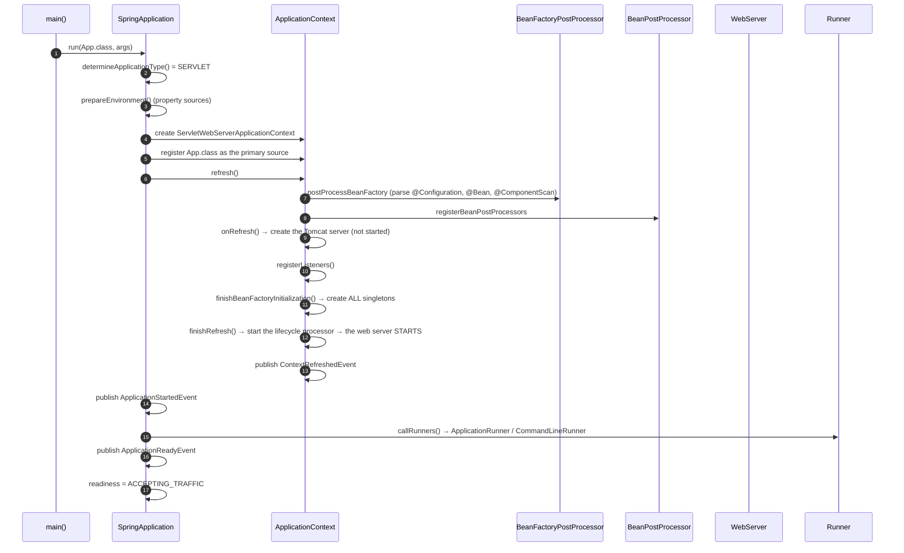
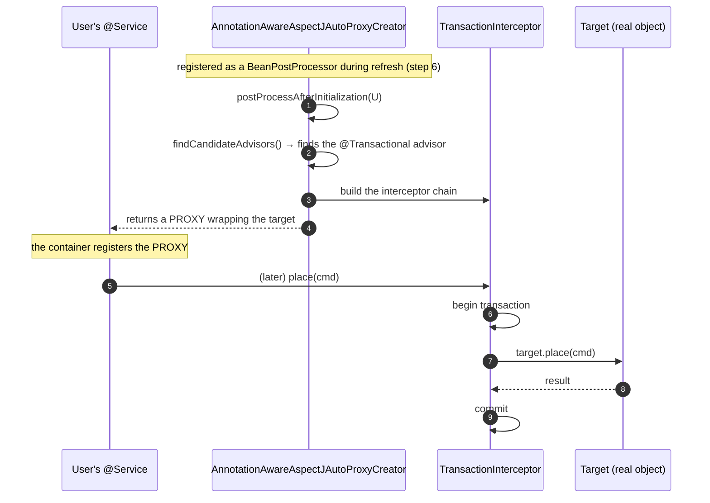

# 05 · Spring Modules Overview & Internal Architecture

> **Level:** Intermediate → Advanced
> **Interview Frequency:** ★★★☆☆ (Common as a "describe the Spring ecosystem" question)
> **Prerequisite:** [01 · IoC Container](./01-IoC-Container-and-ApplicationContext.md)
> **Last Updated:** 2026

---

## 📋 Table of Contents
- [0. TL;DR — The 30-Second Answer](#0-tldr--the-30-second-answer)
- [1. What & Why](#1-what--why)
- [2. Mental Model — the layered Spring ecosystem](#2-mental-model--the-layered-spring-ecosystem)
- [3. Deep Dive — Theory](#3-deep-dive--theory)
- [4. Internal Working Mechanism](#4-internal-working-mechanism)
- [5. Step-by-Step Execution Flow](#5-step-by-step-execution-flow)
- [6. Architecture Diagrams](#6-architecture-diagrams)
- [7. Production-Level Use Cases](#7-production-level-use-cases)
- [8. Code Examples — Production-Grade](#8-code-examples--production-grade)
- [9. Common Mistakes & Gotchas](#9-common-mistakes--gotchas)
- [10. Performance Considerations](#10-performance-considerations)
- [11. Security Considerations](#11-security-considerations)
- [12. Best Practices — The Checklist](#12-best-practices--the-checklist)
- [13. Hands-On Exercises](#13-hands-on-exercises)
- [14. Code Challenges](#14-code-challenges)
- [15. Scenario-Based Questions](#15-scenario-based-questions)
- [16. Interview Q&A — Level-wise](#16-interview-qa--level-wise)
- [17. Counter-Questions & Traps](#17-counter-questions--traps)
- [18. Tricky Interview Questions](#18-tricky-interview-questions)
- [19. Follow-Up Questions Asked by Interviewers](#19-follow-up-questions-asked-by-interviewers)
- [20. Real 3–5 Year Experience Scenarios](#20-real-35-year-experience-scenarios)
- [21. Frequently Asked Production Issues](#21-frequently-asked-production-issues)
- [22. Debugging Scenarios](#22-debugging-scenarios)
- [23. Architecture Design Questions](#23-architecture-design-questions)
- [24. Rapid-Fire MCQs](#24-rapid-fire-mcqs)
- [25. Cheat Sheet — One-Page Summary](#25-cheat-sheet--one-page-summary)
- [26. Real-World Production Notes](#26-real-world-production-notes)
- [27. Follow-up Learning](#27-follow-up-learning)

---

## 0. TL;DR — The 30-Second Answer

- **Spring is a family of projects, not one framework.** The core is `spring-core` +
  `spring-beans` +  `spring-context`; everything else builds on it.
- **The module map (memorise the layers):**
  - **Core** — `spring-core` (utilities, `Environment` abstraction), `spring-beans` (the IoC
    container), `spring-context` (the `ApplicationContext`, events, `@Configuration`).
  - **Data** — `spring-jdbc`, `spring-tx`, `spring-orm` (Hibernate/JPA integration),
    `spring-data-*` (the repository abstraction).
  - **Web** — `spring-web` (the `DispatcherServlet`, the web MVC infrastructure),
    `spring-webmvc` (the MVC implementation), `spring-webflux` (reactive).
  - **AOP** — `spring-aop` + `aspectjweaver`.
  - **Security** — `spring-security-core` + `spring-security-web` + …
  - **Boot** — `spring-boot` (auto-configuration) + `spring-boot-autoconfigure` + `spring-boot-*`
    starters.
- **`spring-boot-autoconfigure` is where the auto-configuration classes live**; `spring-boot`
  contains the runtime (`SpringApplication`, the banner, the `ApplicationRunner` support) and the
  `AutoConfiguration.imports` file.
- **The `Environment` abstraction is the spine** — it unifies `system properties`, `environment
  variables`, `application.properties/yml`, `command-line args`, `JNDI`, and `@Profile` selection
  behind one interface. `@Value` and `@ConfigurationProperties` both read from it.
- **The `ApplicationEventPublisher`** is the in-process integration mechanism; **Spring Integration**
  and **Spring Cloud Stream** are the messaging ones.
- **`ApplicationContext` is the integration point** — the "one object that gives you access to
  everything" (`@Autowired ApplicationContext` gives you the environment, the events, the
  resources, the bean factory).
- **Bean definition sources** — a modern Spring Boot app usually has three: your annotated
  classes, the auto-configurations, and (optionally) functional bean definitions.
- **The runner order** (things that run at startup, in order): `BeanFactoryPostProcessor` →
  `BeanPostProcessor` → `ApplicationRunner`/`CommandLineRunner` → `ApplicationReadyEvent` →
  `AvailabilityChangeEvent(Readiness)`.
- **The one-liner:** *"Spring Core is the container; Spring projects are just modules that plug
  `BeanPostProcessor`s and `BeanFactoryPostProcessor`s into it — which is why every Spring
  annotation, from `@Transactional` to `@Cacheable`, ultimately reduces to an advisor on a
  proxy."*

---

## 1. What & Why

Knowing the module map matters for three practical reasons:

1. **Dependency reasoning** — "do I need `spring-webmvc` or is `spring-web` enough?" A wrong
   answer costs a build or a runtime `ClassNotFoundException`.
2. **Interview credibility** — "describe the Spring ecosystem" is a standard question, and vague
   answers ("Spring is used for dependency injection") are a red flag.
3. **Auto-configuration understanding** — knowing that `spring-boot-autoconfigure` contains
   `DataSourceAutoConfiguration`, `WebMvcAutoConfiguration`, etc. explains *why* your app is
   configured the way it is.

---

## 2. Mental Model — the layered Spring ecosystem

```text
┌──────────────────────────────────────────────────────────────────────────────┐
│  SPRING BOOT                                                                │
│  spring-boot · spring-boot-autoconfigure · starters · Actuator              │
│  "Assemble an app with sensible defaults"                                  │
├──────────────────────────────────────────────────────────────────────────────┤
│  ENTERPRISE MODULES                                                          │
│  Spring Security · Spring Data · Spring Integration · Spring Batch          │
│  Spring Cloud · Spring GraphQL · Spring AI                                  │
├──────────────────────────────────────────────────────────────────────────────┤
│  WEB                                                                        │
│  spring-webmvc (MVC) · spring-webflux (Reactive) · spring-websocket         │
├──────────────────────────────────────────────────────────────────────────────┤
│  DATA                                                                       │
│  spring-data-jpa · spring-data-redis · spring-data-mongodb                  │
│  spring-tx · spring-jdbc · spring-orm (Hibernate)                           │
├──────────────────────────────────────────────────────────────────────────────┤
│  AOP                                                                        │
│  spring-aop · aspectjweaver                                                 │
├──────────────────────────────────────────────────────────────────────────────┤
│  CORE (the foundation)                                                      │
│  spring-context · spring-beans · spring-core · spring-expression            │
│  "The IoC container, the bean definitions, the environment abstraction"      │
└──────────────────────────────────────────────────────────────────────────────┘
```

> **Caption:** Everything above the Core line is optional and layered on top. The Core is the only
> thing that's truly mandatory.

---

## 3. Deep Dive — Theory

### 3.1 The Core modules

| Module | Key types | What it does |
|--------|-----------|--------------|
| **`spring-core`** | `Environment`, `PropertyResolver`, `Resource`, `ConversionService`, `Assert`, `ObjectUtils` | The utility layer; the `Environment` abstraction |
| **`spring-beans`** | `BeanFactory`, `ApplicationContext`, `BeanDefinition`, `BeanPostProcessor`, `@Autowired` | **The IoC container** |
| **`spring-context`** | `@Configuration`, `@ComponentScan`, `ApplicationEventPublisher`, `ResourceLoader`, `Lifecycle` | The application context: events, `@Configuration`, internationalisation |
| **`spring-aop`** | `AopProxy`, `Advisor`, `Pointcut`, `@Aspect` | Proxy-based AOP |
| **`spring-expression`** | `SpelExpressionParser`, `Expression` | The SpEL language (used by `@Value`, `@PreAuthorize`, `@Cacheable` keys) |
| **`spring-jcl`** | `org.apache.commons.logging` shim | The logging facade bridge |

> **Note:** `spring-context` depends on `spring-aop` and `spring-expression`; `spring-beans` does
> not.

### 3.2 The `Environment` abstraction — the spine

```java
public interface Environment extends PropertyResolver {
    String[] getActiveProfiles();
    String[] getDefaultProfiles();
    boolean matchesProfiles(String... profiles);
    List<PropertySource<?>> getPropertySources();
}
```

**`PropertyResolver` methods:**
```java
String getProperty(String key);
String getProperty(String key, String defaultValue);
<T> T getProperty(String key, Class<T> targetType);
<T> T getProperty(String key, Class<T> targetType, T defaultValue);
<T> T getProperty(String key, Class<T> targetType, Supplier<T> defaultValue);
boolean containsProperty(String key);
```

**The standard `Environment` implementations:**
- `StandardServletEnvironment` — servlet apps (adds the servlet config sources).
- `AbstractEnvironment` — the base, with `MutablePropertySources`.
- `MockEnvironment` — for tests.
- `NoOpEnvironment` — a no-op implementation.

**The `PropertySource` hierarchy:**

```text
PropertySource
├── EnumerablePropertySource      (can enumerate its keys — needed for relaxed binding)
│   ├── MapPropertySource
│   │   ├── PropertiesPropertySource
│   │   └── OriginTrackedMapPropertySource
│   ├── SystemEnvironmentPropertySource   ← relaxed binding for env vars
│   └── RandomValuePropertySource
└── PropertySource (non-enumerable) — e.g. a servlet init param source
```

**Why this matters:** **relaxed binding** only works for `EnumerablePropertySource`s that implement
`SystemEnvironmentPropertySource`-style normalisation. A `PropertySource` that can't be
enumerated can't be relaxed-bound.

### 3.3 The Data modules

| Module | Key types | Purpose |
|--------|-----------|---------|
| **`spring-tx`** | `PlatformTransactionManager`, `@Transactional`, `TransactionTemplate` | **Transaction abstraction** — independent of the persistence technology |
| **`spring-jdbc`** | `JdbcTemplate`, `DataSourceUtils`, `SQLErrorCodeSQLExceptionTranslator` | JDBC support; `DataSourceUtils` manages the **connection binding** to the transaction |
| **`spring-orm`** | `HibernateJpaVendorAdapter`, `JpaTransactionManager`, `EntityManagerFactoryUtils` | JPA/Hibernate integration |
| **`spring-r2dbc`** | Reactive transaction support | Reactive DB |
| **`spring-data-commons`** | `Repository`, `CrudRepository`, `PagingAndSortingRepository`, `QueryMethod` | The repository **abstraction** (the "D" in DDD, sort of) |
| **`spring-data-jpa`** | `JpaRepository`, `@Query`, `@EntityGraph`, `Specification` | JPA repositories |
| **`spring-data-redis`** | `RedisTemplate`, `ReactiveRedisTemplate` | Redis |

> **Key insight:** `spring-tx` knows **nothing** about JPA or JDBC. `@Transactional` is a
> *transaction-manager-agnostic* abstraction — the `JpaTransactionManager` or
> `DataSourceTransactionManager` does the actual work. That's why you can swap the persistence
> technology and keep the annotations.

### 3.4 The Web modules

| Module | Key types | Purpose |
|--------|-----------|---------|
| **`spring-web`** | `WebRequest`, `UriComponentsBuilder`, `HttpHeaders`, `RestTemplate`, `ClientHttpRequestFactory` | The **shared HTTP abstractions** — used by both MVC and WebFlux |
| **`spring-webmvc`** | `DispatcherServlet`, `@Controller`, `@RequestMapping`, `HandlerMapping`, `HandlerAdapter` | **Servlet-based** MVC |
| **`spring-webflux`** | `WebFlux`, `Mono`, `Flux`, `RouterFunction` | **Reactive** (Netty) stack |
| **`spring-websocket`** | `WebSocketHandler`, `WebSocketConfigurer` | WebSockets (servlet) |
| **`spring-web-reactive`** | `WebClient` | The reactive HTTP client (part of `spring-web`) |

> **Key insight:** `RestTemplate` and `WebClient` live in **different** modules.
> `RestTemplate` is blocking and servlet-friendly; `WebClient` is non-blocking and belongs to
> WebFlux (but can be used in a servlet app).

### 3.5 The Security modules

```text
spring-security-core          ← the model: Authentication, Authorization, SecurityContext
spring-security-web          ← the servlet filter chain
spring-security-config       ← the XML/Java DSL (the @EnableWebSecurity DSL lives here)
spring-security-oauth2-*     ← OAuth2 client/resource server
spring-security-jwt          ← JWT encoding/decoding
spring-security-messaging    ← Kafka/RabbitMQ security
spring-security-data         ← method security for data layers
```

### 3.6 The Boot modules

| Module | Purpose |
|--------|---------|
| **`spring-boot`** | The runtime: `SpringApplication`, the banner, `ApplicationRunner`, `spring.factories`/`AutoConfiguration.imports`, the `Properties`/`Banner`/`WebApplicationType` classes |
| **`spring-boot-autoconfigure`** | The auto-configuration classes themselves (`WebMvcAutoConfiguration`, `DataSourceAutoConfiguration`, …) — **and their `META-INF/spring/...AutoConfiguration.imports`** |
| **`spring-boot-starter-*`** | Dependency-only "starter" POMs + a small autoconfigure jar |
| **`spring-boot-actuator`** | The management endpoints |
| **`spring-boot-autoconfigure-processor`** | Generates `spring-configuration-metadata.json` for `@ConfigurationProperties` |

> **The two-file detail that interviewers like:**
> - `META-INF/spring.factories` — historically used for **auto-configuration registration**
>   (the `EnableAutoConfiguration` key), and still used for other SPI registrations.
> - `META-INF/spring/org.springframework.boot.autoconfigure.AutoConfiguration.imports` — **since Boot
>   2.7/3.0**, the canonical place for auto-configuration classes. `spring.factories` support was
>   removed in Boot 3.

### 3.7 The `BeanFactoryPostProcessor` extension points — how the modules plug in

This is the key to understanding the whole architecture: **almost every Spring module works by
registering a `BeanPostProcessor` or a `BeanFactoryPostProcessor`.**

| Module | Extension point | What it does |
|--------|-----------------|--------------|
| `spring-context` | `ConfigurationClassPostProcessor` (a `BFRPP`) | Parses `@Configuration` classes, `@Bean` methods, component scanning, `@Import` |
| `spring-context` | `AutowiredAnnotationBeanPostProcessor` | `@Autowired`, `@Value`, `@Inject` |
| `spring-context` | `CommonAnnotationBeanPostProcessor` | `@PostConstruct`, `@PreDestroy`, `@Resource` |
| `spring-aop` | `AnnotationAwareAspectJAutoProxyCreator` | Creates the AOP proxy |
| `spring-tx` | `InfrastructureAdvisorAutoProxyCreator` + `TransactionInterceptor` | `@Transactional` |
| `spring-context` (cache) | `CacheInterceptor` | `@Cacheable` |
| `spring-context` (scheduling) | `ScheduledAnnotationBeanPostProcessor` | `@Scheduled`/`@Async` |
| `spring-security` | `WebSecurityConfiguration` + `DelegatingFilterProxy` | The security filter chain |
| `spring-data-jpa` | `JpaRepositoryConfigExtension` + `RepositoryBeanPostProcessor` | Repository proxies |
| `spring-boot` | `AutoConfigurationImportSelector` (a `DeferredImportSelector`) | Selects the auto-configurations |

> **Caption:** The **proxy** is the universal mechanism: `@Transactional`, `@Cacheable`, `@Async`,
> `@Retryable` and method security are all **advisors** on the same proxy created by the same
> `BeanPostProcessor` family.

### 3.8 `spring.factories` vs `AutoConfiguration.imports`

```java
// Boot 2.x — spring.factories
org.springframework.boot.autoconfigure.EnableAutoConfiguration=\
  org.springframework.boot.autoconfigure.jdbc.DataSourceAutoConfiguration,\
  org.springframework.boot.autoconfigure.web.servlet.WebMvcAutoConfiguration
```

```java
// Boot 3.x — one class per line, no key
// META-INF/spring/org.springframework.boot.autoconfigure.AutoConfiguration.imports
org.springframework.boot.autoconfigure.jdbc.DataSourceAutoConfiguration
org.springframework.boot.autoconfigure.web.servlet.WebMvcAutoConfiguration
```

**Why the change:** the `spring.factories` file was becoming a dumping ground (it was used for
auto-configuration, `EnvironmentPostProcessor`s, `ApplicationContextInitializer`s, `FailureAnalyzer`s
…) and a single key couldn't support **ordered** auto-configuration. The new file is dedicated and
supports ordering via `@AutoConfiguration(before = ..., after = ...)`.

### 3.9 `@AutoConfiguration` (Boot 2.7+/3.x) vs `@Configuration` + `@EnableAutoConfiguration`

```java
@AutoConfiguration
public class MyAutoConfiguration {
    @Bean
    @ConditionalOnMissingBean
    public MyService myService() { return new MyService(); }
}
```

`@AutoConfiguration` is a **specialised `@Configuration`** that:
- is `proxyBeanMethods = false` (no CGLIB proxy — faster startup),
- supports `before`/`after` attributes for ordering,
- is listed in the `AutoConfiguration.imports` file,
- is **not** picked up by component scanning (it must be listed).

### 3.10 The `ApplicationContext` hierarchy in a Boot app

```text
  ApplicationContext (root)
  ├── ApplicationListener (ContextRefreshedEvent)
  ├── BeanDefinitionRegistry
  ├── EnvironmentCapable
  ├── MessageSource
  └── ResourcePatternResolver

  In a Boot web app:
    ServletWebServerApplicationContext
      └── DispatcherServlet's own WebApplicationContext
```

---

## 4. Internal Working Mechanism

### 4.1 `SpringApplication.run()` — the boot sequence

```text
 1. determineApplicationType()          → SERVLET / REACTIVE / NONE
 2. prepareEnvironment()                → Environment + PropertySources
 3. createApplicationContext()          → AnnotationConfigApplicationContext / ServletWeb...
 4. prepareContext()                    → apply initialisers, load the "main" class, register sources
 5. refreshContext()                    → ★ THE BIG ONE (see below)
 6. afterRefresh()                      → listeners, ApplicationStartingEvent
 7. listeners.started(context)          → ApplicationStartedEvent
 8. callRunners(context, args)          → ApplicationRunner / CommandLineRunner
 9. listeners.running(context)          → ApplicationReadyEvent, ReadinessState ACCEPTING_TRAFFIC
10. (on failure) handleRunFailure()     → ApplicationFailedEvent, analysis, exit
```

### 4.2 `AbstractApplicationContext.refresh()` — the 12 steps

```text
 1. prepareRefresh()                       ← set the startup time, init the property sources,
                                              validate the required properties, and add a listener
 2. obtainFreshBeanFactory()               ← create the DefaultListableBeanFactory
 3. prepareBeanFactory(beanFactory)        ← set the serialization id, the class loader, and
                                              add the core BPPs (Aware, Environment, etc.)
 4. postProcessBeanFactory(beanFactory)    ← ★ BeanFactoryPostProcessors run
                                              (ConfigurationClassPostProcessor parses @Configuration)
 5. invokeBeanFactoryPostProcessors(...)   ← ★ the "BeanPostProcessorChecker" + the
                                              PriorityOrdered / Ordered / non-ordered split
 6. registerBeanPostProcessors(beanFactory)← ★ BeanPostProcessors are registered here
 7. initMessageSource()                    ← i18n
 8. initApplicationEventMulticaster()      ← the event multicaster
 9. onRefresh()                            ← ★ the web server is CREATED (not started)
10. registerListeners()                    ← ★ the ApplicationListener beans are registered
11. finishBeanFactoryInitialization()      ← ★ singletons are pre-instantiated
12. finishRefresh()                        ← ★ the lifecycle processor starts; the web server STARTS;
                                              the ContextRefreshedEvent is published
```

> **Caption:** Step 9 creates the web server, step 12 starts it. That's why a failure in step 11
> (a broken bean) prevents the server from ever accepting traffic.

### 4.3 `ConfigurationClassPostProcessor` — how `@Configuration` is parsed

```text
  @Configuration class
      │
      ▼
  parse()  →  processConfigurationClass(configClass, sourceClass)
      │
      ├─ 1. @ComponentScan → ClassPathBeanDefinitionScanner → BeanDefinitions
      ├─ 2. @Import      → import the imported class / ImportSelector / ImportBeanDefinitionRegistrar
      ├─ 3. @ImportResource → XML parsing
      ├─ 4. @Bean methods → BeanDefinitions (with the factory-bean = the config class)
      └─ 5. @PropertySource → add a PropertySource to the Environment
      │
      ▼
  ConfigurationClassBeanDefinitionReader.loadBeanDefinitions()
      → registers the @Bean methods as definitions
```

### 4.4 `AutoConfigurationImportSelector` — how Boot picks the auto-configurations

```text
  @EnableAutoConfiguration
      │
      ▼
  AutoConfigurationImportSelector.getCandidateConfigurations()
      ├─ 1. read META-INF/spring/org.springframework.boot.autoconfigure.AutoConfiguration.imports
      │      from EVERY spring-boot-autoconfigure jar on the classpath
      ├─ 2. remove the ones excluded by @EnableAutoConfiguration(exclude=...)
      │      or spring.autoconfigure.exclude
      └─ 3. return the candidate class names
      │
      ▼
  filter(configurations, autoConfigurationMetadata)
      → removes classes that are NOT on the classpath (@ConditionalOnClass)
      → removes classes already handled by an "AutoConfigurationExcludeFilter"
      │
      ▼
  sort by @AutoConfiguration(before/after), then by class name
      │
      ▼
  the selected classes become @Configuration classes → parsed by ConfigurationClassPostProcessor
      │
      ▼
  each @Bean method is evaluated against its @Conditional* annotations
```

> **Caption:** Step "remove classes not on the classpath" is why the auto-configurations can
> reference classes that aren't present — the `@ConditionalOnClass` check is done by ASM on the
> class metadata, so the class isn't loaded.

---

## 5. Step-by-Step Execution Flow

### 5.1 The full startup



### 5.2 How a module plugs itself in



---

## 6. Architecture Diagrams

### 6.1 The module dependency map

```text
                       ┌──────────────┐
                       │  spring-boot │
                       └──────┬───────┘
                              │
                 ┌────────────┼────────────────┐
                 ▼            ▼                ▼
        spring-boot-    spring-boot-      spring-boot-
        autoconfigure   actuator          starter-*
                 │
                 ▼
        ┌───────────────────────────────────────┐
        │  spring-context                      │
        │   ├── spring-beans  ──▶ spring-core  │
        │   ├── spring-aop    ──▶ spring-core  │
        │   └── spring-expression              │
        └───────────────┬───────────────────────┘
                        │
      ┌─────────────────┼──────────────────┐
      ▼                 ▼                  ▼
 spring-web       spring-tx          spring-security-core
   ├── webmvc      ├── jdbc          ├── web
   └── webflux     └── orm          └── config
```

### 6.2 Where each annotation comes from

```text
  @Component/@Service/@Repository/@Controller  → spring-context (stereotype annotations)
  @Autowired/@Value/@Inject                     → spring-beans
  @Configuration/@Bean/@ComponentScan/@Import   → spring-context
  @Transactional                                → spring-tx
  @Cacheable/@CacheEvict                       → spring-context (spring-context-support?)
  @Async/@Scheduled                            → spring-context
  @PreAuthorize/@Secured                       → spring-security-core
  @Entity/@Table                               → jakarta.persistence (JPA API)
  @Repository (Spring Data)                    → spring-data-commons
  @Query/@EntityGraph/@Transactional (Data)    → spring-data-jpa
  @RestController/@RequestMapping              → spring-web / spring-webmvc
  @ConfigurationProperties                     → spring-boot
  @Valid (jakarta.validation)                  → jakarta.validation
```

### 6.3 The extension-point map

```text
  ┌──────────────────────────────────────────────────────────────┐
  │  BeanFactoryPostProcessor (metadata phase)                  │
  │    ConfigurationClassPostProcessor      ← @Configuration    │
  │    PropertySourcesPlaceholderConfigurer ← ${} resolution    │
  │    AutoConfigurationImportSelector      ← Boot              │
  │    ConfigurationPropertiesBindingPostProcessor (also a BPP) │
  └───────────────────────────┬──────────────────────────────────┘
                              ▼
  ┌──────────────────────────────────────────────────────────────┐
  │  BeanPostProcessor (instance phase)                         │
  │    AutowiredAnnotationBeanPostProcessor  ← @Autowired        │
  │    CommonAnnotationBeanPostProcessor     ← @PostConstruct    │
  │    ApplicationContextAwareProcessor     ← Aware             │
  │    AnnotationAwareAspectJAutoProxyCreator ← AOP + advisors │
  │    ScheduledAnnotationBeanPostProcessor ← @Scheduled/@Async │
  │    PersistenceExceptionTranslationBPP   ← @Repository       │
  │    MethodValidationPostProcessor        ← @Validated       │
  └──────────────────────────────────────────────────────────────┘
```

---

## 7. Production-Level Use Cases

| Use case | Module / mechanism |
|----------|--------------------|
| **Writing a reusable starter** | `spring-boot-starter` + `AutoConfiguration.imports` + `@ConditionalOnMissingBean` |
| **Reading config from many sources** | `Environment` + `PropertySource` + `@ConfigurationProperties` |
| **Replacing the transaction manager** | `spring-tx` — implement `PlatformTransactionManager` |
| **Swapping MVC for WebFlux** | `spring-webmvc` → `spring-webflux`; `spring-boot-starter-web` → `-webflux` |
| **Adding a custom `PropertySource`** | `EnvironmentPostProcessor` (Boot) or `ConfigurableEnvironment.addFirst()` |
| **Programmatic bean definitions** | `ApplicationContextRunner` in tests; `BeanDefinitionRegistryPostProcessor` in prod |
| **Optimising startup** | Reduce the number of auto-configurations, AOT, `spring-context-indexer` |
| **A custom `ApplicationContextInitializer`** | Boot's `spring.factories` / `META-INF/spring.factories` |
| **A failure analysis** | A `FailureAnalyzer` implementation |
| **Startup diagnostics** | `ApplicationStartup` / `BufferingApplicationStartup` |

---

## 8. Code Examples — Production-Grade

### 8.1 Reading the `Environment` safely

```java
@Component
public class EnvironmentConfig {

    private final Environment env;

    public EnvironmentConfig(Environment env) { this.env = env; }

    public String describe() {
        // Profiles
        String profiles = String.join(",", env.getActiveProfiles());
        // A property with a default
        String url = env.getProperty("app.base-url", "http://localhost:8080");
        // A typed property with conversion
        Duration timeout = env.getProperty("app.timeout", Duration.class, Duration.ofSeconds(5));
        // Does it exist?
        boolean prod = env.matchesProfiles("prod");
        return "profiles=%s url=%s timeout=%s prod=%s".formatted(profiles, url, timeout, prod);
    }
}
```

### 8.2 A custom `PropertySource` (e.g. from Vault)

```java
public class VaultPropertySource extends EnumerablePropertySource<Environment> {

    private final Map<String, Object> secrets;

    public VaultPropertySource(Environment source, Map<String, Object> secrets) {
        super("vault", source);
        this.secrets = Map.copyOf(secrets);
    }

    @Override
    public String[] getPropertyNames() {
        return secrets.keySet().toArray(String[]::new);
    }

    @Override
    public Object getProperty(String name) {
        return secrets.get(name);
    }
}
```

### 8.3 A custom `ApplicationContextInitializer`

```java
public class FeatureFlagInitializer implements ApplicationContextInitializer<ConfigurableApplicationContext> {

    @Override
    public void initialize(ConfigurableApplicationContext context) {
        ConfigurableEnvironment env = context.getEnvironment();
        // Add the highest-priority property source
        env.getPropertySources().addFirst(new MapPropertySource(
                "feature-flags", Map.of("app.new-checkout", "true")));
    }
}
```
Register it in `META-INF/spring.factories`:
```
org.springframework.context.ApplicationContextInitializer=\
  com.acme.FeatureFlagInitializer
```

### 8.4 A custom `BeanFactoryPostProcessor` in a reusable starter

```java
public class ClientBeanRegistrar implements BeanFactoryPostProcessor {

    @Override
    public void postProcessBeanFactory(ConfigurableListableBeanFactory beanFactory) {
        if (!beanFactory.containsBeanDefinition("restClient")) {
            beanFactory.registerBeanDefinition("restClient",
                    BeanDefinitionBuilder.genericBeanDefinition(RestClient.class)
                            .addPropertyValue("baseUrl", "https://api.example.com")
                            .getBeanDefinition());
        }
    }
}
```

### 8.5 A `FailureAnalyzer` — a great production touch

```java
public class MissingDatabaseUrlFailureAnalyzer
        extends AbstractFailureAnalyzer<NoSuchBeanDefinitionException> {

    @Override
    protected FailureAnalysis analyze(Throwable rootFailure, NoSuchBeanDefinitionException cause) {
        if (!cause.getMessage().contains("datasource")) return null;
        return new FailureAnalysis(
                "The application failed to start because no DataSource could be configured.",
                "Set 'spring.datasource.url' (and username/password) in application.yml, "
              + "or check that your database is reachable.",
                cause);
    }
}
```
Register it in `META-INF/spring.factories` under
`org.springframework.boot.diagnostics.FailureAnalyzer`.

> **Caption:** A `FailureAnalyzer` turns a 200-line stack trace into a one-paragraph explanation.
> It is a genuinely impressive, production-grade touch that interviewers love.

### 8.6 The `ApplicationRunner` for post-startup initialisation

```java
@Component
@RequiredArgsConstructor
@Slf4j
public class CacheWarmupRunner implements ApplicationRunner {

    private final ProductCache cache;
    private final ProductRepository repository;

    @Override
    public void run(ApplicationArguments args) {
        log.info("Warming product cache…");
        cache.putAll(repository.findAll());
        log.info("Cache warmed with {} products", cache.size());
    }
}
```
> ⚠ A `CommandLineRunner`/`ApplicationRunner` runs **after** the web server has started, so
> requests may already be arriving. For work that must complete *before* traffic, use a
> `SmartLifecycle` with a phase below the web server's.

### 8.7 A custom `BeanDefinitionRegistryPostProcessor` — conditional bean registration

```java
public class LegacyClientRegistrar implements BeanDefinitionRegistryPostProcessor {

    @Override
    public void postProcessBeanDefinitionRegistry(BeanDefinitionRegistry registry) {
        if (registry.containsBeanDefinition("legacyClient")) return;

        GenericBeanDefinition def = new GenericBeanDefinition();
        def.setBeanClass(LegacyClient.class);
        def.setLazyInit(true);
        registry.registerBeanDefinition("legacyClient", def);
    }
}
```

---

## 9. Common Mistakes & Gotchas

| # | ❌ Wrong | ✅ Right | Why |
|---|----------|----------|-----|
| 1 | Adding `spring-webmvc` when you only need `spring-web` | Use the starter | Extra beans, extra startup cost |
| 2 | Using `RestTemplate` in a reactive app | `WebClient` | Blocking in a reactive pipeline |
| 3 | `@Transactional` without `spring-tx` on the classpath | Add `spring-boot-starter-data-jpa` | The annotation silently does nothing |
| 4 | Writing an auto-configuration in `spring.factories` under `EnableAutoConfiguration` (Boot 3) | Use `AutoConfiguration.imports` | Boot 3 removed the old key |
| 5 | A `@Bean` method in a `@Configuration` class without `@ConditionalOnMissingBean` | Add it | It overrides a user's bean |
| 6 | Assuming `spring-core` is enough | You need `spring-context` | `Environment`, `@ComponentScan` live there |
| 7 | Using `@Value` to read a property that only exists in an env var | Use `@ConfigurationProperties` | No relaxed binding with `@Value` |
| 8 | Importing a whole ecosystem "just in case" | Import per use case | Startup time and classpath conflicts |
| 9 | Mixing `spring-boot-starter-web` and `spring-boot-starter-webflux` | Choose one | Boot 3 refuses to start with both |
| 10 | Assuming `spring-boot-actuator` is in the app | Add the starter | The endpoints don't exist otherwise |

---

## 10. Performance Considerations

| Aspect | Impact | Guidance |
|--------|--------|----------|
| **Auto-configuration count** | Hundreds of classes are evaluated at startup | Exclude what you don't need; keep the classpath small |
| **`@ComponentScan` breadth** | Classpath scanning is expensive | Narrow the roots; use `@EntityScan`/`@ConfigurationPropertiesScan` |
| **`spring-context-indexer`** | Generates an index so scanning is O(1) instead of O(n) | Add it as an annotation processor — a free win |
| **AOT (ahead-of-time) processing** | Generates code for the context; enables GraalVM native images | `spring-boot-maven-plugin` with `process-aot` |
| **The `Environment` size** | Every property lookup walks the sources | Keep the number of sources small; use `@ConfigurationProperties` over repeated `getProperty` |
| **Class loading** | Each module adds classes to load | Prefer the smallest starter that works |
| **Bean count** | More beans = slower startup | Avoid over-broad component scanning |

---

## 11. Security Considerations

| Risk | Mitigation |
|------|-----------|
| **Accidentally exposing the `Environment`** | `env.getProperty("db.password")` in a log or an error message | Use `PropertySourcesPropertyResolver` with a `setIgnoreUnresolvableNestedPlaceholders`; never log the `Environment` |
| **`/actuator/env` and `/actuator/configprops`** | They dump every property (masked, but still) | Restrict the management port/endpoint |
| **A custom `PropertySource` leaking secrets** | It's in the `Environment` and appears in `/actuator/env` | Use the `sanitize` option of the actuator |
| **Auto-configuration overriding your beans** | A starter that registers a bean of a common type | Always guard with `@ConditionalOnMissingBean` in *your* starters too |
| **`spring.factories` in a third-party jar** | It can register initialisers that run before your code | Review the starters you add |
| **Including `spring-boot-starter-test` in production** | Test classes on the classpath | Scope it as `test` |

---

## 12. Best Practices — The Checklist

- [ ] Use the **starter** dependencies, not the raw modules, unless you know why.
- [ ] Keep the classpath **minimal** — every auto-configuration is startup cost.
- [ ] For a reusable library: use `AutoConfiguration.imports` + `@ConditionalOnMissingBean` +
      `@AutoConfiguration(before/after = …)`.
- [ ] **Never** put secrets in `application.yml` — use environment variables or a secret manager.
- [ ] Use `@ConfigurationProperties` for configuration groups; `@Value` only for one-offs.
- [ ] Add a `FailureAnalyzer` for your most common misconfiguration.
- [ ] Use `@ConfigurationPropertiesScan` and `@EntityScan` to keep scanning tight.
- [ ] Add `spring-context-indexer` to the build.
- [ ] Enable AOT for native images or faster startup.
- [ ] Remember: **`spring-boot-starter-web` + `spring-boot-starter-webflux` together = Boot won't
      start.**

---

## 13. Hands-On Exercises

**🧪 Lab 1 — Map the classpath**
1. Run `mvn dependency:tree` and identify which module each Spring artifact comes from.
2. Explain what `spring-boot-starter-web` pulls in and why.

**🧪 Lab 2 — The condition report**
1. Start the app with `--debug` and read the auto-configuration report.
2. Find one auto-configuration that was **not** applied and explain why.

**🧪 Lab 3 — Write a starter**
1. Create a module with a `@AutoConfiguration` class, a `META-INF/spring/org.springframework.boot.autoconfigure.AutoConfiguration.imports` file, and a `spring-configuration-metadata.json` via the annotation processor.
2. Use it from a test app and prove the bean is created — and that it backs off when you define your own.

**🧪 Lab 4 — The `Environment`**
1. Print `env.getPropertySources()` and note the order.
2. Add a custom `PropertySource` at the top and see it win.

---

## 14. Code Challenges

### Challenge 1 — A reusable starter (hard)
**Goal:** Build a `mycompany-observability-starter` that:
- auto-configures a Micrometer `MeterRegistry` customiser and a `TracingAspect`;
- backs off if the user defines their own;
- declares its properties via `@ConfigurationProperties` with metadata;
- documents the properties in the generated metadata.

**Test:** an `ApplicationContextRunner` test asserting the bean exists, and that a user-defined
bean wins.

### Challenge 2 — A `FailureAnalyzer` (medium)
**Goal:** Write a `FailureAnalyzer` for the "no `spring.datasource.url`" case that prints a
readable explanation. Register it and prove the message appears in the startup failure output.

### Challenge 3 — Startup optimisation (hard)
**Goal:** Reduce the startup time of a sample app by 30 % using: a narrowed `@ComponentScan`,
`spring-context-indexer`, excluding unnecessary auto-configurations, and AOT processing. Measure
before and after and report the numbers.

---

## 15. Scenario-Based Questions

**S1.** *"Spring Boot says the app failed to start. The stack trace is 300 lines. How do you
improve the developer experience?"*
>
> **Expected answer:** (1) **Enable the failure analysis**: Boot already has `FailureAnalyzer`s
> for common failures (a missing datasource, a missing `web.port`, an incompatible class version)
> — the *actual* cause is printed **below** the stack trace. (2) **Add your own `FailureAnalyzer`**
> for your most common misconfiguration (a missing `spring.datasource.url`, a bad JWT secret, a
> missing `Config` server) — it turns the stack trace into "Description / Action / Cause". (3) Use
> `logging.level.org.springframework.boot=DEBUG` or `--debug` to see the condition report (which
> auto-configurations were skipped and why) — a `ConditionEvaluationReportLoggingListener` can be
> enabled per class. (4) **Shorten the stack trace**: `spring.main.register-shutdown-hook`,
> `logging.level.root=ERROR` for the startup, and `-Dlogging.level.org.springframework=INFO`. (5)
> **In CI**, capture the whole output and store it as an artifact — a failed deployment should be
> diagnosable from the pipeline. (6) **Prevent**: a **pre-deployment validation** step (a
> configuration-properties validation test in CI, or a "dry run" job) that boots the app with the
> production profile and fails fast. (7) The senior addition: **fail the deployment, not the
> traffic** — a smoke test that boots the app and calls `/actuator/health/readiness` before the
> deployment is declared successful.

**S2.** *"A third-party starter auto-configures a `RestClient` bean. Our app also defines a
`RestClient` bean and it breaks at startup. How do you fix it without a fork?"*
>
> **Expected answer:** (1) **Read the actual error** — `BeanDefinitionOverrideException` (the
> starter's definition overrode yours, or vice versa) vs `NoUniqueBeanDefinitionException` (both
> exist with different names). (2) **If it's an override exception**: Boot 2.1+ changed the rule —
> **user-defined beans win** over auto-configuration, so if yours is a proper `@Bean` in a
> `@Configuration`, *it* should win and the starter should back off… **if the starter used
> `@ConditionalOnMissingBean`**. If it didn't, the starter is at fault. Fixes: (a) set
> `spring.main.allow-bean-definition-overriding=true` — a **last resort**, because it makes the
> outcome depend on registration order; (b) exclude the starter's auto-configuration
> (`spring.autoconfigure.exclude=com.vendor.XAutoConfiguration`) and configure the client yourself;
> (c) **rename your bean** and inject by type — if the starter's bean has a different name, both
> exist and `NoUniqueBeanDefinitionException` appears — so qualify yours
> (`@Qualifier("myRestClient")`). (3) **The professional fix**: report it upstream — the starter
> should have used `@ConditionalOnMissingBean`; most libraries accept that PR. (4) **Prevent**:
> add a **test** that boots the context with your bean and asserts the context loads — a
> "wiring test" that catches this at build time. (5) **Belt and braces**: an ArchUnit rule or a
> startup smoke test that boots the full context in CI (so a starter upgrade can't break it
> silently).

**S3.** *"The team wants to know exactly which bean is slow to start. What's the plan?"*
>
> **Expected answer:** (1) **Enable `spring.main.log-startup-info=true`** (Boot 2.4+) — the
> "Started App in X seconds" line gains a per-step breakdown. (2) **Use `BufferingApplicationStartup`**:
> register it as a `BeanFactoryPostProcessor`-ish bean and expose `/actuator/startup` — you get a
> **per-bean-creation timeline**, which is the only way to find the hot bean. (3) **Correlate with
> the auto-configuration report** (`--debug`) to see which auto-configurations were applied. (4)
> **Common causes and fixes** (as in ch. 03's scenario): slow `@PostConstruct` I/O, the Hikari
> pool's `minimumIdle` connections, `ddl-auto=update`, a wide component scan, a slow
> `SecureRandom`, classpath scanning in a fat jar. (5) **Fixes**: move I/O to an
> `ApplicationRunner`/async; narrow the scan; add `spring-context-indexer`; enable **AOT**;
> consider a **CDS archive** (`-XX:SharedArchiveFile`) — on JDK 19+ the default CDS archive
> already helps a lot. (6) **Measure properly**: startup time is noisy — run it 5 times and take
> the median; compare on the same machine. (7) **Make it durable**: a **startup-time budget test**
> in CI that fails the build on a regression, and a dashboard tracking startup time per
> deployment.

---

## 16. Interview Q&A — Level-wise

### 🟢 Beginner
**Q: What are the main modules of Spring?**
**A:** `spring-core` (utilities, `Environment`), `spring-beans` (the IoC container),
`spring-context` (the `ApplicationContext`, `@Configuration`, events), `spring-aop`,
`spring-expression` (SpEL), plus the higher-level modules: `spring-web`/`spring-webmvc`,
`spring-tx`/`spring-jdbc`/`spring-orm`, `spring-data-*`, `spring-security-*`, and
`spring-boot`.

**Q: What is the difference between `spring-beans` and `spring-context`?**
**A:** `spring-beans` contains the container core: `BeanFactory`, `BeanDefinition`,
`BeanPostProcessor`, and the `@Autowired` machinery. `spring-context` builds on it and adds
`ApplicationContext`, `@Configuration`/`@Bean`/`@ComponentScan`, the event publisher, resource
loading, and internationalisation. In practice you depend on `spring-context`.

**Q: What is `spring-boot-autoconfigure`?**
**A:** The module containing the auto-configuration classes (e.g. `WebMvcAutoConfiguration`,
`DataSourceAutoConfiguration`) and the `AutoConfiguration.imports` file that registers them. It
contains no runtime code of its own beyond those classes.

### 🟡 Intermediate
**Q: How does Spring Boot's auto-configuration actually work?**
**A:** `@EnableAutoConfiguration` → `AutoConfigurationImportSelector` reads
`META-INF/spring/org.springframework.boot.autoconfigure.AutoConfiguration.imports` from every
`spring-boot-autoconfigure` jar on the classpath, removes the excluded ones, filters out the
classes whose `@ConditionalOnClass` requirements aren't met (evaluated via ASM, without loading
the class), sorts them, and registers them as `@Configuration` classes. Then each `@Bean` method is
evaluated against its `@Conditional*` annotations, and `@ConditionalOnMissingBean` lets a
user-defined bean win.

**Q: What is the `Environment` and why does it matter?**
**A:** It's the abstraction over all the configuration sources — system properties, environment
variables, `application.properties/yml`, command-line arguments, JNDI, servlet init params. It
gives you a uniform `getProperty` API, drives `@Profile` activation, and is the source for
`@Value` and `@ConfigurationProperties`. The **`PropertySource` ordering** determines which value
wins.

**Q: What is SpEL and where is it used?**
**A:** The Spring Expression Language — a powerful expression evaluator. It's used by `@Value`
(`#{...}`), by Spring Security's `@PreAuthorize`, by Spring Data's `@Query` (SpEL in
`?#{...}`), by `@Cacheable` key generators, and by the `Spring Boot` condition evaluation.

**Q: What is the difference between `spring-web` and `spring-webmvc`?**
**A:** `spring-web` has the shared HTTP abstractions (`HttpHeaders`, `UriComponentsBuilder`,
`RestTemplate`, `WebClient`) and the annotation model; `spring-webmvc` has the servlet-based MVC
implementation (`DispatcherServlet`, `HandlerMapping`, `HandlerAdapter`, `@RequestMapping`
handling). `spring-webflux` is the reactive alternative.

### 🔴 Advanced / Senior
**Q: How do the Spring modules integrate with the container?**
**A:** Almost exclusively through **`BeanPostProcessor`s and `BeanFactoryPostProcessor`s** —
Spring's own extension points. `ConfigurationClassPostProcessor` parses `@Configuration`;
`AutowiredAnnotationBeanPostProcessor` injects; `AnnotationAwareAspectJAutoProxyCreator` creates
the proxy; `TransactionInterceptor` (registered by `spring-tx`) adds the transaction advice;
Spring Data registers a `RepositoryFactoryPostProcessor`; Spring Security installs a
`DelegatingFilterProxy` and a `SecurityFilterChain`. This is why the framework is extensible
without a plugin API — everything is a bean post-processor.

**Q: What is `ApplicationContextInitializer` vs `BeanFactoryPostProcessor` vs
`BeanPostProcessor`?**
**A:** The `ApplicationContextInitializer` runs **before** the context is refreshed — it can
modify the `Environment` and register `BeanDefinition`s (used by Boot for config files, the
`SpringApplication` listeners, and by test frameworks). A `BeanFactoryPostProcessor` runs **after
the definitions are loaded but before any bean is created** — it can *modify* the definitions.
A `BeanPostProcessor` runs **during bean creation** — it can decorate the instances.

**Q: Why did Boot 3 remove the `EnableAutoConfiguration` key from `spring.factories`?**
**A:** `spring.factories` had become a multi-purpose dumping ground, and a single
`EnableAutoConfiguration` key couldn't express **ordering** between auto-configurations. The new
dedicated `AutoConfiguration.imports` file is unambiguous and supports `@AutoConfiguration(before/after)`.
`spring.factories` still exists for other SPI registrations (initialisers, listeners,
`FailureAnalyzer`s).

**Q: How do you reduce Spring Boot's startup time?**
**A:** In order of impact: (1) **AOT processing** (and GraalVM native images) — the biggest win;
(2) **reduce the auto-configuration surface** — exclude what you don't need, and use the smallest
starter set; (3) **narrow the component scan** and add `spring-context-indexer`; (4) **avoid slow
`@PostConstruct` I/O** — move it to an `ApplicationRunner`; (5) **CDS / AppCDS**; (6) **avoid
`ddl-auto=update`**; (7) **reduce the bean count**; (8) `spring.main.lazy-initialization=true` in
dev only.

### ⚫ Expert / Principal
**Q: Design the module boundaries for a platform that other teams build on.**
> **Answer structure:** (1) **A `platform-core` module** — no Spring, just the domain contracts
> and the SPI interfaces. (2) **A `platform-spring` module** — the Spring implementation of those
> SPIs: the auto-configuration, the `BeanPostProcessor`s, the properties. (3) **A
> `platform-starter` module** — a dependency-only POM that brings in the right version of Spring
> and the platform modules. (4) **Version alignment** — the starter owns the Spring Boot version
> (via the parent's `dependencyManagement`), so consumers never get a version conflict. (5)
> **Every auto-configuration uses `@ConditionalOnMissingBean`** and is registered in
> `AutoConfiguration.imports` with explicit `before`/`after`. (6) **No `spring.factories` for
> auto-configuration** (Boot 3). (7) **A `FailureAnalyzer`** for the top misconfigurations.
> (8) **Testing**: an `ApplicationContextRunner` test per auto-configuration, asserting both the
> "applied" and "backed off" cases. (9) **Documentation** — a generated
> `spring-configuration-metadata.json` and a README per property.

---

## 17. Counter-Questions & Traps

### CQ1. "Is `spring-beans` enough to use Spring?"
- **Naive answer:** "Yes, it's the container."  ← incomplete
- **The trap:** `spring-beans` gives you the container, but not `@Configuration`, `@ComponentScan`,
> `@Value`, the `Environment`, or the events.
- **Expert answer:** Technically you can build a `DefaultListableBeanFactory` by hand with
> `spring-beans` alone. But the moment you want annotations, component scanning, the environment,
> or events, you need `spring-context` — which is what every real application uses. The useful
> framing: `spring-beans` is the **SPI** (the container's contracts and the `BeanPostProcessor`
> extension points), `spring-context` is the **production-ready implementation** of those
> contracts.

### CQ2. "Why is `@Transactional` in `spring-tx` and not in `spring-jdbc`?"
- **Naive answer:** "Transactions are a JDBC thing."  ← wrong, and a good trap
- **The trap:** JPA also has transactions, and so do JMS, Mongo, and REST (the "Best Efforts
> 1PC" pattern).
- **Expert answer:** `spring-tx` defines the **abstraction** (`PlatformTransactionManager`,
> `@Transactional`, `TransactionTemplate`, propagation, isolation) and knows nothing about the
> underlying resource. The *managers* (`DataSourceTransactionManager`, `JpaTransactionManager`,
> `JtaTransactionManager`) live in the technology-specific modules. That's the whole point of the
> abstraction: you can change the persistence technology and keep the annotations.

### CQ3. "What does `spring-boot-autoconfigure` actually contain?"
- **Naive answer:** "The auto-configuration classes."  ← right, but incomplete
- **The trap:** It also contains the **`AutoConfiguration.imports`** file, the condition
> annotations (`@ConditionalOnClass`, `@ConditionalOnMissingBean`, …), the `EnvironmentPostProcessor`s
> (e.g. `ConfigDataEnvironmentPostProcessor`), the `FailureAnalyzer`s, and the
> `spring-configuration-metadata` support.
- **Expert answer:** It's the module that implements Boot's **"conditional auto-configuration"**
> contract, and it deliberately contains **no** `spring-boot` runtime dependencies (only the
> `spring-boot` API) so it can be inspected on the classpath.

### CQ4. "How does Boot know which auto-configurations to apply?"
- **Naive answer:** "It checks the classpath."  ← half the answer
- **The trap:** The classpath check is only the **first filter**; the real decision is the
> **condition evaluation** of each `@Bean` method.
- **Expert answer:** Two stages. **Stage 1 (selection)**: read the `AutoConfiguration.imports`
> from all jars → remove excluded ones → filter by `@ConditionalOnClass` (evaluated via ASM on the
> class *metadata*, so the class isn't loaded) → sort. **Stage 2 (evaluation)**: each selected
> class is parsed as a `@Configuration`; each `@Bean` method is evaluated against its
> conditions (`@ConditionalOnMissingBean`, `@ConditionalOnProperty`, `@ConditionalOnBean`, …), and
> only the matching ones are registered. The `--debug` report shows **both** stages — "Positive
> matches" and "Negative matches" with the exact reason.

### CQ5. "Is `spring-context` a dependency of `spring-beans`?"
- **Naive answer:** "Yes."  ← wrong
- **The trap:** It's the **reverse** — `spring-context` depends on `spring-beans`.
- **Expert answer:** The dependency direction is `spring-core` ← `spring-beans` ← `spring-context`.
> `spring-beans` must not depend on `spring-context` (that would be circular), which is why
> `BeanFactoryAware` (a `spring-beans` interface) exists — it's the low-level alternative to
> `ApplicationContextAware`.

### CQ6. "Why does Spring have both `BeanFactory` and `ApplicationContext`?"
- **Naive answer:** "Legacy."  ← shallow
- **The trap:** It's a **layered API** design, not legacy cruft.
- **Expert answer:** `BeanFactory` is the **minimal SPI** — a bean registry with no environment,
> no events, no resource loading. `ApplicationContext` is the **feature-complete, enterprise**
> interface that extends it. The separation means the container's core can be used in a
> lightweight environment (a batch job, a test) without dragging in the whole context. Spring
> Boot always uses the `ApplicationContext`.

### CQ7. "What happens if two auto-configurations define the same bean?"
- **Naive answer:** "The last one wins."  ← actually, it fails
- **The trap:** Since Boot 2.1, **user-defined beans win** over auto-configured ones, and two
> *auto-configured* beans with the same name cause a `BeanDefinitionOverrideException` (by
> default) unless `allow-bean-definition-overriding=true`.
- **Expert answer:** The correct practice is for every auto-configuration to use
> `@ConditionalOnMissingBean`, so a user bean **replaces** it rather than conflicting. And
> auto-configurations should be **ordered** with `@AutoConfiguration(before/after)` to avoid
> dependency-order surprises.

### CQ8. "Where does the `Environment` come from in a Boot app, and who can change it?"
- **Naive answer:** "Spring Boot creates it from application.yml."  ← incomplete
- **The trap:** There are **many** sources, and the ordering is the whole point.
- **Expert answer:** The `ConfigDataEnvironmentPostProcessor` loads
> `application.yml`/`application.properties` (plus profile-specific and `import`ed files) into
> the `Environment` at startup, and the `StandardEnvironment` already has the system properties
> and the system environment. `EnvironmentPostProcessor`s (registered in `spring.factories`) can
> then **add or reorder** property sources — that's how Vault/Consul config injection and
> `SPRING_APPLICATION_JSON` work. The ordering (higher first) determines the winner.

### CQ9. "What is the difference between `spring.factories` and `AutoConfiguration.imports` again?"
- **Naive answer:** "One's old, one's new."  ← true but doesn't help
- **The trap:** People assume `spring.factories` is dead — it isn't; it's still the registry for
> initialisers, listeners, `FailureAnalyzer`s, and `EnvironmentPostProcessor`s.
- **Expert answer:** `AutoConfiguration.imports` is **only** for auto-configuration classes;
> `spring.factories` is for **everything else**. In Boot 3, the `EnableAutoConfiguration` key in
> `spring.factories` is **ignored** — a common migration bug.

---

## 18. Tricky Interview Questions

**T1. "What is the difference between `spring-beans` and `spring-context`?"**
> Covered above — the container SPI vs. the enterprise context.

**T2. "Does `spring-boot-autoconfigure` depend on `spring-boot`?"**
> **No** — the other way around (`spring-boot` depends on `spring-boot-autoconfigure`). The
> autoconfigure module is deliberately free of runtime code so it can be read on the classpath.

**T3. "What is `EnvironmentPostProcessor`?"**
> A Boot SPI that runs **after** the `Environment` is prepared but **before** the context is
> refreshed — it can add, remove, or reorder `PropertySource`s. It's how external config
> (Vault, Consul) is injected, and how `SPRING_APPLICATION_JSON` is handled.

**T4. "What is `ApplicationContextInitializer`?"**
> A Spring SPI that runs **before** `refresh()` — it receives the `ConfigurableApplicationContext`
> and can register bean definitions and modify the environment. Boot uses it to apply the
> initialisers registered in `spring.factories`.

**T5. "What is a `DeferredImportSelector`?"**
> An `ImportSelector` whose selection is **deferred** until all configuration classes have been
> parsed — used by `@EnableAutoConfiguration` so that auto-configurations can be ordered relative
> to user configuration.

**T6. "What is `SmartImportSelector`?"**
> An `ImportSelector` that can implement `Ordered` — used by auto-configurations that need an
> explicit position in the processing order.

**T7. "How does `@Configuration(proxyBeanMethods = false)` change things?"**
> The configuration class is **not** CGLIB-proxied, so calling a `@Bean` method returns a **new**
> instance each time (no singleton caching), and the class can't call other `@Bean` methods
> through the proxy (it must call them directly, which still works). It makes startup slightly
> faster and avoids a subtle "the same bean" assumption. Boot uses it for all auto-configurations.

**T8. "What is the `spring-boot-devtools` module?"**
> A development-only module: it restarts the app on classpath changes (using a restart class
> loader), enables the `devtools` restart, LiveReload, and the "remote" debug support. **It must
> be `runtime`/`developmentOnly` scoped** — never in production.

**T9. "What is `spring-boot-testcontainers`?"**
> A module that auto-configures Testcontainers for the services on the classpath (Postgres,
> Redis, Kafka, Mongo) — it starts the containers and injects their connection details into the
> `Environment`, so `@SpringBootTest` can use them with no manual `@ServiceConnection` wiring.

**T10. "What is the `ApplicationStartup` / `BufferingApplicationStartup` for?"**
> Boot 2.4+ can buffer the startup events (`ApplicationStartup`) so that the
> `/actuator/startup` endpoint can show a **per-bean-creation timeline** — the only reliable way
> to find the slow bean.

---

## 19. Follow-Up Questions Asked by Interviewers

**F1** (after "how does auto-configuration work?") → *"What if two auto-configurations conflict?"*
→ Use `@AutoConfiguration(before/after)` to order them, and `@ConditionalOnMissingBean` to let the
user's bean win.

**F2** (after "what's the Environment?") → *"How do I add a property source at the highest
priority?"*
→ `environment.getPropertySources().addFirst(new MapPropertySource(...))` in an
`EnvironmentPostProcessor` or an `ApplicationContextInitializer`.

**F3** (after "what are the core modules?") → *"What would you exclude to speed up startup?"*
→ `spring-boot-starter-web` if you don't need MVC, the JPA starter if you don't need JPA,
`spring-boot-starter-actuator` isn't a startup cost (it is, a bit) — measure with
`/actuator/startup`.

**F4** (after "what is AOT?") → *"What does it actually generate?"*
→ It pre-computes the bean definitions and the conditions at build time, generating code that
skips the runtime condition evaluation — and it's a prerequisite for a GraalVM native image.

---

## 20. Real 3–5 Year Experience Scenarios

**R1. "A new team joins and the codebase is a mess: 300 `@Value` annotations, `@Autowired` fields
everywhere, and no layering. Where do you start?"**
>
> **Ideal answer:** (1) **Don't refactor everything** — pick a **vertical slice** (one bounded
> context) and make it exemplary, then replicate. (2) **Establish the rules first**, encoded in
> the build: ArchUnit rules for layering (no `web` → `persistence` dependencies), constructor
> injection only, no `ApplicationContext` in services, `@ConfigurationProperties` for
> configuration. Run them in **"observe" mode** first (log the violations) so the team isn't
> blocked, then flip to "enforce". (3) **Introduce a new module pattern** — every new feature
> goes into a new package/module with the rules applied; the legacy code is frozen. (4) **Migrate
> incrementally**, one bounded context per sprint, with the ArchUnit rules scoped to the migrated
> area first. (5) **A shared starter** — put the cross-cutting configuration (the `ObjectMapper`,
> the `RestClient`, the exception handler, the `Clock`) into a `platform-starter` so new code
> gets the good patterns by default. (6) **A "definition of done"** that includes the ArchUnit
> checks. (7) **Measure**: the number of violations should fall each sprint; report it.

**R2. "We want to move from a monolith to microservices. How do you use the Spring module
structure to make that possible?"**
>
> **Ideal answer:** (1) **Use the module structure to define the seams first**: each bounded
> context becomes a **Maven/Gradle module** with a narrow public API. (2) **Extract a
> `platform-core` (no Spring) and a `platform-spring` (the auto-configuration)** so that the
> domain modules don't drag in Spring — this makes them portable. (3) **Replace the in-process
> calls with an interface + a client**: define the SPI in the consuming module, implement it with
> an in-process adapter (today) and a REST/gRPC client (tomorrow) — the classic **hexagonal**
> pattern. (4) **Introduce the Spring Cloud components in the extracted service** (Eureka/
> Consul, Config Server, Circuit Breaker, Sleuth/Zipkin) — but only at the boundary, not in the
> domain. (5) **Data**: each service owns its schema; use a **database-per-service** and replace
> the cross-service joins with **API composition** or **events**. (6) **Migrate gradually**:
> extract the lowest-coupling module first, run both, and use the **Strangler Fig** pattern with
> a gateway routing between them. (7) **Watch out for**: distributed transactions (use the outbox
> pattern), the loss of in-process transactions (which were doing a lot of work silently), and
> the **observability gap** — set up tracing and centralised logs *before* the first extraction.

**R3. "Our build produces a 90 MB fat jar and the startup takes 35 s. Spring Boot 3 supports
native images. Should we?"**
>
> **Ideal answer:** (1) **Measure first** — is startup time actually a problem? For a REST API
> behind a load balancer, a 35 s startup is fine if the readiness probe gates traffic. The
> problems it solves: **cold starts** (scale-from-zero, autoscaling), **memory** (a native image
> uses ~50 % less RSS), and **consistency** (no JIT warm-up variance). (2) **The costs**: the
> build is slow and memory-hungry (GraalVM needs 4–8 GB), the **reflection and dynamic
> proxying** must be configured (`@RegisterReflectionForBinding`, hints, `RuntimeHints`), some
> libraries don't support native (agents, dynamic class loading, some APM agents), and debugging
> is harder. (3) **A middle path**: **AOT processing without a native image** — Spring Boot 3
> pre-computes the context and skips condition evaluation; the jar still runs on the JVM but
> starts faster. (4) **Another middle path**: **CDS/AppCDS** — a JVM-level class-data archive
> giving a big startup win with zero code changes. (5) **The recommendation**: adopt
> `spring-boot-maven-plugin`'s `process-aot` + **AppCDS** first (low risk, good win), and only
> consider a native image for a **serverless/edge** workload where cold start dominates. (6) **The
> plan**: measure the baseline, try AOT+CDS, measure again, and then decide.

---

## 21. Frequently Asked Production Issues

| Symptom | Cause | Diagnosis | Fix |
|---------|-------|-----------|-----|
| `NoSuchBeanDefinitionException` for an auto-configured bean | The condition didn't match | `--debug` → the negative matches | Set the property / add the dependency |
| `BeanDefinitionOverrideException` | Two definitions with the same name | The message names both | `@ConditionalOnMissingBean` in your starter; `allow-bean-definition-overriding` as a last resort |
| `NoUniqueBeanDefinitionException` at startup | Two beans of the same type | The message lists them | `@Primary`/`@Qualifier` |
| The app won't start with both web and webflux starters | Conflicting MVC and reactive | The stack trace | Choose one |
| A `@Value` doesn't see the env var | No relaxed binding | Compare the exact key | `@ConfigurationProperties` |
| Slow startup | See ch. 03's scenario | `/actuator/startup` | Narrow the scan; AOT; CDS |
| `ClassNotFoundException` for a Spring class | A missing module | The stack trace | Add the right starter |
| The auto-configured bean is missing after an upgrade | The condition changed | The `--debug` report | Pin the version or configure explicitly |

---

## 22. Debugging Scenarios

**D1. "Why isn't my auto-configuration applied?"**
1. Start with `--debug` and search the condition report for your class.
2. Check the **negative matches** — the report says exactly why (e.g. "did not match because the
   class X is missing").
3. Check `spring.autoconfigure.exclude`.
4. Check that the class is in the `AutoConfiguration.imports` file of your jar.
5. Check that the `@Bean` method's condition (`@ConditionalOnProperty`, `@ConditionalOnMissingBean`)
   matches.

**D2. "Where does this property value come from?"**
```java
@Autowired Environment env;
...
for (PropertySource<?> ps : ((ConfigurableEnvironment) env).getPropertySources()) {
    log.info("{} -> {}", ps.getName(), ps.getProperty("app.timeout"));
}
```
Or use the actuator's `/actuator/env/app.timeout` (restricted).

**D3. "Which auto-configurations are active?"**
`--debug` prints the report; or inject `List<AutoConfiguration>`? The supported way is the
**condition report**. Programmatically, the `ConditionEvaluationReport` is available via
`ConditionEvaluationReport.get(context.getBeanFactory())` during startup.

**D4. "Is the classpath scanning hurting startup?"**
- Narrow the `@ComponentScan` roots.
- Add `spring-context-indexer` (an annotation processor) — it turns the scan into an O(1) lookup.
- Use `@EntityScan` and `@ConfigurationPropertiesScan` instead of wide scans.

---

## 23. Architecture Design Questions

**Q1. 🏗️ Design the module structure of a large multi-team Spring Boot platform.**
> **Answer structure:** (1) **A layered module graph**: `domain` (no Spring) → `application` (use
> cases, Spring only for DI) → `adapters` (web, persistence, messaging) → `bootstrap` (the Boot
> app). (2) **Enforcement with ArchUnit** at the boundary of each layer, running in the build.
> (3) **A `platform-starter`** providing the cross-cutting configuration (the `ObjectMapper`, the
> `RestClient`, the `Clock`, the exception handling, the metrics) so every service gets them
> consistently. (4) **A `platform-test` module** with the test slices, the Testcontainers
> configuration, and the `ApplicationContextRunner` helpers. (5) **Version alignment** — the
> platform owns the Spring Boot version; consumers inherit it. (6) **A publishable "starter" per
> capability** (e.g. `platform-starter-observability`) so a team can adopt capabilities
> incrementally. (7) **Deprecation policy** — a versioned API with a migration guide; no
> breaking changes within a major version. (8) **Ownership** — a CODEOWNERS file and a platform
> team that reviews changes to the shared modules.

**Q2. 🏗️ Design a starter that a third party can use safely.**
> **Answer structure:** (1) **A narrow API** — one public `@AutoConfiguration` class, an
> `@ConfigurationProperties` class, and a small number of public types. (2) **`@ConditionalOnMissingBean`
> on every `@Bean`** so the user can always override. (3) **`@ConditionalOnClass`/`@ConditionalOnProperty`**
> so nothing breaks when the optional dependency is absent. (4) **Version constraints** in the
> starter's POM: the Spring Boot version, and `provided`/`optional` for the APIs the consumer
> must bring. (5) **A `FailureAnalyzer`** for the common misconfigurations. (6) **Generated
> configuration metadata** so the IDE autocompletes the properties. (7) **`ApplicationContextRunner`
> tests** covering the "applied" and "backed off" cases. (8) **A `README` per property** and a
> `spring-configuration-metadata.json` checked in. (9) **An explicit `AutoConfiguration.imports`**
> (never `spring.factories`). (10) **A compatibility matrix** and a **deprecation policy**.

**Q3. 🏗️ How would you design the observability stack for a Spring Boot platform?**
> **Answer structure:** (1) **Three signals**: logs (structured JSON, with a trace id in the
> MDC), metrics (Micrometer → Prometheus, with a **cardinality budget**), traces (OpenTelemetry —
> prefer the **javaagent** over an AOP aspect so there's no code change and no proxy overhead).
> (2) **Where the code lives**: a `platform-observability` starter that auto-configures the
> `ObjectMapper` (with the log fields), the MDC filter (a `Filter` that puts the trace id and
> the user id in the MDC and **clears it in a `finally`**), and the Micrometer customisers.
> (3) **The MDC leak** — a `ThreadLocal` that isn't cleared pollutes the next request on a pooled
> thread; the `finally` is mandatory. (4) **Metrics hygiene**: never use a user id or a URL with
> an id as a tag; a `MeterFilter` that denies dangerous tags. (5) **Health**: an actuator
> configuration with the liveness group containing only `livenessState` and the readiness group
> containing the real dependencies. (6) **The starter must be `management.endpoints` restricted**
> by default. (7) **Testing**: a test asserting the MDC is populated during a request and empty
> after it.

---

## 24. Rapid-Fire MCQs

**1.** The IoC container lives in:
A) `spring-core`  B) `spring-beans`  C) `spring-context`  D) `spring-boot`
**✅ B** (the `BeanFactory` and `BeanDefinition`); `spring-context` builds on it.

**2.** The `Environment` abstraction is in:
A) `spring-beans`  B) `spring-core`  C) `spring-context`  D) `spring-boot`
**✅ B** — `spring-core` (`Environment`, `PropertyResolver`, `Resource`).

**3.** `@Transactional` lives in:
A) `spring-jdbc`  B) `spring-tx`  C) `spring-orm`  D) `spring-boot`
**✅ B** — and the managers live in the technology modules.

**4.** The `DispatcherServlet` lives in:
A) `spring-web`  B) `spring-webmvc`  C) `spring-context`  D) `spring-boot`
**✅ B**

**5.** Boot 3 registers auto-configurations via:
A) `spring.factories`  B) `AutoConfiguration.imports`  C) `META-INF/services`  D) `@ComponentScan`
**✅ B**

**6.** The condition report is shown by:
A) `--debug`  B) `--trace`  C) `--verbose`  D) `/actuator/env`
**✅ A**

**7.** `PropertySourcesPlaceholderConfigurer` is a:
A) `BeanPostProcessor`  B) `BeanFactoryPostProcessor`  C) `ImportSelector`  D) `ApplicationListener`
**✅ B**

**8.** `ConfigurationClassPostProcessor` is a:
A) `BeanPostProcessor`  B) `BeanFactoryPostProcessor`  C) `BeanDefinitionRegistryPostProcessor` only  D) `ApplicationContextInitializer`
**✅ B** — and it also implements `BeanDefinitionRegistryPostProcessor`.

**9.** The `ApplicationContextInitializer` runs:
A) Before `refresh()`  B) During `refresh()`  C) After `refresh()`  D) After startup
**✅ A**

**10.** `EnvironmentPostProcessor` runs:
A) Before the context is created  B) After the environment is prepared, before `refresh()`  C) After `refresh()`  D) Only in tests
**✅ B**

**11.** `@Configuration(proxyBeanMethods = false)`:
A) Disables the CGLIB proxy  B) Disables `@Bean` methods  C) Disables component scanning  D) Disables the environment
**✅ A**

**12.** The `spring-boot` module contains:
A) The auto-configuration classes  B) The `SpringApplication` runtime  C) The `@ConfigurationProperties` binding  D) The starters
**✅ B** — the auto-configuration classes are in `spring-boot-autoconfigure`.

**13.** `spring-boot-actuator` provides:
A) The management endpoints  B) The auto-configuration  C) The starters  D) The test support
**✅ A**

**14.** A `FailureAnalyzer` improves:
A) Performance  B) The startup error message  C) The health check  D) The logging format
**✅ B**

**15.** SpEL is used by:
A) Only `@Value`  B) `@Value`, `@PreAuthorize`, `@Query`, cache key generators  C) Only `@PreAuthorize`  D) Only in XML
**✅ B**

**16.** The default `spring.main.allow-circular-references` (Boot 2.6+) is:
A) `true`  B) `false`  C) `null`  D) `strict`
**✅ B**

**17.** `spring-context-indexer` speeds up:
A) AOT  B) Component scanning  C) The transaction manager  D) The web server
**✅ B**

**18.** AOT processing is required for:
A) `@ConditionalOnProperty`  B) A GraalVM native image  C) Actuator  D) Testcontainers
**✅ B**

**19.** `spring-boot-devtools` must be scoped as:
A) `compile`  B) `runtime`/`developmentOnly`  C) `test`  D) `provided`
**✅ B** — never in production.

**20.** The `DispatcherServlet`'s context is:
A) The same as the root  B) A child of the root  C) A sibling  D) Unrelated
**✅ B** — a child, so a child bean isn't visible to the root, but the root's are visible to the
child.

---

## 25. Cheat Sheet — One-Page Summary

```text
┌──────────────────────────────────────────────────────────────────────────────┐
│  THE SPRING ECOSYSTEM                                                        │
├──────────────────────────────────────────────────────────────────────────────┤
│  CORE     spring-core (Environment, Resource)                                │
│           spring-beans (BeanFactory, BeanDefinition, @Autowired)             │
│           spring-context (ApplicationContext, @Configuration, events)       │
│           spring-aop · spring-expression (SpEL)                              │
│  WEB      spring-web (shared HTTP) · spring-webmvc · spring-webflux           │
│  DATA     spring-tx (transaction abstraction) · spring-jdbc · spring-orm     │
│           spring-data-commons · spring-data-jpa · spring-data-redis          │
│  SEC      spring-security-core · -web · -config · -oauth2-* · -jwt          │
│  BOOT     spring-boot (runtime) · spring-boot-autoconfigure (auto-configs)   │
│           spring-boot-starter-* · spring-boot-actuator · -test · -devtools   │
├──────────────────────────────────────────────────────────────────────────────┤
│  INTEGRATION MECHANISM: everything plugs in via                              │
│    BeanFactoryPostProcessor (metadata) → BeanPostProcessor (instances)      │
│    → Advisor (advice on a proxy) → the PROXY is what the container hands out│
├──────────────────────────────────────────────────────────────────────────────┤
│  ENVIRONMENT = the spine: system props + env vars + yml + CLI + JNDI         │
│    → read by @Value and @ConfigurationProperties                             │
│    → relaxed binding only via the Binder (not @Value)                        │
├──────────────────────────────────────────────────────────────────────────────┤
│  BOOT 3: auto-configs in META-INF/spring/...AutoConfiguration.imports       │
│          (spring.factories still used for initialisers, listeners,          │
│           FailureAnalyzers, EnvironmentPostProcessors)                      │
│  ⚠ spring-boot-starter-web + -webflux together = won't start                │
└──────────────────────────────────────────────────────────────────────────────┘
```

---

## 26. Real-World Production Notes

- **Every starter you add is startup time and auto-configuration surface.** Every one of them
  evaluates conditions at startup. Be deliberate.
- **`@ConditionalOnMissingBean` is the single most important annotation in a starter.** Without
  it, your starter fights the user's configuration.
- **The condition report is the best debugging tool in Boot.** Learn to read it.
- **`spring.factories` in Boot 3 no longer registers auto-configurations.** A very common
  migration bug when moving a custom starter from Boot 2 to 3.
- **The `Environment` is where secrets live.** Never log it, and restrict `/actuator/env`.
- **`spring-boot-starter-test` must be `test`-scoped** — it brings in a lot.

---

## 27. Follow-up Learning

- → [01 · Boot Architecture & Internals](../01-Spring-Boot-Fundamentals/01-Architecture-and-Internals.md)
  — the `refresh()` sequence in detail.
- → [02 · Auto-Configuration & Starters](../01-Spring-Boot-Fundamentals/02-Auto-Configuration-and-Starters.md)
  — how to write your own.
- → [03 · Spring MVC](../03-Spring-MVC/README.md) — the web layer in detail.
- → [13 · Testing](../13-Testing/README.md) — `ApplicationContextRunner` and the test slices.

---
**Next Chapter:** → [Topic 03 · Spring MVC](../03-Spring-MVC/README.md)
**Previous Chapter:** ← [04 · AOP & Proxies](./04-AOP-and-Proxies.md)
