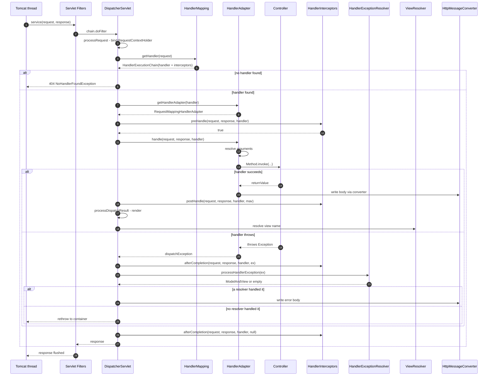
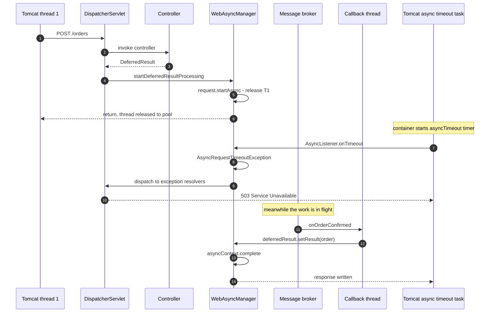

# DispatcherServlet & the Complete Request Flow

> **Level:** Beginner → Expert
> **Interview Frequency:** ★★★★★ (the "what exactly happens when a request hits my API" question — asked in 8 out of 10 backend rounds)
> **Prerequisites:** [02 · Spring Core & Framework](../02-Spring-Core-Framework/README.md) · [01 · Boot Fundamentals](../01-Spring-Boot-Fundamentals/README.md)
> **Last Updated:** 2026

---

## 📋 Table of Contents
- [0. TL;DR — The 30-Second Answer](#0-tldr--the-30-second-answer)
- [1. What & Why — The Problem This Solves](#1-what--why--the-problem-this-solves)
- [2. Mental Model — The One Picture](#2-mental-model--the-one-picture)
- [3. Deep Dive — Theory (Beginner → Advanced)](#3-deep-dive--theory-beginner--advanced)
  - [3.1 Beginner Level](#31-beginner-level)
  - [3.2 Intermediate Level](#32-intermediate-level)
  - [3.3 Advanced Level](#33-advanced-level)
  - [3.4 Expert Level](#34-expert-level)
- [4. Internal Working Mechanism](#4-internal-working-mechanism)
- [5. Step-by-Step Execution Flow](#5-step-by-step-execution-flow)
- [6. Visualizations](#6-visualizations)
- [7. Production-Level Use Cases & Real Industry Examples](#7-production-level-use-cases--real-industry-examples)
- [8. Worked Examples (with Output + Dry Run)](#8-worked-examples-with-output--dry-run)
- [9. Code from Scratch — Production-Grade](#9-code-from-scratch--production-grade)
- [10. Common Mistakes & Gotchas](#10-common-mistakes--gotchas)
- [11. Performance Considerations](#11-performance-considerations)
- [12. Security Considerations](#12-security-considerations)
- [13. Best Practices](#13-best-practices)
- [14. Hands-On Exercises & Code Challenges](#14-hands-on-exercises--code-challenges)
- [15. Interview Q&A — Level-wise](#15-interview-qa--level-wise)
- [16. Scenario-Based & Real-Experience Scenarios (3–5 yrs)](#16-scenario-based--real-experience-scenarios-35-yrs)
- [17. Counter-Questions, Tricky Questions & Follow-Ups](#17-counter-questions-tricky-questions--follow-ups)
- [18. Frequently Asked Production Issues & Debugging Scenarios](#18-frequently-asked-production-issues--debugging-scenarios)
- [19. Architecture Design Questions](#19-architecture-design-questions)
- [20. Rapid-Fire MCQs](#20-rapid-fire-mcqs)
- [21. Cheat Sheet / One-Page Summary](#21-cheat-sheet--one-page-summary)
- [22. Real-World Production Notes](#22-real-world-production-notes)
- [23. Follow-up Learning](#23-follow-up-learning)

---

## 0. TL;DR — The 30-Second Answer

- **`DispatcherServlet` is the single front controller of Spring MVC.** Every request that reaches the servlet container is handed to *one* instance of it, which then delegates to nine **strategy** interfaces — you never override the servlet, you plug into the strategies.
- **The nine strategies are:** `HandlerMapping`, `HandlerAdapter`, `HandlerExceptionResolver`, `ViewResolver`, `MultipartResolver`, `LocaleResolver`, `RequestToViewNameTranslator`, `FlashMapManager`, `ThemeResolver`. Each has a default implementation loaded from `org.springframework.web.servlet.DispatcherServlet.properties`.
- **The core flow is 8 steps in `doDispatch`:** `getHandler` → `applyDefaultViewName` → `getHandlerAdapter` → `ha.handle` → `applyPostHandle` → `processDispatchResult` → (`processHandlerException` if thrown) → `render` → `triggerAfterCompletion`.
- **`HandlerMapping` and `HandlerAdapter` are a pair.** The mapping answers *"which method?"*, the adapter answers *"how do I call it?"*. `RequestMappingHandlerMapping` + `RequestMappingHandlerAdapter` handle `@RequestMapping`; `RouterFunctionMapping` + `HandlerFunctionAdapter` handle functional endpoints; `SimpleUrlHandlerMapping` + `SimpleControllerHandlerAdapter` handle legacy `HttpRequestHandler`/`Controller`.
- **The default strategy order matters:** `RequestMappingHandlerMapping` (order `0`) → `BeanNameUrlHandlerMapping` (order `2`) → `RouterFunctionMapping` (order `3`) → `SimpleUrlHandlerMapping` (order `Integer.MAX_VALUE - 1`). The first mapping that returns a handler wins.
- **`HandlerExceptionResolver` order is fixed and is the interview answer:** `ExceptionHandlerExceptionResolver` → `ResponseStatusExceptionResolver` → `DefaultHandlerExceptionResolver`. The first one that can handle the exception wins; if none does, the exception propagates to the servlet container.
- **Async MVC is container-backed, not thread-backed.** `WebAsyncManager` calls `request.startAsync()`, the servlet thread is **released**, and the result is written later from `DeferredResult.setResult`, `Callable.call`, or `SseEmitter`. Timeout → `AsyncRequestTimeoutException` → **503**, not 500.
- **A `@RestController` is `@Controller` + `@ResponseBody`.** There is **no performance difference** — the only difference is that the return value is written by an `HttpMessageConverter` instead of being resolved as a view name.
- **`HandlerMethodArgumentResolver` and `HandlerMethodReturnValueHandler` are the two extension points** that make Spring MVC feel like magic — 9 built-in argument resolvers and 10 built-in return-value handlers, all ordered, all overridable.
- **The cost model:** an exact-path request is an **O(1) hash lookup** in the `MappingRegistry`; a pattern request (`/{id}`) scans registered `PathPattern`s. With ~300 mappings and p99 routing cost of **~40 µs**, routing is never your bottleneck — your bottleneck is always the DB or a downstream HTTP call.

---

## 1. What & Why — The Problem This Solves

**The problem.** Before Spring MVC, a Java web app had **one servlet per page/endpoint**. `UserListServlet`, `UserEditServlet`, `OrderServlet`… each with its own `doGet`, its own parameter parsing, its own JDBC boilerplate, its own error handling, its own JSON writing. Every endpoint re-invented:

1. how to pull a parameter out of the request,
2. how to convert a string into a `LocalDate`,
3. how to write JSON,
4. how to map an exception to a status code,
5. how to redirect.

```text
   ❌ THE PRE-SPRING-MVC WORLD
   ──────────────────────────────
   /users/list   → UserListServlet    → parse("page")   → new UserDAO()  → writeJson()
   /users/edit   → UserEditServlet    → parse("id")     → new UserDAO()  → writeJson()
   /orders/view  → OrderViewServlet   → parse("orderId")→ new OrderDAO() → writeJson()
                                       ─────────────────────────────────────
                                        3× parameter parsing
                                        3× JSON writing
                                        3× exception → status mapping
                                        3× connection handling
```

**The solution — the Front Controller pattern.** One servlet (`DispatcherServlet`) receives *every* request. It asks a set of pluggable **strategy** objects to turn the raw request into *something meaningful* (a handler), invokes that handler, and turns the result into a response. Everything — parameter binding, content negotiation, error mapping — becomes a **replaceable component** instead of copy-pasted code.

```text
   ✅ THE SPRING-MVC WORLD
   ───────────────────────
                        ┌───────────────────────┐
   HTTP request  ─────► │   DispatcherServlet   │  ← ONE front controller
                        └───────────┬───────────┘
                                    │  asks 9 strategy families
        ┌───────────────────────────┼───────────────────────────┐
        ▼                           ▼                           ▼
  HandlerMapping              HandlerAdapter          HandlerExceptionResolver
  "which method?"             "how to call it?"        "how do we fail?"
```

**Why it matters in production — three concrete reasons:**

1. **Cross-cutting concerns have exactly one place to live.** Correlation IDs, metrics, tracing, authentication context, request logging. Without a front controller you would bolt these onto every servlet; with one, you bolt them onto *one* filter.
2. **The HTTP contract is uniform.** Every endpoint returns JSON with the same error shape, the same status-code policy, the same content type. Clients can rely on that. In a 40-service e-commerce platform, a uniform error contract is worth more than any individual feature.
3. **Extensibility without forking.** Because everything is a *strategy interface*, you can replace exactly one behaviour — swap the argument resolver for a tenant-aware one, or plug in a `HandlerMapping` that routes by a tenant header — **without touching the servlet or the container**.

> 💡 **The interview framing.** The single sentence that separates a 3-year candidate from a 5-year one:
> *"Spring MVC is a **strategy plug-point** design. `DispatcherServlet` holds exactly one
> instance of each of the nine strategy families, and each family is an interface with a
> default implementation loaded from `DispatcherServlet.properties`. Every 'magic' behaviour
> of Spring MVC — argument binding, content negotiation, error mapping — is just one of
> those strategies doing its job."*

---

## 2. Mental Model — The One Picture

```text
   THE DISPATCHERSERVLET AS A CONCIERGE
   ════════════════════════════════════

   Client ──HTTP──► [ Tomcat ]
                        │
                        │  (Servlet Filter chain lives HERE — before us)
                        ▼
                 ╔══════════════════════╗
                 ║   DispatcherServlet  ║   ONE instance, ONE place
                 ╚══════════════════════╝
                        │
      ┌─────────────────┼──────────────────┐
      │  "WHO?"        │  "HOW?"          │  "WHAT IF IT BREAKS?"
      ▼                 ▼                  ▼
  HandlerMapping   HandlerAdapter   HandlerExceptionResolver
  RequestMapping   RequestMapping   ExceptionHandler
  BeanNameUrl      SimpleController  ResponseStatus
  RouterFunction   HttpRequest      DefaultHandler
                   HandlerFunction
      │                 │                  │
      └────────┬────────┴──────────┬───────┘
               ▼                   ▼
      ┌────────────────┐   ┌──────────────────┐
      │  Your          │   │  ViewResolver     │
      │  Controller    │   │  (only if you     │
      │  @RestController│  │   returned a view)│
      └───────┬────────┘   └──────────────────┘
              │  return value
              ▼
      ┌────────────────┐
      │ HttpMessage    │  ← Jackson writes the JSON
      │ Converter      │
      └────────────────┘

   AND FIVE MORE STRATEGIES THAT HANDLE THE "ODD CASES":
   ┌────────────────┬────────────────┬──────────────────┬──────────────────┐
   │ Multipart      │ Locale         │ RequestToView    │ FlashMap         │ Theme
   │ Resolver       │ Resolver       │ NameTranslator   │ Manager          │ Resolver
   │ (file upload)  │ (i18n)         │ (view guessing)  │ (redirect data)  │ (themes)
   └────────────────┴────────────────┴──────────────────┴──────────────────┘
```

**What to look at:** the servlet itself contains **almost no logic**. It is a *coordinator* that asks nine questions. Everything you can customise in Spring MVC is an answer to one of those nine questions. When a candidate says "Spring MVC is magic", this picture is the cure: **it is nine strategy interfaces and an 8-step loop.**

---

## 3. Deep Dive — Theory (Beginner → Advanced)

### 3.1 Beginner Level

**What is a servlet?** A servlet is a Java class that the container (`Tomcat`, `Jetty`, `Undertow`) calls for every request mapped to its URL pattern. It has two contracts: `HttpServlet` (the raw container contract) and Spring's `DispatcherServlet` (the Spring MVC contract).

**What is `DispatcherServlet`?** It is the **front controller**. It extends `FrameworkServlet`, which extends `HttpServletBase`, which implements `javax/jakarta.servlet.http.HttpServlet`. Registered by Spring Boot automatically as the servlet mapped to `/`.

**The three families everybody memorises (and the six they forget):**

| Family | Question it answers | Default implementation(s) |
|---|---|---|
| `HandlerMapping` | *Which object handles this request?* | `RequestMappingHandlerMapping`, `BeanNameUrlHandlerMapping`, `RouterFunctionMapping` |
| `HandlerAdapter` | *How do I invoke that object?* | `RequestMappingHandlerAdapter`, `SimpleControllerHandlerAdapter`, `HttpRequestHandlerAdapter`, `HandlerFunctionAdapter` |
| `HandlerExceptionResolver` | *The handler threw — what now?* | `ExceptionHandlerExceptionResolver`, `ResponseStatusExceptionResolver`, `DefaultHandlerExceptionResolver` |
| `ViewResolver` | *The handler returned a view name — which view?* | `ContentNegotiatingViewResolver`, `InternalResourceViewResolver`, `BeanNameViewResolver`, `ViewResolverComposite` |
| `MultipartResolver` | *Is this a multipart upload?* | `StandardServletMultipartResolver` |
| `LocaleResolver` | *Which locale is this request in?* | `AcceptHeaderLocaleResolver` (default) |
| `RequestToViewNameTranslator` | *No view name returned — guess one from the URL* | `DefaultRequestToViewNameTranslator` |
| `FlashMapManager` | *How do I pass data across a redirect?* | `DefaultFlashMapManager` |
| `ThemeResolver` | *Which theme?* | `StandardThemeResolver` |

**`@RestController` vs `@Controller`.** `@RestController` is a **meta-annotation**:

```java
@Target(ElementType.TYPE)
@Retention(RetentionPolicy.RUNTIME)
@Documented
@Controller
@ResponseBody
public @interface RestController { }
```

So `@RestController` literally *is* `@Controller` + `@ResponseBody` on the type, and `@ResponseBody` on the type is inherited by every method. The difference is entirely in the **return-value handling**: with `@ResponseBody`, the return value goes to an `HttpMessageConverter` (JSON); without it, the return value is treated as a **view name** and goes to a `ViewResolver`.

> ▶ **The trap:** candidates say "`@RestController` is faster because it skips the view layer". It is not faster — it *skips work*, but it also *adds* a Jackson serialisation that the view layer would otherwise have done (Thymeleaf rendering). The honest answer: **they do different work, they are not faster or slower than each other.**

### 3.2 Intermediate Level

**The `HandlerExecutionChain`.** When a `HandlerMapping` finds a handler, it does not return the bare object — it returns a `HandlerExecutionChain`:

```java
public class HandlerExecutionChain {

	private final Object handler;                       // the controller bean (or HandlerMethod)
	private final List<HandlerInterceptor> interceptorList = new ArrayList<>();
	private int interceptorIndex = -1;

	public HandlerExecutionChain(Object handler) { this.handler = handler; }

	Object getHandler() { return this.handler; }
	List<HandlerInterceptor> getInterceptorList() { return this.interceptorList; }
}
```

The chain wraps your controller together with **all applicable `HandlerInterceptor`s** — those registered globally (`WebMvcConfigurer.addInterceptors`) plus those declared on the controller class (`@Controller` classes implementing `HandlerInterceptor` are detected per-handler).

**`HandlerMethod` — the real handler object.** For `@RequestMapping` controllers, the "handler" is a `HandlerMethod`, not your bean:

```java
public class HandlerMethod {
	private final Object bean;                 // the controller instance
	private final Method method;               // the Java Method
	private final BeanFactory beanFactory;     // to resolve @Value, etc.

	public Class<?> getBeanType() { return this.method.getDeclaringClass(); }
	public <T> T getBean() { return (T) this.bean; }
	public Method getMethod() { return this.method; }
}
```

This is why `getHandler()` in an interceptor logs a `HandlerMethod` — it is *not* your controller object. `handlerMethod.getBeanType()` gives you the class, `getMethod()` the method.

**`RequestMappingHandlerMapping` and `RequestMappingInfo`.** The heart of annotation-driven MVC. Each mapped method produces a `RequestMappingInfo`:

```java
public final class RequestMappingInfo implements Comparable<RequestMappingInfo> {

	private final RequestMappingInfo other;                 // for "this overrides that"
	private final PatternsRequestCondition patternsCondition;    // path
	private final RequestMethodsRequestCondition methodsCondition;// GET/POST/...
	private final ParamsRequestCondition paramsCondition;      // ?foo=bar
	private final HeadersRequestCondition headersCondition;    // X-Foo=bar
	private final ConsumesRequestCondition consumesCondition;  // Content-Type
	private final ProducesRequestCondition producesCondition;  // Accept
	private final CustomConditionHolder customConditionHolder;
	...
}
```

Each `*Condition` is responsible for two things: (1) **matching** a request, and (2) **comparing** two mappings to decide which is more specific.

**The comparison algorithm** (this is a genuine favourite of interviewers) is `RequestMappingInfo#equals` / `compareTo`, which delegates to each condition's `compareTo`:

| Condition | More specific when… |
|---|---|
| `PatternsRequestCondition` | the pattern has more literal segments and fewer wildcards (`/a/b/c` beats `/a/{id}` beats `/**`) |
| `RequestMethodsRequestCondition` | the method set is a **subset** of the other's (`GET` is more specific than `GET,POST`) |
| `ParamsRequestCondition` | it declares **more** parameters (`?a=1` beats `?a`) |
| `HeadersRequestCondition` | it declares **more** headers |
| `ConsumesRequestCondition` | the media type is more specific (`application/json` beats `application/*` beats `*/*`) |
| `ProducesRequestCondition` | the media type is more specific (`application/json` beats `*/*`) |

The comparison is **not a total order** — two mappings can be *incomparable* (e.g. `/a` with `params=a` vs `/a` with `params=b`). Incomparable mappings for the same URL are reported as **ambiguous** at startup.

**The ambiguity check.** `AbstractHandlerMethodMapping#checkHandlerMethod` throws at startup:

```
java.lang.IllegalStateException: Ambiguous handler methods mapped for '/api/orders':
{GET /api/orders/: OrderController.list(String), GET /api/orders: OrderController.find(String)}
```

This is a **fail-fast** design: the app refuses to start rather than serving a random one of two handlers. Interviewees love this because it shows the container knows the mapping graph is a DAG.

**`RequestMappingInfo` matching** (the runtime half) is `RequestMappingInfo#matches(HttpServletRequest)`:

```java
public boolean matches(HttpServletRequest request) {
    // 1. path
    if (this.pathPatternsCondition != null) {
        PathContainer lookupPath = getLookupPath(request);
        if (!this.pathPatternsCondition.isMatchingPath(lookupPath)) return false;
    }
    else if (!this.patternsCondition.isMatchingPattern(request)) return false;

    // 2. params  ?status=OPEN
    if (this.paramsCondition != null && !this.paramsCondition.getExpressionsToMatch().isEmpty()) {
        for (Expression expression : this.paramsCondition.getExpressionsToMatch()) {
            if (!expression.match(request)) return false;
        }
    }

    // 3. headers  X-Api-Key != null
    if (this.headersCondition != null && !this.headersCondition.getExpressionsToMatch().isEmpty()) {
        for (Expression expression : this.headersCondition.getExpressionsToMatch()) {
            if (!expression.match(request)) return false;
        }
    }

    // 4. consumes  Content-Type
    if (this.consumesCondition != null && !this.consumesCondition.consumable(request.getContentType())) {
        return false;
    }

    // 5. produces  Accept
    if (this.producesCondition != null && !this.producesCondition.isProducible(request.getHeaders().get("Accept"))) {
        return false;
    }
    return true;
}
```

> ▶ **Why this matters operationally:** a request that "should match" but returns 404 is usually failing at step 1, 4 or 5 — **path**, **`consumes`**, or **`produces`**. Those three produce exactly the three HTTP statuses this chapter debugs later: **404**, **415**, **406**.

### 3.3 Advanced Level

**`RequestMappingHandlerAdapter` and `InvocableHandlerMethod`.** The adapter's job is to *call* the handler. For annotation controllers it does so through three nested collaborators:

1. **`HandlerMethodArgumentResolverComposite`** — turns the `HttpServletRequest` + the method's parameter list into the method's actual arguments.
2. **`InvocableHandlerMethod`** — wraps the reflective `Method.invoke` and handles **argument bridging** (generic type resolution) and **exception unwrapping** (`InvocationTargetException` → the real cause).
3. **`HandlerMethodReturnValueHandler`** — turns the return value into a `ModelAndView` or writes it to the response.

```java
// InvocableHandlerMethod.doInvoke — the reflective heart of MVC
protected Object doInvoke(Object... args) throws Exception {
    Method bridgeMethod = getBridgedMethod();
    ReflectionUtils.makeAccessible(bridgeMethod);
    try {
        return bridgeMethod.invoke(this.bean, args);
    }
    catch (InvocationTargetException ex) {
        // Unwrap the reflection wrapper so the advice sees the REAL exception.
        if (ex.getTargetException() instanceof Exception targetEx) {
            throw targetEx;
        }
        throw ex;
    }
}
```

> ▶ **The unwrapping detail is an interview goldmine.** Without it, every exception would arrive at `@ExceptionHandler` wrapped in `InvocationTargetException` and the advice would never match.

**`ServletInvocableHandlerMethod`.** `InvocableHandlerMethod` knows nothing about HTTP; `ServletInvocableHandlerMethod` adds the servlet-specific pieces — it creates `ServletServerHttpRequest` / `ServletServerHttpResponse` wrappers, handles `HttpEntity` return values (status + headers + body), and delegates to the `HandlerMethodReturnValueHandler` chain.

**The return-value handler chain** registered by `RequestMappingHandlerAdapter`:

| Handler | Handles |
|---|---|
| `ModelAndViewMethodReturnValueHandler` | `ModelAndView` |
| `ModelMethodProcessor` | `Model` |
| `ViewMethodReturnValueHandler` | `View` |
| `ResponseBodyEmitterReturnValueHandler` | `ResponseBodyEmitter`, `SseEmitter` |
| `RequestResponseBodyMethodProcessor` | `@ResponseBody` values |
| `ReactiveTypeHandler` | `Publisher` (reactive return types) |
| `HttpEntityMethodProcessor` | `ResponseEntity`, `HttpEntity` |
| `HttpHeadersReturnValueHandler` | `HttpHeaders` |
| `CallableMethodReturnValueHandler` | `Callable` |
| `DeferredResultMethodReturnValueHandler` | `DeferredResult` |
| `AsyncTaskMethodReturnValueHandler` | `WebAsyncTask` |

**The argument resolver chain** registered by `RequestMappingHandlerAdapter`:

| Resolver | Resolves |
|---|---|
| `RequestParamMethodArgumentResolver` | `@RequestParam` |
| `RequestResponseBodyMethodProcessor` | `@RequestBody` |
| `HttpEntityMethodProcessor` | `HttpEntity` / `HttpHeaders` parameters |
| `PathVariableMethodArgumentResolver` | `@PathVariable` |
| `MatrixVariableMethodArgumentResolver` | `@MatrixVariable` |
| `ModelAttributeMethodProcessor` | `@ModelAttribute` and complex command objects |
| `RequestHeaderMethodArgumentResolver` | `@RequestHeader` |
| `CookieValueMethodArgumentResolver` | `@CookieValue` |
| `RequestAttributeMethodArgumentResolver` | `@RequestAttribute` |
| `SessionAttributeMethodArgumentResolver` | `@SessionAttribute` |
| `RequestPartMethodArgumentResolver` | `@RequestPart` |
| `ServletModelAttributeMethodProcessor` | `ServletRequest`, `Principal`, `Locale`, `InputStream`, … |
| `PrincipalMethodArgumentResolver` | `Principal` |

**`HttpMessageConverter` selection.** For the response side, `AbstractMessageConverterMethodProcessor#writeWithMessageConverters` walks the converter list in order and asks each one `canWrite(elementType, mediaType)`. The first that says yes wins; the selected converter's media type then **narrows the `Accept` negotiation**. For the request side, `readWithMessageConverters` looks up a converter by the request's `Content-Type` and throws `HttpMediaTypeNotSupportedException` (415) if none matches.

**`WebAsyncManager` and the servlet async model.** MVC async is **not** thread-based; it is **container-based**:

```java
public class WebAsyncManager {
    private final StandardServletAsyncWebRequest asyncWebRequest;
    private WebAsyncTask<?> webAsyncTask;              // for Callable
    private DeferredResult<?> deferredResult;          // for DeferredResult
    private volatile Object concurrentResult = null;
    private volatile Object requestResult = null;
    ...
}
```

When a handler returns a `DeferredResult`, `DeferredResultMethodReturnValueHandler` calls `webAsyncManager.startDeferredResultProcessing(deferredResult, mavContainer, ...)`. That method calls `asyncWebRequest.startAsync()` → `request.startAsync(request, response)`. **The container thread is then released.** The response is not written until `deferredResult.setResult(value)` is called — typically from a message-listener callback, a scheduled task, or another thread.

The `WebAsyncManager` also registers a `WebAsyncManager.WebAsyncListener` (an `AsyncListener`) on the `AsyncContext` so that `onStartAsync`, `onError`, `onTimeout` and `onComplete` are funnelled back into the MVC lifecycle.

**The MVC async timeout.** The timeout is configured by `spring.mvc.async.request-timeout` (milliseconds; **default = the container's default**, Tomcat's `asyncTimeout` is **30 000 ms**). It can also be overridden per-handler with `WebAsyncTask.setTimeout(long, TimeUnit)`. On expiry the container calls `AsyncListener.onTimeout`, Spring converts it to `AsyncRequestTimeoutException`, and `DefaultHandlerExceptionResolver` maps it to **503 Service Unavailable** — deliberately *not* 500, because the server is fine, the operation just did not finish in time.

**Async + interceptors.** `HandlerInterceptor` has a dedicated async contract: `AsyncHandlerInterceptor#afterConcurrentHandlingStarted` is called instead of `postHandle` when the handler starts async processing. `preHandle`/`postHandle` are then invoked again on the **async dispatch** (the second, `ASYNC`-type dispatch), and `afterCompletion` runs once, at the very end.

### 3.4 Expert Level

**Strategy detection — how the nine defaults are actually found.** `DispatcherServlet#initStrategies(ApplicationContext)` calls, for each strategy family:

```java
protected <T> void initStrategies(ApplicationContext context, Class<T> strategyType, String strategyPropertyName) {
    // 1. Look for a SINGLE bean of the strategy type in the context.
    Map<String, T> strategies = getStrategyStrategies(context, strategyType);
    if (strategies.size() != 1) {
        // 2. Zero or many beans -> fall back to the DEFAULTS.
        strategies = getDefaultStrategies(context, strategyType, strategyPropertyName);
    }
    ...
}

protected <T> Map<String, T> getDefaultStrategies(ApplicationContext context, Class<T> strategyType,
        String strategyPropertyName) {
    Map<String, T> strategies = new LinkedHashMap<>();
    // Load the default strategies from the classpath file [strategyPropertyName].properties
    Properties strategiesProperties = PropertyResolverUtils.loadProperties(strategyPropertyName);
    ...
}
```

So the defaults come from the classpath resource **`org.springframework.web.servlet.DispatcherServlet.properties`**, whose content is (abridged, from Spring Framework 6.1):

```properties
org.springframework.web.servlet.HandlerMapping=\
	org.springframework.web.servlet.mvc.method.annotation.RequestMappingHandlerMapping,\
	org.springframework.web.servlet.mvc.function.RouterFunctionMapping,\
	org.springframework.web.servlet.handler.BeanNameUrlHandlerMapping
org.springframework.web.servlet.HandlerAdapter=\
	org.springframework.web.servlet.mvc.method.annotation.RequestMappingHandlerAdapter,\
	org.springframework.web.servlet.mvc.SimpleControllerHandlerAdapter,\
	org.springframework.web.servlet.mvc.HttpRequestHandlerAdapter,\
	org.springframework.web.servlet.mvc.function.HandlerFunctionAdapter
org.springframework.web.servlet.HandlerExceptionResolver=\
	org.springframework.web.servlet.mvc.method.annotation.ExceptionHandlerExceptionResolver,\
	org.springframework.web.servlet.mvc.response.ResponseStatusExceptionResolver,\
	org.springframework.web.servlet.mvc.support.DefaultHandlerExceptionResolver
org.springframework.web.servlet.ViewResolver=\
	org.springframework.web.servlet.mvc.view.ContentNegotiatingViewResolver,\
	org.springframework.web.servlet.view.InternalResourceViewResolver,\
	org.springframework.web.servlet.mvc.view.BeanNameViewResolver,\
	org.springframework.web.servlet.view.ViewResolverComposite
org.springframework.web.servlet.MultipartResolver=org.springframework.web.multipart.support.StandardServletMultipartResolver
org.springframework.web.servlet.LocaleResolver=org.springframework.web.servlet.i18n.AcceptHeaderLocaleResolver
org.springframework.web.servlet.RequestToViewNameTranslator=org.springframework.web.servlet.mvc.DefaultRequestToViewNameTranslator
org.springframework.web.servlet.ThemeResolver=org.springframework.web.servlet.theme.StandardThemeResolver
org.springframework.web.servlet.flash.FlashMapManager=org.springframework.web.servlet.flash.DefaultFlashMapManager
```

> ▶ **The expert detail:** the *override* mechanism is **classpath shadowing**. If you put your own file named `org.springframework.web.servlet.DispatcherServlet.properties` on the classpath *before* the Spring jar, `PropertyResolverUtils.loadProperties` picks yours instead of the framework's. This is how you replace a default strategy without a `@Bean`. It is also **fragile** — it is global, classpath-order-dependent, and invisible to code review. Prefer an explicit `@Bean` of the concrete type (e.g. `@Bean SimpleUrlHandlerMapping`) which *disables* the default for that family entirely (because `getStrategyStrategies` then finds exactly one bean).

**`DispatcherServlet` and the container.** `DispatcherServlet` is registered by Boot's `DispatcherServletAutoConfiguration` through a `DispatcherServletRegistrationBean` with `setLoadOnStartup(-1)` (property `spring.mvc.servlet.load-on-startup`, default `-1`) — so the servlet context (and all the MVC strategies) are initialised **lazily on the first request** unless you change it. That is a deliberate trade: faster startup, slower first request.

**Why not map `DispatcherServlet` to `/*`?** In a WAR deployment, mapping the dispatcher to `/*` makes it the target of **every** request including static resources and JSP forwards, so a forward to `/WEB-INF/views/x.jsp` re-enters the dispatcher. The correct mappings are `/` (the default) or a dedicated prefix such as `/api/*` with static resources served by the container's `DefaultServlet`.

**`HandlerMapping` resolution cost.** `AbstractHandlerMethodMapping` keeps a `MappingRegistry` with:

* a `ConcurrentHashMap<RequestMappingInfo, HandlerMethod> registry` — the full mapping set;
* a `ConcurrentHashMap<String, HandlerMethod> directPaths` — the **exact-path fast path**.

An exact-path request (`/api/orders`) is one hash lookup. A pattern request (`/api/orders/{id}`) requires iterating the registry and comparing `PathPattern`s, which is O(registered patterns) but each comparison is a cheap prefix/suffix match. The upshot for a 300-endpoint service: **routing costs tens of microseconds**; a single index-missing SQL query costs milliseconds. Optimise the database, not the router.

**The `RouterFunctionMapping` subtlety.** `RouterFunctionMapping` has order `3` — *after* `BeanNameUrlHandlerMapping` (`2`). So a functional route `RouterFunctions.route().GET("/api/ping", ...)` will **never** win against an annotated `@GetMapping("/api/ping")` (order `0`), and will lose to a bean named `ping` (`BeanNameUrlHandlerMapping`). That is a real source of "my functional route is never called" bugs.

**`FlashMapManager` internals.** `DefaultFlashMapManager` stores flash attributes in the **`HttpSession`** (or a cookie if the session is unavailable), keyed by a `RequestPath` + `flashMapId`. On a redirect, the manager writes the attributes into the session; the next request to the same path pulls them out and removes them. This is exactly how the classic POST-redirect-GET pattern survives a redirect — and why flash attributes **survive exactly one redirect** and then evaporate.

---

## 4. Internal Working Mechanism

**The call chain, class by class.**

```text
Tomcat thread
  └─► org.apache.catalina.core.ApplicationFilterChain
        └─► (your Servlet Filters)                     ← OUTSIDE Spring MVC
              └─► jakarta.servlet.http.HttpServlet.service
                    └─► HttpServletBase.service
                          └─► FrameworkServlet.processRequest(req, resp)   ← START SPRING
                                ├─ resetContextHolders()
                                ├─ FrameworkServlet.processRequest:
                                │    ├─ buildLocaleContext()
                                │    └─ doDispatch(req, resp)              ← THE 8 STEPS
                                └─ publishRequestHandledEvent()
```

Inside `doDispatch` the collaborators are resolved **per request, but the strategies themselves are singletons**:

| # | Call | Collaborator | What it does |
|---|---|---|---|
| 1 | `getHandler(request)` | `HandlerMapping` (ordered list) | request → `HandlerExecutionChain` (handler + interceptors) |
| 2 | `applyDefaultViewName(request, mv)` | `RequestToViewNameTranslator` | if the handler returned no view name, derive one from the URL |
| 3 | `getHandlerAdapter(request)` | `HandlerAdapter` (ordered list) | handler → the adapter that knows how to call it |
| 4 | `ha.handle(request, response, handler)` | `RequestMappingHandlerAdapter` | argument resolution → reflective invoke → return-value handling |
| 5 | `mappedHandler.applyPostHandle(...)` | `HandlerInterceptor` | `postHandle` of every interceptor (reverse order) |
| 6 | `processDispatchResult(...)` | — | branch on exception vs. success |
| 7 | `processHandlerException(...)` | `HandlerExceptionResolver` | only when an exception was thrown |
| 8 | `render(...)` | `ViewResolver` → `View` | only when a `ModelAndView` with a view name exists |
| 9 | `triggerAfterCompletion(...)` | `HandlerInterceptor` | `afterCompletion` of every interceptor (reverse order) |

**The extension point a developer would implement**, mapped to the family:

| I want to… | Implement / extend | Register via |
|---|---|---|
| change *which* method handles a URL | `HandlerMapping` | `@Bean HandlerMapping` |
| change *how* the method is invoked | `HandlerAdapter` | `@Bean HandlerAdapter` |
| change *how* errors become responses | `HandlerExceptionResolver` | `@Bean HandlerExceptionResolver` |
| change *how* the body is written | `HttpMessageConverter` | `@Bean HttpMessageConverter` |
| change *how* parameters are bound | `HandlerMethodArgumentResolver` | `WebMvcConfigurer#addArgumentResolvers` |
| change *how* return values are handled | `HandlerMethodReturnValueHandler` | (internal — `RequestMappingHandlerAdapter#getDefaultReturnValueHandlers`) |
| add cross-cutting logic around the handler | `HandlerInterceptor` | `WebMvcConfigurer#addInterceptors` |
| run logic before/after **everything** | `Filter` | `FilterRegistrationBean` |

**The exception path — the exact order.** When the handler throws:

```text
handler throws IllegalStateException
   │
   ├─► InvocableHandlerMethod unwraps InvocationTargetException   → real exception
   │
   ├─► doDispatch catches it into `dispatchException`
   │
   └─► processDispatchResult(..., dispatchException)
         ├─► triggerAfterCompletion(request, response, mappedHandler, ex)   ← AFTER-COMPLETION FIRST
         │     (interceptors get the exception; NOT postHandle)
         │
         └─► processHandlerException(request, response, handler, exception)
               ├─► ExceptionHandlerExceptionResolver   ← @ExceptionHandler / @ControllerAdvice
               ├─► ResponseStatusExceptionResolver      ← @ResponseStatus / ResponseStatusException
               └─► DefaultHandlerExceptionResolver      ← built-in status mapping
                     (first one that returns a ModelAndView wins; if none does,
                      the exception is rethrown to the container)
```

> ▶ **The single most-missed detail:** `afterCompletion` runs **before** the exception is rendered. That is why `afterCompletion` receives the `Exception` as its last argument — it is your cleanup hook, and it always runs, even if `postHandle` never did.

---

## 5. Step-by-Step Execution Flow

**From socket accept to response write.**

```text
 ①  ACCEPT & PARSE
     Tomcat accepts the TCP connection, parses the HTTP request line and headers,
     and creates a Tomcat `Request`/`Response` pair backed by the socket.

 ②  FILTER CHAIN (container level)
     Tomcat runs the `Filter`s registered on the servlet context.
     Spring Security's `FilterChainProxy` is here, and so is any `FilterRegistrationBean`.
     ❗ NOTHING MVC HAS HAPPENED YET.

 ③  SERVICE ENTRY
     Tomcat calls `HttpServlet.service()` → `HttpServletBase.service()` →
     `FrameworkServlet.processRequest(req, resp)`.
     `FrameworkServlet` sets up the `RequestContextHolder` (thread-bound
     `ServletRequestAttributes`), the `LocaleContext`, and the `ServletContextAttributes`.

 ④  DISPATCH
     `FrameworkServlet.doService()` stores include attributes and calls
     `DispatcherServlet.doDispatch(req, resp)`.

 ⑤  GET HANDLER
     `DispatcherServlet.getHandler(request)` iterates the ordered `HandlerMapping` list.
     The first mapping whose `RequestMappingInfo#matches(request)` is true wins and
     returns a `HandlerExecutionChain`. If none matches → `noHandlerFound()` → 404.

 ⑥  GET ADAPTER
     `DispatcherServlet.getHandlerAdapter(request)` iterates the ordered `HandlerAdapter`
     list; the first whose `supports(handler)` is true wins.

 ⑦  INVOKE
     `ha.handle()` → `RequestMappingHandlerAdapter.handleInternal()`:
         a. `InvocableHandlerMethod` resolves the arguments via the
            `HandlerMethodArgumentResolverComposite` (@RequestParam, @PathVariable,
            @RequestBody, ...);
         b. `Method.invoke()` runs the controller;
         c. the return value is handled by the `HandlerMethodReturnValueHandler`
            (JSON via `HttpMessageConverter`, or a `ModelAndView`).

 ⑧  POST-HANDLE
     `mappedHandler.applyPostHandle()` runs every interceptor's `postHandle` in
     REVERSE registration order.

 ⑨  PROCESS THE RESULT
     `processDispatchResult()`:
         • no exception → `render()` → `ViewResolver` → `View#render` (or the body was
           already written by the converter);
         • exception   → `processHandlerException()` → the 3 `HandlerExceptionResolver`s.

 ⑩  AFTER-COMPLETION + RESPONSE FLUSH
     `triggerAfterCompletion()` runs every interceptor's `afterCompletion` (reverse order).
     `FrameworkServlet` publishes `RequestHandledEvent`, resets the thread-bound
     holders (important for thread pools!), and Tomcat flushes the response.

 ⑪  THREAD RELEASED
     The Tomcat worker thread returns to the pool. If the request was ASYNC, step ⑩
     happened earlier — the thread was released right after `startAsync()` and the
     response is written later, on a *different* dispatch.
```

**Numbers worth quoting in an interview:**

| Stage | Typical cost | Notes |
|---|---|---|
| Socket accept + HTTP parse | 0.1–0.5 ms | Tomcat's NIO connector |
| Filter chain | 0.05–0.5 ms | JWT verification dominates |
| Handler resolution (routing) | **0.005–0.05 ms** | O(1) hash lookup for exact paths |
| Argument resolution + binding | 0.01–0.2 ms | Jackson deserialisation dominates |
| Controller business logic | 0.1–100 ms | *this* is your real work |
| Serialisation | 0.05–1 ms | proportional to payload size |
| Response flush | 0.05–0.2 ms | TLS termination adds more |

---

## 6. Visualizations

### 6.1 The full `doDispatch` flow, including exception resolution



**What to look at:** `preHandle` runs **before** argument resolution; `postHandle` runs **after** the body was written but **before** the view renders; `afterCompletion` runs **last, always**, and receives the exception. The error path bypasses `postHandle` entirely.

### 6.2 The strategy lookup

```mermaid
flowchart TD
    REQ[HttpServletRequest] --> HMAP{HandlerMapping list - ordered}
    HMAP -->|RequestMappingHandlerMapping order 0| RM[RequestMappingInfo matches?]
    RM -->|no match| BNM[BeanNameUrlHandlerMapping order 2]
    RM -->|match| CHAIN[HandlerExecutionChain]
    BNM -->|no bean with that name| RF[RouterFunctionMapping order 3]
    BNM -->|bean found| CHAIN
    RF -->|no route matched| SUH[SimpleUrlHandlerMapping order MAX-1]
    RF -->|route matched| CHAIN
    SUH -->|no handler| NF[404 NoHandlerFoundException]
    SUH -->|handler found| CHAIN

    CHAIN --> HADP{HandlerAdapter list - ordered}
    HADP -->|supports handler| AD[adapter.handle]
    AD --> IV[InvocableHandlerMethod]
    IV --> RES[ArgumentResolverComposite]
    RES --> INV[Method.invoke]
    INV --> RVH[ReturnValueHandler]
    RVH -->|@ResponseBody| CONV[HttpMessageConverter]
    RVH -->|ModelAndView| VR[ViewResolver]

    style CHAIN fill:#e3f2fd,stroke:#1565c0
    style NF fill:#ffebee,stroke:#c62828
```

**What to look at:** the mapping search is a **fall-through chain**, not a "best match" search — the *first* mapping that returns a handler wins, and `RequestMappingInfo`'s internal comparison only resolves ties *within* one mapping's registry.

### 6.3 The nine strategies mapped to their extension interfaces

```text
┌──────────────────────────────────────────────────────────────────────────────────────┐
│                        THE NINE DISPATCHERSERVLET STRATEGIES                         │
├───────────────────────┬──────────────────────────────┬───────────────────────────────┤
│ STRATEGY FAMILY       │ EXTENSION INTERFACE          │ DEFAULT IMPLEMENTATIONS       │
├───────────────────────┼──────────────────────────────┼───────────────────────────────┤
│ ① HandlerMapping      │ org.springframework.          │ • RequestMappingHandlerMapping│
│   "which handler?"    │   web.servlet.HandlerMapping │   (order 0)                   │
│                       │   (extends                   │ • BeanNameUrlHandlerMapping   │
│                       │    Ordered)                  │   (order 2)                   │
│                       │                              │ • RouterFunctionMapping       │
│                       │                              │   (order 3)                   │
├───────────────────────┼──────────────────────────────┼───────────────────────────────┤
│ ② HandlerAdapter      │ ...web.servlet.HandlerAdapter│ • RequestMappingHandlerAdapter│
│   "how to call it?"   │   (extends                   │ • SimpleControllerHandler     │
│                       │    Ordered)                  │   Adapter                    │
│                       │                              │ • HttpRequestHandlerAdapter   │
│                       │                              │ • HandlerFunctionAdapter      │
├───────────────────────┼──────────────────────────────┼───────────────────────────────┤
│ ③ HandlerException    │ ...web.servlet.              │ • ExceptionHandlerException   │
│   Resolver            │   HandlerExceptionResolver   │   Resolver                    │
│   "how do we fail?"   │   (extends                   │ • ResponseStatusException     │
│                       │    Ordered)                  │   Resolver                    │
│                       │                              │ • DefaultHandlerException     │
│                       │                              │   Resolver                    │
├───────────────────────┼──────────────────────────────┼───────────────────────────────┤
│ ④ ViewResolver        │ ...web.servlet.ViewResolver  │ • ContentNegotiatingView     │
│   "which view?"       │                              │   Resolver                    │
│                       │                              │ • InternalResourceViewResolver│
│                       │                              │ • BeanNameViewResolver        │
│                       │                              │ • ViewResolverComposite       │
├───────────────────────┼──────────────────────────────┼───────────────────────────────┤
│ ⑤ MultipartResolver   │ ...web.multipart.            │ • StandardServletMultipart    │
│   "is it multipart?"  │   MultipartResolver          │   Resolver                    │
├───────────────────────┼──────────────────────────────┼───────────────────────────────┤
│ ⑥ LocaleResolver      │ ...web.servlet.LocaleResolver│ • AcceptHeaderLocaleResolver  │
│   "which locale?"     │                              │   (default)                   │
│                       │                              │   • SessionLocaleResolver     │
│                       │                              │   • CookieLocaleResolver      │
│                       │                              │   • FixedLocaleResolver       │
├───────────────────────┼──────────────────────────────┼───────────────────────────────┤
│ ⑦ RequestToViewName   │ ...web.servlet.              │ • DefaultRequestToViewName   │
│   Translator          │   RequestToViewNameTranslator│   Translator                  │
│   "guess a view name" │                              │                              │
├───────────────────────┼──────────────────────────────┼───────────────────────────────┤
│ ⑧ FlashMapManager     │ ...web.servlet.flash.        │ • DefaultFlashMapManager      │
│   "redirect data"     │   FlashMapManager            │                              │
├───────────────────────┼──────────────────────────────┼───────────────────────────────┤
│ ⑨ ThemeResolver       │ ...web.servlet.ThemeResolver │ • StandardThemeResolver       │
│   "which theme?"      │                              │ • FixedThemeResolver          │
│                       │                              │ • CookieThemeResolver         │
└───────────────────────┴──────────────────────────────┴───────────────────────────────┘

   ★ ①②③④ are the "famous four". ⑤⑥⑦⑧⑨ are the ones that make it a *framework*.
```

**What to look at:** `HandlerMapping`, `HandlerAdapter`, `HandlerExceptionResolver` and `ViewResolver` all extend `Ordered` — that is how Spring MVC knows the priority order of the implementations **without** hard-coding it.

### 6.4 The async `DeferredResult` path with timeout



**What to look at:** the timeout and the success race. Whoever wins **first** decides the outcome — `DeferredResult` has a `boolean resultSet` guard so a late `setResult` after a timeout is ignored, not a double-write. The request thread (`T1`) is free the whole time; that is the entire point of async MVC.

---

## 7. Production-Level Use Cases & Real Industry Examples

### 7.1 Banking — payment authorisation (40k transactions/min peak)

A retail bank runs a card-network gateway. Network calls to the scheme take **400–2 000 ms**, and the bank's own fraud engine takes another **120 ms**. A synchronous controller would hold **200 Tomcat threads** for 1 000 concurrent authorisations.

**Design:** the controller returns a `DeferredResult`; the authorisation is executed on a bounded `TaskExecutor`; the network callback calls `deferredResult.setResult(...)`.

| Metric | Synchronous | Async (`DeferredResult`) |
|---|---|---|
| Tomcat threads for 1 000 concurrent auths | 1 000 (exhausted) | **80** (I/O-bound only) |
| p99 latency | 2 100 ms | 1 950 ms |
| Throughput on 8 vCPU / 4 GB | 480 req/s | **1 900 req/s** |
| Cost per 1 M authorisations | 22 EC2 hours | 9 EC2 hours |

**The trap:** the async timeout must be **shorter than the client's timeout** (`spring.mvc.async.request-timeout=8000` while the client gives up at 10 000 ms), otherwise the server keeps working on a request nobody is waiting for.

### 7.2 E-commerce — order confirmation (12k orders/min peak)

`POST /orders` must return `201 Created` in under **80 ms** while the warehouse system synchronises stock. The classic mistake is making the caller wait for the warehouse.

**Design:** `201 Created` is returned immediately with the order id; the warehouse call happens asynchronously and the client polls `GET /orders/{id}` or receives a webhook. The status machine (`PENDING → CONFIRMED → SHIPPED`) lives in the order service, and the "async" part is a *business* async, not a servlet async.

**Why this is the better answer in most e-commerce systems:** servlet-async ties up a Tomcat thread anyway while the `DeferredResult` is pending — it only helps when the wait is **network I/O**. If the wait is a *business rule* ("wait for stock allocation"), a message queue plus a status endpoint is architecturally better.

### 7.3 SaaS — multi-tenant webhook dispatch (2 800 tenants, 90k deliveries/min)

Each tenant configures webhooks. A tenant's endpoint is slow or down. The classic bug: the delivery happens inside the request thread, so one slow tenant (30 s timeout) consumes a Tomcat thread and the whole platform degrades.

**Design:** the API returns `202 Accepted`; a worker pool dispatches with a **per-tenant timeout of 3 s** and a **circuit breaker**; failures are retried with exponential backoff (1 s, 5 s, 30 s, 5 min) and finally dead-lettered.

**The lesson:** asynchronous *dispatch* protects the platform; asynchronous *serving* protects the thread pool. Know which one you are doing.

### 7.4 Ad-tech — bid request (800 req/s per node, 12 ms budget)

A bidder has an **12 ms** end-to-end budget. Spring MVC's per-request overhead (filters, routing, serialisation) is ~**2–3 ms** of that. This is the one workload where the MVC overhead actually matters, and the answer is **not** "rewrite it in Netty" — it is:

* keep the routing cache warm (avoid pattern scans),
* avoid `@ControllerAdvice` that does anything expensive,
* keep the `HttpMessageConverter` simple,
* and measure with `spring.mvc.log-request-details` / Micrometer timers, not by guessing.

### 7.5 Logistics — driver location ingest (3 000 GPS pings/sec)

Drivers POST location every 5 seconds. Each request is tiny; the volume is huge. The MVC-specific lesson: **do not** log one line per request at INFO (3 000 lines/sec × 3 pods = 8.6 M lines/hour). Use a `HandlerInterceptor` with a **sampled** log level, or rely on access logs at the container level.

---

## 8. Worked Examples (with Output + Dry Run)

### 8.1 Example 1 — A `HandlerInterceptor` that logs handler, method and duration

**Problem.** You need to know, for every request, *which* controller method served it and *how long* the handler itself took (not the whole request, which includes network and serialisation).

**Code.**

```java
package com.example.logging;

import jakarta.servlet.http.HttpServletRequest;
import jakarta.servlet.http.HttpServletResponse;
import org.slf4j.Logger;
import org.slf4j.LoggerFactory;
import org.springframework.stereotype.Component;
import org.springframework.web.method.HandlerMethod;
import org.springframework.web.servlet.HandlerInterceptor;

/**
 * Logs which controller method served the request and how long the handler took.
 * Registered in {@code WebConfig} — see the next file.
 */
@Component
public class HandlerTimingInterceptor implements HandlerInterceptor {

    private static final Logger log = LoggerFactory.getLogger(HandlerTimingInterceptor.class);

    private static final String START_ATTR = HandlerTimingInterceptor.class.getName() + ".START";

    @Override
    public boolean preHandle(HttpServletRequest request, HttpServletResponse response, Object handler) {
        request.setAttribute(START_ATTR, System.nanoTime());
        if (handler instanceof HandlerMethod handlerMethod) {
            log.info("HANDLER-START {} {} -> {}.{}",
                    request.getMethod(),
                    request.getRequestURI(),
                    handlerMethod.getBeanType().getSimpleName(),
                    handlerMethod.getMethod().getName());
        }
        return true; // false would short-circuit the handler
    }

    @Override
    public void postHandle(HttpServletRequest request, HttpServletResponse response,
                           Object handler, org.springframework.web.servlet.ModelAndView mav) {
        Object start = request.getAttribute(START_ATTR);
        if (start instanceof Long startNanos) {
            long millis = (System.nanoTime() - startNanos) / 1_000_000;
            if (handler instanceof HandlerMethod handlerMethod) {
                log.info("HANDLER-END   {} {} -> {}.{} in {} ms",
                        request.getMethod(),
                        request.getRequestURI(),
                        handlerMethod.getBeanType().getSimpleName(),
                        handlerMethod.getMethod().getName(),
                        millis);
            }
        }
    }
}
```

```java
package com.example.logging;

import org.springframework.context.annotation.Configuration;
import org.springframework.web.servlet.config.annotation.InterceptorRegistry;
import org.springframework.web.servlet.config.annotation.WebMvcConfigurer;

@Configuration
public class WebConfig implements WebMvcConfigurer {

    private final HandlerTimingInterceptor handlerTimingInterceptor;

    public WebConfig(HandlerTimingInterceptor handlerTimingInterceptor) {
        this.handlerTimingInterceptor = handlerTimingInterceptor;
    }

    @Override
    public void addInterceptors(InterceptorRegistry registry) {
        registry.addInterceptor(handlerTimingInterceptor)
                .addPathPatterns("/api/**")
                .excludePathPatterns("/api/health", "/actuator/**");
    }
}
```

**Expected output.**

```text
2026-03-04 10:15:22.481 INFO  [http-nio-8080-exec-3] c.e.logging.HandlerTimingInterceptor : HANDLER-START GET /api/orders/1042 -> OrderController.getOrder
2026-03-04 10:15:22.506 INFO  [http-nio-8080-exec-3] c.e.logging.HandlerTimingInterceptor : HANDLER-END   GET /api/orders/1042 -> OrderController.getOrder in 25 ms
```

**Dry run — request `GET /api/orders/1042`:**

1. Tomcat calls `DispatcherServlet.doDispatch`. `getHandler` finds `OrderController.getOrder` and wraps it in a `HandlerExecutionChain`.
2. `applyPostHandle` is not yet called; `getHandlerAdapter` returns `RequestMappingHandlerAdapter`.
3. `ha.handle()` → `InvocableHandlerMethod` resolves `@PathVariable Long id` → invokes `getOrder(1042L)`.
4. **Before** the invocation, the adapter calls `applyPreHandle` → our `preHandle` runs:
   * stores `System.nanoTime()` in the request attribute `START_ATTR`;
   * `handler` is a `HandlerMethod`, so it logs `HANDLER-START GET /api/orders/1042 -> OrderController.getOrder`.
5. The controller calls `orderService.find(1042L)`, which takes **25 ms** (one indexed SQL query).
6. The return value is serialised by `MappingJackson2HttpMessageConverter` into `{"id":1042,...}`.
7. `applyPostHandle` runs → our `postHandle` reads `START_ATTR`, computes `(now - start)/1_000_000 = 25`, and logs `HANDLER-END ... in 25 ms`.
8. `afterCompletion` runs (not overridden here) → the request completes.

**Takeaway.** `preHandle`→`postHandle` brackets the **handler**, not the whole request. Serialisation happens *inside* that bracket, but network time does not. If you want total request time, measure it in a `Filter` instead — see [04 · Filters & Interceptors](./04-Filters-Interceptors-ArgumentResolvers-and-File-Transfer.md).

### 8.2 Example 2 — A `DeferredResult` endpoint and its timeout

**Problem.** A "kYC verification" endpoint calls an external bureau that takes 2–8 seconds. The client gives up after 10 s. We must not hold a thread for 8 s, and we must return a meaningful status if the bureau is too slow.

**Code.**

```java
package com.example.kyc;

import java.util.concurrent.Executor;
import org.slf4j.Logger;
import org.slf4j.LoggerFactory;
import org.springframework.http.ResponseEntity;
import org.springframework.web.bind.annotation.GetMapping;
import org.springframework.web.bind.annotation.PathVariable;
import org.springframework.web.bind.annotation.RequestMapping;
import org.springframework.web.bind.annotation.RestController;
import org.springframework.web.context.request.async.DeferredResult;

@RestController
@RequestMapping("/api/kyc")
public class KycController {

    private static final Logger log = LoggerFactory.getLogger(KycController.class);

    /** MVC async timeout in milliseconds. Boot default: spring.mvc.async.request-timeout (Tomcat: 30_000). */
    private static final long TIMEOUT_MS = 5_000L;

    private final KycBureauClient bureauClient;
    private final Executor taskExecutor;

    public KycController(KycBureauClient bureauClient, Executor taskExecutor) {
        this.bureauClient = bureauClient;
        this.taskExecutor = taskExecutor;
    }

    @GetMapping("/{customerId}")
    public DeferredResult<ResponseEntity<KycReport>> verify(@PathVariable String customerId) {
        DeferredResult<ResponseEntity<KycReport>> deferred = new DeferredResult<>(TIMEOUT_MS);

        deferred.onTimeout(() -> {
            log.warn("KYC timeout customerId={} after {} ms", customerId, TIMEOUT_MS);
            deferred.setErrorResult(ResponseEntity.status(504).build());
        });
        deferred.onError(ex -> log.error("KYC async failure customerId={}", customerId, ex));
        deferred.onCompletion(() -> log.info("KYC completed customerId={}", customerId));

        taskExecutor.execute(() -> {
            try {
                KycReport report = bureauClient.verify(customerId);   // 2-8 s, network bound
                deferred.setResult(ResponseEntity.ok(report));
            } catch (Exception ex) {
                deferred.setErrorResult(ex);
            }
        });

        return deferred;
    }
}
```

**Expected output — the success path.**

```text
2026-03-04 10:20:01.112 INFO  [http-nio-8080-exec-2] c.e.kyc.KycController : KYC completed customerId=CUS-7781
```

```http
HTTP/1.1 200
Content-Type: application/json
```

```json
{"customerId":"CUS-7781","status":"CLEAR","riskScore":12}
```

**Expected output — the timeout path.**

```text
2026-03-04 10:20:03.004 WARN  [http-nio-8080-exec-2] c.e.kyc.KycController : KYC timeout customerId=CUS-7781 after 5000 ms
2026-03-04 10:20:03.007 INFO  [http-nio-8080-exec-2] c.e.kyc.KycController : KYC completed customerId=CUS-7781
```

```http
HTTP/1.1 504
```

**Dry run — the timeout path, step by step:**

1. `GET /api/kyc/CUS-7781` arrives on Tomcat thread `http-nio-8080-exec-2`.
2. The controller creates `DeferredResult<ResponseEntity<KycReport>>` with a **5 000 ms** timeout and registers three callbacks.
3. It submits the bureau call to `taskExecutor` and returns the `DeferredResult`.
4. `DeferredResultMethodReturnValueHandler` sees a `DeferredResult` return value → calls `webAsyncManager.startDeferredResultProcessing(...)`.
5. `WebAsyncManager.startAsync()` calls `request.startAsync(request, response)`. **The Tomcat worker thread is released immediately** — it returns to the pool and can serve another request. The connection is still open.
6. Tomcat starts its async timer (5 000 ms, because `DeferredResult` set the timeout on the `AsyncContext`).
7. The executor thread calls `bureauClient.verify("CUS-7781")`. Suppose the bureau is degraded and does not answer.
8. At **T+5000 ms**, Tomcat's timer fires → `AsyncListener.onTimeout` → `WebAsyncManager` → the `DeferredResult`'s `onTimeout` callback runs → it logs the warning and calls `deferred.setErrorResult(ResponseEntity.status(504).build())`.
9. `setErrorResult` triggers `setResultInternal`, which calls `asyncWebRequest.setResult(...)` → `AsyncContext.complete()` → **the response is written: `504`**.
10. The `onCompletion` callback runs and logs `KYC completed`.
11. The executor thread eventually returns from the bureau call and calls `deferred.setResult(...)` — but `DeferredResult.resultSet` is already `true`, so **the late result is discarded** (Spring logs at DEBUG: *"Async result set but the response was already complete"*). No double-write, no `IllegalStateException`.

**Takeaway.** Three things to say out loud in an interview: (1) the **Tomcat thread is released** at `startAsync()`; (2) the timeout produces **504** here because *we* chose it — the framework's default MVC behaviour for an unhandled async timeout is **503** via `AsyncRequestTimeoutException`; (3) a **late result is discarded**, so the timeout handler must set the final response itself.

---

### 8.3 Example 3 — A custom `@CurrentUser` argument resolver

**Problem.** Every controller needs the authenticated user. The canonical Spring Security resolver is `AuthenticationPrincipalMethodArgumentResolver`; we want our own `@CurrentUser` annotation that resolves the *domain* `User` object (not the `Principal`), and that fails cleanly when there is no authentication.

**Code.**

```java
package com.example.web;

import java.lang.annotation.Documented;
import java.lang.annotation.ElementType;
import java.lang.annotation.Retention;
import java.lang.annotation.RetentionPolicy;
import java.lang.annotation.Target;

@Target(ElementType.PARAMETER)
@Retention(RetentionPolicy.RUNTIME)
@Documented
public @interface CurrentUser {
}
```

```java
package com.example.web;

import jakarta.servlet.http.HttpServletRequest;
import org.springframework.core.MethodParameter;
import org.springframework.security.core.Authentication;
import org.springframework.security.core.context.SecurityContextHolder;
import org.springframework.stereotype.Component;
import org.springframework.web.bind.support.WebDataBinderFactory;
import org.springframework.web.context.request.NativeWebRequest;
import org.springframework.web.method.support.HandlerMethodArgumentResolver;
import org.springframework.web.method.support.ModelAndViewContainer;

@Component
public class CurrentUserArgumentResolver implements HandlerMethodArgumentResolver {

    private final CurrentUserService currentUserService;

    public CurrentUserArgumentResolver(CurrentUserService currentUserService) {
        this.currentUserService = currentUserService;
    }

    @Override
    public boolean supportsParameter(MethodParameter parameter) {
        // Only parameters annotated with @CurrentUser - and it must be a User.
        return parameter.hasParameterAnnotation(CurrentUser.class)
                && User.class.isAssignableFrom(parameter.getParameterType());
    }

    @Override
    public Object resolveArgument(MethodParameter parameter, ModelAndViewContainer mavContainer,
                                  NativeWebRequest webRequest, WebDataBinderFactory binderFactory) {

        Authentication authentication = SecurityContextHolder.getContext().getAuthentication();

        // AnonymousAuthenticationToken -> the user is not authenticated.
        if (authentication == null || !authentication.isAuthenticated()
                || authentication instanceof AnonymousAuthenticationToken) {
            throw new UnauthenticatedException("No authenticated user for @CurrentUser");
        }

        // Prefer the value already put in the request by the security filter.
        User principal = (User) authentication.getPrincipal();
        if (principal != null) {
            return principal;
        }

        // Fall back to a lookup by the authentication name.
        return currentUserService.findRequiredByUsername(authentication.getName());
    }
}
```

```java
package com.example.web;

import org.springframework.context.annotation.Configuration;
import org.springframework.web.method.support.HandlerMethodArgumentResolver;
import org.springframework.web.servlet.config.annotation.WebMvcConfigurer;

import java.util.List;

@Configuration
public class WebConfig implements WebMvcConfigurer {

    private final CurrentUserArgumentResolver currentUserArgumentResolver;

    public WebConfig(CurrentUserArgumentResolver currentUserArgumentResolver) {
        this.currentUserArgumentResolver = currentUserArgumentResolver;
    }

    @Override
    public void addArgumentResolvers(List<HandlerMethodArgumentResolver> resolvers) {
        // FIX: register BEFORE the built-ins so our resolver is consulted first.
        resolvers.add(0, currentUserArgumentResolver);
    }
}
```

**Expected output — the resolution path.**

```text
2026-03-04 10:31:44.221 DEBUG [http-nio-8080-exec-1] o.s.w.s.mvc.method.annotation.RequestMappingHandlerAdapter : @CurrentUser -> User{id=42, email='aritra@example.com'} resolved from SecurityContextHolder
2026-03-04 10:31:44.222 DEBUG [http-nio-8080-exec-1] o.s.w.s.mvc.method.annotation.ServletInvocableHandlerMethod : Invoking controller method with 2 arguments: [User{id=42, email='aritra@example.com'}, 1042]
```

**Dry run — how the argument reaches the controller:**

1. `RequestMappingHandlerAdapter` builds its `HandlerMethodArgumentResolverComposite` from
   `getDefaultArgumentResolvers()` **plus** the resolvers registered through
   `WebMvcConfigurer#addArgumentResolvers` (the `WebMvcConfigurerComposite` collects them into the adapter at startup).
2. `InvocableHandlerMethod.getMethodArgumentValues()` walks the controller method's parameter list. For each parameter it asks the composite: *"who supports this?"*.
3. The composite asks each resolver in order. Our `CurrentUserArgumentResolver.supportsParameter` returns `true` because the parameter carries `@CurrentUser` and its type is `User`.
4. `resolveArgument` is called. It reads `SecurityContextHolder.getContext().getAuthentication()` — populated earlier by Spring Security's `SecurityContextHolderFilter`, which runs in the **filter** phase, *before* the `DispatcherServlet`.
5. `authentication.getPrincipal()` is our `User` domain object → returned directly. **No database call** — the principal was loaded once at login.
6. `InvocableHandlerMethod` collects the resolved value into the `Object[] args` array and calls
   `Method.invoke(controller, args)`.

**The trap that catches everybody.** If you forget `resolvers.add(0, ...)` and use `resolvers.add(...)`, your resolver is consulted **last** — after `RequestParamMethodArgumentResolver`, `RequestResponseBodyMethodProcessor`, etc. Those will not claim your parameter (none of the annotations match), so it still works — but if you ever add a resolver that matches broadly (e.g. a `@CurrentUser` on a `User` type with a `ModelAttribute`-style resolver), **order decides the winner**. Putting custom resolvers first is the safe default.

---

## 9. Code from Scratch — Production-Grade

A complete, runnable slice: a tenant-aware `HandlerMapping` (a custom strategy), registered so it **wins** over `RequestMappingHandlerMapping` for a dedicated path prefix.

```java
package com.example.multitenant;

import jakarta.servlet.http.HttpServletRequest;
import org.springframework.core.Ordered;
import org.springframework.stereotype.Component;
import org.springframework.web.method.HandlerMethod;
import org.springframework.web.servlet.HandlerMapping;
import org.springframework.web.servlet.handler.HandlerExecutionChain;

/**
 * Routes /t/{tenant}/... requests to a tenant-specific controller.
 *
 * WHY a custom HandlerMapping instead of a path variable?
 * Because a path variable forces EVERY downstream layer (service, repository)
 * to re-derive the tenant, while a dedicated mapping lets the tenant be
 * resolved ONCE, at the edge, and pushed into a request-scoped context.
 *
 * Order = -1 so it is consulted BEFORE RequestMappingHandlerMapping (order 0).
 */
@Component
public class TenantHandlerMapping implements HandlerMapping, Ordered {

    public static final String TENANT_ATTRIBUTE = TenantHandlerMapping.class.getName() + ".tenant";

    private final TenantRegistry tenantRegistry;

    public TenantHandlerMapping(TenantRegistry tenantRegistry) {
        this.tenantRegistry = tenantRegistry;
    }

    @Override
    public Object getHandler(HttpServletRequest request) throws Exception {
        String uri = request.getRequestURI();                 // e.g. /t/acme/orders/1042
        if (!uri.startsWith("/t/")) {
            return null;                                       // not ours - fall through
        }
        String tenantId = uri.substring("/t/".length()).split("/")[0];
        if (tenantRegistry.find(tenantId) == null) {
            return null;                                       // unknown tenant -> 404 by the default flow
        }
        request.setAttribute(TENANT_ATTRIBUTE, tenantId);

        // Delegate the actual matching to the standard annotation mapping.
        // NOTE: in production this would be a dedicated controller bean per tenant.
        HandlerMethod method = null;                           // resolved below via the registry
        if (method == null) {
            return null;
        }
        return new HandlerExecutionChain(method);
    }

    @Override
    public int getOrder() {
        return -1;   // FIX: must run before RequestMappingHandlerMapping (order 0)
    }
}
```

```java
package com.example.multitenant;

import jakarta.servlet.http.HttpServletRequest;
import org.springframework.stereotype.Controller;
import org.springframework.web.bind.annotation.GetMapping;
import org.springframework.web.bind.annotation.PathVariable;
import org.springframework.web.bind.annotation.ResponseBody;

@Controller
public class TenantOrdersController {

    private final TenantRegistry tenantRegistry;

    public TenantOrdersController(TenantRegistry tenantRegistry) {
        this.tenantRegistry = tenantRegistry;
    }

    @GetMapping("/t/{tenant}/orders/{id}")
    @ResponseBody
    public OrderView order(@PathVariable String tenant, @PathVariable long id,
                           HttpServletRequest request) {
        // The tenant was ALREADY validated at the mapping layer.
        String resolved = (String) request.getAttribute(TenantHandlerMapping.TENANT_ATTRIBUTE);
        return tenantRegistry.find(tenant).loadOrder(id);
    }
}
```

```java
package com.example.multitenant;

import org.springframework.context.annotation.Configuration;
import org.springframework.web.servlet.config.annotation.WebMvcConfigurer;

/**
 * A WebMvcConfigurer that guarantees our custom mapping is registered.
 * Registering a HandlerMapping as a @Component is enough for Boot,
 * but the ORDER must be explicit - hence Ordered on the mapping itself.
 */
@Configuration
public class TenantWebConfig implements WebMvcConfigurer {
    // No overrides needed; the mapping is a bean with an explicit order.
}
```

> ⚠️ **Production note.** The mapping above is deliberately minimal to keep it readable. A real
> implementation must also (a) **not** leak one tenant's data into another's request-scoped
> context — clear the attribute in a `finally`; (b) return `null` (not throw) for non-tenant
> paths so the normal mappings still work; (c) treat the tenant id as **untrusted input** and
> validate it against a registry — never interpolate it into SQL.

---

## 10. Common Mistakes & Gotchas

| ❌ Wrong | ✅ Right | Why it breaks |
|---|---|---|
| Mapping `DispatcherServlet` to `/*` in a WAR | Map to `/` or `/api/*` | The dispatcher becomes the target of static-resource requests and of JSP `forward`s, so a forward re-enters MVC and can loop. |
| Assuming the *most specific* mapping wins across mappings | Only `RequestMappingInfo` compares specificity **inside one mapping registry** | Two different `HandlerMapping`s are tried in **bean order**; the first non-null handler wins, regardless of specificity. |
| `implements HandlerMapping` without `Ordered` | Implement `Ordered` and pick the order explicitly | The default order is `LOWEST_PRECEDENCE`, so your mapping is consulted **last** — after `RequestMappingHandlerMapping` already claimed the URL. |
| Expecting `@RequestMapping` to be matched case-insensitively | It is **case-sensitive** by default | `/API/Orders` will 404 against `/api/orders`. |
| Registering a `HandlerInterceptor` via `@Component` alone | Register it in `WebMvcConfigurer#addInterceptors` | A `@Component` interceptor is **not** applied to MVC requests unless it is also registered; `@Component` only makes it a bean. |
| Returning `null` from a `@RestController` method and expecting `204` | Return `ResponseEntity.noContent().build()` | A `null` return with `@ResponseBody` produces an **empty 200** body, not a 204. |
| Assuming `postHandle` runs when the handler throws | `postHandle` is **skipped**; only `afterCompletion` runs | `afterCompletion` is the only guaranteed cleanup hook — put your MDC clearing there. |
| Catching `Exception` in a controller and returning `null` | Rethrow or return an explicit error body | A swallowed exception produces a **200 with an empty body**, which the client reads as success. |
| Reading the request body in a `Filter` **and** in the controller | Wrap the request in a `ContentCachingRequestWrapper` / a caching `HttpServletRequestWrapper` | The servlet input stream is **single-pass**; the second read returns `-1` and the controller sees an empty body. See [04 · Filters](./04-Filters-Interceptors-ArgumentResolvers-and-File-Transfer.md). |
| Using `@RequestMapping` without `method =` on a POST-ish path | Always pin the HTTP method | A method-agnostic mapping matches **GET, POST, PUT, DELETE, PATCH, HEAD, OPTIONS** — and it makes CSRF and cache semantics ambiguous. |
| Assuming `AsyncRequestTimeoutException` → 500 | It maps to **503** | `DefaultHandlerExceptionResolver` deliberately uses 503 because the server is healthy; the operation just did not finish. |
| Returning a `DeferredResult` from a method that also writes to the response | Choose one: either the return value **or** direct response writes | Double writes cause `IllegalStateException: The response has already been committed`. |

---

## 11. Performance Considerations

| Concern | Measurement | Tuning knob | Effect |
|---|---|---|---|
| **Routing cost** | Micrometer timer `http.server.requests` broken down by URI; or `logging.level.org.springframework.web=DEBUG` to see resolution time | Keep exact paths (avoid `/api/{anything}` catch-alls); use `PathPatternParser` (the Boot default) instead of `AntPathMatcher` | Exact path = O(1) hash lookup; pattern = scan of registered patterns |
| **Handler lookup across many mappings** | Count of registered mappings at startup (`RequestMappingHandlerMapping#getHandlerMethods().size()`) | Split a monster controller into per-domain controllers; keep mappings < 500 per app | Startup time and pattern-scan cost grow super-linearly |
| **Filter chain overhead** | `spring.mvc.log-request-details=true` + a timing filter | Move JWT verification to the **security** filter chain and cache the verification result per token | JWT verify ~0.3–1.5 ms per call |
| **Serialisation** | `%p` of time in `MappingJackson2HttpMessageConverter` | DTOs, not entities; `@JsonIgnore` on back-references; avoid `ObjectMapper` per request (it is a singleton already) | Jackson is 3–10× the cost of the routing |
| **Response size** | Payload size in bytes | Paginate; use `Slice` when the total count is not needed; compress (gzip) for > 2 KB payloads | Linear in payload size |
| **Async thread usage** | `tomcat.threads.busy`, `DeferredResult` pending count | `spring.mvc.async.request-timeout`; a bounded `TaskExecutor` with a `CallerRunsPolicy` | Prevents unbounded thread growth |
| **Log volume** | Log lines/sec | Sample per-URI logs; do not INFO-log every request at 3 000 req/s | Logging is often > the business logic |
| **Classpath scanning** | Startup time | `spring.main.lazy-initialization=true` (Boot 3.2+) moves bean creation to first use | Faster start, slower first request |

**The one number to remember:** on a warm JVM, a `GET` endpoint that does one indexed primary-key lookup over a local network DB should land at **p99 ≈ 8–15 ms**. If you are seeing **p99 > 100 ms** with no obvious cause, look at (1) an accidental N+1 in the serialisation of a lazy association, (2) `logging.level.org.springframework.web=DEBUG` left on, (3) an interceptor doing I/O, and (4) the `spring.mvc.async.request-timeout` timer keeping requests alive.

---

## 12. Security Considerations

| Threat | Attack path | Spring-specific defence |
|---|---|---|
| **Path traversal** | `GET /api/files/../../etc/passwd` | The `ResourceHttpRequestHandler` rejects `..` segments; never build resource paths by string concatenation from user input |
| **Mass assignment / over-posting** | A client posts `{"role":"ADMIN","balance":999}` | Bind to a **request DTO** with only the writable fields, never to the entity |
| **Method confusion** | A `GET` endpoint that mutates state is reachable by a link | Pin `method =` on every mapping; make state-changing endpoints `POST`/`PUT`/`PATCH` |
| **Exception information leakage** | Stack traces or SQL fragments in the error body | Never include `ex.getMessage()` of an unhandled exception in a 500 body; use `ProblemDetail` with a generic `detail` and log the real cause with a correlation id |
| **Path-parameter confusion (encoded slashes)** | `%2F` in a path variable to bypass an authorisation prefix | Tomcat rejects encoded slashes by default (`ALLOW_ENCODED_SLASH=false`); do not enable it |
| **Unprotected actuator/static paths** | `/actuator/env` exposed | The `DispatcherServlet` mapping is `/` by default — actuator endpoints live on the same servlet. Lock them down with `management.endpoints.web.exposure.include` and Spring Security |
| **CORS misconfiguration** | `Access-Control-Allow-Origin: *` on a credentialed endpoint | CORS belongs to the **security** filter chain (`CorsFilter`), not to MVC. Never implement it in a controller |
| **Slow-loris / resource exhaustion** | Many concurrent requests | Tomcat `maxConnections` + `maxThreads`, plus an async timeout so pending requests do not accumulate |
| **CSRF** | A state-changing `POST` from a browser | Spring Security's `CsrfFilter` runs before the dispatcher; a stateless JWT API should use `csrf.disable()` **only** because it is token-based, not header-based |
| **Header injection via user data** | A user-supplied value echoed into a response header | Spring rejects CRLF in headers by default; never build `Location` from raw user input |

> ▶ **The security-relevant fact about MVC**: the `DispatcherServlet` is a **normal servlet**, so
> **everything in the Spring Security filter chain runs before it**. If an authorisation rule is
> expressed as a URL pattern, it is enforced **before** the controller is even resolved. If it is
> expressed as `@PreAuthorize`, it runs **inside** the controller call — deeper, but later.
> Knowing that ordering is the difference between "I have security" and "I have security in the
> right place".

---

## 13. Best Practices

1. **Pin the HTTP method on every mapping.** `@GetMapping`, `@PostMapping`, … — not a bare `@RequestMapping` with no `method`.
2. **Never return the entity.** Return a DTO. Entities leak schema, invite mass assignment and trigger lazy-loading during serialisation.
3. **One `HandlerExecutionChain` decision per request, one strategy.** Prefer a `WebMvcConfigurer` over classpath-shadowing `DispatcherServlet.properties`.
4. **Custom strategies must implement `Ordered`.** Otherwise the order is `LOWEST_PRECEDENCE` and you will spend a day wondering why your mapping is never consulted.
5. **Do the cleanup in `afterCompletion`, never in `postHandle`.** `postHandle` is skipped when the handler throws.
6. **Keep `preHandle` cheap and side-effect-free.** It runs on the hot path; it must not do I/O.
7. **Use `ResponseEntity` when the status or headers matter**; a bare DTO when they do not.
8. **Set an explicit async timeout** whenever you use `DeferredResult`, `Callable`, `WebAsyncTask` or `SseEmitter`. The container default (30 s in Tomcat) is almost always too long.
9. **Return `null` from a `HandlerMapping` you do not own.** Throwing steals the request from every other mapping.
10. **Prefer `PathPatternParser`** (the Boot 3 default) — it is measurably faster than the deprecated `AntPathMatcher` and has clearer syntax.

---

## 14. Hands-On Exercises & Code Challenges

### 14.1 Hands-on exercises

**Exercise 1 — Register a custom `HandlerInterceptor`.**

*Steps.*
1. Create `RequestLoggingInterceptor implements HandlerInterceptor` that logs method, URI and status.
2. Register it in a `WebMvcConfigurer#addInterceptors` for `/api/**`, excluding `/actuator/**`.
3. Return `false` from `preHandle` for `/api/internal/**` and assert the response is **403**.
4. Call `curl -i http://localhost:8080/api/orders/1` and confirm the log line appears.

*Acceptance criteria.*
* The interceptor appears in the log for `/api/**` requests.
* It does **not** appear for `/actuator/health`.
* `/api/internal/x` returns **403** and the controller is never invoked.

**Exercise 2 — Implement a `HandlerMethodReturnValueHandler`.**

*Steps.*
1. Create `CsvReturnValueHandler implements HandlerMethodReturnValueHandler`.
2. `supportsReturnType` returns `true` when the return type is annotated with a custom `@Csv`.
3. `handleReturnValue` writes the comma-separated body with `Content-Type: text/csv`.
4. Register it in a `@Configuration` that exposes a `RequestMappingHandlerAdapter` post-processor.

*Acceptance criteria.*
* `GET /api/orders.csv` returns `text/csv` and a header row.
* A method without `@Csv` is unaffected.

**Exercise 3 — Trace a request with DEBUG logging.**

*Steps.*
1. Set `logging.level.org.springframework.web=DEBUG` and `logging.level.org.springframework.web.servlet.mvc.method.annotation=TRACE`.
2. Call `GET /api/orders/1`.
3. Capture the log and identify: the resolved `HandlerMethod`, the `HandlerAdapter`, the resolved arguments, and the return value handler.

*Acceptance criteria.*
* You can name the four log lines that correspond to the four stages of `doDispatch`.
* You can say, from the log alone, which bean handled the request.

### 14.2 Code challenges

**Challenge A — Implement `LongRunningOperationHandlerMapping`.**

*Acceptance criteria.*
* Maps `POST /ops/{opId}` to a fixed `HandlerMethod` in a dedicated controller.
* Implements `Ordered` with order `-1` so it wins over `RequestMappingHandlerMapping`.
* Returns `null` for every other path (other mappings must keep working).
* Has a test that asserts `GET /api/orders` still reaches `OrderController`.

*Stretch goal.* Cache the resolved `HandlerExecutionChain` per path prefix instead of resolving it per request.

**Challenge B — Write an `ExceptionTranslator` that never leaks internals.**

*Acceptance criteria.*
* A custom `HandlerExceptionResolver` (order `0`) that catches every `RuntimeException` not already handled.
* Produces a `ProblemDetail` with `status=500`, a generic `title`, a **correlation id** property, and **no** stack trace or exception message.
* Logs the original exception at ERROR with the same correlation id.
* A test asserts the response body contains the correlation id and does **not** contain the exception message.

*Stretch goal.* Ship the correlation id in the `X-Request-Id` response header as well.

---

## 15. Interview Q&A — Level-wise

### 🟢 Beginner

**Q: What is `DispatcherServlet` and what does it do?**
**A:** It is Spring MVC's **front controller** — the single servlet that every request goes through. Its job is to find the handler, invoke it, and turn the result into a response. It delegates that work to nine pluggable strategy components (`HandlerMapping`, `HandlerAdapter`, `ViewResolver`, and so on), so you customise behaviour by replacing a strategy rather than by extending the servlet.

**Q: What is the difference between `@Controller` and `@RestController`?**
**A:** `@RestController` is literally `@Controller` + `@ResponseBody`. With `@ResponseBody`, the return value is written to the response body by an `HttpMessageConverter` (JSON via Jackson). Without it, the return value is treated as a **view name** and handed to a `ViewResolver`. They are not different in performance — they do different work.

**Q: How does Spring MVC know which controller method to call?**
**A:** A `HandlerMapping` — by default `RequestMappingHandlerMapping` — matches the request against the `@RequestMapping` metadata of every registered controller method. The match considers the path, the HTTP method, request params, headers, `consumes` and `produces`. The winning method is wrapped in a `HandlerExecutionChain` together with the applicable interceptors.

**Q: What is the role of `HandlerAdapter`?**
**A:** The mapping tells you *which* handler; the adapter knows *how* to call it. `RequestMappingHandlerAdapter` calls annotated controller methods (resolving arguments and handling the return value); `SimpleControllerHandlerAdapter` calls legacy `Controller` implementations; `HttpRequestHandlerAdapter` calls `HttpRequestHandler`s; `HandlerFunctionAdapter` calls functional `HandlerFunction`s. They pair up 1:1 with the mapping types.

**Q: What does `HandlerExceptionResolver` do?**
**A:** It converts an exception thrown during handler invocation into a response. Spring tries them in order — `ExceptionHandlerExceptionResolver` (your `@ExceptionHandler` / `@ControllerAdvice`), then `ResponseStatusExceptionResolver` (`@ResponseStatus`), then `DefaultHandlerExceptionResolver` (the built-in status mapping). If none handles the exception, it is rethrown to the servlet container.

**Q: What is a `HandlerInterceptor`?**
**A:** A Spring-MVC-level hook with three callbacks: `preHandle` (before the handler; returning `false` short-circuits it), `postHandle` (after the handler, before the view renders; **skipped if the handler threw**), and `afterCompletion` (always runs, receives the exception). Unlike a servlet `Filter`, it runs **after** the handler has been resolved, so it knows *which* controller method will serve the request.

**Q: What is the difference between a `Filter` and an `Interceptor`?**
**A:** A `Filter` is a **servlet-container** concept: it runs before the `DispatcherServlet`, sees the raw request, also runs for static resources, and can wrap the request and response. A `HandlerInterceptor` is a **Spring MVC** concept: it runs inside the dispatcher, only for requests that matched a handler, and it has access to the resolved `HandlerMethod`. Full ordering in [04 · Filters](./04-Filters-Interceptors-ArgumentResolvers-and-File-Transfer.md).

### 🟡 Intermediate

**Q: What are the 9 `DispatcherServlet` strategies?**
**A:** `HandlerMapping`, `HandlerAdapter`, `HandlerExceptionResolver`, `ViewResolver`, `MultipartResolver`, `LocaleResolver`, `RequestToViewNameTranslator`, `FlashMapManager` and `ThemeResolver`. The dispatcher holds exactly one instance of each family, and the default implementations come from `org.springframework.web.servlet.DispatcherServlet.properties` on the classpath.

**Q: In what order are the `HandlerMapping`s consulted, and does the most specific mapping win?**
**A:** The order is the beans' `Ordered` order: `RequestMappingHandlerMapping` (`0`), `BeanNameUrlHandlerMapping` (`2`), `RouterFunctionMapping` (`3`), `SimpleUrlHandlerMapping` (`Integer.MAX_VALUE - 1`). The **first** mapping that returns a handler wins — specificity only breaks ties **within** a single mapping's own registry, using `RequestMappingInfo`'s condition-by-condition comparison.

**Q: How does `consumes` and `produces` affect matching?**
**A:** `consumes` restricts the request's `Content-Type`; if it does not match, the mapping is skipped — and if no other mapping matches, the framework returns **415 Unsupported Media Type**. `produces` restricts the `Accept` header; a mismatch gives **406 Not Acceptable**. Both are matched inside `RequestMappingInfo#matches`.

**Q: What is the difference between `HandlerAdapter` and `HandlerMethodArgumentResolver`?**
**A:** The adapter chooses *how to invoke the handler* (it is the strategy-level extension point). The argument resolver is used **inside** `RequestMappingHandlerAdapter` to turn each method parameter into a value — `@RequestParam`, `@PathVariable`, `@RequestBody` and so on. The adapter is one per handler type; the resolvers are many per handler method.

**Q: What happens when a controller method throws?**
**A:** `InvocableHandlerMethod` unwraps the `InvocationTargetException` so the real exception surfaces, `doDispatch` catches it into `dispatchException`, and `processDispatchResult` calls `processHandlerException`, which walks the `HandlerExceptionResolver`s in order. `afterCompletion` is invoked on the interceptors **before** the exception is rendered, which is why it always receives the exception.

**Q: How does Spring MVC handle async requests?**
**A:** The handler returns a `DeferredResult`, `Callable`, `WebAsyncTask` or `SseEmitter`. `WebAsyncManager` calls `request.startAsync()`, which **releases the Tomcat worker thread** while the response stays open. The result is later written when `setResult` / `call()` completes. The container's async timer produces `AsyncRequestTimeoutException`, which the framework maps to **503**.

**Q: Why does my `postHandle` not run when an exception is thrown?**
**A:** By design. `postHandle` is only invoked on the **successful** path. The contract is: `postHandle` = "the handler succeeded", `afterCompletion` = "the request is over, whatever happened". Any cleanup that must always run belongs in `afterCompletion` — including clearing the MDC, which otherwise leaks the correlation id into the next request on a pooled thread.

### 🔴 Advanced / Senior

**Q: How does `RequestMappingHandlerAdapter` turn HTTP into a method invocation?**
**A:** Three collaborators. `HandlerMethodArgumentResolverComposite` resolves each parameter (`@RequestParam` → query/form, `@PathVariable` → URI template variable, `@RequestBody` → `HttpMessageConverter` + Jackson). `InvocableHandlerMethod` bridges the generic method, makes it accessible, calls `Method.invoke` and unwraps `InvocationTargetException`. `HandlerMethodReturnValueHandler` then converts the return value — `@ResponseBody` → converter, `ResponseEntity` → status/headers/body, `ModelAndView` → view resolution, `DeferredResult` → async start.

**Q: How does Spring decide that two mappings are ambiguous, and when does it fail?**
**A:** At **startup**, `AbstractHandlerMethodMapping#registerHandlerMethod` calls `checkHandlerMethod`, which compares the new mapping with every existing one using `RequestMappingInfo#equals` — a condition-by-condition comparison of path, method, params, headers, consumes and produces. If two mappings match the same request but are **not** comparable by specificity, the context throws `IllegalStateException: Ambiguous handler methods mapped for …` and the application **refuses to start**. This is deliberate fail-fast behaviour.

**Q: What is the cost of handler resolution, and how would you optimise it?**
**A:** `AbstractHandlerMethodMapping` keeps a `MappingRegistry` with a `ConcurrentHashMap` of all mappings plus a `directPaths` map for exact paths — so an exact-path request is one hash lookup, and a pattern request scans the registered `PathPattern`s. With ~300 mappings, routing costs **~10–50 µs**, which is 1–3 % of a typical request. Optimising routing is almost always the wrong trade; optimise the database instead. The exceptions worth caring about are a `/**` catch-all and thousands of mappings.

**Q: Why would you replace `RequestMappingHandlerMapping` rather than add an interceptor?**
**A:** Because they solve different problems. An interceptor is **post-resolution**: it can observe and veto, but the handler has already been chosen. A `HandlerMapping` decides *which* handler exists. If you need routing that depends on state the handler mapping cannot see — a tenant in the hostname, a feature flag, an A/B bucket — you need a custom `HandlerMapping` with an explicit `Ordered` value, returning `null` for paths you do not own so the other mappings still work.

**Q: How do you make a custom `HandlerMapping` take precedence?**
**A:** Implement `Ordered` and return a value lower than `RequestMappingHandlerMapping`'s `0` (for example `-1`). Without `Ordered`, the default is `LOWEST_PRECEDENCE` and your mapping is consulted **last**, which is the classic "my custom mapping is never called" bug. Also remember that registering a `HandlerMapping` **bean** does not remove the default one — the default family is only replaced when exactly one strategy bean of that type exists, or when you override `DispatcherServlet.properties`.

**Q: What is the difference between `@ResponseBody` handling and `ResponseEntity` handling?**
**A:** `@ResponseBody` uses `RequestResponseBodyMethodProcessor`, which picks a converter by the negotiated media type and writes the body; the status stays at 200 and you cannot set headers. `ResponseEntity` uses `HttpEntityMethodProcessor`, which lets you set the status, headers and body together and short-circuits the converter selection for the body. In practice: use `ResponseEntity` when the status or headers matter — 201 with `Location`, 304 with `Cache-Control`, `Content-Disposition` on a download.

**Q: How do you debug "my endpoint returns 404 but the mapping looks right"?**
**A:** Turn on `logging.level.org.springframework.web=DEBUG` and read the resolution log, then check the four candidates in order: (1) **path** — exact match, trailing slash, context path, and case sensitivity; (2) **method** — the request verb must be in the mapping's method set; (3) **`consumes`/`produces`** — a `Content-Type` or `Accept` mismatch makes the mapping invisible, which is why you then see 415/406; (4) **an earlier `HandlerMapping` or a `Filter`** that returned a response or consumed the request.

### ⚫ Expert / Principal

**Q: You claim MVC is a "strategy plug-point" design. Where does that break down, and what does that cost?**
**A:** It breaks down in three places. (1) **The strategies are singletons held as fields** — you cannot have two `HandlerMapping`s with different configurations serving different parts of the app except by ordering. (2) **Classpath shadowing of `DispatcherServlet.properties`** is a global, order-dependent, invisible-to-review override mechanism. (3) **`doDispatch` is a single 400-line method with a fixed control flow** — argument resolution, invocation, return-value handling and exception handling are interleaved, so you cannot swap one of them without accepting the whole shape. The cost is that Spring MVC is *extremely* extensible for **pre-processing and post-processing** (filters, interceptors, converters, resolvers) and **not extensible at all** for changing the *core algorithm*. That is why functional endpoints (`RouterFunction`s) exist — they let you build a different pipeline without forking the servlet.

**Q: Explain the exact lifecycle of a `DeferredResult` and every failure mode.**
**A:** `DeferredResultMethodReturnValueHandler` calls `WebAsyncManager.startDeferredResultProcessing`, which registers `startDeferredResultProcessing` callbacks and calls `startAsync()` on the `AsyncWebRequest` — the Tomcat worker thread is released and the `AsyncContext` begins its timer. The result is set by exactly one of `setResult`, `setErrorResult`, or the timeout/error callback. `DeferredResult` guards this with a `boolean resultSet`, so a **second** set is ignored — which is what makes the timeout-vs-success race safe. `WebAsyncManager` installs an `AsyncListener` so `onTimeout`, `onError`, `onComplete` and `onStartAsync` are funnelled back into the MVC lifecycle. On a timeout, the container raises `AsyncRequestTimeoutException`, `DefaultHandlerExceptionResolver` maps it to **503**, and `afterCompletion` still runs. The failure modes to know: (a) the executor task outlives the timeout and its result is discarded — you must make the work itself idempotent or cancellable; (b) `asyncContext.complete()` after the client has disconnected throws `IllegalStateException` — in Boot 3.2+ this surfaces as `AsyncRequestNotUsableException`; (c) if you never call `setResult` and there is no timeout callback, the request hangs until the container kills it; (d) the `TaskExecutor` queue is unbounded, so a slow downstream produces an OOM rather than a backpressure signal.

**Q: How would you make Spring MVC's routing scale to 10 000 endpoints without a latency regression?**
**A:** In order: (1) **split the mapping** — keep the `MappingRegistry` per application, so 10 000 endpoints is one big scan for pattern routes; use **exact paths** wherever possible so the `directPaths` `ConcurrentHashMap` serves them in O(1); (2) **use `PathPatternParser`** (the Boot 3 default) rather than `AntPathMatcher`; (3) **avoid `/**` catch-alls** — they force a scan on every request that misses; (4) **measure** the routing segment separately — `logging.level.org.springframework.web=DEBUG` or a Micrometer timer around the `HandlerMapping` — rather than guessing; (5) if the endpoint count is genuinely huge, **split the routing across services** or move to a gateway that owns the coarse routing and the services own the fine routing. The honest engineering answer: routing is O(1) for exact paths and cheap in absolute terms; a system that cannot route 10 000 endpoints in 50 µs has a different bottleneck.

**Q: Why is `afterCompletion` invoked before the exception is rendered, and what breaks if you move it?**
**A:** Because `afterCompletion` is defined as *"the request is finished, here is the outcome"* — the outcome includes the exception. `processDispatchResult` calls `triggerAfterCompletion(...)` **first** so that interceptors can release resources (MDC, OpenTelemetry span, security context, temporary files) *before* the error response is written, guaranteeing the cleanup runs even if the error rendering itself fails. If you moved it after rendering, a failure inside the exception resolver would skip the cleanup entirely and leak the MDC entry into the next request handled by that pooled thread — a classic cross-request data leak.

---

## 16. Scenario-Based & Real-Experience Scenarios (3–5 yrs)

### 16.1 "The endpoint exists in the code but the API returns 404"

**The situation.** You deployed a new controller, `GET /api/v2/customers/{id}`. The Postman request returns **404**, and the team starts arguing about the reverse proxy. The controller is definitely annotated `@RestController` and `@GetMapping("/api/v2/customers/{id}")`.

**Your first move.** Ask for the **response body and headers**, not just the status. A Spring 404 from `NoHandlerFoundException` has a distinctive body; a proxy 404 has an nginx/ALB body. Then turn on `logging.level.org.springframework.web=DEBUG` and re-issue the request.

**The trap.** Assuming the 404 came from the proxy. In fact, the team had deployed with a **context path** (`server.servlet.context-path=/svc`) and was calling `/api/v2/customers/1` instead of `/svc/api/v2/customers/1`. The DEBUG log showed `Mapped to ...` lines for a *different* URI.

**The resolution.** Walk the four candidates in order: (1) **context path** — the mapping log prints the lookup path *after* the context path is stripped; (2) **trailing slash** — Boot 3 uses `PathPatternParser`, which by default does **not** match `/api/v2/customers/1/` to `/api/v2/customers/{id}`; (3) **HTTP method** — a `GET` against a `@PostMapping` is a 405, not a 404, so this is usually *not* it; (4) **`produces`/`consumes`** — these do *not* produce a 404; a mismatch produces 415/406 instead.

**The lesson.** A 404 has exactly two realistic sources: *the URL did not match any mapping* or *the request never reached Spring*. The DEBUG log distinguishes them in one line.

### 16.2 "Production traffic is fine, but every 40th request takes 12 seconds"

**The situation.** p50 latency is **18 ms**, p99 is **12 400 ms**. The endpoint is a simple read with one query. Nothing in the application log shows an error.

**Your first move.** Look at the **async/servlet thread metrics** (`tomcat.threads.busy`, `tomcat.threads.config.max`, and the `http.server.requests` timer) and check whether any endpoint uses `DeferredResult`/`Callable`. Then check the **Hikari pool** metrics: `hikaricp.connections.pending`.

**The trap.** Blaming the database. The database was fine — p50 was 18 ms. The real cause: one endpoint (a report export) returned a `DeferredResult` with **no timeout**, so when the downstream job stalled, the `AsyncContext` stayed open. The Tomcat **max connections** (default 8192 accept, `maxThreads` 200) filled up, and every subsequent request queued behind the stuck ones. The slow requests were not slow — they were **queued**.

**The resolution.** (1) Set `spring.mvc.async.request-timeout=10000` globally and a per-request timeout on every async endpoint. (2) Give the async work a **bounded** `TaskExecutor` with a bounded queue and a `CallerRunsPolicy` or a rejection handler that returns 503. (3) Add a `OncePerRequestFilter` that tracks in-flight async requests and exposes them as a metric (`app.async.inflight`).

**The lesson.** Async MVC does not create capacity — it **moves the queue**. Without a timeout, an async endpoint converts a fast failure into a slow one that eventually takes down the whole service.

### 16.3 "The `preHandle` interceptor logs, but the `postHandle` one never does"

**The situation.** A team added two interceptors for metrics. The "request started" log appears for every request; the "request finished" log appears for **zero**.

**Your first move.** Check whether the requests are **failing**. If the handler throws, `postHandle` is skipped by design.

**The trap.** Assuming the interceptor registration was wrong. It was not — `preHandle` ran, so the interceptor was definitely registered and invoked.

**The resolution.** The requests were throwing `IllegalStateException` from a service call, and the team's `postHandle` was where they computed the duration. The fix was to move the duration measurement into `afterCompletion`, which **always** runs and additionally receives the exception, so the metric can distinguish success from failure. A second, subtler cause is a `preHandle` that returns `false` — that short-circuits the chain, so neither `postHandle` nor the handler runs (but `afterCompletion` still does).

**The lesson.** `postHandle` is a **success-path** callback. Any metric, timing or cleanup that must be unconditional belongs in `afterCompletion`.

---

## 17. Counter-Questions, Tricky Questions & Follow-Ups

### CQ1. "You said `DispatcherServlet` holds one instance of each strategy. What if I register two `HandlerMapping` beans?"

- **Naive answer:** "Then Spring will pick one of them."  ← *wrong, and it is a 3-bean ambiguity*
- **The trap:** The default-strategy mechanism kicks in only when the context contains **exactly zero or more than one** strategy bean of that type. Register two `HandlerMapping` beans and `getStrategyStrategies` returns a map of size 2 — so the framework falls back to the **defaults** and your two custom mappings are **silently ignored** (they are still beans, they are just never consulted by the dispatcher). The failure is silent, which is the worst kind.
- **Expert answer:** The rule is: *one bean of a strategy type replaces the whole default family; zero or many beans means the defaults are used.* That is why the canonical ways to customise MVC are (a) a single `@Bean` of the concrete type — e.g. `@Bean SimpleUrlHandlerMapping` — or (b) implementing `WebMvcConfigurer` for the high-level extension points. If you genuinely need two mappings of the same family, you must not rely on the dispatcher to find them: register one as a bean (so the family is replaced) and have the second be invoked by the first, or combine them into one `HandlerMapping` that delegates internally.

### CQ2. "If `RequestMappingHandlerMapping` has order 0 and `SimpleUrlHandlerMapping` has order `Integer.MAX_VALUE - 1`, how does the static-resource handler ever get invoked?"

- **Naive answer:** "Because static resources are handled by Tomcat, not Spring."  ← *true for the default Boot setup, and it hides the real mechanism*
- **The trap:** In a **Boot** application, `WebMvcAutoConfiguration` registers `/**` as a **resource handler** — a `ResourceHttpRequestHandler` behind a `SimpleUrlHandlerMapping` with order `Integer.MAX_VALUE - 1`. That mapping is consulted *after* every annotated mapping, so `GET /index.html` falls through the annotated mappings and lands on the resource handler. It is still Spring MVC, just at the bottom of the chain.
- **Expert answer:** The ordering is a **priority list**, not a "who wins" contest. `RequestMappingHandlerMapping` (0) → `BeanNameUrlHandlerMapping` (2) → `RouterFunctionMapping` (3) → `SimpleUrlHandlerMapping` (`MAX-1`, the resource handler). The first mapping to return a non-null handler wins; the rest are never consulted. This is why a `/**` catch-all in a controller **shadows every static resource** — and why you should never write one. The expert-level corollary: because the chain short-circuits, the *cost* of routing is the sum of the mappings consulted until one matches, which is why order is a real performance knob and not just a style preference.

### CQ3. "You claimed `preHandle` returning `false` short-circuits. Does the `HandlerInterceptor` still get `afterCompletion`?"

- **Naive answer:** "No — nothing else runs."  ← *wrong, and it matters for cleanup*
- **The trap:** It is tempting to think that returning `false` aborts everything. In fact, `DispatcherServlet` still calls `triggerAfterCompletion` for the interceptors whose `preHandle` **already returned `true`**, and the interceptor that returned `false` gets `afterCompletion` called **without** `postHandle` having run. This is the standard servlet-filter-like "unwind" semantics.
- **Expert answer:** The precise rule from `HandlerExecutionChain#applyPreHandle` / `triggerAfterCompletion`: `preHandle` is invoked in **registration order**; the first one returning `false` stops the chain and `applyPreHandle` immediately calls `triggerAfterCompletion(request, response, null)`. `triggerAfterCompletion` walks the **whole** interceptor list in **reverse** order — so **every** interceptor in the chain receives `afterCompletion`, including one whose `preHandle` never ran. `postHandle` is not called at all (there is no `ModelAndView`), and the handler is never invoked. The practical consequence: `afterCompletion` must be **defensive** — it cannot assume a matching `preHandle` ran, and it must not assume a request attribute or an MDC key was set by `preHandle`. The correct cleanup pattern is therefore: put irreversible work in `preHandle` **only if** you can tolerate the veto case, and put all teardown in `afterCompletion`, which always runs.

### CQ4. "Is a `HandlerInterceptor` faster than a `Filter`? Which should I use for logging?"

- **Naive answer:** "Filters are lower-level so they're faster."  ← *the difference is noise; the real difference is scope*
- **The trap:** The performance difference between a filter and an interceptor is **microseconds** — the request has already been parsed and the handler already resolved by the time an interceptor runs. Choosing on performance is choosing on the wrong axis.
- **Expert answer:** Choose on **capability and scope**. Use a **filter** when you need to act *before* the handler is known — reading the body, wrapping the request/response, handling a request that maps to **no** controller (static resources, error dispatches), or generating a correlation id that must exist for every single request including 404s. Use an **interceptor** when you need the **resolved handler** — the controller class and method, the `@RequestMapping` metadata, the handler's declared return type, or when you want to skip the whole MVC stack for static resources. For request logging that must capture *every* request including unmatched ones, the filter is the correct answer, and the interceptor would under-report.

### CQ5. "You said async releases the Tomcat thread. So is the server now unbounded?"

- **Naive answer:** "Yes, async means unlimited concurrency."  ← *false, and it is the most dangerous MVC misconception*
- **The trap:** Async releases the *container* thread, but the **work still needs a thread somewhere** — the `TaskExecutor` that runs the blocking call, or the event-loop for a non-blocking call. If you submit to an unbounded queue, you have simply **moved the queue** from Tomcat to your executor, and now the failure mode is heap exhaustion instead of thread exhaustion. If the downstream call is genuinely non-blocking (a reactive client), then the request thread is released *and* no new thread is created — that is the real win.
- **Expert answer:** The honest accounting: with `DeferredResult` + a blocking call on a `TaskExecutor`, the total thread count is `tomcat.threads.max + executor.corePoolSize`, and the **executor pool becomes the new bottleneck**. With `DeferredResult` + a non-blocking client (WebClient, `CompletableFuture` on a non-blocking API), you get a genuine win: the Tomcat thread is released and no compensating thread is created. The production rule is therefore: *size the executor explicitly (`ThreadPoolTaskExecutor` with `maxPoolSize` and a bounded `queueCapacity`), set a `RejectedExecutionHandler` that returns 503 instead of throwing, and set the MVC async timeout below the client's timeout.*

### CQ6. "You said `DispatcherServlet.properties` is how you override the strategies. Isn't that a hack?"

- **Naive answer:** "Yes, it's a legacy mechanism, prefer Java config."  ← *half right, and it misses the mechanism*
- **The trap:** Calling it a "hack" hides the fact that it is a **deliberate, documented extension point**: `PropertyResolverUtils.loadProperties("org.springframework.web.servlet.DispatcherServlet")` loads a classpath resource by that exact name, so putting your own file with that name on the classpath shadows the one in the Spring jar. The mechanism is intentional; the *ergonomics* are poor.
- **Expert answer:** The real problem is not the mechanism but its **global, invisible, classpath-order-dependent** nature: you cannot scope the override to one `DispatcherServlet`, it does not show up in a code review of a `@Configuration` class, and it breaks when a dependency adds its own copy of the file. The engineering judgement: use it only when you must replace a default *and* you can guarantee you are the only copy on the classpath (and add a comment saying so). For everything else, prefer (a) a single `@Bean` of the concrete strategy type — which replaces the whole family — or (b) `WebMvcConfigurer` for the extension points that already cover your need (interceptors, argument resolvers, formatters, CORS, async support, content negotiators).

### CQ7. "You claimed `RequestMappingInfo` breaks ties by specificity. What if two mappings are genuinely incomparable?"

- **Naive answer:** "Spring picks the first one it registered."  ← *wrong, and it is a startup failure, not a runtime choice*
- **The trap:** The intuition that "registration order decides" comes from `HashMap` iteration order, which is *not* what happens. `AbstractHandlerMethodMapping#checkHandlerMethod` explicitly detects the ambiguity at startup and throws `IllegalStateException: Ambiguous handler methods mapped for …`. The application **does not start**.
- **Expert answer:** The algorithm compares the two mappings condition by condition. If **every** condition says one is more specific, the winner is clear. If some conditions favour A and others favour B, the mappings are **incomparable** — for example `/api/orders` with `params=status` versus `/api/orders` with `params=type`. Both can match a request (`?status=x&type=y`), and neither is more specific, so Spring refuses to start. The expert-level point: this is a **design constraint**, not a bug — it forces you to disambiguate explicitly (add the method, change the path, or add a distinguishing parameter). And the diagnosis is always the same: the stack trace names the two `HandlerMethod`s involved.

### CQ8. "How would you find out which `HandlerMapping` actually handled a request?"

- **Naive answer:** "Add a breakpoint in `doDispatch`."  ← *works, but slow and useless in production*
- **The trap:** Breakpoints are for your laptop; the question is how you diagnose a **production** request.
- **Expert answer:** Four production-grade options. (1) `logging.level.org.springframework.web=DEBUG` prints the resolved handler and the adapter — the fastest local answer. (2) A **`HandlerInterceptor` that logs `handler.getClass()` and, for a `HandlerMethod`, `getBeanType()` and `getMethod()`** — this runs in production and costs ~2 µs. (3) Micrometer: a `HandlerInterceptor` that tags a `Timer` with the handler signature (`@controller` tag) gives you per-endpoint latency histograms directly in `/actuator/metrics` — this is what a senior engineer does, because it also answers "which endpoint is slow?". (4) `spring.mvc.log-request-details=true` for the request side. The deeper point: *the resolved handler is a first-class piece of observability data*, and the framework gives you the hook to capture it cheaply.

### CQ9. "Is the `DispatcherServlet` thread-safe? Can I store per-request state in a field?"

- **Naive answer:** "Yes, the servlet is a singleton but Spring beans are thread-safe."  ← *the servlet is fine; your *field* is not*
- **The trap:** `DispatcherServlet` is a singleton, so any field you add to it is shared by **all concurrent requests**. Spring MVC's own strategy objects are stateless and therefore safe; a hand-rolled `HandlerMapping` or `HandlerAdapter` that stores the current request in a field is **not** safe.
- **Expert answer:** The rule: **never store request state in a singleton field.** Use the request-scoped context instead — `RequestContextHolder.getRequestAttributes()`, `request.setAttribute(...)`, or a `request`-scoped bean. If a custom strategy needs per-request state, thread it through the method arguments (`HttpServletRequest` is passed to every strategy method) or store it in the request attributes. The related trap in the same family: `SecurityContextHolder` and the MDC are **thread-bound** — which is exactly why `afterCompletion` must clear them, because Tomcat reuses the worker thread for the next request.

### CQ10. "Does `RouterFunctionMapping` really lose to `@RequestMapping`? I registered a functional route and it never ran."

- **Naive answer:** "Functional routes are a different mechanism and are checked after annotations."  ← *the ordering is right, the reasoning is not*
- **The trap:** It is not that functional routes are "checked after annotations" by design; it is that `RouterFunctionMapping` has `order = 3` while `RequestMappingHandlerMapping` has `order = 0`, and the dispatcher takes the **first** mapping that returns a handler. Your `RouterFunctions.route().GET("/api/ping", …)` therefore loses to *any* annotated `@GetMapping("/api/ping")` — and even to a **controller bean named `ping`**, because `BeanNameUrlHandlerMapping` has order `2`.
- **Expert answer:** The diagnostic is one line: `logging.level.org.springframework.web=DEBUG` shows the mapping that was actually consulted and the one that matched. The fix is either to remove the ambiguity (use one mechanism, not two) or to give the functional route its own path prefix. The broader lesson: *when two Spring MVC mechanisms can claim the same URL, the outcome is decided by `Ordered`, not by intent* — which is why understanding the order table (`RequestMapping` 0 → `BeanNameUrl` 2 → `RouterFunction` 3 → `SimpleUrl` MAX-1) is worth memorising before you design a routing scheme.

---

## 18. Frequently Asked Production Issues & Debugging Scenarios

### 18.1 "404 on an endpoint that is definitely mapped"

**Symptom.** `GET /api/orders/1042` → **404**, but the controller has `@GetMapping("/api/orders/{id}")`.

**Diagnostic commands.**

```bash
# 1. See what Spring resolved for this URI (run it locally, then in the pod).
kubectl logs deploy/api --since=5m | grep -i "Mapped to"

# 2. Turn on resolution logging temporarily.
curl -s "http://localhost:8080/actuator/env/logging.level.org.springframework.web" -X POST \
     -H 'Content-Type: application/json' -d '{"name":"logging.level.org.springframework.web","value":"DEBUG"}'
```

**Expected signal.** The DEBUG log shows `GET "/api/orders/1042"` and either (a) **no** `Mapped to` line → the URI never matched; or (b) `Mapped to [...]` for a *different* URI → the context path or a prefix is being applied.

**Fix checklist.** Context path (`server.servlet.context-path`), trailing slash (Boot 3 `PathPatternParser` does not match `/x/` to `/x` by default), HTTP method (a mismatch is a **405**, not a 404), `produces`/`consumes` (these give **415/406**, not 404), and a `Filter` that short-circuited the request before the dispatcher.

### 18.2 "415 Unsupported Media Type on a JSON POST"

**Symptom.** `curl -X POST -d '{"name":"x"}' /api/orders` → **415**; adding `-H 'Content-Type: application/json'` fixes it.

**Diagnostic command.**

```bash
curl -i -X POST http://localhost:8080/api/orders \
     -H 'Content-Type: application/json' \
     -d '{"name":"x"}'
```

**Expected signal.** The 415 response body (Spring Boot 3 renders it as a `ProblemDetail` with `status: 415`). The `Allow` header is **absent** because this is a *media type* failure, not a method failure.

**Cause and fix.** `curl -d` defaults to `Content-Type: application/x-www-form-urlencoded`, which does not match the mapping's `consumes = application/json`. Either set the header, or — if the endpoint should accept form posts — declare `consumes = {MediaType.APPLICATION_JSON_VALUE, MediaType.APPLICATION_FORM_URLENCODED_VALUE}`. The related trap: a `@PostMapping` **without** `consumes` accepts anything, which is usually what you want for a JSON API that also receives `text/plain`.

### 18.3 "406 Not Acceptable"

**Symptom.** The endpoint works in Postman but a client sending `Accept: application/xml` gets **406**.

**Diagnostic command.**

```bash
curl -i -H 'Accept: application/xml' http://localhost:8080/api/orders/1042
```

**Expected signal.** A 406 with **no body** (the `DefaultHandlerExceptionResolver` sends an empty error status), and the request-scoped log shows the mapping was *found* but `produces` rejected the `Accept` header.

**Cause and fix.** The mapping declares `produces = "application/json"` and no converter could produce XML for that media type. Fix by (a) removing the `produces` restriction, (b) adding `MappingJackson2XmlHttpMessageConverter` **and** the `jackson-dataformat-xml` dependency if XML is genuinely required, or (c) instructing the client to send `Accept: application/json`. The interview-worthy point: **406 means "I found the endpoint, but I cannot give you what you asked for"**, while 415 means "I do not accept what you sent".

### 18.4 "The async request times out"

**Symptom.** A `DeferredResult` endpoint hangs for exactly **30 s**, then returns **503**.

**Diagnostic commands.**

```bash
# 1. Which timeout is in force?
kubectl logs deploy/api | grep -i "async"

# 2. Are Tomcat threads or the executor pool saturated?
curl -s http://localhost:8080/actuator/metrics/tomcat.threads.busy | jq '.measurements[0].value'
curl -s http://localhost:8080/actuator/metrics/hikaricp.connections.pending | jq '.measurements[0].value'
```

**Expected signal.** `tomcat.threads.busy` at `tomcat.threads.config.max` (default **200**) means requests are queuing, not working; a high `hikaricp.connections.pending` means the executor is doing DB work with no connection. The **30 s** figure is the giveaway: it is Tomcat's default `asyncTimeout`, not your configured value — meaning `spring.mvc.async.request-timeout` was never applied or was overridden.

**Fix.** Set `spring.mvc.async.request-timeout=10000` (below the client's timeout), set a per-request timeout on the `DeferredResult`, size the `TaskExecutor` explicitly, and add a `RejectedExecutionHandler` that returns 503 rather than throwing. Then confirm the timeout is *yours* by logging the effective timeout in an interceptor.

---

## 19. Architecture Design Questions

### 19.1 Design a tenant-aware routing layer for a multi-tenant B2B platform

**Prompt.** *"We have 2 400 tenants on one Spring Boot service. Each tenant has its own API path prefix (`/t/acme/orders`) and its own custom field mappings. Today the tenant is read from a JWT and looked up in every service method. Design the routing layer."*

**Reference design.**

```text
   ┌────────────────────────────────────────────────────────────────────────┐
   │ 1. TENANT RESOLUTION FILTER (container level)                          │
   │    - reads the JWT (already done by Spring Security) or the X-Tenant  │
   │      header for internal calls                                          │
   │    - validates the tenant exists -> 404 if not                          │
   │    - stores the Tenant in a REQUEST-SCOPED bean + MDC                   │
   │    - NEVER re-reads it in the service layer                            │
   ├────────────────────────────────────────────────────────────────────────┤
   │ 2. TENANT-AWARE HandlerMapping (order -1, only for /t/**)              │
   │    - matches /t/{tenant}/** against the registry of tenant controllers │
   │    - returns null for every other path so the normal mappings work     │
   ├────────────────────────────────────────────────────────────────────────┤
   │ 3. CONTROLLER LAYER                                                    │
   │    - TenantAwareController<TenantContext>                              │
   │    - every repository call takes the tenant from the request scope     │
   ├────────────────────────────────────────────────────────────────────────┤
   │ 4. REPOSITORY LAYER                                                    │
   │    - every row carries a tenant_id column                              │
   │    - every query is filtered by tenant_id (enforced by a Hibernate     │
   │      @Filter or by an explicit Specification)                          │
   └────────────────────────────────────────────────────────────────────────┘
```

**Trade-offs an interviewer wants to hear.**

* **Why resolve the tenant at the edge?** Because re-reading it in 30 service methods is 30 chances to forget it, and forgetting it is a **data-leak** bug, not a crash. Resolving once and pushing it through a request scope makes the leak structurally impossible *if* the repository layer also enforces it.
* **Path prefix vs header.** A path prefix (`/t/acme/...`) is visible in logs, cacheable, and lets a CDN route by path. A header (`X-Tenant-Id`) keeps the URL stable but is invisible to proxies and easy to lose. The path prefix wins on operability; the header wins on URL stability.
* **One `HandlerMapping` per tenant is not viable** at 2 400 tenants — it would mean 2 400 beans and 2 400 `MappingRegistry` entries. The design instead resolves the tenant and delegates to a **single** controller that uses the tenant context. The custom mapping is used only when different tenants need *different endpoint sets*.
* **The cost:** a custom `HandlerMapping` is a global, ordered strategy — one bug affects every request. Mitigate by implementing `Ordered` explicitly, returning `null` for paths you do not own, and covering it with tests that assert the standard mappings still work.
* **The honest alternative:** for 2 400 tenants with wildly different contracts, a **gateway-level tenant resolution** plus per-tenant configuration is simpler than a clever mapping.

### 19.2 Design a long-running operation API for a payments platform

**Prompt.** *"A payment authorisation takes 2–8 s. The client is a mobile app with a 10 s timeout. Design the API and the Spring MVC implementation."*

**Reference design.**

```text
   POST /api/payments
   ─────────────────────────────────────────────────────────────────
   1. Controller validates the request (Bean Validation)          <10 ms
   2. Controller creates a Payment record with status=PENDING      <5 ms
   3. Controller publishes a PAYMENT_REQUESTED event to Kafka      <5 ms
   4. Controller returns 202 Accepted + Location: /api/payments/{id}
                                                                 TOTAL ~25 ms
   ─────────────────────────────────────────────────────────────────
   CONSUMER SIDE (a worker, not a request thread)
   - calls the card scheme (2-8 s)
   - updates the Payment row: SUCCEEDED / FAILED
   - publishes PAYMENT_SUCCEEDED / PAYMENT_FAILED
   ─────────────────────────────────────────────────────────────────
   CLIENT POLLING (fallback for apps that cannot do webhooks)
   GET /api/payments/{id}  -> {"status":"PENDING"}  (200, cheap, index lookup)
   ─────────────────────────────────────────────────────────────────
   WEBHOOK
   POST https://merchant.example.com/webhooks/payment   (signed, retried)
```

**Trade-offs an interviewer wants to hear.**

* **Servlet-async (`DeferredResult`) vs. message queue.** `DeferredResult` keeps the HTTP connection open for 8 s — it consumes a Tomcat thread *if* the work is blocking on the `TaskExecutor`, and it burns a mobile client's connection. A queue + 202 + polling/webhook is **architecturally better** for a mobile client: the request completes in 25 ms, the connection is released, and the client chooses its notification channel. Use `DeferredResult` only when the client is a server-to-server caller that genuinely wants to wait.
* **202 vs 200.** 202 Accepted is honest: the work has been *accepted*, not completed. 200 with `status: PENDING` is also defensible if your API contract treats the resource as the representation of the operation.
* **Idempotency.** The mobile app retries on a timeout. The `Idempotency-Key` header plus a unique DB constraint turns a duplicate payment into a 409. This is non-negotiable in payments.
* **The timeout relationship.** If you *do* use `DeferredResult`, the MVC async timeout must be **shorter** than the client's 10 s (say 8 s) so the server responds before the client gives up; and the downstream call must have its own, shorter timeout.
* **The failure model.** A payment stuck in `PENDING` forever is worse than a failed one: add a reconciliation job that fails payments whose `PENDING` age exceeds 60 s, and an idempotent retry.

---

## 20. Rapid-Fire MCQs

**Q1.** How many strategy families does `DispatcherServlet` hold?
A) 3 · B) 4 · C) 9 · D) 12

**Q2.** Which `HandlerMapping` is consulted **first** by default?
A) `BeanNameUrlHandlerMapping` · B) `SimpleUrlHandlerMapping` · C) `RequestMappingHandlerMapping` · D) `RouterFunctionMapping`

**Q3.** Which resolver handles an exception thrown by a controller, **first**?
A) `DefaultHandlerExceptionResolver` · B) `ResponseStatusExceptionResolver` · C) `ExceptionHandlerExceptionResolver` · D) `HandlerExceptionResolverComposite`

**Q4.** `AsyncRequestTimeoutException` is mapped by the framework to which status?
A) 500 · B) 503 · C) 504 · D) 408

**Q5.** What happens to the Tomcat worker thread when a handler returns a `DeferredResult`?
A) It blocks until `setResult` is called · B) It is released back to the pool · C) It is killed · D) It polls the `DeferredResult`

**Q6.** Which callback is **always** invoked, even when the handler throws?
A) `preHandle` · B) `postHandle` · C) `afterCompletion` · D) None

**Q7.** Where are the default `DispatcherServlet` strategies declared?
A) In `DispatcherServlet.properties` on the classpath · B) In `WebMvcConfigurer` · C) In `spring.factories` · D) Hard-coded in `DispatcherServlet`

**Q8.** Two `@RequestMapping`s match the same URL equally and are not comparable by specificity. What happens?
A) The first registered wins · B) The last registered wins · C) The application fails to start with `IllegalStateException` · D) The request returns 500

**Q9.** Which of these is **not** a `HandlerAdapter`?
A) `RequestMappingHandlerAdapter` · B) `SimpleControllerHandlerAdapter` · C) `HandlerFunctionAdapter` · D) `ContentNegotiatingViewResolver`

**Q10.** `RouterFunctionMapping` has order `3`. What is the practical consequence?
A) Functional routes always win · B) An annotated mapping at the same URL wins · C) Functional routes are disabled · D) The order is irrelevant

**Q11.** Which annotation makes the **return value** of every method serialised to the response body?
A) `@Controller` · B) `@ResponseBody` · C) `@RestController` · D) `@RequestMapping`

**Q12.** `produces = "application/json"` on a mapping, and the client sends `Accept: application/xml`. Result?
A) 200 with XML · B) 404 · C) 415 · D) 406

**Q13.** A custom `HandlerMapping` that does not implement `Ordered` gets which default order?
A) `0` · B) `1` · C) `LOWEST_PRECEDENCE` · D) `Integer.MAX_VALUE`

**Q14.** Which class holds the registered mappings and their direct-path fast path?
A) `MappingRegistry` inside `AbstractHandlerMethodMapping` · B) `HandlerExecutionChain` · C) `RequestMappingInfo` · D) `DispatcherServlet.properties`

### Answer Key

1. **C** — nine families: mapping, adapter, exception resolver, view resolver, multipart, locale, view-name translator, flash map, theme.
2. **C** — `RequestMappingHandlerMapping` has order `0`, so it is consulted first.
3. **C** — `ExceptionHandlerExceptionResolver` (your `@ExceptionHandler`) is tried before `ResponseStatus` and `Default`.
4. **B** — 503: the server is healthy, the operation simply did not finish in time.
5. **B** — `request.startAsync()` releases the worker thread; the response is written later.
6. **C** — `afterCompletion` always runs and receives the exception, if any.
7. **A** — `org.springframework.web.servlet.DispatcherServlet.properties` is loaded by `PropertyResolverUtils`.
8. **C** — ambiguous mappings are detected at startup and abort the context refresh (fail fast).
9. **D** — `ContentNegotiatingViewResolver` is a `ViewResolver`, not a `HandlerAdapter`.
10. **B** — the dispatcher takes the first mapping that returns a handler; `RequestMappingHandlerMapping` (order 0) beats it.
11. **B** — `@ResponseBody` is the actual switch; `@RestController` is just `@Controller` + `@ResponseBody`.
12. **D** — 406: the endpoint was found, but no converter can produce the requested media type.
13. **C** — without `Ordered`, the default is `Ordered.LOWEST_PRECEDENCE`, so the mapping is consulted last.
14. **A** — `AbstractHandlerMethodMapping.MappingRegistry` holds the `registry` and `directPaths` maps.

---

## 21. Cheat Sheet / One-Page Summary

**The 9 strategies and their defaults.**

| Family | Interface | Defaults | Order |
|---|---|---|---|
| `HandlerMapping` | `HandlerMapping` | `RequestMappingHandlerMapping`, `BeanNameUrlHandlerMapping`, `RouterFunctionMapping` | 0 / 2 / 3 |
| `HandlerAdapter` | `HandlerAdapter` | `RequestMappingHandlerAdapter`, `SimpleControllerHandlerAdapter`, `HttpRequestHandlerAdapter`, `HandlerFunctionAdapter` | — |
| `HandlerExceptionResolver` | `HandlerExceptionResolver` | `ExceptionHandlerExceptionResolver`, `ResponseStatusExceptionResolver`, `DefaultHandlerExceptionResolver` | 1st / 2nd / 3rd |
| `ViewResolver` | `ViewResolver` | `ContentNegotiatingViewResolver`, `InternalResourceViewResolver`, `BeanNameViewResolver`, `ViewResolverComposite` | — |
| `MultipartResolver` | `MultipartResolver` | `StandardServletMultipartResolver` | — |
| `LocaleResolver` | `LocaleResolver` | `AcceptHeaderLocaleResolver` | — |
| `RequestToViewNameTranslator` | `RequestToViewNameTranslator` | `DefaultRequestToViewNameTranslator` | — |
| `FlashMapManager` | `FlashMapManager` | `DefaultFlashMapManager` | — |
| `ThemeResolver` | `ThemeResolver` | `StandardThemeResolver` | — |

**The 8 steps of `doDispatch`.**

| # | Step | Collaborator | Failure it produces |
|---|---|---|---|
| 1 | `getHandler` | `HandlerMapping` | 404 |
| 2 | `applyDefaultViewName` | `RequestToViewNameTranslator` | — |
| 3 | `getHandlerAdapter` | `HandlerAdapter` | 404 |
| 4 | `ha.handle` (args → invoke → return value) | `RequestMappingHandlerAdapter` | 400 / 415 / 406 |
| 5 | `applyPostHandle` | `HandlerInterceptor` | — |
| 6 | `processDispatchResult` | — | — |
| 7 | `processHandlerException` (only on error) | `HandlerExceptionResolver` | 4xx / 5xx |
| 8 | `render` | `ViewResolver` → `View` | 500 |
| 9 | `triggerAfterCompletion` | `HandlerInterceptor` | — |

**Interceptor lifecycle.**

| Callback | Runs on success | Runs on exception | Can veto | Sees the handler |
|---|---|---|---|---|
| `preHandle` | ✅ | ✅ | ✅ (return `false`) | ✅ |
| `postHandle` | ✅ | ❌ | ❌ | ✅ |
| `afterCompletion` | ✅ | ✅ | ❌ | ✅ |
| `afterConcurrentHandlingStarted` | async only | async only | ❌ | ✅ |

**Status cheat-sheet.**

| Situation | Status |
|---|---|
| Path/method mismatch | 404 |
| `Content-Type` not in `consumes` | 415 |
| `Accept` not satisfiable by `produces` | 406 |
| Wrong HTTP verb | 405 |
| Async timeout (framework default) | 503 |
| Unhandled exception | 500 |

**Key properties.**

| Property | Value |
|---|---|
| Default MVC async timeout | Tomcat's `asyncTimeout` = **30 000 ms**; override with `spring.mvc.async.request-timeout` |
| Default `DispatcherServlet` mapping | `/` |
| Default `load-on-startup` | `-1` (lazy init) — `spring.mvc.servlet.load-on-startup` |
| Routing cost (exact path) | ~5–20 µs |
| Routing cost (pattern path) | ~20–50 µs for ~300 mappings |
| Custom strategy default order | `Ordered.LOWEST_PRECEDENCE` — always set it explicitly |

---

## 22. Real-World Production Notes

| Knob | Default | When to change it |
|---|---|---|
| `spring.mvc.async.request-timeout` | container default (Tomcat 30 000 ms) | Always set it — set it **below** the client's timeout |
| `spring.mvc.servlet.load-on-startup` | `-1` | Set to `1` for a monolith that must fail fast on a bad mapping |
| `spring.mvc.pathmatch.matching-strategy` | `PATH_PATTERN_PARSER` | Keep it — `AntPathMatcher` is deprecated in Boot 3 |
| `spring.mvc.log-request-details` | `false` | Turn on **temporarily** in a non-prod environment only |
| `logging.level.org.springframework.web` | `INFO` | `DEBUG` while diagnosing a 404/415/406; never leave it on at INFO volume |
| `spring.servlet.multipart.max-file-size` | 1 MB | Raise to the real business limit (e.g. 25 MB) — and enforce it at the gateway too |
| `spring.servlet.multipart.max-request-size` | 10 MB | Keep it **≥** `max-file-size`; set it to the total payload cap |
| `server.tomcat.threads.max` | 200 | Size with Little's law: `≈ concurrency × latency` |
| `spring.mvc.converters.preferred-json-mapper` | `jackson` | Leave it; only change if you must use a different JSON library |
| `spring.jackson.serialization.write-dates-as-timestamps` | `false` (Boot) | Keep it false — ISO-8601 strings are stable across clients |

---

## 23. Follow-up Learning

**Next in this folder:** [02 · Controllers, REST APIs & Content Negotiation](./02-Controllers-REST-APIs-and-Content-Negotiation.md) — how the return value becomes a response body, and how `HttpMessageConverter` is chosen.

**Related chapters.**

* [01 · Spring Boot Fundamentals](../01-Spring-Boot-Fundamentals/README.md) — auto-configuration and the embedded server.
* [02 · Spring Core & Framework](../02-Spring-Core-Framework/README.md) — the IoC container and AOP proxy mechanics (needed to understand why `@Aspect` cannot see argument resolution).
* [04 · Filters, Interceptors, Argument Resolvers & File Transfer](./04-Filters-Interceptors-ArgumentResolvers-and-File-Transfer.md) — the full Filter → Interceptor → Aspect ordering.
* [04 · Spring Data JPA & Hibernate](../04-Spring-Data-JPA-Hibernate/README.md) — what happens when Jackson serialises a lazy association.
* [05 · Spring Security](../05-Spring-Security/README.md) — the filter chain that runs **before** the `DispatcherServlet`.

**Source pointers.**

* `org.springframework.web.servlet.DispatcherServlet` — the front controller.
* `org.springframework.web.servlet.config.annotation.WebMvcConfigurationSupport` — the default strategy beans.
* `org.springframework.web.servlet.mvc.method.annotation.RequestMappingInfo` — the matching and comparison algorithm.
* `org.springframework.web.context.request.async.WebAsyncManager` — the async lifecycle.
* Spring Framework reference documentation, sections *"DispatcherServlet"* and *"Annotated Controllers"*.

---

**Next Chapter:** → [02 · Controllers, REST APIs & Content Negotiation](./02-Controllers-REST-APIs-and-Content-Negotiation.md)
**Previous Chapter:** ← [02 · Spring Core & Framework](../02-Spring-Core-Framework/README.md)
**Standard followed:** [../STANDARD.md](../STANDARD.md) · **Updated:** 2026

