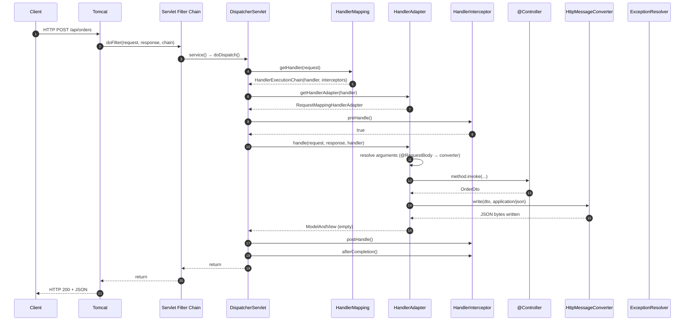
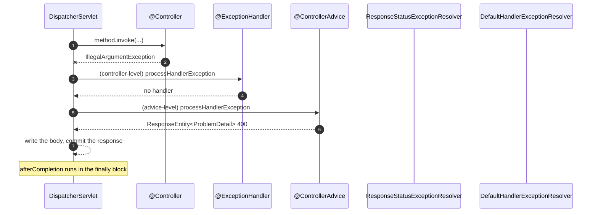
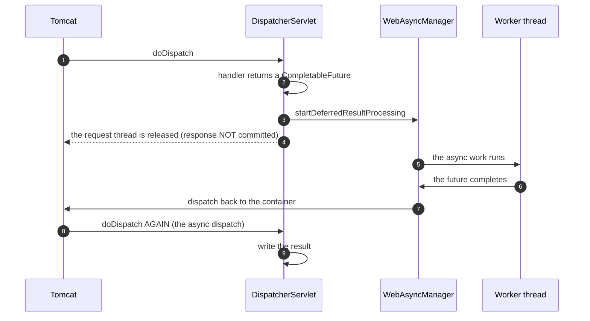

# 01 · The Complete Request Flow & `DispatcherServlet` Deep Dive

> **Level:** Beginner → Advanced
> **Interview Frequency:** ★★★★★ ("Walk me through what happens when a request comes in")
> **Prerequisite:** [02 · Spring Core](../02-Spring-Core/README.md)
> **Last Updated:** 2026

---

## 📋 Table of Contents
- [0. TL;DR — The 30-Second Answer](#0-tldr--the-30-second-answer)
- [1. What & Why](#1-what--why)
- [2. Mental Model — the pipeline](#2-mental-model--the-pipeline)
- [3. Deep Dive — Theory](#3-deep-dive--theory)
- [4. Internal Working Mechanism](#4-internal-working-mechanism)
- [5. Step-by-Step Execution Flow](#5-step-by-step-execution-flow)
- [6. Architecture Diagrams](#6-architecture-diagrams)
- [7. Production-Level Use Cases](#7-production-level-use-cases)
- [8. Code Examples — Production-Grade](#8-code-examples--production-grade)
- [9. Common Mistakes & Gotchas](#9-common-mistakes--gotchas)
- [10. Performance Considerations](#10-performance-considerations)
- [11. Security Considerations](#11-security-considerations)
- [12. Best Practices — The Checklist](#12-best-practices--the-checklist)
- [13. Hands-On Exercises](#13-hands-on-exercises)
- [14. Code Challenges](#14-code-challenges)
- [15. Scenario-Based Questions](#15-scenario-based-questions)
- [16. Interview Q&A — Level-wise](#16-interview-qa--level-wise)
- [17. Counter-Questions & Traps](#17-counter-questions--traps)
- [18. Tricky Interview Questions](#18-tricky-interview-questions)
- [19. Follow-Up Questions Asked by Interviewers](#19-follow-up-questions-asked-by-interviewers)
- [20. Real 3–5 Year Experience Scenarios](#20-real-35-year-experience-scenarios)
- [21. Frequently Asked Production Issues](#21-frequently-asked-production-issues)
- [22. Debugging Scenarios](#22-debugging-scenarios)
- [23. Architecture Design Questions](#23-architecture-design-questions)
- [24. Rapid-Fire MCQs](#24-rapid-fire-mcqs)
- [25. Cheat Sheet — One-Page Summary](#25-cheat-sheet--one-page-summary)
- [26. Real-World Production Notes](#26-real-world-production-notes)
- [27. Follow-up Learning](#27-follow-up-learning)

---

## 0. TL;DR — The 30-Second Answer

- **The full path of a request:**
  `Client → Server socket → Tomcat (Connector/ProtocolHandler) → Servlet Container →
  Filter chain (servlet filters) → DispatcherServlet → HandlerMapping →
  HandlerAdapter → @Controller method → HandlerInterceptor (preHandle) → argument resolution
  & validation → return-value handling → @ResponseBody serialisation → postHandle →
  interceptors afterCompletion → Filter chain unwinds → response → client`.
- **`DispatcherServlet` is a `HttpServlet` that delegates everything.** It doesn't do the work
  itself — it finds a **handler**, gets an **adapter**, invokes it, and handles the result.
- **The three collaborators:**
  - **`HandlerMapping`** — *where is the handler?* (`RequestMappingHandlerMapping` is the default
    for annotated controllers).
  - **`HandlerAdapter`** — *how do I call it?* (`RequestMappingHandlerAdapter`).
  - **`HandlerMethodArgumentResolver`** — *how do I build the arguments?*
  - **`HandlerMethodReturnValueHandler`** — *how do I write the response?*
- **`@RestController` = `@Controller` + `@ResponseBody`**, so the return value is serialised to
  JSON rather than resolved as a view name.
- **`@RequestMapping` on the class + method** combine: the class-level path is a **prefix**, the
  method-level path is **appended**. The HTTP method is a **conjunction** (AND), not a union.
- **Content negotiation** is automatic: the `Accept` header selects the converter
  (`MappingJackson2HttpMessageConverter` for JSON).
- **The `DispatcherServlet` is initialised once** (as a servlet) and its `WebApplicationContext`
  holds the controllers — the same context is reused for **every** request. It is **thread-safe**.
- **The `MultipartResolver` handles file uploads**; `StandardServletMultipartResolver` is the
  default in Boot 3.
- **The killer sentence:** *"The `DispatcherServlet` is a thin, well-designed dispatcher: it
  locates a handler, adapts the request into method arguments, invokes the method, and adapts the
  return value back into a response. Everything interesting lives in the pluggable strategies it
  delegates to."*

---

## 1. What & Why

Almost every Spring MVC interview question is a variation of *"walk me through what happens when
a request hits your API"*. Knowing the answer precisely separates candidates who have **debugged
a request** from those who have only **written controllers**.

Understanding the flow is also how you answer the practical questions:

- **Why is my filter not called?** (It's a servlet filter, and the request never reached the
  dispatcher — or the filter is registered for a different path.)
- **Why does my `HandlerInterceptor` not run?** (The handler is not a `HandlerMethod`, e.g. a
  static resource; or the interceptor isn't registered for that path.)
- **Why is my controller not found?** (The `@RequestMapping` doesn't match, or the method/params
  don't match.)
- **Where do I put the request-id logic?** (A filter, if it must apply to everything including
  static resources; an interceptor, if only to controllers.)
- **Why is the response 400?** (The argument resolver or the validator rejected it.)

---

## 2. Mental Model — the pipeline

```text
  HTTP request
      │
      ▼
  ┌───────────────────────────────────────────────────────────┐
  │  SERVLET CONTAINER (Tomcat)                               │
  │    • Accepts the connection                               │
  │    • Parses the HTTP request → HttpServletRequest        │
  │    • Maps the URI to a servlet                            │
  └───────────────────────┬───────────────────────────────────┘
                          ▼
  ┌───────────────────────────────────────────────────────────┐
  │  SERVLET FILTER CHAIN   (Spring Security, CORS, tracing) │
  │    doFilter → chain.doFilter → doFilter                   │
  └───────────────────────┬───────────────────────────────────┘
                          ▼
  ┌───────────────────────────────────────────────────────────┐
  │  DispatcherServlet.doDispatch()                           │
  │    1. getHandler(request)          → HandlerMapping       │
  │    2. getHandlerAdapter(handler)   → HandlerAdapter       │
  │    3. ha.handle(request, response, handler)               │
  │         ├─ preHandle  (interceptors)                     │
  │         ├─ argument resolution + validation               │
  │         ├─ invoke the @Controller method                  │
  │         ├─ return value handling (serialisation)          │
  │         ├─ postHandle (interceptors)                      │
  │         └─ afterCompletion (interceptors)                 │
  └───────────────────────┬───────────────────────────────────┘
                          ▼
  ┌───────────────────────────────────────────────────────────┐
  │  SERVLET FILTER CHAIN unwinds → response → client        │
  └───────────────────────────────────────────────────────────┘
```

> **Caption:** Filters wrap the **whole** servlet (including the `DispatcherServlet`); interceptors
> wrap **only the handler**. That single distinction answers most "where should this go?" questions.

---

## 3. Deep Dive — Theory

### 3.1 The Servlet anatomy

```java
public class DispatcherServlet extends HttpServlet {

    private static final String DEFAULT_NAMESPACE = "org.springframework.web.servlet.mvc";
    private static final String DEFAULT_DISPATCHER_SERVLET_PATH = "/";
    private static final String DEFAULT_SERVLET_NAME = "springDispatcherServlet";

    private static final String WEB_APPLICATION_CONTEXT_ATTRIBUTE =
            DispatcherServlet.class.getName() + ".CONTEXT";
    private static final String ERROR_EXCEPTION_ATTRIBUTE = "javax.servlet.error.exception";

    // The strategies — all pluggable
    private HandlerMapping[] handlerMappings;
    private HandlerAdapter[] handlerAdapters;
    private HandlerExceptionResolver[] handlerExceptionResolvers;
    private HandlerMethodArgumentResolver[] argumentResolvers;
    private HandlerMethodReturnValueHandler[] returnValueHandlers;
    private List<ViewResolver> viewResolvers;
    private MultipartResolver multipartResolver;
    private LocaleResolver localeResolver;
    private RequestToViewNameTranslator requestToViewNameTranslator;
    private FlashMapManager flashMapManager;
}
```

### 3.2 The `DispatcherServlet` lifecycle

```text
init(ServletConfig)
   │
   ├─ 1. initStrategies(context)      ← read the strategy beans from the WebApplicationContext
   │       ├─ initHandlerMappings(context)        ← from the context, or the defaults
   │       ├─ initHandlerAdapters(context)
   │       ├─ initHandlerExceptionResolvers(context)
   │       ├─ initArgumentResolvers(context)
   │       ├─ initReturnValueHandlers(context)
   │       ├─ initViewResolvers(context)
   │       ├─ initMultipartResolver(context)
   │       ├─ initLocaleResolver(context)
   │       └─ initFlashMapManager(context)
   │
   └─ 2. createWebApplicationContext() ← if none was set by the ServletContainerInitializer
```

> **Key insight:** the strategies are **beans in the `WebApplicationContext`**. That's why you can
> override any of them by defining your own bean — the `DispatcherServlet` looks up the bean by
> type.

### 3.3 `doDispatch()` — the core method

```java
protected void doDispatch(HttpServletRequest request, HttpServletResponse response)
        throws Exception {

    HttpServletRequest processedRequest = request;
    HttpServletResponse processedResponse = response;
    try {
        ModelAndView mv = null;
        Exception dispatchException = null;

        // ① PROCESS THE REQUEST  → the MultipartResolver wraps the request
        processedRequest = getMultipartResolver().resolveMultipart(request);

        // ② DETERMINE THE LOCALE
        Locale locale = getLocaleResolver().resolveLocale(processedRequest);
        ResponseLocaleContext localeContext = new RequestHeaderLocaleContext(processedRequest, locale);
        processedRequest = new LocaleContextRequest(processedRequest, localeContext);
        processedResponse = new LocaleContextResponse(processedResponse, localeContext);

        // ③ FIND THE HANDLER
        HandlerExecutionChain mappedHandler = getHandler(processedRequest);
        if (mappedHandler == null) {
            noHandlerFound(processedRequest, processedResponse);   // → 404
            return;
        }

        // ④ FIND THE ADAPTER
        HandlerAdapter ha = getHandlerAdapter(mappedHandler.getHandler());

        // ⑤ EXECUTE THE HANDLER
        if (!mappedHandler.applyPreHandle(processedRequest, processedResponse)) {
            return;      // an interceptor returned false → the response is already committed
        }

        try {
            mv = ha.handle(processedRequest, processedResponse, mappedHandler.getHandler());
            mappedHandler.applyPostHandle(processedRequest, processedResponse, mv);
        } catch (Exception ex) {
            dispatchException = ex;
            processedRequest = getExceptionHandler().processHandlerException(
                    processedRequest, processedResponse, mappedHandler.getHandler(), ex);
            // → the exception resolvers get a chance; if one handled it, mv is set
        }
        finally {
            mappedHandler.triggerAfterCompletion(processedRequest, processedResponse, null);
        }

        // ⑥ RENDER THE VIEW (or write the response body for @ResponseBody)
        if (mv != null && !mv.wasCleared()) {
            render(mv, processedRequest, processedResponse);
            ...
        }
        else {
            // a @ResponseBody method already wrote the body
        }
    }
    catch (Exception ex) {
        dispatchException = ex;
    }
    finally {
        triggerAfterCompletion(processedRequest, processedResponse, mappedHandler);
    }
}
```

> **Caption:** Note the **`finally` block** that calls `triggerAfterCompletion` — the
> `afterCompletion` interceptor callback **always** runs, even if the handler threw. That's the
> hook for cleanup (e.g. clearing the MDC).

### 3.4 `getHandler()` — the `HandlerExecutionChain`

```java
public final HandlerExecutionChain getHandler(HttpServletRequest request) throws Exception {
    Object handler = null;
    for (HandlerMapping hm : this.handlerMappings) {
        handler = hm.getHandler(request);
        if (handler != null) break;
    }
    if (handler == null) {
        handler = null;    // → 404
    }
    else {
        HandlerExecutionChain chain = (HandlerExecutionChain) handler;
        // apply the CORS configuration, if any
        chain.getInterceptorList().addAll(adaptedInterceptors);
        return chain;
    }
    return null;
}
```

**`HandlerExecutionChain`** = the handler + the list of interceptors (which come from
`HandlerMapping` — e.g. `RequestMappingHandlerMapping` collects the `@RequestMapping`-matched
interceptors and the CORS interceptor).

### 3.5 The default `HandlerMapping`s (in order)

| `HandlerMapping` | Handles |
|------------------|---------|
| `RequestMappingHandlerMapping` | `@RequestMapping`/`@GetMapping`/… annotated controllers |
| `HandlerMethodMapping` (internal) | The actual method-level lookup within the above |
| `RouterFunctionMapping` | **WebMvc.fn** functional endpoints (`RouterFunction`) |
| `ResourceHandlerMapping` | Static resources (`/**` → `classpath:/static/`) |
| `HandlerMappingIntrospector` (a helper) | — |
| `WelcomePageHandlerMapping` | The welcome page |
| `BeanNameUrlHandlerMapping` | A bean named after the URL (legacy XML) |
| `SimpleUrlHandlerMapping` | Explicitly registered URL patterns |
| `DefaultServletHttpRequestHandler` | The servlet container's default servlet (the last resort) |

> **Important:** the order matters. `RequestMappingHandlerMapping` is first, so an annotated
> controller wins over a static resource.

### 3.6 The default `HandlerAdapter`s

| `HandlerAdapter` | Handles |
|------------------|---------|
| `RequestMappingHandlerAdapter` | Annotated controllers (the vast majority) |
| `HandlerMethodAnnotationAdapter` (legacy) | — |
| `HttpRequestHandlerAdapter` | `HttpRequestHandler` beans (static resources) |
| `SimpleControllerHandlerAdapter` | Legacy `Controller` implementations |

### 3.7 `RequestMappingHandlerAdapter` — the argument resolution

```java
// The core
protected ModelAndView handleInternal(HttpServletRequest request,
                                      HttpServletResponse response,
                                      Object handler) throws Exception {

    Method method = ((HandlerMethod) handler).getMethod();
    Object[] args = getMethodArgumentValues(request, response, method, parameters);
    //  ↑ THIS is the interesting part

    Class<?>[] parameterTypes = method.getParameterTypes();
    TargetClass targetClass = AopUtils.getTargetClass(handler);
    Object target = AopUtils.getTargetObject(handler);

    // ⚠ REFLECTION — with args.length == 1, the method is invoked on the BEAN (this),
    //   otherwise on the target object (to avoid exposing the proxy).
    ReflectionUtils.makeAccessible(method);
    return new ModelAndView()
            .addAll(getModelAndViewFactory().updateModelAndView(...));
}
```

### 3.8 The argument resolvers (the important ones)

| Resolver | Supports |
|----------|----------|
| `RequestParamMethodArgumentResolver` | `@RequestParam`, simple types |
| `RequestPathVariableMethodArgumentResolver` | `@PathVariable` |
| `RequestHeaderMethodArgumentResolver` | `@RequestHeader` |
| `RequestBodyMethodArgumentResolver` | `@RequestBody` (deserialisation) |
| `RequestResponseBodyMethodProcessor` | `@ResponseBody` (serialisation) |
| `ServletRequestMethodArgumentResolver` | `HttpServletRequest`, `HttpServletResponse`, `ServletRequest`, … |
| `ServletModelAttributeMethodProcessor` | `@ModelAttribute` / form objects |
| `PrincipalMethodArgumentResolver` | `Principal` |
| `SessionAttributeMethodArgumentResolver` | `@SessionAttribute` |
| `RequestAttributeMethodArgumentResolver` | `@RequestAttribute` |
| `CookieValueMethodArgumentResolver` | `@CookieValue` |
| `ExpressionValueMethodArgumentResolver` | `@Value` on a parameter |
| `MapMethodProcessor` | A `Map` return type (all the model attributes) |

**The rules:**
- A parameter **without** an annotation is treated as a **request parameter** (if it's a simple
  type) or as a **model attribute** (if it's a complex type) — this is the
  `ServletModelAttributeMethodProcessor` with `useDefaultResolution=true`.
- **Only one `@RequestBody`** per method (the body can only be read once).
- A `HttpServletRequest`/`Response`/`Principal`/`HttpSession` parameter is resolved by type.

### 3.9 The return value handlers

| Handler | For |
|---------|-----|
| `RequestResponseBodyMethodProcessor` | `@ResponseBody` → serialisation via `HttpMessageConverter` |
| `ModelAndViewMethodReturnValueHandler` | A `ModelAndView` return value |
| `ViewMethodReturnValueHandler` | A `View` return value |
| `ModelMethodProcessor` | A `Model` (or a `Map`) return value |
| `RedirectViewMethodReturnValueHandler` | `"redirect:/orders"` |
| `ViewNameMethodReturnValueHandler` | A `String` return value → a view name (unless `@ResponseBody`) |
| `HttpEntityMethodProcessor` | A `ResponseEntity` return value |
| `HttpHeadersMethodProcessor` | A `ResponseEntity` with only headers |
| `CallableMethodReturnValueHandler` | A `Callable` → async |
| `DeferredResultMethodReturnValueHandler` | A `DeferredResult` → async |
| `WebAsyncTaskMethodReturnValueHandler` | A `WebAsyncTask` → async |
| `StreamingResponseBodyReturnValueHandler` | A `StreamingResponseBody` |

### 3.10 `HttpMessageConverter` — the serialisation layer

```java
public interface HttpMessageConverter<T> {
    boolean canRead(Class<?> clazz, @Nullable MediaType mediaType);
    boolean canWrite(@Nullable Class<?> clazz, @Nullable MediaType mediaType);
    List<MediaType> getSupportedMediaTypes();
    @Nullable T read(@Nullable Class<? extends T> clazz, HttpInputMessage inputMessage);
    void write(@Nullable T t, @Nullable MediaType contentType, HttpMessageOutputMessage outputMessage);
}
```

**The default converters in a Boot app (order matters — the first that `canWrite` wins):**

| Converter | Handles |
|-----------|---------|
| `ByteArrayHttpMessageConverter` | `byte[]` |
| `StringHttpMessageConverter` | `String` |
| `ResourceHttpMessageConverter` | `Resource` (files) |
| `AllEncompassingFormHttpMessageConverter` | `application/x-www-form-urlencoded` |
| `MappingJackson2HttpMessageConverter` | **JSON** (Jackson) |
| `MappingJackson2XmlHttpMessageConverter` | XML (if on the classpath) |
| `Jaxb2RootElementHttpMessageConverter` | XML (if on the classpath) |
| `FormHttpMessageConverter` | forms |
| `ServerHttpResponsePrinter` (internal) | — |

> **Custom converters** are a common interview topic: implement `HttpMessageConverter`, register it
> as a `@Bean` (Boot auto-registers any `HttpMessageConverter` bean), and it will be inserted
> **before** the Jackson converter if you also implement `extendMessageConverters` with a
> `addDefaultHttpMessageConverters` override — or just declare it as a bean, in which case Boot
> adds it to the list.

### 3.11 The `HandlerMethodArgumentResolver` chain — the resolution algorithm

```text
For each parameter (in order):
   1. Check the "annotation" resolvers first:
      - @RequestParam, @PathVariable, @RequestHeader, @CookieValue,
        @RequestAttribute, @SessionAttribute, @RequestBody, @Value
   2. Check the "standard" resolvers:
      - HttpServletRequest/Response, Principal, HttpSession, Locale, InputStream, Reader
   3. Check the "catch-all":
      - ServletModelAttributeMethodProcessor (a complex type → a model attribute, bound from
        request parameters); for a simple type → a request parameter
   4. If no resolver matched → MethodArgumentNotValidException / IllegalStateException
```

### 3.12 The `Model` / `ModelMap` / `ModelAndView`

```java
public interface Model {
    Model addAttribute(String attributeName, @Nullable Object attributeValue);
    Model addAttribute(Object attributeValue);
    Model addAllAttributes(Map<String, ?> attributes);
    Map<String, Object> asMap();
}
```

- **`Model`** — the view model (for server-side rendering).
- **`ModelMap`** — a `HashMap` implementation of `Model`.
- **`ModelAndView`** — a holder of a **view name** + a **model** + a `HttpStatus` + the
  `ResponseBody` flag.
- **In a `@RestController`**, the `Model` is still usable, but the returned object is serialised
  directly (the model is ignored for the body).

### 3.13 Content negotiation

```java
@GetMapping(produces = MediaType.APPLICATION_JSON_VALUE)
public List<OrderDto> list() { ... }
```

- The `produces` attribute narrows the `Accept` header. If the client's `Accept` doesn't match,
  Spring returns **406 Not Acceptable**.
- The `consumes` attribute narrows the `Content-Type`. A mismatch → **415 Unsupported Media
  Type**.
- If `produces` isn't specified, the converters negotiate on their own.

### 3.14 The `HandlerExceptionResolver` chain

```text
  Exception thrown in the handler
      │
      ▼
  ① ExceptionHandlerExceptionResolver   ← @ExceptionHandler methods  (HIGHEST_PRECEDENCE)
      │    • looks in the CONTROLLER first
      │    • then in the @ControllerAdvice classes (in @Order order)
      │    • if it finds a match → it builds a ModelAndView / writes the body
      │
      ▼ (no match)
  ② ResponseStatusExceptionResolver      ← @ResponseStatus / ResponseStatusException
      │
      ▼ (no match)
  ③ DefaultHandlerExceptionResolver       ← resolves to the servlet container's error page
      │                                      (500 → the /error dispatch)
      │
      ▼ (no match)
  ④ the exception propagates → Tomcat's error handling
```

> **Caption:** This order is a classic interview question. `@ExceptionHandler` in the controller
> beats `@ControllerAdvice`; among advices, the **most specific** advice wins (and `@Order`
> breaks ties).

### 3.15 The async request flow

```java
@GetMapping("/slow")
public CompletableFuture<String> slow() {
    return CompletableFuture.supplyAsync(() -> compute(), executor);
}
```

```text
  Handler returns a Callable/DeferredResult/CompletableFuture
      │
      ▼
  The request thread is RELEASED back to the container
      │  (the response is not committed yet)
      ▼
  The work runs on another thread
      │
      ▼
  The result is dispatched back to the container
      │
      ▼
  DispatcherServlet.doDispatch() runs AGAIN, this time with
  WebAsyncManager → the "dispatch" → the result is written
```

> **Important:** the **filters** are only invoked once (on the initial dispatch); the
> **interceptors**' `afterCompletion` runs at the end of the async cycle. The `SecurityContext`
> is **not** propagated to the async thread by default — you need
> `SecurityContextHolder.getContext().getAuthentication()` captured manually or
> `DelegatingSecurityContextExecutor`.

---

## 4. Internal Working Mechanism

### 4.1 The Tomcat side — what happens before Spring

```text
  1. The client opens a TCP connection
  2. Tomcat's Acceptor thread accepts it and hands the socket to a Poller
  3. The Poller detects readability, creates a Processor, and dispatches to the Executor
  4. The Executor runs the task → the CoyoteAdapter converts the socket bytes into
     an HttpServletRequest (org.apache.catalina.connector.Request) and builds the
     filter chain
  5. The filter chain runs → DispatcherServlet
```

**The three Tomcat abstractions you'll be asked about:**
- **Connector** — the HTTP/1.1 or HTTP/2 entry point; owns the protocol handler.
- **Engine / Host / Context / Wrapper** — the servlet container hierarchy; the `Context` is your
  web application, the `Wrapper` is a servlet.
- **Executor** — the thread pool (`server.tomcat.threads.max`).

### 4.2 `RequestMappingHandlerMapping` — how the mapping is found

```text
  1. At STARTUP: scan all @Controller beans → build a RequestMappingInfo per method
     - RequestMappingInfo = (RequestMethods, path patterns, params, headers, consumes, produces)
  2. Store them in a Map<RequestMappingInfo, HandlerMethod>  (+ a "direct path" map for
     the no-conditions case, which is a fast path)
  3. At REQUEST time: build a RequestMappingInfo from the incoming request
     (method, path, params, headers) and look it up
     - exact match → match
     - pattern match (PathPattern / AntPathMatcher) → match
     - best-match comparison when multiple patterns match (more specific wins)
  4. If no match → the next HandlerMapping is tried
```

**Pattern matching:** Boot 2.6+ defaults to `PathPatternParser` (Spring MVC's own) instead of
`AntPathMatcher` — faster and with different semantics:
- `PathPattern`: `/{id}` — the same syntax, but no `**` in the middle, and trailing-slash
  matching is off by default.
- `AntPathMatcher`: `/**` supported anywhere.

### 4.3 `RequestMappingInfo` matching — the specifics

```java
RequestMappingInfo other = RequestMappingInfo.paths(...).methods(HttpMethod.GET)
        .params("id=42").headers("X-Api-Key").consumes("application/json")
        .produces("application/json").build();

other.matches(request, pathMatcher);   // all conditions must match
```

**Path variable extraction:** `/{id}` → `@PathVariable("id")`. The variables are put in the
request attributes and resolved by `RequestPathVariableMethodArgumentResolver`.

**The `params` condition:** `?id=42` — a **specific value** is an equality match; a bare
`?id` is a "must be present" match.

### 4.4 The `ContentNegotiationManager`

```text
  Accept header (preferred)
      → if absent, use the default content type (or the first supported by the converter)
      → if the Accept header can't be satisfied → 406
```

### 4.5 The `HandlerInterceptor` interface

```java
public interface HandlerInterceptor {
    default boolean preHandle(HttpServletRequest request, HttpServletResponse response,
                               Object handler) throws Exception { return true; }
    default void postHandle(HttpServletRequest request, HttpServletResponse response,
                            Object handler, @Nullable ModelAndView modelAndView) throws Exception { }
    default void afterCompletion(HttpServletRequest request, HttpServletResponse response,
                                 Object handler, @Nullable Exception ex) throws Exception { }
}
```

- **`preHandle` returning `false`** stops the chain — the interceptor is responsible for writing
  the response.
- **`postHandle` runs only on success** (not if the handler threw).
- **`afterCompletion` always runs** (after the response is committed) — the cleanup hook.

**`HandlerMethod` vs `Object handler`:** the `handler` parameter is a `HandlerMethod` for
annotated controllers — cast it to get the `Method` and the bean:
```java
HandlerMethod hm = (HandlerMethod) handler;
Method m = hm.getMethod();
Object bean = hm.getBean();
```

---

## 5. Step-by-Step Execution Flow

### 5.1 The full request lifecycle



### 5.2 The error path



### 5.3 The async flow



---

## 6. Architecture Diagrams

### 6.1 The MVC architecture

```text
┌──────────────────────────────────────────────────────────────────────┐
│  BROWSER / CLIENT                                                     │
└───────────────────────────────┬──────────────────────────────────────┘
                                ▼
┌──────────────────────────────────────────────────────────────────────┐
│  EMBEDDED SERVER (Tomcat)                                            │
│   Connector → ProtocolHandler → CoyoteAdapter → Servlet Container    │
│      Thread pool: server.tomcat.threads.max                         │
└───────────────────────────────┬──────────────────────────────────────┘
                                ▼
┌──────────────────────────────────────────────────────────────────────┐
│  FILTER CHAIN (servlet filters)                                      │
│   • Spring Security: FilterChainProxy                              │
│   • CorsFilter · FormContentFilter · RequestContextFilter           │
│   • Actuator: WebMvcObservationFilter (metrics)                     │
└───────────────────────────────┬──────────────────────────────────────┘
                                ▼
┌──────────────────────────────────────────────────────────────────────┐
│  DispatcherServlet                                                    │
│   ┌──────────────┐  ┌───────────────┐  ┌────────────────────────┐   │
│   │HandlerMapping│→ │HandlerAdapter │→ │ArgumentResolver       │   │
│   │  (find it)   │  │  (call it)    │  │  (build the args)     │   │
│   └──────────────┘  └───────────────┘  └────────────────────────┘   │
│   ┌──────────────┐  ┌───────────────┐  ┌────────────────────────┐   │
│   │ReturnValue   │→ │MessageConver-│  │ExceptionResolver      │   │
│   │Handler       │  │ter (JSON)     │  │  (@ExceptionHandler)  │   │
│   └──────────────┘  └───────────────┘  └────────────────────────┘   │
└───────────────────────────────┬──────────────────────────────────────┘
                                ▼
┌──────────────────────────────────────────────────────────────────────┐
│  @Controller / @RestController                                       │
│     @RestController = @Controller + @ResponseBody                    │
└──────────────────────────────────────────────────────────────────────┘
```

### 6.2 Filters vs interceptors vs controllers

```text
  ┌────────────────────────────────────────────────────────────┐
  │  FILTER (servlet)          │  runs for: ALL requests      │
  │    • before the dispatcher │  • sees the raw request       │
  │    • wraps the whole call │  • can rewrite the request    │
  │    • Security, CORS, gzip  │  • can replace the response   │
  ├───────────────────────────┼──────────────────────────────┤
  │  INTERCEPTOR (MVC)         │  runs for: HANDLER requests  │
  │    • around the controller │  • knows the HandlerMethod   │
  │    • preHandle/postHandle │  • can add model attributes   │
  │    • afterCompletion      │  • runs even on exception     │
  ├───────────────────────────┼──────────────────────────────┤
  │  CONTROLLER                │  runs for: matched handlers  │
  │    • the business entry    │  • returns a body            │
  └───────────────────────────┴──────────────────────────────┘
```

### 6.3 The error flow

```text
  Exception in the handler
        │
        ▼
  ① @ExceptionHandler in the controller       ← highest priority
        │ (not found)
        ▼
  ② @ExceptionHandler in a @ControllerAdvice  ← by @Order, then by specificity
        │ (not found)
        ▼
  ③ ResponseStatusExceptionResolver           ← @ResponseStatus
        │ (not found)
        ▼
  ④ DefaultHandlerExceptionResolver           ← sets the error status
        │
        ▼
  ⑤ The container's /error dispatch           → whitelabel error page or your error page
```

---

## 7. Production-Level Use Cases

| Use case | Where | Why |
|----------|-------|-----|
| **Request correlation / tracing** | A `Filter` (or `OncePerRequestFilter`) | It must run for **every** request, including static resources and error dispatches; it sets the MDC |
| **Authentication / authorisation** | A `Filter` (Spring Security) | It must wrap everything, including the error dispatch |
| **CORS** | A `Filter` (`CorsFilter`) or Spring MVC's built-in CORS config | The preflight `OPTIONS` request must be handled before the dispatcher |
| **Rate limiting** | A `Filter` or a handler interceptor | A filter is safer (it covers the static resources too) |
| **Timing / metrics** | A `Filter` (Micrometer's `Timed`) or an interceptor | A filter captures the total time including the view rendering |
| **Reading the body (audit)** | A `Filter` with a `ContentCachingRequestWrapper` | The body can only be read once — a wrapper is required |
| **Adding a response header** | A `Filter` or an interceptor | |
| **Populating the `Model`** | A `HandlerInterceptor#postHandle` | It has access to the `ModelAndView` |
| **Method-level authorisation** | `@PreAuthorize` on the controller method | The interceptor is the Spring Security mechanism |
| **Resolving the current user in the service layer** | A service-scoped `UserContext` bean, populated by a filter | Avoids passing the user through every method signature |

---

## 8. Code Examples — Production-Grade

### 8.1 A request-correlation filter (the right place for it)

```java
@Component
@Slf4j
public class RequestCorrelationFilter extends OncePerRequestFilter {

    public static final String CORRELATION_ID = "X-Correlation-Id";

    @Override
    protected void doFilterInternal(HttpServletRequest request,
                                    HttpServletResponse response,
                                    FilterChain filterChain)
            throws ServletException, IOException {

        String correlationId = request.getHeader(CORRELATION_ID);
        if (correlationId == null || correlationId.isBlank()) {
            correlationId = UUID.randomUUID().toString();
        }

        MDC.put("correlationId", correlationId);
        MDC.put("method", request.getMethod());
        MDC.put("path", request.getRequestURI());
        response.setHeader(CORRELATION_ID, correlationId);

        long start = System.nanoTime();
        try {
            filterChain.doFilter(request, response);
        } finally {
            // ⚠ CRITICAL: the MDC is a ThreadLocal — on a pooled thread it MUST be cleared
            MDC.clear();
            long ms = (System.nanoTime() - start) / 1_000_000;
            log.info("{} {} -> {} in {} ms", request.getMethod(), request.getRequestURI(),
                     response.getStatus(), ms);
        }
    }
}
```

> **Caption:** `OncePerRequestFilter` guarantees the filter runs **once per request** (it detects
> an `alreadyFiltered` attribute) — important for forwards and error dispatches.

### 8.2 A handler interceptor

```java
@Component
@Slf4j
public class AuditInterceptor implements HandlerInterceptor {

    private final AuditService auditService;

    public AuditInterceptor(AuditService auditService) { this.auditService = auditService; }

    @Override
    public boolean preHandle(HttpServletRequest request, HttpServletResponse response,
                              Object handler) {
        if (handler instanceof HandlerMethod hm) {
            request.setAttribute("audit.action", hm.getMethod().getName());
        }
        return true;   // always continue
    }

    @Override
    public void afterCompletion(HttpServletRequest request, HttpServletResponse response,
                                Object handler, Exception ex) {
        // ⚠ afterCompletion runs even when the handler threw
        auditService.record(request, response.getStatus(), ex);
    }
}
```

```java
@Configuration
@RequiredArgsConstructor
public class WebConfig implements WebMvcConfigurer {

    private final AuditInterceptor auditInterceptor;

    @Override
    public void addInterceptors(InterceptorRegistry registry) {
        registry.addInterceptor(auditInterceptor)
                .addPathPatterns("/api/**")
                .excludePathPatterns("/api/health", "/actuator/**")
                .order(0);          // the order among interceptors
    }
}
```

### 8.3 A `ResponseEntity`-based controller (the production style)

```java
@RestController
@RequestMapping("/api/v1/orders")
@RequiredArgsConstructor
@Validated
public class OrderController {

    private final OrderService orderService;

    @GetMapping
    public ResponseEntity<Page<OrderResponse>> list(
            @RequestParam(defaultValue = "0") int page,
            @RequestParam(defaultValue = "20") @Max(100) int size,
            @RequestParam(required = false) OrderStatus status) {

        Page<OrderResponse> result = orderService.findAll(page, size, status);
        return ResponseEntity.ok()
                .cacheControl(CacheControl.maxAge(Duration.ofSeconds(30)).cachePublic())
                .body(result);
    }

    @GetMapping("/{id}")
    public ResponseEntity<OrderResponse> get(@PathVariable Long id) {
        return orderService.findById(id)
                .map(ResponseEntity::ok)
                .orElseGet(() -> ResponseEntity.notFound().build());
    }

    @PostMapping
    public ResponseEntity<OrderResponse> create(
            @Valid @RequestBody CreateOrderRequest request,
            UriComponentsBuilder uriBuilder) {

        OrderResponse created = orderService.create(request);
        URI location = uriBuilder.path("/api/v1/orders/{id}")
                                  .buildAndExpand(created.id()).toUri();
        return ResponseEntity.created(location).body(created);
    }
}
```

### 8.4 A `ResponseEntityExceptionHandler` — the global error contract

```java
@RestControllerAdvice
@Slf4j
public class GlobalExceptionHandler extends ResponseEntityExceptionHandler {

    /** Spring's own exceptions (validation, type mismatch, 404, 405…) */
    @Override
    protected ResponseEntity<Object> handleMethodArgumentNotValid(
            MethodArgumentNotValidException ex, HttpHeaders headers,
            HttpStatusCode status, WebRequest request) {

        ProblemDetail body = ProblemDetail.forStatusAndDetail(
                HttpStatus.BAD_REQUEST, "Validation failed");
        body.setTitle("Validation failed");
        body.setProperty("errors", ex.getBindingResult().getFieldErrors().stream()
                .map(fe -> Map.of("field", fe.getField(),
                                  "message", fe.getDefaultMessage()))
                .toList());
        body.setProperty("timestamp", Instant.now());
        return ResponseEntity.badRequest().body(body);
    }

    /** Your domain exceptions */
    @ExceptionHandler(OrderNotFoundException.class)
    public ResponseEntity<ProblemDetail> handleNotFound(OrderNotFoundException ex) {
        ProblemDetail body = ProblemDetail.forStatusAndDetail(HttpStatus.NOT_FOUND, ex.getMessage());
        body.setTitle("Order not found");
        return ResponseEntity.status(HttpStatus.NOT_FOUND).body(body);
    }

    @ExceptionHandler({MethodArgumentTypeMismatchException.class,
                       HttpMessageNotReadableException.class})
    public ResponseEntity<ProblemDetail> handleBadRequest(Exception ex) {
        log.warn("Malformed request", ex);
        return ResponseEntity.badRequest().body(ProblemDetail.forStatusAndDetail(
                HttpStatus.BAD_REQUEST, "Malformed request"));
    }
}
```

### 8.5 A custom `HandlerMethodArgumentResolver`

```java
@Component
public class CurrentUserArgumentResolver implements HandlerMethodArgumentResolver {

    private final CurrentUserProvider userProvider;

    public CurrentUserArgumentResolver(CurrentUserProvider userProvider) {
        this.userProvider = userProvider;
    }

    @Override
    public boolean supportsParameter(MethodParameter parameter) {
        return parameter.hasParameterAnnotation(CurrentUser.class)
                && UserPrincipal.class.isAssignableFrom(parameter.getParameterType());
    }

    @Override
    public Object resolveArgument(MethodParameter parameter, ModelAndViewContainer mavContainer,
                                  NativeWebRequest webRequest, WebDataBinderFactory binderFactory) {
        UserPrincipal user = userProvider.currentUser()
                .orElseThrow(() -> new AccessDeniedException("No authenticated user"));
        return user;
    }
}
```

```java
@Configuration
@RequiredArgsConstructor
public class WebConfig implements WebMvcConfigurer {

    private final CurrentUserArgumentResolver currentUserArgumentResolver;

    @Override
    public void addArgumentResolvers(List<HandlerMethodArgumentResolver> resolvers) {
        resolvers.add(currentUserArgumentResolver);
    }
}
```

```java
@RestController
public class ProfileController {

    @GetMapping("/me")
    public Profile me(@CurrentUser UserPrincipal user) {   // ← resolved by the custom resolver
        return profileService.forUser(user.id());
    }
}
```

### 8.6 A custom `HttpMessageConverter`

```java
@Component
public class MoneyHttpMessageConverter implements HttpMessageConverter<Money> {

    private final ObjectMapper objectMapper;

    public MoneyHttpMessageConverter(ObjectMapper objectMapper) {
        this.objectMapper = objectMapper;
    }

    @Override
    public boolean canRead(Class<?> clazz, MediaType mediaType) {
        return Money.class.isAssignableFrom(clazz);
    }

    @Override
    public boolean canWrite(Class<?> clazz, MediaType mediaType) {
        return Money.class.isAssignableFrom(clazz);
    }

    @Override
    public List<MediaType> getSupportedMediaTypes() {
        return List.of(MediaType.APPLICATION_JSON);
    }

    @Override
    public Money read(Class<? extends Money> clazz, HttpInputMessage message) throws IOException {
        return objectMapper.readValue(message.getBody(), Money.class);
    }

    @Override
    public void write(Money money, MediaType contentType, HttpMessageOutputMessage message)
            throws IOException {
        message.getBody().write(objectMapper.writeValueAsBytes(money));
    }
}
```

### 8.7 Consuming a `ResponseEntity` and using `ProblemDetail`

```java
@RestController
@RequestMapping("/api/v1/orders")
@RequiredArgsConstructor
public class OrderController {

    private final OrderService orderService;

    @PostMapping
    public ResponseEntity<OrderResponse> create(@Valid @RequestBody CreateOrderRequest req) {
        OrderResponse created = orderService.create(req);
        return ResponseEntity.created(
                URI.create("/api/v1/orders/" + created.id())).body(created);
    }
}
```

```java
// The client side
@RestClient
public interface OrderClient {

    @GetExchange("/api/v1/orders/{id}")
    OrderResponse get(@PathVariable Long id);

    @PostExchange("/api/v1/orders")
    ResponseEntity<OrderResponse> create(@RequestBody CreateOrderRequest request);
}
```

---

## 9. Common Mistakes & Gotchas

| # | ❌ Wrong | ✅ Right | Why |
|---|----------|----------|-----|
| 1 | Putting the request-id logic in an interceptor | A filter | Interceptors don't run for static resources or error dispatches |
| 2 | Forgetting `MDC.clear()` in a `finally` | Always clear | `ThreadLocal` leak on a pooled thread |
| 3 | `@GetMapping` and `@PostMapping` on the same path with the same params | Differentiate by method/params | Ambiguous mapping → startup error |
| 4 | Two `@RequestMapping`s matching the same request | Make them specific | Ambiguous mapping → 500 at runtime |
| 5 | `@RequestBody` on a `GET` request | Don't | No body to read |
| 6 | Two `@RequestBody` parameters | Only one is allowed | The body can only be read once |
| 7 | Expecting a `Map<String,String>` to bind the JSON body | Use `@RequestBody` with a DTO | The `Map` binds **query parameters** |
| 8 | Returning a `List` from a `@Controller` (not `@RestController`) | Use `@RestController` | The list becomes a **view name** |
| 9 | `@ExceptionHandler` in the controller for an exception thrown in a service | It still works (the advice catches it) | But a `@ControllerAdvice` is more reusable |
| 10 | `@ControllerAdvice` without `basePackages` catching everything | Scope it | Otherwise it catches exceptions from other controllers too |
| 11 | Reading the request body in a filter without a wrapper | Use `ContentCachingRequestWrapper` | The body is consumed once |
| 12 | Assuming `postHandle` runs when the handler threw | It doesn't | Use `afterCompletion` |
| 13 | A `preHandle` returning `false` without writing a response | Write the response | The client gets a blank 200 |
| 14 | Using `@RequestParam` for a JSON body | `@RequestBody` | |
| 15 | `HttpServletRequest` injection into a service | Pass the data you need | Couples the service to the web layer |
| 16 | Forgetting that the `DispatcherServlet` is a **singleton** — storing request state in a field | Use a request-scoped bean | Data leak between requests |
| 17 | `@PathVariable("id")` when the parameter name isn't retained | Always name it explicitly | Needs `-parameters` |
| 18 | Consuming the response body in `postHandle` | Don't | The body is already written |
| 19 | A `Filter` registered for `/*` that also applies to `/actuator` | Exclude the management paths | Don't leak actuator endpoints |
| 20 | Returning `ResponseEntity.ok()` with a `null` body for a 204 | Use `ResponseEntity.noContent().build()` | A 204 must not have a body |

---

## 10. Performance Considerations

| Aspect | Impact | Guidance |
|--------|--------|----------|
| **`@RequestBody` deserialisation** | Jackson's cost per request | Reuse the `ObjectMapper`; avoid polymorphic typing (a security risk too) |
| **The `HandlerMapping` lookup** | A map lookup — very fast | Use `PathPatternParser` (the Boot default) |
| **The argument resolution** | Reflection per parameter | Spring caches the `MethodParameter` metadata; avoid `@ModelAttribute` for big forms |
| **The filter chain** | One extra call per filter | Keep the filters cheap; do the heavy work asynchronously |
| **The `DispatcherServlet` overhead** | Small | It's the same for every request; don't worry |
| **Logging the request body** | Reading the body | Use a wrapper + a size limit |
| **`@ResponseBody` with a huge collection** | Memory + serialisation time | Paginate; use a streaming response for big exports |
| **The Tomcat thread pool** | `server.tomcat.threads.max` (200 by default) | Tune to the DB pool size × the number of instances |
| **`StreamingResponseBody`** | Streams instead of buffering | Use it for large file downloads |
| **The `ContentCachingRequestWrapper`** | Buffers the whole body | Set a max size; only use it when needed |

---

## 11. Security Considerations

| Risk | Mitigation |
|------|-----------|
| **The `DispatcherServlet` mapped to `/*`** | It intercepts static resources | In Boot 3, the dispatcher is mapped to `/` — the static resources are handled by a `ResourceHttpRequestHandler` instead |
| **`@ExceptionHandler` leaking stack traces** | A generic message + a correlation id | Never return `ex.getMessage()` for an unexpected exception |
| **Mass assignment** | Binding the request body straight to an entity | Use a **request DTO** with only the allowed fields |
| **`@ModelAttribute` binding to an entity** | Over-posting (setting `id`, `role`, `price`) | Use a DTO, or `@InitBinder` with `setAllowedFields` |
| **Open redirect** | A redirect to a user-supplied URL | Validate against an allow-list |
| **CORS misconfiguration** | `allowedOrigins("*")` with credentials | Never combine `*` with `allowCredentials=true` |
| **The `HandlerInterceptor` reading the body** | The body is consumed | Use `ContentCachingRequestWrapper` |
| **Logging the request body** | PII in the logs | Redact; never log the authorisation header |
| **Path traversal in a file download** | `../` in a filename | Resolve the path and check it's under the base directory |
| **CORS preflight not handled** | The browser blocks it | Handle `OPTIONS` or use the Spring CORS config |
| **`@ResponseBody` returning an entity** | Exposes internal fields | Return a DTO |

---

## 12. Best Practices — The Checklist

- [ ] **DTOs for the API** — never expose the JPA entity. Separate request and response DTOs.
- [ ] Use `ResponseEntity` for the status code, the headers, and the location.
- [ ] **Version the API** (`/api/v1/...`).
- [ ] Use `ProblemDetail` (RFC 9457) for the error contract.
- [ ] A `@ControllerAdvice` for the global error handling; a `@ExceptionHandler` only for
      controller-specific errors.
- [ ] **Validate the input** with `@Valid` on the request body and `@Validated` on the class for
      the parameter constraints.
- [ ] Put the **cross-cutting, request-wide** logic in a **filter**; the **controller-specific**
      logic in an **interceptor**.
- [ ] Always clear the MDC in a `finally`.
- [ ] **Paginate** every list endpoint.
- [ ] Set an explicit `produces`/`consumes` when it matters.
- [ ] Use `OncePerRequestFilter` for your filters.
- [ ] Don't inject `HttpServletRequest` into a service — pass the data.
- [ ] Handle the async propagation of the `SecurityContext` explicitly.

---

## 13. Hands-On Exercises

**🧪 Lab 1 — Trace the request**
1. Turn on `logging.level.org.springframework.web=DEBUG` and `logging.level.org.springframework.web.servlet.mvc=TRACE`.
2. Make a request and identify: the `HandlerMapping` used, the `HandlerAdapter` used, the argument
   resolvers, and the return-value handler.

**✅ Success signal:** You can name the four collaborators for a given request.

**🧪 Lab 2 — The interceptor vs the filter**
1. Put a log in a filter and a log in an interceptor.
2. Request a **static resource** (`/index.html`) → the filter logs, the interceptor doesn't.
3. Request an **API** → both log.

**✅ Success signal:** You know exactly where to put each.

**🧪 Lab 3 — The MDC leak**
1. Write a filter that puts a value in the MDC but **doesn't clear it**.
2. Make two requests; the second one shows the first one's value.
3. Fix it with a `finally` + `MDC.clear()`.

**✅ Success signal:** You've reproduced the classic cross-request data leak.

**🧪 Lab 4 — Argument resolution**
1. Write a controller method with `@RequestParam`, `@PathVariable`, `@RequestBody`, `@RequestHeader`,
   `@CookieValue`, a `Principal`, and a `@ModelAttribute`.
2. Break each one in turn and read the error.

**✅ Success signal:** You know the failure mode of each.

---

## 14. Code Challenges

### Challenge 1 — A request-scoped user context (medium)
**Goal:** Make the authenticated user available to any service without passing it through every
method.
**Requirements:** no `ThreadLocal`; must not leak between requests; must be testable.

**Hint:** a `OncePerRequestFilter` + a `@RequestScope` bean.

### Challenge 2 — A custom `HandlerMethodArgumentResolver` (medium)
**Goal:** Resolve a `@TenantId` annotation parameter from a JWT claim.
**Requirements:** a clear error when the claim is missing; a unit test.

### Challenge 3 — A global API error contract (hard)
**Goal:** Every error response is an RFC 9457 `ProblemDetail` with a `type`, `title`, `status`,
`detail`, `instance`, a `timestamp`, and a `correlationId`.
**Requirements:** covers the framework's own exceptions (validation, type mismatch, 404, 405,
415) and the domain exceptions; never leaks a stack trace; a test per case.

**Hint:** extend `ResponseEntityExceptionHandler`.

### Challenge 4 — A request-body audit filter (hard)
**Goal:** Log the request body (redacted) for write requests.
**Requirements:** the body must still be readable by the controller; a size limit; the
`Content-Type` must be checked; PII redaction.

**Hint:** `ContentCachingRequestWrapper`.

---

## 15. Scenario-Based Questions

**S1.** *"A request takes 8 seconds. Where do you look?"*
>
> **Expected answer:** (1) **Measure first** — add timing at each layer: a filter (total), an
> interceptor (handler), and the service layer (business logic). The **`traceId`/correlation id**
> in the logs lets you correlate. (2) **The likely layers**: (a) **the handler mapping/argument
> resolution** — usually milliseconds; (b) **the controller method** — the business logic; (c) **the
> serialisation** — a huge collection; (d) **the filter chain** — a slow auth call; (e) **the
> network** — the client is slow to send the body (TTFB vs total time); (f) **the response
> streaming** — a large payload over a slow link. (3) **Tools**: a **distributed trace**
> (Micrometer + Zipkin/Tempo) gives you the breakdown per span — this is the correct production
> tool; `stopwatch` logs are a quick fallback; a **JFR** recording or an **async-profiler** flame
> graph if it's CPU-bound. (4) **Common real causes**: an **N+1 query** in the repository (the
> classic!), a **missing index**, a **synchronous call to a slow downstream**, a **large
> `IN` clause**, or a **lock contention** on the DB. (5) The senior framing: "8 seconds is
> downstream of the application; first prove whether the time is in the app or in the network, and
> then whether it's CPU or waiting." Use the **thread dump** (`jcmd <pid> Thread.print`) to see
> where the thread is blocked — a thread waiting on a socket read is a downstream problem; a thread
> in `RUNNABLE` is CPU.

**S2.** *"After a refactor, some endpoints return 404 and others return 500 'Ambiguous mapping'."*
>
> **Expected answer:** (1) **500 with "Ambiguous handler methods"** — two `@RequestMapping`s match
> the same request. Causes: (a) two controllers with the same path (a copy-paste during the
> refactor); (b) a path variable with a different name but the same shape (`/{id}` vs `/{orderId}`
> — **these DO conflict** because the pattern is the same!); (c) a class-level `@RequestMapping`
> duplicated. Note: `/{id}` and `/{orderId}` are the **same pattern** — only the variable name
> differs, and Spring matches on the pattern. (d) the same method mapped twice. (2) **Fix**: make
> the patterns distinct (`/orders/{id}` vs `/orders/{orderId}` are still identical — use
> `/orders/{id}` vs `/orders/search`, or constrain by `method`/`params`/`headers`). (3) **404** —
> no mapping matched: the path changed, the HTTP method changed (a `PUT` vs `POST` — note that
> a path that matches but a method that doesn't gives **405 Method Not Allowed**, not 404), the
> controller isn't in the scan path, or a **profile** deactivated the controller. (4) **Prevention**:
> a test that hits every endpoint (a **contract test** or an OpenAPI-driven smoke test), and a
> **strict mapping**: Spring Boot 3.2+ can **fail at startup** on ambiguous mappings
> (`spring.mvc.throw-exception-if-no-handler-found` and the `PathPatternParser` default) — enable
> the strict setting so the failure happens at **deploy time**, not at request time. (5) The senior
> addition: "a 404 for a previously working endpoint is a **breaking change**" — if this is a public
> API, version it and monitor the 404 rate by path (an alert on a sudden 404 spike catches
> contract breaks).

**S3.** *"We need to add a request-id to every log line and propagate it to downstream services."*
>
> **Expected answer:** (1) **A filter**, not an interceptor — the request id must be present for
> *every* log line, including the ones before the dispatcher (the security filter, the error
> dispatch). (2) **Generate or propagate**: read the incoming `X-Request-Id` (or `traceparent` for
> W3C) and reuse it; otherwise generate a UUID (or a ULID for sortability). (3) **Put it in the
> MDC** so the logging pattern (`%X{requestId}`) includes it on every line. (4) **Always clear the
> MDC in a `finally`** — otherwise it leaks to the next request on the pooled thread (a real,
> subtle bug). (5) **Echo it in the response header** so the client can quote it in a support
> ticket. (6) **Propagate downstream** — add the header to the `RestClient`/`WebClient` call via
> an `Interceptor` (the client-side equivalent) so the id follows the call chain. (7) **Standardise
> on W3C Trace Context** (`traceparent`) rather than inventing a header — then OpenTelemetry
> picks it up automatically. (8) **Persist it in the logs and the traces** so a single id correlates
> the whole request; add it to the error responses (`ProblemDetail`). (9) **Test**: a test that
> asserts the header is in the response and that the MDC is empty after the request.

---

## 16. Interview Q&A — Level-wise

### 🟢 Beginner
**Q: What is the `DispatcherServlet`?**
**A:** The central servlet of Spring MVC. It receives the request, finds the right handler
(usually a `@Controller` method), invokes it with the right arguments, and writes the response.
It's the "front controller" pattern.

**Q: What is the difference between `@Controller` and `@RestController`?**
**A:** `@RestController` = `@Controller` + `@ResponseBody` on every method — the return value is
serialised straight into the response body (JSON) instead of being resolved as a **view name**.
`@RestController` also implies `@ResponseBody` at the class level.

**Q: How do you accept JSON in a controller?**
**A:** `@PostMapping` with a `@RequestBody` parameter. Spring uses Jackson to deserialise the body
into your DTO.

**Q: What does `@RequestMapping` do?**
**A:** Maps HTTP requests to handler methods. The class-level mapping provides a path prefix and
constraints; the method-level mapping adds the specific path, the HTTP method, and the
params/headers/consumes/produces conditions. **All** the conditions must match (AND).

### 🟡 Intermediate
**Q: Walk me through the request flow.**
**A:** Tomcat accepts the connection and builds the `HttpServletRequest` → the **servlet filter
chain** runs (Spring Security, CORS, …) → the `DispatcherServlet.doDispatch()` runs →
`HandlerMapping.getHandler()` finds a `HandlerExecutionChain` (the handler + interceptors) →
`HandlerAdapter` is selected → `preHandle` interceptors run → the argument resolvers build the
method arguments (and the validator runs) → the handler method is invoked (reflectively) → the
return value is handled (`@ResponseBody` → `HttpMessageConverter` → JSON) → `postHandle`
interceptors run → `afterCompletion` interceptors run → the filters unwind → the response is
written.

**Q: What are the main collaborators of the `DispatcherServlet`?**
**A:** `HandlerMapping` (find the handler), `HandlerAdapter` (invoke it),
`HandlerMethodArgumentResolver` (build the arguments), `HandlerMethodReturnValueHandler` (process
the return value), `HandlerExceptionResolver` (handle exceptions), `HttpMessageConverter`
(serialise/deserialise), `MultipartResolver` (file uploads), `ViewResolver` (server-side views),
`LocaleResolver` and `FlashMapManager`.

**Q: Filter vs interceptor?**
**A:** A **servlet filter** wraps the entire servlet processing (including the `DispatcherServlet`
itself and the static resources) and is part of the **servlet specification**. A **handler
interceptor** wraps only the **handler invocation** and is a **Spring MVC** concept — it can see
the `HandlerMethod` and the `ModelAndView`. Use a filter for request-wide concerns (security,
CORS, tracing, MDC); use an interceptor for handler-specific concerns (auditing, populating the
model).

**Q: How does the exception handling work?**
**A:** An exception thrown in the handler is caught by `doDispatch` and passed to the
`HandlerExceptionResolver` chain. `ExceptionHandlerExceptionResolver` looks for an
`@ExceptionHandler` method — first in the controller itself, then in the `@ControllerAdvice`
classes (ordered by `@Order`); `ResponseStatusExceptionResolver` handles `@ResponseStatus`; then
`DefaultHandlerExceptionResolver` sets the status; finally the container's error dispatch runs.

### 🔴 Advanced / Senior
**Q: Why is the `DispatcherServlet` thread-safe, and how do you know?**
**A:** It's created **once** as a servlet and initialised once (`init()` → `initStrategies()`); all
its collaborators (the mappings, the adapters, the resolvers) are **stateless or thread-safe** and
are shared. The per-request state lives in the `HttpServletRequest`/`Response` and in the
`HandlerExecutionChain` created per request. The dangerous pattern is a **field** on a controller
or a singleton service holding request state — that's a data race and a data leak.

**Q: How does content negotiation work?**
**A:** The `ContentNegotiationManager` reads the `Accept` header (and the `produces` attribute of
the mapping) and produces a list of acceptable `MediaType`s. The `HttpMessageConverter`s are
consulted **in order** — the first whose `canWrite(clazz, mediaType)` returns true wins. If none
matches, the result is **406 Not Acceptable**. The `Content-Type` of the request is checked
against the `consumes` attribute → **415** on a mismatch.

**Q: What happens on an ambiguous mapping?**
**A:** `RequestMappingInfo`'s `equals`/`hashCode` includes the method, the patterns, the params,
the headers, the consumes and the produces. Two mappings that are **equal** (i.e. would match the
same request) cause an `IllegalStateException` at **startup** ("Ambiguous mapping") when the
`RequestMappingHandlerMapping` is initialised. Note that `/{id}` and `/{orderId}` are the **same
pattern** — the variable name isn't part of the pattern, so they conflict.

**Q: How do you handle an async request, and what's tricky about it?**
**A:** Returning a `Callable`, `DeferredResult`, `WebAsyncTask` or `CompletableFuture` switches
the servlet into **async mode**: the request thread is released and the container is free to serve
other requests; the result is dispatched back later. The tricky parts: (1) the **`SecurityContext`
is not propagated** to the async thread — capture it or use a
`DelegatingSecurityContextExecutor`; (2) the **MDC is not propagated** — capture it and restore it
in the async task; (3) the **transaction context is not propagated** — an async task runs outside
the request's transaction; (4) the **timeout** must be configured (`spring.mvc.async.request-timeout`)
and the container's `AsyncContext` must be handled; (5) the `afterCompletion` interceptor callback
runs at the end of the async cycle, not at the end of the request.

**Q: How do you make a filter run for error dispatches?**
**A:** By default, a `Filter` is mapped to `/*` and covers the `DispatcherServlet` — but the
`ERROR` dispatch (to `/error`) is a **separate dispatch** and a filter registered only for the
default dispatcher won't see it. `OncePerRequestFilter` detects the "already filtered" attribute
to avoid running twice. For error dispatch coverage, use `FilterRegistrationBean` with
`setDispatcherTypes(DispatcherType.ERROR, DispatcherType.REQUEST)` — and note that
`OncePerRequestFilter` by default does **not** run on an error dispatch
(`shouldNotFilterErrorDispatch()` returns true).

### ⚫ Expert / Principal
**Q: Design the web layer of a multi-tenant, API-first platform.**
> **Answer structure:** (1) **A versioned, RESTful contract** — `/api/v1/{resource}`; DTOs
> separate from the domain; `ProblemDetail` for errors; an OpenAPI spec generated from the code
> and validated in CI. (2) **A layered controller** — thin controllers (validate → delegate → map
> the response), all the logic in the application services, and the domain model free of web
> concerns. (3) **Cross-cutting, in the right layer**: a filter for the request id, the MDC, the
> metrics, and the rate limiting; an interceptor for the audit and the model population; method
> security for the authorisation. (4) **Multi-tenancy**: the tenant is resolved **once**, at the
> edge, from a signed claim — and stored in a request-scoped context; never taken from a query
> parameter. (5) **Pagination everywhere** — a consistent `Page` response shape; cursor-based for
> the large, mutable lists. (6) **Idempotency** for the `POST` endpoints that can be retried (an
> `Idempotency-Key` header + a store). (7) **Async** for the slow operations (a `202 Accepted` +
> a status endpoint), not a long-held HTTP connection. (8) **Rate limiting** at the edge (a
> filter) with per-tenant quotas. (9) **Testing** — a `MockMvc`/WebTestClient slice per controller
> + a contract test against the OpenAPI spec. (10) **Observability** — the correlation id on every
> response, the metrics per endpoint (with a **cardinality budget** — never tag by the path
> parameter), and the traces.

---

## 17. Counter-Questions & Traps

### CQ1. "Is the `DispatcherServlet` the same as a `Filter`?"
- **Naive answer:** "Yes, roughly."  ← wrong
- **The trap:** The `DispatcherServlet` **is** a servlet, and a servlet is *not* a filter.
- **Expert answer:** The `DispatcherServlet` is the **servlet** at the end of the filter chain. The
> filters wrap it. A common confusion: Spring Security's `FilterChainProxy` is a **servlet
> filter**, not an interceptor — that's why the security context is available in a filter and in
> the controller.

### CQ2. "Why is the `DispatcherServlet` a servlet and not a controller?"
- **Naive answer:** "Because it dispatches."  ← shallow
- **The trap:** The real reason is the **front-controller** pattern: one entry point, one place for
> the cross-cutting MVC logic.
- **Expert answer:** The front controller centralises the request handling (mapping, argument
> resolution, exception handling, view resolution) so that the *controllers* stay thin. It's the
> same pattern as Spring Security's `FilterChainProxy` and Spring MVC's `HandlerMapping` chain
> — **the framework is a chain of pluggable strategies behind one entry point.** That's the key
> architectural idea.

### CQ3. "Why doesn't `@RequestMapping` support multiple paths on a method?"
- **Naive answer:** "It does — `@GetMapping({"/a", "/b"})`."  ← true, and misleading
- **The trap:** The trap is thinking that **the class-level and the method-level paths are
> alternatives**.
- **Expert answer:** They're **concatenated**: the class-level path is a **prefix** and the
> method-level path is appended. `@RequestMapping("/api")` on the class +
> `@GetMapping("/orders")` on the method = `/api/orders`. You *can* declare an array on a
> method (`@GetMapping({"/a", "/b"})`), but that creates **two separate mappings** (which matters
> for the `HandlerMapping` cache and for the metrics).

### CQ4. "Why does the request return 404 when the path is right?"
- **Naive answer:** "The mapping doesn't match."  ← right, but not actionable
- **The trap:** There are several ways to "not match" and the fix differs.
- **Expert answer:** (1) The **HTTP method** doesn't match → that's a **405**, not a 404 (unless
> the method is in the `produces`/`consumes` mismatch). (2) The `consumes`/`produces` don't match
> → **415/406**. (3) The `params`/`headers` conditions don't match → 404. (4) The path is matched
> but a **path variable** doesn't bind → 400. (5) The controller isn't in the component scan →
> 404. (6) A **profile** is active/inactive → 404. (7) The `DispatcherServlet` isn't mapped to
> that path. (8) A **forward** happened (e.g. an error page) → the path changed. The diagnostic
> order: enable `logging.level.org.springframework.web.servlet.mvc=TRACE` — it logs every
> candidate mapping and why it didn't match.

### CQ5. "Why does the response body come back as `{}` or empty?"
- **Naive answer:** "The serialisation failed."  ← not usually
- **The trap:** The common cause is a **private field with no getter** — Jackson only serialises
> **public getters** (or the fields, if annotated).
- **Expert answer:** Jackson's default visibility rules: it serialises **public getters** and
> **public fields**. A `private` field with a `private` getter isn't serialised. Also: (1) the
> object might be a `record` — fine, Jackson 2.12+ handles records; (2) the getter might throw →
> Jackson wraps it in a `JsonMappingException` → a 500; (3) `null` values are **included** by
> default (unless `spring.jackson.default-property-inclusion=non_null`); (4) the `HttpMessageConverter`
> might not support the type → a 406.

### CQ6. "What is the difference between `@RequestParam` and `@PathVariable`?"
- **Naive answer:** "One is in the path, one is in the query string."  ← correct
- **The trap:** People forget that **`@RequestParam` also binds the request body** in the
> form-encoded case, and that a `@ModelAttribute` binds **all** the query parameters.
- **Expert answer:** `@PathVariable` reads from the **URI template** (`/orders/{id}`) — required
> by default (404 if the template doesn't have it). `@RequestParam` reads from the **query string
> / form data**; `required=false` makes it optional, and `defaultValue` supplies a fallback. Both
> are resolved by different `MethodArgumentResolver`s. A subtle point: with a `@ModelAttribute`
> DTO, the **query parameters** bind to the DTO's fields — that's the classic mechanism for
> search forms, and it's also the **mass-assignment risk**.

### CQ7. "Why is my interceptor's `postHandle` not called?"
- **Naive answer:** "The handler threw."  ← one of several causes
- **The trap:** There are 4 reasons.
- **Expert answer:** (1) The handler threw an exception (then `afterCompletion` runs instead);
> (2) `preHandle` returned `false` in an earlier interceptor; (3) the request didn't reach the
> `DispatcherServlet` (a static resource, a filter short-circuited it, a security rejection); (4)
> the interceptor isn't registered for that path (`addPathPatterns`/`excludePathPatterns`). Also
> note: `postHandle` is **not** called for `@ResponseBody` requests that complete the response
> during the handler — actually it is, but the `ModelAndView` is empty, so there's no model to
> work with.

### CQ8. "Why does my `@ExceptionHandler` not catch the exception?"
- **Naive answer:** "The exception type doesn't match."  ← one of several
- **The trap:** The `@ExceptionHandler` must be in the **same controller** or in a
> `@ControllerAdvice` that **matches the controller's package** (`basePackages`/`assignableTypes`).
- **Expert answer:** (1) The advice's `basePackages`/`annotations`/`assignableTypes` don't match
> the controller's package; (2) the exception is thrown **before** the dispatcher (in a filter) —
> the `@ExceptionHandler` can't catch it (use a filter-level error handler or
> `ErrorAttributes`); (3) the exception is wrapped (e.g. `InvocationTargetException`,
> `NestedServletException` — `ResponseEntityExceptionHandler` handles the Spring MVC ones);
> (4) the exception is an `Error` (not an `Exception`) — `@ExceptionHandler` doesn't catch
> `Error`s by default (declare `Throwable`); (5) the response was **already committed** (the
> headers were sent) — the handler can't change the status; (6) the exception is thrown in an
> `async` task — a different path.

### CQ9. "Why is the request slower after adding `@Valid`?"
- **Naive answer:** "Validation is expensive."  ← vague
- **The trap:** It's usually not the validation itself but the **`BindingResult` + the field error
> resolution** — or the fact that the validation happens **after** the deserialisation, and the
> deserialisation is the expensive part.
- **Expert answer:** The cost is usually in the **deserialisation** (Jackson) and the **reflection
> over the constraints**. If it's a genuine hotspot: (1) use a **fast validator** (Hibernate
> Validator is already the default; the "fast" variant drops the XML configuration and the
> expression language); (2) **validate the DTO at the boundary** and pass a trusted object
> internally, so you don't validate twice; (3) for the hot path, use a **compile-time** approach
> (a static type checker, or generating the validators). But the real question: **is it actually
> the bottleneck?** Measure before optimising.

### CQ10. "How would you add a header to every response?"
- **Naive answer:** "In an interceptor's `postHandle`."  ← works, but incomplete
- **The trap:** `postHandle` doesn't run for the error dispatch, for a static resource, or when the
> handler throws.
- **Expert answer:** A **filter** — it covers everything, including the error path. Set the header
> in the filter **before** calling `chain.doFilter` (the headers must be set before the response is
> committed). For the security headers specifically, Spring Security's `headers()` DSL already
> does it (HSTS, `X-Content-Type-Options`, `X-Frame-Options`, CSP — configurable).

---

## 18. Tricky Interview Questions

**T1. "What happens if a `HandlerInterceptor.preHandle` returns `false`?"**
> The chain **stops** — no further interceptors, no handler. The interceptor is responsible for
> setting the response. `afterCompletion` is **not** called for the interceptors whose `preHandle`
> was never called (only for those that already succeeded) — the `HandlerExecutionChain` tracks
> the `interceptorIndex`.

**T2. "What is the difference between `postHandle` and `afterCompletion`?"**
> `postHandle` runs **after the handler returns successfully** and receives the `ModelAndView` —
> you can still change the model. `afterCompletion` runs **after the response is committed** (or
> after an exception) and receives the exception — you **cannot** change the response, only
> clean up.

**T3. "Can you have two `@RequestBody` parameters?"**
> No — the body can only be read once. Spring throws an `IllegalStateException` at startup
> ("Invalid method argument" / the second one would fail at runtime with "Required request body
> parameter is missing"). Use a wrapper DTO.

**T4. "What is `RequestContextHolder`?"**
> A thread-local holder for the current `RequestAttributes` — the way to access the
> `HttpServletRequest` from a non-web class. **Prefer injecting the request**; if you must use it,
> remember the thread-local leak risk with async (the request attributes are **not** inherited by
> the async thread).

**T5. "What is the `ContentCachingRequestWrapper` for?"**
> It wraps the request so the body can be **read multiple times** — the first read is cached and
> the subsequent ones are served from the cache. Required for a filter that logs the body while
> the controller still needs to read it. ⚠ It buffers the whole body in memory — cap the size.

**T6. "What is a `FlashMap`?"**
> Spring MVC's mechanism for carrying **attributes across a redirect** (because a redirect is a
> new request, and the model is lost). `RedirectAttributes.addFlashAttribute` — the data is stored
> in the `FlashMapManager` (the session by default) and removed after one use.

**T7. "What is `@ModelAttribute`?"**
> It binds the request parameters to an object and puts it in the model. In a controller method
> **without** the annotation, a complex-type parameter is treated as a `@ModelAttribute`
> automatically (the "default resolution"). It's also used for a **form-backing object** and for
> pre-populating the model (`@ModelAttribute` on a method that returns a value runs **before**
> the handler).

**T8. "How does Spring decide between `@ModelAttribute` and a request parameter?"**
> By the **type**: a "simple" type (`String`, a primitive, a wrapper) → a request parameter; a
> "complex" type → a model attribute (bound from all the request parameters). This is the
> `useDefaultResolution` behaviour of `ServletModelAttributeMethodProcessor`.

**T9. "What is the `RequestMappingInfo` `params` condition used for?"**
> `params = "id=42"` requires the query parameter `id` to equal `42`; `params = "id"` requires it
> to be **present**. It's how you distinguish two mappings on the same path (e.g.
> `?type=active` vs `?type=archived`).

**T10. "Does Spring MVC support HTTP/2?"**
> Yes — at the **container** level. Tomcat supports HTTP/2 over TLS (with the `Upgrade` protocol
> handler). Spring MVC itself is HTTP-version-agnostic; the only version-specific bit is
> `@RequestMapping` (there's no `HTTP/2`-specific mapping feature).

**T11. "What is `WebMvcConfigurer`?"**
> The interface for configuring Spring MVC (in Boot, via `WebMvcConfigurer` beans). It has default
> methods for the extendable parts (content negotiation, the CORS registry, the argument
> resolvers, the interceptors, the message converters, the view controllers, the async support,
> the path matching, the resource handling). `WebMvcConfigurationSupport` is the class
> `DelegatingWebMvcConfiguration` extends — **don't** extend it directly if you use
> `@EnableWebMvc` (it disables Boot's auto-configuration).

**T12. "What is the difference between `@EnableWebMvc` and Boot's auto-configuration?"**
> `@EnableWebMvc` turns on the **full** Spring MVC configuration and **disables** Boot's
> auto-configuration of the web layer. Boot's `WebMvcAutoConfiguration` is `@ConditionalOnMissingBean(WebMvcConfigurationSupport.class)` — so if you add `@EnableWebMvc`, Boot backs off and you lose the auto-configured converters, the static resource handling, the problem details, etc. In Boot, **don't** use `@EnableWebMvc`; use `WebMvcConfigurer` instead.

---

## 19. Follow-Up Questions Asked by Interviewers

**F1** (after "walk me through the request flow") → *"Where would you put the request-id logic?"*
→ A **filter** — it must cover every request including the static resources and the error
dispatch; and clear the MDC in a `finally`.

**F2** (after "filter vs interceptor") → *"Which one runs on an exception?"*
→ Both — the filter's `finally`/`try-with-resources` and the interceptor's `afterCompletion`.
`postHandle` does **not** run.

**F3** (after "how does the exception handling work?") → *"What if the exception is thrown in a
filter?"*
→ It never reaches the dispatcher → the `@ExceptionHandler` can't catch it. Handle it in the
filter, or use an `ErrorAttributes`/`ErrorController` implementation, or Spring Security's
`AuthenticationEntryPoint`/`AccessDeniedHandler`.

**F4** (after "how does content negotiation work?") → *"What if the client sends `Accept: */*`?"*
→ Every converter matches → the **first** one in the list wins → JSON (because Jackson is
registered before the XML converters). The order of the converters is therefore significant.

**F5** (after "how is the handler found?") → *"How does the path matching work?"*
→ `PathPatternParser` (Boot 2.6+ default) — a pre-parsed pattern with a fast match; the
alternative is the older `AntPathMatcher`, which supports `**` anywhere but is slower.

---

## 20. Real 3–5 Year Experience Scenarios

**R1. "All our API endpoints are slow under load, but the individual ones are fast in
development."**
>
> **Ideal answer:** (1) **Reproduce under concurrency** — a load test (k6/Gatling) with the real
> data volume; a single-threaded test hides the contention. (2) **The usual suspects, in order**:
> (a) **Connection-pool exhaustion** — the DB pool is the shared bottleneck; check
> `hikaricp.connections.pending` and the pool config; the classic cause is an **N+1 query** that
> holds a connection longer. (b) **Thread starvation** — the Tomcat pool (200) is bigger than the
> DB pool (10), so 200 threads queue for 10 connections; set the Tomcat threads to roughly
> **the DB pool size × the number of instances**, and use a **bulkhead**. (c) **The MVC
> interceptor/filter** doing something expensive per request (a remote call!). (d) **A memory
> issue** — a heap dump; (e) **lock contention** in the app (a `synchronized` block on a shared
> object, or a `@Cacheable` without a proper key). (3) **Measure** with a **distributed trace** to
> see the per-span time, and with **Micrometer** to see the pool metrics. (4) **Fix**: size the
> pools correctly, fix the N+1, add a bulkhead (a separate pool for the slow endpoints), and add
> **timeouts** so a slow dependency fails fast instead of exhausting the pool. (5) **Prevent**: a
> load test in CI with a **performance budget** (p99 latency), and pool metrics with alerts. (6)
> The senior framing: "the difference between dev and prod is almost always **concurrency** and
> **data volume** — the fix is to reproduce both."

**R2. "We need to add a new field to a response DTO that's used by 10 mobile clients. What's the
process?"**
>
> **Ideal answer:** (1) **Additive, backward-compatible changes** are safe: a new JSON field is
> ignored by the old clients. (2) **The dangers**: (a) a **renamed** field breaks the old
> clients → never rename; add the new one and keep the old (deprecated) one for a while; (b) a
> **changed type** breaks the clients → never change a type; (c) a **changed nullability** breaks
> the clients (a client that assumes non-null). (3) **The process**: (a) **check the client
> versions** — who consumes this endpoint? (a mobile app has old versions in the wild for months);
> (b) **version the endpoint** if the change is breaking (`/api/v2`); if it's additive, keep
> `v1`; (c) **document it** — the OpenAPI spec is the contract; generate the client SDKs from
> it; (d) **add the field with a default** so the old behaviour is preserved; (e) **deprecate**
> the old field with a `@Deprecated` + a log/metric counting its usage; (f) **remove it** only
> after the usage metric reaches zero (and after the app's minimum supported version has passed
> it). (4) **Tooling**: a **contract test** (a schema check in CI) that fails if a field is
> removed or its type changes — this is the real safety net. (5) **Monitoring**: a metric per
> deprecated field's usage. (6) The senior addition: "for a public API, the **contract is the
> product** — treat the OpenAPI spec as a versioned artefact, review changes to it, and never
> break it silently."

**R3. "We want to move from `@RequestParam` search endpoints to a single POST `/search` endpoint
with a JSON body. Is that a good idea?"**
>
> **Ideal answer:** (1) **The trade-off**: a `POST /search` with a body is better for **complex,
> evolving filters** (an array of conditions, a range, a nested structure) and it keeps the URL
> clean. But it breaks the **GET semantics**: the request is no longer **idempotent** and no
> longer **cacheable** by the browser/CDN, and it can't be bookmarked or shared. (2) **The
> decision depends on the use case**: (a) for a **simple, stable** filter set → keep the GET with
> query parameters (it's cacheable, shareable, and the URL documents the query); (b) for a
> **complex, evolving** filter (a faceted search, a dynamic filter builder) → a POST body is
> better. (3) **If you do it**: keep the old endpoint (deprecated) and support both during the
> transition; use `@RequestBody` with a **validated** DTO; set a **cache-control** header
> explicitly; make sure the **CDN/proxy** doesn't cache a POST (it won't by default); document
> the change. (4) **Security**: a POST body is not logged by the access logs by default (an
> advantage — the filters are often in the URL); but the body **is** logged if you log it — be
> careful. (5) **HTTP semantics**: keep the endpoint **read-only** (no side effects) even with
> `POST` — some tooling assumes `POST` mutates. (6) **The senior framing**: "the URL is a
> resource identifier; a `POST /search` is a **RPC**, not a REST resource**. It's a pragmatic
> choice — many large APIs do it — but document the decision and keep the semantics consistent."

---

## 21. Frequently Asked Production Issues

| Symptom | Cause | Diagnosis | Fix |
|---------|-------|-----------|-----|
| 404 on a valid path | The mapping doesn't match, or the controller isn't scanned | TRACE the MVC log | Check the path/method/produces; check the scan root |
| 405 Method Not Allowed | The path matches, the method doesn't | — | Use the right verb; check the CORS preflight |
| 406 Not Acceptable | No converter satisfies the `Accept` header | The `Accept` header | Fix the client's `Accept`; register a converter |
| 415 Unsupported Media Type | The `Content-Type` doesn't match `consumes` | The request's `Content-Type` | Fix the client; widen `consumes` |
| 400 on a JSON body | The body doesn't match the DTO | The error message | Fix the DTO; check the naming strategy |
| "Ambiguous mapping" at startup | Two mappings match the same request | The startup error | Make them distinct |
| The response is empty | A private field with no getter; or a `@Controller` (not `@RestController`) | — | Add a getter; use `@RestController` |
| The `ThreadLocal` leak | The MDC isn't cleared | Check the `finally` | `MDC.clear()` |
| The interceptor doesn't run | The path isn't covered, or the request never reached the dispatcher | — | Check `addPathPatterns` |
| 500 on a slow request | A timeout, a pool exhaustion, or a downstream failure | The logs and the metrics | Timeouts + a bulkhead |
| The request hangs | The async timeout, or a non-daemon thread | A thread dump | Set the async timeout |

---

## 22. Debugging Scenarios

**D1. "Which handler handled this request?"**
```
logging.level.org.springframework.web.servlet.mvc.method.annotation.RequestMappingHandlerMapping=TRACE
logging.level.org.springframework.web.servlet.DispatcherServlet=TRACE
```
The TRACE log shows every candidate mapping and the match.

**D2. "Why is the argument null / not bound?"**
1. `logging.level.org.springframework.web=DEBUG`.
2. Check the annotation: `@RequestParam` (query), `@PathVariable` (path), `@RequestBody` (body),
   `@RequestHeader` (header), `@ModelAttribute` (query params → object).
3. For a `@PathVariable`: the name must match the template **or** be specified explicitly
   (`@PathVariable("id")`).
4. For a `@RequestParam`: check `required` and `defaultValue`.
5. For a complex type without an annotation: it's bound from the **query parameters** (not the
   body).

**D3. "The response is committed but the status is wrong."**
```java
if (response.isCommitted()) {
    // ⚠ You can't change the status or the body any more
}
```
Common cause: a `ResponseEntity` written twice, or a filter that wrote the response and then
called `chain.doFilter`. Check for a double write.

**D4. "How do I see the resolved arguments?"**
Add a `HandlerInterceptor` that logs `((HandlerMethod) handler).getMethod()` and the
`request.getParameterMap()`. Or enable `logging.level.org.springframework.web.servlet.mvc.method.annotation=TRACE`.

**D5. "The response time is fine locally but slow in production."**
Compare: the DB (the query plan, the data volume), the network (the region, the TLS
handshake), the container's limits (the CPU throttling, the memory limit → GC pressure), and the
downstream services. Use a distributed trace to isolate the span.

---

## 23. Architecture Design Questions

**Q1. 🏗️ Design the web layer for a public API consumed by 3rd-party developers.**
> **Answer structure:** (1) **Versioned, documented, stable** — `/v1`, an OpenAPI spec generated
> from the code, a changelog, and a **deprecation policy** (a field is deprecated for N months
> before removal; the usage is measured). (2) **Consistent contracts** — `ProblemDetail` for the
> errors, a standard pagination envelope, a standard `Location` header for the creates, and
> `Idempotency-Key` support on the retryable writes. (3) **Authentication** — OAuth2 client
> credentials for the servers, an API key for the simple cases, with **scopes** mapped to the
> endpoints. (4) **Rate limits** — per client, per endpoint, with the standard headers
> (`X-RateLimit-*`) and a `429` with a `Retry-After`. (5) **Security** — a strict CSP, CORS with
> an allow-list, the request size limits, and a WAF in front. (6) **Idempotency** — the `PUT` and
> `DELETE` are idempotent; the `POST` supports an idempotency key. (7) **Availability** — a
> circuit breaker on the downstream, a graceful degradation, and a **bulkhead** per downstream.
> (8) **Observability** — the metrics per endpoint (with a cardinality budget), the traces, and
> the SLOs (the availability and the latency objectives) with the alerts on the error budget.

**Q2. 🏗️ Design a file upload/download service.**
> **Answer structure:** (1) **Upload** — a `multipart/form-data` endpoint with a size limit
> (`spring.servlet.multipart.max-file-size`), a content-type check, an **antivirus scan** (a
> quarantine bucket + an async scan), and a **pre-signed S3 upload** for large files (the app
> never proxies the bytes). (2) **Storage** — the object store; the DB stores only the metadata
> (the key, the size, the content type, the owner, the status). (3) **Download** — a redirect to a
> pre-signed URL (never proxy the bytes through the app), with the authorisation checked **before**
> signing. (4) **Path safety** — the file key is a UUID, never a user-supplied name; no path
> traversal. (5) **State machine** — `UPLOADING → QUARANTINED → SCANNING → AVAILABLE /
> REJECTED`, with the state transitions persisted. (6) **Multipart uploads** — the S3 multipart
> API for the large files, with the parts resumable. (7) **Cleanup** — a scheduled job that
> removes the abandoned uploads and the expired pre-signed URLs. (8) **Streaming** — a
> `StreamingResponseBody` if the app must proxy; otherwise redirect. (9) **Tests** — a
> `MockMultipartFile` test, and a Testcontainers-based S3 test.

**Q3. 🏗️ Design the API's pagination, filtering, and sorting strategy.**
> **Answer structure:** (1) **Offset pagination** (`page`/`size`) — simple, but **unstable** under
> concurrent writes (items can be skipped or duplicated) and expensive at a high offset (the DB
> still scans). Use it for the admin UIs with a small dataset. (2) **Cursor (keyset)
> pagination** (`?after=<cursor>`) — **stable** and **fast** (the DB uses the index), and it
> scales. Use it for the infinite-scroll and the public APIs. The cursor encodes the last seen
> sort key (base64-encoded, **signed** to prevent tampering). (3) **Sorting** — an allow-list of
> sortable fields (never interpolate a user string into an `ORDER BY` — an **SQL injection**
> risk); a stable secondary sort key (the id) so the cursor is deterministic. (4) **Filtering** — a
> `Specification` (JPA Criteria) built from an allow-list of the filter fields, with the
> operators restricted. (5) **The response envelope** — `{content, page, size, totalElements,
> totalPages, hasNext}` — or a cursor-based `{data, nextCursor, hasMore}`. (6) **Performance** — the
> count query is often the expensive part; offer a "no total count" mode for the large lists, and
> make sure the sort column is indexed. (7) **Consistency** — a snapshot of the sort key.

---

## 24. Rapid-Fire MCQs

**1.** `DispatcherServlet` is:
A) A filter  B) A servlet  C) An interceptor  D) A listener
**✅ B**

**2.** `@RestController` is:
A) `@Controller` + `@ResponseBody`  B) `@Controller` + `@RestController`  C) Only for GET  D) A stereotype
**✅ A**

**3.** The collaborator that finds the handler is:
A) `HandlerAdapter`  B) `HandlerMapping`  C) `HandlerMethodArgumentResolver`  D) `ViewResolver`
**✅ B**

**4.** The collaborator that invokes the handler is:
A) `HandlerMapping`  B) `HandlerAdapter`  C) `HandlerExceptionResolver`  D) `HttpMessageConverter`
**✅ B**

**5.** The default `HandlerMapping` for annotated controllers is:
A) `BeanNameUrlHandlerMapping`  B) `SimpleUrlHandlerMapping`  C) `RequestMappingHandlerMapping`  D) `RouterFunctionMapping`
**✅ C**

**6.** A servlet filter runs for:
A) Only controller requests  B) All requests reaching the servlet  C) Only POST requests  D) Only error dispatches
**✅ B**

**7.** A `HandlerInterceptor` runs for:
A) All requests  B) Only handler requests  C) Only error dispatches  D) Only async requests
**✅ B**

**8.** The exception resolver with the highest priority is:
A) `DefaultHandlerExceptionResolver`  B) `ResponseStatusExceptionResolver`  C) `ExceptionHandlerExceptionResolver`  D) `SimpleMappingExceptionResolver`
**✅ C**

**9.** `postHandle` is called:
A) Always  B) Only on success  C) Only on exception  D) After the response is committed
**✅ B**

**10.** `afterCompletion` is called:
A) Never  B) Only on success  C) Always (after the handler)  D) Only for async
**✅ C**

**11.** `@RequestMapping` class-level and method-level paths are:
A) Alternatives  B) Concatenated  C) Mutually exclusive  D) Ignored
**✅ B**

**12.** A path variable is bound from:
A) The query string  B) The URI template  C) The header  D) The body
**✅ B**

**13.** `@RequestBody` requires:
A) A `GET` request  B) A converter for the type  C) A `@ModelAttribute`  D) A `Content-Type`
**✅ B**

**14.** Two `@RequestBody` parameters:
A) Are allowed  B) Throw at startup  C) The second is null  D) Both get the same body
**✅ B** — the body can only be read once.

**15.** A path variable that doesn't bind results in:
A) 404  B) 400  C) 500  D) 200
**✅ B** — `MethodArgumentTypeMismatchException` / `MissingPathVariableException`.

**16.** The `Content-Type` not matching `consumes` gives:
A) 400  B) 404  C) 406  D) 415
**✅ D**

**17.** The `Accept` header not matching any converter gives:
A) 400  B) 404  C) 406  D) 415
**✅ C**

**18.** The `DispatcherServlet` is initialised:
A) Per request  B) Once (as a servlet)  C) Per thread  D) Per controller
**✅ B**

**19.** The `DispatcherServlet`'s strategies are:
A) Hard-coded  B) Beans in the `WebApplicationContext`  C) Static  D) In the servlet's init params
**✅ B**

**20.** The default JSON converter is:
A) `GsonHttpMessageConverter`  B) `MappingJackson2HttpMessageConverter`  C) `JsonbHttpMessageConverter`  D) `XmlMapperConverter`
**✅ B**

**21.** In Boot 3, the `DispatcherServlet` is mapped to:
A) `/*`  B) `/`  C) `/mvc/*`  D) `/*`
**✅ B** — the static resources are handled by a `ResourceHttpRequestHandler` instead.

**22.** `OncePerRequestFilter` guarantees:
A) The filter runs once per request  B) The filter runs once per thread  C) The filter is thread-safe  D) The filter runs after the dispatcher
**✅ A**

**23.** The `MDC` must be cleared because:
A) It's a global map  B) It's a `ThreadLocal`  C) It's a cache  D) It's serialised
**✅ B**

**24.** In an async request, the `SecurityContext`:
A) Is propagated automatically  B) Is NOT propagated to the async thread  C) Is lost  D) Is duplicated
**✅ B**

**25.** `@EnableWebMvc` in a Boot app:
A) Is required  B) Disables Boot's MVC auto-configuration  C) Enables WebFlux  D) Enables the actuator
**✅ B**

---

## 25. Cheat Sheet — One-Page Summary

```text
┌──────────────────────────────────────────────────────────────────────────────┐
│  THE SPRING MVC REQUEST FLOW                                                 │
├──────────────────────────────────────────────────────────────────────────────┤
│  Client → Tomcat → [servlet Filter chain] → DispatcherServlet.doDispatch()  │
│                                    │                                        │
│      ① HandlerMapping.getHandler()   → HandlerExecutionChain (handler+inter)│
│      ② HandlerAdapter               → RequestMappingHandlerAdapter         │
│      ③ preHandle (interceptors)                                           │
│      ④ argument resolution (@RequestBody/Param/PathVar/…) + validation     │
│      ⑤ invoke the @Controller method (reflection)                         │
│      ⑥ return value handling → HttpMessageConverter → JSON                 │
│      ⑦ postHandle (interceptors, success only)                             │
│      ⑧ afterCompletion (interceptors, ALWAYS)                              │
│    → [servlet Filter chain unwinds] → response                              │
├──────────────────────────────────────────────────────────────────────────────┤
│  STRATEGIES (all beans in the WebApplicationContext — overrideable):       │
│    HandlerMapping · HandlerAdapter · HandlerExceptionResolver              │
│    HandlerMethodArgumentResolver · HandlerMethodReturnValueHandler          │
│    HttpMessageConverter · MultipartResolver · ViewResolver · LocaleResolver │
├──────────────────────────────────────────────────────────────────────────────┤
│  FILTERS (servlet) = everything, incl. static resources & error dispatch   │
│  INTERCEPTORS (MVC) = only handler invocations; see the HandlerMethod      │
│  CONTROLLERS = the business entry points                                   │
├──────────────────────────────────────────────────────────────────────────────┤
│  ⚠ postHandle ≠ afterCompletion (only on success vs always)                │
│  ⚠ MDC.clear() in a finally (ThreadLocal leak)                             │
│  ⚠ one @RequestBody per method; the body is read once                      │
│  ⚠ preHandle returning false stops the chain (you must write the response) │
│  ⚠ the exception resolver order: @ExceptionHandler (controller) →           │
│     @ControllerAdvice → ResponseStatusExceptionResolver → Default           │
│  ⚠ the SecurityContext & MDC are NOT propagated to the async thread        │
└──────────────────────────────────────────────────────────────────────────────┘
```

---

## 26. Real-World Production Notes

- **The request id belongs in a filter, and the MDC must be cleared.** This is the single most
  common cross-request bug in Spring applications.
- **`@ExceptionHandler` in a controller beats `@ControllerAdvice`** — that surprises people who
  expect the advice to be global.
- **The `DispatcherServlet` is a singleton.** A field on a controller is a data race.
- **Never return the JPA entity.** It leaks the internal model and triggers lazy-loading
  surprises (or `LazyInitializationException` with `open-in-view=false`).
- **404 vs 405 vs 406 vs 415** — know which is which; it saves a lot of debugging time.
- **`@RequestBody` + `@Valid` + a DTO** is the standard input path. Don't bind directly to an
  entity (mass assignment).
- **The `Async` path has real traps** — the security context, the MDC, the transaction, and the
  timeout.

---

## 27. Follow-up Learning

- → [02 · Controllers & REST APIs](./02-Controllers-and-REST-APIs.md) — designing the endpoints.
- → [03 · Validation](./03-Validation.md) — the input contract.
- → [04 · Exception Handling](./04-Exception-Handling.md) — the error contract.
- → [05 · Filters, Interceptors & File Upload](./05-Filters-Interceptors-and-Files.md) — the
  extension points in depth.
- → [05 · Spring Security](../05-Spring-Security/README.md) — the security filter chain.

---
**Next Chapter:** → [02 · Controllers & REST APIs](./02-Controllers-and-REST-APIs.md)
**Previous Chapter:** ← [Topic 02 · Spring Core](../02-Spring-Core/README.md)
