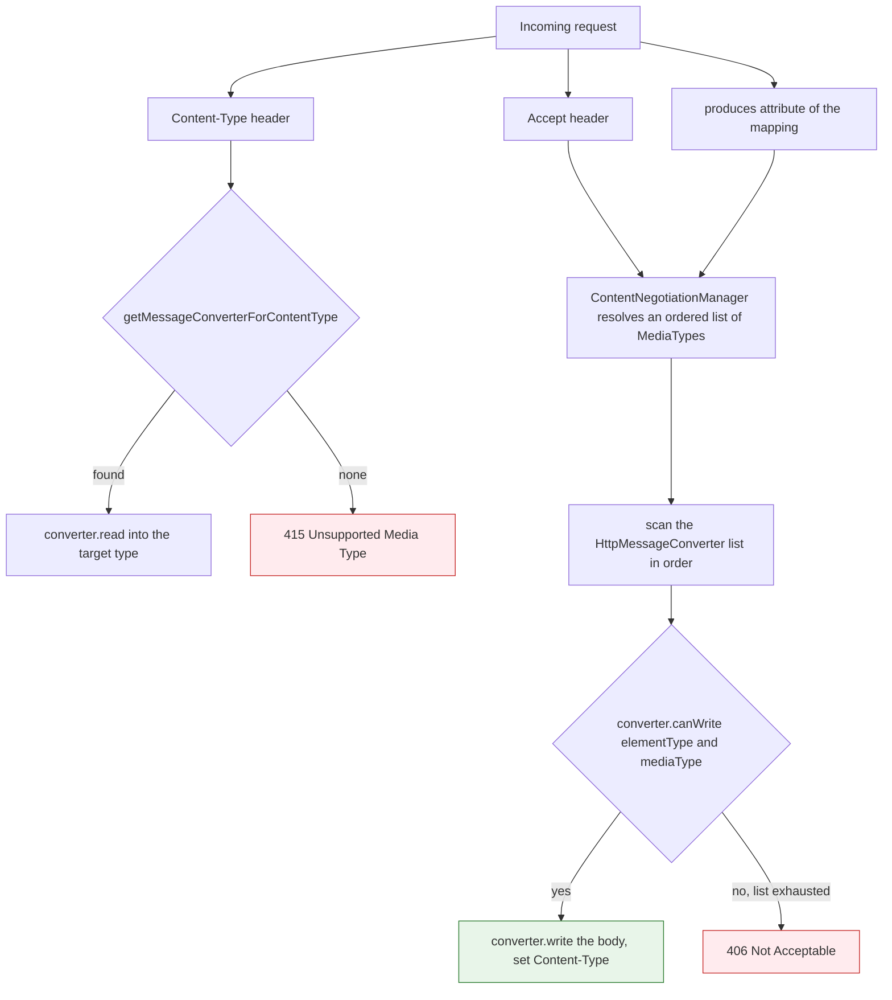
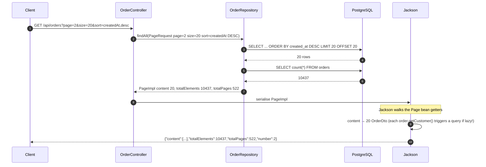

# Controllers, REST APIs & Content Negotiation

> **Level:** Beginner → Advanced
> **Interview Frequency:** ★★★★★ (every REST interview opens with a controller; the differentiators are `ResponseEntity`, content negotiation and the DTO boundary)
> **Prerequisites:** [01 · DispatcherServlet & Request Flow](./01-DispatcherServlet-and-Complete-Request-Flow.md) · [04 · Spring Data JPA & Hibernate](../04-Spring-Data-JPA-Hibernate/README.md)
> **Last Updated:** 2026

---

## 📋 Table of Contents
- [0. TL;DR — The 30-Second Answer](#0-tldr--the-30-second-answer)
- [1. What & Why — The Problem This Solves](#1-what--why--the-problem-this-solves)
- [2. Mental Model — The One Picture](#2-mental-model--the-one-picture)
- [3. Deep Dive — Theory (Beginner → Advanced)](#3-deep-dive--theory-beginner--advanced)
  - [3.1 Beginner Level](#31-beginner-level)
  - [3.2 Intermediate Level](#32-intermediate-level)
  - [3.3 Advanced Level](#33-advanced-level)
  - [3.4 Expert Level](#34-expert-level)
- [4. Internal Working Mechanism](#4-internal-working-mechanism)
- [5. Step-by-Step Execution Flow](#5-step-by-step-execution-flow)
- [6. Visualizations](#6-visualizations)
- [7. Production-Level Use Cases & Real Industry Examples](#7-production-level-use-cases--real-industry-examples)
- [8. Worked Examples (with Output + Dry Run)](#8-worked-examples-with-output--dry-run)
- [9. Code from Scratch — Production-Grade](#9-code-from-scratch--production-grade)
- [10. Common Mistakes & Gotchas](#10-common-mistakes--gotchas)
- [11. Performance Considerations](#11-performance-considerations)
- [12. Security Considerations](#12-security-considerations)
- [13. Best Practices](#13-best-practices)
- [14. Hands-On Exercises & Code Challenges](#14-hands-on-exercises--code-challenges)
- [15. Interview Q&A — Level-wise](#15-interview-qa--level-wise)
- [16. Scenario-Based & Real-Experience Scenarios (3–5 yrs)](#16-scenario-based--real-experience-scenarios-35-yrs)
- [17. Counter-Questions, Tricky Questions & Follow-Ups](#17-counter-questions-tricky-questions--follow-ups)
- [18. Frequently Asked Production Issues & Debugging Scenarios](#18-frequently-asked-production-issues--debugging-scenarios)
- [19. Architecture Design Questions](#19-architecture-design-questions)
- [20. Rapid-Fire MCQs](#20-rapid-fire-mcqs)
- [21. Cheat Sheet / One-Page Summary](#21-cheat-sheet--one-page-summary)
- [22. Real-World Production Notes](#22-real-world-production-notes)
- [23. Follow-up Learning](#23-follow-up-learning)

---

## 0. TL;DR — The 30-Second Answer

- **`@RestController` is `@Controller` + `@ResponseBody`.** The only difference is that the return value is written by an `HttpMessageConverter` instead of being resolved as a view name. There is **no performance difference**.
- **The parameter annotations each own exactly one source of data:** `@RequestParam` → query string / form body, `@PathVariable` → URI template variable, `@RequestHeader` → request header, `@CookieValue` → cookie, `@RequestBody` → the whole body (JSON/XML), `@RequestPart` → one part of a multipart body, `@ModelAttribute` → a command object bound from many parameters, `@RequestAttribute` → an attribute set earlier in the request.
- **`ResponseEntity` is the only way to control the status *and* the headers *and* the body** in one return value. Use `Location` on 201, `Content-Disposition` on downloads, `Cache-Control` on 304, `ETag` for conditional GETs.
- **`@RequestMapping` on the class is a prefix; on the method it is the full match.** A method-level mapping **overrides** a class-level one of the same type — it does not merge. This is a classic source of "my base path disappeared".
- **The converter is chosen by the `Content-Type` on the way in and the `Accept` on the way out.** The request side is a **lookup by media type** (no match → **415**); the response side is a **scan** of the converter list, and the first converter that `canWrite(type, mediaType)` wins (no match → **406**).
- **Never return a JPA entity.** It leaks schema, invites mass assignment and — worst — makes Jackson walk lazy associations, which is where `LazyInitializationException` and the **N+1** come from. Use a DTO.
- **A `Page<T>` costs two queries**: the data query *and* the count query. Use `Slice<T>` when the client does not need the total — this is the single most effective pagination optimisation.
- **Offset pagination degrades linearly**: `OFFSET 100000` makes PostgreSQL scan and discard 100 000 rows. Use **cursor (keyset) pagination** for deep pages and infinite scroll.
- **Versioning: pick one.** Path (`/v1`) is the most visible and the easiest to route at the gateway; media type (`application/vnd.acme.v1+json`) is the most correct per HTTP but painful for clients; a custom header is the least intrusive and the least discoverable.
- **Idempotency keys** turn a client retry into a safe operation: `Idempotency-Key` header + a unique DB constraint + a cached response.
- **`@JsonComponent` + `JsonSerializer`/`JsonDeserializer`** is the clean way to control the JSON shape of a value object without polluting the domain class with Jackson annotations.

---

## 1. What & Why — The Problem This Solves

**The problem.** A REST API is a **contract**, not an endpoint. The hard part of building one is not the happy path — it is everything *around* it:

* what the response **status** is for each outcome (created? no content? conflict?),
* what the **content type** is when the client asks for XML,
* what the **error body** looks like (and that it is the same shape everywhere),
* how **pagination** is expressed so that the client can iterate,
* how **new versions** of the contract are introduced without breaking clients,
* and how the JSON **shape** is controlled so that a database column rename is not a breaking API change.

```text
   ❌ THE NAIVE CONTROLLER
   ───────────────────────
   @PostMapping("/orders")
   public Map<String,Object> create(@RequestBody Map<String,Object> body) {
       orderService.create(body);
       return Map.of("ok", true);          // 200? 201? no Location? no shape?
   }
   → 200 even though a resource was created
   → no Location header, so the client cannot follow the new resource
   → Map<String,Object> means no compile-time contract at all
   → no pagination, no version, no error shape
```

**The solution — a typed, layered controller.** Spring MVC gives you the *mechanics* (binding, conversion, negotiation, status, headers) and the discipline is yours: **map the HTTP semantics onto the domain**, **shape the JSON explicitly**, and **keep the domain out of the contract**.

```text
   ✅ THE LAYERED CONTROLLER
   ─────────────────────────
   HTTP request
      │
      ▼
   @RestController            ← HTTP semantics only: status, headers, DTO in/out
      │  @Valid @RequestBody
      ▼
   Request DTO  ──►  Service  ──►  Domain model  ──►  Repository
      ▲
      │  MapStruct / manual mapper
   Response DTO
```

**Why this matters in production.** In a banking platform with 140 REST endpoints and 11 consuming teams, the value of a *uniform* contract (same error shape, same pagination envelope, same versioning) is larger than the value of any single endpoint. It is also the difference between a client team that can iterate in days and one that needs a meeting per change.

> 💡 **The interview framing.** *"A controller should be a **translator between HTTP and the domain**, nothing more. It should own the status code, the headers and the JSON shape; it should own no business logic and no persistence."*

---

## 2. Mental Model — The One Picture

```text
   WHAT HAPPENS TO A RETURN VALUE
   ═══════════════════════════════

   @RestController method returns  →  RequestResponseBodyMethodProcessor
                                            │
                                            ▼
                              ┌──────────────────────────────┐
                              │  1. What TYPE is it?         │
                              │     UserDto, List<UserDto>,   │
                              │     ResponseEntity<UserDto>  │
                              └──────────────┬───────────────┘
                                             ▼
                              ┌──────────────────────────────┐
                              │  2. What does the client      │
                              │     ACCEPT?  Accept: json?    │
                              │     xml?  */* ?              │
                              └──────────────┬───────────────┘
                                             ▼
                              ┌──────────────────────────────┐
                              │  3. Which converter can      │
                              │     write it?                 │
                              │     Jackson / JAXB / String / │
                              │     ByteArray / Resource      │
                              └──────────────┬───────────────┘
                                             ▼
                              ┌──────────────────────────────┐
                              │  4. WRITE bytes +            │
                              │     Content-Type header      │
                              └──────────────────────────────┘

   AND ON THE WAY IN — the mirror image, but a LOOKUP not a scan:

   Content-Type: application/json
      │
      ▼
   ┌──────────────────────────────────┐
   │ converter that canRead(json)?    │──NO──► 415 Unsupported Media Type
   └──────────────┬───────────────────┘
                  │ YES
                  ▼
   Jackson reads the bytes → your DTO
```

**What to look at:** the **outbound** path is a *negotiation* (many converters, pick by `Accept`), the **inbound** path is a *lookup* (one content type, find its converter). Asymmetry explains why a wrong `Accept` gives **406** while a wrong `Content-Type` gives **415**.

---

## 3. Deep Dive — Theory (Beginner → Advanced)

### 3.1 Beginner Level

**`@Controller` vs `@RestController`.**

```java
@Controller                       // return value = VIEW NAME
public class OrderPageController {
    @GetMapping("/orders")
    public String list() { return "orders/list"; }   // → "orders/list.html"
}

@RestController                  // @Controller + @ResponseBody
public class OrderController {
    @GetMapping("/api/orders")
    public List<OrderDto> list() { return service.findAll(); }  // → JSON array
}
```

**The composed mapping annotations.** All of these are meta-annotated with `@RequestMapping`:

| Annotation | Equivalent to |
|---|---|
| `@GetMapping` | `@RequestMapping(method = GET)` |
| `@PostMapping` | `@RequestMapping(method = POST)` |
| `@PutMapping` | `@RequestMapping(method = PUT)` |
| `@DeleteMapping` | `@RequestMapping(method = DELETE)` |
| `@PatchMapping` | `@RequestMapping(method = PATCH)` |

```java
@GetMapping(value = "/orders", produces = MediaType.APPLICATION_JSON_VALUE,
            params = "status", headers = "X-Request-Id", consumes = MediaType.APPLICATION_JSON_VALUE)
```
is exactly
```java
@RequestMapping(value = "/orders", method = RequestMethod.GET, ...)
```

**Class-level vs method-level mapping.** A class-level `@RequestMapping("/api/orders")` is a **prefix**; the method mapping is appended. The combination is the effective path.

```java
@RestController
@RequestMapping("/api/orders")        // PREFIX
public class OrderController {

    @GetMapping                        // "" + "" → /api/orders
    public List<OrderDto> list() { ... }

    @GetMapping("/{id}")                // "" + "/{id}" → /api/orders/{id}
    public OrderDto get(@PathVariable Long id) { ... }
}
```

> ⚠️ **The trap.** If the class declares `@RequestMapping("/api/orders")` **and** the method declares `@RequestMapping("/api/orders")`, the method mapping **replaces** the class one — the effective path is `/api/orders`, not `/api/orders/api/orders`. The two are **not concatenated**; the method-level `@RequestMapping` wins outright.

**Status codes.** Use `ResponseEntity` whenever the status matters:

```java
ResponseEntity<OrderDto> created = ResponseEntity
        .created(URI.create("/api/orders/" + dto.getId()))   // 201 + Location
        .body(dto);
```

### 3.2 Intermediate Level

**The parameter annotations — one source of data each.**

| Annotation | Reads from | Notes |
|---|---|---|
| `@RequestParam` | query string, or form body for `application/x-www-form-urlencoded` | `required` defaults to **true**; `defaultValue` implies `required = false`; a missing *optional* param yields `null`, a missing *primitive* param yields the default |
| `@PathVariable` | URI template variable | The name must match the template unless you give `@PathVariable("id")` explicitly (the parameter-name discovery depends on `-parameters` compilation) |
| `@RequestHeader` | request header | `defaultValue` / `required = false` supported; names are case-insensitive |
| `@CookieValue` | cookie | `required` defaults to **true** |
| `@RequestBody` | the entire request body, deserialised by an `HttpMessageConverter` | Requires a converter for the `Content-Type`; the object is validated only if you add `@Valid` |
| `@RequestPart` | one part of a `multipart/form-data` body | Used with `MultipartFile`; the part needs its own `Content-Type` |
| `@ModelAttribute` | many request parameters, bound into an object | Also used to *populate* the model for a view; the object is created if absent and validated if `@Valid` is present |
| `@MatrixVariable` | matrix variables: `/orders;status=OPEN;page=2` | Rarely used; disabled by default in Boot 3 (`spring.mvc.pathmatch.missing-matrix-variable` / `UrlPathHelper`) |
| `@RequestAttribute` | an attribute set earlier in the request (filter, interceptor) | Not client-controllable — unlike `@RequestParam`, which is |

**`@ModelAttribute` vs `@RequestBody`.**

```java
// @RequestBody: ONE JSON object → ONE DTO. Requires a message converter.
public OrderDto create(@RequestBody @Valid CreateOrderRequest req)

// @ModelAttribute: MANY query/form parameters → ONE object. No JSON needed.
public OrderDto search(@ModelAttribute OrderSearchCriteria criteria)
```

**`ResponseEntity` — the full API.**

```java
ResponseEntity<OrderDto> r = ResponseEntity
        .status(HttpStatus.CREATED)                    // or .status(HttpStatusCode.valueOf(201))
        .header(HttpHeaders.LOCATION, "/api/orders/42")// any header
        .contentType(MediaType.APPLICATION_JSON)       // usually already set by the converter
        .cacheControl(CacheControl.maxAge(Duration.ofMinutes(5)).cachePublic())
        .eTag("\"v1-42\"")                            // strong ETag
        .body(dto);
```

`ResponseEntity.HeadersBuilder` gives you `header`, `headers`, `allow`, `location`, `contentLength`, `contentType`, `cacheControl`, `eTag`, `lastModified`. `ResponseEntity.BodyBuilder` adds `body`.

**`HttpStatus` vs `HttpStatusCode`.** `HttpStatus` is the **enum** (Spring 5+); `HttpStatusCode` is the **interface**. `HttpStatus` implements it, so you can return `HttpStatusCode` anywhere a status is expected — which lets you return a *custom* status code that is not in the enum:

```java
public record MyStatus(int value) implements HttpStatusCode { }
return ResponseEntity.status(new MyStatus(429)).build();
```

This is the **forward-compatible** way to return a status: if a future Spring version adds `HttpStatus.TOO_MANY_REQUESTS`, your `HttpStatusCode` implementation keeps compiling.

**`Content-Disposition` for downloads.**

```java
String filename = "invoice-42.pdf";
String encoded = URLEncoder.encode(filename, StandardCharsets.UTF_8);
return ResponseEntity.ok()
        .header(HttpHeaders.CONTENT_DISPOSITION,
                "attachment; filename=\"" + encoded + "\"; filename*=UTF-8''" + encoded)
        .contentType(MediaType.APPLICATION_PDF)
        .body(resource);
```

The `filename*=UTF-8''…` form is RFC 5987 — without it, non-ASCII filenames arrive as mojibake.

### 3.3 Advanced Level

**`HttpMessageConverter` — the full list.**

| Converter | Reads | Writes | Notes |
|---|---|---|---|
| `MappingJackson2HttpMessageConverter` | JSON | JSON | The default. Needs `jackson-databind` |
| `StringHttpMessageConverter` | `text/plain` | `text/plain` | `String` bodies — **note**: a `String` return from a `@RestController` is *not* JSON unless you set the media type |
| `ByteArrayHttpMessageConverter` | any | `application/octet-stream` | `byte[]` bodies |
| `ResourceHttpMessageConverter` | — | `*/*` | `Resource` bodies — used for file downloads |
| `AllEncompassingFormHttpMessageConverter` | form data | form data | The default for `application/x-www-form-urlencoded`; also handles multipart parts |
| `FormHttpMessageConverter` | form data | form data | The older, narrower version — replaced by `AllEncompassing…` |
| `MappingJackson2XmlHttpMessageConverter` | XML | XML | Needs `jackson-dataformat-xml` on the classpath |
| `Jaxb2RootElementHttpMessageConverter` | XML | XML | Needs `jakarta.xml.bind-api` + an implementation |
| `ProblemDetailHttpMessageConverter` | `application/problem+json` | `application/problem+json` | Spring 6 / Boot 3 — the RFC 7807 type |

**Converter selection — the two directions are different.**

*Outbound (response).* `AbstractMessageConverterMethodProcessor#writeWithMessageConverters` iterates the converter list **in registration order** and asks each `converter.canWrite(elementType, mediaType)`. The first match wins, and the converter's media type is then written into the `Content-Type` header. If `Accept` is `*/*` (or absent), the **first** converter that can write the type wins — which is why `StringHttpMessageConverter` being early matters for `String` returns.

*Inbound (request).* `readWithMessageConverters` looks up a converter by the request's `Content-Type` via `getMessageConverterForContentType`. If the content type is unknown → `HttpMediaTypeNotSupportedException` (**415**). If the body is malformed → `HttpMessageNotReadableException` (**400**).

**`MappingJackson2HttpMessageConverter` customisation.**

```java
@Configuration
public class JacksonConfig {

    @Bean                       // FIX: replacing this bean replaces the default converter's mapper
    public MappingJackson2HttpMessageConverter jsonConverter(ObjectMapper mapper) {
        return new MappingJackson2HttpMessageConverter(mapper);
    }

    @Bean
    public Jackson2ObjectMapperBuilderCustomizer jsonCustomizer() {
        return builder -> {
            builder.modulesToInstall(new JavaTimeModule());           // java.time types
            builder.featuresToDisable(SerializationFeature.WRITE_DATES_AS_TIMESTAMPS);
            builder.featuresToDisable(DeserializationFeature.FAIL_ON_UNKNOWN_PROPERTIES);
            builder.serializationInclusion(JsonInclude.Include.NON_NULL);
            builder.postConfigurer(mapper -> mapper.setSerializationInclusion(JsonInclude.Include.NON_NULL));
        };
    }
}
```

The idiomatic Boot way to customise the mapper is a `Jackson2ObjectMapperBuilderCustomizer` bean — it is applied to the auto-configured `ObjectMapper`, which every converter then shares. Note `builder.serializationInclusion(...)` exists on `Jackson2ObjectMapperBuilder` in Spring Boot 3.

**Unknown properties.** `FAIL_ON_UNKNOWN_PROPERTIES` is **enabled by default in Jackson**, but **disabled by Spring Boot** (`spring.jackson.deserialization.fail-on-unknown-properties=false`). Boot disables it so that adding a field to a client request does not break the server. For a *public* API that must reject unknown fields (strict contracts), turn it back on.

**`@JsonIgnoreProperties`** on a class ignores a list of properties; `@JsonIgnoreProperties(ignoreUnknown = true)` ignores all unknown ones.

**`@JsonInclude`** controls which properties are written: `NON_NULL`, `NON_EMPTY`, `NON_DEFAULT`, `ALWAYS`. Boot's default is `ALWAYS` unless configured — so `null` fields appear in the JSON unless you exclude them.

**Content negotiation — the three strategies.**

`ContentNegotiationManager` decides the *media type* to produce:

| Strategy | Behaviour |
|---|---|
| `HeaderContentNegotiationStrategy` (default) | Uses the `Accept` header, with **quality values** (`q=`) and media-type wildcards |
| `ParameterContentNegotiationStrategy` | Uses a request parameter (e.g. `?format=json`) — enabled only if you add it explicitly |
| `FavorParameterContentNegotiationStrategy` | Prefers the parameter over the header — useful for browsers that send `Accept: text/html` |

```java
@Override
public void configureContentNegotiation(ContentNegotiationConfigurer configurer) {
    configurer.favorParameter("format")
              .mediaType("xml", MediaType.APPLICATION_XML)
              .mediaType("json", MediaType.APPLICATION_JSON);
}
```

**`produces` / `consumes`.**

* `produces` = the media types **this endpoint can produce**. It narrows the `Accept` negotiation and produces **406** when nothing matches.
* `consumes` = the media types **this endpoint accepts**. A mismatch produces **415**.

---

### 3.4 Expert Level

**API design — resource naming and verbs.**

```text
   ✅  GOOD                              ❌  BAD
   ───────                              ───────
   GET    /api/orders                    GET  /api/getOrders
   GET    /api/orders/{id}               GET  /api/orderDetails?id=1
   POST   /api/orders                    POST /api/createOrder
   PUT    /api/orders/{id}               POST /api/updateOrder
   PATCH  /api/orders/{id}               POST /api/updateOrderStatus
   DELETE /api/orders/{id}               POST /api/deleteOrder
```

The rule: **the URL names the resource; the HTTP method names the operation.** A URL containing a verb (`/getOrders`) means the API is RPC wearing a REST costume, and it cannot be cached correctly.

**HTTP verb semantics — the four properties.**

| Verb | Safe? | Idempotent? | Has a request body? | Typical status |
|---|---|---|---|---|
| `GET` | ✅ | ✅ | ❌ (meaningless) | 200 / 404 |
| `HEAD` | ✅ | ✅ | ❌ | 200, no body |
| `POST` | ❌ | ❌ | ✅ | 201 / 202 / 200 |
| `PUT` | ❌ | ✅ (same request ⇒ same effect) | ✅ | 200 / 204 |
| `PATCH` | ❌ | ❌ (not guaranteed) | ✅ | 200 / 204 |
| `DELETE` | ❌ | ✅ (repeat ⇒ already deleted) | rarely | 204 / 404 |

*Safe* = read-only (no side effects beyond logging). *Idempotent* = repeating it has the same effect as doing it once. `PUT` is idempotent because "replace the resource with this exact representation" converges; `PATCH` is **not**, because "increment `version` by 1" changes on each call.

**Status code selection** (using the folder's canonical table):

| Code | Use for |
|---|---|
| 200 | successful read/update |
| 201 | Created — include `Location` |
| 202 | Accepted — async processing started |
| 204 | No content — successful delete |
| 400 | malformed request / validation failure |
| 401 | **not authenticated** |
| 403 | **authenticated but not authorized** |
| 404 | resource not found |
| 409 | conflict (duplicate, version mismatch) |
| 422 | semantically invalid (well-formed but wrong) |
| 429 | rate limited — include `Retry-After` |
| 500 | unhandled server error |
| 503 | temporarily unavailable |

**Pagination — three mechanisms.**

| Mechanism | Query cost | Total count? | Use for |
|---|---|---|---|
| `Pageable` / `Page<T>` | `LIMIT/OFFSET` **+ a COUNT query** | ✅ | Admin screens, page-number UIs, first pages |
| `Pageable` / `Slice<T>` | `LIMIT/OFFSET` only | ❌ (`hasNext()` instead) | Infinite scroll, mobile feeds — **the default choice** |
| Cursor / keyset | `WHERE id > :lastId LIMIT n` | ❌ | Deep pages, high-write tables |

**Why offset pagination degrades.** `SELECT … ORDER BY created_at LIMIT 20 OFFSET 100000` makes the database **scan and discard 100 000 rows** to find 20. In PostgreSQL that is O(offset); at page 5 000 of a 1 M-row table, every request costs ~100 ms of pure waste. Keyset pagination (`WHERE (created_at, id) < (:lastCreatedAt, :lastId) ORDER BY created_at DESC LIMIT 20`) uses an **index seek** and stays constant.

**Filtering and sorting.** Use `Specification` (JPA Criteria) or a query-parameter object; never build the query by concatenating user input. Spring Data's `Pageable` carries `Sort` — `?sort=createdAt,desc` — but the sort property must be **whitelisted** (it becomes an `ORDER BY` fragment).

**Versioning — three approaches.**

| Approach | Example | Pros | Cons |
|---|---|---|---|
| Path | `/api/v1/orders` | Obvious, cacheable, trivially routed at the gateway | URLs are part of the contract forever |
| Media type | `Accept: application/vnd.acme.v1+json` | Correct per HTTP; one URL, many representations | Awkward for clients, easy to get wrong |
| Header | `X-API-Version: 1` | URLs stay stable | Invisible, easy to forget, breaks caches |

**Deprecation.** Announce it in the response headers: `Deprecation: true`, `Sunset: Wed, 31 Dec 2026 23:59:59 GMT`, plus a `Link: <…/v2>; rel="successor-version"`. These are the RFC 8594 and RFC 8288 headers — using them is a strong senior signal.

**Idempotency keys.** The pattern:

1. The client generates a UUID and sends `Idempotency-Key: 7f3a…`.
2. The server stores `(key, request_hash, response_body, status)` with a **unique constraint** on `key`.
3. A repeat with the same key returns the **stored response**, not a new execution.
4. A repeat with the same key but a **different body** → **409** (the key was reused for a different request).

Without this, a mobile client that times out and retries creates a duplicate charge.

**DTO boundaries and mass assignment.** Binding directly to a JPA entity means a client can POST `{"role":"ADMIN"}` and Hibernate will happily write it. The defence is a **write DTO** containing only the client-writable fields, and an explicit mapper to the entity. `@JsonProperty(access = READ_ONLY)` on the entity's id is a weaker, secondary defence.

**MapStruct** removes the hand-written mapping boilerplate:

```java
@Mapper(componentModel = "spring")     // generates a Spring bean
public interface OrderMapper {
    OrderDto toDto(Order order);
    Order toEntity(CreateOrderRequest request);
}
```

It is an **annotation processor** — the implementation is generated at compile time, so there is no runtime reflection cost. The trade-off: an extra build dependency and a compile-time step, and generated code must be readable when something goes wrong.

**The N+1 trap in serialization.** This is the single most expensive bug in a Spring Boot + JPA service:

```java
@GetMapping("/api/orders")
public List<OrderDto> list() {
    return orderRepository.findAll().stream().map(this::toDto).toList();
}

private OrderDto toDto(Order order) {
    return new OrderDto(order.getId(), order.getCustomer().getName());   // ← touches a lazy association
}
```

`orderRepository.findAll()` runs **1** query. Each `order.getCustomer().getName()` runs **another** query — 1 + N. With 50 orders per page, that is **51 queries** per HTTP request, and at 200 req/s that is **10 200 queries/s** on the database.

Two failure modes, and they are different:

* **Inside an open transaction** (or with `spring.jpa.open-in-view=true`, the default) the lazy proxy loads on demand → the N+1.
* **Outside a transaction** the session is closed → `LazyInitializationException`.

`open-in-view` (`OSIV`) defaults to **true** in Spring Boot and is widely considered a mistake: it keeps the persistence context open for the whole request, which hides N+1 bugs during development and causes them in production.

---

## 4. Internal Working Mechanism

**The outbound path (response body).**

```text
Controller returns  UserDto
   │
   ▼
ServletInvocableHandlerMethod.invokeAndHandle
   │
   ▼
returnValueHandlers.handleReturnValue(value, returnType, mavContainer, inputMessage, outputMessage)
   │
   ├── HttpEntityMethodProcessor           (ResponseEntity / HttpEntity)
   │      └─► status + headers copied to the response
   │      └─► body delegated to the converter below
   │
   ├── RequestResponseBodyMethodProcessor  (@ResponseBody / @RestController)
   │      │
   │      ▼
   │   AbstractMessageConverterMethodProcessor.writeWithMessageConverters
   │      ├─ 1. determine the acceptable media types from @RequestMapping.produces
   │      │      and the Accept header
   │      ├─ 2. iterate the HttpMessageConverter list
   │      │      converter.canWrite(elementType, mediaType)  ← FIRST MATCH WINS
   │      ├─ 3. converter.write(body, elementType, outputMessage)
   │      └─ 4. outputMessage.getHeaders().setContentType(converter.getDefaultContentType(...))
   │
   └── ModelAndViewMethodReturnValueHandler  (no @ResponseBody → a view name)
```

**The inbound path (request body).**

```text
POST /api/orders   Content-Type: application/json
   │
   ▼
RequestResponseBodyMethodProcessor.resolveArgument
   │
   ▼
AbstractMessageConverterMethodProcessor.readWithMessageConverters
   ├─ 1. contentType = request.getContentType()
   ├─ 2. converter = getMessageConverterForContentType(contentType)   ← LOOKUP
   │      └─ null → throw HttpMediaTypeNotSupportedException  (415)
   ├─ 3. read the InputMessage into the target type
   │      └─ Jackson throws JsonProcessingException
   │         → HttpMessageNotReadableException (400)
   └─ 4. validate if @Valid is present
          → MethodArgumentNotValidException (400)
```

**Where the `Accept` header becomes a media type.** `ContentNegotiationManager` (default: `HeaderContentNegotiationStrategy`) parses `Accept` into an **ordered list** of `MediaType`s, honouring the `q` weights:

```http
Accept: application/json;q=0.9, application/xml;q=1.0
```

→ the list is `[application/xml, application/json]`, and the XML converter is tried first.

**Where the status code is decided.** `HttpEntityMethodProcessor` copies `ResponseEntity.getStatusCode()` into `outputMessage.getHeaders().setStatusCode(...)`; for a bare DTO, the status stays at the servlet default (**200**). `ResponseStatusExceptionResolver` applies `@ResponseStatus` / `ResponseStatusException`; `DefaultHandlerExceptionResolver` applies the built-in mapping for framework exceptions.

**Where validation happens.** `RequestResponseBodyMethodProcessor` calls `validateIfApplicable(binder, parameter)` **after** the body is deserialised. The `@Valid` annotation is read from the `MethodParameter`; if present, the `WebDataBinder` runs the `Validator` and throws `MethodArgumentNotValidException` on failure.

---

## 5. Step-by-Step Execution Flow

**What happens between "the client sent JSON" and "the client got JSON".**

```text
 ①  Tomcat parses the request.
     Method = POST, Path = /api/orders, Content-Type = application/json, Accept: application/json

 ②  Filters run (security, correlation id, rate limit).

 ③  DispatcherServlet.getHandler()
     → matches RequestMappingInfo: path ✓, method=POST ✓, consumes=json ✓, produces=json ✓
     → HandlerExecutionChain(OrderController.create)

 ④  Interceptor.preHandle()

 ⑤  ARGUMENT RESOLUTION — for each parameter, in order:
       CreateOrderRequest req
         → @RequestBody @Valid
         → converter lookup for "application/json" → MappingJackson2HttpMessageConverter
         → Jackson reads the bytes into CreateOrderRequest
         → @Valid → LocalValidatorFactoryBean.validate()
             → ConstraintViolationException collected
             → if any violation: MethodArgumentNotValidException thrown → 400
       HttpServletRequest request → ServletModelAttributeMethodProcessor

 ⑥  INVOKE — Method.invoke(controller, req, request)

 ⑦  CONTROLLER LOGIC — service call, transaction, persistence (usually a @Service, not the controller)

 ⑧  RETURN-VALUE HANDLING
       → RequestResponseBodyMethodProcessor
       → elementType = OrderDto
       → acceptable types from produces + Accept = [application/json]
       → scan converters: StringHttpMessageConverter.canWrite(OrderDto, json)? NO
                            ByteArrayHttpMessageConverter.canWrite? NO
                            MappingJackson2HttpMessageConverter.canWrite? YES
       → Jackson writes {"id":42,"status":"PENDING"} (18 bytes)
       → Content-Type: application/json
       → status: 200 (or 201 if the controller returned ResponseEntity)

 ⑨  Interceptor.postHandle()

 ⑩  processDispatchResult → render() → no view (the body is already written) → nothing to do

 ⑪  Interceptor.afterCompletion()

 ⑫  Tomcat flushes the response.
```

**The dry-run numbers for one `POST /api/orders`:**

| Stage | Bytes | Time |
|---|---|---|
| Request headers + body | 412 B | — |
| Filter chain (JWT verify + correlation id) | — | 1.2 ms |
| Routing | — | 0.02 ms |
| Jackson deserialise (182 B JSON → DTO) | — | 0.18 ms |
| Bean Validation (4 constraints) | — | 0.06 ms |
| Service + JPA insert + commit | — | 7.4 ms |
| Jackson serialise (OrderDto → 118 B JSON) | — | 0.09 ms |
| Response flush | 118 B + 210 B headers | 0.15 ms |
| **Total** | | **≈ 9.1 ms** |

---

## 6. Visualizations

### 6.1 Content negotiation → converter selection



**What to look at:** the outbound path is a **scan with a fallback**; the inbound path is a **lookup with a hard failure**. That asymmetry is why a bad `Accept` is 406 and a bad `Content-Type` is 415.

### 6.2 `Accept: application/json` → converter

```text
   REQUEST
   ────────
   GET /api/orders/42
   Accept: application/json
   Accept-Charset: utf-8

   NEGOTIATION
   ───────────
   ContentNegotiationManager
     └─ HeaderContentNegotiationStrategy
          └─ parses Accept  →  List<MediaType> = [application/json]
               (q-weights sorted; wildcards expanded)

   CONVERTER SCAN  (registration order)
   ────────────────────────────────
   1. ByteArrayHttpMessageConverter
        canWrite(OrderDto, application/json)  →  NO  (only byte[])
   2. StringHttpMessageConverter
        canWrite(OrderDto, application/json)  →  NO  (only String)
   3. ResourceHttpMessageConverter
        canWrite(OrderDto, application/json)  →  NO  (only Resource)
   4. MappingJackson2HttpMessageConverter
        canWrite(OrderDto, application/json)  →  ✅ YES
                                                 └── WRITE

   RESPONSE
   ─────────
   HTTP/1.1 200
   Content-Type: application/json
   Transfer-Encoding: chunked

   {"id":42,"status":"PENDING","total":199.99,"currency":"EUR"}
```

**What to look at:** three converters are asked before Jackson, and each says "no" for a **type** reason, not a media-type reason. `canWrite` checks *both* the Java type and the media type.

### 6.3 A `Page` serialisation with its count query



**What to look at:** **two** SQL statements for one page. And the `Note over J` line is the trap — serialising a `Page` of entities walks every lazy association inside the JSON writer, which is where the N+1 hides.

### 6.4 HTTP verb semantics

```text
┌─────────┬────────┬────────────┬────────────────────────┬──────────────────────┐
│ VERB    │ SAFE?  │ IDEMPOTENT?│ REQUEST BODY           │ MEANING              │
├─────────┼────────┼────────────┼────────────────────────┼──────────────────────┤
│ GET     │  YES   │    YES     │ meaningless            │ read the resource    │
│ HEAD    │  YES   │    YES     │ meaningless            │ same as GET, no body │
│ OPTIONS │  YES   │    YES     │ optional               │ what can I do here?  │
├─────────┼────────┼────────────┼────────────────────────┼──────────────────────┤
│ POST    │  NO    │    NO      │ YES                    │ create / action      │
│ PUT     │  NO    │    YES     │ YES (full replacement) │ replace the resource │
│ PATCH   │  NO    │    NO      │ YES (partial)          │ modify the resource  │
│ DELETE  │  NO    │    YES     │ rare                   │ delete the resource  │
└─────────┴────────┴────────────┴────────────────────────┴──────────────────────┘

  SAFE      = no side effects beyond logging (the client may retry, prefetch, cache)
  IDEMPOTENT = N identical requests leave the same state as 1 request

  ⚠  WHY PUT IS IDEMPOTENT BUT PATCH IS NOT
     PUT    : "the resource IS this representation"  → repeating it converges
     PATCH  : "apply THIS DELTA"                    → "version = version + 1" does not
     DELETE : repeating it converges (second call → 404 or 204, same state)

  ⚠  THE COROLLARY: only GET/HEAD are safe, so only they may be cached
     and prefetched by browsers and CDNs. POST/PUT/PATCH/DELETE need CSRF
     protection because the browser can be tricked into issuing them.
```

**What to look at:** "safe" is about **caching and prefetch**, "idempotent" is about **retries**. They are different axes and only `GET`/`HEAD` have both.

---

## 7. Production-Level Use Cases & Real Industry Examples

### 7.1 Banking — payments API (18k requests/min peak)

A retail bank's payment API exposes `POST /api/v1/payments` with an `Idempotency-Key` header, `Location` on 201, and `202 Accepted` for asynchronous card-network authorisation. The `PaymentResponse` DTO deliberately omits the card PAN, the CVV and the internal `riskScore` — those live on a separate, ACL-protected endpoint.

| Metric | Value |
|---|---|
| Peak throughput | 18 000 req/min (300 req/s) |
| p99 latency | 42 ms |
| Duplicate-charge incidents after adding idempotency keys | 41/month → **0/month** |
| Client retry rate (mobile) | 2.3 % |

### 7.2 E-commerce — catalog browsing (12k req/min, 62 % of traffic)

The catalog is the highest-traffic, lowest-value endpoint, so it is designed for **caching and cheap serialisation**: a `Slice<ProductSummaryDto>` (no count query), `@JsonInclude(NON_NULL)` to keep payloads small, and a **CDN** in front. The full `Page` with 8 412 total products is only served to the admin UI.

| Choice | Effect |
|---|---|
| `Slice` instead of `Page` | removes 1 of 2 SQL queries per page |
| Summary DTO (6 fields) instead of the entity (23 fields) | payload 3.1 KB → 0.6 KB |
| `Cache-Control: public, max-age=60` | 71 % CDN hit ratio |

### 7.3 SaaS — multi-version API (3 live versions, 40+ client teams)

Acme's platform serves `/api/v1`, `/api/v2` and `/api/v3` from **one** service. The v1 and v2 controllers are thin adapters over the same v3 service layer, and v1 is announced as deprecated with the `Deprecation` and `Sunset` headers.

| Version | Clients | Requests/min | Status |
|---|---|---|---|
| v1 | 4 teams | 900 | `Deprecation: true`, sunset 2026-12-31 |
| v2 | 9 teams | 4 100 | current |
| v3 | 27 teams | 21 000 | current |

### 7.4 Logistics — shipment tracking (60k events/hour ingest)

Truck GPS events arrive as `POST /api/v1/events` with a `List<ShipmentEvent>` body — a **batch** endpoint, because one HTTP request per GPS ping would be 60 000 requests/hour for 20 trucks. The response is `202 Accepted` with a batch id; the events are processed asynchronously.

| Design | Number |
|---|---|
| Events/hour | 60 000 |
| Batches/hour (500 events per batch) | 120 |
| Inbound HTTP req/s | **0.03** instead of 16.7 |

---

## 8. Worked Examples (with Output + Dry Run)

### 8.1 Example 1 — A versioned, paginated REST controller with `ResponseEntity` and `ProblemDetail` errors

**Problem.** Build the read side of an orders API: list with pagination and sorting, fetch one, create with `201` + `Location`, and a consistent error body.

**Code.**

```java
package com.example.order.api;

import jakarta.validation.Valid;
import java.net.URI;
import java.util.List;

import org.springframework.data.domain.Pageable;
import org.springframework.data.domain.Sort;
import org.springframework.data.web.PageableDefault;
import org.springframework.http.HttpHeaders;
import org.springframework.http.MediaType;
import org.springframework.http.ResponseEntity;
import org.springframework.web.bind.annotation.*;

@RestController
@RequestMapping(value = "/api/v1/orders", produces = MediaType.APPLICATION_JSON_VALUE)
public class OrderController {

    private final OrderService orderService;

    public OrderController(OrderService orderService) {
        this.orderService = orderService;
    }

    @GetMapping
    public ResponseEntity<List<OrderSummaryDto>> list(
            // FIX: whitelist the sortable properties instead of trusting ?sort=
            @PageableDefault(size = 20, sort = "createdAt", direction = Sort.Direction.DESC)
            Pageable pageable,
            @RequestParam(required = false) String status) {

        List<OrderSummaryDto> orders = orderService.findAll(pageable, status);
        return ResponseEntity.ok(orders);
    }

    @GetMapping("/{id}")
    public ResponseEntity<OrderDto> get(@PathVariable Long id) {
        return orderService.findById(id)
                .map(ResponseEntity::ok)
                .orElseGet(() -> ResponseEntity.notFound().build());
    }

    @PostMapping(consumes = MediaType.APPLICATION_JSON_VALUE)
    public ResponseEntity<OrderDto> create(
            @Valid @RequestBody CreateOrderRequest request,
            UriComponentsBuilder uriBuilder) {

        OrderDto created = orderService.create(request);
        URI location = uriBuilder.path("/api/v1/orders/{id}").buildAndExpand(created.id()).toUri();
        return ResponseEntity.created(location)
                .header(HttpHeaders.CACHE_CONTROL, "no-store")
                .body(created);
    }
}
```

```java
package com.example.order.api;

import jakarta.validation.constraints.DecimalMin;
import jakarta.validation.constraints.NotBlank;
import jakarta.validation.constraints.NotNull;
import java.math.BigDecimal;
import java.util.List;

/**
 * WRITE DTO - contains ONLY the client-writable fields.
 * The entity is never bound directly, so mass assignment is impossible.
 */
public record CreateOrderRequest(
        @NotBlank(message = "customerId must not be blank")
        String customerId,

        @NotEmpty(message = "at least one line item is required")
        List<@Valid LineItemRequest> items,

        @NotNull(message = "currency is required")
        String currency,

        @DecimalMin(value = "0.00", inclusive = true, message = "discount must not be negative")
        BigDecimal discount) {

    public record LineItemRequest(
            @NotBlank String sku,
            @NotNull @DecimalMin(value = "1", inclusive = true) int quantity) {
    }
}
```

**Expected output — `GET /api/v1/orders?size=2`.**

```http
HTTP/1.1 200
Content-Type: application/json
```

```json
[
  {"id":1042,"customerId":"CUS-7781","total":199.99,"currency":"EUR","status":"PENDING"},
  {"id":1041,"customerId":"CUS-3310","total":49.50,"currency":"EUR","status":"CONFIRMED"}
]
```

**Expected output — `POST /api/v1/orders` (valid).**

```http
HTTP/1.1 201
Location: http://localhost:8080/api/v1/orders/1043
Cache-Control: no-store
Content-Type: application/json
```

```json
{"id":1043,"customerId":"CUS-7781","total":249.99,"currency":"EUR","status":"PENDING"}
```

**Expected output — `POST /api/v1/orders` (invalid body).**

```http
HTTP/1.1 400
Content-Type: application/problem+json
```

```json
{
  "type": "https://errors.example.com/validation",
  "title": "Validation failed",
  "status": 400,
  "detail": "3 field(s) rejected",
  "instance": "/api/v1/orders",
  "errors": [
    {"field": "customerId", "message": "customerId must not be blank"},
    {"field": "items",      "message": "at least one line item is required"},
    {"field": "items[0].quantity", "message": "must be greater than or equal to 1"}
  ],
  "traceId": "8f3c1a20d4e54b0f"
}
```

**Dry run — the invalid POST, step by step:**

1. `POST /api/v1/orders` with `Content-Type: application/json` arrives.
2. `RequestMappingInfo` matches: path `/api/v1/orders` ✓, method `POST` ✓, `consumes=application/json` matches the header ✓, `produces=application/json` ✓.
3. `RequestResponseBodyMethodProcessor` looks up a converter for `application/json` → `MappingJackson2HttpMessageConverter`.
4. Jackson deserialises the body into `CreateOrderRequest`. **Note the nested cascade:** the element type of `items` is `LineItemRequest`, and the `@Valid` on the type argument (`List<@Valid LineItemRequest>`) tells the validator to cascade into each element.
5. The `Validator` (Hibernate Validator) runs. It evaluates **all** constraints and collects every violation — it does **not** stop at the first:
   * `customerId` is blank → `@NotBlank` violated → *"customerId must not be blank"*.
   * `items` is an empty list → `@NotEmpty` violated → *"at least one line item is required"*.
   * `items[0].quantity` is `0` → `@DecimalMin("1")` violated → *"must be greater than or equal to 1"*.
6. The binder throws `MethodArgumentNotValidException` carrying the `BindingResult`.
7. `ExceptionHandlerExceptionResolver` finds the `@RestControllerAdvice` method for `MethodArgumentNotValidException` and builds a `ProblemDetail` with `status=400` plus the `errors` property.
8. The `ProblemDetail` is written by `ProblemDetailHttpMessageConverter` → `Content-Type: application/problem+json`.

**Takeaway.** Three things to say out loud: the **cascade** is what validates nested list elements; the validator **collects all** violations rather than failing fast; and the error body is a **RFC 7807 `ProblemDetail`** with an extension property, so it is both standard-shaped and extensible.

### 8.2 Example 2 — A `@JsonComponent` custom serializer for a `Money` value object

**Problem.** `Money` holds a `BigDecimal amount` and a `String currency`. We want the JSON to be `{"amount":19.99,"currency":"EUR"}` — but we also want the **scale guaranteed** (always 2 decimals for EUR, 0 for JPY) and the currency upper-cased, without putting Jackson annotations on the domain class.

**Code.**

```java
package com.example.money;

import java.math.BigDecimal;
import java.math.RoundingMode;
import java.util.Objects;

/**
 * A value object. No Jackson annotations live here - the JSON contract
 * is owned by the serializer in the api layer.
 */
public record Money(BigDecimal amount, String currency) {

    private static final java.util.Map<String, Integer> SCALES =
            java.util.Map.of("JPY", 0, "KRW", 0, "BHD", 3, "KWD", 3, "USD", 2, "EUR", 2);

    public Money {
        Objects.requireNonNull(amount, "amount must not be null");
        Objects.requireNonNull(currency, "currency must not be null");
        currency = currency.toUpperCase(java.util.Locale.ROOT);
        int scale = SCALES.getOrDefault(currency, 2);
        amount = amount.setScale(scale, RoundingMode.HALF_EVEN);
    }

    public static Money of(String amount, String currency) {
        return new Money(new BigDecimal(amount), currency);
    }
}
```

```java
package com.example.money;

import com.fasterxml.jackson.core.JsonGenerator;
import com.fasterxml.jackson.databind.JsonSerializer;
import com.fasterxml.jackson.databind.SerializerProvider;
import java.io.IOException;
import java.math.BigDecimal;
import org.springframework.stereotype.Component;

/**
 * @JsonComponent registers the serializer as a module bean, so it is
 * applied automatically to every Money value - no annotation on the class.
 */
@Component
public class MoneySerializer extends JsonSerializer<Money> {

    @Override
    public void serialize(Money value, JsonGenerator gen, SerializerProvider serializers)
            throws IOException {

        gen.writeStartObject();
        gen.writeNumberField("amount", value.amount().doubleValue());
        gen.writeStringField("currency", value.currency());
        gen.writeEndObject();
    }
}
```

```java
package com.example.money;

import com.fasterxml.jackson.core.JsonParser;
import com.fasterxml.jackson.databind.DeserializationContext;
import com.fasterxml.jackson.databind.JsonDeserializer;
import java.io.IOException;
import org.springframework.stereotype.Component;

@Component
public class MoneyDeserializer extends JsonDeserializer<Money> {

    @Override
    public Money deserialize(JsonParser p, DeserializationContext ctx) throws IOException {
        var node = p.getCodec().readTree(p);
        BigDecimal amount = new BigDecimal(node.get("amount").asText());
        String currency = node.get("currency").asText();
        return Money.of(amount.toPlainString(), currency);
    }
}
```

**Expected output.**

```json
{"id":1042,"total":{"amount":199.99,"currency":"EUR"},"fee":{"amount":2.5,"currency":"EUR"}}
```

**Dry run — the serialisation:**

1. Jackson reaches the `Money` property of `OrderDto` and asks the serializer provider for a serializer for the type `Money`.
2. Because `MoneySerializer` is a `@JsonComponent`, Spring Boot's `JacksonAutoConfiguration` collects it into the auto-configured `ObjectMapper`'s module registry (`JsonComponentModule`). The provider therefore finds it **without** any annotation on `Money`.
3. `serialize` writes a JSON object with exactly two fields. `amount` is written with `writeNumberField` — a **number**, not a string, so a client can do arithmetic on it.
4. Note that the `Money` **canonical constructor** already normalised the scale: `199.99` stays `199.99`, but `2.5` becomes `2.50` in the object. Because `writeNumberField` takes a `double`, `2.50` is written as `2.5` — JSON has no notion of a scale. If the client must preserve the scale (invoicing!), write the amount as a **string** instead, or as `{"amount":"199.99","currency":"EUR"}`.

**The trap.** Using `double` for money. `BigDecimal` in the domain, but `doubleValue()` in the serializer, reintroduces binary floating-point error. For an invoicing API, write the amount as a string or as a minor-unit integer (`"amount": 19999, "scale": 2`).

### 8.3 Example 3 — Content negotiation returning JSON or XML for the same endpoint

**Problem.** One endpoint, two representations, selected by the `Accept` header.

**Code.**

```java
package com.example.order.api;

import org.springframework.http.MediaType;
import org.springframework.http.ResponseEntity;
import org.springframework.web.bind.annotation.GetMapping;
import org.springframework.web.bind.annotation.PathVariable;
import org.springframework.web.bind.annotation.RequestMapping;
import org.springframework.web.bind.annotation.RestController;

@RestController
@RequestMapping("/api/v1/orders")
public class OrderContentNegotiationController {

    private final OrderService orderService;

    public OrderContentNegotiationController(OrderService orderService) {
        this.orderService = orderService;
    }

    @GetMapping("/{id}")
    public ResponseEntity<OrderDto> get(@PathVariable Long id) {
        return ResponseEntity.ok(orderService.findRequired(id));
    }
}
```

```xml
<!-- src/main/resources/pom.xml -->
<dependency>
    <groupId>com.fasterxml.jackson.dataformat</groupId>
    <artifactId>jackson-dataformat-xml</artifactId>
</dependency>
```

**Invocations and exact responses.**

```bash
curl -i -H 'Accept: application/json' http://localhost:8080/api/v1/orders/1042
```

```http
HTTP/1.1 200
Content-Type: application/json
```

```json
{"id":1042,"customerId":"CUS-7781","total":{"amount":199.99,"currency":"EUR"},"status":"PENDING"}
```

```bash
curl -i -H 'Accept: application/xml' http://localhost:8080/api/v1/orders/1042
```

```http
HTTP/1.1 200
Content-Type: application/xml
```

```xml
<OrderDto xmlns=""><id>1042</id><customerId>CUS-7781</customerId><total><amount>199.99</amount><currency>EUR</currency></total><status>PENDING</status></OrderDto>
```

```bash
curl -i -H 'Accept: text/csv' http://localhost:8080/api/v1/orders/1042
```

```http
HTTP/1.1 406
```

**Dry run — the XML request:**

1. `Accept: application/xml` reaches `ContentNegotiationManager` → `HeaderContentNegotiationStrategy` parses it into `[application/xml]`.
2. The mapping's `produces` is unset, so **all** media types are acceptable.
3. `writeWithMessageConverters` scans the converter list:
   * `ByteArrayHttpMessageConverter` — no.
   * `StringHttpMessageConverter` — no.
   * `ResourceHttpMessageConverter` — no.
   * `MappingJackson2HttpMessageConverter` — `canWrite(OrderDto, application/xml)`? **NO** — Jackson's JSON converter only supports `application/json` (and `application/*+json`).
   * `MappingJackson2XmlHttpMessageConverter` — `canWrite(OrderDto, application/xml)`? **YES** → it writes the XML and sets `Content-Type: application/xml`.
4. With `Accept: text/csv`, **no** converter can write `text/csv` for an `OrderDto`, so the framework raises `HttpMediaTypeNotAcceptableException` → `DefaultHandlerExceptionResolver` → **406**.

> ⚠️ **The production warning.** XML support is a **negotiation liability**: it doubles your test matrix, most clients do not want it, and `MappingJackson2XmlHttpMessageConverter` produces a *different* shape (attributes instead of elements, no `BigDecimal` precision quirks). Enable it only if a real client asked for it. The pragmatic industry answer is: **accept `application/json` and `application/problem+json`, and return 406 for everything else** — i.e. do not add `produces` and let the negotiation fail naturally, or pin `produces = application/json` explicitly.

---

## 9. Code from Scratch — Production-Grade

A production response envelope and a paginated response shape — the two pieces every REST service ends up needing.

```java
package com.example.common.api;

import java.util.List;
import org.springframework.data.domain.Page;
import org.springframework.data.domain.Slice;

/**
 * A stable pagination envelope.
 *
 * WHY an envelope instead of returning Page<T> directly?
 *  - Page<T> serialises its internal implementation (PageImpl) - the JSON
 *    shape is a Spring Data accident and can change between versions.
 *  - Page<T> ALWAYS triggers a COUNT query; Slice<T> does not.
 *  - The envelope lets us add fields later (totalPages, hasNext) without
 *    breaking clients that parse the body strictly.
 *
 * @param content   the page items
 * @param page      zero-based page index
 * @param size      requested page size
 * @param total     total number of items - null when the count was not queried
 * @param hasNext   whether another page exists
 */
public record PageResponse<T>(
        List<T> content,
        int page,
        int size,
        Long total,
        boolean hasNext) {

    /** From a Spring Data Page - the total count was queried. */
    public static <T> PageResponse<T> from(Page<T> page) {
        return new PageResponse<>(page.getContent(), page.getNumber(), page.getSize(),
                page.getTotalElements(), page.hasNext());
    }

    /** From a Spring Data Slice - the total count was NOT queried (no COUNT round-trip). */
    public static <T> PageResponse<T> from(Slice<T> slice) {
        return new PageResponse<>(slice.getContent(), slice.getNumber(), slice.getSize(),
                null, slice.hasNext());
    }
}
```

```java
package com.example.common.api;

import java.util.Map;

/**
 * A small, explicit error body used for business errors that are NOT
 * framework exceptions (no validation, no binding failure).
 *
 * WHY not use ProblemDetail for these too?
 * ProblemDetail is the RFC 7807 shape and SHOULD be used for protocol-level
 * errors. A business error such as "the account is closed" is a *domain*
 * outcome that happens to be transported over HTTP - many teams still prefer
 * a compact, stable, application-specific shape for those.
 *
 * Keep BOTH in the same service: ProblemDetail for protocol errors, this for
 * business errors - and document which is which.
 */
public record ApiError(
        String code,          // stable machine-readable code, e.g. "ACCOUNT_CLOSED"
        String message,       // human-readable, safe to show to an end user
        Map<String, String> details,  // optional field-level context
        String traceId) {     // correlates with the server logs
}
```

```java
package com.example.common.api;

import java.util.LinkedHashMap;
import java.util.Map;

import com.example.order.domain.OrderNotFoundException;
import com.example.order.domain.AccountClosedException;

import jakarta.servlet.http.HttpServletRequest;
import org.slf4j.MDC;
import org.springframework.http.HttpStatus;
import org.springframework.http.ResponseEntity;
import org.springframework.web.bind.annotation.ExceptionHandler;
import org.springframework.web.bind.annotation.RestControllerAdvice;

/**
 * Business-error handler. Framework errors (validation, 415, 405, ...) are
 * handled by the framework's own advice - see 03-Validation-and-Global-
 * Exception-Handling.md.
 */
@RestControllerAdvice
public class BusinessErrorHandler {

    @ExceptionHandler(OrderNotFoundException.class)
    public ResponseEntity<ApiError> handleNotFound(OrderNotFoundException ex,
                                                    HttpServletRequest request) {
        return ResponseEntity.status(HttpStatus.NOT_FOUND)
                .body(new ApiError("ORDER_NOT_FOUND", ex.getMessage(), Map.of(),
                        MDC.get("traceId")));
    }

    @ExceptionHandler(AccountClosedException.class)
    public ResponseEntity<ApiError> handleClosed(AccountClosedException ex) {
        Map<String, String> details = new LinkedHashMap<>();
        details.put("accountId", ex.getAccountId());
        details.put("closedAt", ex.getClosedAt().toString());
        return ResponseEntity.status(HttpStatus.CONFLICT)
                .body(new ApiError("ACCOUNT_CLOSED", "The account is closed for this customer",
                        details, MDC.get("traceId")));
    }
}
```

```java
package com.example.order.api;

import java.util.List;

import io.swagger.v3.oas.annotations.Operation;
import io.swagger.v3.oas.annotations.tags.Tag;

import org.springframework.data.domain.Pageable;
import org.springframework.data.domain.Slice;
import org.springframework.http.MediaType;
import org.springframework.http.ResponseEntity;
import org.springframework.web.bind.annotation.GetMapping;
import org.springframework.web.bind.annotation.RequestMapping;
import org.springframework.web.bind.annotation.RequestParam;
import org.springframework.web.bind.annotation.RestController;

/**
 * The read-only catalog side of the orders API.
 *
 * NOTE the use of Slice: the client renders an infinite scroll and never needs
 * the total count, so we deliberately avoid the COUNT query.
 */
@RestController
@RequestMapping(value = "/api/v1/orders", produces = MediaType.APPLICATION_JSON_VALUE)
@Tag(name = "Orders")
public class OrderQueryController {

    private final OrderQueryService orderQueryService;

    public OrderQueryController(OrderQueryService orderQueryService) {
        this.orderQueryService = orderQueryService;
    }

    @GetMapping
    @Operation(summary = "List orders (cursor-free pagination, no total count)")
    public ResponseEntity<PageResponse<OrderSummaryDto>> list(
            @RequestParam(required = false) String status,
            Pageable pageable) {

        Slice<OrderSummaryDto> slice = orderQueryService.findSlice(status, pageable);
        return ResponseEntity.ok(PageResponse.from(slice));
    }
}
```

> ⚠️ **Why `Slice` and not `Page` here.** `Page<T>` executes **two** queries — the data query plus
> `SELECT count(*)`. At 400 requests/second that is 400 extra count queries/second, and on a
> 12 M-row table the count alone can take **80–200 ms** because PostgreSQL has to scan the index.
> `Slice<T>` runs **one** query and reports `hasNext` by fetching `size + 1` rows. The trade-off:
> the client cannot render "page 37 of 412" — which is exactly what an infinite-scroll UI does
> not need.

---

## 10. Common Mistakes & Gotchas

| ❌ Wrong | ✅ Right | Why it breaks |
|---|---|---|
| `@PostMapping` returning the DTO | `ResponseEntity.created(uri).body(dto)` | 200 instead of **201**, and no `Location` header — the client cannot follow the new resource |
| Returning the JPA entity | Return a DTO | Leaks schema, enables mass assignment, and triggers the N+1 / `LazyInitializationException` during serialisation |
| `@RequestMapping("/api")` on the class **and** `@RequestMapping("/api")` on the method | Use a prefix on the class and a path on the method | The method-level mapping **replaces** the class-level one — the paths are not concatenated |
| `@RequestParam Long id` with no `required`/`defaultValue` | `required = false` or `defaultValue = "0"` | A missing parameter → **400**, not `null`, and for a primitive the default is `0` |
| Relying on parameter-name discovery for `@PathVariable` | Write `@PathVariable("id")` explicitly | Without `-parameters` compilation the name is `arg0` → the binding fails at runtime, not at startup |
| `PageRequest.of(0, 1000)` for a mobile screen | Cap the size, e.g. `size = min(requested, 100)` | A client can request 1 000 000 rows and OOM the service — an unauthenticated DoS |
| Trusting `?sort=` | Whitelist the sortable properties | The sort property becomes an `ORDER BY` fragment — an injection vector and a full-scan trigger |
| `open-in-view = true` (the Boot default) | `spring.jpa.open-in-view=false` | The persistence context stays open for the whole request, hiding N+1 bugs and holding DB connections longer |
| `@JsonInclude` left at `ALWAYS` (Boot's default) | `spring.jackson.default-property-inclusion=non_null` | Every null field is serialised — payloads grow by 30–40 % for no benefit |
| Returning `String` from a `@RestController` | Return a DTO, or set `produces = text/plain` | A `String` is written by `StringHttpMessageConverter` as `text/plain` — a JSON-looking body with the wrong content type |
| `ResponseEntity.ok()` for a create | `ResponseEntity.created(...)` | Clients cannot distinguish "created" from "replaced" |
| Catching `Exception` in the controller and returning `null` | Let the `@RestControllerAdvice` handle it | The client gets a **200 with an empty body** — the worst possible outcome |
| `@RequestBody` on a `GET` | Do not | The body semantics of `GET` are undefined; proxies may strip it |

---

## 11. Performance Considerations

| Concern | Default / measurement | Fix |
|---|---|---|
| **N+1 in serialisation** | `spring.jpa.open-in-view=true` hides it; look for a rising SQL count per request in the datasource proxy | `spring.jpa.open-in-view=false` + DTO projection (`@Query` with `select new ...`) or `@EntityGraph` |
| **Count query on every page** | `Page<T>` runs `count(*)` | Use `Slice<T>` when the total is not needed; on PostgreSQL, an exact `count(*)` on 12 M rows can take 80–200 ms |
| **Offset pagination** | `LIMIT 20 OFFSET 100000` scans 100 000 rows | Keyset/cursor pagination: `WHERE (created_at, id) < (:c, :id) ORDER BY created_at DESC LIMIT 20` |
| **Payload size** | Measure the `Content-Length`; typical entity JSON is 3–8 KB | Projections + `@JsonInclude(NON_NULL)` + no bidirectional back-references |
| **Serialisation cost** | Jackson is ~3–10× the cost of routing | Reuse the `ObjectMapper` (it is a singleton — never create one per request); avoid `@JsonFormat` with custom formatters in hot paths |
| **Unbounded page size** | `?size=1000000` | Cap it in a `PageableHandlerMethodArgumentResolverCustomizer` or validate in the controller |
| **Reflection overhead** | First call to a `Method` is ~100× slower than a warm call | Nothing to do — Spring warms the `HandlerMethod` at startup; avoid calling methods reflectively per request |
| **CDN / caching** | No cache headers by default | `Cache-Control` on read endpoints; `ETag` + `If-None-Match` for conditional GETs (→ **304**) |
| **Content negotiation cost** | Each request parses the `Accept` header and scans the converter list | Keep `produces` narrow (fewer candidates); a fixed `produces` short-circuits the scan |

**The number to remember:** converting a `Page` of 20 entities to JSON with lazy associations is
**~8 ms of CPU** when the N+1 is absent and **~180 ms** when 20 extra queries sneak in. That is
the whole argument for DTOs.

---

## 12. Security Considerations

| Threat | Attack | Defence |
|---|---|---|
| **Mass assignment** | `POST {"id":1,"role":"ADMIN","balance":999999}` | Bind to a **write DTO** with only the writable fields; map explicitly to the entity |
| **Over-broad JSON binding** | `FAIL_ON_UNKNOWN_PROPERTIES` disabled by Boot → unknown fields are silently dropped | Keep it disabled for forward compatibility, but **never** bind to the entity |
| **Field-level exposure** | `passwordHash`, `pan`, `internalRiskScore` serialised out | Separate read DTOs; `@JsonIgnore` on sensitive entity fields as a second line of defence |
| **IDOR / broken object-level authorisation** | `GET /api/v1/orders/1042` returns another customer's order | Authorise **in the service**, not in the controller: load with `findByIdAndCustomerId(id, currentUser)` |
| **Pagination DoS** | `?size=10000000` | Cap the page size; validate the sort property against a whitelist |
| **Sort/filter injection** | `?sort=id;DROP TABLE` or a JPQL fragment | Whitelist; use Spring Data `Sort` with typed properties, never string-concatenated JPQL |
| **XML external entity (XXE)** | XML payloads with a DOCTYPE | Do not enable XML converters unless required; if you must, disable external entities in the underlying parser |
| **Content-type sniffing** | A browser renders `text/html` returned by your API | Always set `Content-Type` explicitly; add `X-Content-Type-Options: nosniff` (Spring Security's `HeaderWriterFilter` does it for you) |
| **Error body leakage** | SQL text or class names in the response | Never put `ex.getMessage()` of an unhandled exception in the body; use a generic message + `traceId` |
| **Open redirect** | `Location: <user-supplied URL>` | Never build `Location` from user input; only from server-generated identifiers |
| **CORS** | `Access-Control-Allow-Origin: *` on a credentialed API | Configure CORS in the **security** filter chain with an explicit origin allow-list, never `*` with `allowCredentials=true` |

---

## 13. Best Practices

1. **One `@RestController` per resource**, with a matching `@RequestMapping` prefix.
2. **Always pin the HTTP method.** Use `@GetMapping` / `@PostMapping` / … and never a bare `@RequestMapping` without `method`.
3. **Return DTOs.** Two DTOs per resource: a *write* DTO (input) and a *read* DTO (output).
4. **Use `ResponseEntity` when the status or headers matter**, a bare DTO when they do not.
5. **Set `produces` and `consumes` explicitly** on a public API — it makes the contract visible and turns ambiguous requests into precise 406/415 errors.
6. **Paginate every collection endpoint** and cap the page size.
7. **Never leak an entity.** `@JsonIgnore` on the sensitive fields as a backstop.
8. **Authorise in the service layer**, using the authenticated principal — not in the controller, where a new endpoint can forget it.
9. **Version from day one**, even if you only ever ship v1 — retrofitting `/v1` is a breaking change.
10. **Use `202 Accepted` + a status endpoint** (or a webhook) for anything longer than ~1 s.
11. **Make the error contract uniform**: `ProblemDetail` for protocol errors, one business-error shape for domain errors.
12. **Support `Idempotency-Key` on every non-idempotent write** in a payments or orders system.

---

## 14. Hands-On Exercises & Code Challenges

### 14.1 Hands-on exercises

**Exercise 1 — Build a controller with 6 verbs and correct status codes.**

*Steps.*
1. Create `OrderCrudController` at `/api/v1/orders` with `GET` (list), `GET /{id}`, `POST`, `PUT /{id}`, `PATCH /{id}/status`, `DELETE /{id}`.
2. `POST` returns **201** + `Location`; `PUT`/`PATCH` return **200**; `DELETE` returns **204**; a missing order returns **404**.
3. Add `@RequestParam(required = false) String status` to the list endpoint.
4. Verify with `curl -i` for each verb.

*Acceptance criteria.*
* `POST` returns a `Location` header pointing at the new resource.
* `DELETE` returns **204** with an empty body.
* `GET /api/v1/orders/999999` returns **404** with a `ProblemDetail` body.
* `PUT` twice produces the same state (idempotent).

**Exercise 2 — Add a custom `HttpMessageConverter`.**

*Steps.*
1. Implement `YamlHttpMessageConverter extends AbstractHttpMessageConverter<Object>` that reads and writes YAML.
2. Register it with `configureMessageConverters` in a `WebMvcConfigurer` (and add `snakeyaml` to the classpath).
3. Call `GET /api/v1/orders/1042` with `Accept: application/yaml`.

*Acceptance criteria.*
* The response `Content-Type` is `application/yaml`.
* The body is valid YAML that parses back into the DTO.
* A request with `Accept: application/json` is unaffected.

**Exercise 3 — Prove the converter-selection order.**

*Steps.*
1. Write a controller returning a `String` and one returning a `Map`.
2. Call both with `Accept: application/json` and with no `Accept`.
3. Read `AbstractMessageConverterMethodProcessor` and explain the difference.

*Acceptance criteria.*
* You can state, with evidence, why the `String` response is `text/plain` and the `Map` response is `application/json`.
* You can explain what `Accept: */*` does to the selection.

### 14.2 Code challenges

**Challenge A — A versioned API with a deprecation window.**

*Acceptance criteria.*
* `/api/v1/orders` and `/api/v2/orders` both work and share one service layer.
* The v1 endpoints send `Deprecation: true` and a `Sunset` header with an RFC 1123 date.
* A `Sunset` header is emitted by an interceptor, not repeated in every controller method.
* A test asserts the v1 response contains both headers and the v2 response contains neither.

*Stretch goal.* Emit a `Link: </api/v2/orders>; rel="successor-version"` header from v1.

**Challenge B — A cursor-paginated endpoint that beats offset pagination.**

*Acceptance criteria.*
* `GET /api/v1/orders?cursor=<opaque>&limit=20` returns a `PageResponse` with a `nextCursor`.
* The cursor is **opaque** (base64url of `createdAt|id`), not a raw offset.
* The query uses a keyset predicate — no `OFFSET` anywhere in the SQL.
* A test inserts 1 000 rows and asserts that page 50 does not read 1 000 rows (assert on the SQL log or on the execution time).

*Stretch goal.* Make the cursor tamper-proof by signing it with an HMAC.

---

## 15. Interview Q&A — Level-wise

### 🟢 Beginner

**Q: What is the difference between `@Controller` and `@RestController`?**
**A:** `@RestController` is `@Controller` + `@ResponseBody` on the type. With `@ResponseBody`, the return value is written to the body by an `HttpMessageConverter` (JSON via Jackson); without it, the return value is a **view name** resolved by a `ViewResolver`. They are not faster or slower than each other — they do different work.

**Q: What does `@RequestMapping` do at the class level vs the method level?**
**A:** At the class level it is a **prefix** that is prepended to every method mapping in that class. At the method level it is the full match. Important subtlety: if both declare the *same* path, the method-level mapping **replaces** the class-level one — the two are not concatenated.

**Q: What is the difference between `@RequestParam` and `@PathVariable`?**
**A:** `@RequestParam` reads from the query string (or a form body) — it identifies *which* record; `@PathVariable` reads the URI template variable — it identifies *which* resource. A typical read endpoint uses both: `GET /api/orders/{id}?include=items`.

**Q: When do I return `ResponseEntity` instead of the object?**
**A:** Whenever the **status code** or **headers** matter: 201 with `Location` on create, 204 on delete, `Content-Disposition` on a download, `Cache-Control` on a cacheable read. If the answer is "200 with this JSON", returning the DTO directly is simpler and produces the same result.

**Q: What does `@RequestBody` do?**
**A:** It tells Spring to deserialize the entire request body into the parameter's type, using the `HttpMessageConverter` registered for the request's `Content-Type` (Jackson for JSON). It requires a `Content-Type` header — a request without one gets **415**.

**Q: What is the difference between `produces` and `consumes`?**
**A:** `consumes` restricts the **request** media types (the `Content-Type`); a mismatch gives **415**. `produces` restricts the **response** media types (the `Accept`); a mismatch gives **406**.

**Q: What is the status code for a successful delete, and why?**
**A:** **204 No Content** — the operation succeeded and there is nothing to return. Using 200 with an empty body is acceptable but less precise, and returning the deleted resource with 200 is a legitimate alternative when the client wants to see the final state.

**Q: What does `@PathVariable` require at compile time?**
**A:** Either that the parameter name matches the template variable, or an explicit `@PathVariable("id")`. The name-based form depends on the `-parameters` compiler flag, which Spring Boot's Maven plugin enables by default — but an explicit name is safer, especially in a refactor.

### 🟡 Intermediate

**Q: How does Spring choose the `HttpMessageConverter` for the response?**
**A:** It scans the converter list in registration order and asks each one `canWrite(elementType, mediaType)`. The first that says yes wins, and its media type is written into the `Content-Type` header. The candidate media types come from the mapping's `produces` attribute intersected with the `Accept` header (with `q` weights honoured). If nothing matches → **406**.

**Q: How is the converter chosen for the request body?**
**A:** Differently — by a **lookup**: `getMessageConverterForContentType(request.getContentType())`. If the content type is unknown → **415**. Then the converter reads the bytes; if the payload is malformed, Jackson throws and Spring wraps it as `HttpMessageNotReadableException` → **400**.

**Q: What is the difference between `Page` and `Slice`?**
**A:** `Page<T>` runs a **count query** in addition to the data query and exposes `totalElements`/`totalPages`. `Slice<T>` runs **only** the data query (it fetches `size + 1` rows to know whether there is a next page) and exposes `hasNext()`. Use `Page` when the UI shows "page 3 of 42", `Slice` for infinite scroll and mobile feeds.

**Q: Why not return the JPA entity directly?**
**A:** Four reasons: it leaks the database schema into the API contract; it enables **mass assignment** (a client can set `role` or `id`); it exposes lazy associations, which either causes an **N+1** or a `LazyInitializationException`; and it makes every schema change a breaking API change. A DTO fixes all four.

**Q: What is `Idempotency-Key` and how do you implement it?**
**A:** A client-generated unique key on a non-idempotent request (typically `POST`). The server stores `(key, request_hash, response_body, status)` under a unique constraint on the key; a repeat with the same key **and the same body** returns the stored response without re-executing; a repeat with the same key but a **different** body returns **409**. It is how you make a mobile client's blind retry safe.

**Q: Explain the HTTP verb semantics and where idempotency actually matters.**
**A:** `GET`/`HEAD` are **safe** (no side effects, so they may be cached and prefetched). `GET`/`HEAD`/`PUT`/`DELETE` are **idempotent** (repeating them converges to the same state). `POST` and `PATCH` are **neither** — `PATCH` because a delta applied twice is not the same as once ("increment version" changes on every call). Idempotency matters wherever a client may retry: network timeouts, mobile reconnects, at-least-once message delivery.

**Q: What is content negotiation and how do you configure it?**
**A:** The process of choosing the media type of the response. The `ContentNegotiationManager` holds a list of strategies; by default only `HeaderContentNegotiationStrategy` (the `Accept` header) is active. You add `ParameterContentNegotiationStrategy` or `FavorParameterContentNegotiationStrategy` via `configureContentNegotiation`, which lets a browser that insists on `text/html` use `?format=json`.

**Q: How do you return a `BigDecimal` as JSON with a fixed scale?**
**A:** Configure Jackson (`spring.jackson.serialization.write-dates-as-timestamps` is for dates; for numbers use a custom serializer or `@JsonFormat(shape = JsonFormat.Shape.STRING)`), or better — put the scale rule in the **domain** (a `Money` value object whose canonical constructor normalises the scale) and let the serializer write it. Do not use `double`.

### 🔴 Advanced / Senior

**Q: How would you version a public API, and what are the trade-offs?**
**A:** Path versioning (`/api/v1`) is the most common: visible, cacheable, and the gateway can route on it — the cost is that URLs become permanent contract. Media-type versioning (`application/vnd.acme.v1+json`) is the most HTTP-correct — one URL, many representations — but clients get it wrong and it complicates caching. A custom header (`X-API-Version`) keeps URLs stable but is invisible and easy to forget. Whatever you choose, announce the end of life with `Deprecation: true` and a `Sunset` header (RFC 8594), and give a migration path. The real work is the **deprecation window**, not the mechanism.

**Q: How do you prevent the N+1 problem when serialising JPA entities, and what is the role of `open-in-view`?**
**A:** `open-in-view=true` (the Boot default) keeps the persistence context open for the whole HTTP request, so lazy proxies load during serialisation — which *hides* the N+1 in development and *causes* it in production. Set `spring.jpa.open-in-view=false`, and then every lazy access outside a transaction throws `LazyInitializationException` — which is exactly the point: it forces the fix. The fixes are (a) a DTO projection query (`select new OrderDto(...)`) that fetches only the needed columns in one query, (b) `@EntityGraph` / join fetch, or (c) `@BatchSize` to collapse the N queries into `ceil(N/batchSize)`.

**Q: What is the difference between `HttpStatus` and `HttpStatusCode`, and why does it matter?**
**A:** `HttpStatus` is an enum of the standard codes; `HttpStatusCode` is the interface it implements. Because the framework APIs accept `HttpStatusCode`, you can return a status the enum does not contain yet — your own `HttpStatusCode` implementation — without breaking when Spring adds the enum constant. It is a small forward-compatibility trick that shows you have read the API rather than memorised the enum.

**Q: How would you design a consistent error contract across 140 endpoints?**
**A:** Use RFC 7807 `ProblemDetail` for **protocol** errors and one application-specific shape for **business** errors, and make the mapping explicit in a `@RestControllerAdvice` that extends `ResponseEntityExceptionHandler`. Every error body carries a `traceId` that also appears in the server logs, so a support ticket can be traced in seconds. Never include a stack trace, a SQL fragment or a class name. The contract should be documented and covered by contract tests (for example, `spring-cloud-contract` or a set of MockMvc assertions) so a new endpoint cannot invent a fourth error shape.

**Q: How do you make a `Page` endpoint scale to page 10 000?**
**A:** You cannot, with offset pagination — `OFFSET 200 000` makes the database scan and discard 200 000 rows per request. Switch to **keyset (cursor) pagination**: `WHERE (created_at, id) < (:lastCreatedAt, :lastId) ORDER BY created_at DESC LIMIT 20`, using a composite index on `(created_at, id)`. The cursor is opaque (base64url of the tuple) so clients cannot construct invalid ones, and optionally HMAC-signed so they cannot tamper. The trade-off: no random access to page N, and the sort order must be deterministic — which is why the tie-breaker column (`id`) matters.

**Q: What is the difference between a `Filter` and a `HandlerInterceptor` for a cross-cutting concern like request logging?**
**A:** A filter sees **every** request, including static resources and unmatched URLs, and runs before the handler is resolved; it cannot tell you *which* controller method served the request. An interceptor runs only for requests that matched a handler and can report the `HandlerMethod`. For a log that needs the controller name, use an interceptor; for a log that must capture 404s and static hits too, use a filter. Details in [04 · Filters & Interceptors](./04-Filters-Interceptors-ArgumentResolvers-and-File-Transfer.md).

### ⚫ Expert / Principal

**Q: You claim content negotiation is a feature. When does it become a liability, and what is your policy?**
**A:** It becomes a liability when the *number of representations* grows faster than the number of clients that need them, because each representation is a **separate contract** that must be tested, documented and versioned. XML is the classic trap: `MappingJackson2XmlHttpMessageConverter` produces a structurally different document (attributes vs elements, no native `BigDecimal` fidelity, root-element naming rules), so the "one endpoint, two formats" promise quietly becomes "two endpoints". My production policy is: (1) accept `application/json` and `application/problem+json` only; (2) pin `produces = MediaType.APPLICATION_JSON_VALUE` so the contract is visible in the code; (3) return **406** for everything else, including `text/html`, because an API that can be negotiated into HTML is an API with an XSS surface; (4) add a second representation only when a **named client** asks for it, and then give it its own versioned path rather than a content-type branch.

**Q: You said `Page` costs two queries. Prove it, and explain what happens to those queries under load.**
**A:** Prove it with `logging.level.org.springframework.data.jpa=DEBUG` (or Hibernate's `show_sql` plus a statement inspector) and observe the `select ... limit` followed by `select count(*)`. Under load, the count query is the dangerous one: it is proportional to the **table**, not the page, and it cannot use a cheap index-only scan when there are filters. At 400 req/s on a 12 M-row table, the count query alone can consume 30–50 % of the database's CPU while returning a number no client reads. The mitigation is to decide *per endpoint* whether the total is needed: `Slice` for feeds, `Page` for admin screens (and even there, cache the count for 30 s). A second mitigation is an approximate count (`count(*) from (select 1 ... limit 10000)`) when an estimate is acceptable.

**Q: How do you evolve a JSON contract without breaking clients you cannot see?**
**A:** Treat the response body as a **published interface** with the same discipline as code. Rules: (1) **additive only** — new optional fields are safe; renaming, removing or changing the *type* of a field is not; (2) never reuse a field name with a new meaning; (3) never change a field's nullability — `null` → omitted is a breaking change for strict parsers, so pick one and stay consistent (I prefer *always include the key*, `null` when absent); (4) enums are strings, and adding a value is safe only if the client tolerates unknown values — document that; (5) version in the URL so that a breaking change gets a new path rather than a flag day; (6) instrument the contract — log the client identity and the version per request so you can find out who breaks before they tell you. The tooling that makes this survivable is **consumer-driven contract tests** (Pact): every consumer's expectations are asserted against the provider in CI, so a breaking change fails the build rather than a customer.

**Q: Why does returning an entity cause a `LazyInitializationException`, and what is the real fix?**
**A:** Hibernate's lazy association is a **proxy** that loads the target on first access. The proxy can only load while an `EntityManager` (and therefore a transaction and a JDBC connection) is open. If Jackson touches that proxy *after* the transaction closed — which is the normal case when the controller returns the entity and the serialiser runs later — the session is gone and the proxy throws `LazyInitializationException`. Boot's `open-in-view=true` masks this by keeping the session open until the response is written — but that is a **band-aid**, because it converts a crash into an **N+1** (the proxy loads one row per entity, inside the request). The real fix is to make the fetch explicit: a **DTO projection query** that selects exactly the fields the response needs in one round trip, so there is no proxy to initialise and no lazy access at serialisation time at all. The deeper lesson: *serialisation is part of the data-access design, not a formatting detail.*

---

## 16. Scenario-Based & Real-Experience Scenarios (3–5 yrs)

### 16.1 "The API started returning 500s after we added a field to the entity"

**The situation.** A release added a `riskScore` column to the `Order` entity. Two hours later, the mobile app reports "unknown field" errors and the service logs show 500s on `GET /api/orders`.

**Your first move.** Read the 500 body and the stack trace. Look for `UnrecognizedPropertyException` in the message.

**The trap.** Assuming it is a database problem. The database is fine — the **Jackson deserialiser** on the *inbound* side rejected the client's payload because the client now sends `riskScore` and the server's DTO does not know it. Wait — Boot disables `FAIL_ON_UNKNOWN_PROPERTIES` by default, so the *inbound* side should be fine. The real cause is the opposite direction: the **outbound** side. Adding a field to the *entity* changed the *response* shape, and the mobile client's strict JSON parser rejects unknown response fields.

**The resolution.** Two fixes, and the second is the real one. (1) Roll back the field, or mark it `@JsonIgnore` on the entity. (2) The durable fix: **never serialise entities** — serialise DTOs — so an internal column change cannot alter the public contract. Then add a **contract test** that snapshots the response JSON and fails when a field is added or removed without an explicit decision.

**The lesson.** An entity is a *storage* model; a DTO is a *contract* model. When they are the same class, every schema change is an API change.

### 16.2 "The catalog endpoint got slow after we 'optimised' it with a bigger page size"

**The situation.** The team changed `?size=20` to `?size=200` to "reduce round-trips". The p99 latency went from **60 ms** to **2 900 ms**, and the database CPU went from 20 % to 95 %.

**Your first move.** Look at the SQL. With `size=200` the app is now loading 200 entities, each with a lazy `customer` association.

**The trap.** Assuming the bigger page is inherently expensive. 200 rows is not much data — **2 900 ms** is not row volume, it is **N+1**: 200 rows × 1 extra query for `customer` = 201 queries per HTTP request, at 400 req/s = **80 400 queries/s**.

**The resolution.** (1) Project the DTO in the query itself: `select new OrderSummaryDto(o.id, o.total, c.name) from Order o join o.customer c` — **one** query, only the needed columns. (2) Keep `size` at 20–50 and give clients **cursor pagination** instead of a bigger page. (3) Set `spring.jpa.open-in-view=false` so the N+1 becomes a hard failure in staging instead of a slow path in production. (4) Add a Micrometer timer tagged with the endpoint so the p99 is attributable.

**The lesson.** "Fewer HTTP round-trips" is not the goal; **fewer SQL round-trips** is. And the page size that is right for a desktop grid (50) is wrong for a mobile feed (20) — cap it per endpoint.

### 16.3 "A partner says our API returns the wrong status code on create"

**The situation.** A partner integration reports that `POST /api/v1/payments` returns **200** and they cannot follow the new resource.

**Your first move.** Reproduce with `curl -i` and read the response headers.

**The trap.** Arguing that 200 is technically acceptable. It is *allowed* by the spec (a `POST` may return 200), so the partner's complaint is not about correctness — it is about **usability**: without a `Location` header the client has to guess the new id, and many clients cannot.

**The resolution.** Change the controller to return `ResponseEntity.created(uriBuilder.path("/api/v1/payments/{id}").buildAndExpand(id).toUri()).body(dto)`. Verify the `Location` header is **absolute** and reachable from the caller's network — a relative `Location` is legal in HTTP but many clients do not resolve it. Then check the *other* create endpoints, because this is a systemic issue, not a one-off.

**The lesson.** HTTP semantics are a **contract**, and the cost of a wrong status code is multiplied by the number of clients you did not know about. When you fix one, audit all of them.

---

## 17. Counter-Questions, Tricky Questions & Follow-Ups

### CQ1. "Is `@ResponseBody` on a method the same as `@RestController` on the class?"

- **Naive answer:** "Yes, they do the same thing."  ← *functionally true, and it hides a real difference*
- **The trap:** `@RestController` is a **type-level** meta-annotation, so it applies to **every** method in the class — including methods that return `String` view names or `ModelAndView`, which then get serialised as JSON instead of being treated as views. That is a real trap when you add a method to a `@RestController` and it accidentally returns a view name as a JSON string.
- **Expert answer:** The **effect** on a single method is identical; the **scope** is not. `@RestController` means "every method in this class is a `@ResponseBody` method". The practical guidance: keep a class's response strategy uniform — do not mix view-returning and body-returning methods in a `@RestController`; if you need both, use `@Controller` with `@ResponseBody` on the specific body methods. And note the third difference: `@RestController` is *also* a `@Controller`, so it still participates in view resolution if a method returns a `ModelAndView` explicitly.

### CQ2. "Why does `ResponseEntity` need a `HttpStatusCode` instead of just an `int`?"

- **Naive answer:** "Type safety."  ← *true, but it misses the design intent*
- **The trap:** `int` would also allow `ResponseEntity.status(999)` — an invalid HTTP status. `HttpStatusCode` makes the compiler reject nonsense.
- **Expert answer:** The real reason is **extensibility**: `HttpStatusCode` is an interface, so you can implement it with a status the framework does not know yet (a WebDAV code, a custom `429`-style code, or a future HTTP status) without waiting for Spring to add an enum constant. `HttpStatus` (the enum) implements it, so you lose nothing. The general pattern: *prefer the interface in a public API signature and the enum in application code* — it makes your code forward-compatible with the framework.

### CQ3. "You said `Page` costs two queries. Isn't the count query cached by the second-level cache?"

- **Naive answer:** "Yes, the count is cached so it's free."  ← *false for the common case*
- **The trap:** The Hibernate second-level cache caches **entities and collections**, not the result of an aggregate `count(*)` query. Spring Data's `PageableExecutionUtils` has a `countSupplier` hook precisely so you can supply a *cached* count — but the default does not.
- **Expert answer:** `count(*)` over a filtered set is an **aggregate**, and aggregates are not cacheable by the entity cache. The practical answers are (a) use `Slice` and avoid the count entirely, (b) implement `PageableExecutionUtils.getPage(...)` with a `countSupplier` that reads a cached total (with a short TTL — 30–60 s — accepting staleness), or (c) if the total must be exact and the filter is common, maintain a **counter table** updated by triggers or by the application. The deeper principle: *the total count is a product decision, not a correctness requirement — if nobody displays "page 1 of 412", do not pay for it.*

### CQ4. "You told me to use a DTO. But isn't that just boilerplate that MapStruct should remove?"

- **Naive answer:** "Yes, MapStruct removes the boilerplate, so the DTO is free."  ← *partly true, and it hides the design cost*
- **The trap:** The DTO is not just the *mapping* — it is the **contract boundary**. Even with zero mapping code, you now have two classes, two sets of tests, and a decision about which fields are public. And MapStruct generates an **implementation** — so a rename in the entity silently changes the generated mapper and the generated code must be reviewed like any other code.
- **Expert answer:** The honest cost model: a DTO per resource costs one class + one mapper + one mapper test, roughly **30 minutes per resource**. What it buys: the contract stops moving when the schema moves, mass assignment becomes structurally impossible, and you can shape the response for the *client's* need rather than the *database's*. The trap to avoid is the opposite extreme — a "generic" `Map<String, Object>` response that has no contract at all. Also worth knowing: MapStruct is an **annotation processor**, so the mapping runs as plain generated Java (no reflection, no runtime cost) but a compile-time dependency must be configured, and `MapStruct` + records + constructor binding needs `componentModel = "spring"` and, in some setups, an unmapped-target policy (`unmappedTargetPolicy = ReportingPolicy.ERROR`) so a renamed field fails the build instead of silently dropping it.

### CQ5. "If `produces` is set on the mapping, does Spring still honour the `Accept` header?"

- **Naive answer:** "`produces` overrides `Accept`."  ← *true-ish, but it hides a real behaviour*
- **The trap:** The two are **intersected**, not overridden. If `produces = "application/json"` and the client sends `Accept: application/xml`, the intersection is empty → **406**. But if `produces` lists several types (`application/json, application/xml`), the `Accept` header still chooses *between* them — and the `q` weights apply.
- **Expert answer:** The precise model: the **effective** producible types are the intersection of (a) the mapping's `produces` and (b) the media types the client accepts (from `Accept`, sorted by `q`). If the intersection is empty → **406**. If `produces` is absent, the effective set is everything, and the client can technically ask for `text/csv` — which is why omitting `produces` on a public API is how you accidentally expose a representation you never wrote. Note also the `+suffix` wildcard (`application/*+json`) — `MappingJackson2HttpMessageConverter` supports `application/problem+json` through it, which is how RFC 7807 works without special-casing.

### CQ6. "You said the response body is written by a converter. What happens if I return a `StreamingResponseBody`?"

- **Naive answer:** "The converter writes it as a stream."  ← *wrong, and the mechanism is different*
- **The trap:** `StreamingResponseBody` is handled by `StreamingResponseBodyReturnValueHandler`, **not** by a message converter. The handler starts **async** processing: the return value is executed on an `AsyncTaskExecutor`, and the bytes are written directly to the response output stream while the response is open. The MVC async machinery is involved, so an async timeout applies.
- **Expert answer:** The distinction matters operationally: with a `StreamingResponseBody` the response is **committed** as soon as the first byte is written, so you can no longer change the status code or add headers. That is exactly why you must set `Content-Type`, `Content-Disposition` and `Content-Length` (or use chunked encoding) **before** the first write — usually by returning a `ResponseEntity<StreamingResponseBody>` so the headers are set first. And because it is async, `spring.mvc.async.request-timeout` applies, so a slow source can leave the connection open until the timeout fires. The correct use is a genuinely large or unbounded payload (a CSV export, a proxy stream); for a 5 MB file, `ResponseEntity<Resource>` with `ResourceHttpMessageConverter` is simpler and lets the container stream it.

### CQ7. "How would you find out which converter actually wrote a response?"

- **Naive answer:** "Add a print statement in each converter."  ← *works locally, useless in production*
- **The trap:** You cannot easily instrument the framework's converters without replacing them, and replacing the JSON converter changes the whole serialisation behaviour.
- **Expert answer:** Three production-grade options. (1) **`logging.level.org.springframework.web=DEBUG`** prints the resolved media type and the converter for the request — the fastest local answer. (2) A **`HandlerInterceptor` that reads `response.getContentType()`** after the handler ran — it tells you the *negotiated* type without touching the converter, and it can be tagged into a Micrometer counter so you can see, in production, what fraction of traffic asks for XML. (3) The **definitive** answer: Spring publishes the selected converter through `RequestMappingHandlerAdapter`… more practically, register a `ConverterRegistry`/decorator — but the pragmatic answer for an interview is (1) for a one-off diagnosis and (2) for permanent observability. The general lesson: *negotiation is a decision you want to measure, not just implement.*

### CQ8. "Is it safe to expose `ProblemDetail` with the original exception's message?"

- **Naive answer:** "Yes, `ProblemDetail` is the standard way to return errors."  ← *the shape is standard; the content is the risk*
- **The trap:** `ProblemDetail.forStatusAndDetail(status, ex.getMessage())` is the idiom everyone copies — and `ex.getMessage()` for a `DataIntegrityViolationException` is typically **"could not execute statement [...]"**, which leaks the SQL. `getLocalizedMessage()` is worse.
- **Expert answer:** Split the exception into **two audiences**. The **client** gets a stable, safe `code` plus a human-readable message you wrote deliberately, plus a `traceId`. The **server** gets the full exception, the stack trace and the SQL — in the logs, keyed by the same `traceId`. That is the whole point of the correlation id: it lets a support agent turn "I got error 500 at 14:32" into a full stack trace without exposing anything to the caller. A useful rule of thumb: *if the message would be embarrassing in a screenshot, it does not belong in the response body.*

### CQ9. "You said `Page` is O(offset). Isn't `LIMIT/OFFSET` pushed down to the index?"

- **Naive answer:** "Yes, the index is used, so it's fast."  ← *the index is used, and that is exactly the problem*
- **The trap:** PostgreSQL *does* use the index for `ORDER BY created_at DESC LIMIT 20 OFFSET 100000` — it walks the index and **discards** 100 000 entries. The index seek is cheap per row; the *discarding* is the cost. So the query is O(offset) in index entries touched, even though the plan looks like an index scan.
- **Expert answer:** The plan will show `Index Scan ... (cost=… rows=20)` with a large "Rows Removed by Filter" figure. Keyset pagination turns it into `Index Cond: (created_at, id) < (…)` — a **bounded** seek that touches only 20 entries regardless of depth. The practical rule: *offset pagination is fine for the first few pages (users rarely go past page 10) and pathological beyond that.* For deep pagination, offer a cursor; for a page-number UI that must reach page 900, consider a **search engine** (Elasticsearch) or a precomputed keyset index.

### CQ10. "You said a `String` return is `text/plain`. But my API returns JSON strings all the time — what's going on?"

- **Naive answer:** "`StringHttpMessageConverter` should convert it to JSON."  ← *no — it writes the string as-is*
- **The trap:** `StringHttpMessageConverter` writes the string **verbatim** with `Content-Type: text/plain`. So a controller returning `"{\"id\":42}"` produces a JSON-looking body with the **wrong content type** — and any client that parses by content type fails. This is exactly the "the response is a JSON string instead of an object" symptom.
- **Expert answer:** `StringHttpMessageConverter.canWrite(String.class, application/json)` returns **true** — Jackson is never consulted, because `String` is matched by the earlier converter. The correct fix is to **not return a `String`** when you mean JSON: return a DTO, or return `ResponseEntity<String>` with an explicit `contentType(MediaType.APPLICATION_JSON)` if you truly need a pre-serialised string. The general principle: *the return type decides the converter, and `String` is a special case that bypasses the JSON converter entirely.* The same trap exists for `byte[]` (`ByteArrayHttpMessageConverter` → `application/octet-stream`) and `Resource` (`ResourceHttpMessageConverter`).

---

## 18. Frequently Asked Production Issues & Debugging Scenarios

### 18.1 "The response is a JSON string instead of a JSON object"

**Symptom.** `GET /api/orders` returns `"[{\"id\":42}]"` — the JSON array, **quoted as a string**.

**Diagnostic command.**

```bash
curl -i http://localhost:8080/api/orders
```

**Expected signal.** `Content-Type: text/plain;charset=UTF-8` (or `application/json` with a quoted body if the mapping pins `produces`). The header is the decisive evidence: the body is a valid JSON *document* but the media type says `text/plain`.

**Cause and fix.** The controller method returns a `String` (or the class is a `@Controller` without `@ResponseBody`, so a `String` return is treated as a **view name**). Fix: annotate the class with `@RestController` or the method with `@ResponseBody`, and return a DTO instead of a serialised `String`.

### 18.2 "415 Unsupported Media Type on a JSON POST"

**Symptom.** `POST` with a JSON body returns **415**, but the same body works in Postman.

**Diagnostic command.**

```bash
curl -i -X POST http://localhost:8080/api/orders \
     -H 'Content-Type: application/json' \
     -d '{"customerId":"CUS-1","items":[{"sku":"A","quantity":1}]}'
```

**Expected signal.** `415` with `Content-Type: application/problem+json` when Spring's `ProblemDetail` support is on, or an empty body otherwise. Crucially, the request must show the `Content-Type` header actually sent.

**Cause and fix.** The mapping declares `consumes = MediaType.APPLICATION_JSON_VALUE` but the client sent `application/x-www-form-urlencoded` (the `curl -d` default) or `text/plain`. Fix the client, or widen `consumes`. The related trap: a **charset** in the header (`application/json;charset=UTF-8`) is fine — the media type is compared without parameters.

### 18.3 "The response contains fields I never asked for"

**Symptom.** The API returns `id`, `version`, `createdBy`, `internalNotes` and the whole `customer` object. The team wants three fields.

**Diagnostic command.**

```bash
curl -s http://localhost:8080/api/orders/1042 | jq 'keys'
```

**Expected signal.** The list of serialised properties — and, for the root cause, the presence of a nested object showing an entire related entity.

**Cause and fix.** The controller returns the **entity**. Fix by returning a DTO. If you must serialise the entity, the immediate mitigations are `@JsonIgnore` on the unwanted fields, `@JsonIgnoreProperties(ignoreUnknown = true)` for inbound, and `@JsonProperty(access = Access.READ_ONLY)` for server-owned fields such as `id` and `version`. The durable fix is the DTO boundary — see §16.1.

### 18.4 "Pagination returns duplicate rows"

**Symptom.** Scrolling through the orders list shows order 1042 twice, and 1043 is missing.

**Diagnostic command.**

```bash
# Reproduce and look at the page boundaries.
curl -s 'http://localhost:8080/api/orders?page=0&size=20&sort=createdAt,desc' | jq '.content[].id'
curl -s 'http://localhost:8080/api/orders?page=1&size=20&sort=createdAt,desc' | jq '.content[].id'
```

**Expected signal.** The last id of page 0 equals the first id of page 1 → the **sort key is not unique**.

**Cause and fix.** `ORDER BY created_at DESC` alone is **not deterministic**: rows with the same `created_at` can come back in any order, so the boundary row can be repeated or skipped. Fix by adding a **tie-breaker** to the sort — `ORDER BY created_at DESC, id DESC` — or by moving to **keyset pagination** with the composite key `(created_at, id)`. The same bug appears with `Slice` and with cursor pagination if the cursor does not include the tie-breaker column.

---

## 19. Architecture Design Questions

### 19.1 Design the REST API for a multi-tenant SaaS platform (40+ client teams)

**Prompt.** *"We have 40 internal teams consuming our API. We need a versioned, paginated, error-consistent contract that survives schema changes. Design it."*

**Reference design.**

```text
  URL SPACE
  ──────────
  /api/v1/{resource}                  plural nouns, no verbs
  /api/v1/{resource}/{id}             opaque, server-generated ids (ULID/UUID)
  /api/v1/{resource}/{id}/{sub}       at most ONE level of nesting

  ENVELOPES
  ─────────
  LIST   → { "content": [...], "page": 0, "size": 20, "total": 10437, "hasNext": true }
  SINGLE → the resource DTO directly (no wrapper)
  ERROR  → RFC 7807 ProblemDetail + { "code", "traceId", "errors": [...] }

  VERSIONING
  ──────────
  - Path version: /api/v1
  - One service layer; v1/v2 controllers are thin adapters
  - Deprecation headers on the sunset version

  COMPATIBILITY RULES (documented, contract-tested)
  ────────────────────────────────────────────────
  - add optional fields  → safe
  - rename / remove / retype a field → BREAKING → new version
  - enum: string values, new values allowed, clients must tolerate unknown
  - nullability never changes

  TOOLING
  ───────
  - OpenAPI 3.1 generated from the code → docs + client SDKs
  - Pact consumer-driven contract tests in the provider's CI
  - Response-shape snapshot tests that fail on an unapproved field change
```

**Trade-offs an interviewer wants to hear.**

* **Path vs media-type versioning.** Path wins on operability (visible in logs, cacheable, gateway-routable); media-type wins on HTTP purity. For 40 teams, **operability wins** — a team can see from the URL which contract they are on.
* **One service layer, many adapters.** v1 and v2 controllers call the same service; only the DTO mapping differs. The cost: the v1 adapter accumulates mapping code that must be deleted at the sunset date — so put a **removal ticket with a date** in the backlog the day v1 ships, not the day it is deprecated.
* **Envelope vs raw list.** An envelope costs ~40 bytes per response and buys forward compatibility (you can add `nextCursor` later without breaking parsers). A raw list cannot be extended at all. Envelope wins, but only if you actually keep the contract.
* **Total count.** Include it, but **cache it** (30 s TTL) or make it optional via a query flag — a `count(*)` over 40 M rows on every page request is the classic API performance cliff.
* **The error contract.** One `ProblemDetail` shape, one `traceId`, never a stack trace. Clients can code against it once.

### 19.2 Design the bulk/batch ingest API for a logistics platform (60k events/hour)

**Prompt.** *"Trucks send GPS pings every 5 seconds. 600 trucks → 43 000 events/hour. Today each ping is a POST, which is 12 requests/second of pure overhead. Design the bulk API."*

**Reference design.**

```text
  POST /api/v1/shipments/events
  Content-Type: application/json
  Idempotency-Key: <uuid>

  [
    {"shipmentId":"SHP-88213","ts":"2026-03-04T10:15:22Z","lat":22.5726,"lng":88.3639,"speed":54},
    {"shipmentId":"SHP-88213","ts":"2026-03-04T10:15:27Z","lat":22.5731,"lng":88.3644,"speed":51}
  ]

  RESPONSE (202 Accepted)
  Location: /api/v1/ingestions/batch_9f2c
  {
    "batchId":"batch_9f2c",
    "accepted":24,
    "rejected":1,
    "rejections":[{"index":7,"code":"UNKNOWN_SHIPMENT"}]
  }

  SERVER SIDE
  ───────────
  1. @Valid the batch (size 1..500)
  2. Validate each element; collect per-item rejections (do NOT fail the batch)
  3. Persist the batch with a UNIQUE constraint on Idempotency-Key
  4. Publish a BATCH_INGESTED event → Kafka
  5. Return 202 + Location
  6. A worker consumes the event, writes the pings to the time-series store
  7. The client polls GET /api/v1/ingestions/{batchId} for the final outcome
```

**Trade-offs an interviewer wants to hear.**

* **Batch vs single.** Batching cuts the request rate by 500× (43 000/h → 86/h) and the per-request overhead (auth, TLS, routing) by the same factor. The cost: **partial failure semantics** — one bad element must not fail the batch, so you need per-item validation and a per-item rejection list.
* **202 vs 200.** The events are not yet queryable when the response is sent. `202 Accepted` + a `Location` to the batch status is the honest contract. If your pipeline is fast enough to be synchronous (writes to Postgres in 30 ms), `200` with the persisted batch is simpler — decide by measuring, not by principle.
* **Idempotency.** A truck with a flaky connection will retry the same batch. Without a key you get duplicate pings, which corrupts the route history. The key + unique constraint + stored response makes the retry free.
* **Validation ordering.** Validate the *envelope* (size, content type) with Bean Validation → reject the whole batch with **400**. Validate the *elements* (does the shipment exist?) in the service → reject individual items. Mixing the two is the classic mistake: one unknown shipment should not fail 499 good pings.
* **Backpressure.** Cap the batch size (500) and the number of in-flight batches per truck; return **429** with `Retry-After` when a truck exceeds the quota.

---

## 20. Rapid-Fire MCQs

**Q1.** `@RestController` is equivalent to which combination?
A) `@Controller` + `@ResponseBody` · B) `@Controller` + `@RequestBody` · C) `@ResponseBody` only · D) `@Controller` + `@RequestMapping`

**Q2.** The return type of a `@RestController` method is a `String`. Which converter writes it?
A) `MappingJackson2HttpMessageConverter` · B) `StringHttpMessageConverter` · C) `ByteArrayHttpMessageConverter` · D) `ResourceHttpMessageConverter`

**Q3.** A client sends `Content-Type: application/xml` to an endpoint with `consumes = "application/json"`. Status?
A) 400 · B) 404 · C) 406 · D) 415

**Q4.** A client sends `Accept: application/xml` to a JSON-only endpoint. Status?
A) 400 · B) 404 · C) 406 · D) 415

**Q5.** Which one is a **lookup** rather than a scan?
A) Selecting the response converter · B) Selecting the request converter · C) Both · D) Neither

**Q6.** `Page<T>` executes how many SQL statements for one page?
A) 1 · B) 2 · C) 3 · D) Depends on the page size

**Q7.** `Slice<T>` executes how many SQL statements?
A) 1 · B) 2 · C) 3 · D) 0

**Q8.** Which status code must carry a `Location` header?
A) 200 · B) 201 · C) 202 · D) 204

**Q9.** Which verb is **not** idempotent?
A) GET · B) PUT · C) DELETE · D) PATCH

**Q10.** What does `ResponseEntity.status(...)` accept?
A) `int` only · B) `HttpStatus` only · C) `HttpStatusCode` (so `HttpStatus` works too) · D) `String`

**Q11.** Spring Boot's default for `spring.jpa.open-in-view` is…
A) `true` · B) `false` · C) `null` · D) `always`

**Q12.** Sorting by a non-unique column can cause duplicate rows across pages. Why?
A) The count query is wrong · B) The sort order is not deterministic · C) `Slice` re-reads rows · D) Jackson caches pages

**Q13.** `FAIL_ON_UNKNOWN_PROPERTIES` is enabled by Jackson but **disabled** by Spring Boot by default. Why is that reasonable?
A) It is a Jackson bug · B) So adding a field to a client request does not break the server · C) It speeds up deserialisation · D) It is required by Jakarta EE

**Q14.** `@JsonComponent` is used to register…
A) a controller · B) a custom serializer/deserializer with Spring Boot's auto-configuration · C) a message converter · D) a test slice

### Answer Key

1. **A** — `@RestController` is meta-annotated with `@Controller` and `@ResponseBody`.
2. **B** — `StringHttpMessageConverter` matches `String` first and writes `text/plain`; Jackson is never consulted.
3. **D** — 415: the request's `Content-Type` is not in the mapping's `consumes` set.
4. **C** — 406: the endpoint was found, but no converter can produce a representation the client accepts.
5. **B** — the inbound path looks the converter up by content type; the outbound path scans the list.
6. **B** — the data query plus a `count(*)` query.
7. **A** — one query; `hasNext` is derived from fetching `size + 1` rows.
8. **B** — 201 Created should include `Location`.
9. **D** — `PATCH` applies a delta, so applying it twice is not the same as once.
10. **C** — the builder accepts the `HttpStatusCode` interface, so the enum works and custom codes are possible.
11. **A** — `open-in-view` defaults to `true` in Spring Boot, which is widely considered a mistake.
12. **B** — rows with an equal sort key can be returned in any order, so the page boundary is unstable.
13. **B** — forward compatibility: a client sending a new field should not get a 400.
14. **B** — `@JsonComponent` beans are collected into the auto-configured `ObjectMapper`'s module registry.

---

## 21. Cheat Sheet / One-Page Summary

**Annotation → data source.**

| Annotation | Reads from | Required? |
|---|---|---|
| `@RequestParam` | query string / form | `required = true` by default |
| `@PathVariable` | URI template | yes (unless `required = false`) |
| `@RequestHeader` | header | `required = true` by default |
| `@CookieValue` | cookie | `required = true` by default |
| `@RequestBody` | whole body (converter) | yes |
| `@RequestPart` | one multipart part | yes |
| `@ModelAttribute` | many parameters → an object | no |
| `@RequestAttribute` | an attribute set earlier in the request | yes |
| `@MatrixVariable` | `;name=value` in the path | yes |

**Status → meaning → the Spring way.**

| Code | Meaning | Spring |
|---|---|---|
| 200 | OK | `ResponseEntity.ok()` |
| 201 | Created (+ `Location`) | `ResponseEntity.created(uri)` |
| 202 | Accepted | `ResponseEntity.accepted()` |
| 204 | No Content | `ResponseEntity.noContent().build()` |
| 400 | Bad request | `MethodArgumentNotValidException` |
| 401 | Not authenticated | Spring Security |
| 403 | Not authorized | Spring Security |
| 404 | Not found | `NoHandlerFoundException` / your handler |
| 409 | Conflict | `DataIntegrityViolationException` |
| 422 | Semantically invalid | your handler |
| 429 | Rate limited (+ `Retry-After`) | a filter |
| 500 | Server error | `DefaultHandlerExceptionResolver` |
| 503 | Temporarily unavailable | circuit breaker / async timeout |

**Verb semantics.**

| Verb | Safe | Idempotent | Cacheable |
|---|---|---|---|
| GET | ✅ | ✅ | ✅ |
| HEAD | ✅ | ✅ | ✅ |
| POST | ❌ | ❌ | ❌ |
| PUT | ❌ | ✅ | ❌ |
| PATCH | ❌ | ❌ | ❌ |
| DELETE | ❌ | ✅ | ❌ |

**Converter list.**

| Converter | Media type |
|---|---|
| `MappingJackson2HttpMessageConverter` | `application/json` |
| `StringHttpMessageConverter` | `text/plain` |
| `ByteArrayHttpMessageConverter` | `application/octet-stream` |
| `ResourceHttpMessageConverter` | `*/*` (for `Resource`) |
| `AllEncompassingFormHttpMessageConverter` | form data |
| `MappingJackson2XmlHttpMessageConverter` | `application/xml` |
| `Jaxb2RootElementHttpMessageConverter` | `application/xml` |
| `ProblemDetailHttpMessageConverter` | `application/problem+json` |

**Pagination choice.**

| Need | Use | Cost |
|---|---|---|
| "page 3 of 42" | `Page<T>` | 2 queries |
| Infinite scroll / mobile | `Slice<T>` | 1 query |
| Deep pages | cursor (keyset) | 1 query, O(1) |

---

## 22. Real-World Production Notes

| Knob | Default | When to change it |
|---|---|---|
| `spring.jpa.open-in-view` | `true` | Set to `false` in every production service — it is what hides the N+1 |
| `spring.jackson.default-property-inclusion` | `always` | `non_null` — typically a 30–40 % payload reduction |
| `spring.jackson.deserialization.fail-on-unknown-properties` | `false` | Keep `false` for inbound; enforce strictness per DTO if a contract demands it |
| `spring.jackson.serialization.write-dates-as-timestamps` | `false` | Keep `false` — ISO-8601 strings |
| `spring.mvc.problemdetails.enabled` | `false` (Boot 3.2+) | `true` to make the framework's own errors RFC 7807 |
| `server.error.include-message` | `never` | Keep `never` — messages leak internals |
| `server.error.include-stacktrace` | `never` | Keep `never` — always |
| `spring.data.web.pageable.default-page-size` | 20 | Tune per endpoint; cap with `max-page-size` (default 2000 — too high) |
| `spring.data.web.pageable.max-page-size` | 2000 | Lower to 100 for public APIs |
| `spring.data.web.pageable.one-indexed-parameters` | `false` | `true` if your clients count pages from 1 (then fix the off-by-one in the UI) |
| `spring.mvc.converters.preferred-json-mapper` | `jackson` | Leave it |
| `spring.servlet.multipart.max-file-size` | 1 MB | Raise deliberately, and enforce at the gateway too |

---

## 23. Follow-up Learning

**Next in this folder:** [03 · Validation & Global Exception Handling](./03-Validation-and-Global-Exception-Handling.md) — how the 400 bodies and the `ProblemDetail` contract are actually produced.

**Related chapters.**

* [01 · DispatcherServlet & Request Flow](./01-DispatcherServlet-and-Complete-Request-Flow.md) — how the controller method is found and invoked.
* [03 · Validation & Global Exception Handling](./03-Validation-and-Global-Exception-Handling.md) — `@Valid` vs `@Validated`, `ProblemDetail`, the resolver chain.
* [04 · Filters, Interceptors & Argument Resolvers](./04-Filters-Interceptors-ArgumentResolvers-and-File-Transfer.md) — the cross-cutting layer around the controller.
* [04 · Spring Data JPA & Hibernate](../04-Spring-Data-JPA-Hibernate/README.md) — `Page`/`Slice`, `Specification`, and the N+1 that Jackson triggers.
* [Master index](../README.md) — the *System Design for Java Backend* folder (12) covers API design at system scale.

**Source pointers.**

* `org.springframework.web.servlet.mvc.method.annotation.RequestResponseBodyMethodProcessor` — the `@RequestBody`/`@ResponseBody` processor.
* `org.springframework.http.converter.AbstractMessageConverterMethodProcessor` — the converter selection algorithm.
* `org.springframework.http.converter.ProblemDetailHttpMessageConverter` — RFC 7807 support.
* `org.springframework.data.domain.Slice` vs `Page` — the pagination trade-off.
* RFC 9110 (HTTP semantics) · RFC 7807 (Problem Details) · RFC 8594 (Sunset header).

---

**Next Chapter:** → [03 · Validation & Global Exception Handling](./03-Validation-and-Global-Exception-Handling.md)
**Previous Chapter:** ← [01 · DispatcherServlet & Request Flow](./01-DispatcherServlet-and-Complete-Request-Flow.md)
**Standard followed:** [../STANDARD.md](../STANDARD.md) · **Updated:** 2026
