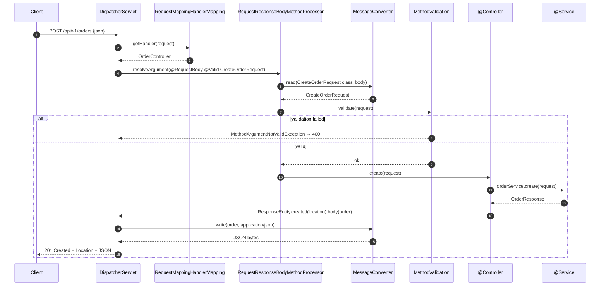
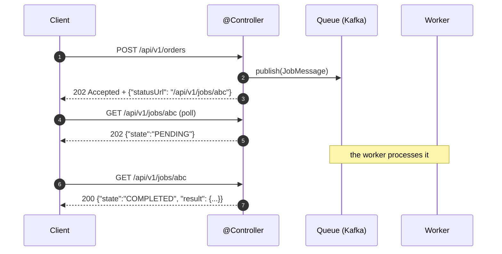

# 02 · Controllers, REST APIs & the HTTP Contract

> **Level:** Beginner → Advanced
> **Interview Frequency:** ★★★★☆ (The "design a REST API" question is near-universal)
> **Prerequisite:** [01 · Request Flow](./01-Request-Flow-and-DispatcherServlet.md)
> **Last Updated:** 2026

---

## 📋 Table of Contents
- [0. TL;DR — The 30-Second Answer](#0-tldr--the-30-second-answer)
- [1. What & Why](#1-what--why)
- [2. Mental Model — the HTTP contract](#2-mental-model--the-http-contract)
- [3. Deep Dive — Theory](#3-deep-dive--theory)
- [4. Internal Working Mechanism](#4-internal-working-mechanism)
- [5. Step-by-Step Execution Flow](#5-step-by-step-execution-flow)
- [6. Architecture Diagrams](#6-architecture-diagrams)
- [7. Production-Level Use Cases](#7-production-level-use-cases)
- [8. Code Examples — Production-Grade](#8-code-examples--production-grade)
- [9. Common Mistakes & Gotchas](#9-common-mistakes--gotchas)
- [10. Performance Considerations](#10-performance-considerations)
- [11. Security Considerations](#11-security-considerations)
- [12. Best Practices — The Checklist](#12-best-practices--the-checklist)
- [13. Hands-On Exercises](#13-hands-on-exercises)
- [14. Code Challenges](#14-code-challenges)
- [15. Scenario-Based Questions](#15-scenario-based-questions)
- [16. Interview Q&A — Level-wise](#16-interview-qa--level-wise)
- [17. Counter-Questions & Traps](#17-counter-questions--traps)
- [18. Tricky Interview Questions](#18-tricky-interview-questions)
- [19. Follow-Up Questions Asked by Interviewers](#19-follow-up-questions-asked-by-interviewers)
- [20. Real 3–5 Year Experience Scenarios](#20-real-35-year-experience-scenarios)
- [21. Frequently Asked Production Issues](#21-frequently-asked-production-issues)
- [22. Debugging Scenarios](#22-debugging-scenarios)
- [23. Architecture Design Questions](#23-architecture-design-questions)
- [24. Rapid-Fire MCQs](#24-rapid-fire-mcqs)
- [25. Cheat Sheet — One-Page Summary](#25-cheat-sheet--one-page-summary)
- [26. Real-World Production Notes](#26-real-world-production-notes)
- [27. Follow-up Learning](#27-follow-up-learning)

---

## 0. TL;DR — The 30-Second Answer

- **`@RestController` = `@Controller` + `@ResponseBody`.** The return value is serialised into the
  body (JSON by default). Use it for APIs; use `@Controller` for server-rendered views.
- **The mapping annotations:** `@GetMapping`, `@PostMapping`, `@PutMapping`, `@PatchMapping`,
  `@DeleteMapping`, and the general `@RequestMapping(method = …)`.
- **The class-level `@RequestMapping` is a path prefix**; the method-level one is appended. All
  the conditions (method, path, params, headers, consumes, produces) are **ANDed**.
- **`@RequestBody` → deserialise the body; `@RequestParam` → the query string;
  `@PathVariable` → the URI template; `@RequestHeader` → a header; `@CookieValue` → a cookie;
  `@ModelAttribute` → bind the query params to an object.**
- **`ResponseEntity<T>`** is the professional way to control the status, the headers, and the body.
- **The status codes that matter:**
  - `200` OK — a successful read/update.
  - `201` Created — with a `Location` header.
  - `202` Accepted — the work is async; return a status resource.
  - `204` No Content — a successful delete, **no body**.
  - `400` Bad Request — a malformed/invalid request.
  - `401` Unauthenticated / `403` Forbidden — **the most commonly confused pair**.
  - `404` Not Found / `405` Method Not Allowed / `409` Conflict / `415` / `422` / `429`.
  - `500` — an unexpected error. `503` — temporarily unavailable.
- **`PUT` is idempotent and replaces; `PATCH` is partial; `POST` creates and is not idempotent.**
- **Never return the entity — return a DTO.** It decouples the API from the domain and prevents
  lazy-loading problems and accidental field exposure.
- **Pagination, sorting, and filtering** must be **allow-listed** — never interpolate a
  user-supplied field name into an `ORDER BY` (SQL injection).
- **`@RestControllerAdvice` + `ProblemDetail`** (RFC 9457) is the modern error contract.
- **The one-liner:** *"A controller is a translation layer: it maps HTTP into a typed command, and
  maps a typed result back into HTTP. The moment business logic leaks into it, the API becomes
  hard to evolve and hard to test."*

---

## 1. What & Why

Controllers are the **public contract** of a service. Everything about them is a design decision
that other people (mobile teams, partner integrations, your future self) depend on.

**What a controller should do:**
1. Bind and **validate** the input.
2. Delegate to the application service.
3. Map the result to a response DTO and a status code.

**What a controller should NOT do:**
- Business logic.
- Direct repository access.
- Transaction management (that's the service's job).
- Swallowing exceptions.

---

## 2. Mental Model — the HTTP contract

```text
   HTTP REQUEST                        HTTP RESPONSE
   ────────────                        ─────────────
   Method  ─────────────────────┐
   Path    ─────────────────────┤
   Headers ─────────────────────┼──►  @Controller ──► Status
   Body    ─────────────────────┘        │            Headers
   Query   ─────────────────────┐        │            Body
                                └──────► │            Location
                                         ▼
                                    Application Service
```

> **Caption:** The controller is a **protocol adapter**. It converts a loosely-typed, transport-
> specific request into a strictly-typed domain command, and a domain result back into a
> transport-specific response. It is the **anti-corruption layer** of the web tier.

---

## 3. Deep Dive — Theory

### 3.1 The mapping annotations

```java
@RestController
@RequestMapping("/api/v1/orders")          // class-level: the PREFIX
public class OrderController {

    @GetMapping                                   // GET /api/v1/orders
    public List<OrderResponse> list(...) { }

    @GetMapping("/{id}")                          // GET /api/v1/orders/{id}
    public OrderResponse get(@PathVariable Long id) { }

    @GetMapping(params = "status=ACTIVE")        // GET /api/v1/orders?status=ACTIVE
    public List<OrderResponse> active(...) { }

    @PostMapping(consumes = MediaType.APPLICATION_JSON_VALUE,
                 produces = MediaType.APPLICATION_JSON_VALUE)
    public ResponseEntity<OrderResponse> create(@RequestBody @Valid CreateOrderRequest req) { }

    @PutMapping("/{id}")
    public OrderResponse replace(@PathVariable Long id, @RequestBody @Valid ReplaceOrderRequest req) { }

    @PatchMapping("/{id}")
    public OrderResponse patch(@PathVariable Long id, @RequestBody @Valid PatchOrderRequest req) { }

    @DeleteMapping("/{id}")
    public ResponseEntity<Void> delete(@PathVariable Long id) { }
}
```

**The general form:**
```java
@RequestMapping(
    value = "/path",                 // or path = "/path" (Spring 5.3+)
    method = RequestMethod.GET,
    params = "id=42",                // a query param condition
    headers = "X-Api-Key=abc",       // a header condition
    consumes = "application/json",   // the request's Content-Type must match
    produces = "application/json"    // the Accept header must match
)
```

### 3.2 HTTP methods and their semantics

| Method | Idempotent | Safe | Has a body | Typical status |
|--------|-----------|------|------------|----------------|
| `GET` | ✅ | ✅ | ❌ | 200 |
| `HEAD` | ✅ | ✅ | ❌ | 200 (headers only) |
| `POST` | ❌ | ❌ | ✅ | 201 / 202 / 200 |
| `PUT` | ✅ | ❌ | ✅ | 200 / 204 |
| `PATCH` | ❌ (partially) | ❌ | ✅ | 200 |
| `DELETE` | ✅ | ❌ | optional | 204 / 200 |
| `OPTIONS` | ✅ | ✅ | ❌ | 200 (the CORS preflight) |

> **Key distinction:**
> - **Idempotent** = repeating the request has the same effect as doing it once (`PUT`, `DELETE`).
> - **Safe** = it only reads (`GET`, `HEAD`, `OPTIONS`).
> - A `PUT` to the same URL with the same body must be **safe to retry** — that's the basis of
> **idempotency keys** and the reason `POST` needs one.

### 3.3 The status codes — the complete reference

| Code | Name | When |
|------|------|------|
| **200** | OK | A successful read or update with a body |
| **201** | Created | A resource was created; include a `Location` header |
| **202** | Accepted | The work was queued for async processing |
| **204** | No Content | A successful delete or an update with no body — **no body allowed** |
| **206** | Partial Content | A range request |
| **301/308** | Moved Permanently | A permanent redirect (308 preserves the method) |
| **302/307** | Found / Temporary Redirect | A temporary redirect (307 preserves the method) |
| **304** | Not Modified | The cached copy is still valid (ETag) |
| **400** | Bad Request | A malformed request or a validation failure |
| **401** | Unauthorized | **Not authenticated** — should include `WWW-Authenticate` |
| **403** | Forbidden | **Authenticated but not allowed** |
| **404** | Not Found | The resource doesn't exist (or you're hiding its existence) |
| **405** | Method Not Allowed | The path exists, the method doesn't — include `Allow` |
| **406** | Not Acceptable | The `Accept` header can't be satisfied |
| **409** | Conflict | A state conflict (a duplicate, a concurrent modification) |
| **412** | Precondition Failed | A failed `If-Match`/ETag precondition |
| **415** | Unsupported Media Type | The `Content-Type` isn't supported |
| **422** | Unprocessable Entity | Syntactically valid but semantically invalid (often used for domain validation) |
| **428** | Precondition Required | `If-Match` is required |
| **429** | Too Many Requests | Rate limited — include `Retry-After` |
| **500** | Internal Server Error | An unexpected exception |
| **502/503/504** | Bad Gateway / Unavailable / Gateway Timeout | A downstream failure |

> **401 vs 403** — the single most commonly confused pair:
> - **401**: "I don't know who you are" → send a `WWW-Authenticate` header.
> - **403**: "I know who you are, but you can't do this" → no `WWW-Authenticate` header.
> The **Spring Security** defaults match this: `AuthenticationEntryPoint` → 401,
> `AccessDeniedHandler` → 403.

### 3.4 The response DTO pattern

```java
// ❌ Returning the entity
@GetMapping("/{id}")
public Order get(@PathVariable Long id) {
    return orderRepository.findById(id).orElseThrow();
}
```
**Problems:**
1. **Over-exposure** — every field of the entity is now part of the public API.
2. **Accidental coupling** — renaming a DB column breaks the API.
3. **Lazy loading** — with `open-in-view=false`, a lazy association throws
   `LazyInitializationException` during serialisation.
4. **N+1 queries** — serialising a collection of entities triggers a query per row.
5. **Security** — `passwordHash`, `internalNotes`, `auditFields` leak.

```java
// ✅ The DTO pattern
public record OrderResponse(
        Long id,
        String orderNumber,
        OrderStatus status,
        BigDecimal total,
        String currency,
        Instant createdAt,
        List<OrderLineResponse> lines) {

    public static OrderResponse from(Order order) {
        return new OrderResponse(
                order.getId(),
                order.getOrderNumber(),
                order.getStatus(),
                order.getTotal(),
                order.getCurrency(),
                order.getCreatedAt(),
                order.getLines().stream().map(OrderLineResponse::from).toList());
    }
}
```

### 3.5 Request DTOs and the command pattern

```java
public record CreateOrderRequest(
        @NotNull Long customerId,
        @NotEmpty @Valid List<CreateOrderLineRequest> lines,
        @NotBlank String currency,
        @Size(max = 500) String note) { }

public record CreateOrderLineRequest(
        @NotNull Long productId,
        @Min(1) int quantity) { }
```

**Why a separate request DTO:**
- **Mass-assignment protection** — only the declared fields can be set.
- **Different shapes for create vs update** — a `PUT` replaces everything, a `PATCH` updates a
  subset; a `null` field in a `PATCH` means "not provided", but in a `PUT` it's invalid.
- **Validation groups** — `@Validated(Create.class)` vs `@Validated(Update.class)`.
- **The API can evolve independently** of the domain.

### 3.6 `ResponseEntity` — the full API

```java
ResponseEntity.ok(body);
ResponseEntity.ok().header("X-Custom", "v").body(body);
ResponseEntity.created(uri).body(body);
ResponseEntity.accepted().body(statusResource);
ResponseEntity.noContent().build();
ResponseEntity.status(HttpStatus.CONFLICT).body(errorBody);
ResponseEntity.notFound().build();
ResponseEntity.status(HttpStatus.INTERNAL_SERVER_ERROR).build();
// Building it manually:
ResponseEntity.status(HttpStatus.OK)
               .headers(headers -> headers.add("X-RateLimit-Remaining", "99"))
               .contentType(MediaType.APPLICATION_JSON)
               .body(body);
```

### 3.7 `ProblemDetail` — RFC 9457 (the modern error contract)

```java
ProblemDetail pd = ProblemDetail.forStatusAndDetail(HttpStatus.CONFLICT,
        "An order with this orderNumber already exists");
pd.setTitle("Duplicate order");
pd.setType(URI.create("https://api.example.com/problems/duplicate-order"));
pd.setInstance(URI.create("/api/v1/orders"));
pd.setProperty("orderNumber", "ORD-2026-001");
pd.setProperty("timestamp", Instant.now());
return ResponseEntity.status(HttpStatus.CONFLICT).body(pd);
```

```json
{
  "type": "https://api.example.com/problems/duplicate-order",
  "title": "Duplicate order",
  "status": 409,
  "detail": "An order with this orderNumber already exists",
  "instance": "/api/v1/orders",
  "orderNumber": "ORD-2026-001",
  "timestamp": "2026-01-01T10:00:00Z"
}
```

> **Boot 3 advantage:** `ProblemDetail` is supported natively — the `spring.mvc.problemdetails.enabled=true`
> property makes Spring MVC's own exceptions (404, 405, 415, validation) return a `ProblemDetail`
> automatically, with the same shape as your custom ones.

### 3.8 The `HttpEntity` family

| Type | Purpose |
|------|---------|
| `ResponseEntity<T>` | A status + headers + a body |
| `HttpEntity<T>` | Headers + a body (no status) |
| `HttpHeaders` | The header map |
| `MediaType` | `application/json`, `application/xml`, … |
| `MediaTypeFactory` | Resolve a media type from a file extension |

### 3.9 Consuming APIs — `RestClient` (Boot 3.2+) vs `RestTemplate` vs `WebClient`

```java
// ── RestClient (Boot 3.2+, modern, immutable) ─────────────────────────
@RestClient
public interface PaymentClient {

    @PostExchange("/api/v1/payments")
    PaymentResponse charge(@RequestBody PaymentRequest request);

    @GetExchange("/api/v1/payments/{id}")
    PaymentResponse get(@PathVariable("id") String id);

    @ExceptionHandler(PaymentServiceException.class)
    default ResponseEntity<PaymentResponse> handle(PaymentServiceException ex) {
        return ResponseEntity.status(HttpStatus.BAD_GATEWAY).build();
    }
}

@Bean
RestClient paymentClient(RestClient.Builder builder) {
    return builder.baseUrl("https://payments.internal")
                   .defaultHeader("X-Api-Key", secret)
                   .requestFactory(clientRequestFactory())
                   .build();
}
```

```java
// ── RestClient with a base URL (the programmatic style) ───────────────
RestClient client = RestClient.builder()
        .baseUrl("https://payments.internal")
        .defaultHeader("X-Api-Key", secret)
        .build();

PaymentResponse response = client.post()
        .uri("/api/v1/payments")
        .body(request)
        .retrieve()
        .onStatus(HttpStatusCode::isError, (req, res) -> { throw new PaymentFailed(res); })
        .body(PaymentResponse.class);
```

```java
// ── RestTemplate (legacy, still supported) ─────────────────────────────
RestTemplate restTemplate = new RestTemplate();
restTemplate.setErrorHandler(new ResponseErrorHandler() { ... });
PaymentResponse response = restTemplate.postForObject("/api/v1/payments", request, PaymentResponse.class);
```

**`RestClient` vs `RestTemplate`:**

| | `RestClient` | `RestTemplate` |
|---|---|---|
| **Style** | Fluent, immutable | Mutable, imperative |
| **Introduced** | Boot 3.2 | Spring 4.1 |
| **Error handling** | `.retrieve()` with `onStatus`, or `.exchange()` | `ResponseErrorHandler` |
| **Testing** | Easy to mock (it's an interface) | Harder |
| **Blocking** | Yes | Yes |

> **Use `RestClient` in new code**; `RestTemplate` is still fine and is not deprecated.

### 3.10 HTTP client configuration — the production essentials

```java
@Bean
RestClient paymentClient(RestClient.Builder builder,
                         RestClientResponseService responseService) {
    SimpleClientHttpRequestFactory factory = new SimpleClientHttpRequestFactory();
    factory.setConnectTimeout(Duration.ofSeconds(2));
    factory.setReadTimeout(Duration.ofSeconds(5));

    return builder.baseUrl("https://payments.internal")
                  .requestFactory(factory)
                  .defaultHeader("X-Api-Key", secretProvider.current())
                  .defaultStatusHandler(responseService)
                  .build();
}
```

**Or with the JDK's `HttpClient`:**
```java
@Bean
RestClient paymentClient(RestClient.Builder builder) {
    HttpClient httpClient = HttpClient.newBuilder()
            .connectTimeout(Duration.ofSeconds(2))
            .version(HttpClient.Version.HTTP_1_1)
            .build();

    JdkClientHttpRequestFactory factory = new JdkClientHttpRequestFactory(httpClient);
    factory.setReadTimeout(Duration.ofSeconds(5));

    return builder.baseUrl("https://payments.internal").requestFactory(factory).build();
}
```

**Production checklist for an HTTP client:**
- **A connect timeout AND a read timeout** (the default is infinite — a hung downstream hangs
  your thread forever).
- **A connection pool** (`HttpComponentsClientHttpRequestFactory` with a pool, or the JDK client).
- **A retry policy** — only for **idempotent** requests, with a **backoff** and a **jitter**, and
  **never** for a non-idempotent `POST` without an idempotency key.
- **A circuit breaker** (Resilience4j) around it.
- **A bulkhead** — a separate pool per downstream, so one slow dependency doesn't exhaust
  everything.
- **Propagate the correlation id** and the auth headers.
- **Metrics** — the latency and the error rate per downstream.

### 3.11 The `HttpInterface`/`@HttpExchange` model (HTTP Service clients)

```java
public interface GitHubClient {

    @GetExchange("/repos/{owner}/{repo}/issues")
    List<Issue> issues(@PathVariable String owner, @PathVariable String repo,
                       @RequestHeader("Accept") String accept);

    @GetExchange(value = "/search/issues", params = "q={query}")
    SearchResult search(@RequestParam("q") String query);
}
```

```java
RestClient restClient = RestClient.builder().baseUrl("https://api.github.com").build();
HttpServiceProxyFactory factory = HttpServiceProxyFactory
        .builderFor(RestClientAdapter.create(restClient))
        .build();
GitHubClient client = factory.createClient(GitHubClient.class);
```

> **When to use it:** it's the cleanest way to write a **type-safe** HTTP client with no
> boilerplate — much better than `RestTemplate` + `ParameterizedTypeReference`.

### 3.12 Conditional requests — ETags

```java
@GetMapping("/{id}")
public ResponseEntity<OrderResponse> get(@PathVariable Long id,
                                          @RequestHeader(value = "If-None-Match", required = false)
                                          String ifNoneMatch) {
    OrderResponse body = service.get(id);

    String etag = "\"" + service.etag(id) + "\"";
    if (etag.equals(ifNoneMatch)) {
        return ResponseEntity.status(HttpStatus.NOT_MODIFIED).eTag(etag).build();
    }
    return ResponseEntity.ok().eTag(etag).body(body);
}
```

### 3.13 Content negotiation and the `Accept` header

```java
@GetMapping(value = "/{id}", produces = {MediaType.APPLICATION_JSON_VALUE,
                                          MediaType.APPLICATION_XML_VALUE})
public OrderResponse get(@PathVariable Long id) { }
```

- The `produces` narrows what the endpoint **can** return.
- The `Accept` header narrows what the client **wants**.
- If they don't intersect → **406**.

### 3.14 The `PATCH` problem

`PATCH` is not well-standardised. Two common styles:

```java
// ── JSON Merge Patch (RFC 7386) ───────────────────────────────────────
@PatchMapping("/{id}")
public OrderResponse mergePatch(@PathVariable Long id, @RequestBody JsonNode patch) { }

// ── JSON Patch (RFC 6902) — an array of operations ────────────────────
@PatchMapping("/{id}")
public OrderResponse jsonPatch(@PathVariable Long id, @RequestBody List<JsonPatchOperation> ops) { }
```

**Practical advice:** many APIs use `PATCH` with a **partial DTO** (the null fields mean "not
provided"). It's not RFC-pure, but it's the most common and the most usable. Document it.

---

## 4. Internal Working Mechanism

### 4.1 The controller's place in the flow

```text
  HandlerAdapter.handle()
      │
      ├─ getMethodArgumentValues()   ← the argument resolvers
      │     • @RequestBody → RequestBodyMethodArgumentResolver
      │         → readBody() → HttpMessageConverter.read() → Jackson
      │     → then VALIDATE (the @Valid argument resolver)
      │
      ├─ method.invoke(target, args)  ← the reflection call
      │
      └─ returnValueHandlers.handleReturnValue()
            • @ResponseBody → RequestResponseBodyMethodProcessor
                → writeWithMessageConverters() → Jackson → the output stream
```

### 4.2 The validation step — where it actually happens

```java
// In ModelFactory / ServletModelAttributeMethodProcessor
if (binderFactory != null) {
    WebDataBinder binder = binderFactory.createBinder(webRequest, null, name);
    // ← the @Valid / @Validated annotations are found here
    validateIfApplicable(binder, parameter);
    ...
}
```

**The `@Valid` handling** (in `AbstractMessageConverterMethodArgumentResolver`):
```java
if (binderFactory != null) {
    WebDataBinder binder = binderFactory.createBinder(webRequest, null, name);
    if (binderFactory instanceof ConfigurableWebBindingProcessorFactory factory) {
        // the @Valid on the parameter is found and applied
    }
    validateIfApplicable(binder, parameter);
    if (binder.getBindingResult().hasErrors()) {
        throw new MethodArgumentNotValidException(parameter, binder.getBindingResult());
    }
}
```

> **Key insight:** the validation happens **after** the deserialisation and **before** the method
> invocation. A validation failure throws `MethodArgumentNotValidException` — which the
> `HandlerExceptionResolver` turns into a 400.

### 4.3 `ModelAndView` vs `@ResponseBody`

```java
// @RestController → the return value is the body
public OrderResponse get() { return order; }

// @Controller → the return value is a VIEW NAME
public String get() { return "order-detail"; }        // → order-detail.html
public ModelAndView get() { return new ModelAndView("order-detail", model); }
```

### 4.4 How the `produces` condition is evaluated

```text
  ① The mapping declares produces = "application/json"
  ② The request's Accept header is parsed into a list of MediaTypes, sorted by quality
  ③ RequestMappingInfo.matches() → the produces condition is checked against the Accept list
  ④ If it doesn't intersect → the mapping doesn't match → 404 (or 406 if the path matched
     but the content type didn't)
```

> **Subtlety:** the `produces` mismatch usually gives a **404** (the mapping simply doesn't
> match) rather than a 406, unless **no** mapping matches at all — then the `DispatcherServlet`
> produces a 406 via `HttpMediaTypeNotAcceptableException`. This is a common source of confusion.

---

## 5. Step-by-Step Execution Flow

### 5.1 A `POST` with a body



### 5.2 The async (202) flow



---

## 6. Architecture Diagrams

### 6.1 The layered web architecture

```text
┌──────────────────────────────────────────────────────────────────────┐
│  HTTP LAYER                                                            │
│   Filters (security, CORS, tracing, rate limit)                       │
│   DispatcherServlet → HandlerMapping → HandlerAdapter                 │
│   Controllers (@RestController)  ← thin: validate, delegate, map      │
├──────────────────────────────────────────────────────────────────────┤
│  APPLICATION LAYER                                                     │
│   Application services (@Service) — use cases, transactions,           │
│   orchestration. Depends on the domain interfaces, NOT on the web.    │
├──────────────────────────────────────────────────────────────────────┤
│  DOMAIN LAYER                                                          │
│   Entities, value objects, domain services, domain events,            │
│   repository INTERFACES (the ports)                                   │
├──────────────────────────────────────────────────────────────────────┤
│  INFRASTRUCTURE LAYER                                                  │
│   Repository implementations (JPA), HTTP clients, message producers   │
└──────────────────────────────────────────────────────────────────────┘
```

### 6.2 The status code decision tree

```text
  Request arrives
      │
      ├─ Not authenticated? ──────────────► 401 (+ WWW-Authenticate)
      ├─ Authenticated but not allowed? ──► 403
      ├─ Malformed / validation failed? ─► 400 (or 422 for a domain rule)
      ├─ Wrong Content-Type? ────────────► 415
      ├─ Accept can't be satisfied? ─────► 406
      ├─ Resource doesn't exist? ────────► 404
      ├─ Path exists, method doesn't? ───► 405 (+ Allow)
      ├─ State conflict? ────────────────► 409
      ├─ Rate limited? ──────────────────► 429 (+ Retry-After)
      ├─ Work queued? ───────────────────► 202 (+ a status URL)
      ├─ Created? ───────────────────────► 201 (+ Location)
      ├─ Success, no body? ──────────────► 204
      └─ Success? ──────────────────────► 200 (+ the body)
```

### 6.3 The DTO mapping layers

```text
  HTTP body  →  Request DTO  →  Command  →  Domain entity  →  Result  →  Response DTO  →  HTTP body
  (JSON)      (validated)     (typed)      (the model)                  (the contract)  (JSON)
               ▲                                                                    ▲
               │ @Valid — the trust boundary                                      │
               └── you never bind the HTTP body straight to the entity ────────────┘
```

---

## 7. Production-Level Use Cases

| Use case | Pattern |
|----------|---------|
| **A public API** | Versioned, DTO-based, `ProblemDetail` errors, an OpenAPI spec, the rate limits |
| **An internal service-to-service API** | `RestClient` with a base URL, the timeouts, the correlation id propagation, the circuit breaker |
| **A long-running operation** | `202 Accepted` + a status resource + a webhook (or an SSE) |
| **A file export** | `202` + an async job + a pre-signed download URL |
| **A bulk operation** | `POST /batch` with a list, returning the per-item results |
| **A webhook callback** | A signed callback with a retry and a DLE |
| **A third-party integration** | An adapter that translates the third-party's model into yours |
| **A soft delete** | `DELETE` sets a `deletedAt`; the `GET` filters it out; a `restore` endpoint |
| **An optimistic-locking update** | `PUT` with an `If-Match` (ETag) → `412` on a conflict |
| **A partial update** | `PATCH` with a partial DTO |

---

## 8. Code Examples — Production-Grade

### 8.1 A production CRUD controller

```java
@RestController
@RequestMapping("/api/v1/orders")
@RequiredArgsConstructor
@Validated
@Tag(name = "Orders", description = "Order management")
public class OrderController {

    private final OrderService orderService;
    private final OrderMapper mapper;

    // ── LIST ────────────────────────────────────────────────────────────
    @GetMapping
    @Operation(summary = "List orders")
    public ResponseEntity<PageResponse<OrderResponse>> list(
            @RequestParam(defaultValue = "0") @Min(0) int page,
            @RequestParam(defaultValue = "20") @Min(1) @Max(100) int size,
            @RequestParam(required = false) OrderStatus status,
            @RequestParam(required = false) @DateTimeFormat(iso = ISO.DATE) LocalDate from,
            @RequestParam(defaultValue = "createdAt") SortField sort) {

        Page<Order> orders = orderService.findAll(OrderFilter.of(page, size, status, from, sort));
        return ResponseEntity.ok(PageResponse.of(orders.map(mapper::toResponse)));
    }

    // ── GET ONE ─────────────────────────────────────────────────────────
    @GetMapping("/{id}")
    @Operation(summary = "Get an order")
    public ResponseEntity<OrderResponse> get(@PathVariable Long id) {
        return orderService.findById(id)
                .map(mapper::toResponse)
                .map(ResponseEntity::ok)
                .orElseThrow(() -> new OrderNotFoundException(id));
    }

    // ── CREATE ──────────────────────────────────────────────────────────
    @PostMapping(consumes = MediaType.APPLICATION_JSON_VALUE,
                 produces = MediaType.APPLICATION_JSON_VALUE)
    @Operation(summary = "Create an order")
    public ResponseEntity<OrderResponse> create(
            @Valid @RequestBody CreateOrderRequest request,
            UriComponentsBuilder uriBuilder) {

        Order created = orderService.create(mapper.toCommand(request));
        URI location = uriBuilder.path("/api/v1/orders/{id}")
                                  .buildAndExpand(created.getId())
                                  .toUri();
        return ResponseEntity.created(location)
                             .eTag("\"" + created.getVersion() + "\"")
                             .body(mapper.toResponse(created));
    }

    // ── REPLACE (PUT) ───────────────────────────────────────────────────
    @PutMapping(value = "/{id}", consumes = MediaType.APPLICATION_JSON_VALUE)
    @Operation(summary = "Replace an order")
    public ResponseEntity<OrderResponse> replace(
            @PathVariable Long id,
            @Valid @RequestBody ReplaceOrderRequest request) {
        Order updated = orderService.replace(id, mapper.toCommand(request));
        return ResponseEntity.ok(mapper.toResponse(updated));
    }

    // ── PARTIAL UPDATE (PATCH) ──────────────────────────────────────────
    @PatchMapping(value = "/{id}", consumes = MediaType.APPLICATION_JSON_VALUE)
    @Operation(summary = "Partially update an order")
    public ResponseEntity<OrderResponse> patch(
            @PathVariable Long id,
            @Valid @RequestBody PatchOrderRequest request) {
        Order updated = orderService.patch(id, mapper.toCommand(request));
        return ResponseEntity.ok(mapper.toResponse(updated));
    }

    // ── DELETE ──────────────────────────────────────────────────────────
    @DeleteMapping("/{id}")
    @Operation(summary = "Cancel an order")
    public ResponseEntity<Void> delete(@PathVariable Long id) {
        orderService.cancel(id);
        return ResponseEntity.noContent().build();
    }
}
```

### 8.2 The DTOs and the mapper

```java
// ── Request DTOs ───────────────────────────────────────────────────────
public record CreateOrderRequest(
        @NotNull Long customerId,
        @NotEmpty @Size(max = 100) @Valid List<CreateOrderLineRequest> lines,
        @NotBlank @Pattern(regexp = "[A-Z]{3}") String currency,
        @Size(max = 500) String note) { }

public record CreateOrderLineRequest(
        @NotNull Long productId,
        @Min(1) @Max(999) int quantity) { }

// ── Response DTO ───────────────────────────────────────────────────────
public record OrderResponse(
        Long id,
        String orderNumber,
        Long customerId,
        OrderStatus status,
        BigDecimal total,
        String currency,
        Instant createdAt,
        Instant updatedAt,
        List<OrderLineResponse> lines) { }

// ── The mapper (a hand-written mapper; MapStruct is the usual choice) ─
@Component
public class OrderMapper {

    public OrderResponse toResponse(Order order) {
        return new OrderResponse(
                order.getId(),
                order.getOrderNumber(),
                order.getCustomerId(),
                order.getStatus(),
                order.getTotal(),
                order.getCurrency(),
                order.getCreatedAt(),
                order.getUpdatedAt(),
                order.getLines().stream()
                        .map(l -> new OrderLineResponse(l.getProductId(), l.getQuantity(),
                                                        l.getUnitPrice()))
                        .toList());
    }

    public CreateOrderCommand toCommand(CreateOrderRequest request) {
        return new CreateOrderCommand(
                request.customerId(),
                request.currency(),
                request.note(),
                request.lines().stream()
                        .map(l -> new OrderLineCommand(l.productId(), l.quantity()))
                        .toList());
    }
}
```

### 8.3 A `PageResponse` envelope

```java
public record PageResponse<T>(
        List<T> content,
        int page,
        int size,
        long totalElements,
        int totalPages,
        boolean hasNext) {

    public static <T> PageResponse<T> of(Page<T> page) {
        return new PageResponse<>(
                page.getContent(),
                page.getNumber(),
                page.getSize(),
                page.getTotalElements(),
                page.getTotalPages(),
                page.hasNext());
    }
}
```

### 8.4 The `ProblemDetail` error contract

```java
@RestControllerAdvice
@Slf4j
public class ApiExceptionHandler {

    @ExceptionHandler(OrderNotFoundException.class)
    public ResponseEntity<ProblemDetail> handleNotFound(OrderNotFoundException ex) {
        ProblemDetail pd = ProblemDetail.forStatusAndDetail(HttpStatus.NOT_FOUND, ex.getMessage());
        pd.setTitle("Order not found");
        pd.setType(URI.create("https://api.example.com/problems/order-not-found"));
        return ResponseEntity.status(HttpStatus.NOT_FOUND).body(pd);
    }

    @ExceptionHandler(DuplicateOrderException.class)
    public ResponseEntity<ProblemDetail> handleConflict(DuplicateOrderException ex) {
        ProblemDetail pd = ProblemDetail.forStatusAndDetail(HttpStatus.CONFLICT, ex.getMessage());
        pd.setTitle("Duplicate order");
        pd.setType(URI.create("https://api.example.com/problems/duplicate-order"));
        pd.setProperty("orderNumber", ex.getOrderNumber());
        return ResponseEntity.status(HttpStatus.CONFLICT).body(pd);
    }

    @ExceptionHandler(OptimisticLockingFailureException.class)
    public ResponseEntity<ProblemDetail> handleConflict(OptimisticLockingFailureException ex) {
        ProblemDetail pd = ProblemDetail.forStatusAndDetail(HttpStatus.CONFLICT,
                "The resource was modified by another request. Reload and retry.");
        pd.setTitle("Concurrent modification");
        return ResponseEntity.status(HttpStatus.CONFLICT).body(pd);
    }
}
```

### 8.5 A typed HTTP client with `RestClient`

```java
public record PaymentRequest(String orderNumber, BigDecimal amount, String currency) {}
public record PaymentResponse(String transactionId, String status) {}

@RestClient
public interface PaymentClient {

    @PostExchange("/api/v1/payments")
    PaymentResponse charge(@RequestBody PaymentRequest request);

    @GetExchange("/api/v1/payments/{id}")
    PaymentResponse get(@PathVariable("id") String id);

    @ExceptionHandler(UnknownHttpStatusCodeException.class)
    default ResponseEntity<PaymentResponse> handleUnknown(UnknownHttpStatusCodeException ex) {
        log.error("Unexpected payment response", ex);
        return ResponseEntity.status(HttpStatus.BAD_GATEWAY).build();
    }
}
```

```java
@Bean
RestClient paymentClient(RestClient.Builder builder, PaymentProperties props) {
    HttpComponentsClientHttpRequestFactory factory = new HttpComponentsClientHttpRequestFactory();
    factory.setConnectTimeout(Duration.ofMillis(props.getConnectTimeoutMs()));
    factory.setReadTimeout(Duration.ofMillis(props.getReadTimeoutMs()));

    return builder
            .baseUrl(props.getBaseUrl())
            .requestFactory(factory)
            .defaultHeader("X-Api-Key", props.getApiKey())
            .defaultStatusHandler(HttpStatusCode::isError, (request, response) -> {
                throw new PaymentServiceException(
                        "Payment failed with status " + response.getStatusCode());
            })
            .build();
}
```

### 8.6 A "long-running operation" endpoint (202 + status resource)

```java
@RestController
@RequestMapping("/api/v1/exports")
@RequiredArgsConstructor
public class ExportController {

    private final ExportService exportService;

    @PostMapping
    public ResponseEntity<JobResponse> requestExport(@Valid @RequestBody ExportRequest request) {
        Job job = exportService.enqueue(request);
        return ResponseEntity.accepted()
                .location(URI.create("/api/v1/exports/" + job.getId()))
                .body(JobResponse.pending(job.getId()));
    }

    @GetMapping("/{jobId}")
    public ResponseEntity<JobResponse> status(@PathVariable String jobId) {
        Job job = exportService.find(jobId).orElseThrow(() -> new JobNotFoundException(jobId));
        return ResponseEntity.ok(JobResponse.from(job));
    }
}
```

```java
public record JobResponse(String jobId, String state, String downloadUrl, Instant expiresAt) {
    static JobResponse pending(String jobId) {
        return new JobResponse(jobId, "PENDING", null, null);
    }
    static JobResponse from(Job job) {
        return new JobResponse(job.getId(), job.getState().name(),
                job.getDownloadUrl(), job.getExpiresAt());
    }
}
```

### 8.7 A `RestClient` with the correlation id propagated

```java
@Bean
RestClient downstreamClient(RestClient.Builder builder) {
    return builder
            .baseUrl("https://downstream.internal")
            .requestInterceptor((request, body, execution) -> {
                String correlationId = MDC.get("correlationId");
                if (correlationId != null) {
                    request.getHeaders().add("X-Correlation-Id", correlationId);
                }
                return execution.execute(request, body);
            })
            .build();
}
```

### 8.8 The controller advice with a validation error handler

```java
@RestControllerAdvice
public class ValidationExceptionHandler extends ResponseEntityExceptionHandler {

    @Override
    protected ResponseEntity<Object> handleMethodArgumentNotValid(
            MethodArgumentNotValidException ex, HttpHeaders headers,
            HttpStatusCode status, WebRequest request) {

        ProblemDetail pd = ProblemDetail.forStatusAndDetail(
                HttpStatus.BAD_REQUEST, "The request contains invalid values");
        pd.setTitle("Validation failed");
        pd.setProperty("errors", ex.getBindingResult().getFieldErrors().stream()
                .map(fe -> new FieldError(fe.getField(), fe.getDefaultMessage()))
                .toList());
        return ResponseEntity.badRequest().body(pd);
    }

    public record FieldError(String field, String message) {}
}
```

---

## 9. Common Mistakes & Gotchas

| # | ❌ Wrong | ✅ Right | Why |
|---|----------|----------|-----|
| 1 | Returning the JPA entity | Return a DTO | Over-exposure, coupling, lazy loading, N+1 |
| 2 | Binding the body straight to an entity | Use a request DTO | Mass assignment (a client can set `role`, `price`) |
| 3 | Business logic in the controller | Delegate to a service | Testability, reuse, transactions |
| 4 | `@Transactional` on the controller | Put it on the service | The transaction should end before the serialisation |
| 5 | Returning 200 for a create | 201 + `Location` | The HTTP contract |
| 6 | A 200 with a body for a delete | 204, no body | The HTTP contract |
| 7 | 403 for an unauthenticated user | 401 | The semantics differ; 401 needs `WWW-Authenticate` |
| 8 | Swallowing the exception in the controller | Let the advice handle it | You lose the error contract |
| 9 | `?sort=...` interpolated into the `ORDER BY` | An allow-list | **SQL injection** |
| 10 | `?size=1000000` | Cap it (`@Max(100)`) | A DoS vector |
| 11 | A `@GetMapping` with a `@RequestBody` | Don't | A GET has no body |
| 12 | `@RequestMapping` on the class with a trailing slash + a method without one | Be consistent | A mismatch → 404 (Boot 3 doesn't match the trailing slash by default) |
| 13 | Catching `Exception` and returning 200 | Don't | You hide the failure |
| 14 | Returning `null` from a `@RestController` | An empty body or 204 | The response is empty with a 200 |
| 15 | A `Map<String,Object>` for the body | A typed DTO | No validation, no OpenAPI schema |
| 16 | A `Set` for the response body | A `List` | The JSON array order is non-deterministic for a `Set` |
| 17 | Logging the whole request DTO | Log the ids | PII |
| 18 | A `PUT` that merges instead of replaces | `PUT` replaces; `PATCH` merges | The HTTP semantics |
| 19 | `@RequestMapping` without `produces` on a JSON API | Set `produces` | A 406 surprise |
| 20 | A `Long` id exposed to the client | An opaque id (a UUID or a prefixed id) | Enumerable ids, information leakage |

---

## 10. Performance Considerations

| Aspect | Impact | Guidance |
|--------|--------|----------|
| **The serialisation of a big collection** | CPU + memory | Paginate; use a streaming response for the exports |
| **Lazy loading during the serialisation** | N+1 queries | Map to a DTO inside the transaction (`@Transactional(readOnly = true)` on the service) |
| **`open-in-view`** | Holds the connection for the whole request | Set `spring.jpa.open-in-view=false` (the Boot default) |
| **The `size` parameter** | A huge limit | Cap it |
| **The `count(*)` for the pagination** | Expensive on a big table | Offer a "no total" mode; use a keyset pagination |
| **The JSON field naming** | A longer payload | Configure the naming strategy consistently |
| **The `RestClient` timeouts** | A hung downstream | Always set both timeouts |
| **The HTTP client pool** | Connection exhaustion | Configure the pool; size it per downstream |
| **The `Location` header construction** | Minor | `UriComponentsBuilder` is fine |
| **The DTO mapping** | Reflection (MapStruct generates the code) | Use MapStruct for the hot paths |

---

## 11. Security Considerations

| Risk | Mitigation |
|------|-----------|
| **Mass assignment** | A request DTO with only the writable fields |
| **Over-exposure of the entity** | A response DTO with only the intended fields |
| **ID enumeration** | Opaque ids (UUID); check the authorisation per resource |
| **SQL injection via a sort/filter field** | An allow-list |
| **Excessive `pageSize`** | A hard cap |
| **Verbose errors** | A generic message + a correlation id; the details in the logs |
| **CORS** | An allow-list, never `*` with credentials |
| **CSRF** | For a cookie-authenticated API, keep the CSRF protection; for a token-based API, disable it deliberately |
| **The `Location` header** | Don't leak the internal host — build it from the request or a configured base URL |
| **Logging the request body** | PII; log the ids instead |
| **The `produces`/`consumes`** | Set them — a wrong `Content-Type` should be rejected early |
| **File upload** | Validate the type and the size; scan it |

---

## 12. Best Practices — The Checklist

- [ ] **Thin controllers** — validate → delegate → map.
- [ ] **DTOs everywhere** — the request DTO and the response DTO are separate.
- [ ] **`ResponseEntity`** for the status and the headers.
- [ ] **The right status codes** — 201 + `Location`, 204 for a delete, 202 for async, 409 for a
      conflict, 401 vs 403.
- [ ] **`ProblemDetail`** for the errors, globally.
- [ ] **Version the API** (`/api/v1`).
- [ ] **Paginate** everything, with a capped page size.
- [ ] **Allow-list** the sort and the filter fields.
- [ ] **Never** put a transaction on the controller.
- [ ] **Document** with OpenAPI (`springdoc-openapi`) and generate the spec in CI.
- [ ] **`RestClient`** (not `RestTemplate`) for the new clients, with the timeouts.
- [ ] **Propagate the correlation id** to the downstream calls.
- [ ] **Contract tests** so the API can't change silently.

---

## 13. Hands-On Exercises

**🧪 Lab 1 — The status code matrix**
1. Write a controller with 8 endpoints and deliberately return the wrong status code for each.
2. Predict what a client would do with each (retry? cache? show an error?).

**🧪 Lab 2 — The DTO refactor**
1. Take a controller that returns entities and refactor it to DTOs.
2. Run the app and compare the JSON payloads — what disappeared? (Usually: the audit fields, the
   internal flags, the associations.)

**🧪 Lab 3 — The N+1**
1. Return a list of 100 orders with their lines from a `Page`.
2. Enable `spring.jpa.open-in-view=false` and the SQL logging → count the queries.
3. Map to a DTO inside a `@Transactional(readOnly = true)` service method and count again.

**✅ Success signal:** You've seen 1 query become 101 and become 2.

**🧪 Lab 4 — The HTTP client**
1. Write a `RestClient` call to a public API (or a `MockRestServiceServer`).
2. Add the timeouts and verify that a hung server doesn't hang your thread.

---

## 14. Code Challenges

### Challenge 1 — A complete, production-grade CRUD API (hard)
**Goal:** Build a `ProductController` with:
- a paginated, sorted, filtered `GET /api/v1/products`;
- a `GET /api/v1/products/{id}` returning a `ProductResponse`;
- a `POST` with a validated `CreateProductRequest` and a `201` + `Location`;
- a `PUT` that replaces (with an `If-Match` ETag → 412);
- a `PATCH` that partially updates;
- a `DELETE` returning 204;
- a global `ProblemDetail` error handler;
- an OpenAPI annotation on every endpoint.

**Test:** a `MockMvc` test per endpoint and per error case.

### Challenge 2 — An idempotent POST (hard)
**Goal:** Implement `Idempotency-Key` support on `POST /api/v1/payments`.
**Requirements:**
- The same key + the same body → the same response (replayed, with an `Idempotent-Replayed: true`
  header).
- The same key + a **different** body → a `422`.
- The key expires after 24 hours.
- Thread-safe under concurrency.

**Hint:** a unique constraint on `(client_id, idempotency_key)` in the DB — the database is the
source of truth for the uniqueness.

### Challenge 3 — A bulk endpoint (medium)
**Goal:** `POST /api/v1/orders/bulk` with up to 100 orders.
**Requirements:** a per-item result (the successes and the failures), an all-or-nothing mode, a
partial-success response with a 207-style body, and a clear limit.

---

## 15. Scenario-Based Questions

**S1.** *"A mobile client broke after we renamed a field in the response DTO. How do we prevent
this?"*
>
> **Expected answer:** (1) **Immediate fix**: restore the old field (as deprecated) and add the new
> one. Never rename a field in a public API — **add** the new one, keep the old, and deprecate it.
> (2) **Prevention — a contract test**: generate the OpenAPI spec from the code and store it as a
> versioned artefact; a **snapshot/breaking-change check** in CI (e.g. `openapi-diff`,
> `springwolf`'s diff, or a custom check) fails the build if a field is **removed or its type
> changes**. Renames are detected as a removal + an addition. (3) **The deprecation process**:
> mark the field `@Deprecated` with a `@Schema(deprecated = true)`, add a **usage metric** (log or
> count the old field's usage — for a response field you'd need the client to report, so instead
> publish a deprecation notice and watch the adoption), and remove it only after a defined
> window. (4) **Versioning**: for a breaking change, create `/api/v2` and run both in parallel;
> the clients migrate on their own schedule. (5) **The monitoring**: a 4xx-rate alert per endpoint
> catches a client that sends an unexpected field (if you use a strict deserialisation with
> `FAIL_ON_UNKNOWN_PROPERTIES` on the client side, an unknown field fails the request — a good
> forcing function). (6) The senior framing: "**the API contract is a product** — it needs
> versioning, a changelog, a deprecation policy, and automated compatibility checks, exactly like
> a published library."

**S2.** *"Our API is slow for the list endpoint. The list returns 1000 items with their
relations."*
>
> **Ideal answer:** (1) **Measure**: enable the SQL logging or use a trace; count the queries.
> (2) **The likely causes**: (a) **N+1** — 1 + 1000 queries for the relations; (b) **no
> pagination** — 1000 rows fully materialised; (c) the **serialisation** of a big graph; (d) the
> **`count(*)`** for the total. (3) **Fixes**: (a) fetch the relations in one query — a **join
> fetch** (`@EntityGraph` or `join fetch`) with `@BatchSize` or a **DTO projection** (the best
> option: a single query returning a flat DTO, no entity loading at all); (b) **paginate** with a
> capped page size; (c) use a **keyset pagination** for the deep pages; (d) skip the count when
> the client doesn't need it. (4) **A DTO projection** is the best answer:
> `@Query("select new com.acme.OrderSummary(o.id, o.number, o.status) from Order o")` — one
> query, no lazy loading, no N+1, and only the columns you need. (5) **Watch the `open-in-view`**:
> it must be `false` — otherwise the persistence context stays open for the whole request,
> holding a connection and making the N+1 invisible in the code. (6) **Also**: the response
> **size** — a 1000-item JSON is slow to serialise and to transfer; the `size` cap is the real
> fix. (7) **Add a performance budget** in CI (a load test asserting the p99) so it doesn't
> regress.

**S3.** *"A third party needs to call our API. What do you need to build beyond the
endpoints?"*
>
> **Ideal answer:** (1) **Authentication** — OAuth2 client credentials (the standard) or an API key
> for the simple cases; a self-service portal for the key management. (2) **Authorisation** —
> the **scopes**/roles per endpoint; a per-client quota. (3) **Documentation** — the OpenAPI
> spec, a getting-started guide, the examples in multiple languages, and a **changelog**. (4) A
> **sandbox environment** with fake data, and a **postman collection** or an SDK. (5) **Rate
> limits** — with the standard headers, a documented quota, and a process to request more.
> (6) **The error contract** — `ProblemDetail`, documented, with the error codes the client should
> handle. (7) **A support process** — a status page, a support channel, and an SLA. (8)
> **Webhooks** — so they don't have to poll. (9) **Security** — the IP allow-list (optional), the
> TLS requirements, the audit log of the calls, and the secret rotation. (10) **The version
> policy** — how the breaking changes are communicated and how long each version is supported.
> (11) The **commercial** side: the plan limits, the pricing, the onboarding, the billing. (12)
> The senior framing: "integrating a third party is a **product** task, not an endpoint task — the
> API is only 20 % of it."

---

## 16. Interview Q&A — Level-wise

### 🟢 Beginner
**Q: What is the difference between `@Controller` and `@RestController`?**
**A:** `@RestController` is `@Controller` + `@ResponseBody` at the class level — the return value
is serialised into the response body (JSON) instead of being treated as a **view name**.

**Q: How do you read the JSON body?**
**A:** `@RequestBody` on a method parameter — Spring uses Jackson (the `HttpMessageConverter`) to
deserialise it.

**Q: How do you read a query parameter?**
**A:** `@RequestParam("name")` — or just declare a simple-type parameter (the default
resolution).

**Q: What is `ResponseEntity`?**
**A:** A wrapper for the status code, the headers, and the body — the full HTTP response.

### 🟡 Intermediate
**Q: What HTTP status code should a create return?**
**A:** `201 Created`, with a `Location` header pointing to the new resource. `202 Accepted` if the
work is asynchronous (then a status resource URL).

**Q: What's the difference between `PUT` and `PATCH`?**
**A:** `PUT` **replaces** the resource — the client sends the complete representation, and the
server must make the resource identical to the request body. `PATCH` **partially** updates it —
only the provided fields change. `PUT` is idempotent; `PATCH` generally isn't (unless the patch
is absolute).

**Q: What is the difference between 401 and 403?**
**A:** **401 Unauthorized** = the request is **not authenticated** (no/invalid credentials) — the
server should send a `WWW-Authenticate` header. **403 Forbidden** = the client **is** authenticated
but isn't allowed to perform the action. (Strictly, 401 should be "Unauthenticated", but the code
is what it is.)

**Q: How do you handle a validation failure?**
**A:** Annotate the DTO's fields with the JSR-380 constraints and the parameter with `@Valid`.
Spring throws `MethodArgumentNotValidException`, which you handle in a
`@RestControllerAdvice` (or extend `ResponseEntityExceptionHandler`) and return a 400 with the
field errors.

**Q: How do you avoid the N+1 problem in the response?**
**A:** Fetch the relations eagerly in a single query (a join fetch / `@EntityGraph`) or — better —
use a **DTO projection** (a JPQL `select new Dto(...)`), and map to the DTO **inside** the
transaction.

### 🔴 Advanced / Senior
**Q: How would you design the error response for a public API?**
**A:** Use **RFC 9457 `ProblemDetail`** as the single error shape: `type` (a URI identifying the
error type), `title` (a short human-readable summary), `status`, `detail` (a specific
explanation), `instance` (the request path), plus **extension fields** (the field errors, the
correlation id, the timestamp). Handle it **globally** in a `@RestControllerAdvice` extending
`ResponseEntityExceptionHandler` so the framework's own exceptions (validation, type mismatch,
404, 405, 415) get the same shape. Never leak a stack trace or an internal message; use the
correlation id to look up the details in the logs. Boot 3's
`spring.mvc.problemdetails.enabled=true` makes Spring's own exceptions consistent with yours.

**Q: How do you handle an optimistic-locking conflict?**
**A:** JPA's `@Version` + `OptimisticLockingFailureException` → catch it in the advice and return
**409 Conflict** with a message telling the client to reload and retry. For a better UX, also
support the **ETag / `If-Match`** pattern: return the `ETag` on the `GET`, require it on the
`PUT`/`DELETE`, and return **412 Precondition Failed** on a mismatch. Combine it with a
**retry with a backoff** for the transient cases (a bounded retry, only for the idempotent
operations).

**Q: How do you make an API backwards-compatible?**
**A:** The rules: (1) **add**, never remove or rename; (2) never change a type (a widening is
usually safe: an int → a string is not); (3) never change a field's nullability (a client that
assumes non-null breaks); (4) a new required request field is a **breaking change** — make it
optional with a default; (5) a new response field is safe (the clients ignore the unknown
fields); (6) a new enum value is **breaking** for a strict client — always document it. Enforce
it with a **contract test** (an OpenAPI diff in CI) and a **deprecation policy** (a field is
deprecated for N months, with the usage tracked, before it's removed).

**Q: How do you design a paginated, sorted, filtered list endpoint?**
**A:** The parameters: `page`, `size` (capped), `sort` (an **allow-list** of the sortable fields
with a direction), and the filters (each an allow-listed field with an operator). The **security**
point: never interpolate a user-supplied field name into the `ORDER BY` — map the allow-list to
a known-safe expression. The **performance** point: the `count(*)` is often the expensive part
— offer a mode without the total; use **keyset pagination** for the deep pages; make sure the
sort column is indexed. The **response**: a consistent envelope (`content`, `page`, `size`,
`totalElements`, `totalPages`, `hasNext`).

**Q: `RestTemplate` or `RestClient`?**
**A:** `RestClient` (Boot 3.2+) — a fluent, immutable API, easier to test (it's an interface),
with better error handling (`.onStatus` / `.exchange`). `RestTemplate` is still supported and not
deprecated, and it's fine in an existing codebase. For a type-safe client, use
`@HttpExchange` interfaces with `HttpServiceProxyFactory`. **Regardless of the client, always
configure the connect and the read timeouts** — the default is infinite.

### ⚫ Expert / Principal
**Q: Design the API layer for a multi-tenant, multi-region platform.**
> **Answer structure:** (1) **The contract** — a versioned REST API with an OpenAPI spec as the
> source of truth, a `ProblemDetail` error model, and a generated client SDK. (2) **The tenancy** —
> the tenant comes from the **token** (never from a header the client can forge); the tenant
> context is resolved once at the edge. (3) **The data isolation** — enforced at the repository
> level (and by the DB's RLS), not by the controller. (4) **The global concerns** — a filter for
> the correlation id, the metrics, the rate limiting, and the tenant resolution; an interceptor
> for the audit. (5) **The resilience** — the timeouts, the circuit breakers, the bulkheads, the
> retry policies (idempotent only), and the **degraded modes** (a stale cache, a partial
> response). (6) **The consistency** — the idempotency keys, the ETags, the `409` on the state
> conflicts, and the async `202` for the long operations. (7) **The observability** — the
> metrics per endpoint (a cardinality budget — the path template, never the path parameter), the
> traces, the per-tenant quotas in the metrics. (8) **The evolution** — the contract tests, the
> deprecation policy, the versioning, and the "expand and contract" database migration pattern
> for the breaking changes. (9) **The multi-region** — the routing (a global endpoint, a regional
> data plane), the read-your-writes consistency (a session affinity or a token pinning), and the
> failover.

---

## 17. Counter-Questions & Traps

### CQ1. "Is REST just JSON over HTTP?"
- **Naive answer:** "Yes."  ← a very common mistake
- **The trap:** REST is an **architectural style** (Roy Fielding, 2000) with six constraints:
> client–server, **stateless**, cacheable, a **uniform interface**, layered, and
> **code-on-demand** (optional).
- **Expert answer:** JSON is just the **representation**. The constraints are what matter: the
> **stateless**ness (every request carries everything the server needs — which is why JWT and
> API keys fit and why session affinity breaks horizontal scaling), the **uniform interface**
> (the resource URIs, the verbs, the representations, and the HATEOAS links), the **cacheability**
> (the `ETag`, `Cache-Control`, and the 304), and the **layered** system (the load balancer doesn't
> need to know the app is behind it). A good answer: "REST is a set of constraints; JSON is one of
> the possible representations."

### CQ2. "Should a create return the created object or just an ID?"
- **Naive answer:** "Both are fine."  ← vague
- **The trap:** The answer depends on the **client's need** and on the **consistency** requirement.
- **Expert answer:** Return the **full representation** (201 + `Location` + the body) when the
> client needs it — it saves a round trip, and the representation you return is exactly what a
> subsequent `GET` would return (a documented guarantee). Return **only the ID** (201 + `Location`)
> when the create is expensive (a big report) or when the representation is large — the client
> then does a `GET`. **Never** return the entity that was created from the request body (it may
> contain server-computed fields, but the shape must match the `GET`).

### CQ3. "Why not return 200 for everything?"
- **Naive answer:** "It's simpler."  ← and it breaks the HTTP semantics
- **The trap:** The status code is a **machine-readable part of the contract** — the clients, the
> gateways, the retries, and the monitoring all depend on it.
- **Expert answer:** (1) The **caches** use it (`200` = cacheable by default; `201`/`204` are not
> cacheable the same way). (2) The **clients** use it (a `POST` returning `200` is ambiguous — did
> it create something, or was it a no-op?). (3) The **infrastructure** uses it (a `429`/`503`
> triggers a retry with a backoff; a `4xx` doesn't). (4) The **monitoring** uses it (the error
> rate is computed from the `5xx`; the `4xx` are the client's fault). (5) The **semantics** are
> the point: `201` means "a new resource was created", `202` means "I've accepted the work",
> `204` means "done, nothing to say". A uniform 200 destroys the contract.

### CQ4. "What's the difference between a 400 and a 422?"
- **Naive answer:** "422 is for validation."  ← half right
- **The trap:** Both are commonly used for validation, so the distinction is fuzzy in practice.
- **Expert answer:** The strict reading: **400** = the request is **malformed** (a syntax error, a
> missing required parameter, a type mismatch — the server couldn't even parse it); **422** = the
> request is **syntactically valid but semantically unprocessable** (the JSON is fine, but the
> business rule is violated — a negative quantity, an invalid state transition). Spring's default
> is **400** for the bean-validation failures (the `MethodArgumentNotValidException`), and many
> teams keep it. Pick one, document it, and be consistent. The important part is that the error
> body says **which** field and **why** — that's what the client needs.

### CQ5. "How do you handle a resource that doesn't exist vs one you're not allowed to see?"
- **Naive answer:** "404 for the first, 403 for the second."  ← common, but a deliberate decision
> is needed
- **The trap:** Returning 403 for a resource you can't see **confirms its existence** — an
> information leak (an attacker can enumerate the ids).
- **Expert answer:** It's a **deliberate trade-off**. (1) **404 for both** — the safest; the
> client can't distinguish "doesn't exist" from "not yours". (2) **403 for the second** — better
> UX (the user knows to ask for access) but leaks the existence. Many mature APIs return 404 for
> both. Decide per resource, **document it**, and be consistent. (The related question: should
> the existence check happen before or after the authorisation check? Doing the authorisation
> first avoids the leak and is usually better for the security, though it can leak the existence
> through the *timing*.)

### CQ6. "Why not use `@RequestParam Map<String, String>` for the filters?"
- **Naive answer:** "It's simpler."  ← it is, but wrong
- **The trap:** A `Map` binds **all** the query parameters, including the ones you didn't
> intend — a client could pass `role=ADMIN` and, if you bind it to a DTO, **mass-assign** it.
- **Expert answer:** A `Map` (or a `@ModelAttribute` DTO) binds **every** query parameter, so
> every field of the DTO becomes settable by the client — that's the **mass-assignment** risk. Use
> explicit `@RequestParam` parameters (or a DTO with `setAllowedFields` in an `@InitBinder`) so
> only the intended inputs are bound. And the security point: a filter like `?status=PAID` must
> be validated against an allow-list before it reaches the query.

### CQ7. "How do you version an API?"
- **Naive answer:** "Add /v1 to the path."  ← that's part of it
- **The trap:** The question is often really about **how to evolve without breaking the clients**.
- **Expert answer:** Three levels of increasing effort: (1) **the path** (`/v1`) — the most
> common; the versions are separate deployments (or the same app with a routing layer) and they
> can diverge. (2) **the header** (`Accept: application/vnd.acme.v1+json`) — "content
> negotiation versioning"; the version is in the media type, so the URL is stable (better for
> the caching and the URLs). (3) **the date/version in the media type** — fine-grained but
> heavy. The **real** question is the **deprecation policy**: how long you support the old
> version, how you communicate it, and how you measure the adoption. The best practice: make the
> changes **additive** so that most of the time you don't need a new version at all.

### CQ8. "Why is `RestTemplate` deprecated?"
- **Naive answer:** "It's not."  ← it isn't, technically
- **The trap:** `RestTemplate` is in **maintenance mode** — it isn't scheduled for removal, but
> the Spring team recommends `RestClient` for new code.
- **Expert answer:** `RestTemplate` isn't deprecated, but it has drawbacks: a mutable, imperative
> API; the error handling is a separate `ResponseErrorHandler`; the `ParameterizedTypeReference`
> boilerplate for the generics; and it's harder to mock in a test. `RestClient` fixes all of
> those. **But** the real issue is often the **misconfiguration**: the default timeouts are
> infinite, so a hung downstream hangs your thread. Whatever the client, **always set the
> timeouts**.

### CQ9. "How do you make a POST retryable?"
- **Naive answer:** "Use PUT instead."  ← changes the semantics
- **The trap:** A `PUT` isn't always appropriate — many operations are genuinely "create a new
> one" (a payment, an order, a notification).
- **Expert answer:** **Idempotency keys**. The client generates a unique key (`Idempotency-Key`
> header) and sends it with the `POST`; the server stores the key **with the response**; a retry
> with the same key returns the **stored response** instead of executing again. The
> **uniqueness must be enforced by the database** (a unique index on `(client, key)`) — an
> in-memory check races under concurrency. Also: the key should be **scoped to the client and the
> endpoint**, and expire (24 hours is typical). If the same key arrives with a **different
> body**, return `422`. The alternative is the **natural idempotency** of the operation (e.g.
> "set the status to X" is idempotent even if repeated).

### CQ10. "How do you make sure the API doesn't break the mobile clients?"
- **Naive answer:** "Be careful."  ← not a process
- **The trap:** "Careful" doesn't scale; a single dev can forget.
- **Expert answer:** (1) **A contract test in CI** — generate the OpenAPI spec and diff it against
> the stored one; fail on a removed field or a changed type. (2) **The spec as an artefact** — the
> spec is generated from the code, but the **diff** is checked in (so the change is visible in
> the PR). (3) **The deprecation process** — a `@Deprecated` + a `deprecated: true` in the schema +
> a usage metric + a defined removal window. (4) **The client SDK** — generated from the spec, so
> the clients get the update with the release. (5) **The monitoring** — the error rate per
> endpoint and per client version (a header like `X-Client-Version`); a spike in the `4xx` for a
> specific client version is the early warning. (6) **The staged rollout** — the API changes
> behind a feature flag, or the new field is added first and the server starts using it only
> after the clients have adopted it.

---

## 18. Tricky Interview Questions

**T1. "What is the difference between `ResponseEntity` and `HttpEntity`?"**
> `HttpEntity` = headers + body (no status). `ResponseEntity` = status + headers + body. The
> status is what makes it an HTTP response.

**T2. "Can a controller method return `void`?"**
> Yes — the response is `200` with an empty body. But for a delete, `204 No Content` is better.
> And a `void` return in a `@RestController` with a `ResponseEntity` parameter still lets you
> set the status.

**T3. "What happens if a controller method returns a `null`?"**
> The response is `200` with an **empty body** (for `@ResponseBody`). It's usually a bug — return
> `Optional` and throw a `404`, or return `ResponseEntity.notFound()`.

**T4. "What is `@ResponseStatus`?"**
> An annotation that sets the status of the response based on the return value. Useful for
> non-`@ResponseBody` methods; with `ResponseEntity` it's redundant.

**T5. "How do you return a specific `Content-Type`?"**
> `produces = "application/vnd.acme.v1+json"` on the mapping, or `ResponseEntity.ok().contentType(...)`.

**T6. "What is the difference between `@RequestBody` and `@RequestParam` for a JSON body?"**
> `@RequestParam` reads the **query string** (or the form-encoded body). `@RequestBody` reads the
> **body** and deserialises it. A `POST` with a JSON body needs `@RequestBody` (or
> `@RequestPart`).

**T7. "What does `@RequestPart` do?"**
> It binds **one part** of a `multipart/form-data` request — a file or a JSON part. The
> difference from `@RequestParam`: `@RequestParam` handles the simple form fields, `@RequestPart`
> handles the parts (with a content type). `@RequestPart` is what you use for a file plus a JSON
> metadata part.

**T8. "Can a controller have an overloaded `@RequestMapping`?"**
> Yes, if the signatures are distinguishable by the **conditions** (the method, the params, the
> headers) — otherwise it's an "ambiguous mapping" at startup.

**T9. "What is `ModelAndView` used for?"**
> The server-side rendering flow: a view name + a model. In a `@RestController` it's not needed
> (the return value is the body).

**T10. "How do you return a `Stream`/`StreamingResponseBody`?"**
> `StreamingResponseBody` — Spring writes to the output stream asynchronously, so a large file is
> **not** buffered in memory. The async request timeout applies.

**T11. "What's the difference between `@RequestMapping` and `@GetMapping`?"**
> `@GetMapping` is a **shorthand**: `@RequestMapping(method = RequestMethod.GET)`. It can't
> express the `params`/`headers`/`consumes`/`produces`... actually it can (it has all those
> attributes). The only difference is the default method.

**T12. "How do you handle a `HEAD` request?"**
> Spring MVC handles `HEAD` automatically for the `GET` mappings (it invokes the `GET` handler
> and discards the body). You can map it explicitly.

**T13. "What is the `Location` header and when do you use it?"**
> On a `201 Created`, it points to the newly created resource. The URI can be relative
> (`/api/v1/orders/123`) or absolute. The client should be able to `GET` it.

**T14. "How do you set a `Retry-After` header?"**
> `ResponseEntity.status(429).header("Retry-After", "120").build()`.

**T15. "What is `HttpStatusCode` vs `HttpStatus`?"**
> `HttpStatusCode` is the **interface** (Spring 6) that supports any status code;
> `HttpStatus` is the **enum** of the standard ones. The framework APIs take `HttpStatusCode` so
> they can support non-standard codes.

---

## 19. Follow-Up Questions Asked by Interviewers

**F1** (after "what status code for a create?") → *"What if the create takes 30 seconds?"*
→ `202 Accepted` with a status resource (or a webhook). Don't hold the connection.

**F2** (after "how do you avoid the N+1?") → *"What's the difference between a join fetch and a
DTO projection?"*
→ A join fetch loads the entities (and the associations) into the persistence context — the
memory cost and the "cartesian product" risk with multiple collections. A DTO projection selects
only the columns you need, in one query, with no entity loading — usually better for a read
endpoint. The trade-off: a projection can't use the lazy loading and it bypasses the second-level
cache.

**F3** (after "how do you handle errors?") → *"What if the exception is thrown in a filter?"*
→ It never reaches the dispatcher → the `@ExceptionHandler` can't catch it. Handle it in the
filter, or use an `ErrorAttributes`/`ErrorController` implementation, or Spring Security's
`AuthenticationEntryPoint`/`AccessDeniedHandler`.

**F4** (after "how do you call other services?") → *"What if the call is slow?"*
→ The timeouts, the circuit breaker, the bulkhead, the retry (idempotent only), and the
degraded mode. A slow downstream must not consume your threads.

**F5** (after "how do you test controllers?") → *"MockMvc or WebTestClient?"*
→ `MockMvc` for a servlet app (it exercises the filters and the full dispatcher, without a
server); `WebTestClient` for a reactive app, or for a servlet app with the `MockServerExchange`
(bind to the server). `WebTestClient` is nicer for the API-style tests (the fluent assertions).

---

## 20. Real 3–5 Year Experience Scenarios

**R1. "A partner says our API is returning wrong data for some accounts. Half of them are in one
region."**
>
> **Ideal answer:** (1) **Reproduce**: get the exact request (the tenant, the params, the time)
> and the exact response. Compare with the expected data. (2) **Is it the data or the
> transport?** If the data is wrong → a **data isolation** bug (the tenant filter isn't applied
> on some code path — a native query, a join fetch without the tenant predicate, a cache key
> without the tenant!). If the data is right but the *response* is wrong → a **cache** bug (a
> shared cache without the tenant in the key — the classic multi-tenant leak) or a **replication
> lag** (a read replica serving a stale copy — that explains the regional split!). (3) **The
> regional split is the key clue**: it points at either the **replication lag** (a read-after-write
> inconsistency) or a **region-specific deployment** (a different config, a different version, a
> different feature flag). (4) **The investigation**: (a) compare the app versions across the
> regions; (b) check the replication lag metric; (c) dump the cache keys; (d) trace one request
> end-to-end (a distributed trace) and see where the wrong data appears; (e) compare the
> configuration (the feature flags!). (5) **The fix** depends: (a) the stale replica → the
> read-after-write consistency (route the reads to the primary for a short window after a write,
> or use a session affinity / a token pinning); (b) the cache → the tenant-scoped cache key (and
> invalidate the affected keys); (c) the config drift → the config as code (an IaC, a
> GitOps sync) and a startup config check. (6) **The prevention**: (a) a **multi-tenant
> isolation test** in CI (the same test for two tenants, in one JVM); (b) a **cache-key
> convention** enforced by a test; (c) a **config parity check** across the regions; (d) the
> **feature flag** consistency check; (e) a **canary** with an automated comparison of the
> responses across the regions. (7) The senior framing: "the regional split means the bug is
> **environmental**, not logical — start with the version, the config, and the data locality, not
> with the code."

**R2. "We're launching a public API. The engineering team wants to expose the internal
microservices directly. How do you push back?"**
>
> **Ideal answer:** (1) **Acknowledge the goal** (a fast launch) and **name the risks**:
> (a) the internal services' contracts aren't **public contracts** — they'll change; (b) they
> leak the **internal data model** and the **implementation details**; (c) they have **no
> authentication, no rate limiting, and no per-client quotas**; (d) they have **no versioning** —
> a change breaks the public clients; (e) they have **no SLA** — a public API needs one; (f) they
> expose the **internal topology** (an information leak). (2) **Propose the alternative**: an
> **API gateway / BFF** — a thin layer that owns the public contract (the versioning, the
> auth, the quotas, the rate limits, the routing, the caching, the observability) and translates
> to the internal contracts. It doesn't need to be a big project: a Spring Cloud Gateway route
> + an auth filter + a rate-limit filter is often enough. (3) **Phase it**: (a) phase 1 — put the
> gateway in front of the existing services with **no** contract changes, but add the auth, the
> quotas, the rate limits, and the monitoring; (b) phase 2 — introduce the public DTOs at the
> gateway (the translation) so the internal contracts can evolve freely; (c) phase 3 — the
> versioned public API with the deprecation policy. (4) **Make the case with data**: the
> cost of a **breaking change** to a public API (the mobile clients you break) versus the cost of
> the gateway (a few weeks). (5) **The compromise** the team will accept: "you can expose the
> service directly **if** it has a versioned public contract, the auth, the quotas, and the
> monitoring — which is most of the work of the gateway anyway." (6) The senior framing: "a
> **public API is a product** with a lifecycle, a support model, and a deprecation policy — the
> gateway is where that product lives."

**R3. "The same endpoint is used by the web app, the mobile app, and a partner. They all need
different fields. How do you design it?"**
>
> **Ideal answer:** (1) **Don't** create three endpoints (the `?fields=` parameter, the
> `/v1/...` vs `/v2/...` duplication, or the `X-Client-Type` header) — they all end up as
> unmaintained forks. (2) **The options, in order of preference**: (a) **A superset response** —
> one endpoint returning all the fields; the clients ignore what they don't need. The cost is the
> payload size — acceptable if the extra fields are small; measure it. (b) **A field-selection
> parameter** (`?fields=id,name,price`) — a **whitelist** of the allowed fields (never a free-form
> projection into the DB — that's an SQL injection risk and it breaks the response contract). The
> cost: the OpenAPI spec becomes dynamic (document the fields as a named set of "views" instead:
> `?view=summary` / `?view=detail`). (c) **Separate resources** for genuinely different
> resources (`/orders/{id}` vs `/orders/{id}/invoice`) — the cleanest when the shapes are truly
> different. (d) **Version the API** — the last resort; expensive. (3) **The recommendation**:
> (a) by default — a superset with a **stable, documented** shape, plus (b) a small number of
> named **views** for the mobile app's bandwidth. (4) **The rules**: the response must be a
> **superset** of what any client needs (so no client breaks), the field names must be stable, and
> the changes must be **additive** only. (5) **The governance**: the API's schema is reviewed
> (a schema-diff check in CI) and the clients' usage is monitored. (6) The senior framing: "the
> **client-driven API** is a smell — design for the **domain** and let the clients project what
> they need; the alternative is a fork per client that nobody maintains."

---

## 21. Frequently Asked Production Issues

| Symptom | Cause | Diagnosis | Fix |
|---------|-------|-----------|-----|
| 404 on a valid URL | The mapping doesn't match (the method, the trailing slash, the produces) | TRACE the MVC log | Fix the mapping; check the trailing slash |
| 405 | The path matches, the method doesn't | The `Allow` header | Use the right verb |
| 406 | The `Accept` header | The request's `Accept` | Fix the client; add the converter |
| 415 | The `Content-Type` | The request's `Content-Type` | Fix the client; widen `consumes` |
| 400 on a valid body | The validation failed, or the JSON doesn't match | The error body | Fix the DTO or the client |
| The response is empty | A private field, a missing getter, or a `null` return | The JSON | Add a getter; return a DTO |
| 500 with "Ambiguous mapping" | Two mappings match | The startup log | Make them distinct |
| `LazyInitializationException` | The entity was serialised outside the transaction | The stack trace | Map to a DTO inside the transaction |
| N+1 queries | The lazy relations are loaded during the serialisation | The SQL log | A join fetch or a DTO projection |
| The `Location` header is wrong | The base URL is wrong | The header | Build it from the request or a configured base URL |
| The response is huge | No pagination, or a big graph | The payload size | Paginate |

---

## 22. Debugging Scenarios

**D1. "Which mapping matched?"**
```java
logging.level.org.springframework.web.servlet.mvc.method.annotation.RequestMappingHandlerMapping=TRACE
```

**D2. "What is the resolved argument?"**
Add an interceptor or a `@ControllerAdvice` with an `@ExceptionHandler` for the
`MethodArgumentNotValidException` — the `BindingResult` shows exactly which field failed and why.
For the runtime values, log them in the service (or use a debugger).

**D3. "Is the response committed?"**
```java
log.info("committed={} status={}", response.isCommitted(), response.getStatus());
```

**D4. "Why is my `RestClient` call failing?"**
```java
// Log the request/response in a ClientHttpRequestInterceptor / ExchangeFilterFunction
ExchangeFilterFunction logging = ExchangeFilterFunction.of((request, next) ->
        next.exchange(request).doOnSuccess(res ->
                log.info("{} {} -> {}", res.statusCode(), request.method(), request.url())));
```
And check: the base URL (a missing trailing slash), the timeouts (an `IllegalStateException` on
a read timeout), and the status handler (the `.retrieve()` throws a
`RestClientResponseException` for a 4xx/5xx by default).

**D5. "Is the response being serialised twice?"**
Enable `logging.level.org.springframework.web.servlet.mvc.method.annotation.RequestResponseBodyMethodProcessor=TRACE`.
A double write usually comes from returning a `ResponseEntity` **and** writing to the response
manually, or from a filter that writes and then calls `chain.doFilter`.

---

## 23. Architecture Design Questions

**Q1. 🏗️ Design the API layer for a multi-tenant, multi-region platform.**
> (Covered in the Expert Q&A above — the key points: the contract as a product, the tenant from
> the token, the DTOs, the `ProblemDetail` errors, the idempotency keys, the ETags, the `202` for
> the async, the rate limits per tenant, the contract tests, and the observability with a
> cardinality budget.)

**Q2. 🏗️ Design the API for a system that must support both a first-party mobile app and
third-party partners with different needs.**
> (Covered in scenario R3 — the superset + named views approach, the additive-only rule, the
> schema governance, and the usage monitoring.)

**Q3. 🏗️ Design the async/long-running operation API.**
> **Answer structure:** (1) **The trigger** — `POST /api/v1/exports` returns `202 Accepted` with a
> **job id** and a `Location` pointing to the status resource. (2) **The status resource** — `GET
> /api/v1/exports/{jobId}` returns the state (`PENDING` / `RUNNING` / `COMPLETED` / `FAILED`),
> the progress, and — when complete — a **pre-signed download URL** with an expiry. (3) **The
> completion notification** — a **webhook** (a signed callback with a retry and a DLE) or an
> **SSE** stream; the polling is the fallback. (4) **The job storage** — a table with the state,
> the requester, the input parameters, the result reference, the timestamps, and the **error**; the
> state transitions must be **atomic** (an optimistic lock or a `select for update`). (5) **The
> execution** — a worker (a queue consumer) with a **visibility timeout**, a **retry** with a
> backoff, and a **dead-letter** queue; the job must be **idempotent**. (6) **The lifecycle** —
> the expiry of the results, the cleanup of the abandoned jobs, the quotas. (7) **The security** —
> the job must be scoped to the requester (a job id is not an authorisation), and the download URL
> is short-lived and single-purpose. (8) **The observability** — the queue depth, the job
> duration, the failure rate, and the per-tenant quotas.

---

## 24. Rapid-Fire MCQs

**1.** `@RestController` is:
A) `@Controller` + `@ResponseBody`  B) Only for REST  C) A stereotype  D) `@ResponseStatus`
**✅ A**

**2.** A successful create returns:
A) 200  B) 201 + Location  C) 202  D) 204
**✅ B** — `202` if the work is async.

**3.** A successful delete with no body returns:
A) 200  B) 201  C) 204  D) 404
**✅ C**

**4.** An unauthenticated request returns:
A) 401  B) 403  C) 400  D) 500
**✅ A**

**5.** An authenticated but unauthorised request returns:
A) 401  B) 403  C) 404  D) 409
**✅ B**

**6.** The path matches but the method doesn't:
A) 404  B) 405  C) 406  D) 415
**✅ B**

**7.** The `Content-Type` isn't supported:
A) 400  B) 415  C) 406  D) 422
**✅ B**

**8.** The `Accept` header can't be satisfied:
A) 400  B) 404  C) 406  D) 415
**✅ C**

**9.** `PUT` is:
A) Safe  B) Idempotent  C) Neither  D) Always async
**✅ B**

**10.** `GET` is:
A) Idempotent and safe  B) Idempotent but not safe  C) Neither  D) Only safe
**✅ A**

**11.** The class-level `@RequestMapping` is:
A) Optional  B) A path prefix  C) The HTTP method  D) The produces
**✅ B**

**12.** The method-level and class-level conditions are combined:
A) OR  B) AND  C) XOR  D) The method-level wins
**✅ B**

**13.** `@RequestBody` reads:
A) The query string  B) The request body  C) The header  D) The path
**✅ B**

**14.** `@PathVariable` reads:
A) The query string  B) The URI template  C) The body  D) The cookie
**✅ B**

**15.** Returning a JPA entity from a controller is:
A) Best practice  B) A risk (over-exposure, lazy loading, N+1)  C) Required  D) Fine with `open-in-view=true`
**✅ B**

**16.** The recommended way to handle the errors globally is:
A) A `try/catch` in each controller  B) A `@RestControllerAdvice`  C) A filter  D) `@ResponseStatus`
**✅ B**

**17.** `ProblemDetail` is defined in:
A) Spring Security  B) Spring MVC (RFC 9457)  C) Jackson  D) Jakarta
**✅ B**

**18.** The recommended HTTP client in Boot 3.2+ is:
A) `RestTemplate`  B) `RestClient`  C) `HttpURLConnection`  D) `Feign`
**✅ B**

**19.** An HTTP client without a timeout:
A) Is faster  B) Can hang a thread forever  C) Retries automatically  D) Uses a connection pool
**✅ B**

**20.** A user-supplied `sort` field must be:
A) Interpolated into the SQL  B) Validated against an allow-list  C) Ignored  D) Passed to `PreparedStatement`
**✅ B**

**21.** `ResponseEntity.notFound()` is used when:
A) The route is wrong  B) The resource doesn't exist  C) The method is wrong  D) The body is invalid
**✅ B**

**22.** A state conflict (e.g. a duplicate) returns:
A) 400  B) 401  C) 409  D) 422
**✅ C**

**23.** Rate limiting returns:
A) 429  B) 503  C) 500  D) 403
**✅ A**

**24.** An optimistic-lock failure returns:
A) 409  B) 412  C) 428  D) 400
**✅ A** (or 412 with an `If-Match`).

**25.** A long-running operation returns:
A) 200  B) 201  C) 202  D) 204
**✅ C**

---

## 25. Cheat Sheet — One-Page Summary

```text
┌──────────────────────────────────────────────────────────────────────────────┐
│  CONTROLLERS & THE HTTP CONTRACT                                            │
├──────────────────────────────────────────────────────────────────────────────┤
│  @RestController = @Controller + @ResponseBody                              │
│  MAPPING: @GetMapping @PostMapping @PutMapping @PatchMapping @DeleteMapping │
│           class-level = a PREFIX; method-level = appended; all ANDed       │
│  ARGS:  @RequestBody (body) · @RequestParam (query) · @PathVariable (path) │
│         @RequestHeader · @CookieValue · @ModelAttribute · @RequestPart     │
├──────────────────────────────────────────────────────────────────────────────┤
│  STATUS CODES                                                                │
│  200 ok · 201 created (+Location) · 202 accepted (async) · 204 no content   │
│  400 malformed · 401 not authenticated · 403 not allowed · 404 not found    │
│  405 method not allowed · 406 not acceptable · 409 conflict · 415 type      │
│  422 semantically invalid · 429 rate limited · 500 unexpected · 503 down    │
├──────────────────────────────────────────────────────────────────────────────┤
│  RULES                                                                      │
│  ⚠ DTOs, never the entity (over-exposure, lazy loading, N+1, mass assign)  │
│  ⚠ Thin controllers: validate → delegate → map                            │
│  ⚠ No @Transactional on the controller                                     │
│  ⚠ Allow-list the sort/filter fields (SQL injection)                      │
│  ⚠ Cap the page size                                                       │
│  ⚠ Use ProblemDetail (RFC 9457) + a @RestControllerAdvice                  │
│  ⚠ Idempotency-Key for the retryable POSTs                                 │
│  ⚠ ETag / If-Match for the concurrent updates (412)                        │
├──────────────────────────────────────────────────────────────────────────────┤
│  CLIENT: RestClient (Boot 3.2+) with connect + read timeouts, a pool,     │
│          a circuit breaker, a bulkhead, and the correlation id propagated  │
└──────────────────────────────────────────────────────────────────────────────┘
```

---

## 26. Real-World Production Notes

- **A public API is a product.** It needs a version, a changelog, a deprecation policy, a
  support model, and a contract test. This is the difference between "an API" and "a public
  API".
- **The DTO boundary is the most valuable line in your codebase.** It decouples the domain from
  the transport and it is where the mass-assignment protection lives.
- **The `ProblemDetail` shape should be identical for every error.** Clients parse it once.
- **Never log the request body.** Log the ids.
- **The `RestClient` timeouts are not optional.** The default is infinite.
- **The `produces`/`consumes` attributes are a contract.** Set them.
- **A 404 for a deleted resource vs a soft delete** — decide and document it.

---

## 27. Follow-up Learning

- → [03 · Validation](./03-Validation.md) — the input contract in depth.
- → [04 · Exception Handling](./04-Exception-Handling.md) — the error contract in depth.
- → [05 · Filters, Interceptors & Files](./05-Filters-Interceptors-and-Files.md) — the extension
  points.
- → [12 · System Design](../12-System-Design-for-Java-Backend/README.md) — the API design patterns at scale.

---
**Next Chapter:** → [03 · Validation](./03-Validation.md)
**Previous Chapter:** ← [01 · Request Flow](./01-Request-Flow-and-DispatcherServlet.md)
