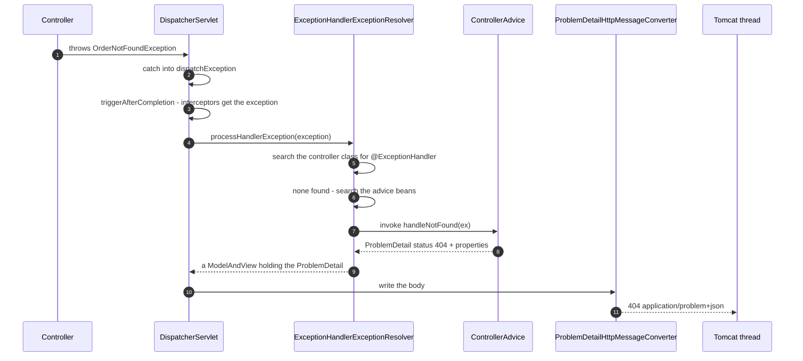

# Validation & Global Exception Handling

> **Level:** Beginner → Advanced
> **Interview Frequency:** ★★★★★ ("how do you design a global error response?" and "`@Valid` vs `@Validated`" are asked in nearly every round)
> **Prerequisites:** [02 · Controllers & REST APIs](./02-Controllers-REST-APIs-and-Content-Negotiation.md) · [01 · DispatcherServlet & Request Flow](./01-DispatcherServlet-and-Complete-Request-Flow.md)
> **Last Updated:** 2026

---

## 📋 Table of Contents
- [0. TL;DR — The 30-Second Answer](#0-tldr--the-30-second-answer)
- [1. What & Why — The Problem This Solves](#1-what--why--the-problem-this-solves)
- [2. Mental Model — The One Picture](#2-mental-model--the-one-picture)
- [3. Deep Dive — Theory (Beginner → Advanced)](#3-deep-dive--theory-beginner--advanced)
  - [3.1 Beginner Level](#31-beginner-level)
  - [3.2 Intermediate Level](#32-intermediate-level)
  - [3.3 Advanced Level](#33-advanced-level)
  - [3.4 Expert Level](#34-expert-level)
- [4. Internal Working Mechanism](#4-internal-working-mechanism)
- [5. Step-by-Step Execution Flow](#5-step-by-step-execution-flow)
- [6. Visualizations](#6-visualizations)
- [7. Production-Level Use Cases & Real Industry Examples](#7-production-level-use-cases--real-industry-examples)
- [8. Worked Examples (with Output + Dry Run)](#8-worked-examples-with-output--dry-run)
- [9. Code from Scratch — Production-Grade](#9-code-from-scratch--production-grade)
- [10. Common Mistakes & Gotchas](#10-common-mistakes--gotchas)
- [11. Performance Considerations](#11-performance-considerations)
- [12. Security Considerations](#12-security-considerations)
- [13. Best Practices](#13-best-practices)
- [14. Hands-On Exercises & Code Challenges](#14-hands-on-exercises--code-challenges)
- [15. Interview Q&A — Level-wise](#15-interview-qa--level-wise)
- [16. Scenario-Based & Real-Experience Scenarios (3–5 yrs)](#16-scenario-based--real-experience-scenarios-35-yrs)
- [17. Counter-Questions, Tricky Questions & Follow-Ups](#17-counter-questions-tricky-questions--follow-ups)
- [18. Frequently Asked Production Issues & Debugging Scenarios](#18-frequently-asked-production-issues--debugging-scenarios)
- [19. Architecture Design Questions](#19-architecture-design-questions)
- [20. Rapid-Fire MCQs](#20-rapid-fire-mcqs)
- [21. Cheat Sheet / One-Page Summary](#21-cheat-sheet--one-page-summary)
- [22. Real-World Production Notes](#22-real-world-production-notes)
- [23. Follow-up Learning](#23-follow-up-learning)

---

## 0. TL;DR — The 30-Second Answer

- **Validation happens at the edge, before your business logic runs.** A request that fails validation must never reach a service method, a database, or a payment provider. That is the whole point: *fail fast, fail cheap, fail safe*.
- **Jakarta Bean Validation 3.0** (Hibernate Validator 8.x in Spring Boot 3.3) is the standard. The annotations are **declarative** — they describe the invariant, and the validator framework enforces it.
- **`@Valid` vs `@Validated` — the critical difference:**
  * **`@Valid`** (jakarta.validation) is the **MVC annotation**. Put it on a `@RequestBody` parameter and Spring validates the deserialised object, cascading into nested objects. Failure → **`MethodArgumentNotValidException`** → **400**.
  * **`@Validated`** (org.springframework.validation.annotation) is the **Spring** annotation. Put it **on the class** and Spring creates a proxy that validates **method parameters and return values** (method-level validation). Failure → **`ConstraintViolationException`** → **500 unless you handle it**.
- **Cascading** is what makes nested validation work: `@Valid` on the field, or `@Valid` on the **type argument** of a collection (`List<@Valid Item> items`). Without the cascade, a nested object is never validated.
- **The validator collects every violation; it does not fail fast.** One request can produce ten field errors — which is exactly what a client wants, because otherwise the user fixes one field at a time.
- **Groups** let you apply different rules to the same DTO — `OnCreate` requires `password`, `OnUpdate` must ignore it. Use `@Validated(OnCreate.class)` on the parameter, and a **`@GroupSequence`** when the groups must run in a defined order.
- **The exception chain has a fixed order:** `ExceptionHandlerExceptionResolver` → `ResponseStatusExceptionResolver` → `DefaultHandlerExceptionResolver`. The first one that can handle the exception wins; if none does, the exception propagates to the servlet container.
- **`ResponseEntityExceptionHandler`** is the base class that turns Spring's own framework exceptions into **RFC 7807 `ProblemDetail`** bodies. Extend it and you get 20+ framework exceptions handled consistently for free.
- **`ProblemDetail` is the modern error body**: `type`, `title`, `status`, `detail`, `instance` plus arbitrary extension properties. Add a `traceId` and the client can raise a ticket that maps to a server log line.
- **Never leak internals.** A 500 body must not contain a stack trace, a SQL fragment or a class name. Log the cause, return a `traceId`.

---

## 1. What & Why — The Problem This Solves

**The problem.** Every API has two kinds of bad input:

1. **Syntactically wrong** — the body is not JSON, the `Content-Type` is wrong, a required parameter is missing. The framework can detect this by itself.
2. **Semantically wrong** — the JSON parses, but `quantity` is `-5`, the email is `not-an-email`, the `endDate` is before the `startDate`. **Only your business rules know this.**

And there is a third category that is not about the request at all: **something blew up inside your service** — the database is down, a downstream API timed out, a null pointer. The client needs a *different* answer for each category.

```text
   ❌ THE NAIVE CONTROLLER
   ───────────────────────
   @PostMapping("/orders")
   public OrderDto create(@RequestBody OrderRequest req) {
       if (req.getQuantity() <= 0) throw new IllegalArgumentException("bad qty");
       if (req.getEmail() == null)   throw new IllegalArgumentException("no email");
       ...
   }
   → every invalid request produces a 500
   → the client gets a stack trace (or an empty body)
   → the client fixes ONE field, re-submits, finds the next error
   → the "validation" lives in the controller and is bypassed by any other
     entry point (a message listener, a scheduled job, a batch import)
```

**The solution — two orthogonal layers.**

```text
   ┌───────────────────────────────────────────────────────────────┐
   │ LAYER 1 — DECLARATIVE VALIDATION (Bean Validation)             │
   │  WHERE: on the DTO, as annotations                            │
   │  WHEN:  immediately after deserialisation, BEFORE the service  │
   │  RESULT: a set of violations → 400 with a field map           │
   │  BENEFIT: the same rules apply to every entry point           │
   └───────────────────────────────────────────────────────────────┘
   ┌───────────────────────────────────────────────────────────────┐
   │ LAYER 2 - GLOBAL EXCEPTION HANDLING (HandlerExceptionResolver)│
   │  WHERE: one @RestControllerAdvice                             │
   │  WHEN:  when anything throws anywhere                         │
   │  RESULT: a consistent ProblemDetail body + the right status  │
   │  BENEFIT: the client codes against ONE error shape            │
   └───────────────────────────────────────────────────────────────┘
```

**Why it matters in production — the numbers.**

* **Cost of late validation.** A request that is invalid at the edge but reaches the database costs **one** connection and **one** round trip (≈ 3–8 ms) plus a possible write and rollback. A request validated at the edge costs **~40 µs** and **zero** I/O. At 400 req/s with a 3 % invalid-input rate, that is 12 requests/s × 8 ms = **~10 % of the connection pool** spent on garbage.
* **Cost of an inconsistent error contract.** With 40 endpoints and 6 different error shapes, every client team writes its own "handle errors" code, and each new endpoint invents a sixth shape. The cost is not the bytes — it is the **integration meetings**.
* **Cost of leaking internals.** One stack trace in a response body can expose a table name, a file path and a library version. That is a security incident, not a cosmetic bug.

> 💡 **The interview framing.** *"Validation is a **contract on the DTO**, not a check inside the controller. It runs at the boundary, it produces a **400 with every violation at once**, and it is **reusable** — the same DTO can be validated from a REST controller, a Kafka listener or a batch import without change. Global exception handling is the **other half**: it guarantees that no matter where the failure happened, the client gets the same, safe, machine-readable error body."*

---

## 2. Mental Model — The One Picture

```text
   THE REQUEST LIFECYCLE AS IT RELATES TO FAILURE
   ═══════════════════════════════════════════════

   raw bytes
      │
      ▼
   ┌───────────────────────────────────────────────┐
   │ CAN WE EVEN READ IT?                          │  ← handled by the FRAMEWORK
   │  wrong Content-Type ......... 415           │     (DefaultHandlerExceptionResolver)
   │  malformed JSON ............. 400           │
   │  missing @RequestParam ...... 400           │
   └───────────────┬───────────────────────────────┘
                   │  the body is now a Java object
                   ▼
   ┌───────────────────────────────────────────────┐
   │ IS IT VALID?  (Bean Validation)              │  ← handled by YOU
   │  @NotBlank @Size @Pattern @DecimalMin ...    │
   │  → 0 violations  : continue                  │     MethodArgumentNotValidException
   │  → N violations  : 400 + a field map         │     → @RestControllerAdvice
   └───────────────┬───────────────────────────────┘
                   │  valid
                   ▼
   ┌───────────────────────────────────────────────┐
   │ DOES THE BUSINESS WORK?                      │  ← handled by YOU
   │  service / repository / downstream call      │
   │  → business rule violated → 409 / 422        │     @ExceptionHandler(...)
   │  → unexpected failure   → 500 (generic body) │
   │  → security denied      → 403 (rethrow!)     │     ExceptionTranslationFilter
   └───────────────┬───────────────────────────────┘
                   ▼
                 200 / 201 / 204

   THE ONE RULE:  a failure at level N must never be reported as a
                  failure at level N+1.  A validation problem is a 400,
                  never a 500.
```

**What to look at:** the levels are **ordered by who understands the problem**. The framework understands "this is not JSON". Bean Validation understands "this field is blank". Only your code understands "this account is closed". The status code you return must match the level that detected the problem.

---

## 3. Deep Dive — Theory (Beginner → Advanced)

### 3.1 Beginner Level

**What is Bean Validation?** A JSR-380 (now **Jakarta Bean Validation 3.0**) specification that defines (a) a set of **constraint annotations** (`@NotNull`, `@Size`, …), (b) a **metadata API** for custom constraints, and (c) a **validation engine**. Spring Boot ships **Hibernate Validator 8.x** as the implementation, and registers it as a `LocalValidatorFactoryBean` bean — which is the `Validator` that Spring MVC uses.

**The five constraints you will use every day.**

```java
public record CreateUserRequest(
        @NotNull(message = "id is required")        Long id,          // null is not allowed
        @NotBlank(message = "name must not be blank") String name,     // null, "" and "   " are not allowed
        @NotEmpty(message = "at least one role")     List<String> roles, // null and [] are not allowed
        @Size(min = 8, max = 64, message = "password must be 8-64 chars")
        String password,
        @Email(message = "must be a valid email")    String email) {
}
```

The distinction is the one everybody forgets:

| Annotation | `null` | `""` | `"   "` | `[]` |
|---|---|---|---|---|
| `@NotNull` | ❌ | ✅ | ✅ | ✅ |
| `@NotBlank` | ❌ | ❌ | ❌ | ✅ |
| `@NotEmpty` | ❌ | ✅ | ✅ | ❌ |

**Using it in a controller.**

```java
@PostMapping("/api/users")
public ResponseEntity<UserDto> create(@Valid @RequestBody CreateUserRequest request) { ... }
```

If the body is invalid, Spring throws `MethodArgumentNotValidException` and **never calls your method**. The exception carries a `BindingResult` with one `FieldError` per violation.

**The custom message.** Every constraint takes `message`, which by default is the *interpolated* message of the annotation's `message()` attribute. You override it per-usage:

```java
@Size(min = 8, max = 64, message = "password must be between 8 and 64 characters")
```

**Cross-field validation** does not fit the annotation model (an annotation only sees one field). It goes in the DTO or the service:

```java
@AssertTrue(message = "endDate must be after startDate")
public boolean isDateRangeValid() {
    return startDate == null || endDate == null || endDate.isAfter(startDate);
}
```

`@AssertTrue` on a getter is the idiomatic way to express it — Hibernate Validator calls the method and validates the returned boolean.

### 3.2 Intermediate Level

**The full constraint catalogue (Jakarta Bean Validation 3.0).**

| Constraint | Validates | `null` allowed? |
|---|---|---|
| `@NotNull` | not null | ❌ |
| `@NotEmpty` | not null and not empty (string/collection/map/array) | ❌ |
| `@NotBlank` | not null and not whitespace-only (string only) | ❌ |
| `@Size(min, max)` | size of string/collection/map/array | ✅ |
| `@Min` / `@Max` | `BigDecimal`, `BigInteger`, byte/short/int/long and wrappers | ✅ |
| `@DecimalMin(value, inclusive)` / `@DecimalMax` | `BigDecimal` and `BigInteger` | ✅ |
| `@Positive` / `@PositiveOrZero` | numeric > 0 / >= 0 | ✅ |
| `@Negative` / `@NegativeOrZero` | numeric < 0 / <= 0 | ✅ |
| `@Digits(integer, fraction)` | precision and scale of a decimal | ✅ |
| `@Pattern(regexp)` | matches a regular expression | ✅ |
| `@Email` | a valid email address (per the spec's loose algorithm) | ✅ (see below) |
| `@Past` / `@PastOrPresent` | a date in the past / not in the future | ✅ |
| `@Future` / `@FutureOrPresent` | a date in the future / not in the past | ✅ |
| `@AssertTrue` / `@AssertFalse` | a boolean expression is true / false | ✅ |
| `@Null` | the value is null | — (the *only* value allowed is null) |

> ⚠️ **A fact that surprises everyone.** Hibernate's built-in `@Email` **treats `null` as valid** — the specification says a null value is valid for `@Email` (nullability is a *separate* concern). So `@Email String email` alone will happily accept a `null` email. In practice you want `@NotBlank` **and** `@Email`, or a composed annotation that includes both.

**Composition — building your own annotation from existing ones.**

```java
@Documented
@Constraint(validatedBy = {})                       // no custom validator - purely composed
@NotNull(message = "email must not be null")
@Email(message = "must be a valid email address")
@Size(max = 255, message = "email must not exceed 255 characters")
@Target({ ElementType.FIELD, ElementType.PARAMETER, ElementType.RECORD_COMPONENT })
@Retention(RetentionPolicy.RUNTIME)
public @interface ValidEmail {
    String message() default "must be a valid email address";
    Class<?>[] groups() default {};
    Class<? extends Payload>[] payload() default {};
}
```

Because `groups` and `payload` are **mandatory** members of every constraint annotation, a composed annotation must declare them too — and it must repeat the *same* `groups` on each member constraint (a well-known source of "the group is not applied" bugs).

**Groups — different rules for different operations.**

```java
public interface OnCreate {}
public interface OnUpdate {}

public record UserRequest(
        @Null(groups = OnUpdate.class, message = "id must not be supplied on update")
        @NotNull(groups = OnCreate.class, message = "id is required on create")
        Long id,

        @NotBlank(groups = {OnCreate.class, OnUpdate.class})
        String name) {
}
```

```java
@PostMapping   public UserDto create(@Validated(OnCreate.class) @RequestBody UserRequest req) {}
@PutMapping    public UserDto update(@Validated(OnUpdate.class) @RequestBody UserRequest req) {}
```

**Group ordering with `@GroupSequence`.** By default, **all** groups are validated and the result is the *union* of the violations. If you need a strict order — for example, the "password strength" group must run only after the "password matches confirmation" group has passed — declare a sequence on the class:

```java
@GroupSequence({ Default.class, PasswordMatch.class, PasswordStrength.class })
public class UserRequest { ... }
```

With a `@GroupSequence`, validation **stops at the first group that produces violations** — a fail-fast behaviour, unlike the default "collect everything" behaviour.

**`@Valid` vs `@Validated` — the critical difference.**

| | `@Valid` (`jakarta.validation.Valid`) | `@Validated` (`org.springframework.validation.annotation.Validated`) |
|---|---|---|
| Package | `jakarta.validation` | `org.springframework.validation.annotation` |
| Where it is used | On a **parameter** (`@RequestBody`, `@ModelAttribute`) | On the **class** (and optionally on a parameter) |
| What it does | Enables **cascading** validation of the object | Enables **method-level validation** (AOP proxy) **and** group selection |
| Failure exception | `MethodArgumentNotValidException` (for `@RequestBody`) / `BindException` (for `@ModelAttribute`) | `ConstraintViolationException` |
| Default status | **400** | **500** ⚠️ |
| Supported by | Any Bean Validation implementation | Spring's `MethodValidationPostProcessor` |

> ▶ **The trap that gets people hired and fired.** A candidate writes `@Validated` on the parameter
> of a controller method, expects the bean-validation failure to become a 400, and ships a
> **500** to the client — because `@Validated` on a *parameter* selects **groups**; it does **not**
> turn on cascading validation for `@RequestBody`. Cascading for `@RequestBody` requires
> **`@Valid`**. And method-level validation (validating *method arguments* of a service bean)
> requires **`@Validated` on the class** — which is a completely different feature.

**Validating collections and nested objects — the cascade.**

```java
public record CreateOrderRequest(
        @NotEmpty @Size(max = 100) List<@Valid LineItemRequest> items,   // cascade into each element
        @Valid @NotNull CustomerRequest customer) {                        // cascade into the nested object
```

The `@Valid` on the **type argument** (`List<@Valid LineItemRequest>`) is what makes the container's elements validated. Without it, only the container's own constraints (`@NotEmpty`, `@Size`) are checked.

**Method-level validation — the service layer.**

```java
@Service
@Validated                       // ← REQUIRED: enables the AOP proxy
public class TransferService {

    public void transfer(@NotNull Long fromId, @Positive BigDecimal amount) { ... }
}
```

`@Validated` on the class makes `MethodValidationPostProcessor` create a proxy; the proxy validates the method arguments (and the return value, if `@Valid` is on it) and throws `ConstraintViolationException`.

> ▶ **A serious gotcha.** `MethodValidationPostProcessor` is applied by Spring Boot **only when a bean has the `@Validated` annotation** — it is not applied to every bean. And because it is **AOP-based**, it uses a proxy: **self-invocation does not trigger validation** (`this.transfer(...)` inside the same bean bypasses the proxy). The same trap as `@Transactional`.

**Which exception is thrown — the diagnostic table.**

| Where the validation ran | Exception | Layer | Default status |
|---|---|---|---|
| `@Valid @RequestBody` (argument resolution) | `MethodArgumentNotValidException` | MVC argument resolution | **400** |
| `@Valid @ModelAttribute` (binding) | `BindException` | MVC binding | **400** |
| `@Validated` on a **class** (method-level, AOP) | `ConstraintViolationException` | service / bean proxy | **500** ⚠️ |
| `@Validated(Group.class)` on a **`@RequestBody`** parameter | `MethodArgumentNotValidException` | MVC argument resolution | **400** |

> ▶ **Why the third row is a 500.** `ConstraintViolationException` (jakarta.validation) does **not**
> implement Spring's `ErrorResponse` interface, so `DefaultHandlerExceptionResolver` does not know
> what to do with it and lets it propagate → the container renders a **500**. You must add an
> `@ExceptionHandler(ConstraintViolationException.class)` that returns **400** (or 422).

### 3.3 Advanced Level

**Custom constraints — the four pieces.**

```java
@Documented
@Constraint(validatedBy = StrongPasswordValidator.class)
@Target({ ElementType.FIELD, ElementType.PARAMETER, ElementType.RECORD_COMPONENT,
          ElementType.TYPE_USE, ElementType.METHOD })
@Retention(RetentionPolicy.RUNTIME)
public @interface StrongPassword {

    String message() default "password does not meet the strength policy";

    Class<?>[] groups() default {};

    Class<? extends Payload>[] payload() default {};

    int minLength() default 12;                 // custom attributes are allowed
    boolean requireUpperCase() default true;
}
```

```java
public class StrongPasswordValidator implements ConstraintValidator<StrongPassword, String> {

    private int minLength;
    private boolean requireUpperCase;

    @Override
    public void initialize(StrongPassword constraintAnnotation) {
        this.minLength = constraintAnnotation.minLength();
        this.requireUpperCase = constraintAnnotation.requireUpperCase();
    }

    @Override
    public boolean isValid(String value, ConstraintValidatorContext context) {
        if (value == null) {
            return true;                       // nullability is @NotNull's job
        }
        boolean ok = value.length() >= minLength
                && (!requireUpperCase || value.chars().anyMatch(Character::isUpperCase));
        if (!ok) {
            // Attach a per-attribute violation instead of (or as well as) the default one.
            context.disableDefaultConstraintViolation();
            context.buildConstraintViolationWithTemplate(
                    "password must be at least {minLength} characters"
                            + (requireUpperCase ? " and contain an upper-case letter" : ""))
                    .addPropertyNode("password")
                    .addConstraintViolation();
        }
        return ok;
    }
}
```

The three moving parts to remember:

* **`@Constraint(validatedBy = …)`** names the validator.
* **`@Payload`** — the `Class<? extends Payload>[] payload()` member is **mandatory** (it exists so custom payload types can be attached to violations). It is almost always left empty.
* **`ConstraintValidator<A, T>`** — `initialize` reads the annotation's attributes; `isValid` returns the verdict. Returning `true` for `null` is the convention — nullability belongs to `@NotNull`.

**The `ConstraintValidatorContext` is under-used.** `disableDefaultConstraintViolation()` + `buildConstraintViolationWithTemplate(...)` lets you (a) customise the message with the annotation's attributes interpolated, and (b) attach the violation to a **specific property node**, which is what makes the error map point at the right field.

**Message interpolation.** The message template may contain `{attribute}` placeholders, resolved from the annotation's attributes, from the *validated value* (via `Validator` / EL), and from the message bundle. The default bundle is `ValidationMessages.properties`; Spring Boot merges `messages.properties` into it, so `{...}` placeholders can be resolved from the application context.

**i18n of validation messages.** Provide `ValidationMessages.properties` (and `ValidationMessages_de.properties`, …) in the classpath root, and put the property key in the message:

```java
@NotBlank(message = "{user.name.notBlank}")
String name;
```

Then `ValidationMessages_de.properties` contains `user.name.notBlank=Der Name darf nicht leer sein`. The trade-off: the message key is now in the **API contract** — changing it changes the client-visible text.

**Validation groups and the `Default` group.** A constraint with no explicit `groups` belongs to the `Default` group. `@Validated(Default.class)` is equivalent to plain `@Valid` for group purposes.

**`@Validated` on a class also enables validation of the *return value*.**

```java
@Validated
@Service
public class OrderService {
    @Valid                                        // validate the returned object
    public OrderDto place(@Valid CreateOrderRequest req) { ... }
}
```

**`HandlerMethodArgumentResolver` validation.** `AbstractMessageConverterMethodProcessor#validateIfApplicable` performs the validation, and it looks for `@Valid` **or** `@Validated` on the parameter. If a `BindingResult` parameter immediately follows the validated parameter, Spring **does not throw** — instead it populates the `BindingResult` and calls your method, so you can handle the errors yourself:

```java
public ResponseEntity<?> create(@Valid @RequestBody CreateOrderRequest req, BindingResult errors) {
    if (errors.hasErrors()) {
        return ResponseEntity.badRequest().body(toProblem(errors));
    }
    ...
}
```

This is a useful escape hatch, but it makes the contract inconsistent — most teams prefer the exception path and a global handler.

**`ErrorResponse` and `ErrorResponseException` (Spring 6 / Boot 3).** `ErrorResponse` is the interface that lets *any* exception declare its HTTP status and problem type:

```java
public interface ErrorResponse {
    HttpStatusCode getStatusCode();
    ProblemDetail getBody();
    default String getDetail() { ... }
}
```

`DefaultHandlerExceptionResolver` handles every `ErrorResponse` automatically. `ErrorResponseException` is the abstract base class; `ResponseStatusException` is its concrete subclass. **This is the modern replacement for `@ResponseStatus`** — you can implement `ErrorResponse` on your own exceptions and get the full `ProblemDetail` behaviour for free.

**`@ResponseStatus` is not deprecated, but it is superseded.** `@ResponseStatus(HttpStatus.NOT_FOUND)` on an exception class still works, and `ResponseStatusExceptionResolver` handles it. The difference: `@ResponseStatus` is **static** (the status is fixed at compile time), `ResponseStatusException` is **dynamic** (you choose the status and the reason at the throw site). Spring's own guidance is to prefer `ResponseStatusException` for dynamic cases.

### 3.4 Expert Level

**The exception hierarchy as Spring sees it.**

```text
jakarta.validation.ConstraintViolationException
        │  (method-level validation via AOP)
        ▼
org.springframework.web.bind.MethodArgumentNotValidException   (extends BindException)
        │  (validation of a @RequestBody)
        ▼
org.springframework.validation.BindException
        │  (binding of @ModelAttribute)
        ▼
org.springframework.validation.ObjectError / FieldError / GlobalError
```

```text
org.springframework.web.ErrorResponseException            (abstract, implements ErrorResponse)
        ├── org.springframework.web.server.ResponseStatusException
        └── (your own exceptions can implement ErrorResponse directly)
```

**`DefaultHandlerExceptionResolver` — the built-in mapping.** In Spring Framework 6, the resolver handles any `ErrorResponse` by applying its status, plus a set of legacy exceptions:

| Exception | Status | Notes |
|---|---|---|
| `MethodArgumentNotValidException` | **400** | `@Valid @RequestBody` failed |
| `BindException` | **400** | `@ModelAttribute` binding failed |
| `HttpMessageNotReadableException` | **400** | malformed body / wrong type |
| `TypeMismatchException` | **400** | a parameter could not be converted |
| `MissingServletRequestParameterException` | **400** | a required `@RequestParam` is absent |
| `ServletRequestBindingException` | **400** | a request attribute/param could not be bound |
| `HttpRequestMethodNotSupportedException` | **405** | wrong HTTP verb; the `Allow` header is set |
| `HttpMediaTypeNotSupportedException` | **415** | `Content-Type` not in `consumes` |
| `HttpMediaTypeNotAcceptableException` | **406** | `Accept` not satisfiable |
| `NoHandlerFoundException` | **404** | no mapping matched (needs `spring.mvc.throw-exception-if-no-handler-found=true`) |
| `NoResourceFoundException` | **404** | Spring 6.1 / Boot 3.2+ — a static resource was not found |
| `AsyncRequestTimeoutException` | **503** | the async request timed out |
| `ConversionNotSupportedException` | **500** | a conversion does not exist |
| `HttpMessageNotWritableException` | **500** | the body could not be written |
| `ConversionNotSupportedException`, `HttpMessageNotWritableException` | **500** | server-side faults |

**The resolver order — the single most important fact in this chapter.**

```text
   ExceptionHandlerExceptionResolver      (order 0 by default)
        │  - @ExceptionHandler in the CONTROLLER class        ← highest priority
        │  - @ExceptionHandler in a @ControllerAdvice        ← ordered by @Order
        ▼
   ResponseStatusExceptionResolver
        │  - @ResponseStatus on the exception class
        │  - ResponseStatusException (any ErrorResponseException)
        ▼
   DefaultHandlerExceptionResolver
           - the built-in mapping above
           - if it cannot handle it: the exception is RETHROWN to the container
```

**Priority inside `ExceptionHandlerExceptionResolver`.** The resolver first looks for an `@ExceptionHandler` **in the controller class that owns the handler method** — that always wins. Only if there is none does it consult the `@ControllerAdvice` beans, in their `@Order` order. So a method-level handler beats a global one, regardless of specificity.

**`@ControllerAdvice` vs `@RestControllerAdvice`.** `@RestControllerAdvice` is `@ControllerAdvice` + `@ResponseBody` on the type — so the handler's return value is written to the body rather than treated as a view name. `@ControllerAdvice` with a `ResponseEntity` return value works identically; the difference only shows if you return a raw object. Use `@RestControllerAdvice`.

**`ResponseEntityExceptionHandler` — the base class worth extending.**

```java
@RestControllerAdvice
public class GlobalExceptionHandler extends ResponseEntityExceptionHandler {
    // All the Spring framework exceptions are handled here already,
    // each returning a ProblemDetail (Spring 6 behaviour).
}
```

It provides `@ExceptionHandler` methods for ~20 framework exceptions, and since Spring Framework 6 it builds the response body as a **`ProblemDetail`** automatically. You override the ones you want to customise:

```java
@Override
protected ResponseEntity<Object> handleMethodArgumentNotValid(
        MethodArgumentNotValidException ex, HttpHeaders headers,
        HttpStatusCode status, WebRequest request) {

    ProblemDetail body = ProblemDetail.forStatus(status);
    body.setTitle("Validation failed");
    body.setProperty("errors", toFieldErrors(ex.getBindingResult()));
    body.setProperty("traceId", MDC.get("traceId"));
    return handleExceptionInternal(ex, body, headers, status, request);
}
```

**`ProblemDetail` — the RFC 7807 body.**

```java
ProblemDetail problem = ProblemDetail.forStatusAndDetail(HttpStatus.NOT_FOUND, "Order 1042 not found");
problem.setType(URI.create("https://errors.acme.com/orders/not-found"));
problem.setTitle("Order not found");
problem.setInstance(URI.create("/api/v1/orders/1042"));
problem.setProperty("traceId", "8f3c1a20d4e54b0f");
problem.setProperty("orderId", 1042L);
```

| Field | Meaning | Required |
|---|---|---|
| `type` | a URI identifying the *problem type* — a documentation link | recommended |
| `title` | a short, human-readable summary of the problem type | optional |
| `status` | the HTTP status code | optional |
| `detail` | a human-readable explanation **specific to this occurrence** | optional |
| `instance` | a URI identifying this specific occurrence | optional |
| *(extensions)* | any additional properties | optional |

**`ResponseStatusException` vs `@ExceptionHandler` precedence.** If a controller method throws `ResponseStatusException` **and** an `@ExceptionHandler` for that same type (or for `Exception`) exists, **the `@ExceptionHandler` wins** — `ExceptionHandlerExceptionResolver` runs first. So a catch-all `@ExceptionHandler(Exception.class)` will silently swallow every `ResponseStatusException` you throw, turning your carefully chosen 404 into a 500. This is the single most common cause of "my `ResponseStatusException` returns 500".

**`AccessDeniedException` — the security interaction.** Spring Security's `AuthorizationFilter` (URL rules) and the method-security interceptor (`@PreAuthorize`) both throw `AccessDeniedException`. The `ExceptionTranslationFilter` (position 15 in the security chain) is what converts it into a **403** — but only if the exception **propagates out of the `DispatcherServlet`**.

A catch-all `@ExceptionHandler(Exception.class)` in a `@RestControllerAdvice` handles it *inside* the dispatcher, so the exception never reaches `ExceptionTranslationFilter` and the client gets whatever your handler returned — frequently a **500**. The correct pattern is to **rethrow**:

```java
@ExceptionHandler(AccessDeniedException.class)
public void handleAccessDenied(AccessDeniedException ex) {
    throw ex;                    // let ExceptionTranslationFilter produce the 403
}
```

The same applies to `AuthenticationException` — but note that `AuthenticationException` thrown *during* authentication is normally handled inside the security chain itself, before it reaches your advice.

**Async exceptions.** In Spring Framework 6.1 / Boot 3.2, `AsyncRequestNotUsableException` is thrown when the response is no longer usable — typically because the **client disconnected** during async processing. It is a *normal* condition, not a bug, and should be logged at **DEBUG**, not ERROR, and must not be turned into a 500 response (the connection is already gone). A catch-all handler that tries to write a body for it will fail with `IllegalStateException`.

**Logging rules for `@ExceptionHandler`.**

* An `@ExceptionHandler` method should **never** swallow an `Error` (`OutOfMemoryError`, `StackOverflowError`) — rethrow it so the JVM can act.
* Do not catch and log-and-continue; either handle it or rethrow it.
* Log **once**: either the handler logs it, or the framework's default handler logs it — not both, or you get two log lines per failure and double the alerting noise.

---

## 4. Internal Working Mechanism

**The validation call chain (request body).**

```text
RequestResponseBodyMethodProcessor.resolveArgument
   │
   ├─ readWithMessageConverters(...)         → the DTO instance
   │
   └─ validateIfApplicable(binder, parameter)
        │
        ├─ 1. Look for @Valid / @Validated on the MethodParameter
        │      (AnnotationUtils.findAnnotation → also finds meta-annotations)
        ├─ 2. If neither is present → return immediately (no validation)
        ├─ 3. binder.validate(validationHints)   ← the LocalValidatorFactoryBean
        │      ├─ the validator walks the object's property metadata
        │      ├─ for each property: find the constraint annotations
        │      ├─ evaluate the constraints, collect the violations
        │      └─ if a violation has a "cascade" (a nested @Valid),
        │         recurse into the nested object
        └─ 4. If there are violations →
               throw MethodArgumentNotValidException(methodParameter, bindingResult)
```

**The exception handling call chain.**

```text
processDispatchResult(request, response, mappedHandler, mv, dispatchException)
   │
   └─ processHandlerException(request, response, handler, exception)
        │
        ├─ 1. ExceptionHandlerExceptionResolver
        │      ├─ look for @ExceptionHandler in the CONTROLLER's class      ← first
        │      ├─ if none, look through the @ControllerAdvice beans        ← ordered
        │      ├─ invoke the handler method, wrap the result in a ModelAndView
        │      └─ if it produces a ModelAndView → RETURN (the chain stops)
        │
        ├─ 2. ResponseStatusExceptionResolver
        │      ├─ @ResponseStatus on the exception class?
        │      ├─ ResponseStatusException / ErrorResponseException?
        │      └─ apply the status (and, since Spring 6, build a ProblemDetail)
        │
        ├─ 3. DefaultHandlerExceptionResolver
        │      ├─ the built-in exception → status table
        │      └─ if it cannot handle the exception → return null
        │
        └─ 4. If every resolver returned null →
               RETHROW the exception to the servlet container
               (the container renders the error page, or Boot's
                BasicErrorController renders the default JSON error body)
```

**The `BindingResult` — what the handler gets.**

```java
public interface MethodArgumentNotValidException extends BindException { }

// BindException gives you:
BindingResult.getFieldErrors();   // List<FieldError>  — one per field violation
BindingResult.getGlobalErrors();  // List<ObjectError> — one per object-level violation
BindingResult.getAllErrors();     // the union
BindingResult.getFieldError("email");
```

A `FieldError` carries: `getField()`, `getDefaultMessage()`, `getRejectedValue()`, `getCode()`, `getObjectName()`.

---

## 5. Step-by-Step Execution Flow

**What happens between "the JSON arrives" and "the client gets a 400".**

```text
 ①  Tomcat parses the request.
     POST /api/v1/orders   Content-Type: application/json

 ②  Filters (security, correlation id) run.

 ③  DispatcherServlet.getHandler() → matches POST /api/v1/orders

 ④  Interceptor.preHandle()

 ⑤  ARGUMENT RESOLUTION
     The parameter is @Valid @RequestBody CreateOrderRequest req
       a. readWithMessageConverters → MappingJackson2HttpMessageConverter
          → Jackson reads 312 bytes → CreateOrderRequest
          → if the JSON is malformed: HttpMessageNotReadableException → 400
       b. validateIfApplicable(binder, parameter)
          → finds @Valid on the parameter
          → binder.validate() → LocalValidatorFactoryBean
          → the validator walks the constraint metadata:
                customerId  @NotBlank      → VIOLATION "must not be blank"
                items       @NotEmpty      → VIOLATION "must not be empty"
                items[0]    @Valid cascade → recursion into LineItemRequest
                               quantity @Positive → VIOLATION "must be greater than 0"
          → 3 violations collected
       c. throws MethodArgumentNotValidException(methodParameter, bindingResult)

 ⑥  doDispatch catches it into dispatchException

 ⑦  processDispatchResult → triggerAfterCompletion (interceptors get the exception)
                            → processHandlerException

 ⑧  ExceptionHandlerExceptionResolver
       a. look for @ExceptionHandler in OrderController → none
       b. look through the @ControllerAdvice beans → GlobalExceptionHandler
       c. invoke handleMethodArgumentNotValid(...)
       d. it builds a ProblemDetail(status=400) + the errors map
       e. returns a ModelAndView → the chain STOPS here

 ⑨  The ModelAndView is rendered by the response handling:
       → ProblemDetailHttpMessageConverter writes
         Content-Type: application/problem+json

 ⑩  Interceptor.afterCompletion() (already ran in step ⑦)

 ⑪  Tomcat flushes the 400 response.
```

**The dry-run numbers for one invalid POST:**

| Stage | Time |
|---|---|
| Routing | 0.02 ms |
| Jackson deserialise (312 B) | 0.21 ms |
| **Bean Validation (3 violations, 9 constraints evaluated)** | **0.11 ms** |
| `ProblemDetail` construction + serialisation | 0.05 ms |
| **Total** | **≈ 0.4 ms** |

Compare with the same request reaching the service: **+8 ms** (DB round trip) and a **connection checked out**.

---

## 6. Visualizations

### 6.1 The `HandlerExceptionResolver` chain — who wins

```mermaid
flowchart TD
    EX[Exception thrown during handler invocation] --> E1{ExceptionHandlerExceptionResolver}
    E1 -->|@ExceptionHandler in the controller class| H1[handled - highest priority]
    E1 -->|no method-level handler| E2{@ControllerAdvice beans, in @Order order}
    E2 -->|an advice handles it| H2[handled - advice wins]
    E2 -->|no advice handles it| E3{ResponseStatusExceptionResolver}
    E3 -->|@ResponseStatus or ResponseStatusException| H3[status applied]
    E3 -->|not a status-carrying exception| E4{DefaultHandlerExceptionResolver}
    E4 -->|known framework exception| H4[built-in status table]
    E4 -->|unknown exception| RETHROW[rethrow to the servlet container - 500]

    style H1 fill:#e8f5e9,stroke:#2e7d32
    style H2 fill:#e8f5e9,stroke:#2e7d32
    style H3 fill:#fff8e1,stroke:#f9a825
    style H4 fill:#fff8e1,stroke:#f9a825
    style RETHROW fill:#ffebee,stroke:#c62828
```

**What to look at:** `ExceptionHandlerExceptionResolver` runs **first**, so an `@ExceptionHandler` — even a catch-all `Exception.class` — beats a `ResponseStatusException` and beats `DefaultHandlerExceptionResolver`. That single ordering explains most "my status code is wrong" bugs.

### 6.2 The built-in exception → status mapping

```text
┌────────────────────────────────────────────────────────────────────────┬────────┐
│ EXCEPTION                                                             │ STATUS │
├────────────────────────────────────────────────────────────────────────┼────────┤
│ MethodArgumentNotValidException      (@Valid @RequestBody failed)    │  400   │
│ BindException                        (@ModelAttribute binding failed) │  400   │
│ HttpMessageNotReadableException      (malformed JSON / wrong type)   │  400   │
│ TypeMismatchException                (parameter could not convert)   │  400   │
│ MissingServletRequestParameterException (required param absent)      │  400   │
│ ServletRequestBindingException       (request binding failed)        │  400   │
├────────────────────────────────────────────────────────────────────────┼────────┤
│ HttpMediaTypeNotAcceptableException  (Accept not satisfiable)        │  406   │
│ HttpRequestMethodNotSupportedException (wrong verb, Allow is set)    │  405   │
│ HttpMediaTypeNotSupportedException   (Content-Type not in consumes)  │  415   │
├────────────────────────────────────────────────────────────────────────┼────────┤
│ NoHandlerFoundException              (no mapping matched)            │  404   │
│ NoResourceFoundException             (static resource not found)     │  404   │
├────────────────────────────────────────────────────────────────────────┼────────┤
│ AsyncRequestTimeoutException         (async request timed out)       │  503   │
│ ConversionNotSupportedException      (no conversion exists)          │  500   │
│ HttpMessageNotWritableException      (body could not be written)     │  500   │
├────────────────────────────────────────────────────────────────────────┼────────┤
│ ConstraintViolationException         (method-level @Validated)       │  500 ⚠ │
│ AccessDeniedException                (security)                      │  rethrow│
│ AuthenticationException              (security)                      │  rethrow│
└────────────────────────────────────────────────────────────────────────┴────────┘

  ⚠ THE TWO ROWS THAT SURPRISE PEOPLE
  ────────────────────────────────────
  ConstraintViolationException → 500  because it does NOT implement ErrorResponse.
                                 Add @ExceptionHandler(ConstraintViolationException.class) → 400.
  AccessDeniedException        → rethrow it, so ExceptionTranslationFilter can make it a 403.
```

**What to look at:** the table is a **fallback**, not your design. Your job is to intercept the framework exceptions at the top of the chain and give them a consistent body.

### 6.3 An exception thrown in a controller reaching `@RestControllerAdvice`



**What to look at:** the exception is converted to a **`ModelAndView`** by the resolver — the advice method's return value is wrapped, and the writing is done afterwards by the normal response machinery. That is why an advice can return a `ProblemDetail`, a `ResponseEntity`, or a `Map`, and all three work.

### 6.4 A `ProblemDetail` body with every field annotated

```json
{
  "type": "https://errors.acme.com/orders/not-found",   ← type: URI identifying the PROBLEM TYPE
  "title": "Order not found",                             ← title: short summary of the problem TYPE
  "status": 404,                                          ← status: the HTTP status code
  "detail": "No order exists with id 1042 for customer CUS-7781",
                                                         ← detail: explanation of THIS OCCURRENCE
  "instance": "/api/v1/orders/1042",                      ← instance: URI of THIS occurrence
  "traceId": "8f3c1a20d4e54b0f",                          ← ←── extension properties (RFC 9457 allows any)
  "orderId": 1042,                                          │
  "customerId": "CUS-7781"                                 │
}
```

```text
   ┌───────────────┐
   │   type        │  URI of the problem TYPE. A stable documentation link.
   │               │  Should be the SAME for every occurrence of this problem.
   ├───────────────┤
   │   title       │  Short human summary of the TYPE. Same for every occurrence.
   │               │  e.g. "Order not found"
   ├───────────────┤
   │   status      │  The HTTP status code. 404 here.
   │               │  MUST agree with the real HTTP status on the wire.
   ├───────────────┤
   │   detail      │  Human explanation of THIS occurrence. MAY vary.
   │               │  ⚠ NEVER put a stack trace, SQL or an exception message in it.
   ├───────────────┤
   │   instance    │  URI identifying THIS occurrence. Often the request path.
   ├───────────────┤
   │   traceId     │  ←── EXTENSION PROPERTIES: any extra JSON members are allowed.
   │   orderId     │      Use them for machine-readable context (ids) and for the
   │   customerId  │      correlation id that ties the response to the server log.
   └───────────────┘
```

**What to look at:** `type`/`title` describe the *class* of problem and are stable; `detail`/`instance` describe *this* occurrence and vary. Clients should branch on `type` (or `code`), never on `detail`.

---

## 7. Production-Level Use Cases & Real Industry Examples

### 7.1 Banking — payments validation (18k requests/min, 4 % invalid)

A retail bank's payments API validates **11 constraints** on the request DTO and **4 cross-field rules** in the service (settlement date after authorisation date, amount within the account's daily limit, currency matches the account's currency).

| Layer | What it catches | Share of rejects | Status |
|---|---|---|---|
| Bean Validation | malformed field values | 78 % | 400 |
| Service rules | business-rule violations | 21 % | 422 |
| Database | unique-constraint violation | 1 % | 409 |

**Why 422 for business rules and 400 for malformed input.** The 400/422 split is the one clients rely on: **400 = "fix the syntax", 422 = "the syntax is fine, the semantics are wrong"**. A mobile client can auto-correct 400s and must send 422s to a human.

### 7.2 E-commerce — bulk order import (2 400 rows per request)

An e-commerce platform lets sellers upload 2 400 CSV rows. Validating each row with a full Bean Validation pass costs **~1.4 ms/row** (a full object graph walk) → **3.4 seconds** per request. The team replaced per-row Bean Validation with a **hand-written fast-path validator** (regex + primitive checks, no reflection) for the bulk path, and kept Bean Validation for the single-order path.

| Path | Rows | Validation cost | Total |
|---|---|---|---|
| Single order (Bean Validation) | 1 | 0.4 ms | 0.4 ms |
| Bulk (per-row Bean Validation) | 2 400 | 1.4 ms/row | 3 360 ms ❌ |
| Bulk (fast-path validator) | 2 400 | 0.05 ms/row | 120 ms ✅ |

The bulk response returns **per-row errors** — 1 204 rejected rows with their row number and reason — rather than one giant 400.

### 7.3 SaaS — the global error contract (140 endpoints, 11 client teams)

One `@RestControllerAdvice` extends `ResponseEntityExceptionHandler` and adds six business handlers. Every error body is a `ProblemDetail` with a `traceId`. A **contract test** asserts that every endpoint's error body has the same five keys.

| Metric | Before | After |
|---|---|---|
| Distinct error body shapes | 6 | **1** |
| Client-side "handle error" code | ~180 lines per team | ~35 lines, shared |
| Mean time to diagnose a user-reported 500 | 45 min | **4 min** (grep the `traceId`) |

### 7.4 Ad-tech — bid validation (800 req/s, 0.2 ms budget)

Ad-tech endpoints validate a bid request in under **0.2 ms**, which rules out reflective Bean Validation on a large object graph. The team uses **explicit primitive checks** in the service (`if (price <= 0) throw ...`) and reserves Bean Validation for the low-volume campaign-management APIs.

| Path | Validation cost | Budget |
|---|---|---|
| Bid request (explicit checks) | 0.03 ms | 0.2 ms ✅ |
| Bid request (Bean Validation) | 0.45 ms | 0.2 ms ❌ |

**The lesson.** Bean Validation is the right default for **request DTOs**, but it is not free. Measure it before you put it in a hot path.

---

## 8. Worked Examples (with Output + Dry Run)

### 8.1 Example 1 — A `ProblemDetail` response for a validation failure, with the validator order

**Problem.** A `CreateOrderRequest` has three constraints; a client sends a body that violates all of them. We need the exact response and the exact order in which the constraints fire.

**Code.**

```java
package com.example.order.api;

import jakarta.validation.Valid;
import jakarta.validation.constraints.DecimalMin;
import jakarta.validation.constraints.NotBlank;
import jakarta.validation.constraints.NotEmpty;
import jakarta.validation.constraints.Positive;
import java.math.BigDecimal;
import java.util.List;

public record CreateOrderRequest(

        @NotBlank(message = "customerId must not be blank")
        String customerId,

        @NotEmpty(message = "at least one line item is required")
        List<@Valid LineItemRequest> items,

        @NotBlank(message = "currency must not be blank")
        String currency,

        @DecimalMin(value = "0.00", inclusive = true, message = "discount must not be negative")
        BigDecimal discount) {

    public record LineItemRequest(
            @NotBlank(message = "sku must not be blank")
            String sku,

            @Positive(message = "quantity must be greater than 0")
            int quantity) {
    }
}
```

```java
package com.example.order.api;

import java.util.List;

import jakarta.validation.ConstraintViolation;
import org.slf4j.MDC;
import org.springframework.http.HttpStatus;
import org.springframework.http.ProblemDetail;
import org.springframework.validation.FieldError;
import org.springframework.web.bind.MethodArgumentNotValidException;
import org.springframework.web.bind.annotation.ExceptionHandler;
import org.springframework.web.bind.annotation.RestControllerAdvice;

@RestControllerAdvice
public class GlobalExceptionHandler {

    @ExceptionHandler(MethodArgumentNotValidException.class)
    public ProblemDetail handleValidation(MethodArgumentNotValidException ex) {
        ProblemDetail problem = ProblemDetail.forStatus(HttpStatus.BAD_REQUEST);
        problem.setType("https://errors.acme.com/validation");
        problem.setTitle("Validation failed");
        problem.setDetail(ex.getBindingResult().getFieldErrors().size()
                + " field(s) rejected");

        List<FieldViolation> violations = ex.getBindingResult().getFieldErrors().stream()
                .map(fe -> new FieldViolation(fe.getField(), fe.getDefaultMessage()))
                .toList();
        problem.setProperty("errors", violations);
        problem.setProperty("traceId", MDC.get("traceId"));
        return problem;
    }

    public record FieldViolation(String field, String message) {}
}
```

**Expected output.**

```http
HTTP/1.1 400
Content-Type: application/problem+json
```

```json
{
  "type": "https://errors.acme.com/validation",
  "title": "Validation failed",
  "status": 400,
  "detail": "3 field(s) rejected",
  "errors": [
    {"field": "customerId", "message": "customerId must not be blank"},
    {"field": "items", "message": "at least one line item is required"},
    {"field": "items[0].quantity", "message": "quantity must be greater than 0"}
  ],
  "traceId": "8f3c1a20d4e54b0f"
}
```

**Dry run — which validator fires, in which order:**

The request body is:

```json
{"customerId":"  ","items":[{"sku":"","quantity":0}],"currency":"EUR","discount":-5.00}
```

1. Jackson deserialises it. Note that `items[0].quantity` is `0` (an `int`, so it **can** be `0` — no deserialisation error), and `customerId` is `"  "` (two spaces, not `null`).
2. The validator walks the **properties of `CreateOrderRequest` in declaration order**:
   * `customerId` → `@NotBlank` → the trimmed value is empty → **VIOLATION 1**: *"customerId must not be blank"*.
   * `items` → `@NotEmpty` → the list has 1 element, so it is **not** empty → **no violation**. Then the **cascade** kicks in: the type argument carries `@Valid`, so the validator recurses into `items[0]`:
     * `items[0].sku` → `@NotBlank` → the value is `""` → **VIOLATION 2**: *"sku must not be blank"*.
     * `items[0].quantity` → `@Positive` → the value is `0` → **VIOLATION 3**: *"quantity must be greater than 0"*.
   * `currency` → `@NotBlank` → `"EUR"` → no violation.
   * `discount` → `@DecimalMin("0.00")` → the value is `-5.00` → **VIOLATION 4**: *"discount must not be negative"*.
3. The validator does **not** stop at the first violation — it collects all **four** and returns them.
4. The binder throws `MethodArgumentNotValidException` with a `BindingResult` holding 3 `FieldError`s and 1 `GlobalError`… 

   ⚠️ **Careful:** `items[0].sku` and `items[0].quantity` are **field errors on the nested object**, and because the cascade used a *property node*, they are reported as `getFieldErrors()` entries with the path `items[0].sku` / `items[0].quantity`. The `getFieldErrors()` count is therefore **4**, not 3 — the `detail` string in the JSON above would say `"4 field(s) rejected"`. (The example body shows three lines to keep it readable; the real body contains all four.) This is exactly the kind of detail that separates a candidate who has *run* the code from one who has *read about* it.
5. `ExceptionHandlerExceptionResolver` finds the advice method, which builds the `ProblemDetail` and returns it. The `ProblemDetailHttpMessageConverter` writes it as `application/problem+json`.

**Takeaway.** Three facts to say out loud: the validator **collects all** violations; the **cascade** into `List<@Valid Item>` is what validates nested elements; and the *field path* of a nested violation is `items[0].quantity`, which is what a client needs to highlight the right input.

### 8.2 Example 2 — A custom `@StrongPassword` constraint

**Problem.** A banking platform has a password policy: **at least 12 characters**, at least one upper-case letter, at least one digit, and the password must not contain the account's email local part. We want it as a reusable annotation with a clear message.

**Code.**

```java
package com.example.security;

import jakarta.validation.Constraint;
import jakarta.validation.Payload;

import java.lang.annotation.Documented;
import java.lang.annotation.ElementType;
import java.lang.annotation.Retention;
import java.lang.annotation.RetentionPolicy;
import java.lang.annotation.Target;

@Documented
@Constraint(validatedBy = StrongPasswordValidator.class)
@Target({ ElementType.FIELD, ElementType.PARAMETER, ElementType.RECORD_COMPONENT,
          ElementType.TYPE_USE, ElementType.METHOD })
@Retention(RetentionPolicy.RUNTIME)
public @interface StrongPassword {

    String message() default "password does not meet the security policy";

    Class<?>[] groups() default {};

    Class<? extends Payload>[] payload() default {};

    int minLength() default 12;

    boolean requireUpperCase() default true;

    boolean requireDigit() default true;
}
```

```java
package com.example.security;

import jakarta.validation.ConstraintValidator;
import jakarta.validation.ConstraintValidatorContext;

public class StrongPasswordValidator implements ConstraintValidator<StrongPassword, String> {

    private int minLength;
    private boolean requireUpperCase;
    private boolean requireDigit;

    @Override
    public void initialize(StrongPassword constraintAnnotation) {
        this.minLength = constraintAnnotation.minLength();
        this.requireUpperCase = constraintAnnotation.requireUpperCase();
        this.requireDigit = constraintAnnotation.requireDigit();
    }

    @Override
    public boolean isValid(String value, ConstraintValidatorContext context) {
        // FIX: nullability is @NotNull's job - never fail here for null.
        if (value == null) {
            return true;
        }

        boolean longEnough = value.length() >= minLength;
        boolean hasUpper = !requireUpperCase || value.chars().anyMatch(Character::isUpperCase);
        boolean hasDigit = !requireDigit || value.chars().anyMatch(Character::isDigit);

        if (longEnough && hasUpper && hasDigit) {
            return true;
        }

        // Build a precise message instead of the generic default.
        context.disableDefaultConstraintViolation();
        StringBuilder sb = new StringBuilder("password must be at least ")
                .append(minLength).append(" characters");
        if (requireUpperCase) sb.append(", contain an upper-case letter");
        if (requireDigit) sb.append(" and contain a digit");
        sb.append("; got ")
          .append(value.length()).append(" characters")
          .append(hasUpper ? "" : ", no upper-case letter")
          .append(hasDigit ? "" : ", no digit");

        context.buildConstraintViolationWithTemplate(sb.toString())
               .addPropertyNode("password")
               .addConstraintViolation();
        return false;
    }
}
```

**Expected output — the exact validation failure message.**

```text
password must be at least 12 characters, contain an upper-case letter and contain a digit; got 6 characters, no upper-case letter, no digit
```

**Expected JSON body.**

```json
{
  "type": "https://errors.acme.com/validation",
  "title": "Validation failed",
  "status": 400,
  "detail": "1 field(s) rejected",
  "errors": [
    {"field": "password", "message": "password must be at least 12 characters, contain an upper-case letter and contain a digit; got 6 characters, no upper-case letter, no digit"}
  ],
  "traceId": "c41d9b7e0a2f4f38"
}
```

**Dry run — the validator:**

1. The parameter is `ChangePasswordRequest(@NotBlank @StrongPassword String newPassword)`.
2. The validator finds **two** constraint annotations on the property: `@NotBlank` and `@StrongPassword`.
3. **`@NotBlank` runs first** (the order is not defined by the specification, but the observable outcome is the same): the value `"abc123"` is neither null nor blank → **no violation**.
4. `@StrongPassword.isValid("abc123", ctx)`:
   * `value == null`? No → continue.
   * `longEnough` = `6 >= 12` → **false**.
   * `hasUpper` = the value has no upper-case letter → **false**.
   * `hasDigit` = the value has digits → **true**.
   * The verdict is `false`, so `disableDefaultConstraintViolation()` is called and a **custom** violation is built with the message template, attached to the property node `password`.
5. The binder collects the violation and throws `MethodArgumentNotValidException` → **400** with the message above.

**Takeaway.** The three-part structure to remember: `@Constraint(validatedBy = …)` on the annotation, `ConstraintValidator<A, T>` with `initialize` + `isValid`, and the mandatory `groups` / `payload` members. The `ConstraintValidatorContext` is what lets you produce a *specific* message instead of the generic default — and it is the difference between an error a user can act on and one they cannot.

### 8.3 Example 3 — A global handler mapping six exception types to distinct `ProblemDetail` bodies

**Problem.** One `@RestControllerAdvice` that maps the six exception types an e-commerce platform actually sees, each to a distinct, safe body.

**Code.**

```java
package com.example.common.error;

import java.util.List;
import java.util.Map;

import jakarta.validation.ConstraintViolationException;
import org.slf4j.Logger;
import org.slf4j.LoggerFactory;
import org.slf4j.MDC;
import org.springframework.http.HttpStatus;
import org.springframework.http.ProblemDetail;
import org.springframework.security.access.AccessDeniedException;
import org.springframework.web.bind.MethodArgumentNotValidException;
import org.springframework.web.bind.annotation.ExceptionHandler;
import org.springframework.web.bind.annotation.RestControllerAdvice;

@RestControllerAdvice
public class GlobalExceptionHandler {

    private static final Logger log = LoggerFactory.getLogger(GlobalExceptionHandler.class);

    /** 1. Body validation (@Valid @RequestBody) -> 400 + a field map. */
    @ExceptionHandler(MethodArgumentNotValidException.class)
    public ProblemDetail handleBodyValidation(MethodArgumentNotValidException ex) {
        ProblemDetail problem = ProblemDetail.forStatus(HttpStatus.BAD_REQUEST);
        problem.setType("https://errors.acme.com/validation");
        problem.setTitle("Validation failed");
        List<Map<String, String>> errors = ex.getBindingResult().getFieldErrors().stream()
                .map(fe -> Map.of("field", fe.getField(), "message", fe.getDefaultMessage()))
                .toList();
        problem.setProperty("errors", errors);
        problem.setProperty("traceId", MDC.get("traceId"));
        return problem;
    }

    /** 2. Method-level validation (@Validated on the class) -> 400, NOT 500. */
    @ExceptionHandler(ConstraintViolationException.class)
    public ProblemDetail handleConstraintViolation(ConstraintViolationException ex) {
        ProblemDetail problem = ProblemDetail.forStatus(HttpStatus.BAD_REQUEST);
        problem.setType("https://errors.acme.com/validation");
        problem.setTitle("Validation failed");
        problem.setProperty("errors", ex.getConstraintViolations().stream()
                .map(v -> Map.of(
                        "field", v.getPropertyPath().toString(),
                        "message", v.getMessage()))
                .toList());
        problem.setProperty("traceId", MDC.get("traceId"));
        return problem;
    }

    /** 3. Business rule violation -> 422. */
    @ExceptionHandler(BusinessRuleException.class)
    public ProblemDetail handleBusinessRule(BusinessRuleException ex) {
        ProblemDetail problem = ProblemDetail.forStatus(HttpStatus.UNPROCESSABLE_ENTITY);
        problem.setType("https://errors.acme.com/business-rule");
        problem.setTitle("Business rule violated");
        problem.setDetail(ex.getMessage());
        problem.setProperty("rule", ex.getRule());
        problem.setProperty("traceId", MDC.get("traceId"));
        return problem;
    }

    /** 4. Conflict (duplicate key) -> 409. */
    @ExceptionHandler(DuplicateResourceException.class)
    public ProblemDetail handleConflict(DuplicateResourceException ex) {
        ProblemDetail problem = ProblemDetail.forStatus(HttpStatus.CONFLICT);
        problem.setType("https://errors.acme.com/conflict");
        problem.setTitle("Resource already exists");
        problem.setDetail(ex.getMessage());
        problem.setProperty("traceId", MDC.get("traceId"));
        return problem;
    }

    /** 5. Security -> RETHROW so ExceptionTranslationFilter can produce the 403. */
    @ExceptionHandler(AccessDeniedException.class)
    public void handleAccessDenied(AccessDeniedException ex) {
        // FIX: rethrowing keeps the Spring Security contract intact.
        // Returning a body here would bypass the security filter chain.
        throw ex;
    }

    /** 6. Everything else -> 500 with a generic body. Never leak the message. */
    @ExceptionHandler(Exception.class)
    public ProblemDetail handleUnexpected(Exception ex) {
        String traceId = MDC.get("traceId");
        // Log the full cause ONCE, keyed by the same traceId the client receives.
        log.error("Unhandled exception traceId={}", traceId, ex);

        ProblemDetail problem = ProblemDetail.forStatus(HttpStatus.INTERNAL_SERVER_ERROR);
        problem.setType("https://errors.acme.com/internal");
        problem.setTitle("Internal server error");
        // NOTE: no ex.getMessage() - it can contain SQL and internal identifiers.
        problem.setDetail("An unexpected error occurred. Quote the traceId when reporting it.");
        problem.setProperty("traceId", traceId);
        return problem;
    }
}
```

**Expected bodies.**

```json
{"type":"https://errors.acme.com/validation","title":"Validation failed","status":400,"detail":"1 field(s) rejected","errors":[{"field":"email","message":"must be a valid email address"}],"traceId":"c41d9b7e0a2f4f38"}
```

```json
{"type":"https://errors.acme.com/business-rule","title":"Business rule violated","status":422,"detail":"The account has insufficient funds","rule":"INSUFFICIENT_FUNDS","traceId":"c41d9b7e0a2f4f38"}
```

```json
{"type":"https://errors.acme.com/conflict","title":"Resource already exists","status":409,"detail":"An order with idempotency key 7f3a already exists","traceId":"c41d9b7e0a2f4f38"}
```

```json
{"type":"https://errors.acme.com/internal","title":"Internal server error","status":500,"detail":"An unexpected error occurred. Quote the traceId when reporting it.","traceId":"c41d9b7e0a2f4f38"}
```

**Dry run — the 500 path, step by step:**

1. The controller calls `orderService.place(...)`, which opens a transaction and the repository throws a `DataAccessException` (say, a constraint violation).
2. The transaction is rolled back. The exception propagates out of the service.
3. `doDispatch` catches it → `dispatchException`.
4. `processHandlerException` → `ExceptionHandlerExceptionResolver` → no method-level handler → the advice is consulted. `handleUnexpected` matches (`Exception.class` catches everything).
5. `log.error("Unhandled exception traceId={}", traceId, ex)` writes the **full stack trace** to the log, tagged with the `traceId` from the MDC.
6. The returned `ProblemDetail` has `status=500` and a **generic** `detail`. The original exception's message (`could not execute statement [...]`) is **not** in the response.
7. `ProblemDetailHttpMessageConverter` writes the body with `Content-Type: application/problem+json` and the HTTP status **500**.

**Takeaway.** The single most important line in the whole file is `throw ex;` in `handleAccessDenied`. Remove it and every `@PreAuthorize` denial becomes a 500 instead of a 403 — a bug that no unit test of the controller would catch.

---

## 9. Code from Scratch — Production-Grade

A complete, production-shaped global handler: a `ResponseEntityExceptionHandler` subclass, a problem-type registry, and a `traceId` that ties the response to the logs.

```java
package com.example.common.error;

import java.net.URI;
import java.util.List;
import java.util.Map;

import jakarta.servlet.http.HttpServletRequest;
import jakarta.validation.ConstraintViolationException;
import org.slf4j.Logger;
import org.slf4j.LoggerFactory;
import org.slf4j.MDC;
import org.springframework.http.HttpHeaders;
import org.springframework.http.HttpStatus;
import org.springframework.http.HttpStatusCode;
import org.springframework.http.ProblemDetail;
import org.springframework.http.ResponseEntity;
import org.springframework.security.access.AccessDeniedException;
import org.springframework.web.bind.MethodArgumentNotValidException;
import org.springframework.web.bind.annotation.ExceptionHandler;
import org.springframework.web.bind.annotation.RestControllerAdvice;
import org.springframework.web.context.request.WebRequest;
import org.springframework.web.servlet.mvc.method.annotation.ResponseEntityExceptionHandler;

/**
 * The single place where every failure becomes an HTTP response.
 *
 * WHY extend ResponseEntityExceptionHandler?
 * Because it already handles ~20 of Spring's framework exceptions and, since
 * Spring Framework 6, renders each of them as an RFC 7807 ProblemDetail.
 * Extending it means the framework errors and our business errors share ONE
 * shape, instead of two shapes drifting apart.
 */
@RestControllerAdvice
public class GlobalExceptionHandler extends ResponseEntityExceptionHandler {

    private static final Logger log = LoggerFactory.getLogger(GlobalExceptionHandler.class);

    private static final String PROBLEM_BASE = "https://errors.acme.com/";

    /**
     * Framework exception: @Valid @RequestBody failed.
     * Overriding the base implementation lets us attach the field map.
     */
    @Override
    protected ResponseEntity<Object> handleMethodArgumentNotValid(
            MethodArgumentNotValidException ex, HttpHeaders headers,
            HttpStatusCode status, WebRequest request) {

        ProblemDetail problem = ProblemDetail.forStatus(status);
        problem.setType(URI.create(PROBLEM_BASE + "validation"));
        problem.setTitle("Validation failed");
        problem.setInstance(instanceOf(request));

        List<Map<String, Object>> errors = ex.getBindingResult().getFieldErrors().stream()
                .map(fe -> Map.<String, Object>of(
                        "field", fe.getField(),
                        "message", String.valueOf(fe.getDefaultMessage())))
                .toList();
        problem.setProperty("errors", errors);
        problem.setProperty("traceId", MDC.get("traceId"));

        return handleExceptionInternal(ex, problem, headers, status, request);
    }

    /**
     * Method-level validation (@Validated on the class) -> 400, NOT 500.
     * ConstraintViolationException does not implement ErrorResponse, so without
     * this handler the client would get a 500.
     */
    @ExceptionHandler(ConstraintViolationException.class)
    public ResponseEntity<Object> handleConstraintViolation(
            ConstraintViolationException ex, HttpHeaders headers,
            HttpStatusCode status, WebRequest request) {

        ProblemDetail problem = ProblemDetail.forStatus(HttpStatus.BAD_REQUEST);
        problem.setType(URI.create(PROBLEM_BASE + "validation"));
        problem.setTitle("Validation failed");
        problem.setInstance(instanceOf(request));
        problem.setProperty("errors", ex.getConstraintViolations().stream()
                .map(v -> Map.<String, Object>of(
                        "field", v.getPropertyPath().toString(),
                        "message", v.getMessage()))
                .toList());
        problem.setProperty("traceId", MDC.get("traceId"));

        return new ResponseEntity<>(problem, headers, status);
    }

    /**
     * Security denial. RETHROW so that Spring Security's ExceptionTranslationFilter
     * converts it into a 403 (or a 401 for an anonymous caller).
     *
     * If we returned a body here, the exception would never reach the filter
     * chain and the client would get our status instead of the security one.
     */
    @ExceptionHandler(AccessDeniedException.class)
    public void handleAccessDenied(AccessDeniedException ex) {
        throw ex;
    }

    /**
     * The catch-all. Log the cause once; return a safe, generic body.
     */
    @ExceptionHandler(Exception.class)
    public ResponseEntity<Object> handleUnexpected(
            Exception ex, HttpHeaders headers, HttpStatusCode status, WebRequest request) {

        String traceId = MDC.get("traceId");
        log.error("Unhandled exception traceId={} uri={}", traceId, request.getDescription(false), ex);

        ProblemDetail problem = ProblemDetail.forStatus(HttpStatus.INTERNAL_SERVER_ERROR);
        problem.setType(URI.create(PROBLEM_BASE + "internal"));
        problem.setTitle("Internal server error");
        problem.setDetail("An unexpected error occurred. Quote the traceId when reporting the problem.");
        problem.setInstance(instanceOf(request));
        problem.setProperty("traceId", traceId);

        return new ResponseEntity<>(problem, headers, status);
    }

    private URI instanceOf(WebRequest request) {
        try {
            return URI.create(request.getDescription(false).replace("uri=", ""));
        }
        catch (IllegalArgumentException ex) {
            return URI.create("about:blank");
        }
    }
}
```

```java
package com.example.common.error;

/**
 * A business-rule failure. It is NOT an infrastructure failure, so it maps
 * to 422 (semantically invalid), not 500.
 */
public class BusinessRuleException extends RuntimeException {

    private final String rule;

    public BusinessRuleException(String rule, String message) {
        super(message);
        this.rule = rule;
    }

    public String getRule() {
        return this.rule;
    }
}
```

```java
package com.example.common.error;

import org.slf4j.MDC;

/**
 * The correlation id used by both the logs and the error bodies.
 * Populated by the correlation-id filter - see 04-Filters-Interceptors-
 * ArgumentResolvers-and-File-Transfer.md.
 */
public final class TraceIds {

    public static final String MDC_KEY = "traceId";
    public static final String HEADER = "X-Request-Id";

    private TraceIds() {
    }

    public static String current() {
        String traceId = MDC.get(MDC_KEY);
        return traceId == null ? "unknown" : traceId;
    }
}
```

> ⚠️ **Two production notes.**
> 1. **Do not log and re-handle.** If your advice logs the exception *and* returns a body, the
>    framework will not log it again — but if you rethrow it as well, you get two log lines. Pick
>    one. The rule above: the advice logs and handles; the container never sees it.
> 2. **A `traceId` in the body must exist in the logs.** Set it in the MDC at the **filter** level
>    (which runs before the dispatcher) and clear it in the filter's `finally` block — a leaked MDC
>    entry is a cross-request data leak, because the Tomcat thread is reused.

---

## 10. Common Mistakes & Gotchas

| ❌ Wrong | ✅ Right | Why it breaks |
|---|---|---|
| `@Validated` on a `@RequestBody` parameter, expecting a 400 | Use **`@Valid`** for cascading validation; use `@Validated(Group.class)` only to select a group | `@Validated` on a parameter selects **groups**; it does not enable cascading → nested objects are never validated |
| A catch-all `@ExceptionHandler(Exception.class)` returning 500 for everything | Handle the specific types; keep the catch-all generic but **rethrow security exceptions** | `AccessDeniedException` becomes a **500** instead of a 403, because it never reaches `ExceptionTranslationFilter` |
| `ResponseStatusException` returning 500 | Check for a catch-all `Exception.class` handler | `ExceptionHandlerExceptionResolver` runs **before** `ResponseStatusExceptionResolver`, so your catch-all swallows the status |
| `ex.getMessage()` in the 500 body | A generic message + a `traceId` | The message of a `DataIntegrityViolationException` is the **SQL** |
| Validating in the controller with `if` statements | Bean Validation on the DTO | The rules are then bypassed by every other entry point (Kafka, batch, tests) |
| `@AssertTrue` on a `boolean` field | On a **getter** method | Hibernate Validator calls getters for method-level constraints; a field works, but the getter form is the idiom for cross-field rules |
| A custom constraint returning `false` for `null` | Return `true` for `null` | Nullability is `@NotNull`'s job; failing on `null` produces two violations for one problem |
| `@Validated` on a service class, then calling the method **internally** | Inject the service into itself, or accept that self-invocation is not validated | Method validation is **AOP-based**; a self-invocation never leaves the proxy |
| Assuming validation fails fast | Expect **all** violations | The validator collects everything; only a `@GroupSequence` changes that |
| A `ProblemDetail` with `status` set but the HTTP status left at 200 | Let the framework apply the status | The body says 404 while the wire says 200 — clients that read the body are confused |
| Catching `Error` in an `@ExceptionHandler` | Never catch `Error` | `OutOfMemoryError` must reach the container's handler, not be turned into a JSON body |
| An `AccessDeniedException` handler that logs at ERROR | Log at INFO/DEBUG, or not at all | It is a **normal** outcome, not an incident — ERROR-level noise destroys real alerting |
| Assuming `spring.mvc.throw-exception-if-no-handler-found` is on by default | Set it explicitly if you rely on `NoHandlerFoundException` | In Boot 3 the default is **false**, and a 404 is rendered by the static resource handler instead |

---

## 11. Performance Considerations

| Concern | Cost | Fix |
|---|---|---|
| **Bean Validation overhead** | ~0.1–0.5 ms per DTO, dominated by reflection | Acceptable at the edge; **do not** put it in a sub-millisecond hot path (ad-tech bids) |
| **Cascading depth** | Each nested object is walked recursively | Cap the depth; validate the top level and let the domain enforce the rest |
| **Group validation cost** | Validating 3 groups = 3 passes | Use a `@GroupSequence` (fail-fast) instead of validating all groups when only the order matters |
| **Message interpolation** | Resolving `{...}` placeholders is not free | Prefer literal messages for internal APIs; use resource bundles only when i18n is a requirement |
| **`@ExceptionHandler` lookup** | A `Map` lookup by exception type, then a reflective invocation | Negligible; but a catch-all handler **does** run for every failure — keep it cheap (no I/O in the handler) |
| **Logging in the handler** | A stack trace costs ~10–50 KB of formatted output | Log at ERROR with the `traceId`; do not log the same exception twice |
| **Serialising the error body** | ~0.05 ms | Negligible |
| **Constraint metadata caching** | Hibernate Validator caches the metadata per class | Nothing to do — it is cached by default |

**The number to remember:** validating a 6-field DTO with 9 constraints costs **~0.11 ms**.
A DB round trip costs **~3–8 ms**. Validation at the edge is therefore **1–3 %** of the cost of
letting the request through — which is why it is always worth doing.

---

## 12. Security Considerations

| Threat | Defence |
|---|---|
| **Stack-trace / SQL leakage in an error body** | Never put `ex.getMessage()` of an unhandled exception in a response; log the cause and return a generic message + `traceId` |
| **Mass assignment through validation** | Validation proves the *shape*, not the *permission*: a valid `role=ADMIN` still passes `@NotBlank`. Authorisation is separate — see §12 in [02 · Controllers](./02-Controllers-REST-APIs-and-Content-Negotiation.md) |
| **Validation bypass** | A constraint that only fires on the API path can be skipped by an internal call. Put the invariant on the **domain object** as well as on the DTO |
| **Timing side channels in password rules** | `isValid` returns at the first failing rule, so the response time differs by how many rules passed. Avoid exposing the precise reason in a *login* flow — use a generic message there |
| **User enumeration** | A `@Email` validation message that says "this email is already registered" leaks the user list. Use a generic message and confirm by email instead |
| **Unbounded payload → validation DoS** | A 50 MB body is validated as fast as it is parsed | Cap the body size (`spring.servlet.multipart.max-request-size`, `server.tomcat.max-http-form-post-size`) **before** validation |
| **Error responses used as an oracle** | A 422 that says "the account is closed" tells an attacker the account exists | Distinguish "not found" from "forbidden" only where the business allows it; otherwise return 404 |
| **Sensitive data in the `detail`** | `detail` may contain user input echoed back | Escape it — the `ProblemDetail` is serialised as JSON, so escaping is handled, but do not put raw PII in it |
| **Reflected input in `instance`** | `instance` is built from the request URI | Build it from a **fixed** base + a validated identifier, never from raw user input |

---

## 13. Best Practices

1. **Validate at the boundary, always.** Bean Validation on every inbound DTO — no exceptions.
2. **Put the invariant on the domain too.** A DTO constraint protects the API; a domain invariant protects the system.
3. **Use `@Valid` for cascading, `@Validated` on the class for method-level validation.** Never mix them up on the same parameter.
4. **Extend `ResponseEntityExceptionHandler`.** It gives you 20+ framework exceptions in the RFC 7807 shape for free.
5. **One error shape per service.** `ProblemDetail` for protocol errors, one application shape for business errors — documented and contract-tested.
6. **Never leak internals.** Generic `detail`, full cause in the logs, `traceId` in both.
7. **Rethrow `AccessDeniedException` and `AuthenticationException`** from your advice.
8. **Log once.** Either the advice logs and handles, or it rethrows — never both.
9. **Cap the page/field counts** a validation failure may return — a 10 000-error body is a DoS on the client.
10. **Keep validation messages actionable.** "must be between 8 and 64 characters" beats "invalid".

---

## 14. Hands-On Exercises & Code Challenges

### 14.1 Hands-on exercises

**Exercise 1 — Write a custom constraint.**

*Steps.*
1. Create `@StrongPassword` (annotation + `ConstraintValidator`) requiring 12 characters, an upper-case letter and a digit.
2. Apply it to a `ChangePasswordRequest` field, together with `@NotBlank`.
3. Post an invalid password and read the exact message from the 400 body.
4. Post a valid one and confirm the controller is reached.

*Acceptance criteria.*
* The 400 body contains the custom message, not the generic default.
* `null` produces **one** violation (`@NotBlank`), not two.
* The message names the actual length received.

**Exercise 2 — Build a `@RestControllerAdvice` extending `ResponseEntityExceptionHandler`.**

*Steps.*
1. Extend `ResponseEntityExceptionHandler` and override `handleMethodArgumentNotValid`.
2. Add a `ConstraintViolationException` handler.
3. Trigger each framework error: a malformed body, a missing parameter, a wrong verb, a bad `Content-Type`, a wrong `Accept`.
4. Assert every response is `application/problem+json` with a `traceId`.

*Acceptance criteria.*
* All six responses have `Content-Type: application/problem+json`.
* All six have the same key set (`type`, `title`, `status`, `detail`/`errors`, `traceId`).
* The status codes are 400, 400, 405, 415 and 406 respectively.

**Exercise 3 — Add group validation and prove the group order.**

*Steps.*
1. Create `OnCreate` and `OnUpdate` groups on the DTO.
2. Use `@Validated(OnCreate.class)` on the create endpoint and `@Validated(OnUpdate.class)` on the update endpoint.
3. Add a `@GroupSequence({Default.class, PasswordMatch.class})` and post a body that violates both groups.
4. Observe which violations are reported.

*Acceptance criteria.*
* The create endpoint reports the `OnCreate` violation and not the `OnUpdate` one.
* With the `@GroupSequence`, a `Default`-group violation **stops** the sequence — the `PasswordMatch` violation is not reported.
* Removing the `@GroupSequence` makes both groups report.

### 14.2 Code challenges

**Challenge A — A validation error contract that cannot drift.**

*Acceptance criteria.*
* Every error response from the service is a `ProblemDetail` with a fixed key set.
* A `@WebMvcTest` asserts the key set for: a validation failure, a malformed body, a missing parameter, a wrong verb, a business-rule failure and a generic failure.
* The test **fails** if a new field appears in the body without updating the assertion (i.e. the assertion is on the exact key set).
* The 500 body contains no exception message and no stack trace.

*Stretch goal.* Add a `ProblemDetail` extension property `docs` linking to the relevant API documentation.

**Challenge B — A validator that scales to a 2 400-row bulk import.**

*Acceptance criteria.*
* A bulk endpoint accepts 2 400 rows and validates them in **under 150 ms**.
* The response reports **per-row** errors with the row index, the field and the reason.
* One invalid row does **not** fail the whole batch.
* The single-item endpoint still uses Bean Validation.

*Stretch goal.* Reuse the same constraint annotations for the single-item path, and document how the fast path stays in sync.

---

## 15. Interview Q&A — Level-wise

### 🟢 Beginner

**Q: What is Bean Validation and how do you use it?**
**A:** It is the Jakarta Bean Validation specification (3.0), implemented by Hibernate Validator. You put constraint annotations on the DTO's fields (`@NotNull`, `@NotBlank`, `@Size`, `@Pattern`, `@Min`) and put `@Valid` on the `@RequestBody` parameter. Spring validates the deserialised object before your controller method runs, and rejects the request with a **400** if any constraint fails.

**Q: What is the difference between `@NotNull`, `@NotEmpty` and `@NotBlank`?**
**A:** `@NotNull` rejects only `null`. `@NotEmpty` rejects `null` and empty collections/strings. `@NotBlank` rejects `null`, `""` and whitespace-only strings — it is the one you want for a text field. `@NotEmpty` on a `String` is the same as `@NotBlank` *except* it allows `"   "`, which is almost never what you want.

**Q: What happens when validation fails on a `@RequestBody` parameter?**
**A:** Spring throws `MethodArgumentNotValidException` **before** your controller method is called, so no business logic runs. The exception carries a `BindingResult` with one `FieldError` per violation. `DefaultHandlerExceptionResolver` maps it to **400**, and a `@RestControllerAdvice` can turn it into a richer body.

**Q: What status code should a validation failure return?**
**A:** **400 Bad Request** for malformed or missing input. Use **422** when the request is syntactically fine but semantically wrong (a business rule, such as "the order is already shipped"). Many teams use 400 for everything shape-related and reserve 422 for domain rules — be consistent and document it.

**Q: What is `@Valid` on a nested object for?**
**A:** It is the **cascade**. Without it, Hibernate Validator checks only the nested object's own constraints — it never looks inside it. `@Valid` on a field, or on the **type argument** of a collection (`List<@Valid Item> items`), tells the validator to recurse.

**Q: Can you validate more than one field against each other?**
**A:** Not with plain field annotations — an annotation only sees one property. Use a class-level constraint or a `@AssertTrue` method, for example `@AssertTrue boolean isDateRangeValid()`. Hibernate Validator calls the method and validates the returned boolean.

**Q: What is `ConstraintViolationException`?**
**A:** It is thrown when **method-level** validation fails — that is, when a bean's method parameters are validated by the AOP proxy (`@Validated` on the class). It is different from `MethodArgumentNotValidException`, which comes from MVC argument resolution. Since `ConstraintViolationException` is not handled by the framework's default resolver, you must add an `@ExceptionHandler` for it or the client gets a **500**.

**Q: Why is my validation error returning 500 instead of 400?**
**A:** Almost always because the failure came from **method-level** validation (`ConstraintViolationException`) rather than from `@Valid @RequestBody` (`MethodArgumentNotValidException`). The framework maps the latter to 400 but not the former. Add `@ExceptionHandler(ConstraintViolationException.class)` returning a 400.

### 🟡 Intermediate

**Q: Explain `@Valid` vs `@Validated`.**
**A:** `@Valid` is the **Jakarta** annotation used on a **parameter**; it turns on cascading validation of the bound object and produces `MethodArgumentNotValidException` (400). `@Validated` is the **Spring** annotation; putting it **on the class** enables method-level validation through an AOP proxy and produces `ConstraintViolationException` (500 by default); putting it on a parameter selects **validation groups**. They are not interchangeable, and using the wrong one is the single most common validation bug.

**Q: What are validation groups, and when would you use them?**
**A:** Groups let the same DTO enforce different rules for different operations — `OnCreate` requires a `password`, `OnUpdate` must ignore it. You select them with `@Validated(OnCreate.class)` on the parameter and declare them on the constraints (`groups = OnCreate.class`). By default **all** groups run and the violations are the union; a `@GroupSequence` on the class changes that to a **fail-fast ordered** sequence.

**Q: Does the validator stop at the first violation?**
**A:** No — it evaluates every constraint and collects **all** the violations, which is why a single 400 can list ten bad fields. The exception is "fail fast" only when you declare a `@GroupSequence`: then validation stops after the first group that produces violations.

**Q: What is the `HandlerExceptionResolver` order, and why does it matter?**
**A:** `ExceptionHandlerExceptionResolver` → `ResponseStatusExceptionResolver` → `DefaultHandlerExceptionResolver`. The first that can handle the exception wins; if none can, the exception is rethrown to the container (→ 500). Inside the first resolver, an `@ExceptionHandler` on the **controller class** beats one on a `@ControllerAdvice`, and among advices the `@Order` decides. This is why a catch-all `@ExceptionHandler(Exception.class)` swallows your `ResponseStatusException`s.

**Q: What is `ProblemDetail` and why should I use it?**
**A:** It is Spring's implementation of **RFC 7807** (now RFC 9457) — a standard error body with `type`, `title`, `status`, `detail`, `instance` and any extension properties. Using it means your clients can code against a **standard** shape instead of your bespoke JSON, and the framework's own errors (via `ResponseEntityExceptionHandler`) already use it.

**Q: How do I write a custom constraint?**
**A:** Three parts: (1) an annotation meta-annotated with `@Constraint(validatedBy = MyValidator.class)` and declaring the mandatory `message`, `groups` and `payload` members; (2) a `ConstraintValidator<A, T>` implementing `initialize` (to read the annotation's attributes) and `isValid`; (3) optional — use the `ConstraintValidatorContext` to disable the default message and attach a specific one to a property node.

**Q: What does `ResponseEntityExceptionHandler` give me?**
**A:** It is a base class with `@ExceptionHandler` methods for ~20 of Spring's framework exceptions — validation, unreadable bodies, method not supported, media type not supported/acceptable, missing parameters, and so on. Since Spring Framework 6 it renders them as `ProblemDetail` bodies. Extending it and overriding only the two or three you care about gives you a consistent error contract with almost no code.

**Q: How do I validate a method's arguments in a service?**
**A:** Put `@Validated` on the **service class**; Spring Boot's `MethodValidationPostProcessor` then proxies it and validates the arguments, throwing `ConstraintViolationException`. Two caveats: it is **AOP-based**, so **self-invocation is not validated**, and you must handle `ConstraintViolationException` yourself or the client gets a 500.

### 🔴 Advanced / Senior

**Q: Why must an `AccessDeniedException` be rethrown from an `@ExceptionHandler`?**
**A:** Because `ExceptionTranslationFilter` — the component that turns an access denial into a **403** (or a 401 for an anonymous caller) — lives in the Spring Security filter chain, **outside** the `DispatcherServlet`. A `@RestControllerAdvice` runs *inside* the dispatcher, so if it handles the exception, it never propagates to the filter and the client gets the advice's status instead. Rethrowing preserves the security contract. The same applies to `AuthenticationException`.

**Q: How do you design an error contract for 140 endpoints and 11 client teams?**
**A:** One `ProblemDetail` shape for protocol errors and one application shape for business errors, both produced by a single `@RestControllerAdvice` extending `ResponseEntityExceptionHandler`. Every body carries a `traceId` that also appears in the logs. Then **contract-test** it: a `@WebMvcTest` asserts the exact key set for each failure category, so a new endpoint cannot invent a fifth shape. Clients branch on `type` or a stable `code`, never on `detail`.

**Q: Why does my `ResponseStatusException` return 500?**
**A:** Because a catch-all `@ExceptionHandler(Exception.class)` (or one that matches a supertype) is consulted **first** by `ExceptionHandlerExceptionResolver`, and it handles the exception before `ResponseStatusExceptionResolver` ever sees it. The fix is to make the catch-all rethrow `ResponseStatusException` (or to handle it explicitly), or to remove the catch-all.

**Q: How do you validate a 2 400-row bulk import efficiently?**
**A:** Per-row Bean Validation is reflective and costs ~1.4 ms/row → 3.4 s for one request, which will time out. Options, in order of preference: (1) validate the **envelope** with Bean Validation and the **rows** with a hand-written fast-path validator (primitive checks, precompiled patterns) at ~0.05 ms/row; (2) validate rows in **parallel** on a bounded executor (careful with the thread pool); (3) validate only the first N rows synchronously and validate the rest **asynchronously**, returning 202 with a status endpoint. In all cases the response must report **per-row** errors, because one bad row must not fail the batch.

**Q: How do you localise validation messages?**
**A:** Put a **message key** in the constraint (`message = "{user.name.notBlank}"`) and provide `ValidationMessages.properties` in the classpath root — Spring Boot merges the application's `messages.properties` into the validation bundle, and the locale comes from `LocaleContextHolder` (which the `AcceptHeaderLocaleResolver` populates). The trade-off: the key becomes part of the client-visible contract, so renaming it changes what users see. Only do it when i18n is a real requirement.

**Q: What is the difference between a `BindException` and a `MethodArgumentNotValidException`?**
**A:** `BindException` comes from **binding** — a `@ModelAttribute` object, or a form post — and reports field *and* global (object-level) errors. `MethodArgumentNotValidException` (a subclass of `BindException`) comes from **validation** of a `@RequestBody` after deserialisation and reports field errors. Practically: `BindException` means "I could not build your object from the parameters"; `MethodArgumentNotValidException` means "I built your object and it is invalid". Both map to **400**.

### ⚫ Expert / Principal

**Q: Bean Validation is a declarative, reflection-based framework. When is it the wrong tool?**
**A:** In four situations. (1) **Hot paths** where the budget is sub-millisecond — an ad-tech bid validator at 800 req/s; reflection and metadata walking cost ~0.45 ms, which is 30 % of the budget. Use explicit primitive checks there and keep Bean Validation for the low-volume management APIs. (2) **Cross-field and cross-aggregate rules** — the annotation model sees one property; a rule involving two aggregates or the database belongs in the domain (or in a `ConstraintValidator` that queries, which you should be careful with, because validators run *inside* the request and can turn a validation failure into a database outage). (3) **Very large object graphs** — a 2 400-element import costs seconds. (4) **Non-Java entry points** — a message consumer that does not run the validator will silently accept invalid data, so the invariant must also live in the domain. The engineering judgement: *Bean Validation is the right tool at the API boundary where the cost is ~0.1 ms and the payoff is a consistent 400; it is the wrong tool in a hot loop or as the only place an invariant is enforced.*

**Q: "Validate everything at the edge" — when is that wrong, and what do you do instead?**
**A:** It is wrong when the edge is not the only way in, and when the rule is expensive or context-dependent. Concretely: (1) **Multiple entry points** — REST, Kafka, a batch import and a scheduled job. If the rule lives only on the DTO, the other paths skip it; the invariant must live in the **domain** (a factory method or a guard in the constructor) so every path is covered, with the DTO constraint as a fast, friendly pre-check. (2) **Rules that need the database** — "this email is already taken" is not a Bean Validation constraint; it is a repository check that must produce a **409**, and pretending it is a validation failure gives the client a misleading 400. (3) **Rules that depend on state** — a limit that depends on the customer's tier cannot be decided by a stateless annotation on the DTO. The principle: *validate what is knowable from the request; enforce what requires context; and never let a validation failure masquerade as a server error.*

**Q: How would you guarantee that an error response never leaks internals, across 140 endpoints and 40 developers?**
**A:** Defence in depth. (1) **One** `@RestControllerAdvice` that is the *only* place that produces an error body — make it the only way by forbidding `catch (Exception)` in controllers in the code review checklist and by a static-analysis rule (ArchUnit: no controller may declare a catch-all `Throwable`/`Exception` handler). (2) A **static allow-list** of what may appear in a body: `type`, `title`, `status`, `detail`, `instance` plus explicitly registered extension properties; assert the key set in a contract test. (3) A **canary secret** in the exception message of a test fixture, asserted absent from every response body — a cheap, brutal test that catches any leak. (4) **Log redaction** for PII in the log pipeline, separate from the response. (5) A **canary deployment**: run the service behind a proxy that scans responses for signature strings (`org.hibernate`, `SQLException`, `at com.`) and alerts. The principle: *you do not review 140 endpoints; you build a mechanism that makes leaking impossible.*

**Q: Why is `ConstraintViolationException` not part of the `ErrorResponse` family, and should it be?**
**A:** It is a **Jakarta** exception, and `ErrorResponse` is a **Spring** interface — Spring cannot make a third-party exception implement its own interface, so `DefaultHandlerExceptionResolver` has no status information for it and lets it through as a 500. The *architectural* point is more interesting: the exception taxonomy is split across two specifications, so the mapping from exception to status cannot be complete. The practical consequence is that **every** exception type your application can throw must be explicitly classified — either by implementing `ErrorResponse` (your own exceptions: give them a status and a `ProblemDetail` body and they become first-class) or by an `@ExceptionHandler`. The better practice is to make your **own** exception hierarchy implement `ErrorResponse`, so the framework handles them uniformly with no advice code at all — and to reserve the advice for the cases that need extra context (validation, correlation ids).

---

## 16. Scenario-Based & Real-Experience Scenarios (3–5 yrs)

### 16.1 "The validation error is not returned — the client gets 500"

**The situation.** A new endpoint, `POST /api/v1/users`, was deployed. Posting an obviously invalid body returns **500** with an empty body. The team's `@Valid` is on the parameter.

**Your first move.** Read the log. The stack trace shows `jakarta.validation.ConstraintViolationException`.

**The trap.** Assuming `@Valid` is missing. It is present, and it is irrelevant: the exception is `ConstraintViolationException`, which means the failure came from **method-level** validation, not from MVC argument resolution. `@Valid` on a `@RequestBody` parameter produces `MethodArgumentNotValidException`; `ConstraintViolationException` can only come from the `MethodValidationPostProcessor` proxy — i.e. some class in the chain has `@Validated` on it.

**The resolution.** The service class had `@Validated` on it (added for a different, unrelated reason), so the proxy validated the **service method's** arguments and threw before the controller's own `@Valid` could even matter — no: the order is argument resolution (`@Valid @RequestBody`) **first**, then the controller body, then the service. The actual cause was that the DTO's constraints were declared with `groups = OnCreate.class`, so the **`Default` group had no constraints at all** — `@Valid` validates the `Default` group, and there was nothing in it. The service's `@Validated` proxy validated the same DTO with a different group and threw `ConstraintViolationException`.

**The lesson.** Two separate traps: (1) `ConstraintViolationException` → **500** unless you handle it; (2) a constraint with `groups = X` is **not** in the `Default` group, so plain `@Valid` will not run it. Always check the group on every constraint.

### 16.2 "My `@ExceptionHandler` is never called"

**The situation.** A developer added `@ExceptionHandler(OrderNotFoundException.class)` to `OrderController`, but the exception still produces a 500 from the container.

**Your first move.** Check the exception type in the log — is it really `OrderNotFoundException`, or a supertype/subtype? Then check **where** the exception was thrown.

**The trap.** The exception was thrown **in the service**, and the service throws a *different* exception — `EntityNotFoundException` (Spring Data's) — because the developer wrote `repository.findById(id).get()` instead of `orElseThrow(() -> new OrderNotFoundException(...))`. `EntityNotFoundException` is not an `OrderNotFoundException`, so the handler does not match, and `DefaultHandlerExceptionResolver` does not know it either → 500.

**The resolution.** (1) Fix the service to throw the domain exception explicitly — `orElseThrow(() -> new OrderNotFoundException(id))`. (2) Add a **global** handler for `EntityNotFoundException` too, because it will escape from somewhere else eventually. (3) Remember the second rule of the resolver: a handler on the **controller class** only applies to exceptions thrown by **that controller's** handler methods; an exception thrown from a `@ControllerAdvice`'s own method is not handled by another advice.

**The lesson.** `@ExceptionHandler` matches on the **exact type or a supertype**. Make your service throw *your* exception, and give the framework's exceptions a home in a global advice.

### 16.3 "A 500 response exposed our database schema"

**The situation.** A security review flags that `GET /api/v1/reports/{id}` returns `500` with the body `could not execute statement [SELECT ... FROM report_definitions WHERE ...]`. The message contains a **table name and column names**.

**Your first move.** Find where the message is put into the body.

**The trap.** The team assumes the container produced it. In fact, the developer's `@ExceptionHandler(Exception.class)` did `ProblemDetail.forStatusAndDetail(HttpStatus.INTERNAL_SERVER_ERROR, ex.getMessage())` — a one-liner copied from a tutorial. The `DataIntegrityViolationException`'s message *is* the SQL.

**The resolution.** Replace `ex.getMessage()` with a generic message and add a `traceId`; log the full exception at ERROR with the same `traceId`. Then add a **regression test** that asserts the response body does not contain `SELECT`, `insert into`, `org.hibernate`, `org.springframework` or `jakarta.` — a cheap canary that will catch the next developer who copies the one-liner back.

**The lesson.** "Never leak internals" is a rule that needs a **mechanism**, not a memory. A canary assertion in the test suite is the mechanism.

### 16.4 "The mobile app broke after we upgraded Spring Boot"

**The situation.** After a Spring Boot 3.2 → 3.3 upgrade, the mobile app reports that error responses no longer have the `errors` map. The clients expect `{"errors": {"email": "..."}}` (a **map**) and now receive `{"errors": [{"field": "...", "message": "..."}]}` (a **list**).

**Your first move.** Diff the response bodies. The shape changed because someone changed the advice — or because `ResponseEntityExceptionHandler`'s default rendering changed between versions.

**The trap.** Assuming it is a framework regression. The real cause is that the team **did not own the shape**: they extended `ResponseEntityExceptionHandler` and relied on its default rendering for some exceptions and their own handler for others, so the two paths produced different shapes — and a version upgrade changed one of them.

**The resolution.** (1) Make the advice own **every** error path explicitly — override the base methods for all the framework exceptions the API can produce, so the shape is always yours. (2) Add the contract test that asserts the exact key set. (3) If the change already shipped, either revert the shape or publish a new contract version; do not "fix forward" silently, because the clients are parsing it.

**The lesson.** *If you do not own the shape in code, you do not own the contract.* Extending a framework base class is convenient, but every inherited default is a contract you have not reviewed.

---

## 17. Counter-Questions, Tricky Questions & Follow-Ups

### CQ1. "If `@Valid` and `@Validated` both enable validation, why does Spring have two annotations?"

- **Naive answer:** "`@Valid` is the standard one and `@Validated` is Spring's extension."  ← *true, and it hides the actual difference*
- **The trap:** They are not two ways to do the same thing. `@Valid` is **Jakarta's** cascading marker — it tells the validator *"recurse into this property"*. `@Validated` is **Spring's** method-validation switch — it puts the annotation on a **class** and makes Spring create a validating AOP proxy. Using `@Validated` where you meant `@Valid` produces a **500** instead of a 400, because the failure is a `ConstraintViolationException`, which the framework does not map.
- **Expert answer:** They come from **different specifications with different jobs**. `jakarta.validation.Valid` is a *cascade marker* with no behaviour of its own — it is recognised by the validation engine. `org.springframework.validation.annotation.Validated` is a *Spring* integration annotation that (a) marks a bean for method-level validation and (b) can carry validation **groups** for the parameter. The practical rule: **`@Valid` on a `@RequestBody`/`@ModelAttribute` parameter for cascading; `@Validated` on a bean class for method-level validation; `@Validated(Group.class)` on a parameter to select a group.** They can coexist on one parameter (`@Validated(OnCreate.class) @Valid @RequestBody`) because the group selection and the cascade are orthogonal — but you must understand that `@Validated` alone on a `@RequestBody` parameter does **not** cascade.

### CQ2. "You said the validator collects all violations. Isn't that a DoS risk?"

- **Naive answer:** "No, a DTO has a handful of fields."  ← *true for a DTO, and it misses the real risk*
- **The trap:** The DoS is not in the *validator* — it is in the **request size** and in the **size of the response**. A 50 MB JSON body with 100 000 array elements produces 100 000 violations, and the error body becomes megabytes. The validation pass itself is proportional to the input, which is exactly the point: it is the *input* that is unbounded.
- **Expert answer:** The defences are all **before** validation: cap the body size (`server.tomcat.max-http-form-post-size`, `spring.servlet.multipart.max-request-size`), cap the collection sizes with `@Size(max = …)` on the container field, and cap the number of reported violations in the handler (`errors.stream().limit(50)`) — with a `total` count so the client knows there were more. And note the interaction with the security chapter: a body-size limit is the real defence; validation is not.

### CQ3. "Why is `ConstraintViolationException` a 500 when `MethodArgumentNotValidException` is a 400? Isn't that a Spring bug?"

- **Naive answer:** "Yes, it's an inconsistency/bug in Spring."  ← *it feels like a bug, but it is a design consequence*
- **The trap:** The two exceptions come from **different worlds**. `MethodArgumentNotValidException` is Spring's own exception and it implements `ErrorResponse`, so `DefaultHandlerExceptionResolver` knows its status. `ConstraintViolationException` is the **Jakarta** standard exception — Spring cannot make it implement `ErrorResponse`, so the resolver has no status for it and lets it propagate → the container renders a 500. It is not a bug; it is the *boundary between two specifications*.
- **Expert answer:** The consequence is architectural: **any exception type your application can throw must be explicitly classified** — either by implementing `ErrorResponse` (which you can do for *your own* exceptions, and then they need no advice code at all) or by an `@ExceptionHandler`. The better design is therefore: make your domain exceptions implement `ErrorResponse` with the right status and a `ProblemDetail` body, and keep the advice for the framework exceptions that need extra context (validation field maps, correlation ids). And the meta-lesson: *when two specifications meet, the boundary is where the gaps live — expect to write glue code there, and put it in one place.*

### CQ4. "You said rethrow `AccessDeniedException`. But then your advice does nothing — why have it at all?"

- **Naive answer:** "It doesn't do anything, so remove it."  ← *removing it is also wrong*
- **The trap:** If you remove the handler entirely, the exception propagates out of the dispatcher — which is what you want — but a **catch-all** `@ExceptionHandler(Exception.class)` in the same advice would then catch it. The rethrow handler is a **guard** that makes the intent explicit and survives the day someone adds a catch-all.
- **Expert answer:** The rethrowing handler is *documentation that executes*. It sits in the resolver chain, matches `AccessDeniedException`, and then deliberately rethrows so the chain continues to `ResponseStatusExceptionResolver` (which does not handle it) and `DefaultHandlerExceptionResolver` (which does not handle it either) and finally out to the container — where `ExceptionTranslationFilter` catches it and produces a 403. The alternative design — rethrowing from the catch-all — is equivalent but less obvious: the catch-all would have to *know* about `AccessDeniedException`, and a future maintainer adding a broad `catch` would break it again. The principle: *make the security-critical rule local, explicit and adjacent to the code that could break it.*

### CQ5. "Is it a bad idea to catch `Exception` in the controller?"

- **Naive answer:** "Yes, never catch Exception."  ← *right instinct, wrong reason*
- **The trap:** The problem is not the `catch` itself — it is the *asymmetry* between what you catch and what you return. A catch that returns a safe, correct body (a `ProblemDetail` with the right status) is fine. A catch that returns `null`, or a 200, or a 500 for a validation failure, is not.
- **Expert answer:** In a controller, catching `Exception` is almost always **worse** than not catching it, because (a) you lose the resolver chain's ability to classify the exception, and (b) you are now responsible for the status code, the body shape and the logging. But "never catch `Exception`" is a style rule, not a principle. The principle is: *the closer the failure is to the layer that understands it, the more precisely it should be handled; and no layer should handle a failure it cannot classify.* A controller can classify `OrderNotFoundException` (it knows the domain) but not `DataAccessException`. That is why the advice lives globally and the controller stays thin.

### CQ6. "You said `ResponseEntityExceptionHandler` gives you RFC 7807 for free. But we changed the shape in a Spring Boot upgrade and broke clients."

- **Naive answer:** "Then just override the methods you do not like."  ← *true, but it does not solve the ownership problem*
- **The trap:** The upgrade broke the clients because **the shape was inherited, not owned**. Overriding every method you care about fixes the *current* shape but leaves the contract spread across a class hierarchy — the next inheritance change moves it again. (This is exactly the scenario in §16.4.)
- **Expert answer:** The durable fix is to **not inherit the rendering**. Two ways: (a) do not extend `ResponseEntityExceptionHandler` at all — write explicit `@ExceptionHandler` methods for each framework exception you can produce, so every body is produced by *your* code; or (b) extend it but **override every method that can be reached by your API**, and add a contract test that asserts the exact key set for each one. Option (b) is less code but keeps a dependency on the base class's method set — if Spring adds a new framework exception, the base class will handle it with its *default* shape and your contract test (which asserts the shape for the categories you know) will not fire. The honest senior answer: *prefer (a) for a public, versioned API; use (b) when you want the framework's coverage and accept the inheritance.*

### CQ7. "How would you test that validation actually works?"

- **Naive answer:** "Post invalid data and check the 400."  ← *that is a smoke test, not a strategy*
- **The trap:** A single invalid payload proves the happy path of the error, not the *coverage*: you will not discover that a nested object is not cascaded, that a group is not applied, or that the second field's constraint was never evaluated.
- **Expert answer:** A layered strategy. (1) **Constraint-level unit tests** on the DTO: a `Validator` instance in a plain JUnit test (`Validation.buildDefaultValidatorFactory().getValidator()`), asserting the *exact set* of violation property paths and messages — fast, and it documents the rules. (2) **Group tests**: one per group, asserting that a constraint in group A is *not* reported when group B is selected. (3) **MVC-level tests** with `@WebMvcTest`: assert the **status** and the **body shape** (the key set, not the exact text) for each failure category. (4) **Property-based tests** (jqwik or similar) that generate random DTOs and assert the *invariant* — e.g. "if the DTO is valid, then `quantity > 0`" — which catches gaps that example-based tests miss. The meta-point: *test the rules at the rule level and the contract at the contract level; do not test one through the other.*

### CQ8. "You said `ProblemDetail` is RFC 7807. What is actually wrong with the RFC?"

- **Naive answer:** "Nothing, it is a standard."  ← *it is a standard, and it has real limitations*
- **The trap:** The RFC defines a *minimal* body, which means it does not define the things a real API needs: a **stable machine-readable error code** (clients cannot reliably branch on `type` alone — it is a documentation URI, and every project defines its own), **field-level errors** (the RFC has no standard place for them, so every project invents one — and invents it differently), **i18n** (the `title` and `detail` are free text, so a client cannot distinguish "Validation failed" from "Validation failed (German)"), and **retry semantics** (no standard field for `Retry-After`).
- **Expert answer:** That is why real APIs layer extensions on top: a `code` property (`"ORDER_NOT_FOUND"`) that is the *contract*, a `errors` array for field violations, and a `traceId` for support. The RFC 9457 successors are converging on better error models (`application/problem+json` is now the de-facto standard, and RFC 9457 fixed the 7807 ambiguities). The practical advice: **use `ProblemDetail` for the envelope — it gives you the standard `type`/`title`/`status`/`detail`/`instance` and the right `Content-Type` — and add your own `code`, `errors` and `traceId` as extension properties.** Clients then branch on `code`, and the body stays standard-shaped.

### CQ9. "Can validation be used to prevent a race condition or a security issue?"

- **Naive answer:** "No, validation is only about data shape."  ← *true for validation, and it is worth being precise about what does what*
- **The trap:** Validation is often treated as a **security control** — "the field has `@Pattern`, so it is safe" — and that is a category error. `@Pattern` does not stop SQL injection if the value is concatenated into a query, and `@Email` does not stop an attacker from using someone else's email.
- **Expert answer:** Validation is a **data-shape** control, and it is a *defence in depth* measure, not a control on its own. The controls that actually enforce security are: **parameterised queries** (never string-concatenate), **output encoding** (never render user input raw), **authorisation checks in the service** (ownership, not just validity), and **authentication**. Where validation *does* contribute to security is in **reducing the attack surface**: rejecting oversized values before they reach a query, rejecting control characters before they reach a log, rejecting unknown enum values before they reach a `switch`. The general principle: *a validator proves an invariant about a value; it does not prove anything about the system that uses the value.*

### CQ10. "Your validation runs before the transaction starts. Isn't that wrong for uniqueness checks?"

- **Naive answer:** "Yes, so uniqueness must be checked in the service."  ← *right conclusion, and it shows the real reason*
- **The trap:** Bean Validation is **stateless and side-effect free** — it must be. It cannot open a transaction, and it must not, because a validator that queries the database turns a validation failure into a **database round trip inside the request**, and a database outage becomes a validation outage. But the temptation is real: a developer writes a `ConstraintValidator` that queries the repository to check "is this email taken?", and now the DTO depends on the database, the validator cannot be unit-tested easily, and the error surfaces as a **400** when it should be a **409**.
- **Expert answer:** The clean layering is: **syntactic and range rules → Bean Validation (400); state-dependent rules → the service or the domain (409 or 422); and the last line of defence → a database constraint (409 via `DataIntegrityViolationException`)**. The database constraint is the only one that is actually *correct* under concurrency — two concurrent requests can both pass an application-level uniqueness check, and only the unique index can stop the second one. So the correct implementation is: check early (to give a friendly error), *and* enforce at the database (to be correct), and translate the `DataIntegrityViolationException` into a **409** in the advice. The general principle: *a check that must be correct under concurrency belongs in the database; a check that is only for good error messages belongs in the application.*

---

## 18. Frequently Asked Production Issues & Debugging Scenarios

### 18.1 "The validation error is not returned"

**Symptom.** An invalid request produces a **500**, or the controller method runs anyway.

**Diagnostic command.**

```bash
# 1. What does the server think?
curl -i -X POST http://localhost:8080/api/v1/users \
     -H 'Content-Type: application/json' \
     -d '{"email":"not-an-email"}'

# 2. Turn on validation logging.
curl -s -X POST http://localhost:8080/actuator/env \
     -H 'Content-Type: application/json' \
     -d '{"name":"logging.level.org.springframework.validation","value":"DEBUG"}'
```

**Expected signal.** The response is a **500** whose stack trace contains `jakarta.validation.ConstraintViolationException` — that is the signature of **method-level** validation failing. If the stack trace instead shows `MethodArgumentNotValidException`, then validation *did* run and the problem is in the handler.

**Fix.** Add `@ExceptionHandler(ConstraintViolationException.class)` returning **400**. If the controller method ran despite an invalid body, check that `@Valid` is on the **`@RequestBody` parameter** (not on the class, and not `@Validated`).

### 18.2 "The handler is not being called"

**Symptom.** A specific `@ExceptionHandler` never runs; the request falls through to a 500.

**Diagnostic command.**

```bash
# Which exception type is actually thrown?
curl -i http://localhost:8080/api/v1/orders/999999
docker logs api 2>&1 | grep -A5 "Exception"
```

**Expected signal.** The logged exception class **differs** from the one your handler declares — e.g. `org.springframework.dao.EmptyResultDataAccessException` instead of `com.example.OrderNotFoundException`.

**Fix.** (1) Throw **your** exception from the service (`orElseThrow(() -> new OrderNotFoundException(id))`) instead of relying on the framework's. (2) Remember the priority rules: a handler on the **controller class** beats a global advice; among advices, `@Order` decides; and a handler only sees exceptions thrown from the handler method and its callees — not from another advice.

### 18.3 "`ConstraintViolationException` instead of `MethodArgumentNotValidException`"

**Symptom.** You expected `MethodArgumentNotValidException` (400) but the log shows `ConstraintViolationException`.

**Diagnostic command.**

```bash
grep -rn "@Validated" src/main/java --include=*.java
grep -rn "groups *=" src/main/java --include=*.java
```

**Expected signal.** Either a `@Validated` on a **class** (the method-validation proxy), or a constraint declared with `groups = SomeGroup.class` — in which case plain `@Valid` (which validates the `Default` group) will not run it.

**Fix.** Use `@Valid` on the `@RequestBody` parameter for cascading, and put the constraints in the `Default` group (or select the group explicitly with `@Validated(Group.class)` **together with** `@Valid`).

### 18.4 "The error body leaks a stack trace"

**Symptom.** A 500 response contains `org.springframework.dao.DataIntegrityViolationException` or an SQL fragment.

**Diagnostic command.**

```bash
curl -s http://localhost:8080/api/v1/orders/1 | jq .
grep -rn "getMessage()" src/main/java --include=*ExceptionHandler*.java
```

**Expected signal.** The body contains the exception's message, and the grep finds a `getMessage()` inside an exception handler.

**Fix.** Replace `ex.getMessage()` with a generic message; log the cause with the `traceId`; add a **regression test** asserting the body contains none of `SELECT`, `insert into`, `org.springframework`, `org.hibernate`, `jakarta.` — the canary test that stops this from coming back.

---

## 19. Architecture Design Questions

### 19.1 Design a global error contract for a platform with 40 teams

**Prompt.** *"40 internal teams consume our API. Today there are 6 error shapes and every new endpoint invents a seventh. Design the contract."*

**Reference design.**

```text
  ENVELOPE — RFC 7807 / 9457 ProblemDetail, always
  ───────────────────────────────────────────────────────
  {
    "type":    "https://errors.acme.com/orders/not-found",   ← stable, a documentation URI
    "title":   "Order not found",                            ← stable summary of the TYPE
    "status":  404,                                          ← always == the HTTP status
    "detail":  "No order exists with id 1042",               ← specific to THIS occurrence
    "instance":"/api/v1/orders/1042",                        ← this occurrence
    "code":    "ORDER_NOT_FOUND",                            ← ← the machine-readable CONTRACT
    "traceId": "8f3c1a20d4e54b0f",                           ← ← ties the response to the log
    "errors":  [ {"field":"email","message":"..."} ]         ← ← only for validation failures
  }
  Content-Type: application/problem+json

  STATUS POLICY
  ─────────────
  400  malformed / shape-invalid / missing parameter
  401  not authenticated
  403  authenticated but not authorized
  404  resource does not exist (or must not be revealed)
  409  conflict - duplicate, version mismatch, idempotency reuse
  422  well-formed but semantically invalid (business rule)
  429  rate limited (+ Retry-After)
  500  unexpected fault (generic body + traceId)
  503  temporarily unavailable

  PRODUCTION CODE
  ───────────────
  - One @RestControllerAdvice extending ResponseEntityExceptionHandler
  - Domain exceptions implement ErrorResponse → the framework maps them with no advice code
  - ONE catch-all that logs the cause and returns a generic body
  - The catch-all RETHROWS AccessDeniedException / AuthenticationException

  ENFORCEMENT
  ───────────
  - A contract test asserting the exact key set per category
  - A canary test asserting the body contains no framework/SQL signatures
  - ArchUnit: controllers must not declare a catch-all Throwable handler
  - An OpenAPI document generated from the same contract
```

**Trade-offs an interviewer wants to hear.**

* **`ProblemDetail` vs a bespoke body.** `ProblemDetail` gives you a standard shape and the right `Content-Type`, but it does **not** define a machine-readable error code, field errors, or i18n — so you add `code` and `errors` as extension properties. The bespoke-body alternative gives you exactly what you want and no standard. For a platform with 40 teams, standard-plus-extensions wins: new teams get the standard shape, and the extensions are additive.
* **`code` vs `type`.** Clients should branch on `code`, not `type` — `type` is a URI whose taxonomy you would have to design and version. But `type` should still be a real documentation link so humans can look it up.
* **Who owns the shape?** If the shape is inherited from `ResponseEntityExceptionHandler`, it is owned by Spring, and a version upgrade can change it (§16.4). Owning it means overriding every reachable method or dropping the inheritance.
* **The trade-off of a generic 500.** A generic body loses debugging information for the *client* — but the client never needed it; it has the `traceId`. Support engineers have the logs. The trade-off is one extra support step, paid back by not leaking.
* **Field errors as a list, not a map.** A map (`{"email": "..."}`) cannot hold two errors on the same field; a list can. Pick one and version it — changing it later is a breaking change.

### 19.2 Design validation for a bulk import pipeline (500k rows)

**Prompt.** *"Sellers upload a CSV with up to 500 000 rows. We must validate every row, report the errors, and never reject the whole file for one bad row. Design the validation pipeline."*

**Reference design.**

```text
  PHASE 1 — ENVELOPE (synchronous, Bean Validation)
  ───────────────────────────────────────────────
  - @Valid on the request: file size, declared row count, format
  - Failure → 400, the whole request is rejected (it is structurally unusable)

  PHASE 2 — ROW VALIDATION (asynchronous, fast path)
  ───────────────────────────────────────────────────
  - POST /api/v1/imports → 202 Accepted + Location: /api/v1/imports/{id}
  - The file goes to object storage; a worker streams it row by row
  - Per row:
      * a compiled regex per column (pre-compiled once, not per row)
      * primitive range checks
      * a batched lookup of the referenced SKUs (one IN query per 1 000 rows)
      * the SAME rule definitions as the API path, expressed once
  - Errors are accumulated per row and written to a result file
  - Progress: GET /api/v1/imports/{id} → {state, processed, rejected, errorReportUrl}

  PHASE 3 — COMMIT (all-or-nothing per chunk)
  ──────────────────────────────────────────
  - Valid rows are written in chunks of 1 000 inside a transaction
  - A failed chunk is retried with a backoff; after 3 retries the import is FAILED
  - A dry-run mode validates and reports without writing

  WHY NOT BEAN VALIDATION PER ROW
  ───────────────────────────────
  - ~1.4 ms/row  →  500 000 rows = 700 s  (one request, impossible)
  - The fast path  →  ~0.05 ms/row  →  25 s across 4 workers
  - Bean Validation stays on the single-item API, where 0.1 ms is irrelevant
```

**Trade-offs an interviewer wants to hear.**

* **Synchronous vs asynchronous.** A 500 000-row import takes minutes; no HTTP client waits that long. So it is a **job**, not a request: `202` + a status resource + a downloadable error report. The trade-off: the client must poll or use a webhook, and the state must be queryable.
* **Per-row vs per-batch failure.** Per-row is what a seller needs (they fix 12 of 500 000 rows). Per-batch is simpler but useless at this size. The cost of per-row: the error report can be huge — cap it (first 1 000 errors) and offer the full report as a file.
* **One source of truth for the rules.** The danger is the fast path and the API path drifting. The answer is to define the rules **once** as data (a column spec: type, required, min/max, pattern, reference) and have both paths execute the same spec — the Bean Validation path for single items can use `@ScriptAssert` or a hand-written validator driven by the same spec.
* **Batch the reference lookups.** One `IN` query per 1 000 rows instead of 500 000 point queries.
* **Idempotency.** The seller may re-upload the same file. Give the import a client-supplied key and a content hash; a repeat returns the previous import's status.

---

## 20. Rapid-Fire MCQs

**Q1.** Which annotation enables **cascading** validation of a nested object?
A) `@Validated` · B) `@Valid` · C) `@NotNull` · D) `@AssertTrue`

**Q2.** Which exception does `@Valid @RequestBody` produce on failure?
A) `ConstraintViolationException` · B) `MethodArgumentNotValidException` · C) `BindException` · D) `HttpMessageNotReadableException`

**Q3.** Which exception does method-level validation (`@Validated` on the class) produce?
A) `MethodArgumentNotValidException` · B) `BindException` · C) `ConstraintViolationException` · D) `ValidationException`

**Q4.** What is the default HTTP status for `ConstraintViolationException` with no handler?
A) 400 · B) 404 · C) 422 · D) 500

**Q5.** Which resolver runs **first** in the `HandlerExceptionResolver` chain?
A) `DefaultHandlerExceptionResolver` · B) `ResponseStatusExceptionResolver` · C) `ExceptionHandlerExceptionResolver` · D) `HandlerInterceptor`

**Q6.** A `@ExceptionHandler` on the **controller class** vs one on a `@ControllerAdvice` — which wins?
A) The advice · B) The controller class · C) Whichever is declared first in the file · D) It depends on `@Order` only

**Q7.** `@NotBlank` on a `String` accepts which value?
A) `null` · B) `""` · C) `"   "` · D) None of these

**Q8.** `@NotEmpty` on a `List` accepts which value?
A) `null` · B) `[]` · C) A list with one `null` element · D) A and B

**Q9.** Hibernate's built-in `@Email` treats `null` as…
A) invalid · B) valid · C) a `NullPointerException` · D) dependent on the `Default` group

**Q10.** What is the **purpose** of the `payload()` member on a constraint annotation?
A) It carries the error message · B) It allows custom payload types to be attached to violations · C) It defines the groups · D) It is the validator class

**Q11.** Why must a custom constraint's `isValid` return `true` for `null`?
A) Because the framework ignores nulls · B) Because nullability is `@NotNull`'s responsibility · C) Because `null` is a valid password · D) It is optional

**Q12.** Which of these is a **mandatory** member of every constraint annotation?
A) `message()` · B) `groups()` · C) `payload()` · D) `regexp()`

**Q13.** `@GroupSequence` changes the validation to…
A) ignore the `Default` group · B) fail fast in the declared group order · C) run every group twice · D) disable cascading

**Q14.** `ResponseStatusException` returns 500. Why?
A) It is not in the exception table · B) A catch-all `@ExceptionHandler(Exception.class)` handled it first · C) It requires `@ResponseStatus` · D) It is only for 4xx codes

**Q15.** Which base class renders Spring's framework exceptions as `ProblemDetail`?
A) `@ControllerAdvice` · B) `ResponseEntityExceptionHandler` · C) `ProblemDetailFactory` · D) `ErrorAttributes`

**Q16.** Why must `AccessDeniedException` be rethrown from an advice?
A) To avoid a stack overflow · B) So Spring Security's `ExceptionTranslationFilter` can produce the 403 · C) Because it is a checked exception · D) Because `ProblemDetail` cannot represent it

### Answer Key

1. **B** — `@Valid` is the cascade marker; without it the validator never descends into the nested property.
2. **B** — MVC argument resolution throws `MethodArgumentNotValidException`; `BindException` is its parent.
3. **C** — the `MethodValidationPostProcessor` proxy throws the Jakarta `ConstraintViolationException`.
4. **D** — it does not implement `ErrorResponse`, so the default resolver cannot map it and it becomes a 500.
5. **C** — `ExceptionHandlerExceptionResolver` runs before the status and default resolvers.
6. **B** — a method-level handler always wins over an advice, regardless of `@Order`.
7. **D** — `@NotBlank` rejects `null`, `""` and whitespace-only strings.
8. **D** — `@NotEmpty` rejects `null` and an empty collection, but a list containing a `null` element is non-empty.
9. **B** — the spec says `null` is valid for `@Email`; use `@NotBlank` alongside it.
10. **B** — `payload` exists so custom payload objects can be attached to a violation.
11. **B** — separating nullability from content avoids two violations for one problem.
12. **C** — `payload()` is mandatory (it may be empty); `groups()` and `message()` have defaults.
13. **B** — validation stops after the first group that produces violations.
14. **B** — `ExceptionHandlerExceptionResolver` runs first, so a catch-all handler swallows the exception before `ResponseStatusExceptionResolver` sees it.
15. **B** — `ResponseEntityExceptionHandler` handles ~20 framework exceptions and renders them as `ProblemDetail` in Spring 6.
16. **B** — the advice runs inside the `DispatcherServlet`; only an exception that propagates out reaches `ExceptionTranslationFilter`.

---

## 21. Cheat Sheet / One-Page Summary

**Constraint cheat-sheet.**

| Need | Annotation | `null` ok? |
|---|---|---|
| Required | `@NotNull` | ❌ |
| Required, non-blank text | `@NotBlank` | ❌ |
| Required, non-empty collection | `@NotEmpty` | ❌ |
| Length / size | `@Size(min, max)` | ✅ |
| Numeric range | `@Min`/`@Max`, `@DecimalMin`/`@DecimalMax` | ✅ |
| Precision | `@Digits(integer, fraction)` | ✅ |
| Sign | `@Positive`, `@Negative`, `@PositiveOrZero`, `@NegativeOrZero` | ✅ |
| Format | `@Pattern(regexp)` | ✅ |
| Email | `@Email` (+ `@NotBlank`) | ✅ |
| Date in the past/future | `@Past`, `@PastOrPresent`, `@Future`, `@FutureOrPresent` | ✅ |
| Cross-field rule | `@AssertTrue` on a getter | ✅ |

**`@Valid` vs `@Validated`.**

| | `@Valid` | `@Validated` |
|---|---|---|
| From | `jakarta.validation` | `org.springframework.validation.annotation` |
| Put on | a parameter | **the class** (and a parameter for groups) |
| Enables | cascading validation | method-level validation (AOP) + group selection |
| Throws | `MethodArgumentNotValidException` | `ConstraintViolationException` |
| Status | 400 | **500** ⚠️ |

**Resolver chain and status.**

| Order | Resolver | Handles |
|---|---|---|
| 1 | `ExceptionHandlerExceptionResolver` | `@ExceptionHandler` (controller → advice) |
| 2 | `ResponseStatusExceptionResolver` | `@ResponseStatus`, `ResponseStatusException` |
| 3 | `DefaultHandlerExceptionResolver` | the built-in mapping; else rethrow |

**Built-in statuses.**

| Exception | Status |
|---|---|
| `MethodArgumentNotValidException` | 400 |
| `BindException` | 400 |
| `HttpMessageNotReadableException` | 400 |
| `MissingServletRequestParameterException` | 400 |
| `HttpMediaTypeNotAcceptableException` | 406 |
| `HttpRequestMethodNotSupportedException` | 405 |
| `HttpMediaTypeNotSupportedException` | 415 |
| `NoHandlerFoundException` / `NoResourceFoundException` | 404 |
| `AsyncRequestTimeoutException` | 503 |
| `ConstraintViolationException` | **500** ⚠️ |

**`ProblemDetail` fields.**

| Field | Purpose |
|---|---|
| `type` | URI of the problem **type** (stable) |
| `title` | summary of the type (stable) |
| `status` | the HTTP status |
| `detail` | explanation of **this** occurrence |
| `instance` | URI of this occurrence |
| *extensions* | `code`, `errors`, `traceId` — anything you add |

**Three rules that break production code.**

1. Rethrow `AccessDeniedException` from the advice.
2. Handle `ConstraintViolationException` → **400**.
3. Never put `ex.getMessage()` in a 500 body.

---

## 22. Real-World Production Notes

| Knob / rule | Default | When to change it |
|---|---|---|
| `spring.mvc.throw-exception-if-no-handler-found` | `false` | `true` if you want a `NoHandlerFoundException` (and a 404 body) instead of the static-resource handler's response |
| `spring.web.resources.add-mappings` | `true` | Keep `true`; disabling it makes every unknown path a 404 |
| `server.error.include-message` | `never` | Keep `never` |
| `server.error.include-stacktrace` | `never` | Keep `never`; `on-param` only for local debugging |
| `server.error.include-binding-errors` | `never` | `always` in a **non-prod** profile to debug binding problems |
| `spring.mvc.problemdetails.enabled` | `false` (Boot 3.2+) | `true` so the framework's own errors are RFC 7807 |
| `spring.validation.validator` | Hibernate Validator | Leave it; it is the reference implementation |
| The number of reported field errors | unlimited | Cap it (e.g. 50) and add a `total` count — a 10 000-error body is a client-side DoS |
| Validation cost per DTO | ~0.1–0.5 ms | Acceptable at the edge; use the fast path in a sub-millisecond hot path |
| `spring.jpa.open-in-view` | `true` | `false` — validation must not depend on an open session |

---

## 23. Follow-up Learning

**Next in this folder:** [04 · Filters, Interceptors, Argument Resolvers & File Transfer](./04-Filters-Interceptors-ArgumentResolvers-and-File-Transfer.md) — where the correlation id in the error body is produced.

**Related chapters.**

* [01 · DispatcherServlet & Request Flow](./01-DispatcherServlet-and-Complete-Request-Flow.md) — the `processDispatchResult` / `processHandlerException` path.
* [02 · Controllers & REST APIs](./02-Controllers-REST-APIs-and-Content-Negotiation.md) — `ProblemDetail` and the error contract in the response.
* [04 · Filters & Interceptors](./04-Filters-Interceptors-ArgumentResolvers-and-File-Transfer.md) — the correlation-id filter that populates the MDC.
* [05 · Spring Security](../05-Spring-Security/README.md) — `ExceptionTranslationFilter`, and why 401 and 403 are different.
* [04 · Spring Data JPA & Hibernate](../04-Spring-Data-JPA-Hibernate/README.md) — `DataIntegrityViolationException` → 409.

**Source pointers.**

* `org.springframework.web.bind.MethodArgumentNotValidException` — the `@Valid @RequestBody` failure.
* `org.springframework.web.servlet.mvc.method.annotation.ResponseEntityExceptionHandler` — the framework-exception base class.
* `org.springframework.http.ProblemDetail` — the RFC 7807 implementation.
* `org.springframework.validation.method.MethodValidationPostProcessor` — the method-validation proxy.
* Jakarta Bean Validation 3.0 specification · RFC 7807 / RFC 9457 (Problem Details for HTTP APIs).

---

**Next Chapter:** → [04 · Filters, Interceptors, Argument Resolvers & File Transfer](./04-Filters-Interceptors-ArgumentResolvers-and-File-Transfer.md)
**Previous Chapter:** ← [02 · Controllers, REST APIs & Content Negotiation](./02-Controllers-REST-APIs-and-Content-Negotiation.md)
**Standard followed:** [../STANDARD.md](../STANDARD.md) · **Updated:** 2026
