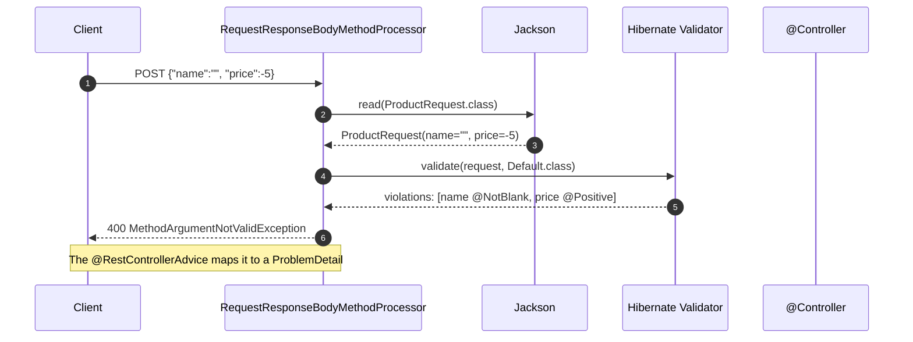
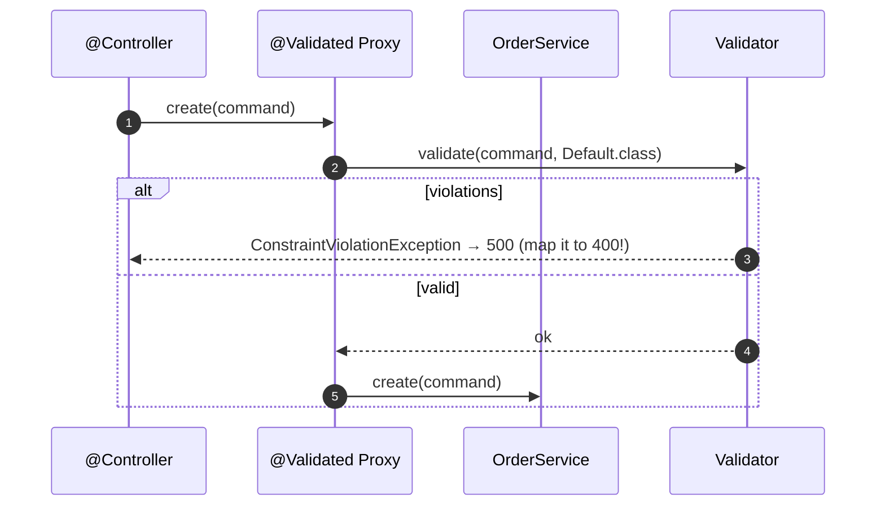

# 03 · Validation — The Input Contract

> **Level:** Beginner → Advanced
> **Interview Frequency:** ★★★★☆ ("How do you validate the request?")
> **Prerequisite:** [02 · Controllers](./02-Controllers-and-REST-APIs.md)
> **Last Updated:** 2026

---

## 📋 Table of Contents
- [0. TL;DR — The 30-Second Answer](#0-tldr--the-30-second-answer)
- [1. What & Why](#1-what--why)
- [2. Mental Model — Validation as a boundary](#2-mental-model--validation-as-a-boundary)
- [3. Deep Dive — Theory](#3-deep-dive--theory)
- [4. Internal Working Mechanism](#4-internal-working-mechanism)
- [5. Step-by-Step Execution Flow](#5-step-by-step-execution-flow)
- [6. Architecture Diagrams](#6-architecture-diagrams)
- [7. Production-Level Use Cases](#7-production-level-use-cases)
- [8. Code Examples — Production-Grade](#8-code-examples--production-grade)
- [9. Common Mistakes & Gotchas](#9-common-mistakes--gotchas)
- [10. Performance Considerations](#10-performance-considerations)
- [11. Security Considerations](#11-security-considerations)
- [12. Best Practices — The Checklist](#12-best-practices--the-checklist)
- [13. Hands-On Exercises](#13-hands-on-exercises)
- [14. Code Challenges](#14-code-challenges)
- [15. Scenario-Based Questions](#15-scenario-based-questions)
- [16. Interview Q&A — Level-wise](#16-interview-qa--level-wise)
- [17. Counter-Questions & Traps](#17-counter-questions--traps)
- [18. Tricky Interview Questions](#18-tricky-interview-questions)
- [19. Follow-Up Questions Asked by Interviewers](#19-follow-up-questions-asked-by-interviewers)
- [20. Real 3–5 Year Experience Scenarios](#20-real-35-year-experience-scenarios)
- [21. Frequently Asked Production Issues](#21-frequently-asked-production-issues)
- [22. Debugging Scenarios](#22-debugging-scenarios)
- [23. Architecture Design Questions](#23-architecture-design-questions)
- [24. Rapid-Fire MCQs](#24-rapid-fire-mcqs)
- [25. Cheat Sheet — One-Page Summary](#25-cheat-sheet--one-page-summary)
- [26. Real-World Production Notes](#26-real-world-production-notes)
- [27. Follow-up Learning](#27-follow-up-learning)

---

## 0. TL;DR — The 30-Second Answer

- **Bean Validation (Jakarta Bean Validation / JSR 380)** is the standard. The implementation is
  **Hibernate Validator** (the reference implementation), pulled in by `spring-boot-starter-validation`.
- **The annotations live on the DTO fields** (`@NotNull`, `@Size`, `@Email`, `@Pattern`, `@Min`,
  `@Max`, `@Positive`, `@Past`, `@PastOrPresent`, `@Future`, `@DecimalMin`, `@Digits`, …).
- **`@Valid` on a `@RequestBody` parameter** triggers the validation. The failure throws
  `MethodArgumentNotValidException` → a **400** with the field errors.
- **`@Validated` on the class** enables the **method-level** validation (the constraints on the
  method parameters), and it also enables the **validation groups**.
- **Validation groups** let you have different rule sets per operation:
  `@Validated(Create.class)` for a POST and `@Validated(Update.class)` for a PUT.
- **Cascading** with `@Valid` on a nested object or a collection field — the nested fields are
  validated too.
- **Custom constraints** with `@Constraint` + a `Validator` — the reusable custom validation.
- **A class-level constraint** with `@Constraint(validatedBy = …)` — the cross-field rules (the
  end date after the start date).
- **The `@InitBinder`** with `setAllowedFields` / `setDisallowedFields` — the defence against the
  mass assignment on the `@ModelAttribute` binding.
- **Domain validation ≠ input validation.** The input validation is about the **shape**; the
  domain validation is about the **rules** (in the domain, throwing a domain exception).
- **Never trust the client.** Validate on the server, always, even if the client validates too.
- **The one-liner:** *"Bean Validation handles the **shape** of the input; the domain handles the
  **rules**. Put the shape validation on the DTO at the boundary, and the rule validation in the
  domain — and never let a bad input reach the database."*

---

## 1. What & Why

Without validation, every piece of invalid input becomes a **runtime failure somewhere else**:
a `NullPointerException` in the service, a `DataIntegrityViolationException` from the DB, or —
worse — a **corrupted row** (a negative price, a malformed email, an XSS payload stored and later
rendered).

**Validation gives you:**
1. **A fast, clear error** at the boundary (a 400 with the field and the reason).
2. **A guarantee** that the service layer only receives valid data.
3. **A self-documenting contract** — the DTO's annotations *are* the API's constraints (and the
   OpenAPI schema is generated from them).
4. **Protection** from the injection of bad data (an oversized string, an invalid enum, a
   malicious URL).

---

## 2. Mental Model — Validation as a boundary

```text
        UNTRUSTED                    TRUSTED
   ────────────────────────  │  ────────────────────────────
   JSON / form / query      │   Command / domain object
        │                   │        │
        ▼                   │        ▼
  ┌───────────────┐         │   ┌───────────────┐
  │ Deserialise   │  shape  │   │ Domain rules  │  rules
  │ (Jackson)     ├────────►│   │ (invariant)   │
  └───────────────┘         │   └───────────────┘
        │                   │        │
        ▼                   │        ▼
  ┌───────────────┐         │   ┌───────────────┐
  │ @Valid        │  the    │   │ Persistence   │
  │ Bean Validator│  gate   │   │ (JPA / SQL)   │
  └───────────────┘         │   └───────────────┘
        │ FAIL → 400        │
        └───────────────────┘
```

> **Caption:** Validation is a **gate**, not a suggestion. The controller's DTO is the **boundary
> object**; everything inside the boundary can trust its invariants.

---

## 3. Deep Dive — Theory

### 3.1 The standard constraints (JSR 380 / Jakarta Validation 3.0)

| Annotation | Applies to | Rule |
|------------|-----------|------|
| `@NotNull` | Any object | Not null (an empty string is **not** null) |
| `@NotEmpty` | CharSequence, Collection, Map, Array | Not null **and** not empty (a size > 0) |
| `@NotBlank` | CharSequence | Not null, and not empty **after trimming** |
| `@Size(min, max)` | CharSequence, Collection, Map, Array | The size bounds |
| `@Length(min, max)` | CharSequence | The length bounds (Hibernate-specific) |
| `@Email` | CharSequence | A valid email (a fairly lenient regex) |
| `@Pattern(regexp)` | CharSequence | The regex must match |
| `@Positive` / `@Negative` | Number | > 0 / < 0 |
| `@PositiveOrZero` / `@NegativeOrZero` | Number | >= 0 / <= 0 |
| `@Min` / `@Max` | Number, BigDecimal, String (the length) | The bounds |
| `@DecimalMin` / `@DecimalMax` | BigDecimal, BigInteger | The inclusive bounds |
| `@Digits(integer, fraction)` | BigDecimal, BigInteger | The precision and the scale |
| `@Past` / `@PastOrPresent` | Date/Calendar/Instant/LocalDate/… | In the past |
| `@Future` / `@FutureOrPresent` | Date/… | In the future |
| `@AssertTrue` / `@AssertFalse` | Boolean | The value |
| `@Null` | Any | Must be null (rare) |

**`@NotNull` vs `@NotEmpty` vs `@NotBlank`** — the most important distinction:

| Input | `@NotNull` | `@NotEmpty` | `@NotBlank` |
|-------|-----------|-------------|-------------|
| `null` | ❌ | ❌ | ❌ |
| `""` | ✅ | ❌ | ❌ |
| `"   "` | ✅ | ✅ | ❌ |
| `"abc"` | ✅ | ✅ | ✅ |

### 3.2 Enabling validation

```xml
<dependency>
    <groupId>org.springframework.boot</groupId>
    <artifactId>spring-boot-starter-validation</artifactId>
</dependency>
```

> **Boot 2.3+ note:** the validation starter is **no longer included** by
> `spring-boot-starter-web`. You must add it explicitly. (In Boot ≤ 2.2 it came transitively via
> `hibernate-validator`.) A very common "why isn't `@Valid` working" cause.

**A `LocalValidatorFactoryBean` is auto-configured** when the validator is on the classpath. It
exposes the validator as a bean, so you can inject it directly:

```java
@Service
@RequiredArgsConstructor
public class UserService {
    private final Validator validator;   // jakarta.validation.Validator
}
```

### 3.3 The three ways to trigger validation

```java
// ① The controller — @Valid on the parameter
@PostMapping
public OrderResponse create(@Valid @RequestBody CreateOrderRequest request) { }

// ② The service — the method-level validation (@Validated on the class)
@Service
@Validated
public class OrderService {

    @Transactional
    public Order create(@Valid CreateOrderCommand command) { }

    // Or with a constraint on the parameter itself:
    public Order create(@Size(min = 1, max = 100) List<OrderLine> lines) { }
}

// ③ Manually
Set<ConstraintViolation<Object>> violations = validator.validate(request);
```

> **Important:** `@Valid` on a **service method parameter** only works if the class is annotated
> with `@Validated` (the `MethodValidationPostProcessor` proxies the bean and validates the
> parameters). Without `@Validated`, the annotation is **silently ignored**. A very common trap.

### 3.4 The validation groups

```java
public interface Create {}
public interface Update {}

public record ProductRequest(
        @NotBlank(groups = Create.class)
        @Size(max = 100)
        String name,

        @NotNull(groups = {Create.class, Update.class})
        @Positive
        BigDecimal price,

        @NotNull(groups = Update.class)
        @Positive
        Long stock) { }
```

```java
@RestController
@RequestMapping("/api/v1/products")
public class ProductController {

    @PostMapping
    public ProductResponse create(@Validated(Create.class) @RequestBody ProductRequest request) { }

    @PutMapping("/{id}")
    public ProductResponse update(@Validated(Update.class) @RequestBody ProductRequest request) { }
}
```

**How the groups work:**
- The default group is `jakarta.validation.groups.Default`. A constraint with **no** `groups`
  attribute belongs to **Default**.
- When you specify `groups = Create.class`, **only** the constraints in `Create` are evaluated —
  the Default ones are **not** (unless `Create` extends `Default`).
- **The common pattern:** make the interface extend `Default` so the always-applicable constraints
  are inherited:
  ```java
  public interface Create extends Default {}
  public interface Update extends Default {}
  ```
- The **group sequence** (`@GroupSequence`) defines the **order** — useful for the cross-field
  class-level constraints.

### 3.5 The class-level (cross-field) constraints

```java
@Documented
@Constraint(validatedBy = DateRangeValidator.class)
@Target({ElementType.TYPE, ElementType.ANNOTATION_TYPE})
@Retention(RetentionPolicy.RUNTIME)
public @interface ValidDateRange {

    String message() default "startDate must be before endDate";

    Class<?>[] groups() default {};

    Class<? extends Payload>[] payload() default {};

    String startDateField();     // the extra attributes
    String endDateField();
}
```

```java
public class DateRangeValidator implements ConstraintValidator<ValidDateRange, Object> {

    private String startDateField;
    private String endDateField;

    @Override
    public void initialize(ValidDateRange constraint) {
        this.startDateField = constraint.startDateField();
        this.endDateField = constraint.endDateField();
    }

    @Override
    public boolean isValid(Object value, ConstraintValidatorContext context) {
        if (value == null) return true;   // null is handled by @NotNull

        BeanWrapper wrapper = new BeanWrapperImpl(value);
        LocalDate start = (LocalDate) wrapper.getPropertyValue(startDateField);
        LocalDate end   = (LocalDate) wrapper.getPropertyValue(endDateField);

        if (start == null || end == null) return true;

        if (start.isAfter(end)) {
            context.disableDefaultConstraintViolation();
            context.buildConstraintViolationWithTemplate(
                            "startDate (" + start + ") must be before endDate (" + end + ")")
                    .addPropertyNode(startDateField)
                    .addConstraintViolation();
            return false;
        }
        return true;
    }
}
```

```java
@ValidDateRange(startDateField = "startDate", endDateField = "endDate")
public record SearchRequest(LocalDate startDate, LocalDate endDate) { }
```

> **Alternative for records (Boot 3 / Bean Validation 3.0):** the built-in **method-level
> validation** can express cross-field rules without a custom class-level constraint:
> ```java
> @RestController
> @Validated
> public class SearchController {
>
>     @GetMapping("/search")
>     public List<Result> search(
>             @RequestParam @DateTimeFormat(iso = ISO.DATE) LocalDate startDate,
>             @RequestParam @DateTimeFormat(iso = ISO.DATE) LocalDate endDate) { }
>
>     @AssertTrue(message = "startDate must be before endDate")
>     @JsonIgnore
>     public boolean isDateRangeValid() {
>         return !startDate.isAfter(endDate);
>     }
> }
> ```
> This is elegant for **controllers** (the parameter object is bound by Spring). For **records**
> used as request bodies, the class-level constraint is still the cleanest.

### 3.6 Custom field constraints

```java
@Documented
@Constraint(validatedBy = PhoneNumberValidator.class)
@Target({ElementType.FIELD, ElementType.PARAMETER, ElementType.RECORD_COMPONENT})
@Retention(RetentionPolicy.RUNTIME)
public @interface PhoneNumber {
    String message() default "Invalid phone number";
    Class<?>[] groups() default {};
    Class<? extends Payload>[] payload() default {};
}
```

```java
public class PhoneNumberValidator implements ConstraintValidator<PhoneNumber, String> {

    private static final Pattern PHONE = Pattern.compile("^\\+?[1-9]\\d{7,14}$");

    @Override
    public boolean isValid(String value, ConstraintValidatorContext context) {
        if (value == null || value.isBlank()) return true;   // @NotNull handles the null
        return PHONE.matcher(value).matches();
    }
}
```

### 3.7 The message interpolation

```java
@NotNull(message = "The name is mandatory")
@Size(min = 3, max = 50, message = "The name must be between 3 and 50 characters")
private String name;
```

**The default message bundle** — `ValidationMessages.properties`:

```properties
jakarta.validation.constraints.NotNull.message=must not be null
jakarta.validation.constraints.Size.message=size must be between {min} and {max}
jakarta.validation.constraints.Min.message=must be greater than or equal to {min}
```

**Per-locale bundles:**
```
ValidationMessages.properties
ValidationMessages_de.properties
ValidationMessages_fr.properties
```

**The EL expressions** (`@Size(min = 3, message = "must be at least {min}")`) — the `{min}` is
interpolated from the annotation's attributes.

### 3.8 The validation error response

The default `BindingResult` → the `MethodArgumentNotValidException` → the `DefaultHandlerExceptionResolver`
→ a 400 with the **default** body:

```json
{
  "timestamp": "2026-01-01T10:00:00.000+00:00",
  "status": 400,
  "error": "Bad Request",
  "path": "/api/v1/products",
  "message": "Validation failed"
}
```

**Customise it** in a `@RestControllerAdvice`:

```java
@RestControllerAdvice
public class ValidationErrorHandler extends ResponseEntityExceptionHandler {

    @Override
    protected ResponseEntity<Object> handleMethodArgumentNotValid(
            MethodArgumentNotValidException ex, HttpHeaders headers,
            HttpStatusCode status, WebRequest request) {

        List<FieldViolation> violations = ex.getBindingResult().getFieldErrors().stream()
                .map(fe -> new FieldViolation(fe.getField(), fe.getRejectedValue(),
                                              fe.getDefaultMessage()))
                .toList();

        List<ObjectViolation> globals = ex.getBindingResult().getGlobalErrors().stream()
                .map(ge -> new ObjectViolation(ge.getObjectName(), ge.getDefaultMessage()))
                .toList();

        ProblemDetail pd = ProblemDetail.forStatusAndDetail(HttpStatus.BAD_REQUEST,
                "The request contains " + violations.size() + " invalid field(s)");
        pd.setTitle("Validation failed");
        pd.setProperty("violations", violations);
        pd.setProperty("objectViolations", globals);
        return ResponseEntity.badRequest().body(pd);
    }

    public record FieldViolation(String field, Object rejectedValue, String message) {}
    public record ObjectViolation(String object, String message) {}
}
```

**The `rejectedValue` caveat:** including the rejected value in the response is convenient but can
**echo the user's input back** — a **reflected XSS** risk if the client renders it as HTML, and a
**PII leak**. Most production APIs return **only the field and the message**. Choose deliberately.

### 3.9 `@ModelAttribute` validation and the `BindingResult`

```java
@GetMapping("/search")
public String search(@Valid @ModelAttribute SearchForm form, BindingResult result) {
    if (result.hasErrors()) {
        return "search";   // the classic Spring MVC (Thymeleaf) flow
    }
    ...
}
```

> **Important:** when the method has a `BindingResult` parameter, Spring does **not** throw
> `MethodArgumentNotValidException` — it populates the `BindingResult` instead. Without the
> `BindingResult` parameter, the exception is thrown. This is the classic Thymeleaf form flow.

**The `BindingResult` immediately follows the `@ModelAttribute` parameter** in the signature —
that's a Spring requirement.

### 3.10 The `WebDataBinder` and the allowed fields

```java
@Controller
public class ProductFormController {

    @InitBinder
    public void initBinder(WebDataBinder binder) {
        binder.setAllowedFields("name", "price", "description", "categoryId");
        binder.setDisallowedFields("id", "createdBy", "role");
        binder.setAllowedValues("currency", List.of("USD", "EUR", "GBP"));
    }
}
```

> **The `setAllowedFields` whitelist is the defence against the mass assignment** for the
> `@ModelAttribute`/form binding. It's the equivalent of the DTO boundary for the form flows.
> The `@InitBinder` method can be `@ControllerAdvice`-level (global) or controller-level.

### 3.11 The type conversion and the conversion errors

```java
public record ProductRequest(@Positive Long id) { }
```

If the client sends `id=abc`, Jackson fails to bind it → `HttpMessageNotReadableException` →
a **400** (not a validation error, but the same status). With a `BindingResult`, it's a
**type mismatch error** on the field:

```java
public record SearchForm(@DateTimeFormat(iso = ISO.DATE) LocalDate from) { }
```

→ `typeMismatch.from` in the `BindingResult`.

### 3.12 The validation and the `jakarta.validation` vs `javax.validation`

| Generation | Package | Spring |
|-----------|---------|--------|
| **Jakarta EE 8 / Java EE** | `javax.validation.*` | Spring Boot **2.x** |
| **Jakarta EE 9+ / Java 17** | `jakarta.validation.*` | Spring Boot **3.x** |

> Boot 3 moved everything to the `jakarta.*` namespace (the `javax` → `jakarta` rename). A common
> migration error: the `javax.validation` annotations are **silently ignored** in Boot 3.

### 3.13 The validation in the persistence layer

```java
@Entity
public class Product {
    @NotBlank
    @Column(nullable = false)
    private String name;
}
```

**What the entity-level constraints do:**
- `jakarta.persistence.prePersist` / `preUpdate` → the `BeanValidationEventListener` validates the
  entity **before** the insert/update → a `ConstraintViolationException` → a rollback.
- They act as a **last line of defence** — they catch the code paths that bypass the DTO (a
  scheduled job, a data migration, a message consumer).

> **Recommendation:** keep the constraints on the **DTO** (the API contract) and on the **entity**
> (the DB contract). They serve different purposes — the DTO's rules are the *API's*, the
> entity's are the *database's*. Duplicating a rule in both places is fine when it's a genuine
> invariant (a non-null name), but be aware of the **two sources of truth**.

---

## 4. Internal Working Mechanism

### 4.1 The validation flow

```text
  ① Jackson deserialises the body → ProductRequest
  ② The argument resolver checks for @Valid / @Validated on the parameter
  ③ It gets the Validator from the WebBindingInitializer's validator
  ④ validator.validate(target, groups) → a Set<ConstraintViolation>
  ⑤ If empty → the method is invoked
  ⑥ If not empty → MethodArgumentNotValidException (with the BindingResult)
```

**The exact code** (simplified, in `AbstractMessageConverterMethodArgumentResolver`):

```java
@Override
public Object resolveArgument(MethodParameter parameter, ModelAndViewContainer mavContainer,
                              NativeWebRequest webRequest, WebDataBinderFactory binderFactory) {
    ...
    Object arg = readWithMessageConverters(webRequest, parameter, parameter.getNestedGenericParameterType());
    if (binderFactory != null) {
        WebDataBinder binder = binderFactory.createBinder(webRequest, null, name);
        if (arg instanceof AbstractBeanPropertyBindingResult bindingResult) {
            binder.getBindingResult().merge(bindingResult);
        }
        validateIfApplicable(binder, parameter);       // ← HERE
        if (binder.getBindingResult().hasErrors()) {
            throw new MethodArgumentNotValidException(parameter, binder.getBindingResult());
        }
    }
    ...
}
```

**`validateIfApplicable`** (in `AbstractMessageConverterMethodArgumentResolver` / `ModelFactory`):

```java
protected void validateIfApplicable(WebDataBinder binder, MethodParameter parameter) {
    for (Annotation ann : parameter.getParameterAnnotations()) {
        Object[] validationHints = ValidationAnnotationUtils.determineValidationHints(ann);
        if (validationHints != null) {
            binder.validate(validationHints);
            break;
        }
    }
}
```

`ValidationAnnotationUtils.determineValidationHints`:
- `@Validated` → the hint is the `groups` from the annotation (or `Default`).
- `@Valid` → the hint is `null` → the **Default** group.

### 4.2 The `MethodValidationPostProcessor` — the service-level validation

```text
  BeanPostProcessor: for each @Validated bean, wrap it in a proxy
      │
      ▼
  AOP proxy → MethodValidationInterceptor
      │
      ├─ determine the validation groups (from @Validated on the class/method)
      ├─ validate the method's parameters
      ├─ validate the method's return value (if @Valid on the return)
      └─ if there are violations → ConstraintViolationException
```

> **Key:** the proxy is created by the `MethodValidationPostProcessor` (a `BeanPostProcessor`), so
> the class **must** be annotated with `@Validated`. Also: because it's a proxy, **calling a
> validated method from within the same class bypasses the validation** (the self-invocation
> problem).

### 4.3 The validator resolution

```text
  Spring MVC
      │
      ▼
  WebBindingInitializer.initBinder()
      │
      ▼
  ConfigurableWebBindingInitializer.getValidator()
      │
      ▼
  The LocalValidatorFactoryBean (auto-configured)
      │
      ▼
  Hibernate Validator (the Jakarta Bean Validation implementation)
```

**The `LocalValidatorFactoryBean`** is auto-configured by `ValidationAutoConfiguration` when:
- `jakarta.validation.Validator` is on the classpath, and
- `ExecutableValidator` is not already defined.

It integrates with Spring:
- It implements `MessageInterpolator` (so the Spring's `MessageSource` can resolve the messages).
- It adds the `SpringValidatorAdapter` so the `ConstraintViolationException` can be handled by
  Spring's exception resolvers.
- The `ValidationMessages.properties` from the classpath is picked up.

---

## 5. Step-by-Step Execution Flow

### 5.1 The `@Valid` on a request body



### 5.2 The service-level validation



> **Gotcha:** a `ConstraintViolationException` from a service is **not** handled by Spring's
> default exception resolver as a 400 — it becomes a **500**. Map it explicitly in the advice
> (or use `ResponseEntityExceptionHandler`).

---

## 6. Architecture Diagrams

### 6.1 The validation layers

```text
┌─────────────────────────────────────────────────────────────────────────┐
│  TRANSPORT LAYER                                                        │
│   • The format is valid JSON?      → Jackson (a deserialisation error)  │
│   • The types are convertible?     → the type mismatch error            │
├─────────────────────────────────────────────────────────────────────────┤
│  SHAPE LAYER (Bean Validation on the DTO)                              │
│   • Not null, not blank, the size, the range, the format, the pattern  │
│   • The cross-field rules (the class-level constraints)                 │
│   → 400 Bad Request                                                    │
├─────────────────────────────────────────────────────────────────────────┤
│  DOMAIN LAYER (the invariants)                                         │
│   • "An order can't be shipped before it's paid"                       │
│   • "The balance can't go negative"                                    │
│   → 409 / 422 (or a domain-specific status)                            │
├─────────────────────────────────────────────────────────────────────────┤
│  PERSISTENCE LAYER                                                     │
│   • NOT NULL, the unique constraints, the FKs, the check constraints    │
│   → the DataIntegrityViolationException (the last line of defence)      │
└─────────────────────────────────────────────────────────────────────────┘
```

> **Caption:** Each layer catches a different class of error, at a different cost. The cheapest
> and the clearest error is the one produced at the top — so validate as early as possible.

### 6.2 The validation vs the domain error decision

```text
  "name must not be blank"
        → SHAPE   → 400   → the client sent garbage → the client's fault
  "price must be positive"
        → SHAPE   → 400   → ditto
  "startDate must be before endDate"
        → SHAPE   → 400   → ditto
  "this coupon has expired"
        → DOMAIN  → 422   → well-formed but semantically invalid
  "the order is already shipped, you can't cancel it"
        → DOMAIN  → 409   → a state conflict → the client should refresh
  "the SKU already exists"
        → DOMAIN  → 409   → a uniqueness conflict
  "the DB connection failed"
        → INFRA   → 500   → our fault
```

---

## 7. Production-Level Use Cases

| Use case | Approach |
|----------|----------|
| **A public API** | The DTO constraints + the OpenAPI schema generated from them + a `ProblemDetail` with the field violations |
| **A form (server-rendered)** | `@ModelAttribute` + `@Valid` + the `BindingResult` + the field errors redisplayed |
| **A batch import** | Validate each row, return the per-row errors (not an all-or-nothing failure) |
| **A config-driven rule** | A custom constraint that reads the rule from a `@ConfigurationProperties` bean |
| **A cross-field rule** | A class-level constraint or the record's compact constructor |
| **A domain invariant** | The domain — **not** Bean Validation (the domain doesn't depend on Jakarta) |
| **A DB-level guarantee** | A `CHECK` constraint in the schema (the last line of defence) |
| **A file upload** | The size + the content type + the extension, in a custom constraint or in the service |
| **An enum value** | The Jackson `@JsonCreator` with an explicit error (a 400, not a 500) |

---

## 8. Code Examples — Production-Grade

### 8.1 A fully annotated request DTO

```java
public record CreateOrderRequest(
        @NotNull(message = "customerId is required")
        Long customerId,

        @NotEmpty(message = "at least one line is required")
        @Size(max = 100, message = "an order cannot have more than 100 lines")
        @Valid                                    // ← cascade into the list elements
        List<CreateOrderLineRequest> lines,

        @NotBlank
        @Pattern(regexp = "[A-Z]{3}", message = "currency must be a 3-letter ISO code")
        String currency,

        @Size(max = 500, message = "note cannot exceed 500 characters")
        String note,

        @Email
        @Size(max = 254)                         // the RFC's max email length
        String contactEmail) { }
```

```java
public record CreateOrderLineRequest(
        @NotNull Long productId,

        @NotNull
        @Min(value = 1, message = "quantity must be at least 1")
        @Max(value = 999, message = "quantity cannot exceed 999")
        Integer quantity) { }
```

### 8.2 The global error handler

```java
@RestControllerAdvice
@Slf4j
public class ApiErrorHandler extends ResponseEntityExceptionHandler {

    @Override
    protected ResponseEntity<Object> handleMethodArgumentNotValid(
            MethodArgumentNotValidException ex, HttpHeaders headers,
            HttpStatusCode status, WebRequest request) {

        ProblemDetail pd = ProblemDetail.forStatus(HttpStatus.BAD_REQUEST);
        pd.setTitle("Validation failed");
        pd.setDetail(ex.getBindingResult().getFieldErrors().size() + " field(s) are invalid");

        List<FieldViolation> violations = ex.getBindingResult().getFieldErrors().stream()
                .map(fe -> new FieldViolation(
                        fe.getField(),
                        fe.getDefaultMessage(),
                        fe.getCode()))
                .toList();
        pd.setProperty("violations", violations);
        return ResponseEntity.badRequest().body(pd);
    }

    @Override
    protected ResponseEntity<Object> handleHandlerMethodValidationException(
            HandlerMethodValidationException ex, HttpHeaders headers,
            HttpStatusCode status, WebRequest request) {

        ProblemDetail pd = ProblemDetail.forStatus(HttpStatus.BAD_REQUEST);
        pd.setTitle("Validation failed");
        pd.setProperty("violations", ex.getAllValidationResults().stream()
                .flatMap(r -> r.getResolvableErrors().stream()
                        .map(e -> new FieldViolation(
                                e.getDefaultMessage(),
                                e.getDefaultMessage(),
                                e.getCode())))
                .toList());
        return ResponseEntity.badRequest().body(pd);
    }

    // The service-level violations (ConstraintViolationException) → 400, not 500
    @ExceptionHandler(ConstraintViolationException.class)
    public ResponseEntity<ProblemDetail> handleConstraintViolation(ConstraintViolationException ex) {
        ProblemDetail pd = ProblemDetail.forStatus(HttpStatus.BAD_REQUEST);
        pd.setTitle("Validation failed");
        pd.setProperty("violations", ex.getConstraintViolations().stream()
                .map(v -> new FieldViolation(v.getPropertyPath().toString(),
                                            v.getMessage(),
                                            v.getConstraintDescriptor()
                                             .getAnnotation()
                                             .annotationType()
                                             .getSimpleName()))
                .toList());
        return ResponseEntity.badRequest().body(pd);
    }

    public record FieldViolation(String field, String message, String code) {}
}
```

### 8.3 The record's compact constructor — the invariant validation

```java
public record Money(BigDecimal amount, String currency) {

    public Money {
        Objects.requireNonNull(amount, "amount is required");
        Objects.requireNonNull(currency, "currency is required");
        if (amount.scale() > 2) {
            throw new IllegalArgumentException("amount cannot have more than 2 decimal places");
        }
        if (currency.length() != 3) {
            throw new IllegalArgumentException("currency must be a 3-letter ISO code");
        }
        amount = amount.setScale(2, RoundingMode.HALF_UP);
    }

    public static Money of(BigDecimal amount, String currency) {
        return new Money(amount, currency);
    }
}
```

> **When to use it:** the compact constructor is for the **invariants that must always hold** — it
> can't be bypassed. It's not a substitute for Bean Validation on the input DTO (the exception
> type matters for the HTTP mapping), but it's the right tool for a **value object**.

### 8.4 The validation groups with the DTO

```java
public interface OnCreate extends Default {}
public interface OnUpdate extends Default {}

public record ProductRequest(
        @NotBlank(groups = OnCreate.class)
        @Size(max = 120)
        String name,

        @NotNull(groups = {OnCreate.class, OnUpdate.class})
        @Positive
        BigDecimal price,

        @PositiveOrZero(groups = OnUpdate.class)
        Integer stock) { }
```

```java
@RestController
@RequestMapping("/api/v1/products")
@RequiredArgsConstructor
public class ProductController {

    private final ProductService productService;

    @PostMapping
    public ResponseEntity<ProductResponse> create(
            @Validated(OnCreate.class) @RequestBody ProductRequest request) {
        Product created = productService.create(request);
        return ResponseEntity.created(URI.create("/api/v1/products/" + created.getId()))
                             .body(ProductResponse.from(created));
    }

    @PutMapping("/{id}")
    public ResponseEntity<ProductResponse> update(
            @PathVariable Long id,
            @Validated(OnUpdate.class) @RequestBody ProductRequest request) {
        return ResponseEntity.ok(productService.update(id, request));
    }
}
```

### 8.5 A custom constraint — a strong password

```java
@Documented
@Constraint(validatedBy = StrongPasswordValidator.class)
@Target({ElementType.FIELD, ElementType.PARAMETER, ElementType.RECORD_COMPONENT})
@Retention(RetentionPolicy.RUNTIME)
public @interface StrongPassword {

    String message() default "The password is too weak";
    Class<?>[] groups() default {};
    Class<? extends Payload>[] payload() default {};

    int minLength() default 12;
}
```

```java
public class StrongPasswordValidator implements ConstraintValidator<StrongPassword, String> {

    private static final Pattern UPPER = Pattern.compile("[A-Z]");
    private static final Pattern LOWER = Pattern.compile("[a-z]");
    private static final Pattern DIGIT  = Pattern.compile("\\d");
    private static final Pattern SPECIAL = Pattern.compile("[^A-Za-z0-9]");

    private int minLength;

    @Override
    public void initialize(StrongPassword constraint) {
        this.minLength = constraint.minLength();
    }

    @Override
    public boolean isValid(String value, ConstraintValidatorContext context) {
        if (value == null) return true;

        int score = 0;
        if (value.length() >= minLength) score++;
        if (UPPER.matcher(value).find()) score++;
        if (LOWER.matcher(value).find()) score++;
        if (DIGIT.matcher(value).find()) score++;
        if (SPECIAL.matcher(value).find()) score++;

        if (score < 4) {
            context.disableDefaultConstraintViolation();
            context.buildConstraintViolationWithTemplate(
                    "The password must be at least " + minLength
                    + " characters and contain an uppercase letter, a lowercase letter, "
                    + "a digit and a special character")
                    .addConstraintViolation();
            return false;
        }
        return true;
    }
}
```

### 8.6 The `@InitBinder` — the mass-assignment defence for the forms

```java
@ControllerAdvice
public class GlobalBindingAdvice {

    @InitBinder
    public void restrictFields(WebDataBinder binder) {
        binder.setAllowedFields("name", "price", "description", "categoryId");
        binder.setDisallowedFields("id", "role", "version", "createdAt");
    }
}
```

### 8.7 The custom message bundle

```properties
# src/main/resources/ValidationMessages.properties
jakarta.validation.constraints.NotNull.message=is required
jakarta.validation.constraints.Size.message=must be between {min} and {max} characters
jakarta.validation.constraints.Positive.mustBePositive=must be greater than zero
```

```properties
# src/main/resources/ValidationMessages_de.properties
jakarta.validation.constraints.NotNull.message=ist erforderlich
jakarta.validation.constraints.Size.message=muss zwischen {min} und {max} Zeichen liegen
```

### 8.8 The OpenAPI schema generated from the constraints

```java
@Operation(summary = "Create an order")
@ApiResponses({
    @ApiResponse(responseCode = "201", description = "Created"),
    @ApiResponse(responseCode = "400", description = "Validation failed",
                 content = @Content(schema = @Schema(implementation = ProblemDetail.class)))
})
@PostMapping
public ResponseEntity<OrderResponse> create(
        @Valid @RequestBody @io.swagger.v3.oas.annotations.parameters.RequestBody(
                description = "The order to create",
                required = true,
                content = @Content(schema = @Schema(implementation = CreateOrderRequest.class)))
        CreateOrderRequest request) { }
```

With `springdoc-openapi`, the `required`, `minLength`, `maximum`, and the `pattern` are all
**derived from the Bean Validation annotations** — one source of truth.

### 8.9 The method-level validation for the query parameters

```java
@RestController
@RequestMapping("/api/v1/orders")
@Validated
public class OrderController {

    @GetMapping
    public List<OrderResponse> list(
            @RequestParam @Min(0) int page,
            @RequestParam @Min(1) @Max(100) int size,
            @RequestParam @PastOrPresent LocalDate createdBefore) {
        ...
    }
}
```

> **The failure mode:** a violation here throws a `HandlerMethodValidationException` (Spring 6.1+)
> → a **400** by default in Boot 3.2+. In Boot 3.0/3.1 it was a `ConstraintViolationException` →
> a **500** unless you mapped it. Handle both.

---

## 9. Common Mistakes & Gotchas

| # | ❌ Wrong | ✅ Right | Why |
|---|----------|----------|-----|
| 1 | `@Valid` on the service method without `@Validated` on the class | Add `@Validated` | The constraint is **silently ignored** |
| 2 | Forgetting `spring-boot-starter-validation` | Add the dependency | `@Valid` does nothing in Boot 2.3+ without it |
| 3 | Using `javax.validation.*` in Boot 3 | Use `jakarta.validation.*` | The `javax` annotations are **ignored** |
| 4 | Validating the entity instead of the DTO | Validate the DTO | The entity's validation is the last line of defence, and it can't express the API's rules |
| 5 | `@NotEmpty` where you meant `@NotBlank` | Use `@NotBlank` for the strings | `"   "` passes `@NotEmpty` |
| 6 | `@NotNull` on a `String` to mean "not empty" | `@NotBlank` | `""` passes `@NotNull` |
| 7 | Forgetting `@Valid` on the nested list/field | Add `@Valid` | The nested object is **not** validated without it |
| 8 | Validating in the controller only | Also validate at the domain/DB level | The other entry points (the jobs, the consumers) bypass it |
| 9 | Returning the `rejectedValue` in the error | Return only the field and the message | A reflected-XSS / PII risk |
| 10 | A `ConstraintViolationException` → a 500 | Map it to a 400 | It's a client error |
| 11 | Validating in a `for` loop in the service | Use the Bean Validation | You lose the uniform error format |
| 12 | A regex for the email validation | Use `@Email` (or a custom validator) | The built-in one is more forgiving; a home-made one usually rejects valid addresses |
| 13 | The self-invocation of a validated method | Inject the proxy / restructure | The proxy is bypassed |
| 14 | The validation groups not extending `Default` | `interface OnCreate extends Default {}` | The default constraints are skipped |
| 15 | `@Size(max=…)` on a `String` in the DB but no `@Column(length=…)` | Set both | The DB can truncate or reject it |
| 16 | Trusting the client-side validation | Always validate on the server | The client can send anything |
| 17 | The unbounded file upload | Validate the size before reading | A DoS vector |
| 18 | `@Pattern` with a catastrophic-backtracking regex | Avoid the nested quantifiers | A ReDoS risk |

---

## 10. Performance Considerations

| Aspect | Impact | Guidance |
|--------|--------|----------|
| **The validation cost** | Small (regex + reflection, cached) | The metadata is cached by the validator; the cost is microseconds |
| **The regex compilation** | Once per annotation | The `Pattern` is compiled once — but a `matches()` on a huge string is O(n) |
| **The ReDoS** | A catastrophic backtracking | Avoid the nested quantifiers; cap the string length with `@Size` **before** the `@Pattern` |
| **The N+1 validation** | N queries if the validator hits the DB | Don't validate an entity's lazy relations |
| **The validation of a huge collection** | O(n) | Cap the collection size with `@Size(max = …)` |
| **The message interpolation** | The `MessageSource` lookup | Keep the messages in a resource bundle, not in the database |
| **The duplicate validation** | The controller + the service + the entity | It's cheap; but if it's hot, validate once at the boundary |

---

## 11. Security Considerations

| Risk | Mitigation |
|------|-----------|
| **The mass assignment** | A DTO with only the writable fields; `@InitBinder.setAllowedFields` for the forms |
| **The injection of an oversized value** | `@Size` on every string and collection |
| **The ReDoS** | A safe regex + a length cap |
| **The reflected XSS** | Don't echo the `rejectedValue`; the message must be a static text |
| **The PII in the validation messages** | A generic message; the details in the logs (with the correlation id) |
| **The information leak** | Don't reveal whether a field exists in the schema ("no such field") |
| **The file upload** | The size + the type + the content sniffing, not just the extension |
| **The enum injection** | The strict Jackson deserialisation (`READ_UNKNOWN_ENUM_VALUES_AS_NULL` off) |
| **The business rule bypass** | The domain validation, not just the shape validation |
| **The mass assignment on the entity** | Never bind the HTTP body to an entity |

---

## 12. Best Practices — The Checklist

- [ ] **Validate the DTO at the boundary** — `@Valid` on the `@RequestBody`.
- [ ] **Use the right annotation** — `@NotBlank` for the strings, `@NotNull` for the objects.
- [ ] **Cascade with `@Valid`** for the nested objects and the collections.
- [ ] **Use the groups** for the operation-specific rules; extend `Default`.
- [ ] **A class-level constraint** for the cross-field rules.
- [ ] **Custom constraints** for the reusable domain-flavoured rules.
- [ ] **A global error handler** producing a consistent `ProblemDetail` with the field violations.
- [ ] **Don't echo the rejected value** (unless you have a strong reason).
- [ ] **Keep the invariants in the domain** — the Bean Validation is the *shape*, not the *rules*.
- [ ] **Also constrain the database** (`NOT NULL`, `CHECK`, the unique indexes).
- [ ] **Validate the uploads** (the size, the type, the content).
- [ ] **Localised messages** via `ValidationMessages_<locale>.properties`.
- [ ] **The OpenAPI schema** is generated from the constraints — one source of truth.

---

## 13. Hands-On Exercises

**🧪 Lab 1 — The constraint matrix**
1. Create a DTO with 10 fields.
2. Write a `@ParameterizedTest` that posts 11 payloads (one invalid per field) and asserts the
   400 + the field name in the response.

**✅ Success signal:** Every invalid field produces a named violation in the response body.

**🧪 Lab 2 — The groups**
1. Add a `name` that is `@NotBlank` only on create.
2. Prove that a `PUT` with an empty name succeeds while a `POST` with an empty name fails.

**🧪 Lab 3 — The service-level validation**
1. Add `@Validated` to a service with a `@Valid` parameter.
2. Remove `@Validated` and observe that the validation is **silently skipped** — and that the
   invalid data reaches the database. (This is the most valuable 5 minutes of this chapter.)

**🧪 Lab 4 — The custom constraint**
1. Write an `@Iban` constraint with a checksum (the ISO 7064 mod-97).
2. Write a test with the valid and the invalid IBANs.

**🧪 Lab 5 — The error contract**
1. Implement a global handler that produces a `ProblemDetail` with the field violations.
2. Verify that the OpenAPI schema shows the `required` and the `minLength` (the springdoc
   integration).

---

## 14. Code Challenges

### Challenge 1 — A reusable validation library (medium-hard)
**Goal:** Build a small `common-validation` module with:
- `@Iban` (the mod-97 checksum),
- `@PhoneNumber` (E.164),
- `@Slug`,
- `@StrongPassword` (the configurable policy),
- `@DateRange` (the class-level, cross-field),
each with a unit test and a message bundle.

**Bonus:** a `ValidationMessages` bundle shared across the services.

### Challenge 2 — The conditional validation (hard)
**Goal:** "A discount is required when the order total is above 1000."
**Requirements:** implement it without a custom class-level constraint if possible (the
record's compact constructor), and with one if not. Handle the case where the order total isn't
known yet (the cross-row rule) — describe the options.

### Challenge 3 — The batch validation (hard)
**Goal:** `POST /api/v1/orders/bulk` with 100 orders.
**Requirements:** each order validated independently; the response returns the successes and the
per-row failures with the row index and the field violations; a summary count; and an atomic
mode (all or nothing). The design question: how do you distinguish a **row error** (a 400) from
a **system error** (a 500) in a bulk response?

---

## 15. Scenario-Based Questions

**S1.** *"A user says they get a 500 when they submit the registration form with an empty
name."*
>
> **Ideal answer:** (1) **Reproduce**: post the payload, get the stack trace. (2) The likely
> cause: **the validation isn't applied** — either the starter is missing (Boot 2.3+), or the
> `javax`/`jakarta` namespace mismatch, or the `@Valid` is on the wrong parameter, or the DTO is
> bound as a `@ModelAttribute` without a `BindingResult` (then the exception isn't thrown but the
> `result` is ignored and the null fields flow through). (3) **Check the order**: is the
> validation **before** the service call? A `MethodArgumentNotValidException` is a 400; a
> `NullPointerException` in the service is a 500. (4) **The fix**: add the starter, use the
> right namespace, put `@Valid` on the parameter, and map the exception in the advice. (5) **The
> prevention**: a **test** that posts an invalid payload and asserts a 400 — a contract test for
> every endpoint. A "smoke" test per controller. (6) The deeper point: "a 500 for a client error
> is a **monitoring** problem too — the `5xx` alert fired but the cause was a user input; the
> error handler should log it at `WARN`, not `ERROR`."

**S2.** *"We need to validate the file upload: a PDF, at most 10 MB, belonging to the allowed
types."*
>
> **Ideal answer:** (1) **Three layers**: (a) the **request level** — `spring.servlet.multipart.max-file-size=10MB` and `max-request-size` (a hard limit, enforced before the app sees it — the container rejects it with a `MaxUploadSizeExceededException` → a 413); (b) the **app level** — a `@Valid` DTO with the `@Size`/`@NotNull` on the `MultipartFile`, plus the content type check (`file.getContentType()`) — but remember the content type is **client-supplied** and can be spoofed; (c) the **content level** — inspect the actual bytes (the magic number / `Files.probeContentType` / a library like Apache Tika) and, for the security, **scan** the file (a virus scanner) and **don't** execute it. (2) **The storage**: never store the uploaded file in the temp directory long-term — stream it to the object storage (S3/MinIO) with a **generated** name (never the client's filename — a path traversal risk), and store it in a **quarantine** bucket first if you scan it. (3) **The error handling**: `MaxUploadSizeExceededException` → a **413 Payload Too Large**; a type mismatch → a **415**. (4) The **performance**: the multipart upload buffers to disk by default (`spring.servlet.multipart.file-size-threshold=0`) — set it so the large files don't eat the heap; use a **streaming** upload (not `MultipartFile` → `getBytes()`) to avoid a 2× memory copy. (5) The **security** checklist: the size limit, the type check, the content sniffing, the name sanitisation, the storage outside the web root, the antivirus scan, the `Content-Disposition: attachment` on the download, and the `X-Content-Type-Options: nosniff` on the response.

**S3.** *"We want the validation rules to be configurable per customer (some allow a 100-character
name, others 50)."*
>
> **Ideal answer:** (1) **Don't** make the constraints dynamic — the Bean Validation annotations
> are compile-time constants. (2) **Options**: (a) **the `@Size(max = 255)`** as an absolute
> ceiling in the DTO, and the **per-tenant** rule enforced in the **domain** (a
> `TenantPolicyService.validateName(name)`), returning a domain exception → a 422. (b) A
> **custom constraint** whose validator injects a `PolicyService` (the validator is a Spring bean
> in Boot — it can be autowired!) and looks up the current tenant's policy. This keeps the error
> format consistent. (c) A **config-driven rule engine** (a JSON/DB rules table) evaluated by a
> custom validator. (3) **The recommendation**: (b) or (c) — a custom constraint with an
> injected policy service, so the errors stay in the standard format. (4) The **trade-offs**: the
> per-tenant rules make the validation **stateful** (the tenant is resolved from the security
> context — the validator needs the tenant id, so the validator must read it from a
> `TenantContextHolder`, not from a field), the rules must be **cached** (not a DB query per
> validation!), and the behaviour becomes **harder to test**. (5) The senior framing: "the
> **static shape** validation stays in the DTO; the **policy** validation lives behind a custom
> constraint so the error contract is uniform."

---

## 16. Interview Q&A — Level-wise

### 🟢 Beginner
**Q: What is `@Valid` and where do you put it?**
**A:** `@Valid` (from `jakarta.validation`) on the method parameter triggers the Bean Validation of
the bound object. On a `@RequestBody` parameter it validates the deserialised DTO; the violations
cause a `MethodArgumentNotValidException` → a 400.

**Q: What is the difference between `@NotNull`, `@NotEmpty` and `@NotBlank`?**
**A:** `@NotNull` — the value isn't null. `@NotEmpty` — it isn't null and its size is > 0 (a
collection or a string). `@NotBlank` — it's not null and it's not empty **after trimming** (a
string only).

**Q: What happens if the validation fails?**
**A:** Spring throws `MethodArgumentNotValidException` (for a `@RequestBody`) carrying the
`BindingResult` with the field errors. Handle it in a `@RestControllerAdvice` and return a 400
with the field violations.

### 🟡 Intermediate
**Q: How do you validate a nested object?**
**A:** Put `@Valid` on the nested field (or on the list element type) so the validator cascades
into it. Without the cascade, the nested object's constraints are not evaluated.

**Q: What are the validation groups for?**
**A:** Different rule sets per operation — e.g. a `name` is `@NotBlank` only on create, but
optional on update. You define the group interfaces, put them in the `groups` attribute, and
apply them with `@Validated(OnCreate.class)`. The interfaces should extend `Default` so the
always-applicable constraints are inherited.

**Q: How do you do a cross-field validation (the end date after the start date)?**
**A:** A **class-level constraint**: an annotation with `@Constraint(validatedBy = …)` and a
validator that uses `BeanWrapperImpl` to read the two properties. Alternatively (in Spring 6.1+)
a method-level validation with an `@AssertTrue` method on the controller.

**Q: What is the difference between the `@Valid` and the `@Validated` annotation?**
**A:** `@Valid` is the **Bean Validation** annotation (it triggers the cascade). `@Validated` is
**Spring's** annotation: on a controller/service class it enables the **method-level** validation
(the parameter constraints), and on a parameter it specifies the **groups**. Using `@Validated`
without `@Valid` on a `@RequestBody` also works (Spring reads the groups from it), but `@Valid`
is the idiomatic one for the body.

### 🔴 Advanced / Senior
**Q: Where should the validation live — the DTO, the domain, or the DB?**
**A:** **All three, for different reasons.** The **DTO** holds the **shape** validation (the
format, the size, the required-ness) — it's the API's contract and it produces the nice 400
errors. The **domain** holds the **invariants** (the business rules) — it throws a domain
exception, and it's the only place the rule can be enforced regardless of the entry point. The
**database** holds the **integrity constraints** (`NOT NULL`, `UNIQUE`, `CHECK`, the FKs) — the
last line of defence that survives a bug in the code. The key design point: the **DTO's rules and
the domain's rules are different kinds of rules**; don't duplicate the format rules in the domain
and don't put the business rules in the DTO.

**Q: What is the difference between the Bean Validation and the Spring's `Validator` interface?**
**A:** The Spring `Validator` (`org.springframework.validation.Validator`) is the **framework's
abstraction**, used by the data binding (`WebDataBinder`) and the MVC's binding — it validates an
object and returns a `BindingResult` of `Errors`. The **Bean Validation** (Jakarta) is the
**standard** — the annotations on the fields, the constraint metadata, and the
`ConstraintValidator` SPI. In a Spring MVC app, the `LocalValidatorFactoryBean` **adapts** the
Bean Validator to the Spring `Validator` interface, so the binding result contains the
constraint violations. Practically: use the **Bean Validation** annotations for the DTOs; the
Spring `Validator` interface only matters if you're writing a custom binding for a non-annotated
object or integrating with a legacy validation framework.

**Q: How do you return the validation errors in a consistent format?**
**A:** A single `@RestControllerAdvice` extending `ResponseEntityExceptionHandler` that overrides
`handleMethodArgumentNotValid` (the `@RequestBody` case), `handleHandlerMethodValidationException`
(the method-level case), and adds a `@ExceptionHandler(ConstraintViolationException.class)` (the
service-level case). All three produce the same `ProblemDetail` shape with a `violations` array
(`field`, `message`, `code`). Don't put the try/catch in each controller — that's the whole point
of the advice. Also remember: don't include the `rejectedValue` unless you consciously accept the
XSS/PII implications.

**Q: Why does my `@Valid` on the service method do nothing?**
**A:** Because the **method-level** validation requires the bean to be proxied by the
`MethodValidationPostProcessor`, which only happens for a class annotated with **`@Validated`**.
Without it, the annotation is silently ignored. The other gotchas: the **self-invocation**
(the proxy is bypassed when the method calls itself), and the **`@Valid` on a `@RequestBody`**
vs a `@ModelAttribute` (the latter populates a `BindingResult` instead of throwing, if the
parameter is present).

### ⚫ Expert / Principal
**Q: How would you design the validation strategy for a large multi-tenant platform?**
> **Answer structure:** (1) **The layering** — the *transport* rules (the format, the size) on the
> DTO; the *domain* rules (the invariants) in the domain; the *integrity* rules in the DB. (2)
> **The static vs the dynamic** — the static rules are annotations; the dynamic (tenant-specific)
> rules go through a **custom constraint** that injects a **cached** policy service (never a DB
> query per validation) and reads the tenant from a request-scoped context. (3) **The consistency**
> — one `ProblemDetail` shape for every validation failure, everywhere, produced by one advice
> class (extracted into a shared starter so every service produces the same errors). (4) **The
> error catalogue** — a stable **error code** per rule (`ORDER_DATE_RANGE_INVALID`) so the clients
> can react programmatically, not by matching the message text. (5) **The i18n** — the messages in
> the resource bundles, per locale, with a fallback. (6) **The evolution** — the rules are part of
> the API contract; a **contract test** + an OpenAPI diff guards them. (7) **The security** — the
> mass-assignment defence (the DTO boundary + the `setAllowedFields`), the no-echo of the rejected
> values, the ReDoS-safe regexes, and the upload validation. (8) **The observability** — the
> validation-failure rate per endpoint and per rule code (a spike in one rule = a client
> integration bug or an attack).

---

## 17. Counter-Questions & Traps

### CQ1. "Why not just validate in the service with `if` statements?"
- **Naive answer:** "The service is where the business logic lives."  ← half right
- **The trap:** You lose the **uniform error format**, the **declarative documentation** (the
  OpenAPI schema), and the **cascade**.
- **Expert answer:** The `if` statements are fine for the **domain rules** (they throw the domain
  exceptions). What's missing is the **shape validation** — and that's what Bean Validation gives
  you: a **declarative**, **reusable**, **documented** (in the OpenAPI schema) way to express it,
  with a **consistent error contract**. The strongest answer: "I use **both** — the annotations
  for the shape at the boundary, the domain for the rules."

### CQ2. "Is Bean Validation thread-safe?"
- **Naive answer:** "Yes, it's stateless."  ← the right answer, for the wrong reason
- **The trap:** A **custom** validator can easily be **not** thread-safe (a mutable field in the
  validator — like the `minLength` in `StrongPasswordValidator`, which is fine because it's set
  once at initialisation — but a field mutated per validation is not).
- **Expert answer:** The Hibernate Validator implementation is **thread-safe** — the constraint
  metadata is cached and immutable, and the validators are **stateless per call** (the
  `initialize()` is called once, and the validator instances are shared). But **your** validator
  must be thread-safe: the `ConstraintValidator` instances are cached and **shared across
  threads**, so any mutable instance state is a data race. Use local variables or a thread-safe
  collaborator. And if the validator needs a **tenant context**, don't store it in a field — read
  it from the request-scoped context at validation time.

### CQ3. "What's the difference between `@Size` and `@Length`?"
- **Naive answer:** "They're the same."  ← not exactly
- **The trap:** `@Length` is a **Hibernate-specific** extension; `@Size` is the standard.
- **Expert answer:** `@Size` is the **Jakarta standard** — it works on a `CharSequence`, a
  `Collection`, a `Map`, and an array. `@Length(min, max)` is Hibernate Validator's extension —
  it only works on a `CharSequence` (it throws an `UnexpectedTypeException` for a collection) and
  it allows the `min`/`max` to be omitted. Use `@Size` — it's portable and it covers the
  collections.

### CQ4. "Should the validation be in the DTO or in the entity?"
- **Naive answer:** "In the entity, so it applies everywhere."  ← the classic trap
- **The trap:** The entity's validation is **too late** (after the deserialisation, at the flush)
> and it produces a **500**, not a 400.
- **Expert answer:** **Both, for different purposes.** The **DTO** carries the API's contract — the
> validation happens at the boundary, produces a 400, and generates the OpenAPI schema. The
> **entity** carries the DB's contract — it's the last line of defence for the entry points that
> bypass the controller (the scheduled jobs, the message consumers, the data migrations), and it
> fires at `prePersist`/`preUpdate` (so it happens before the SQL). The mistake to avoid is
> **duplicating the format rules** in the entity (the `@Email` on both) — that's noise; keep the
> **invariants** on both (a non-null name) and the **formats** only on the DTO.

### CQ5. "How do you validate a value that depends on the database?"
- **Naive answer:** "Add a `@Unique` constraint."  ← doesn't exist in Bean Validation
- **The trap:** The standard has **no** `@Unique` — it's a database constraint, checked at the
> insert.
- **Expert answer:** There isn't one, and that's by design — the Bean Validation is a **pure,
> in-memory** check; it can't do I/O. For a uniqueness rule: (1) rely on the **DB's unique
> index** and catch the `DataIntegrityViolationException` → a **409 Conflict** (the standard
> pattern); (2) if you need a **pre-check** (to give a nicer message), do it in the service with
> a `repository.existsByX()` — but it's **racy**, so the DB constraint must still be the
> authority; (3) a custom constraint that queries the DB is **possible but a smell** (it does I/O
> during the validation, it's slow, and it opens a transaction implicitly). The expert answer:
> "the DB is the source of truth for the uniqueness; the service translates the constraint
> violation into a 409."

### CQ6. "Why did my validation suddenly stop working after the upgrade?"
- **Naive answer:** "Clear the cache."  ← unlikely
- **The trap:** The most common cause is the **`javax` → `jakarta`** migration in Boot 3.
- **Expert answer:** Check (1) the **namespace**: `javax.validation.*` → `jakarta.validation.*`
> (in Boot 3, the `javax` annotations are simply not processed by the Jakarta validator — the
> constraints are silently ignored); (2) the **starter**: `spring-boot-starter-validation` is no
> longer transitive with `spring-boot-starter-web` since Boot 2.3; (3) the **starter**: `spring-boot-starter-validation` is no
> longer transitive with `spring-boot-starter-web` since Boot 2.3; (3) the **`@Validated`** on
> the class for the method-level validation; (4) the **proxy**: if the bean is created by a
> `new` (not a Spring bean), it isn't proxied; (5) the **self-invocation**.

### CQ7. "How do you return the validation errors to the client?"
- **Naive answer:** "A 400 with a message."  ← too vague
- **The trap:** The message alone isn't machine-readable — the client can't map it to a form field.
- **Expert answer:** A `ProblemDetail` with an **extension property** `violations` — an array of
`{field, message, code}`. The `field` is the **path** to the offending value (the dotted path for
the nested fields: `lines[2].quantity`). The `code` is a **stable identifier** so the clients
can react programmatically (and so you can change the message text without breaking them). Don't
echo the rejected value. And the same shape for every service — extract it into a shared starter.

### CQ8. "Does the validation happen before or after the deserialisation?"
- **Naive answer:** "Before."  ← wrong
- **The trap:** It happens **after** — which matters for the error semantics.
- **Expert answer:** **After** the deserialisation. The order is: (1) Jackson deserialises → a
> malformed JSON → `HttpMessageNotReadableException` → a 400; (2) a **type mismatch** (a string
> where a number is expected) → also a deserialisation failure → a 400 (a *type* error, not a
> *validation* error); (3) the **Bean Validation** → the semantic constraints → a 400 with the
> field violations. So there are **two** classes of 400 with **different bodies** — the
> deserialisation one (a generic message) and the validation one (the field list). A good API
> distinguishes them. And the "before" part: the **method-level** validation of the query
> parameters happens **before** the method body — that's why the `@Min` on a `@RequestParam`
> works even when the parameter has no default.

### CQ9. "How do you handle the validation of the file uploads?"
- **Naive answer:** "`@NotNull` on the `MultipartFile`."  ← far from enough
- **The trap:** The content type is **client-supplied** and spoofable.
- **Expert answer:** Four layers: (1) the **container limit** (`spring.servlet.multipart.max-file-size`)
→ a 413; (2) the **DTO** constraints (the presence, the size); (3) the **content inspection** (the
magic bytes — never trust `getContentType()`); (4) the **security scan** + the **safe storage**
(a generated name, outside the web root, a `Content-Disposition: attachment` on the download).

---

## 18. Tricky Interview Questions

**T1. "What is the difference between `@Valid` and `@Validated` on a `@RequestBody`?"**
> `@Valid` triggers the **Bean Validation** with the `Default` group. `@Validated` is Spring's
> annotation — it specifies the **groups** to use and it also enables the method-level validation
> when placed on the class. On a parameter, `@Validated(OnCreate.class)` is the idiomatic way to
> apply a group; `@Valid` alone uses `Default`.

**T2. "Can a validator call the database?"**
> Technically yes, but it's a **smell**: it does I/O in the validation phase, it's slow, it may
> open an implicit transaction, and it makes the validation non-deterministic. The uniqueness
> rules belong to the **database** (with the `DataIntegrityViolationException` → a 409), and the
> "does this value exist?" checks belong to the **service**, not the validator.

**T3. "What happens if the validation passes but the entity is invalid at the DB level?"**
> The DB constraint fires → a `DataIntegrityViolationException` → a **500** by default. That's why
> the entity-level constraints (the `@NotNull` on the entity) are the last line of defence: they
> turn most of these into a `ConstraintViolationException` **before** the SQL. But the DB
> constraints (a `CHECK`, a `UNIQUE`) can still fire → catch them in the service and map them to
> a 409/422.

**T4. "How do you validate the same field differently for a POST and a PUT?"**
> The **validation groups**. Define `interface OnCreate extends Default {}` and
> `interface OnUpdate extends Default {}`, put them in the `groups` attribute of the relevant
> constraints, and apply them with `@Validated(OnCreate.class)` / `@Validated(OnUpdate.class)`.

**T5. "What is the `Payload` class in a constraint?"**
> The **JSR-380 extension mechanism** — an arbitrary marker interface that carries additional
> metadata for the specific constraint. The standard payload is `Payload`. It's used by the
> framework extensions (e.g. Spring's `@Validated` groups, or the validation-mode metadata). Most
> custom constraints never use it, but the `payload` attribute must be declared.

**T6. "How do you skip the validation for a specific field?"**
> You can't "skip" a constraint — you **group** it out (put it in a group that's not applied), or
> you remove it. `@Null` is the inverse (the field must be null). For the conditional rules
> (the "required only if X"), use a **class-level constraint** with the `isValid` logic, or a
> **group**.

**T7. "Does the validation work on the constructor arguments of a record?"**
> Yes — the annotations on the record components are propagated to the field, the parameter, and
> the accessor (depending on the `@Target`). But the **compact constructor's** validation
> (throwing `IllegalArgumentException`) happens at **deserialisation** time — which means a
> malformed value produces a `HttpMessageNotReadableException` (a 400) rather than a
> `MethodArgumentNotValidException`. The **field-level** annotations on a record are validated
> normally, by the validator, after the deserialisation. So: the compact constructor = the
> **invariants** (an exception at construction, for every caller); the annotations = the **input
> rules** (a 400 with a field list, at the boundary).

**T8. "What is the `ConstraintValidatorContext` for?"**
> It lets you build a **custom message** and attach the **property node** (the field path) to the
> violation — e.g. to say "the endDate must be after the startDate" and point at the `endDate`
> field, rather than the class. You also call `disableDefaultConstraintViolation()` when you
> replace the default message. And `unwrap(HibernateConstraintValidatorContext.class)` gives you
> the Hibernate-specific features (the `addExpressionVariable`).

**T9. "Can the validation be asynchronous?"**
> Bean Validation 2.0 supports an **asynchronous** validation mode (`@GroupSequence` + the
> executor service), but it's rarely used. The practical asynchronous validation is at the
> **method** level (Spring's `@Async` + the `@Validated` proxy), or in the **domain events**.

**T10. "What does `@Validated` do on a class with the method-level validation?"**
> It makes the `MethodValidationPostProcessor` create a proxy that validates the **method's
> parameters** and its **return value** against the constraints declared on the method. The
> violations throw a `ConstraintViolationException`. Without it, no proxy, no validation.

**T11. "Is `@Size` on a `List` the same as `@NotEmpty`?"**
> No — `@Size(min = 1)` is equivalent to `@NotEmpty` for a collection, but `@Size(min = 0, max = 0)`
> allows an empty list (and rejects a null one, unless it's also `@Nullable`). Use `@NotEmpty` when
> the intent is "at least one element".

**T12. "How do you handle the validation of the query parameters vs the path variables?"**
> The **method-level** validation (Spring 6.1+ with the built-in support, or the
> `MethodValidationPostProcessor`): `@Min(0) int page` on a `@RequestParam`. The failure throws
> a `HandlerMethodValidationException` (Boot 3.2+) → a 400. The path variables work the same way.
> The `@PathVariable` is also implicitly required (a missing one → a 400 from the resolver).

---

## 19. Follow-Up Questions Asked by Interviewers

**F1** (after "how do you validate the request?") → *"What if the same rule applies to 20
endpoints?"*
→ The annotations are on the **DTO** — so the rule is defined once and reused by every endpoint
that uses the DTO. That's the benefit of validating the DTO instead of the entity.

**F2** (after "you use the validation groups") → *"How do you know which group to use?"*
→ Convention: one group interface per operation (`OnCreate`, `OnUpdate`, `OnPatch`), the
controller's mapping method declares which one it uses, and the DTO's constraints declare which
group they belong to. A **test** for each endpoint that asserts the 400 for the missing fields.

**F3** (after "how do you return the errors?") → *"What about the errors from the service?"*
→ A `ConstraintViolationException` → a 400 via the advice (a `ConstraintViolationException` is
**not** handled as a 400 by default → a 500). The classic trap.

**F4** (after "the custom constraint") → *"How do you unit-test it?"*
→ Directly: `validator.validate(bean)` and assert the violations — that's the **fastest** way to
test a validator, without the Spring context. Or with the `Validation.buildDefaultValidatorFactory()`.

**F5** (after "the mass assignment") → *"What if the DTO has 40 fields and the form binds them
all?"*
→ The `setAllowedFields` whitelist in the `@InitBinder` — but for the REST APIs, the DTO
*is* the whitelist (only the declared fields exist). The forms are where the risk lives.

---

## 20. Real 3–5 Year Experience Scenarios

**R1. "A client keeps sending invalid payloads and our 400 rate is 30 % of the traffic. The
support team is drowning."**
>
> **Ideal answer:** (1) **Quantify**: which endpoints, which fields, which **error codes** (that's
> why you have stable codes!), which clients (a `X-Client-Version` header). (2) **Diagnose**:
> the violations cluster — it's probably **one** field with one rule (a too-strict `@Pattern`, a
> wrong `@Size`). (3) **Fix the root cause**: the rule is probably wrong (too strict, or a
> business assumption that doesn't hold). Either relax it or make it a **warning** (the
> validation is the boundary — a hard 400 for a soft business preference is a bad contract). (4)
> **Communicate**: the clients need to know — a changelog, a deprecation notice, a "the field X
> will be required from June". (5) **Prevent**: the **contract test** + the OpenAPI spec + a
> **client-side** validation (the SDK/mobile validates before sending) — the real fix is that
> the client shouldn't send invalid data. (6) **Measure**: the 400 rate per endpoint per client
> version; the alert when it spikes. (7) The senior framing: "a high 400 rate is a **client
> contract** problem, not a server problem — the server is doing exactly what it was told. The
> question is whether the contract is right, and whether the clients know it."

**R2. "We migrated to Boot 3 and the validation stopped working. Some invalid data reached the
DB."**
>
> **Ideal answer:** (1) **Identify**: the `javax.validation` → `jakarta.validation` migration. The
> `javax` annotations are **not** processed by the Jakarta validator — the constraints are
> silently ignored, so **everything passes**. This is why it fails **silently** and the damage is
> done downstream. (2) **Confirm**: search the codebase for `javax.validation` — a single grep
> finds it. Also check for `javax.persistence` (the same problem — the entity mappings are also
> ignored, which is even more catastrophic: the tables aren't mapped!). (3) **Assess the
> damage**: which data got in, and when — check the DB for the invalid rows (the nulls, the
> over-lengths, the bad emails) and the date range. (4) **Fix the code**: the `javax.*` →
> `jakarta.*` for the validation, the persistence, the servlet, the JPA, and the transaction
> annotations. (5) **Add the tests** — a **contract test per endpoint** that posts an invalid
> payload and asserts a 400. This is the class of bug that a test suite prevents. (6) **Clean up
> the data**: a migration script to fix or quarantine the invalid rows. (7) **Prevent**: a
> **build-time check** — an ArchUnit rule or a grep in CI that fails on `javax.validation`,
> `javax.persistence`, or `javax.servlet` imports. (8) The senior framing: "the Jakarta
> migration is exactly the kind of change that needs **the tests to be the safety net** — without
> them, the failure is silent. That's the lesson: **silent** failures are the dangerous ones, so
> the contract tests matter more than the unit tests."

**R3. "We need to add a new validation rule to 30 endpoints. How do we do it without breaking
the clients?"**
>
> **Ideal answer:** (1) **Assess the impact**: which rule, is it a new field or a tightened
> constraint, and is it a **hard** rule or a **soft** one? (2) **The compatibility rule**: a
> **tightening** (making an optional field required, lowering a max length, tightening a pattern)
> is a **breaking change** for the clients that currently send the old values — they start
> getting a 400. The **safe path**: (a) **soften** it first — the new rule becomes a **warning**
> (a log, a metric, a response header) and the server keeps accepting the old values; (b) **measure
> the adoption** — how many clients still send the old values (the metric per client version);
> (c) **notify** — a changelog, a deprecation notice, a direct communication to the top clients;
> (d) **enforce** — after the window, turn the warning into a 400 (or keep it as a warning if
> the value is still legitimate). (3) **The tooling**: the **violation codes** and the **metrics**
> per code make this measurable — you can see the adoption curve. (4) **The rollout safety valve**:
> a **feature flag** for the enforcement (per client or globally) so you can enforce it for the
> new clients and keep it soft for the old ones. (5) **The contract test**: the change is visible
> in the PR (the OpenAPI diff) so the reviewer sees it. (6) The senior framing: "a validation rule
> is part of the **API contract** — tightening it is a breaking change, and it deserves the same
> discipline as a schema change: **soften, measure, notify, enforce**."

---

## 21. Frequently Asked Production Issues

| Symptom | Cause | Diagnosis | Fix |
|---------|-------|-----------|-----|
| The validation doesn't run | The starter is missing (Boot 2.3+) | Check the dependency tree | Add `spring-boot-starter-validation` |
| The validation doesn't run | `javax.validation` in Boot 3 | `grep -r "javax.validation"` | Migrate to `jakarta.validation` |
| The validation doesn't run (the service) | No `@Validated` on the class | Check the annotation | Add it |
| The validation doesn't run (the nested) | No `@Valid` on the nested field | Check the DTO | Add the cascade |
| The nested validation doesn't run (a collection) | `@Valid` on the wrong element | Check the placement | `@Valid List<Item>` works; `@Valid` on the `Item` type also works |
| A 500 instead of a 400 | A `ConstraintViolationException` from the service | The stack trace | Map it in the advice |
| A 500 instead of a 400 | The `MethodArgumentNotValidException` isn't handled | The stack trace | Extend `ResponseEntityExceptionHandler` |
| The message is the default, not mine | The bundle isn't found / the `ValidationMessages` name | The classpath | Name it `ValidationMessages.properties` |
| The validation runs twice | The controller + the service + the entity | The logs | Accept it, or remove the duplication |
| The groups don't apply | The interface doesn't extend `Default` | The annotation | Extend `Default` |
| A slow validation | A custom validator doing I/O | A profiler | Move the rule to the service/DB |

---

## 22. Debugging Scenarios

**D1. "Is the validator being invoked at all?"**
```java
@Component
public class ValidationAudit {
    @Aspect
    @Around("@annotation(jakarta.validation.Valid) || @annotation(org.springframework.validation.annotation.Validated)")
    public Object audit(ProceedingJoinPoint pjp) throws Throwable {
        log.info("Validating {}", pjp.getSignature());
        return pjp.proceed();
    }
}
```
Or simply put a `log.debug` in a custom validator's `isValid`.

**D2. "Which constraint failed?"**
```java
Set<ConstraintViolation<Object>> violations = validator.validate(request);
violations.forEach(v -> log.info("{} -> {} ({})",
        v.getPropertyPath(), v.getMessage(),
        v.getConstraintDescriptor().getAnnotation().annotationType().getSimpleName()));
```
**The property path** tells you the exact field (including the nested ones: `lines[0].quantity`).

**D3. "Why does my custom validator never run?"**
- The annotation's `@Target` doesn't include the element (`FIELD` vs `RECORD_COMPONENT` — for a
  record, use `RECORD_COMPONENT` or `FIELD`+`PARAMETER`).
- The `@Retention` isn't `RUNTIME` → the annotation isn't visible at runtime.
- The validator isn't registered (it must have a no-arg constructor and be in the same package or
  be explicitly referenced).
- The constraint isn't in the applied **group**.
- The `initialize()` isn't implemented (the default does nothing → the field defaults are used).

**D4. "The constraint fires but the message is wrong."**
The message interpolation: the `{min}`/`{max}` placeholders come from the annotation's attributes;
the message bundle is `ValidationMessages.properties`; the EL (`${...}`) is only for the
expression language.

**D5. "The nested violation has no field path."**
The class-level constraint's violations are attached to the **object**, not a field. Use
`context.buildConstraintViolationWithTemplate(...).addPropertyNode("endDate")` to point at a
specific field.

---

## 23. Architecture Design Questions

**Q1. 🏗️ Design the validation strategy for a public API with 200 endpoints.**
> **Answer structure:** (1) **One shared validation starter** — a `common-validation` module with
> the shared constraints (`@Iban`, `@PhoneNumber`, `@Uuid`, …), the shared `ProblemDetail` advice
> (so every service produces the same errors), and the shared message bundles. (2) **The layering**
> — the DTO (the shape), the domain (the rules), the DB (the integrity). (3) **The error
> catalogue** — a stable **code** per rule, in a registry, so the clients can react
> programmatically and the metrics are meaningful. (4) **The groups** — the operation-specific
> rules, with the group interfaces in the shared module. (5) **The OpenAPI** — the spec is
> generated from the constraints; the **diff check** in CI guards the contract. (6) **The
> dynamic rules** (the per-tenant policies) through a custom constraint with a cached policy
> service. (7) **The i18n** — the message bundles per locale, with the locale from the
> `Accept-Language` header. (8) **The observability** — the violation rate per code per endpoint
> per client version.

**Q2. 🏗️ Design the validation for a file-processing pipeline (uploads + an async processing).**
> **Answer structure:** (1) **The upload** — the container limit (a 413), the DTO constraints, the
> content sniffing, the scan, the safe storage in a quarantine area, the async job (a 202 + a
> status resource). (2) **The processing** — the **content** is validated again in the worker
> (the file may not be what the client claimed): the format, the size, the structure (a CSV with
> the required columns). (3) **The idempotency** — the processing job is idempotent (the content
> hash as the key) so a retry doesn't double-process. (4) **The partial failures** — the
> per-row validation errors are reported in the result, not as a batch failure. (5) **The
> quarantine** — a file that fails the content validation goes to a quarantine bucket with the
> reason, for the support team. (6) **The security** — the no-execution (the anti-virus), the
> path sanitisation, the storage outside the web root, the `Content-Disposition: attachment`, and
> the `nosniff` header.

---

## 24. Rapid-Fire MCQs

**1.** The reference implementation of Jakarta Bean Validation is:
A) Spring  B) Hibernate Validator  C) Jackson  D) EclipseLink
**✅ B**

**2.** `@NotEmpty` on a `String` rejects:
A) null only  B) null and ""  C) null, "" and "   "  D) nothing
**✅ B**

**3.** `@NotBlank` on a `String` rejects:
A) null only  B) null and ""  C) null, "" and whitespace-only  D) long strings
**✅ C**

**4.** The validation of a `@RequestBody` failure throws:
A) `ConstraintViolationException`  B) `MethodArgumentNotValidException`  C) `BindException`  D) `IllegalArgumentException`
**✅ B**

**5.** The method-level validation requires:
A) `@Valid` on the parameter  B) `@Validated` on the class  C) `@Transactional`  D) `@Component`
**✅ B**

**6.** The validation groups are applied with:
A) `@Valid`  B) `@Validated(OnCreate.class)`  C) `@Group`  D) `@Constraint`
**✅ B**

**7.** A cross-field constraint is declared on:
A) The field  B) The class  C) The method  D) The package
**✅ B**

**8.** The starter needed for the validation in Boot 2.3+:
A) `spring-boot-starter-web`  B) `spring-boot-starter-validation`  C) `spring-boot-starter-data-jpa`  D) `spring-boot-starter-actuator`
**✅ B**

**9.** The Jakarta namespace in Boot 3:
A) `javax.validation`  B) `jakarta.validation`  C) `java.validation`  D) `org.validation`
**✅ B**

**10.** A violation of the method-level validation results in:
A) `MethodArgumentNotValidException`  B) `ConstraintViolationException`  C) `BindException`  D) `ResponseStatusException`
**✅ B**

**11.** The cascading into a nested object requires:
A) `@Valid` on the field  B) `@NotNull`  C) `@Cascade`  D) Nothing
**✅ A**

**12.** The messages are customised in:
A) `application.properties`  B) `ValidationMessages.properties`  C) `messages.yml`  D) The `ConstraintValidator`
**✅ B**

**13.** The `ConstraintValidator` is:
A) A singleton, thread-safe  B) Created per validation  C) Not thread-safe  D) Always pooled
**✅ A** — the instances are cached and shared, so they must be thread-safe.

**14.** The `@InitBinder.setAllowedFields` protects against:
A) XSS  B) The mass assignment  C) SQL injection  D) CSRF
**✅ B**

**15.** A `ConstraintViolationException` from a service maps to:
A) 400  B) 404  C) 500 by default  D) 409
**✅ C** — it needs an explicit handler to become a 400.

**16.** The `ConstraintValidatorContext` is used to:
A) Store the state  B) Build a custom message and the property node  C) Register the validator  D) Get the groups
**✅ B**

**17.** The `payload` attribute is for:
A) The message  B) The extension metadata  C) The groups  D) The validator
**✅ B**

**18.** The unique constraint is enforced by:
A) Bean Validation  B) The database  C) A custom constraint  D) The controller
**✅ B**

**19.** The method-level validation of a `@RequestParam` throws (Boot 3.2+):
A) `MethodArgumentNotValidException`  B) `HandlerMethodValidationException`  C) `ConstraintViolationException`  D) `BindException`
**✅ B**

**20.** The compact constructor of a record is the right place for:
A) The format validation  B) The invariants  C) Nothing  D) The DB mapping
**✅ B**

---

## 25. Cheat Sheet — One-Page Summary

```text
┌──────────────────────────────────────────────────────────────────────────────┐
│  VALIDATION                                                                 │
├──────────────────────────────────────────────────────────────────────────────┤
│  DEP: spring-boot-starter-validation (Boot 2.3+ needs it explicitly)       │
│  NS:  jakarta.validation.* (Boot 3) / javax.validation.* (Boot 2)           │
├──────────────────────────────────────────────────────────────────────────────┤
│  WHERE                                                                      │
│  DTO (@Valid @RequestBody)  → the SHAPE (format, size, required)  → 400     │
│  Domain                      → the RULES (the invariants)         → 409/422 │
│  Database                    → the INTEGRITY (NOT NULL, UNIQUE)    → 500    │
├──────────────────────────────────────────────────────────────────────────────┤
│  ANNOTATIONS                                                                │
│  @NotNull (not null) · @NotEmpty (size>0) · @NotBlank (trimmed, not empty) │
│  @Size · @Pattern · @Email · @Min/@Max · @Positive · @Digits · @Past/@Future│
├──────────────────────────────────────────────────────────────────────────────┤
│  MECHANICS                                                                  │
│  @Valid on the body → MethodArgumentNotValidException → 400                  │
│  @Validated on the class → the method-level proxy → ConstraintViolationEx.  │
│  @Valid on a nested field/list → the cascade                                │
│  Groups: interface OnCreate extends Default {} → @Validated(OnCreate.class) │
│  Cross-field: a class-level @Constraint(validatedBy=…)                      │
├──────────────────────────────────────────────────────────────────────────────┤
│  ⚠ The service's ConstraintViolationException → 500 by default → MAP IT     │
│  ⚠ Don't echo the rejectedValue (XSS/PII)                                   │
│  ⚠ setAllowedFields in @InitBinder for the forms (mass assignment)          │
│  ⚠ Never trust the client's validation                                        │
└──────────────────────────────────────────────────────────────────────────────┘
```

---

## 26. Real-World Production Notes

- **The validation is a contract, so it needs a lifecycle.** A rule that tightens breaks the
  clients — soften, measure, notify, enforce.
- **The error codes matter more than the messages.** The messages are for the humans; the codes
  are for the clients and the dashboards.
- **Keep the messages static.** The dynamic parts (the field names, the values) are the
  interpolation variables, not the message text.
- **A validation that does I/O is a design smell.** It slows the request and it hides the rules
  from the code review.
- **The DTO validation and the entity validation are different contracts.** Don't duplicate them
  mechanically — the duplication is what rots.

---

## 27. Follow-up Learning

- → [04 · Exception Handling](./04-Exception-Handling.md) — the error contract.
- → [04 · Spring Data JPA](../04-Spring-Data-JPA-Hibernate/README.md) — the DB constraints and the
  `DataIntegrityViolationException`.
- → [02 · Dependency Injection](../02-Spring-Core/02-Dependency-Injection.md) — the proxy-based
> method validation.

---
**Next Chapter:** → [04 · Exception Handling](./04-Exception-Handling.md)
**Previous Chapter:** ← [02 · Controllers & REST APIs](./02-Controllers-and-REST-APIs.md)
