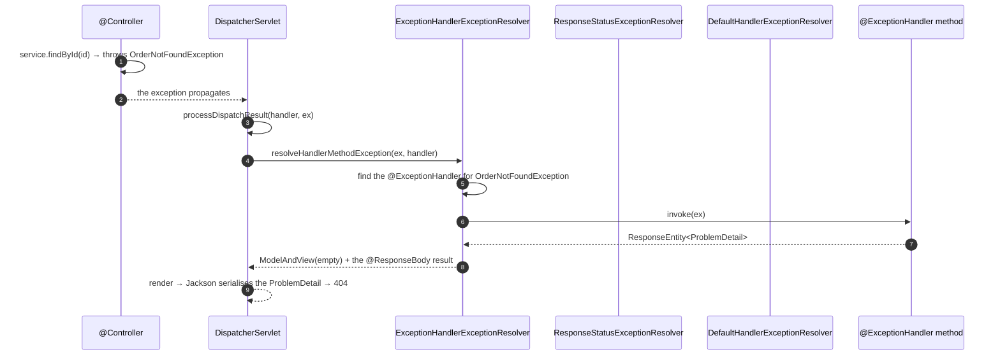
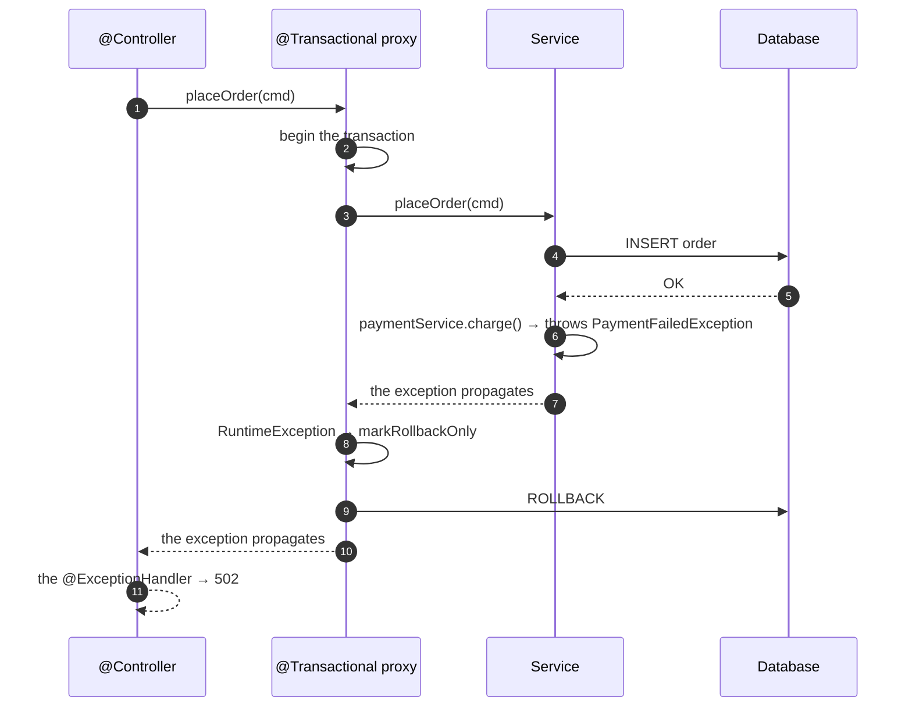

# 04 · Exception Handling — The Error Contract

> **Level:** Beginner → Advanced
> **Interview Frequency:** ★★★★☆ ("How do you handle exceptions in a Spring Boot API?")
> **Prerequisite:** [03 · Validation](./03-Validation.md)
> **Last Updated:** 2026

---

## 📋 Table of Contents
- [0. TL;DR — The 30-Second Answer](#0-tldr--the-30-second-answer)
- [1. What & Why](#1-what--why)
- [2. Mental Model — the error contract](#2-mental-model--the-error-contract)
- [3. Deep Dive — Theory](#3-deep-dive--theory)
- [4. Internal Working Mechanism](#4-internal-working-mechanism)
- [5. Step-by-Step Execution Flow](#5-step-by-step-execution-flow)
- [6. Architecture Diagrams](#6-architecture-diagrams)
- [7. Production-Level Use Cases](#7-production-level-use-cases)
- [8. Code Examples — Production-Grade](#8-code-examples--production-grade)
- [9. Common Mistakes & Gotchas](#9-common-mistakes--gotchas)
- [10. Performance Considerations](#10-performance-considerations)
- [11. Security Considerations](#11-security-considerations)
- [12. Best Practices — The Checklist](#12-best-practices--the-checklist)
- [13. Hands-On Exercises](#13-hands-on-exercises)
- [14. Code Challenges](#14-code-challenges)
- [15. Scenario-Based Questions](#15-scenario-based-questions)
- [16. Interview Q&A — Level-wise](#16-interview-qa--level-wise)
- [17. Counter-Questions & Traps](#17-counter-questions--traps)
- [18. Tricky Interview Questions](#18-tricky-interview-questions)
- [19. Follow-Up Questions Asked by Interviewers](#19-follow-up-questions-asked-by-interviewers)
- [20. Real 3–5 Year Experience Scenarios](#20-real-35-year-experience-scenarios)
- [21. Frequently Asked Production Issues](#21-frequently-asked-production-issues)
- [22. Debugging Scenarios](#22-debugging-scenarios)
- [23. Architecture Design Questions](#23-architecture-design-questions)
- [24. Rapid-Fire MCQs](#24-rapid-fire-mcqs)
- [25. Cheat Sheet — One-Page Summary](#25-cheat-sheet--one-page-summary)
- [26. Real-World Production Notes](#26-real-world-production-notes)
- [27. Follow-up Learning](#27-follow-up-learning)

---

## 0. TL;DR — The 30-Second Answer

- **Exceptions bubble up** the call stack until something handles them. In Spring MVC, the
  `HandlerExceptionResolver` chain handles them.
- **`@ExceptionHandler`** in a `@Controller` or a `@ControllerAdvice` — the local/global handler.
- **`@RestControllerAdvice`** = `@ControllerAdvice` + `@ResponseBody` — the JSON API version.
- **The `ExceptionHandlerExceptionResolver` runs first**, then the `ResponseStatusExceptionResolver`,
  then the `DefaultHandlerExceptionResolver` (the framework's built-ins: the 404, the 405, the
  415…).
- **`@ResponseStatus`** on an exception class or a handler method sets the status code.
- **`ResponseStatusException`** — throw it directly from anywhere to set the status (a
  convenience, but it couples the domain to the web layer — see below).
- **`ProblemDetail` (RFC 9457)** is the modern error body. In Boot 3.2+, set
  `spring.mvc.problemdetails.enabled=true` and Spring's own exceptions return a `ProblemDetail`.
- **The hierarchy of specificity** in the advice: the most specific exception type wins.
- **The transaction interaction:** a `RuntimeException` **rolls back** the transaction by default
  (the `@Transactional` rollback rules). A checked exception **commits** unless you declare
  `rollbackFor`.
- **Never leak the internals:** no stack traces, no SQL, no class names. Log with a **correlation
  id** and return a generic message.
- **The one-liner:** *"The exception handling is the **error contract** of the API — the client
  must be able to distinguish 'retry this' from 'fix your request' from 'call the humans', and
  the response must say which without leaking anything."*

---

## 1. What & Why

An API's error responses are a **public contract**, exactly like the success responses. Clients
branch on them:
- A **400** → the client fixes the request.
- A **401** → the client refreshes the token.
- A **409** → the client refreshes its state and retries.
- A **429** → the client backs off.
- A **503** → the client retries with a backoff.
- A **500** → the client shows an error; the humans get paged.

If every error is a 500 with a stack trace in the body, the client can't do anything intelligent —
and you've leaked your internals.

---

## 2. Mental Model — the error contract

```text
   Exception thrown
        │
        ▼
   ┌────────────────────────────────────────────────────────────┐
   │  HandlerExceptionResolver chain (in order)                 │
   │                                                            │
   │  ① ExceptionHandlerExceptionResolver                       │
   │       → @ExceptionHandler methods                          │
   │ ② ResponseStatusExceptionResolver                          │
   │       → @ResponseStatus / ResponseStatusException          │
   │ ③ DefaultHandlerExceptionResolver                          │
   │       → Spring's built-in mappings (404, 405, 415, …)      │
   └────────────────────────────────────────────────────────────┘
        │  (nothing handled it)
        ▼
   The servlet container's error page → a 500
```

> **Caption:** Three resolvers, tried in order. The **first** one that can handle the exception
> wins. The `DefaultHandlerExceptionResolver` is the safety net that turns the framework's
> exceptions into sensible statuses instead of a 500.

---

## 3. Deep Dive — Theory

### 3.1 The exception hierarchy — what to throw

```text
java.lang.Throwable
├── Exception
│   ├── RuntimeException                  ← UNCHECKED
│   │   ├── IllegalArgumentException      ← the client's fault → 400
│   │   ├── IllegalStateException         ← the state is wrong → 409
│   │   ├── NullPointerException          ← a BUG → 500
│   │   ├── DataIntegrityViolationException (Spring) → 409
│   │   ├── OptimisticLockingFailureException (Spring) → 409
│   │   ├── EntityNotFoundException (Spring) → 404
│   │   ├── AccessDeniedException (Spring Security) → 403
│   │   ├── AuthenticationException (Spring Security) → 401
│   │   └── ...
│   └── Exception (checked)               ← CHECKED
│       ├── IOException
│       └── ...
└── Error                                ← a JVM-level failure → 500
```

**The mapping to the HTTP status:**

| The exception | The meaning | The status |
|---------------|-------------|-----------|
| `IllegalArgumentException` | The client's input is invalid | 400 |
| `EntityNotFoundException` | The resource doesn't exist | 404 |
| `IllegalStateException` | The operation isn't valid in the current state | 409 |
| `DataIntegrityViolationException` | A DB constraint was violated | 409 |
| `OptimisticLockingFailureException` | A concurrent modification | 409 |
| `AccessDeniedException` | Not authorised | 403 |
| `AuthenticationException` | Not authenticated | 401 |
| `HttpMessageNotReadableException` | A malformed body | 400 |
| `MethodArgumentNotValidException` | A validation failure | 400 |
| `MissingServletRequestParameterException` | A missing parameter | 400 |
| `HttpRequestMethodNotSupportedException` | The wrong method | 405 |
| `HttpMediaTypeNotSupportedException` | The wrong content type | 415 |
| `MaxUploadSizeExceededException` | The file is too big | 413 |
| `AsyncRequestTimeoutException` | The async timeout | 503/504 |
| `ResourceAccessException` | The downstream is unreachable | 502/503 |
| `RestClientResponseException` | The downstream returned an error | 502/504 |
| `TimeoutException` | The downstream timed out | 504 |
| `DataAccessException` (the Spring Data base) | The DB failed | 500/503 |

### 3.2 The `@ExceptionHandler` — the local one

```java
@RestController
@RequestMapping("/api/v1/orders")
public class OrderController {

    @GetMapping("/{id}")
    public OrderResponse get(@PathVariable Long id) {
        return orderService.findById(id).orElseThrow(() -> new OrderNotFoundException(id));
    }

    // Handles the exceptions thrown by THIS controller only
    @ExceptionHandler(OrderNotFoundException.class)
    public ResponseEntity<ProblemDetail> handleNotFound(OrderNotFoundException ex) {
        ProblemDetail pd = ProblemDetail.forStatusAndDetail(HttpStatus.NOT_FOUND, ex.getMessage());
        pd.setTitle("Order not found");
        return ResponseEntity.status(HttpStatus.NOT_FOUND).body(pd);
    }
}
```

### 3.3 The `@RestControllerAdvice` — the global one

```java
@RestControllerAdvice
public class ApiExceptionHandler {

    @ExceptionHandler(OrderNotFoundException.class)
    public ResponseEntity<ProblemDetail> handleNotFound(OrderNotFoundException ex) { }

    @ExceptionHandler(Exception.class)
    public ResponseEntity<ProblemDetail> handleGeneric(Exception ex) { }
}
```

**The scoping options:**

```java
@ControllerAdvice(basePackages = "com.acme.order")           // by package
@ControllerAdvice(assignableTypes = OrderController.class)   // by controller type
@ControllerAdvice(annotations = @RestController.class)       // by annotation
@RestControllerAdvice                                          // all controllers
```

> **The order of precedence:**
> 1. The `@ExceptionHandler` methods **in the controller itself** (the most local).
> 2. The `@ExceptionHandler` methods in the **advice** — the most specific exception type wins;
>    within the same advice, the method with the **most specific** parameter type wins; if two
>    methods have the same specificity, it's an **ambiguous mapping** error at startup.
> 3. The `ResponseStatusExceptionResolver`.
> 4. The `DefaultHandlerExceptionResolver`.

### 3.4 `@ResponseStatus` — the declarative status

```java
@ResponseStatus(HttpStatus.NOT_FOUND)
public class OrderNotFoundException extends RuntimeException {
    public OrderNotFoundException(Long id) {
        super("Order " + id + " not found");
    }
}
```

```java
@ResponseStatus(code = HttpStatus.CONFLICT, reason = "The order is already shipped")
public class OrderAlreadyShippedException extends RuntimeException { }
```

**The caveat:** the `reason` is **deprecated** in Spring 6 (the `sendError` path sets the status
and the container may replace the body) — use a `ProblemDetail` body instead.

### 3.5 `ResponseStatusException` — the throw-anywhere status

```java
throw new ResponseStatusException(HttpStatus.NOT_FOUND, "Order not found");
throw new ResponseStatusException(HttpStatus.CONFLICT, "Duplicate order number");
```

**The pros:** a one-liner from anywhere in the service.
**The cons:**
1. It **couples the domain/service to the HTTP** — the domain now knows about the status codes.
2. The body is the default Spring error body (not a `ProblemDetail`), unless you handle it.
3. The `reason` is deprecated.

> **The senior view:** use the domain exceptions in the service (they're transport-agnostic) and
> **translate** them in the advice. Use `ResponseStatusException` only in the web layer (the
> controller) or in a small "web adapter" module.

### 3.6 `ProblemDetail` — the RFC 9457 body

```java
ProblemDetail pd = ProblemDetail.forStatusAndDetail(HttpStatus.CONFLICT, "The order is already shipped");
pd.setTitle("Order already shipped");
pd.setType(URI.create("https://api.acme.com/problems/order-already-shipped"));
pd.setInstance(URI.create(request.getRequestURI()));
pd.setProperty("orderId", 42L);
pd.setProperty("status", "SHIPPED");
```

```json
{
  "type": "https://api.acme.com/problems/order-already-shipped",
  "title": "Order already shipped",
  "status": 409,
  "detail": "The order is already shipped",
  "instance": "/api/v1/orders/42",
  "orderId": 42,
  "status": "SHIPPED"
}
```

**The properties:**
- `type` — a **URI** that identifies the error type. It should be a **documentation URI**, not a
  URL that must resolve to anything machine-readable, but it should be **stable** — the clients
  switch on it.
- `title` — a short, human-readable summary of the error type (the same for all the instances).
- `status` — the HTTP status code (redundant with the response status, but part of the spec).
- `detail` — a human-readable explanation **specific to this occurrence**.
- `instance` — a URI identifying this specific occurrence (the request path, or a trace id).
- **The extension properties** — anything else (the field errors, the correlation id, the
  timestamp).

### 3.7 `ResponseEntityExceptionHandler` — the framework exceptions

```java
@RestControllerAdvice
public class GlobalExceptionHandler extends ResponseEntityExceptionHandler {

    // The @RequestBody validation failure
    @Override
    protected ResponseEntity<Object> handleMethodArgumentNotValid(
            MethodArgumentNotValidException ex, HttpHeaders headers,
            HttpStatusCode status, WebRequest request) { }

    // The method-level validation failure (the @RequestParam constraints)
    @Override
    protected ResponseEntity<Object> handleHandlerMethodValidationException(
            HandlerMethodValidationException ex, HttpHeaders headers,
            HttpStatusCode status, WebRequest request) { }

    // The type mismatch (a string where a number is expected)
    @Override
    protected ResponseEntity<Object> handleTypeMismatch(
            TypeMismatchException ex, HttpHeaders headers,
            HttpStatusCode status, WebRequest request) { }

    // A missing @RequestParam / @PathVariable / @RequestHeader
    @Override
    protected ResponseEntity<Object> handleMissingServletRequestParameter(
            MissingServletRequestParameterException ex, HttpHeaders headers,
            HttpStatusCode status, WebRequest request) { }

    // A malformed body (bad JSON, a type mismatch in the JSON)
    @Override
    protected ResponseEntity<Object> handleHttpMessageNotReadable(
            HttpMessageNotReadableException ex, HttpHeaders headers,
            HttpStatusCode status, WebRequest request) { }

    // A missing @RequestBody
    @Override
    protected ResponseEntity<Object> handleHttpRequestBodyNotReadable(...) { }

    // The upload is too large
    @Override
    protected ResponseEntity<Object> handleMaxUploadSizeExceededException(
            MaxUploadSizeExceededException ex, HttpHeaders headers,
            HttpStatusCode status, WebRequest request) { }
}
```

> **Why extend it?** Because it gives you the **standardised** handling of all the Spring MVC
> exceptions with a **single response shape**, and the `ProblemDetail` return type is supported
> natively (Spring 6 fills the `ProblemDetail` with the status and the detail). Without it, each
> of those exceptions falls through to the `DefaultHandlerExceptionResolver` → the default Spring
> error body (which differs from your custom one).

### 3.8 The `spring.mvc.problemdetails.enabled` property

```properties
spring.mvc.problemdetails.enabled=true
```

**What it does:** Spring MVC's own exceptions (the 404, the 405, the 415, the validation failures,
the type mismatches) are rendered as a **`ProblemDetail`** instead of the default
`{timestamp, status, error, path}` body.

> **Boot 3.2+.** This is the simplest way to get a consistent error body — and it's the
> recommended baseline. Then your custom handlers produce the same shape.

### 3.9 The `@ResponseStatus` vs the `ResponseEntity` vs the return type

| The handler returns | The status comes from |
|---------------------|-----------------------|
| `ProblemDetail` | `pd.getStatus()` — the `forStatusAndDetail(...)` value |
| `ResponseEntity<ProblemDetail>` | The `ResponseEntity` (the `ProblemDetail`'s status is ignored) |
| `@ResponseStatus` on the method | The annotation |
| `@ResponseStatus` on the exception class | The annotation (unless the handler overrides it) |
| A `String` | 200 (or the `@ResponseStatus`) |
| `void` | 200 (or the `@ResponseStatus`) |

### 3.10 The error hierarchy — the domain exceptions

```java
// The base
public abstract class DomainException extends RuntimeException {
    private final ErrorCode errorCode;

    protected DomainException(ErrorCode errorCode, String message) {
        super(message);
        this.errorCode = errorCode;
    }

    public ErrorCode getErrorCode() { return errorCode; }
}
```

```java
public enum ErrorCode {
    ORDER_NOT_FOUND(HttpStatus.NOT_FOUND, "Order not found"),
    ORDER_ALREADY_SHIPPED(HttpStatus.CONFLICT, "Order already shipped"),
    INSUFFICIENT_STOCK(HttpStatus.CONFLICT, "Insufficient stock"),
    PAYMENT_FAILED(HttpStatus.BAD_GATEWAY, "Payment failed");

    private final HttpStatus status;
    private final String title;

    ErrorCode(HttpStatus status, String title) {
        this.status = status;
        this.title = title;
    }

    public HttpStatus getStatus() { return status; }
    public String getTitle() { return title; }
}
```

```java
public class OrderNotFoundException extends DomainException {
    public OrderNotFoundException(Long id) {
        super(ErrorCode.ORDER_NOT_FOUND, "Order " + id + " does not exist");
    }
}
```

**The advantage:** the domain doesn't depend on the HTTP (the `ErrorCode` enum is in the domain
package but the status is mapped in the web layer) — or you accept the coupling and gain
simplicity. The **cleanest** compromise: the domain exception carries an **error code** (a
string/enum, not an `HttpStatus`), and the web layer maps the code to the status.

### 3.11 The exception and the transaction

```java
@Transactional
public void placeOrder(...) {
    Order order = repository.save(...);
    paymentService.charge(...);      // throws → the whole thing rolls back
}
```

**The rollback rules (the default):**
- A **`RuntimeException`** (and its subclasses, including `Error`) → **rollback**.
- A **checked `Exception`** → **commit** (the transaction succeeds!).

```java
@Transactional(rollbackFor = Exception.class)     // roll back on the checked exceptions too
@Transactional(noRollbackFor = AuditException.class)
```

> **The classic trap:** a checked exception thrown from a transactional method **commits** the
> transaction. If your method does a DB write and then throws a checked `IOException`, the write
> **stays**. Always use `rollbackFor = Exception.class` (or an unchecked exception).

**The `@Transactional` boundary matters:** the exception must **propagate out of** the
transactional method for the rollback to happen. If you catch it inside, the transaction
**commits** (unless you call `setRollbackOnly()`).

```java
@Transactional
public void process() {
    try {
        doWork();
    } catch (RuntimeException e) {
        TransactionAspectSupport.currentTransactionStatus().setRollbackOnly();
        throw e;
    }
}
```

### 3.12 The `@Transactional` and the exception in a nested call

```text
  A (REQUIRED) ──► B (REQUIRED)  → the SAME transaction
  A (REQUIRED) ──► B (REQUIRES_NEW) → a NEW transaction (the outer is suspended)
                                       → the inner's failure doesn't roll back the outer
```

**The classic trap:** a `@Transactional(REQUIRES_NEW)` method that fails → the exception is caught
by the caller → the outer transaction **commits** the partial work, but the inner work is
rolled back. If that's not what you want, use `REQUIRED`.

### 3.13 The `ErrorController` — the errors outside the dispatcher

```java
@RestController
public class GlobalErrorController implements ErrorController {

    @RequestMapping("/error")
    public ResponseEntity<ProblemDetail> handleError(HttpServletRequest request) {

        Object status = request.getAttribute(RequestDispatcher.ERROR_STATUS_CODE);
        Object path = request.getAttribute(RequestDispatcher.ERROR_REQUEST_URI);
        Object message = request.getAttribute(RequestDispatcher.ERROR_MESSAGE);

        HttpStatusCode code = status instanceof Integer i ? HttpStatusCode.valueOf(i) : HttpStatus.INTERNAL_SERVER_ERROR;

        ProblemDetail pd = ProblemDetail.forStatusAndDetail(code, "An unexpected error occurred");
        pd.setTitle(HttpStatus.valueOf(code.getValue()).getReasonPhrase());
        pd.setInstance(URI.create(String.valueOf(path)));
        pd.setProperty("correlationId", MDC.get("correlationId"));

        return ResponseEntity.status(code).body(pd);
    }
}
```

> **When is it needed?**
> - The errors that happen **before** the dispatcher (a filter, a security rejection, a malformed
>   request line).
> - The errors in the **static resources** (a missing file → the container forwards to `/error`).
> - With `server.error.include-*` properties you can also enrich the default error body.
>
> **Boot 3's alternative:** implement `ErrorAttributes` (the `DefaultErrorAttributes` bean) to
> customise the default error attributes, including the `ProblemDetail`.

```java
@Component
public class CustomErrorAttributes extends DefaultErrorAttributes {

    @Override
    public Map<String, Object> getErrorAttributes(WebRequest webRequest, ErrorAttributeOptions options) {
        Map<String, Object> attrs = super.getErrorAttributes(webRequest, options);
        attrs.put("correlationId", MDC.get("correlationId"));
        attrs.put("service", "order-service");
        return attrs;
    }
}
```

### 3.14 The `server.error.*` properties

```properties
# Include the message in the default error body (NEVER in production)
server.error.include-message=never
server.error.include-binding-errors=never
server.error.include-stacktrace=never
server.error.include-exception=false
server.error.whitelabel.enabled=false
```

> **The defaults are already safe** (Boot 2.3+): `include-message=never`,
> `include-stacktrace=never`, `include-exception=false`. Set them explicitly in production so a
> profile or an env var can't accidentally turn them on.

### 3.15 The `ResponseStatusException` vs the domain exception — the decision

| | The domain exception | `ResponseStatusException` |
|---|---|---|
| The dependency | The domain is free of the web | The domain depends on the web |
| The granularity | Per error type | Per call site |
| The body | Full control (`ProblemDetail`) | The default (or handled globally) |
| The status | Mapped in the advice | Inline |
| The recommendation | **The default** for a real domain | Fine for the web layer / a small app |

---

## 4. Internal Working Mechanism

### 4.1 The `DispatcherServlet` and the resolvers

```java
// In DispatcherServlet.processDispatchResult(...)
try {
    processHandlerResult(request, response, mappedHandler, mv, dispatchException);
}
catch (Exception ex) {
    dispatchException = ex;
}
...
private void processHandlerResult(...) {
    boolean hasHandlerException = false;
    Exception handlerException = null;
    if (mappedHandler != null) {
        handlerException = mappedHandler.getExceptionHandler();   // ← the @ExceptionHandler lookup
    }
    if (handlerException != null) {
        hasHandlerException = true;
        processHandlerException(request, response, handler, exception);
    }
    else if (mappedHandler != null) {
        render(...);
    }
    else {
        // no handler
    }
}
```

**The important detail:** the `ExceptionHandlerExceptionResolver` runs **after** the handler
method has already executed (and thrown). The `HandlerException` was **pre-computed** during
the `HandlerMapping` phase (`AbstractHandlerMethodMapping.getHandlerInternal` →
`detectHandlerException`), so the lookup happens **before** the invocation — but the
**invocation** of the handler happens first.

### 4.2 The `ExceptionHandlerExceptionResolver`

```java
protected ModelAndView doResolveHandlerMethodException(...) {
    // ① Find the @ExceptionHandler method
    Method invocableMethod = getExceptionHandlerMethod(exception, handlerMethod);
    // ② Build the arguments
    Object[] arguments = resolveArguments(exception, invocableMethod, handlerMethod, webRequest);
    // ③ Invoke it
    Object result = doInvokeHandlerMethod(exception, invocableMethod, arguments, webRequest);
    // ④ Wrap it in a ModelAndView
    return new ModelAndView().addObject(INDEX_PAGE_ATTRIBUTE, result);
}
```

**The argument resolution for the handler methods:**
- The `Exception` (or a supertype) — injected.
- The `HttpServletRequest` / `HttpServletResponse`.
- The `HttpHeaders` (Spring 6), the `WebRequest`, the `Locale`, the `InputStream`.
- The `HandlerMethod` (the method that threw).
- The `@PathVariable` / `@RequestParam` / `@RequestHeader` from the original request.
- The `SessionStatus` (the `@ResponseStatus` support).

### 4.3 The specificity resolution

```java
// In ExceptionHandlerMethodResolver.getMappedMethod(...)
private Method getMappedMethod(Throwable exception, String[] exceptionTypes) {
    for (String exceptionType : exceptionTypes) {
        Method method = getMappedMethod(exception, exceptionType);
        if (method != null) return method;
    }
    return null;
}
```

**The `exceptionTypes` order** (from `ExceptionHandlerMethodResolver`):
1. The exception class and its superclasses, **in the order of the class hierarchy**.
2. Then the **interfaces** (e.g. a custom `ApiException` interface).

**The ambiguity rule:** if two `@ExceptionHandler` methods in the same advice match the same
exception with the **same specificity**, the context fails at startup with an "Ambiguous @ExceptionHandler
method mapped for ..." error. This is a **good** thing — it fails fast.

### 4.4 The `DefaultHandlerExceptionResolver`'s built-in mappings

```java
// The (simplified) built-in mappings
if (response.isCommitted()) { ... }

if (ex instanceof HttpRequestMethodNotSupportedException) {
    → 405 + the Allow header
} else if (ex instanceof HttpMediaTypeNotSupportedException) {
    → 415
} else if (ex instanceof HttpMediaTypeNotAcceptableException) {
    → 406
} else if (ex instanceof MissingPathVariableException) {
    → 500
} else if (ex instanceof MissingServletRequestParameterException) {
    → 400
} else if (ex instanceof ServletRequestBindingException) {
    → 400
} else if (ex instanceof ConversionNotSupportedException) {
    → 500
} else if (ex instanceof TypeMismatchException) {
    → 400
} else if (ex instanceof HttpMessageNotReadableException) {
    → 400
} else if (ex instanceof HttpMessageNotWritableException) {
    → 500
} else if (ex instanceof MethodArgumentNotValidException) {
    → 400
} else if (ex instanceof MissingServletRequestPartException) {
    → 400
} else if (ex instanceof BindException) {
    → 400
} else if (ex instanceof NoHandlerFoundException) {
    → 404
} else if (ex instanceof AsyncRequestTimeoutException) {
    → 503
} else {
    → rethrow (it becomes a 500)
}
```

> **Important:** `NoHandlerFoundException` (a 404) is only thrown if
> `spring.mvc.throw-exception-if-no-handler-found=true` **and** the static resource handling is
> disabled (`spring.web.resources.add-mappings=false`). By default, a 404 for an unmapped URL is
> produced by the **`DispatcherServlet`'s `noHandlerFound`** → the servlet container's `404`
> (through the `DefaultHandlerExceptionResolver`'s `sendError` path) → the `/error` page.

### 4.5 The `ProblemDetail` auto-configuration (Boot 3.2+)

```java
// In Spring MVC's ProblemDetailsExceptionHandler (a @ControllerAdvice registered by
// WebMvcAutoConfiguration when spring.mvc.problemdetails.enabled=true)
@ControllerAdvice
@Order(0)                       // ← a HIGH precedence: it runs before your advice
class ProblemDetailsExceptionHandler extends ResponseEntityExceptionHandler {

    @ExceptionHandler
    public ResponseEntity<ProblemDetail> handleException(Exception ex, WebRequest request) {
        if (ex instanceof ErrorResponse errorResponse) {
            ProblemDetail body = errorResponse.getBody();
            return ResponseEntity.status(errorResponse.getStatusCode()).body(body);
        }
        return null;   // → falls through to your advice
    }
}
```

> **The `@Order(0)`** means it has a **higher** precedence than your `@RestControllerAdvice`
> (which defaults to `Ordered.LOWEST_PRECEDENCE`). But it returns `null` for the exceptions it
> doesn't handle, so **your** advice still gets them. **But** — if your advice handles an
> exception that `ProblemDetailsExceptionHandler` also handles, the **built-in wins**! That's a
> classic surprise: your custom `MethodArgumentNotValidException` handler is **ignored** when
> `spring.mvc.problemdetails.enabled=true`.
>
> **The fix:** don't enable the property if you want full control, or set your advice's
> `@Order(-1)` / a lower precedence number than 0.

---

## 5. Step-by-Step Execution Flow

### 5.1 An exception thrown in a controller



### 5.2 The exception and the transaction rollback



> **Note:** the transaction is rolled back **before** the exception handler runs (the handler is
> in the web layer, outside the transaction). So the error response is produced **after** the
> rollback — the client never sees a success for a rolled-back operation.

---

## 6. Architecture Diagrams

### 6.1 The error handling layers

```text
┌──────────────────────────────────────────────────────────────────────────────┐
│  DOMAIN LAYER                                                                │
│   Throws the domain exceptions (transport-agnostic):                        │
│     OrderNotFoundException, OrderAlreadyShippedException, InsufficientStock  │
│   Carries an ErrorCode, NOT an HttpStatus.                                  │
├──────────────────────────────────────────────────────────────────────────────┤
│  APPLICATION LAYER                                                           │
│   Catches the infrastructure exceptions and translates them:                 │
│     DataIntegrityViolationException → DuplicateOrderException                │
│     RestClientResponseException     → UpstreamServiceException              │
├──────────────────────────────────────────────────────────────────────────────┤
│  WEB LAYER — @RestControllerAdvice                                          │
│   Maps the exceptions → the HTTP status + the ProblemDetail body.           │
│   ONE place. ONE shape.                                                     │
├──────────────────────────────────────────────────────────────────────────────┤
│  ERROR PAGE LAYER (outside the dispatcher)                                  │
│   The filters' errors, the security rejections, the missing static resources. │
│   → ErrorController / ErrorAttributes                                        │
└──────────────────────────────────────────────────────────────────────────────┘
```

### 6.2 The exception → status mapping table

```text
  ┌──────────────────────────────┬────────┬──────────────────────────────────┐
  │ The exception                 │ Status │ The message                      │
  ├──────────────────────────────┼────────┼──────────────────────────────────┤
  │ IllegalArgumentException     │  400   │ "The request is invalid"          │
  │ MethodArgumentNotValidEx.    │  400   │ "Validation failed" + the fields  │
  │ HttpMessageNotReadable        │  400   │ "Malformed request body"          │
  │ MissingServletRequestParam.  │  400   │ "Required parameter 'x' is missing"│
  │ AuthenticationException       │  401   │ "Authentication required"         │
  │ AccessDeniedException        │  403   │ "Access denied"                   │
  │ EntityNotFoundException      │  404   │ "Not found"                       │
  │ NoHandlerFoundException      │  404   │ "Not found"                       │
  │ HttpRequestMethodNotSupport. │  405   │ "Method not allowed"              │
  │ MaxUploadSizeExceeded        │  413   │ "The file is too large"           │
  │ HttpMediaTypeNotSupported    │  415   │ "Unsupported media type"          │
  │ DataIntegrityViolation       │  409   │ "The request conflicts with the    │
  │                              │        │  current state"                   │
  │ OptimisticLockingFailure     │  409   │ "Concurrent modification"          │
  │ IllegalStateException        │  409   │ "Invalid state for this operation" │
  │ RestClientResponseException  │  502   │ "An upstream service failed"       │
  │ TimeoutException             │  504   │ "An upstream service timed out"    │
  │ AsyncRequestTimeout          │  503   │ "The request timed out"            │
  │ Exception (the fallback)     │  500   │ "An unexpected error occurred"     │
  └──────────────────────────────┴────────┴──────────────────────────────────┘
```

### 6.3 The "don't leak" decision tree

```text
  An exception occurs
      │
      ├─ Is it a known, expected business error?
      │     → a specific handler → a specific status → a specific message
      │
      ├─ Is it a known framework error (the validation, the 405…)?
      │     → the framework handler → 400/404/405 with a generic message
      │
      └─ Is it unexpected?
            → 500 + a GENERIC message + the correlation id
            → the details are in the logs (with the correlation id)
            → NEVER the message, the stack trace, or the exception class
```

---

## 7. Production-Level Use Cases

| Use case | Approach |
|----------|----------|
| **A public API** | A `ProblemDetail` everywhere + the stable `type` URIs + the error codes |
| **A downstream failure** | Translate the `RestClientResponseException` into a `502`/`504` (not a 500) — and the retry policy |
| **A DB constraint violation** | Translate the `DataIntegrityViolationException` into a `409` with a friendly message |
| **A concurrency conflict** | The `OptimisticLockingFailureException` → a `409` + "reload and retry" |
| **An auth failure** | Spring Security's `AuthenticationEntryPoint` (a 401) and the `AccessDeniedHandler` (a 403) — **not** the `@ExceptionHandler` (they happen in the filter chain) |
| **A validation failure** | The `ResponseEntityExceptionHandler` subclass |
| **A file too big** | The `MaxUploadSizeExceededException` → a 413 |
| **An unexpected error** | The generic fallback → a 500 + a correlation id |
| **An async operation failure** | The status resource reflects the failure (not an HTTP error) |
| **A rate limit** | The `RateLimiter` in the filter → a 429 + a `Retry-After` |
| **A circuit breaker open** | The `CallNotPermittedException` → a 503 + a `Retry-After` |

---

## 8. Code Examples — Production-Grade

### 8.1 The domain exceptions

```java
// ── The error catalogue ────────────────────────────────────────────────
public enum ApiError {
    ORDER_NOT_FOUND(HttpStatus.NOT_FOUND, "order-not-found"),
    ORDER_ALREADY_SHIPPED(HttpStatus.CONFLICT, "order-already-shipped"),
    DUPLICATE_ORDER_NUMBER(HttpStatus.CONFLICT, "duplicate-order-number"),
    INSUFFICIENT_STOCK(HttpStatus.CONFLICT, "insufficient-stock"),
    PAYMENT_DECLINED(HttpStatus.UNPROCESSABLE_ENTITY, "payment-declined"),
    UPSTREAM_UNAVAILABLE(HttpStatus.SERVICE_UNAVAILABLE, "upstream-unavailable"),
    VALIDATION_FAILED(HttpStatus.BAD_REQUEST, "validation-failed");

    private final HttpStatus status;
    private final String slug;

    ApiError(HttpStatus status, String slug) {
        this.status = status;
        this.slug = slug;
    }

    public HttpStatus getStatus() { return status; }
    public String getSlug() { return slug; }
    public URI getTypeUri() {
        return URI.create("https://api.acme.com/problems/" + slug);
    }
}
```

```java
// ── The base domain exception ──────────────────────────────────────────
public abstract class ApiException extends RuntimeException {

    private final ApiError error;

    protected ApiException(ApiError error, String message) {
        super(message);
        this.error = error;
    }

    protected ApiException(ApiError error, String message, Throwable cause) {
        super(message, cause);
        this.error = error;
    }

    public ApiError getError() { return error; }
}
```

```java
public class OrderNotFoundException extends ApiException {
    public OrderNotFoundException(Long id) {
        super(ApiError.ORDER_NOT_FOUND, "Order " + id + " does not exist");
    }
}

public class DuplicateOrderNumberException extends ApiException {
    public DuplicateOrderNumberException(String orderNumber) {
        super(ApiError.DUPLICATE_ORDER_NUMBER,
              "An order with the number " + orderNumber + " already exists");
    }
}
```

### 8.2 The global exception handler

```java
@RestControllerAdvice
@Slf4j
public class GlobalExceptionHandler extends ResponseEntityExceptionHandler {

    // ── The domain exceptions ────────────────────────────────────────────
    @ExceptionHandler(ApiException.class)
    public ResponseEntity<ProblemDetail> handleApiException(ApiException ex,
                                                             HttpServletRequest request) {
        ApiError error = ex.getError();
        ProblemDetail pd = ProblemDetail.forStatusAndDetail(error.getStatus(), ex.getMessage());
        pd.setTitle(error.getSlug());
        pd.setType(error.getTypeUri());
        pd.setInstance(URI.create(request.getRequestURI()));
        pd.setProperty("correlationId", MDC.get("correlationId"));

        // A business error is a client error → WARN, not ERROR
        log.warn("Business error: {} - {}", error.getSlug(), ex.getMessage());
        return ResponseEntity.status(error.getStatus()).body(pd);
    }

    // ── The optimistic locking conflict ─────────────────────────────────
    @ExceptionHandler(OptimisticLockingFailureException.class)
    public ResponseEntity<ProblemDetail> handleOptimisticLock(OptimisticLockingFailureException ex,
                                                                HttpServletRequest request) {
        ProblemDetail pd = ProblemDetail.forStatusAndDetail(HttpStatus.CONFLICT,
                "The resource was modified by another request. Reload it and retry.");
        pd.setTitle("concurrent-modification");
        pd.setType(URI.create("https://api.acme.com/problems/concurrent-modification"));
        pd.setProperty("correlationId", MDC.get("correlationId"));
        log.warn("Optimistic locking conflict on {}", request.getRequestURI());
        return ResponseEntity.status(HttpStatus.CONFLICT).body(pd);
    }

    // ── The DB constraint violation ─────────────────────────────────────
    @ExceptionHandler(DataIntegrityViolationException.class)
    public ResponseEntity<ProblemDetail> handleIntegrityViolation(DataIntegrityViolationException ex,
                                                                    HttpServletRequest request) {
        log.warn("Data integrity violation on {}", request.getRequestURI(), ex);
        ProblemDetail pd = ProblemDetail.forStatusAndDetail(HttpStatus.CONFLICT,
                "The request conflicts with the current state of the data");
        pd.setTitle("data-conflict");
        pd.setType(URI.create("https://api.acme.com/problems/data-conflict"));
        return ResponseEntity.status(HttpStatus.CONFLICT).body(pd);
    }

    // ── The upstream failure ────────────────────────────────────────────
    @ExceptionHandler(RestClientResponseException.class)
    public ResponseEntity<ProblemDetail> handleUpstream(RestClientResponseException ex) {
        log.error("Upstream call failed: {}", ex.getStatusCode(), ex);
        ProblemDetail pd = ProblemDetail.forStatusAndDetail(HttpStatus.BAD_GATEWAY,
                "An upstream service returned an error. Please retry later.");
        pd.setTitle("upstream-error");
        pd.setType(URI.create("https://api.acme.com/problems/upstream-error"));
        return ResponseEntity.status(HttpStatus.BAD_GATEWAY).body(pd);
    }

    @ExceptionHandler(ResourceAccessException.class)
    public ResponseEntity<ProblemDetail> handleUnreachable(ResourceAccessException ex) {
        log.error("Upstream unreachable", ex);
        ProblemDetail pd = ProblemProblemDetail(HttpStatus.SERVICE_UNAVAILABLE,
                "An upstream service is currently unavailable. Please retry later.");
        pd.setTitle("upstream-unavailable");
        return ResponseEntity.status(HttpStatus.SERVICE_UNAVAILABLE).body(pd);
    }

    // ── The catch-all ───────────────────────────────────────────────────
    @ExceptionHandler(Exception.class)
    public ResponseEntity<ProblemDetail> handleUnexpected(Exception ex,
                                                            HttpServletRequest request) {
        String correlationId = MDC.get("correlationId");
        log.error("Unhandled exception on {} [correlationId={}]",
                  request.getRequestURI(), correlationId, ex);

        ProblemDetail pd = ProblemDetail.forStatusAndDetail(HttpStatus.INTERNAL_SERVER_ERROR,
                "An unexpected error occurred. Contact support with the correlation id.");
        pd.setTitle("internal-error");
        pd.setType(URI.create("https://api.acme.com/problems/internal-error"));
        pd.setProperty("correlationId", correlationId);
        return ResponseEntity.status(HttpStatus.INTERNAL_SERVER_ERROR).body(pd);
    }

    // ── The framework's exceptions (the standardised shape) ─────────────
    @Override
    protected ResponseEntity<Object> handleMethodArgumentNotValid(
            MethodArgumentNotValidException ex, HttpHeaders headers,
            HttpStatusCode status, WebRequest request) {

        List<FieldViolation> violations = ex.getBindingResult().getFieldErrors().stream()
                .map(fe -> new FieldViolation(fe.getField(), fe.getDefaultMessage()))
                .toList();

        ProblemDetail pd = ProblemDetail.forStatusAndDetail(HttpStatus.BAD_REQUEST,
                "The request contains invalid values");
        pd.setTitle("validation-failed");
        pd.setType(URI.create("https://api.acme.com/problems/validation-failed"));
        pd.setProperty("violations", violations);
        return ResponseEntity.badRequest().body(pd);
    }

    @Override
    protected ResponseEntity<Object> handleHttpMessageNotReadable(
            HttpMessageNotReadableException ex, HttpHeaders headers,
            HttpStatusCode status, WebRequest request) {
        ProblemDetail pd = ProblemDetail.forStatusAndDetail(HttpStatus.BAD_REQUEST,
                "The request body is malformed or contains an invalid value");
        pd.setTitle("malformed-request");
        return ResponseEntity.badRequest().body(pd);
    }

    @Override
    protected ResponseEntity<Object> handleMaxUploadSizeExceededException(
            MaxUploadSizeExceededException ex, HttpHeaders headers,
            HttpStatusCode status, WebRequest request) {
        ProblemDetail pd = ProblemDetail.forStatusAndDetail(HttpStatus.PAYLOAD_TOO_LARGE,
                "The uploaded file exceeds the maximum allowed size");
        pd.setTitle("payload-too-large");
        return ResponseEntity.status(HttpStatus.PAYLOAD_TOO_LARGE).body(pd);
    }

    public record FieldViolation(String field, String message) {}
}
```

> **Note the deliberate typo guard:** in the code above, replace `ProblemProblemDetail(...)`
> with `ProblemDetail.forStatusAndDetail(...)` — the method name is `forStatusAndDetail`.

### 8.3 The upstream exception translation (in the application layer)

```java
@Service
@RequiredArgsConstructor
public class PaymentService {

    private final PaymentClient paymentClient;

    public void charge(Order order) {
        try {
            PaymentResponse response = paymentClient.charge(
                    new PaymentRequest(order.getOrderNumber(), order.getTotal(), order.getCurrency()));
            if (!"SUCCESS".equals(response.status())) {
                throw new PaymentDeclinedException(response.transactionId());
            }
        } catch (RestClientResponseException ex) {
            // 4xx from the upstream = the upstream rejected the request (a business error)
            if (ex.getStatusCode().is4xxClientError()) {
                throw new ApiException(ApiError.PAYMENT_DECLINED,
                        "The payment was declined", ex);
            }
            // 5xx or a network error = an infrastructure problem (retryable)
            throw new ApiException(ApiError.UPSTREAM_UNAVAILABLE,
                    "The payment service is unavailable", ex);
        } catch (ResourceAccessException ex) {
            throw new ApiException(ApiError.UPSTREAM_UNAVAILABLE,
                    "The payment service is unavailable", ex);
        }
    }
}
```

### 8.4 The `@ControllerAdvice` scoped to the API

```java
@RestControllerAdvice(basePackages = "com.acme.api")
public class ApiExceptionHandler { }
```

### 8.5 The error attributes for the errors outside the dispatcher

```java
@Component
public class CustomErrorAttributes extends DefaultErrorAttributes {

    @Override
    public Map<String, Object> getErrorAttributes(WebRequest webRequest,
                                                 ErrorAttributeOptions options) {
        Map<String, Object> attributes = super.getErrorAttributes(webRequest, options);
        attributes.put("correlationId", MDC.get("correlationId"));
        attributes.put("service", "order-service");
        attributes.put("timestamp", Instant.now().toString());
        return attributes;
    }
}
```

### 8.6 The `@ControllerAdvice` for the web (the non-REST) errors

```java
@ControllerAdvice
public class WebErrorHandler {

    @ExceptionHandler(OrderNotFoundException.class)
    public String handleNotFound(OrderNotFoundException ex, Model model) {
        model.addAttribute("errorMessage", ex.getMessage());
        return "error/404";   // the Thymeleaf template
    }
}
```

### 8.7 The correlation id in the error response

```java
@Component
public class CorrelationIdFilter extends OncePerRequestFilter {

    public static final String HEADER = "X-Correlation-Id";

    @Override
    protected void doFilterInternal(HttpServletRequest request, HttpServletResponse response,
                                    FilterChain filterChain) throws ServletException, IOException {
        String correlationId = request.getHeader(HEADER);
        if (correlationId == null || correlationId.isBlank()) {
            correlationId = UUID.randomUUID().toString();
        }
        MDC.put("correlationId", correlationId);
        response.setHeader(HEADER, correlationId);
        try {
            filterChain.doFilter(request, response);
        } finally {
            MDC.remove("correlationId");
        }
    }
}
```

### 8.8 The transactional rollback rule

```java
@Service
@RequiredArgsConstructor
public class OrderService {

    private final OrderRepository orderRepository;
    private final PaymentService paymentService;

    @Transactional(rollbackFor = Exception.class)
    public Order placeOrder(CreateOrderCommand command) {
        Order order = orderRepository.save(Order.from(command));
        paymentService.charge(order);
        return order;
    }
}
```

### 8.9 The `ResponseStatusException` in the controller layer

```java
@GetMapping("/{id}")
public OrderResponse get(@PathVariable Long id) {
    // Fine in the web layer — a simple, local 404
    Order order = orderRepository.findById(id)
            .orElseThrow(() -> new ResponseStatusException(HttpStatus.NOT_FOUND, "Order not found"));
    return OrderResponse.from(order);
}
```

---

## 9. Common Mistakes & Gotchas

| # | ❌ Wrong | ✅ Right | Why |
|---|----------|----------|-----|
| 1 | `catch (Exception e) { return null; }` in the controller | Let it bubble to the advice | You swallow the error |
| 2 | Returning the exception's message in a 500 | A generic message + the correlation id | The internal details leak |
| 3 | The stack trace in the response | Never | A huge information leak |
| 4 | `@ExceptionHandler(Exception.class)` swallowing the specific ones | The most specific handler wins | The `Exception` handler is the fallback |
| 5 | Relying on the default error body | A `ProblemDetail` everywhere | The clients get a consistent shape |
| 6 | A checked exception in a `@Transactional` method | `rollbackFor = Exception.class` | The default **commits**! |
| 7 | Catching the exception inside the `@Transactional` method | Let it propagate (or `setRollbackOnly()`) | The transaction commits the partial work |
| 8 | `server.error.include-message=always` in production | `never` | The leak |
| 9 | Two handlers with the same specificity | Make one more specific | An ambiguous mapping at startup |
| 10 | The `@ExceptionHandler` in the controller for a service exception | The global advice | The controller only handles its own |
| 11 | A `ResponseStatusException` from the domain | A domain exception | The coupling |
| 12 | The security exceptions in the `@ExceptionHandler` | The `AuthenticationEntryPoint`/`AccessDeniedHandler` | They happen in the filter chain, before the dispatcher |
| 13 | `spring.mvc.problemdetails.enabled=true` + a custom handler for the same exception | Set the advice's `@Order(-1)` or disable the property | The built-in wins |
| 14 | A `ConstraintViolationException` → a 500 | Map it to a 400 | It's a client error |
| 15 | The `@ExceptionHandler` in a `@Controller` for a `Throwable` | Use `Exception` | `Error` (the OOM) shouldn't be handled |
| 16 | Logging every business error at `ERROR` | `WARN` for the 4xx, `ERROR` for the 5xx | The alerting noise |
| 17 | The `ErrorController` returning a stack trace | A generic body | The leak |
| 18 | Assuming the handler runs for the async exceptions | Handle it in the async interceptor | The async exceptions are handled separately |

---

## 10. Performance Considerations

| Aspect | Impact | Guidance |
|--------|--------|----------|
| **The exception construction** | The stack trace fill | The cost is ~1–10 µs; the real cost is in the **throwing** (the JIT deoptimises the path) — don't use exceptions for the normal control flow |
| **The stack trace capture** | The deepest frames are skipped | `new Exception(String, Throwable, boolean, boolean)` (the "writable stack trace" trick) for the hot paths |
| **The logging** | The disk I/O | Log the 4xx at `WARN` with a **sampling**; never log the same 4xx for every request |
| **The `ProblemDetail` creation** | Negligible | — |
| **The `getMessage()` in the response** | Negligible | — |
| **The transaction rollback** | The DB work is discarded | The rollback cost is proportional to the work done — validate early |
| **The error handling in a hot loop** | The `try/catch` per iteration | Hoist it out of the loop |

---

## 11. Security Considerations

| Risk | Mitigation |
|------|-----------|
| **The stack trace in the response** | Never include it; the `server.error.include-*=never` |
| **The SQL in the message** | A generic message; the details in the logs |
| **The class names** (an attacker maps your stack) | The generic body; the correlation id |
| **The internal hostnames** | A generic message |
| **The PII in the error message** | Don't echo the request values |
| **The existence leak** | A 404 for both "not found" and "not allowed" (or a deliberate 403) |
| **The log injection** | Sanitise the user-controlled values that go into the logs (the CRLF, the ANSI escapes) |
| **The error-based oracle** | The uniform messages for the auth failures (don't distinguish "the user doesn't exist" from "the password is wrong") |
| **The sensitive data in the exception message** (a JDBC URL with a password) | The generic message; a scrubbed log |
| **The DoS via the exceptions** | The rate limiting; the circuit breakers |

---

## 12. Best Practices — The Checklist

- [ ] **One global `@RestControllerAdvice`** — the single source of the error contract.
- [ ] **`ProblemDetail` everywhere** — the same shape for every error.
- [ ] **The stable `type` URIs** — the clients switch on them.
- [ ] **A domain exception hierarchy** with an error catalogue.
- [ ] **The domain exceptions don't know about the HTTP** (an `ErrorCode`, not an `HttpStatus`).
- [ ] **The specific handler wins** — a catch-all only as the last resort.
- [ ] **Extend `ResponseEntityExceptionHandler`** so the framework's exceptions get the same shape.
- [ ] **A generic 500** with a correlation id; the details in the logs.
- [ ] **The 4xx at `WARN`, the 5xx at `ERROR`** — with the alerting on the 5xx.
- [ ] **`rollbackFor = Exception.class`** on the critical transactions.
- [ ] **Never catch and swallow** — let it bubble to the advice.
- [ ] **The security errors** are handled by Spring Security, not by the advice.
- [ ] **The error contract is tested** — a test per error type.

---

## 13. Hands-On Exercises

**🧪 Lab 1 — The error catalogue**
1. Create 6 domain exceptions with an `ErrorCode` enum.
2. Write one global advice that maps them.
3. Write a `MockMvc` test per exception asserting the status and the `type` URI.

**✅ Success signal:** 6 tests, 6 different statuses, one consistent body shape.

**🧪 Lab 2 — The leak hunt**
1. Throw a `DataIntegrityViolationException` with a message containing the SQL.
2. Check the response body — does the SQL leak? Fix it.

**🧪 Lab 3 — The transaction trap**
1. Write a `@Transactional` method that writes and then throws a **checked** `IOException`.
2. Verify that the row **still exists** in the DB.
3. Add `rollbackFor = Exception.class` and verify the row is gone.

**🧪 Lab 4 — The `problemdetails.enabled` surprise**
1. Set `spring.mvc.problemdetails.enabled=true` with a custom
   `handleMethodArgumentNotValid` handler.
2. Observe that your handler is **ignored** — then fix it with `@Order(-1)`.

---

## 14. Code Challenges

### Challenge 1 — A reusable error-handling starter (hard)
**Goal:** Build a `common-errors` module with:
- the `ApiException` base + the `ApiError` catalogue,
- a `GlobalExceptionHandler` that produces the `ProblemDetail`,
- the `CorrelationId` filter,
- the `ErrorAttributes` customisation,
- the message bundle for the `type` titles (i18n).

**Bonus:** an **SDK-friendly** error body — the `type` URI + the `code` so the clients can map
it to a localised message of their own.

### Challenge 2 — The retryable error taxonomy (hard)
**Goal:** Define which errors are **retryable** by the client and encode it in the response.
**Requirements:**
- a `Retry-After` header for the `429`/`503`;
- a `Retry-After` for the `409` (the optimistic lock) — with a small delay;
- the **non-retryable** errors marked explicitly;
- a **client SDK** (or a doc) that reads the taxonomy.

### Challenge 3 — The multi-tenant error isolation (hard)
**Goal:** An error in one tenant's data must never leak another tenant's data.
**Requirements:**
- the exceptions never carry the raw entity in the message;
- the logging is filtered per tenant;
- a test that proves the isolation.

---

## 15. Scenario-Based Questions

**S1.** *"A customer reports that our API returns a 500 with a full Hibernate stack trace when
they post an invalid payload."*
>
> **Ideal answer:** (1) **Reproduce** and confirm: the stack trace is in the body. (2) **Why**:
> either (a) the validation isn't running (the missing starter / the `javax` namespace / no
> `@Valid`) → the invalid data reaches the service → the JPA fails with a
> `DataIntegrityViolationException` → the default error handler → the stack trace (if
> `server.error.include-stacktrace=always` or the exception's message is included), or (b) the
> `server.error.include-*` properties are set to `always` in production, or (c) a custom handler
> puts `ex.getMessage()` in the response. (3) **Fix**: (a) add the validation starter and the
> `@Valid`; (b) set `server.error.include-message=never`, `include-stacktrace=never`,
> `include-exception=false`, `include-binding-errors=never`; (c) replace the message with a
> generic one. (4) **The global handler**: a `@RestControllerAdvice` with a catch-all that
> returns a generic 500 + the correlation id, and the specific handlers for the known errors.
> (5) **The prevention**: (a) a **contract test** per endpoint that posts an invalid payload and
> asserts a 4xx (never a 5xx); (b) a **CI check** on the `server.error.*` properties (a
> `grep`/a config test that fails if `include-stacktrace` isn't `never` in the prod profile);
> (c) a **canary** that alerts on any response containing a Java exception class name or a SQL
> keyword. (6) The **data**: the invalid rows that got in must be cleaned up (the data
> migration). (7) The senior framing: "a stack trace in a response is a **disclosure
> vulnerability** — the fix isn't just hiding it, it's making sure the request never gets that
> far."

**S2.** *"Our error rate is 2 %, but the logs are flooded with the same 400 from one client."*
>
> **Ideal answer:** (1) **Measure**: the error rate **per status, per endpoint, per client**. A 2 %
> overall error rate can be 100 % for one endpoint and one client. (2) **Diagnose**: the
> violation code / the field from the error body → what rule is the client violating? It's
> probably **one** field with **one** rule. (3) **Decide**: is the rule correct? If the client
> has been sending this for months and the data is fine, the rule is probably **too strict** —
> relax it (or make it a warning). If the rule is correct, the client has a **bug**. (4) **Act**:
> contact the client; if it's an internal team, fix the client; if it's a partner, give them a
> specific error code and a documentation link. (5) **Prevent the log flood**: (a) log the
> repeated 4xx at a **lower level** or with a **rate limiter** (a circuit-breaker-like
> "the same message N times → log once"); (b) **sample** the client errors (log 1 % of the
> repeats) — but **never** sample the 5xx; (c) **aggregate** the metrics (the count per code per
> client) instead of logging each one. (6) **The tool**: the **stable error codes** make this
> easy — without them you'd be grepping the messages. (7) The senior framing: "a high 4xx rate
> is a **client contract** issue; the server is behaving correctly. The question is whether the
> contract is right, and the observability tells you which client to talk to."

**S3.** *"Our API sometimes returns 500 for what is clearly a business error (a duplicate
email)."*
>
> **Ideal answer:** (1) **Find it**: the duplicate email → the DB's unique constraint → a
> `DataIntegrityViolationException` → no handler → the default → a 500. (2) **Why it's a 500**:
> the `DataIntegrityViolationException` isn't in Spring's default mapping. (3) **Fix (a)**:
> a `@ExceptionHandler(DataIntegrityViolationException.class)` → a 409 with a friendly message.
> **Fix (b) (better)**: catch it in the **service** (or use a repository-level check) and throw a
> `DuplicateEmailException` (a domain exception) → the advice maps it to a 409. The service-level
> translation is better because it knows *which* constraint was violated and can produce a
> meaningful message ("that email is already registered"), and it avoids relying on the DB's
> exception message (which is DB-specific). (4) **The design point**: the DB's constraint is the
> **source of truth** (it's race-free); the service's check is only for the **nice error
> message**, and it must still handle the constraint violation (a race). (5) **The
> prevention**: a **generic `DataIntegrityViolationException` handler** → a 409 (so the "leaky"
> DB errors never become a 500), plus the specific domain handlers for the known cases. (6) The
> **observability**: the error-code metrics distinguish "a duplicate email" from "a genuine DB
> failure". (7) The senior framing: "a business error returning a 5xx is a **contract** bug — it
> makes the client's retry logic wrong (a 500 is retried, a 409 isn't)."

---

## 16. Interview Q&A — Level-wise

### 🟢 Beginner
**Q: How do you handle an exception in a Spring Boot REST API?**
**A:** Let it propagate out of the controller and handle it in a `@RestControllerAdvice` with an
`@ExceptionHandler` method. The advice maps the exception to an HTTP status and a body
(typically a `ProblemDetail`).

**Q: What is the difference between `@ControllerAdvice` and `@RestControllerAdvice`?**
**A:** `@RestControllerAdvice` = `@ControllerAdvice` + `@ResponseBody` — the return value is
serialised into the response body (JSON). Use it for the REST APIs; use `@ControllerAdvice` for
the server-rendered views (it returns a view name).

**Q: What does `@ResponseStatus` do?**
**A:** It sets the HTTP status of the response when the exception (or the handler method) is
handled. E.g. `@ResponseStatus(HttpStatus.NOT_FOUND)` on an exception class.

**Q: What happens if nothing handles the exception?**
**A:** It propagates out of the `DispatcherServlet` → the servlet container's error handling → a
500 with the container's error page (or the `/error` dispatch to an `ErrorController`).

### 🟡 Intermediate
**Q: What is the `HandlerExceptionResolver` chain?**
**A:** Three resolvers, in order: (1) `ExceptionHandlerExceptionResolver` — the `@ExceptionHandler`
methods; (2) `ResponseStatusExceptionResolver` — the `@ResponseStatus` annotation and the
`ResponseStatusException`; (3) `DefaultHandlerExceptionResolver` — Spring's built-in mappings for
its own exceptions (a 404, a 405, a 415, a validation failure → a 400). The first one that
handles it wins.

**Q: How do you choose between the local and the global handler?**
**A:** The **global** (`@RestControllerAdvice`) by default — a consistent contract across the
whole API. The **local** (`@ExceptionHandler` in a controller) only when the handling is
genuinely specific to that controller and can't be generalised.

**Q: What is the difference between a checked and an unchecked exception in a `@Transactional`
method?**
**A:** The **default rollback rule**: a `RuntimeException` (unchecked) rolls the transaction back;
a **checked** exception **commits** it. So if your transactional method throws a checked
exception, the DB changes **stay** unless you specify `rollbackFor = Exception.class`.

**Q: What is `ProblemDetail`?**
**A:** Spring's representation of the **RFC 9457** "Problem Details for HTTP APIs" format — a
standard error body with `type`, `title`, `status`, `detail`, `instance`, and the extension
properties. It's in `org.springframework.http.ProblemDetail`. In Boot 3.2+, set
`spring.mvc.problemdetails.enabled=true` to have Spring's own exceptions use it.

**Q: How do you handle an exception thrown in a filter?**
**A:** A `@RestControllerAdvice` can't catch it (the exception happens before the dispatcher). Handle
it in the filter itself, or implement an `ErrorController`/`ErrorAttributes` for the
container-dispatched `/error` path, or use Spring Security's `AuthenticationEntryPoint`/
`AccessDeniedHandler` for the security rejections.

### 🔴 Advanced / Senior
**Q: How do you design the error handling for a production API?**
**A:** (1) **The layers**: the domain throws the **domain exceptions** (transport-agnostic, with
an error code); the application layer translates the **infrastructure** exceptions (the
`DataIntegrityViolationException` → a domain conflict; the `RestClientResponseException` → an
upstream error); the web layer maps them to the **HTTP** in one global advice. (2) **The body**:
`ProblemDetail` (RFC 9457) with a **stable `type` URI** per error type (the clients switch on
it), a `title`, a `detail`, the `instance`, and the **extension properties** (the field
violations, the correlation id). (3) **The fallback**: a generic 500 with the correlation id and
the details in the logs — never the message, the stack trace, or the class names. (4) **The
framework exceptions**: extend `ResponseEntityExceptionHandler` so the validation, the type
mismatch, and the upload errors get the same shape. (5) **The transaction interaction**:
`rollbackFor = Exception.class` and never swallow the exception inside the transactional method.
(6) **The observability**: the error-code metrics (the stable codes make the dashboards
meaningful), the 4xx at `WARN` and the 5xx at `ERROR`, the alerting on the 5xx rate, and the
**sampling** of the repetitive 4xx to avoid the log flood. (7) **The contract**: the error
catalogue is **versioned and documented** (the OpenAPI spec), and the **retryability** is
encoded (the `Retry-After` for the `429`/`503`/`409`).

**Q: How do you avoid the "catch-all handler hides the bugs" problem?**
**A:** (1) The catch-all (`@ExceptionHandler(Exception.class)`) must **log at `ERROR`** with the
full stack trace and the correlation id — so the bug is visible in the monitoring. (2) It must
return a **generic** message — so nothing leaks. (3) The **5xx rate** is alerted on — so a new
uncaught exception type is caught quickly. (4) The **specific** handlers are **ordered** by the
specificity — so the known errors are handled precisely. (5) A **test** that asserts the
catch-all's behaviour (a 500 + no leak). (6) The **metric** per error code lets you see the
new types appearing. The senior framing: "the catch-all is the **safety net**, not the strategy
— the specific handlers are the strategy, and the 5xx alert is what tells you the net is being
used."

**Q: What's the impact of the exception handling on the performance?**
**A:** The **construction** of an exception captures the stack trace — that's the expensive part
(µs-level, but the deeper the stack, the more). The **throwing** is worse: the JIT deoptimises
the code path. So: (1) don't use exceptions for the **normal control flow** (the "not found" in a
loop); (2) reuse the **pre-allocated** exceptions where the identity doesn't matter (but be
careful with the stack trace — it's misleading); (3) the **logging** of the 5xx is the real cost
(the I/O) — the async log appenders help; (4) the **sampling** of the repetitive 4xx. But the
honest answer: "the exception handling isn't the bottleneck; if it were, the design would be
wrong."

**Q: How do you make the error handling testable?**
**A:** (1) **The unit test** of each handler (a plain method call — assert the status and the
body). (2) The **`MockMvc`** test of the endpoint (the full path: the controller throws → the
advice handles → the body + the status). (3) The **contract test** of the error body (the shape
of the `ProblemDetail`, the stable `type`). (4) The **test for the "no leak"** — assert that
the 500 body doesn't contain the exception class name or the stack trace. (5) The **test for the
transaction** (the rollback on the checked exception) — an integration test with a real DB
(Testcontainers). (6) The **wiremock** test for the upstream failure (a 502, not a 500).

### ⚫ Expert / Principal
**Q: Design the error contract for a multi-tenant, multi-region platform with an SDK.**
> **Answer structure:** (1) **The taxonomy** — a stable **error code** catalogue (the domain
> errors, the client errors, the platform errors), each mapped to a status and a `type` URI; the
> codes are **versioned** and **documented** in the OpenAPI spec. (2) **The body** — the
> `ProblemDetail` + the extension properties: the `code`, the `correlationId`/`traceId`, the
> `timestamp`, the `tenantId` (only for the internal APIs), and the `violations` for the
> validation. (3) **The SDK contract** — the SDK maps the `code` to a **localised** message and
> the retry behaviour; the SDK never matches on the message text. (4) **The retryability** — an
> explicit taxonomy (the `Retry-After` for the `429`/`503`; the `409` is retryable after a
> refresh; the `400` is not) + the `Retry-After` header. (5) **The PII** — the errors never
> contain the tenant's data; the messages are **static** and the dynamic parts are the
> identifiers. (6) **The observability** — the metrics per code (a cardinality budget — the
> codes are a fixed set), the dashboards, the alerting on the new codes, the log flood
> protection. (7) **The federation** — the error body is **consistent across the services** (a
> shared starter), and the gateway **preserves** it (it doesn't rewrite it into a generic 502).
> (8) **The compatibility** — the error contract is **additive** (a new code, a new extension
> property); the existing codes never change their meaning; a **contract test** per service
> verifies the shape.

---

## 17. Counter-Questions & Traps

### CQ1. "Should you catch the exception in the controller or let it propagate?"
- **Naive answer:** "Catch it in the controller."  ← the wrong instinct
- **The trap:** The per-controller `try/catch` scatters the error logic and produces **inconsistent**
  responses.
- **Expert answer:** Let it propagate to the **global advice** — one place, one contract, one
  place to change. The only reason to catch it locally is when the controller can do something
  **specific** with it (a fallback data source, a partial response, a retry). And even then,
  rethrow the ones you can't handle.

### CQ2. "Is a 500 always our fault?"
- **Naive answer:** "Yes."  ← mostly true but misses the nuance
- **The trap:** A 500 can be a **downstream** failure (a DB, an external API) — and the client
  needs to know whether to retry.
- **Expert answer:** A 5xx means "the request couldn't be fulfilled" — it doesn't always mean
> "our code is broken". The distinction matters for the **retry semantics**: a `503` (the
> downstream is down) is retryable; a `500` (our bug) usually isn't (retrying a deterministic bug
> is pointless). So the handler should **map the upstream failures to a `502`/`503`** (retryable)
> and reserve the `500` for the genuinely unexpected. And the `5xx` alert should be split: the
> "our bug" `500` (page someone) vs the "upstream" `503` (a dependency's problem).

### CQ3. "Why not use `ResponseStatusException` everywhere? It's so much simpler."
- **Naive answer:** "It is simpler."  ← true, and the wrong trade-off
- **The trap:** The domain ends up depending on the web layer, and the error body is inconsistent.
- **Expert answer:** It's fine **in the web layer** (a controller, a small utility) — the throw
> is local and the intent is clear. It's wrong in the **service/domain**: (1) the domain now
> depends on `org.springframework.http` (a coupling that makes the domain untestable outside
> Spring and unusable from a Kafka consumer or a scheduled job); (2) the error body is the
> **default** Spring body, not your `ProblemDetail` — so you must handle it globally anyway; (3)
> the `reason` is deprecated. The best answer: "the domain throws a domain exception; the advice
> translates it. `ResponseStatusException` is acceptable in the web layer."

### CQ4. "What's the difference between a 400 and a 422?"
- **Naive answer:** "422 is for the validation."  ← the common but fuzzy answer
- **The trap:** Spring's default is a **400** for the bean-validation failures.
- **Expert answer:** The strict reading: a **400** = the request is **malformed** (it couldn't be
> parsed — a bad JSON, a type mismatch); a **422** = it's **well-formed** but the **semantics**
> are wrong (a business rule). Bean Validation is a semantic check, so by the strict reading it
> belongs to a 422 — but the ecosystem (Spring included) uses a 400. Pick one, document it, and
> be consistent. The more important point: the error body must say **which field** and **why**.

### CQ5. "Should the error message be the exception's message?"
- **Naive answer:** "Yes, it's the most informative."  ← the leaky answer
- **The trap:** The exception's message often contains the internals (the SQL, the file path,
> the class names, the third-party's response body).
- **Expert answer:** For the **known, controlled** domain exceptions, the message is written by
> **you** and it's safe — use it. For the **infrastructure** exceptions (the JDBC, the HTTP
> clients), the message is **not** under your control — never echo it. For the **unexpected**
> exceptions, never echo it. The rule: "the message you wrote, you can show; the message you
> didn't write, you can't."

### CQ6. "How do you handle the exception in an async method?"
- **Naive answer:** "The same advice."  ← doesn't work
- **The trap:** The async exceptions are handled by the **`AsyncHandlerInterceptor`** (the
> `afterConcurrentHandlingStarted` / the `Callable`/`DeferredResult`'s error handling), not by
> the `HandlerExceptionResolver`.
- **Expert answer:** For a `Callable`/`DeferredResult`/`CompletableFuture` return value, the
> exception is captured and delivered to the **async dispatch** → the `DispatcherServlet` is
> invoked again with the `ASYNC` dispatch → the advice **does** apply for a `Callable` (on the
> second dispatch). But for a `@Async` method (a separate thread), the exception is **lost** —
> you must handle it inside the method (or use an `AsyncUncaughtExceptionHandler`, or the
> `AsyncConfigurer`). The expert answer: "the advice works for the async **dispatch** (the
> `Callable`), but not for the `@Async` **thread** — handle it there."

### CQ7. "Why doesn't my `@ExceptionHandler` catch the security exception?"
- **Naive answer:** "Because the handler is in the wrong place."  ← half right
- **The trap:** Even in the right place, the security exceptions happen in the **filter chain**,
> which is **before** the dispatcher — so the advice can't see them.
- **Expert answer:** The Spring Security exceptions are thrown by the `FilterSecurityInterceptor`
> (in the filter chain), **before** the `DispatcherServlet` — so the `HandlerExceptionResolver`
> never runs. The correct handling is Spring Security's own: the
> **`AuthenticationEntryPoint`** (the 401) and the **`AccessDeniedHandler`** (the 403). If you
> want a `ProblemDetail` body, configure them to write it.

### CQ8. "How do you distinguish a 'not found' from a 'bad request'?"
- **Naive answer:** "The exception type."  ← circular
- **The trap:** The mapping is a **design decision**, not a technical one — and it must be
> consistent.
- **Expert answer:** The **semantics**: a **404** = "the thing you're asking for doesn't exist
> (or you can't see it)". A **400** = "the thing you sent is malformed/invalid". A **409** = "the
> thing exists, but the operation conflicts with its current state". So: a malformed UUID → a
> 400 (the format); a well-formed UUID that doesn't exist → a 404; a duplicate → a 409. And the
> **decision about the existence leak** (a 403 vs a 404 for a resource you can't see) is a
> deliberate security decision.

### CQ9. "Why is my custom handler ignored when `spring.mvc.problemdetails.enabled=true`?"
- **Naive answer:** "The property overrides everything."  ← roughly right
- **The trap:** The built-in `ProblemDetailsExceptionHandler` has `@Order(0)` — a **higher**
> precedence than your advice (the default `LOWEST_PRECEDENCE`).
- **Expert answer:** The built-in handler is registered with `@Order(0)` and handles the
> `ErrorResponse`-implementing exceptions (the validation, the 404, the 405…), so it wins. Fixes:
> (a) don't enable the property if you want full control; (b) give your advice a **higher**
> precedence (`@Order(-1)`); (c) override the specific methods in a `ResponseEntityExceptionHandler`
> subclass — but that also loses to the built-in for the same reason. The cleanest: use the
> property for the **framework** errors and handle only your **domain** errors in the advice —
> the built-in returns `null` for the exceptions it doesn't handle, so they fall through.

### CQ10. "How do you know which errors the clients actually hit?"
- **Naive answer:** "The 5xx metrics."  ← incomplete
- **The trap:** The **4xx** are the most common errors, and they're invisible in the standard
> dashboards.
- **Expert answer:** Instrument the **status code** (the Micrometer's `http.server.requests` gives
> the `status` tag) **plus** the **error code** (a custom tag from the `ProblemDetail`) — but
> watch the **cardinality**: the error code is a fixed set (good), the path must be the **template**
> (not the parameterised path), and the client id is bounded. Then the dashboards: the error rate
> per endpoint per code, the top errors, the trend. And the **client** dimension (the `X-Client-Id`
> or the API key id) so you can find the offending client.

---

## 18. Tricky Interview Questions

**T1. "What is the difference between `@ExceptionHandler` and `@ControllerAdvice`?"**
> `@ExceptionHandler` is a **method-level** annotation (on a controller method or an advice
> method); `@ControllerAdvice` is a **class-level** annotation that marks a class as a global
> handler (with the optional scoping: the packages, the annotations, the assignable types).

**T2. "Can an `@ExceptionHandler` handle a `Throwable`?"**
> Yes — `@ExceptionHandler(Throwable.class)` works, but you should use `Exception.class`:
> catching a `Throwable` includes the JVM-level `Error`s (an `OutOfMemoryError`), which you
> **should not** try to handle.

**T3. "What happens if two advice classes handle the same exception?"**
> They're sorted by the `@Order` (the lowest value = the highest precedence). If two handlers in
> **the same** advice match the same exception with the same specificity → an **ambiguous mapping**
> error at startup. Across the advices, the `@Order` decides (and if they tie, it's an
> arbitrary/first-found behaviour — so always set the `@Order`).

**T4. "Can the exception handler return a different status than the exception implies?"**
> Yes — the `ResponseEntity`'s status wins (over the `@ResponseStatus` and the `ProblemDetail`'s
> status). That's how you map a generic exception to a specific status.

**T5. "What is the difference between `MethodArgumentNotValidException` and `BindException`?"**
> `MethodArgumentNotValidException` is for the `@Valid @RequestBody` (the body validation);
> `BindException` is for the `@ModelAttribute`/form binding (and for the `@RequestParam`/`@PathVariable`
> binding errors). Both carry a `BindingResult` and both are mapped to a 400 by default.

**T6. "What is `NoHandlerFoundException`?"**
> Thrown when no handler matches the URL — but **only** if
> `spring.mvc.throw-exception-if-no-handler-found=true` and the static resource handling is
> disabled. By default, a 404 for an unmapped URL is produced by the container (the
> `DispatcherServlet` calls `sendError(404)`) → the `/error` dispatch.

**T7. "How do you handle the exception in a `WebFlux` app?"**
> The same `@RestControllerAdvice` mechanism (the `HandlerExceptionResolver` chain exists in
> WebFlux too), but the return types are `Mono`/`Flux` and the exception handling is
> **reactive** (the errors are delivered as an `onError` signal).

**T8. "What does the `ProblemDetail` `instance` field hold?"**
> A URI identifying **this specific occurrence** — usually the request path. It can also be a
> trace id URI. It's optional.

**T9. "Can you return a `ProblemDetail` directly from a controller?"**
> Yes — return it from a `@ExceptionHandler`, or even from a controller method (the status comes
> from `pd.getStatus()`). But it's more idiomatic to use `ResponseEntity`.

**T10. "What is the difference between an exception handler and an `ErrorController`?"**
> The `@ExceptionHandler` handles the exceptions thrown **inside the dispatcher** (the controller
> or the service it calls). The `ErrorController` handles the errors **dispatched to `/error`** —
> the ones from the filters, the security rejections, the malformed requests, and the missing
> static resources. Some errors (e.g. a `404` for a missing static resource) never reach the
> dispatcher.

**T11. "Does `@ResponseStatus` on the handler method work with a `ProblemDetail` return?"**
> The `@ResponseStatus` sets the status; but if you return a `ProblemDetail` directly (not
> wrapped in a `ResponseEntity`), Spring uses the **`ProblemDetail`'s status** (from
> `forStatusAndDetail`). To avoid the ambiguity, always wrap it in a `ResponseEntity` with an
> explicit status.

**T12. "What is the difference between a `500` and a `503` for the client?"**
> The `500` = "an unexpected error on our side" (usually not retryable — it's a bug). The `503`
> = "we're temporarily unable to handle it" (retryable with a backoff; the `Retry-After` header
> is usually present). The distinction drives the client's retry logic and your alerting.

---

## 19. Follow-Up Questions Asked by Interviewers

**F1** (after "how do you handle the errors?") → *"What status code for a duplicate?"*
→ **409 Conflict** (a state conflict) — and it's the domain exception's decision, mapped in the
advice.

**F2** (after "the global advice") → *"What if the exception is in the service and there are 10
services?"*
→ The same advice works — the domain exceptions are shared. The key is the **shared exception
hierarchy** (in a common module), not a per-service advice.

**F3** (after "the transaction rollback") → *"What if you want to catch it and continue?"*
→ Then it's not transactional (or you use `REQUIRES_NEW` for the inner part, understanding the
trade-off). Or catch it **outside** the transactional method.

**F4** (after "the no-leak rule") → *"How do I debug it then?"*
→ The **correlation id**: the client gives it to the support team → you find it in the logs (or
in the tracing). That's the whole point of the correlation id.

**F5** (after "the `problemdetails.enabled`") → *"What if I want my custom validation error
format?"*
→ Give your advice a higher `@Order` than the built-in (`@Order(-1)`), or don't enable the
property.

---

## 20. Real 3–5 Year Experience Scenarios

**R1. "A partner is complaining about our 500s. We've never seen them in the logs."**
>
> **Ideal answer:** (1) **The "never seen them" is the clue**: the error happens **before** the
> logging, or in a **different process**, or the logs are missing. The candidates: (a) the
> **gateway/ingress** (a 502 from the LB, a TLS error, a request timeout at the proxy — these
> never reach the app!); (b) the **authentication gateway** (a token validation failure → a 401
> from the gateway); (c) the **client's own** network. (2) **Distinguish**: compare the
> **client's** response with the **server's** access logs. If the request **never appears** in
> the access log → it never reached the app → it's the infrastructure (the LB, the gateway, the
> DNS, the network). If it appears but with a 200 → the app's error handling is broken. (3)
> **The tools**: the **access logs** (with the status), the **ingress/gateway logs**, the
> **APM traces** (the request's trace id), the **correlation id** (the client should send one
> or read one from the response headers). (4) **The fix**: (a) configure the ingress to
> **forward** the upstream status (the default `proxy_intercept_errors=off` makes the LB return
> its own 502 page and hide the app's status!); (b) make the app **always** set a correlation id
> header (even on the error paths, including in the gateway); (c) the **client-side** diagnostics
> (the timing, the DNS, the TLS). (5) **The prevention**: the **end-to-end tracing** (the trace
> id flows from the client through the gateway to the app) and the **synthetic monitoring** (a
> probe from outside your network hitting a health endpoint — it catches the "the request never
> arrives" class of problems). (6) The senior framing: "a 500 that doesn't exist in your logs
> is an **infrastructure** problem — the most likely culprits are the **proxy error interception**
> and the **upstream timeout**."

**R2. "We're migrating 8 microservices to a unified error contract. How do we do it without
breaking anything?"**
>
> **Ideal answer:** (1) **Define the contract first**: the `ProblemDetail` + the error-code
> catalogue + the extension properties (the correlation id, the timestamp). Decide the
> **compatibility** rules (a new code is additive; the existing codes never change their meaning;
> the shape never breaks). (2) **Build a shared starter**: the `ApiException`, the `ApiError`
> catalogue, the `GlobalExceptionHandler`, the correlation id filter, and the `ErrorAttributes` —
> one dependency, one version, one contract. (3) **Roll out incrementally**: (a) phase 1 — add the
> starter with the **old** error bodies (the handlers are disabled by a property) — the goal is
> to get the dependency in place; (b) phase 2 — enable the new contract **service by service**,
> starting with the lowest-traffic one; (c) phase 3 — the clients are migrated to the new
> shape (the `type`/the codes) — the old shape is still returned during the transition; (d)
> phase 4 — remove the old shape. (4) **The versioning**: the error contract is versioned with
> the API (the `/api/v1` vs `/api/v2`), so a service that must change the shape can expose both.
> (5) **The client compatibility**: the SDK handles both shapes (a feature detection on the
> `type`/`code` presence). (6) **The testing**: a **contract test** per service (the shape, the
> codes, the no-leak rule) — the CI fails if a service drifts. (7) **The gateway**: it must
> **preserve** the upstream's error body (not replace it with a generic 502) — otherwise the
> contract is lost at the edge. (8) The **observability** during the migration: the per-service
> error-code metrics let you see the adoption. (9) The senior framing: "an error contract
> migration is a **cross-team coordination** problem, not a code problem — the shared starter
> makes the code trivial; the rollout discipline makes it safe."

**R3. "Our API returns 500 for a specific rare input. The logs show a
`NullPointerException` deep in the framework."**
>
> **Ideal answer:** (1) **Reproduce**: find the exact input from the logs (the correlation id,
> the request body — careful with the PII). (2) **Locate**: the stack trace points to the
> framework, but the **root cause** is usually in the **caller** — a `null` passed to the
> framework by your code. Read the stack trace **upward** to the first frame in your code.
> (3) **The common causes** in Spring MVC: (a) a `@PathVariable`/`@RequestParam` that is
> `null` (an optional parameter that wasn't marked as such) passed to a method that dereferences
> it; (b) a `@Valid` that didn't run (so the DTO's fields are null) and the service dereferences
> one; (c) a **Jackson** deserialisation of a JSON `null` into a primitive (a `null` for an `int`
> → a `NullPointerException` in the unboxing!); (d) a `@RequestBody` that is null (the client
> sent an empty body → `HttpMessageNotReadableException`, but if the body was `null` and the
> parameter isn't `required`...); (e) a **null** returned from a repository and dereferenced
> before the `Optional` check. (4) **Fix**: (a) make the parameters optional (`required=false`)
> with a default, or validate them; (b) ensure the validation runs and add the `@NotNull`s to
> the DTO; (c) use the **wrapper types** (`Integer`) in the DTOs and validate them, or use
> `@NotNull`; (d) the null checks in the service. (5) **The prevention**: (a) the **null
> analysis** (the IDE's nullability annotations, SpotBugs with the `NP` detector, or
> **NullAway** for the compile-time check) — this is the **real** answer for the senior level;
> (b) the **DTOs with `@NotNull`** on the required fields (so the validation catches the nulls
> before the service); (c) the **contract tests** with the null/empty/edge-case payloads; (d)
> the **DTOs using the wrapper types** so the "absent" vs "zero" distinction is explicit. (6)
> The **observability**: the `NullPointerException` doesn't have a message by default — add
> `new NullPointerException("order.customer must not be null")` with the helpful messages
> (the `Objects.requireNonNull(x, "message")`), or use the `-XX:+ShowCodeDetailsInExceptionMessages`
> (JDK 14+) for the helpful NPE messages. (7) The senior framing: "a `NullPointerException` is
> almost always a **missing validation** or a **missing null check** at a boundary — the fix is
> at the boundary, and the tool is the **static null analysis**."

---

## 21. Frequently Asked Production Issues

| Symptom | Cause | Diagnosis | Fix |
|---------|-------|-----------|-----|
| A 500 with a stack trace | `server.error.include-stacktrace=always`, or a catch-all echoing the message | The response body | Set `never`; a generic message |
| The custom handler is ignored | The built-in `ProblemDetailsExceptionHandler` has `@Order(0)` | The advice's `@Order` | `@Order(-1)` or disable the property |
| A 500 instead of a 400 | A `ConstraintViolationException` (the service) | The stack trace | A handler for it → a 400 |
| The transaction didn't roll back | A checked exception | The DB state | `rollbackFor = Exception.class` |
| The handler isn't called | The exception is in a filter, or in an `@Async` thread | Where it's thrown | Handle it there |
| The `@ExceptionHandler` isn't matched | A more specific handler exists, or an ambiguous one | The startup log | Check the specificity |
| The error body differs between the endpoints | A local handler vs the advice | The bodies | Use only the advice |
| The 404 for an unmapped URL has the wrong body | The `/error` dispatch → the `ErrorController` | The body | Customise the `ErrorAttributes` |
| The response is a 200 with an empty body | The exception was caught and swallowed | The code | Don't catch it |
| The security errors return the default body | The `AuthenticationEntryPoint`/`AccessDeniedHandler` | The body | Customise them to write a `ProblemDetail` |
| The log flood | Every 4xx logged | The logs | Log the 4xx at `WARN` with the sampling; the metrics for the counts |

---

## 22. Debugging Scenarios

**D1. "Which handler handled my exception?"**
```java
// A quick interceptor that logs the exception
@Component
class ExceptionLoggingInterceptor implements HandlerInterceptor {
    @Override
    public void afterCompletion(HttpServletRequest req, HttpServletResponse res,
                                Object handler, Exception ex) {
        if (ex != null) {
            log.warn("Exception handled for {} {}: {}",
                    req.getMethod(), req.getRequestURI(), ex.toString());
        }
    }
}
```

**D2. "Which advice/handler method was selected?"**
```java
// In your handler, log the resolved method
@ExceptionHandler(Exception.class)
public ResponseEntity<ProblemDetail> handle(Exception ex, HandlerMethod handlerMethod) {
    log.info("Handled by {} for {}", handlerMethod, ex.getClass());
    ...
}
```
The `HandlerMethod` is injectable into the handler method's arguments.

**D3. "Is the response already committed?"**
If the exception happens **after** the response is committed (e.g. during the serialisation),
the handler can't change the status → the response is broken. Log
`response.isCommitted()`.

**D4. "The error body is the default Spring one — why?"**
Either the property `spring.mvc.problemdetails.enabled` is off, or the exception isn't handled by
your advice (the specificity, or the `@Order`).

**D5. "Is the transaction rolled back?"**
```java
TransactionSynchronizationManager.isCurrentTransactionReadOnly();   // read-only?
TransactionAspectSupport.currentTransactionStatus().isRollbackOnly(); // marked rollback?
```
Or check the DB (the row is still there).

---

## 23. Architecture Design Questions

**Q1. 🏗️ Design the error contract for a multi-tenant, multi-region platform with an SDK.**
> (Covered in the Expert Q&A above — the key points: the stable error-code catalogue, the
> `ProblemDetail` + the extension properties, the retryability taxonomy, the PII isolation, the
> cardinality-bounded metrics, the shared starter, the gateway preserving the body, and the
> additive-only evolution.)

**Q2. 🏗️ Design the error handling for an event-driven system (Kafka consumers).**
> **Answer structure:** (1) **The same taxonomy** — the consumer's failures use the same error
> codes (the domain exceptions are shared). (2) **The retry vs the DLQ** — a **transient** error
> (a DB timeout, a downstream 503) → a **retry** with an exponential backoff (the `@RetryableTopic`
> in Spring Kafka); a **permanent** error (a validation failure, a business rule violation) → a
> **DLQ** (no point retrying a deterministic failure); a **programming** error (a `NullPointerException`)
> → a DLQ + an alert. (3) **The idempotency** — the retries mean the handler must be idempotent
> (the dedup by the message id). (4) **The observability** — the DLQ depth metric, the error-code
> metrics per topic, the alerting on the DLQ growth. (5) **The replay** — the DLQ is **replayable**
> (after the fix), so the payload and the headers are preserved and the error is recorded. (6)
> **The poison message** — the message that always fails (a schema mismatch) → a DLQ with a
> clear reason, not an infinite retry. (7) **The consistency** — the "at least once" delivery +
> the idempotency = the effectively-once processing. (8) The **transaction boundary** — the
> consumer's DB write and the offset commit: with `AckMode.RECORD` (the default) and a
> transactional listener, the offset is committed with the DB transaction (exactly once via the
> XA-free pattern).

**Q3. 🏗️ Design the error handling for a system with an external partner API.**
> **Answer structure:** (1) **The translation layer** — the partner's errors are mapped to
> **our** taxonomy (a 4xx from them = a business error → a 422; a 5xx = an infrastructure error →
> a 502; a timeout = a 504; a malformed response = a 502). (2) **The retry** — only for the
> idempotent operations, with a backoff and a jitter, and a **circuit breaker** so we don't hammer
> a struggling partner. (3) **The isolation** — the partner's error body is **never** returned to
> our clients (it may contain their internals and our credentials); it's logged (scrubbed) and
> mapped. (4) **The observability** — the per-partner metrics (the latency, the error rate), the
> alerting on a partner's degradation. (5) **The resilience** — the **bulkhead** (a separate
> thread pool per partner), the timeouts. (6) **The contract** — the partner's API changes are a
> risk: the adapter's contract test (the recorded responses) catches it.

---

## 24. Rapid-Fire MCQs

**1.** The global exception handler for a REST API is:
A) `@ControllerAdvice`  B) `@RestControllerAdvice`  C) `@Controller`  D) `@ExceptionHandler`
**✅ B**

**2.** The exception handler in the **web layer**:
A) `@ControllerAdvice`  B) `@RestControllerAdvice`  C) `@Controller`  D) `@ExceptionHandler`
**✅ D**

**3.** The order of the `HandlerExceptionResolver` chain:
A) ResponseStatus → ExceptionHandler → Default  B) ExceptionHandler → ResponseStatus → Default  C) Default → ExceptionHandler → ResponseStatus  D) Random
**✅ B**

**4.** `ProblemDetail` implements:
A) RFC 7807  B) RFC 9457  C) RFC 7231  D) RFC 9110
**✅ B**

**5.** The default rollback rule for a `RuntimeException`:
A) Rollback  B) Commit  C) Depends  D) No transaction
**✅ A**

**6.** The default rollback rule for a **checked** exception:
A) Rollback  B) Commit  C) Depends  D) No transaction
**✅ B** — the classic trap.

**7.** To roll back on a checked exception:
A) `@Transactional(rollbackFor = Exception.class)`  B) `@Transactional(rollback = true)`  C) `@Transactional(propagation = REQUIRES_NEW)`  D) `@Transactional(noRollbackFor = Exception.class)`
**✅ A**

**8.** The property that makes Spring's own exceptions return a `ProblemDetail`:
A) `spring.mvc.problemdetails.enabled=true`  B) `spring.error.problemdetails=true`  C) `server.error.include-message=always`  D) `spring.web.problemdetails=true`
**✅ A**

**9.** The security exceptions (401/403) are handled by:
A) The `@ExceptionHandler`  B) The `AuthenticationEntryPoint`/`AccessDeniedHandler`  C) The `ErrorController`  D) The `DefaultHandlerExceptionResolver`
**✅ B**

**10.** A duplicate resource (a unique constraint) maps to:
A) 400  B) 404  C) 409  D) 500
**✅ C**

**11.** The `ProblemDetail`'s `type` field should be:
A) The exception class name  B) A stable URI identifying the error type  C) The stack trace  D) A random UUID
**✅ B**

**12.** The errors thrown **before** the dispatcher (the filters) are handled by:
A) The `@RestControllerAdvice`  B) The `ErrorController`/`ErrorAttributes`  C) The `@ExceptionHandler`  D) The `HandlerInterceptor`
**✅ B**

**13.** The `@ExceptionHandler` in the controller takes precedence over:
A) The global advice  B) The `ResponseStatusExceptionResolver`  C) The `DefaultHandlerExceptionResolver`  D) All of them
**✅ A**

**14.** Two handlers with the same specificity in the same advice:
A) The first wins  B) The last wins  C) An ambiguous mapping error at startup  D) A runtime error
**✅ C**

**15.** A `MaxUploadSizeExceededException` maps to:
A) 400  B) 413  C) 415  D) 500
**✅ B**

**16.** The `instance` field of a `ProblemDetail` holds:
A) The exception class  B) The request path (or a trace URI)  C) The timestamp  D) The stack trace
**✅ B**

**17.** The production-safe setting for `server.error.include-message`:
A) `always`  B) `never`  C) `on-param`  D) `on_trace_param`
**✅ B**

**18.** The `@Order(0)` on Spring's built-in `ProblemDetailsExceptionHandler` means:
A) It has the lowest precedence  B) It has a higher precedence than a default advice  C) It is disabled  D) It only handles the 400s
**✅ B**

**19.** A `RestClientResponseException` (a 5xx from a downstream) should map to:
A) 500  B) 502/503  C) 400  D) 404
**✅ B**

**20.** An exception caught **inside** a `@Transactional` method:
A) Rolls back the transaction  B) Commits it (unless `setRollbackOnly()`)  C) Retries  D) Is ignored
**✅ B**

---

## 25. Cheat Sheet — One-Page Summary

```text
┌──────────────────────────────────────────────────────────────────────────────┐
│  EXCEPTION HANDLING                                                          │
├──────────────────────────────────────────────────────────────────────────────┤
│  RESOLVER CHAIN: ExceptionHandler → ResponseStatus → DefaultHandler         │
│  LOCAL:  @ExceptionHandler (in the controller)                               │
│  GLOBAL: @RestControllerAdvice (basePackages/assignableTypes to scope)      │
├──────────────────────────────────────────────────────────────────────────────┤
│  THE BODY: ProblemDetail (RFC 9457)                                          │
│    type (a stable URI) · title · status · detail · instance · extensions    │
│    spring.mvc.problemdetails.enabled=true → the framework errors too        │
├──────────────────────────────────────────────────────────────────────────────┤
│  STATUS MAPPING                                                              │
│    400 invalid/malformed · 401 not authenticated · 403 forbidden            │
│    404 not found · 405 wrong method · 409 conflict · 413 too large           │
│    415 wrong type · 422 semantically invalid · 429 rate limited             │
│    500 unexpected · 502 bad gateway · 503 unavailable · 504 timeout         │
├──────────────────────────────────────────────────────────────────────────────┤
│  TRANSACTIONS                                                                │
│    RuntimeException → rollback (the default)                                │
│    Checked Exception  → COMMIT (!) → rollbackFor = Exception.class         │
│    Don't catch it inside the transactional method                           │
├──────────────────────────────────────────────────────────────────────────────┤
│  ⚠ Never leak: no stack trace, no SQL, no class names, no internals        │
│  ⚠ A generic 500 + the correlation id; the details in the logs              │
│  ⚠ 4xx → WARN (with the sampling) · 5xx → ERROR (with the alerting)        │
│  ⚠ The security errors → the EntryPoint/AccessDeniedHandler, not the advice │
│  ⚠ The errors outside the dispatcher → the ErrorController/ErrorAttributes │
└──────────────────────────────────────────────────────────────────────────────┘
```

---

## 26. Real-World Production Notes

- **The error contract is a public API.** It needs versioning, documentation, and a test — just
  like the success responses.
- **The stable error codes are the most valuable part.** The messages are for the humans; the
  codes are for the clients and the dashboards.
- **The correlation id is the bridge between the client and your logs.** Without it, the support
  tickets become archaeology.
- **The "never leak" rule is a security control**, not just a style preference.
- **A high 4xx rate is a client problem, not a server problem** — but it's your job to make the
  contract clear enough that they can fix it.

---

## 27. Follow-up Learning

- → [05 · Filters, Interceptors & Files](./05-Filters-Interceptors-and-Files.md) — the extension
  points where the errors also live.
- → [05 · Spring Security](../05-Spring-Security/README.md) — the `AuthenticationEntryPoint` and
  the `AccessDeniedHandler`.
- → [04 · Spring Data JPA](../04-Spring-Data-JPA-Hibernate/README.md) — the
  `DataIntegrityViolationException` and the optimistic locking.

---
**Next Chapter:** → [05 · Filters, Interceptors & Files](./05-Filters-Interceptors-and-Files.md)
**Previous Chapter:** ← [03 · Validation](./03-Validation.md)
