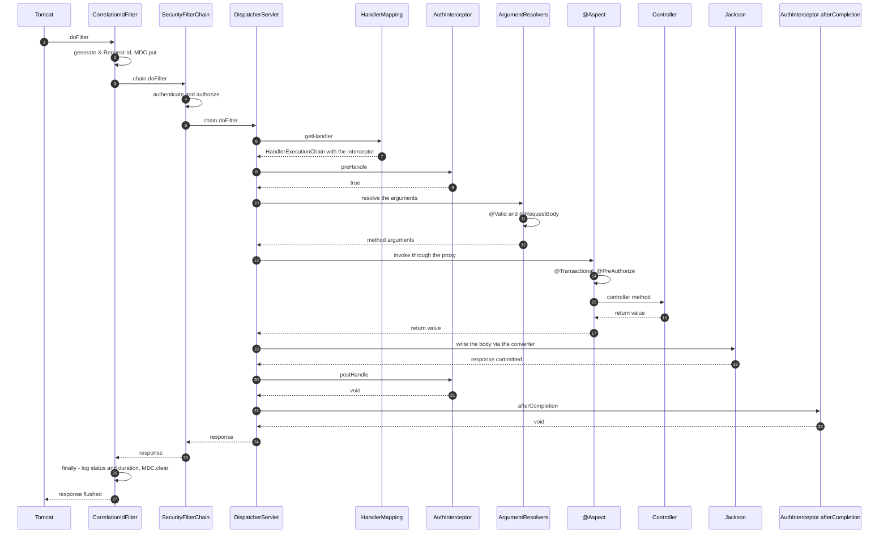
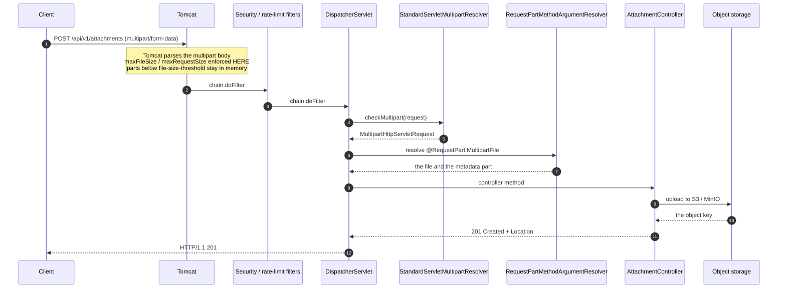

# Filters, Interceptors, Argument Resolvers & File Transfer

> **Level:** Intermediate → Advanced
> **Interview Frequency:** ★★★★☆ ("what exactly is the order of filter → interceptor → aspect?" is the classic MVC deep-dive question)
> **Prerequisites:** [01 · DispatcherServlet & Request Flow](./01-DispatcherServlet-and-Complete-Request-Flow.md) · [02 · Controllers & REST APIs](./02-Controllers-REST-APIs-and-Content-Negotiation.md)
> **Last Updated:** 2026

---

## 📋 Table of Contents
- [0. TL;DR — The 30-Second Answer](#0-tldr--the-30-second-answer)
- [1. What & Why — The Problem This Solves](#1-what--why--the-problem-this-solves)
- [2. Mental Model — The One Picture](#2-mental-model--the-one-picture)
- [3. Deep Dive — Theory (Beginner → Advanced)](#3-deep-dive--theory-beginner--advanced)
  - [3.1 Beginner Level](#31-beginner-level)
  - [3.2 Intermediate Level](#32-intermediate-level)
  - [3.3 Advanced Level](#33-advanced-level)
  - [3.4 Expert Level](#34-expert-level)
- [4. Internal Working Mechanism](#4-internal-working-mechanism)
- [5. Step-by-Step Execution Flow](#5-step-by-step-execution-flow)
- [6. Visualizations](#6-visualizations)
- [7. Production-Level Use Cases & Real Industry Examples](#7-production-level-use-cases--real-industry-examples)
- [8. Worked Examples (with Output + Dry Run)](#8-worked-examples-with-output--dry-run)
- [9. Code from Scratch — Production-Grade](#9-code-from-scratch--production-grade)
- [10. Common Mistakes & Gotchas](#10-common-mistakes--gotchas)
- [11. Performance Considerations](#11-performance-considerations)
- [12. Security Considerations](#12-security-considerations)
- [13. Best Practices](#13-best-practices)
- [14. Hands-On Exercises & Code Challenges](#14-hands-on-exercises--code-challenges)
- [15. Interview Q&A — Level-wise](#15-interview-qa--level-wise)
- [16. Scenario-Based & Real-Experience Scenarios (3–5 yrs)](#16-scenario-based--real-experience-scenarios-35-yrs)
- [17. Counter-Questions, Tricky Questions & Follow-Ups](#17-counter-questions-tricky-questions--follow-ups)
- [18. Frequently Asked Production Issues & Debugging Scenarios](#18-frequently-asked-production-issues--debugging-scenarios)
- [19. Architecture Design Questions](#19-architecture-design-questions)
- [20. Rapid-Fire MCQs](#20-rapid-fire-mcqs)
- [21. Cheat Sheet / One-Page Summary](#21-cheat-sheet--one-page-summary)
- [22. Real-World Production Notes](#22-real-world-production-notes)
- [23. Follow-up Learning](#23-follow-up-learning)

---

## 0. TL;DR — The 30-Second Answer

- **There are exactly three cross-cutting mechanisms, and they run at different levels.** A **servlet `Filter`** runs at the *container* level (before the `DispatcherServlet`), a **`HandlerInterceptor`** runs at the *Spring MVC* level (after the handler is resolved), and an **AOP `@Aspect`** runs at the *method* level (around the controller method only).
- **The order is: Filter → DispatcherServlet → HandlerMapping → `preHandle` → argument resolution → controller method (@Aspect wraps here) → return-value handling → `postHandle` → view/serialisation → `afterCompletion` → Filter unwinds.**
- **An aspect cannot see argument resolution or response serialisation.** It only wraps the *method invocation*. A `@PreAuthorize` check therefore happens **after** the arguments have been bound and validated.
- **`preHandle` returning `false` short-circuits the handler** — the controller is never called and the response is whatever the interceptor wrote. `postHandle` is **not** called on the exception path; `afterCompletion` is.
- **A filter sees the raw request; an interceptor sees the resolved handler.** That is the whole decision rule: *do you need to know which controller method will serve the request?* If yes → interceptor. If you need to act on requests that match **no** handler (404s, static resources, error dispatches) → filter.
- **`HandlerMethodArgumentResolver` is the SPI** with two methods: `supportsParameter` and `resolveArgument`. Nine built-ins; yours is registered via `WebMvcConfigurer#addArgumentResolvers`.
- **A servlet request body is single-pass.** Read it in a filter and the controller sees an **empty** body. To read it twice you must wrap the request in a caching `HttpServletRequestWrapper`.
- **File upload is handled by the container** (`StandardServletMultipartResolver`), so `max-file-size` / `max-request-size` are enforced by Tomcat, before Spring sees the request.
- **File download: `ResponseEntity<Resource>` for known-length files, `StreamingResponseBody` for large or unbounded ones.** With `StreamingResponseBody` the response is committed early, so set the headers **before** the first byte.
- **CORS belongs to the Spring Security filter chain**, not to MVC. A `CorsFilter` in the MVC layer runs after authentication and will not satisfy a preflight.
- **`OncePerRequestFilter` exists because a container can dispatch the same request multiple times** (`ERROR`, `ASYNC`) — a plain `Filter` would run twice and double-count your metrics.

---

## 1. What & Why — The Problem This Solves

**The problem.** Every real service has behaviour that is **not** business logic but must happen on **every** request:

* a correlation id, so a user's screenshot can be found in the logs,
* request logging with the method, path, status and duration,
* a rate limit,
* security (authentication, authorisation, CSRF, CORS),
* metrics and tracing,
* and — very often — reading or rewriting part of the request or response.

If you copy-paste that into every controller, you get duplication, inconsistent behaviour and
unmaintainable code. If you put it in a servlet `Filter`, it applies to **everything** but has no
idea what the request is going to do. If you put it in an AOP aspect, it applies to **methods** but
has no idea about the request.

```text
   ❌ THE THREE FAILED PLACEMENTS
   ───────────────────────────────
   In every controller   → duplication, and new endpoints forget it
   In a Filter            → applies to static resources and 404s too;
                           cannot see WHICH handler will run
   In an @Aspect          → runs only around the method: it never sees
                           argument resolution or the serialised response
```

**The solution — use each mechanism at the level it actually owns.**

```text
   ┌───────────────────────────────────────────────────────────────┐
   │ CONTAINER LEVEL — servlet Filter                             │
   │   owns: the raw request/response, the connection, the bytes   │
   │   sees: EVERY request, including 404s and static resources    │
   │   examples: correlation id, request log, rate limit, tracing │
   ├───────────────────────────────────────────────────────────────┤
   │ MVC LEVEL — HandlerInterceptor                               │
   │   owns: the resolved handler and its @RequestMapping metadata │
   │   sees: only requests that matched a handler                 │
   │   examples: auth checks, per-handler metrics, audit logging  │
   ├───────────────────────────────────────────────────────────────┤
   │ METHOD LEVEL — AOP @Aspect                                   │
   │   owns: the method call itself                               │
   │   sees: the arguments and the return value, nothing else     │
   │   examples: @Transactional, @PreAuthorize, @Cacheable, timing │
   └───────────────────────────────────────────────────────────────┘
```

**Why it matters in production.** In a 40-service platform the *only* way to be sure every
service logs the same correlation id is to put the filter in a **shared starter library**. And the
only way to be sure a metric is emitted for *every* request — including the ones that 404 — is to
put it in a filter, not an interceptor. Choosing the wrong level is not a style issue: it produces
**silent gaps in your observability**.

> 💡 **The interview framing.** *"Filters, interceptors and aspects are not three ways to do the
> same thing — they are three **different levels of the request lifecycle**, each with a different
> view of the world. The question is never 'which is better', it is **'at which level does the
> behaviour belong?'**"*

---

## 2. Mental Model — The One Picture

```text
   THE FULL NESTING — one request, three layers
   ═════════════════════════════════════════════

   Tomcat thread
     │
     ▼
   ╔══════════════════════════════════════════════════════════════╗
   ║ FILTER LAYER (container)                                     ║
   ║   CorrelationIdFilter  →  RequestLoggingFilter  →  RateLimit ║
   ║   ┌──────────────────────────────────────────────────────┐   ║
   ║   │ DispatcherServlet                                    │   ║
   ║   │   HandlerMapping  →  finds OrderController#get      │   ║
   ║   │   ┌──────────────────────────────────────────────┐   │   ║
   ║   │   │ INTERCEPTOR LAYER (Spring MVC)               │   │   ║
   ║   │   │   preHandle  ── can VETO (return false)      │   │   ║
   ║   │   │   ┌──────────────────────────────────────┐   │   │   ║
   ║   │   │   │ ARGUMENT RESOLUTION                 │   │   │   ║
   ║   │   │   │   @PathVariable @RequestParam @Body │   │   │   ║
   ║   │   │   │   @Valid  →  400 on failure         │   │   │   ║
   ║   │   │   │   ┌──────────────────────────────┐   │   │   │   ║
   ║   │   │   │   │ ASPECT LAYER (method)        │   │   │   ║
   ║   │   │   │   │  @PreAuthorize  @Timed        │   │   │   ║
   ║   │   │   │   │  ┌────────────────────────┐  │   │   │   ║
   ║   │   │   │   │  │  CONTROLLER METHOD    │  │   │   │   ║
   ║   │   │   │   │  └────────────────────────┘  │   │   │   ║
   ║   │   │   │   └──────────────────────────────┘   │   │   ║
   ║   │   │   │ RETURN VALUE HANDLING (converter)  │   │   │   ║
   ║   │   │   └──────────────────────────────────────┘   │   │   ║
   ║   │   │   postHandle  ── after the body was written │   │   ║
   ║   │   └──────────────────────────────────────────────┘   │   ║
   ║   │   triggerAfterCompletion  (ALWAYS runs)              │   ║
   ║   └──────────────────────────────────────────────────────┘   ║
   ╚══════════════════════════════════════════════════════════════╝
     │   ← the filter UNWINDS here (finally block)
     ▼
   Response flushed

   THE THREE VIEWS OF THE SAME REQUEST
   ────────────────────────────────────
   Filter       sees: method, URI, headers, body, status, duration
   Interceptor  sees: + WHICH controller method + its annotations
   Aspect       sees: + the ARGUMENTS and the RETURN VALUE only
```

**What to look at:** the aspect is the **innermost** box. It cannot see the argument resolution
that produced its arguments, and it cannot see the serialisation that produced its return value.
That is why a `@Timed` aspect measures the *method*, not the *request*.

---

## 3. Deep Dive — Theory (Beginner → Advanced)

### 3.1 Beginner Level

**What is a servlet `Filter`?** A class implementing `jakarta.servlet.Filter` with three methods:

```java
public interface Filter {
    default void init(FilterConfig filterConfig) throws ServletException {}
    void doFilter(ServletRequest request, ServletResponse response, FilterChain chain)
            throws IOException, ServletException;
    default void destroy() {}
}
```

The contract is: **you must call `chain.doFilter(...)`**, or the request never continues. Everything
else — reading the body, wrapping the response, short-circuiting with an error — is built on that
one call.

```java
@Component
public class TimingFilter implements Filter {

    @Override
    public void doFilter(ServletRequest request, ServletResponse response, FilterChain chain)
            throws IOException, ServletException {

        long start = System.nanoTime();
        try {
            chain.doFilter(request, response);      // ← the rest of the chain
        }
        finally {
            long ms = (System.nanoTime() - start) / 1_000_000;
            log.info("{} {} in {} ms", request.getMethod(), ((HttpServletRequest) request).getRequestURI(), ms);
        }
    }
}
```

**What is a `HandlerInterceptor`?** An interface with three callbacks, all optional:

```java
public interface HandlerInterceptor {
    default boolean preHandle(HttpServletRequest request, HttpServletResponse response, Object handler) {
        return true;                              // true = continue, false = stop
    }
    default void postHandle(HttpServletRequest request, HttpServletResponse response,
                            Object handler, @Nullable ModelAndView modelAndView) { }
    default void afterCompletion(HttpServletRequest request, HttpServletResponse response,
                                  Object handler, @Nullable Exception ex) { }
}
```

**What is an AOP `@Aspect`?** A class with `@Around`/`@Before`/`@After` advice that intercepts
**method calls on Spring beans**:

```java
@Aspect
@Component
public class TimingAspect {

    @Around("@annotation(org.springframework.web.bind.annotation.GetMapping)")
    public Object timeIt(ProceedingJoinPoint pjp) throws Throwable {
        long start = System.nanoTime();
        try {
            return pjp.proceed();
        }
        finally {
            log.info("{} took {} ms", pjp.getSignature(), (System.nanoTime() - start) / 1_000_000);
        }
    }
}
```

**The one-sentence difference.**

| | Filter | Interceptor | Aspect |
|---|---|---|---|
| Applies to | **every** request | requests that matched a handler | **any** annotated method |
| Knows the handler? | ❌ | ✅ | ✅ (the target object) |
| Sees the raw body? | ✅ | ❌ | ❌ |
| Runs for a 404? | ✅ | ❌ | ❌ |
| Runs for a static resource? | ✅ | ❌ (unless a resource handler matched) | ❌ |

### 3.2 Intermediate Level

**Registering a filter — the three ways.**

```java
// 1. A @Component filter. Boot registers it with the default order.
@Component
public class MyFilter extends OncePerRequestFilter { ... }

// 2. A FilterRegistrationBean — the only way to set the ORDER and the URL patterns.
@Bean
public FilterRegistrationBean<MyFilter> myFilter(MyFilter filter) {
    FilterRegistrationBean<MyFilter> registration = new FilterRegistrationBean<>(filter);
    registration.setOrder(-100);                          // lower = earlier
    registration.addUrlPatterns("/api/*");
    registration.setName("myFilter");
    return registration;
}

// 3. DelegatingFilterProxy — the servlet delegates to a Spring bean.
```

**`@Order` vs `Ordered`.** Both work on a filter bean; the framework reads `Ordered` first and
`@Order` as an alternative (via `AnnotationAwareOrderComparator`). `FilterRegistrationBean` has an
explicit `setOrder(int)`, and that **wins** over the order on the filter class itself.

**The default filter order in a Spring Boot application** (lower = earlier):

| Order | Filter | Registered by |
|---|---|---|
| `Ordered.HIGHEST_PRECEDENCE` (`-2147483648`) | `CharacterEncodingFilter` | Boot |
| `Ordered.HIGHEST_PRECEDENCE` | `OrderedRequestContextFilter` | Boot (MVC) |
| `-9900` | `FormContentFilter` | Boot |
| **`-100`** | `SecurityFilterProxy` (`FilterChainProxy`) | Spring Security (`SecurityProperties.DEFAULT_FILTER_ORDER`) |
| `0` (your `FilterRegistrationBean` default is `LOWEST_PRECEDENCE`, but `@Order`-less filters land here in practice) | your filters | you |
| `Ordered.LOWEST_PRECEDENCE` | `DispatcherServlet` | Boot |

> ▶ **The operational consequence:** Spring Security's chain runs at **`-100`**, so a filter you
> register with the default order runs **after** authentication. If your filter needs the
> `SecurityContext`, set `registration.setOrder(-99)` (or lower) — but still **above** the
> `DispatcherServlet`.

**`OncePerRequestFilter` — why it exists.** A servlet container can dispatch the **same request**
more than once: an `ERROR` dispatch after an exception, and an `ASYNC` dispatch when an async
request completes. A plain `Filter` would run on **every** dispatch, so a metrics filter would
count one HTTP request three times.

```java
public abstract class OncePerRequestFilter extends GenericFilterBean {

    @Override
    public final void doFilter(ServletRequest request, ServletResponse response, FilterChain chain)
            throws IOException, ServletException {

        if (skipDispatch((HttpServletRequest) request, (HttpServletResponse) response)) {
            chain.doFilter(request, response);
            return;
        }
        String alreadyFilteredAttributeName = getAlreadyFilteredAttributeName();
        if (request.getAttribute(alreadyFilteredAttributeName) != null) {
            chain.doFilter(request, response);
            return;
        }
        request.setAttribute(alreadyFilteredAttributeName, Boolean.TRUE);
        try {
            doFilterInternal((HttpServletRequest) request, (HttpServletResponse) response, chain);
        }
        finally {
            request.removeAttribute(alreadyFilteredAttributeName);
        }
    }

    /** In Spring Framework 6 the async dispatch is skipped by default. */
    protected boolean shouldNotFilterAsyncDispatch() { return true; }
    protected boolean shouldNotFilterErrorDispatch() { return true; }
}
```

> ⚠️ **Version note.** In Spring Framework 6, `OncePerRequestFilter` **does not re-run on the
> `ASYNC` dispatch by default** (`shouldNotFilterAsyncDispatch()` returns `true`). If your filter
> must also run when the async result is written, override it to return `false`.

**`DelegatingFilterProxy`.** It is a servlet `Filter` that holds **no logic** — it looks up a
Spring bean by name and delegates to it. Spring Security uses it so that the security filter chain
is a **normal Spring bean** (injectable, configurable, testable) while the container still sees a
plain filter:

```java
public class DelegatingFilterProxy extends Filter implements BeanNameAware {
    private String targetBeanName;
    private Filter targetBean;
    ...
    public void doFilter(...) {
        // lazily initialises targetBean from the WebApplicationContext
        this.targetBean.doFilter(request, response, chain);
    }
}
```

**`HttpServletRequestWrapper` — modifying the request.** To add a header, change the path, or
replay the body:

```java
public class RequestWithTenantHeader extends HttpServletRequestWrapper {

    private final String tenantId;

    public RequestWithTenantHeader(HttpServletRequest request, String tenantId) {
        super(request);
        this.tenantId = tenantId;
    }

    @Override
    public Enumeration<String> getHeaderNames() {
        List<String> names = Collections.list(super.getHeaderNames());
        names.add("X-Resolved-Tenant");
        return Collections.enumeration(names);
    }

    @Override
    public String getHeader(String name) {
        return "X-Resolved-Tenant".equalsIgnoreCase(name) ? this.tenantId : super.getHeader(name);
    }
}
```

**The `HandlerInterceptor` lifecycle — the exact rules.**

| Callback | When | `false` allowed? | Gets the exception? |
|---|---|---|---|
| `preHandle` | after the handler is resolved, **before** argument resolution | ✅ — stops the chain | — |
| `postHandle` | after the handler returns, **after** the body was written, **before** the view renders | ❌ | — |
| `afterCompletion` | after the request is finished — **always** | ❌ | ✅ (the `Exception`, or `null`) |

Two rules that catch people out:

1. **`postHandle` is skipped when the handler throws.** It is a success-path callback.
2. **`afterCompletion` receives the exception**, which is the only place you can see it (besides
   the exception resolver).

**`AsyncHandlerInterceptor`.** For async handlers, the interceptor contract changes:

```java
public interface AsyncHandlerInterceptor extends HandlerInterceptor {
    default void afterConcurrentHandlingStarted(HttpServletRequest request, HttpServletResponse response,
                                                 Object handler) { }
    default void postHandle(HttpServletRequest request, HttpServletResponse response,
                            Object handler, ModelAndView concurrentResult) { }
}
```

When the controller returns a `DeferredResult`/`Callable`, `afterConcurrentHandlingStarted` is
called **instead of** `postHandle` — because at that point there is no `ModelAndView` yet. Later,
when the async result is dispatched, the interceptor's `preHandle` and `postHandle` run **again**,
and `afterCompletion` runs once at the very end.

**Registering interceptors.**

```java
@Configuration
public class WebConfig implements WebMvcConfigurer {

    @Override
    public void addInterceptors(InterceptorRegistry registry) {
        registry.addInterceptor(authInterceptor())
                .addPathPatterns("/api/**")
                .excludePathPatterns("/api/public/**")
                .order(1);
    }
}
```

`InterceptorRegistry` also supports `MappedInterceptor` beans — a `MappedInterceptor` carries its own
patterns and order, so you can declare it as a `@Component` and it is picked up automatically.

### 3.3 Advanced Level

**`HandlerMethodArgumentResolver` — the SPI.**

```java
public interface HandlerMethodArgumentResolver {

    boolean supportsParameter(MethodParameter parameter);

    @Nullable
    Object resolveArgument(MethodParameter parameter,
                           @Nullable ModelAndViewContainer mavContainer,
                           NativeWebRequest webRequest,
                           @Nullable WebDataBinderFactory binderFactory) throws Exception;
}
```

* `supportsParameter` is a **fast, side-effect-free** predicate. It is called for **every** parameter
  of **every** request — keep it cheap.
* `resolveArgument` does the work. It receives the native request, so it can read headers, query
  parameters, the session or the security context.

**The built-in argument resolvers.**

| Resolver | Resolves | Key detail |
|---|---|---|
| `RequestParamMethodArgumentResolver` | `@RequestParam` | `required = true` by default; `defaultValue` implies not required |
| `RequestResponseBodyMethodProcessor` | `@RequestBody` | uses the `HttpMessageConverter`; runs `@Valid` |
| `PathVariableMethodArgumentResolver` | `@PathVariable` | reads the URI template variables |
| `MatrixVariableMethodArgumentResolver` | `@MatrixVariable` | `;name=value` segments |
| `RequestHeaderMethodArgumentResolver` | `@RequestHeader` | case-insensitive names |
| `CookieValueMethodArgumentResolver` | `@CookieValue` | |
| `RequestAttributeMethodArgumentResolver` | `@RequestAttribute` | server-side only — not client-controllable |
| `SessionAttributeMethodArgumentResolver` | `@SessionAttribute` | |
| `RequestPartMethodArgumentResolver` | `@RequestPart` | one part of a multipart body |
| `ServletModelAttributeMethodProcessor` | `ServletRequest`, `ServletResponse`, `HttpSession`, `Principal`, `Locale`, `TimeZone`, `ZoneId`, `InputStream`, `Reader`, `WebRequest` | the "everything else" resolver |
| `PrincipalMethodArgumentResolver` | `Principal` | |
| `HttpEntityMethodProcessor` | `HttpEntity`/`HttpHeaders` parameters | |

**The canonical example: `@AuthenticationPrincipal`.** Spring Security ships
`AuthenticationPrincipalMethodArgumentResolver`, which resolves the `Principal` (or the
`Authentication.getPrincipal()`) into a parameter annotated with `@AuthenticationPrincipal`. It is
the pattern every custom resolver should copy: **a marker annotation + a resolver that supports
exactly that annotation + a type check.**

**`WebMvcConfigurer` — the extension points.**

| Method | What it configures |
|---|---|
| `addFormatters(FormatterRegistry)` | `Converter`, `Formatter`, `Printer` for request/response binding |
| `addCorsMappings(CorsRegistry)` | MVC-level CORS (prefer the security chain) |
| `addInterceptors(InterceptorRegistry)` | `HandlerInterceptor`s |
| `addResourceHandlers(ResourceHandlerRegistry)` | static resources |
| `addViewControllers(ViewControllerRegistry)` | URL → view without a controller |
| `addArgumentResolvers(List<…>)` | custom `HandlerMethodArgumentResolver`s |
| `addViewResolvers(List<ViewResolver>)` | custom `ViewResolver`s |
| `addHttpMessageConverters(List<…>)` | **replace** the default converters |
| `extendMessageConverters(List<…>)` | **modify** the default converters (the usual choice) |
| `configureContentNegotiation(ContentNegotiationConfigurer)` | `produces`/`Accept` behaviour |
| `addContentNegotiators(List<ContentNegotiationStrategy>)` | custom negotiation strategies |
| `configurePathMatch(PathMatchConfigurer)` | suffix patterns, trailing-slash, case sensitivity |
| `configureAsyncSupport(AsyncSupportConfigurer)` | async timeout, task executor, `Callable` interceptors |
| `addDefaultHttpHeaders(HttpHeaders)` | default response headers |

**File upload — the multipart flow.**

```text
   multipart/form-data
   ───────────────────
   POST /api/v1/attachments
   Content-Type: multipart/form-data; boundary=----X
   Content-Length: 2401883

   ------X
   Content-Disposition: form-data; name="meta"
   Content-Type: application/json

   {"filename":"invoice.pdf","category":"TAX"}
   ------X
   Content-Disposition: form-data; name="file"; filename="invoice.pdf"
   Content-Type: application/pdf

   %PDF-1.7 ...  (2.3 MB)
   ------X--
```

**The resolution chain.**

1. The **container** parses the multipart body — Tomcat, not Spring. The `MultipartConfigElement`
   (created by Boot's `MultipartAutoConfiguration`) carries `maxFileSize`, `maxRequestSize` and
   `fileSizeThreshold`.
2. `DispatcherServlet#checkMultipart` asks the `MultipartResolver` to wrap the request. The default
   is **`StandardServletMultipartResolver`**, which delegates to the container's parsing and returns
   a `MultipartHttpServletRequest`.
3. `RequestPartMethodArgumentResolver` (or `RequestParamMethodArgumentResolver`) resolves the
   `@RequestPart`/`@RequestParam` `MultipartFile`.

> ⚠️ **Spring Framework 6 removed `CommonsMultipartResolver`** (Commons FileUpload was dropped). The
> only supported implementation is `StandardServletMultipartResolver`, i.e. **the container does the
> work** — which is also why `max-file-size` is enforced by Tomcat and not by Spring.

**The `MultipartFile` API.**

```java
public interface MultipartFile {
    String getName();                 // the form field name
    String getOriginalFilename();     // the client-supplied name (UNTRUSTED)
    String getContentType();          // the client-supplied type (UNTRUSTED)
    boolean isEmpty();
    long getSize();
    byte[] getBytes() throws IOException;
    InputStream getInputStream() throws IOException;
    void transferTo(File dest) throws IOException, IllegalStateException;
    void transferTo(Path dest) throws IOException;   // Spring 5.1+
}
```

**File download — three techniques.**

| Technique | When | Content-Length | Memory |
|---|---|---|---|
| `ResponseEntity<byte[]>` | small payloads (< 1 MB) | known | fully buffered |
| `ResponseEntity<Resource>` | known files | known for `File`/`ByteArrayResource`; **unknown** for `InputStreamResource` | streamed by the converter |
| `StreamingResponseBody` | large or unbounded (CSV export, proxy) | chunked | streamed, **async** |

**`StreamingResponseBody` and the committed response.** When the controller returns a
`StreamingResponseBody`, the framework starts **async** processing: the lambda runs on the MVC
task executor and writes directly to the response's output stream. Two consequences: the response is
**committed** after the first byte (so the status and headers can no longer be changed), and the MVC
**async timeout** applies.

```java
@GetMapping("/api/v1/reports/orders.csv")
public ResponseEntity<StreamingResponseBody> exportOrders() {
    StreamingResponseBody body = out -> {
        out.write("orderId,total,currency\n".getBytes(StandardCharsets.UTF_8));
        orderRepository.streamAll().forEach(o -> { /* write a line */ });
    };
    return ResponseEntity.ok()
            .header(HttpHeaders.CONTENT_DISPOSITION, "attachment; filename=\"orders.csv\"")
            .contentType(MediaType.parseMediaType("text/csv"))
            .body(body);
}
```

### 3.4 Expert Level

**The exact ordering, and the two places it surprises people.**

```text
   ① FILTER: CorrelationIdFilter          (adds X-Request-Id, populates the MDC)
   ② FILTER: SecurityFilterChainProxy     (authentication, authorisation, CSRF, CORS)
   ③ DispatcherServlet.service
   ④   HandlerMapping.getHandler           → HandlerExecutionChain
   ⑤   HandlerAdapter.getHandlerAdapter
   ⑥   INTERCEPTOR preHandle               ← the FIRST thing that knows the handler
   ⑦   ARGUMENT RESOLUTION                 ← @Valid, @RequestBody, custom resolvers
   ⑧   ASPECT around the controller method ← @Transactional, @PreAuthorize, @Timed
   ⑨   CONTROLLER METHOD
   ⑩   RETURN-VALUE HANDLING               ← Jackson writes the body
   ⑪   INTERCEPTOR postHandle              ← the body is ALREADY written
   ⑫   processDispatchResult → render      ← view rendering (if any)
   ⑬   INTERCEPTOR afterCompletion         ← ALWAYS
   ⑭ FILTER: unwind (the finally block)
```

**Surprise 1 — `postHandle` runs after the body was written.** By the time `postHandle` runs, the
response has usually been **committed**. You cannot change the status code from `postHandle`. If you
need to modify the response, do it in a **filter** (which wraps the response) or in an **aspect**
(which wraps the method call, before the body is written).

**Surprise 2 — the aspect runs *after* argument resolution and validation.** So:

* `@Valid` failures happen **before** `@PreAuthorize` runs — an unauthorised caller with an invalid
  body gets a **400**, not a **403**. (That is an information-disclosure nuance worth knowing:
  the endpoint's validation rules are observable by anonymous callers.)
* `@Transactional` opens the transaction **after** the arguments are bound — the transaction does
  **not** cover the deserialisation of a large `@RequestBody`. For a 5 MB upload, the bytes are
  read (and Jackson parses them) **outside** the transaction.

**The `afterCompletion` ordering with a veto.** When `preHandle` returns `false`,
`HandlerExecutionChain#applyPreHandle` calls `triggerAfterCompletion(request, response, null)` and
the dispatcher returns. `triggerAfterCompletion` walks the **whole** interceptor list in reverse
order — so an interceptor in the chain may receive `afterCompletion` **without ever having received
`preHandle`**. Be defensive: `afterCompletion` must tolerate being called without a matching
`preHandle`, and must not assume the MDC or a request attribute was set by `preHandle`.

**The body is single-pass — and `ContentCachingRequestWrapper` does not change that.**

```java
public class ContentCachingRequestWrapper extends HttpServletRequestWrapper {
    private final ByteArrayOutputStream cachedContent = new ByteArrayOutputStream();
    ...
    @Override
    public ServletInputStream getInputStream() throws IOException {
        // returns a stream that writes INTO the cache as it is read
    }
}
```

The wrapper **caches what is read**, but the underlying stream is still consumed. If a filter reads
the body *before* `chain.doFilter`, the controller receives an **empty** stream. Two correct
patterns:

```text
   PATTERN A — read AFTER the chain (logging, WAF inspection of the body)
   ────────────────────────────────────────────────────────────────────
   filter.doFilter(req, resp, chain)      // the controller reads the body
   byte[] body = ((ContentCachingRequestWrapper) req).getContentAsByteArray();

   PATTERN B — read BEFORE and still let the controller read it
   ───────────────────────────────────────────────────────────────
   read all bytes → wrap the request so getInputStream() serves those bytes
   → chain.doFilter(wrappedRequest, resp, chain)
```

Pattern B needs a **custom** wrapper whose `getInputStream()` returns a `ServletInputStream` over
the buffered bytes. `ContentCachingRequestWrapper` alone is **not** enough.

**The memory cost of pattern B**: the whole body is in the heap. That is why body inspection at the
edge is normally done for **small** bodies only, with a size guard (e.g. only buffer bodies below
64 KB) and otherwise a streaming digest.

**Multipart memory model.** With `StandardServletMultipartResolver`, Tomcat decides where the bytes
live:

| Size vs `file-size-threshold` | Where the part is stored |
|---|---|
| `< file-size-threshold` (default `0`) | **in memory** |
| `>= file-size-threshold` | **on disk**, in the container's temp directory |

`file-size-threshold = 0` means *everything* goes to disk — the safest default for large uploads
and the worst for latency. `file-size-threshold = 0` with Tomcat also means the upload is written
to disk **before** your controller runs, so a 100 MB upload consumes disk even if your controller
rejects it. The container's `maxFileSize` (Boot: `spring.servlet.multipart.max-file-size`) aborts the
parse with a `MaxUploadSizeExceededException` **before** Spring sees the request.

**CORS belongs to the security chain.** A preflight `OPTIONS` request carries **no credentials** and
**no `Authorization` header**, so a CORS filter that runs *after* authentication cannot authorise
it — and Spring Security's default `CsrfFilter` would reject it. The `CorsFilter` therefore sits at
position **5** in the security chain, **before** authentication, exactly as the folder's canonical
table shows.

**`@Order` and the `DispatcherServlet`.** The `DispatcherServlet` is itself a servlet, and its
position in the filter chain is determined by the servlet mapping (`/` by default), not by a filter
order. Every filter you register runs **before** it, regardless of its order value, unless you map
the servlet to a path prefix and register filters only for other patterns.

---

## 4. Internal Working Mechanism

**The mechanism table — who calls what.**

| Concern | Interface | Registered by | Called by |
|---|---|---|---|
| Cross-cutting, container level | `jakarta.servlet.Filter` | `FilterRegistrationBean` / `@Component` / `DelegatingFilterProxy` | the **container** (`ApplicationFilterChain`) |
| Cross-cutting, MVC level | `HandlerInterceptor` | `WebMvcConfigurer#addInterceptors` / `MappedInterceptor` | `HandlerExecutionChain` (from `DispatcherServlet`) |
| Cross-cutting, method level | `@Aspect` + `@Around` | `@EnableAspectJAutoProxy` (Boot enables it) | the **AOP proxy** around the bean method |
| Parameter binding | `HandlerMethodArgumentResolver` | `WebMvcConfigurer#addArgumentResolvers` | `InvocableHandlerMethod#getMethodArgumentValues` |
| Response writing | `HttpMessageConverter` | `extendMessageConverters` | `AbstractMessageConverterMethodProcessor` |
| Response metadata | `HandlerMethodReturnValueHandler` | framework-internal | `ServletInvocableHandlerMethod` |

**The interceptor call chain inside `HandlerExecutionChain`.**

```java
// DispatcherServlet.doDispatch
mappedHandler = getHandler(request);              // → HandlerExecutionChain
...
if (!mappedHandler.applyPreHandle(request, response)) {
    return;                                       // a preHandle returned false
}
mv = ha.handle(request, response, mappedHandler.getHandler());
if (mappedHandler != null) {
    applyDefaultViewName(request, mv);
    mappedHandler.applyPostHandle(request, response, mv);
}
processDispatchResult(request, response, mappedHandler, mv, dispatchException);
```

```java
// HandlerExecutionChain
boolean applyPreHandle(HttpServletRequest request, HttpServletResponse response) throws Exception {
    for (int i = 0; i < interceptorList.size(); i++) {
        HandlerInterceptor interceptor = interceptorList.get(i);
        if (!interceptor.preHandle(request, response, this.handler)) {
            triggerAfterCompletion(request, response, null);   // ← cleanup for the whole chain
            return false;
        }
    }
    return true;
}

void applyPostHandle(HttpServletRequest request, HttpServletResponse response, ModelAndView mv) {
    for (int i = interceptorList.size() - 1; i >= 0; i--) {     // reverse order
        interceptorList.get(i).postHandle(request, response, this.handler, mv);
    }
}

void triggerAfterCompletion(HttpServletRequest request, HttpServletResponse response, Exception ex) {
    for (int i = interceptorList.size() - 1; i >= 0; i--) {     // reverse order
        try {
            interceptorList.get(i).afterCompletion(request, response, this.handler, ex);
        }
        catch (Throwable ex2) {
            logger.error("HandlerInterceptor.afterCompletion threw exception", ex2);
        }
    }
}
```

> ▶ **Note the symmetry:** `preHandle` runs in **registration order**, `postHandle` and
> `afterCompletion` run in **reverse** — the classic onion model. And `afterCompletion` swallows
> its own exceptions (it only logs them), so a broken interceptor cannot break the response.

**The argument-resolution chain.**

```java
// InvocableHandlerMethod
protected Object[] getMethodArgumentValues(Object... providedArgs) throws Exception {
    MethodParameter[] parameters = getMethodParameters();
    Object[] args = new Object[parameters.length];
    for (int i = 0; i < parameters.length; i++) {
        MethodParameter parameter = parameters[i];
        args[i] = findProvidedArgument(parameter, providedArgs);        // already supplied?
        if (args[i] == null) {
            args[i] = getArgumentResolver().resolveArgument(              // ← the composite
                    parameter, getModelAndViewContainer(), getWebRequest(), getBinderFactory());
        }
    }
    return args;
}
```

The composite asks each resolver in order:

```java
public class HandlerMethodArgumentResolverComposite extends HandlerMethodArgumentResolverComposite {
    @Override
    public Object resolveArgument(MethodParameter parameter, ModelAndViewContainer mavContainer,
            NativeWebRequest webRequest, WebDataBinderFactory binderFactory) throws Exception {

        for (HandlerMethodArgumentResolver resolver : this.argumentResolvers) {
            if (resolver.supportsParameter(parameter)) {
                return resolver.resolveArgument(parameter, mavContainer, webRequest, binderFactory);
            }
        }
        throw new IllegalArgumentException("No suitable resolver for " + parameter);
    }
}
```

**The multipart resolution chain.**

```java
// DispatcherServlet
protected MultipartHttpServletRequest checkMultipart(HttpServletRequest request) {
    if (this.multipartResolver != null && this.multipartResolver.isMultipart(request)) {
        if (WebUtils.getNativeRequest(request, MultipartHttpServletRequest.class) != null) {
            return (MultipartHttpServletRequest) request;
        }
        MultipartHttpServletRequest multipartRequest = this.multipartResolver.resolveMultipart(request);
        return multipartRequest;
    }
    return null;
}
```

---

## 5. Step-by-Step Execution Flow

**One request, end to end, with every layer named.**

```text
 ①  Tomcat accepts the connection and parses the HTTP request.

 ②  APPLICATION FILTER CHAIN (container level)
     a. CharacterEncodingFilter        → sets the request encoding
     b. OrderedRequestContextFilter    → binds RequestContextHolder to the thread
     c. FormContentFilter              → PUT/PATCH form bodies
     d. SecurityFilterChainProxy (-100)
          → CorsFilter (preflight)
          → CsrfFilter
          → BearerTokenAuthenticationFilter
          → AuthorizationFilter (URL rules)
          → ExceptionTranslationFilter
     e. CorrelationIdFilter (your filter)
          → reads or generates X-Request-Id
          → request.setAttribute(...) + MDC.put("traceId", id)
          → wraps the response to capture the status
     f. RequestLoggingFilter (your filter)
          → start = nanoTime
          → chain.doFilter(...)
          → finally: log method, path, status, duration; MDC.clear()

 ③  DispatcherServlet.service → FrameworkServlet.processRequest → doDispatch

 ④  HandlerMapping.getHandler → HandlerExecutionChain(OrderController#get, [AuthInterceptor])

 ⑤  HandlerAdapter.getHandlerAdapter → RequestMappingHandlerAdapter

 ⑥  INTERCEPTOR preHandle(request, response, handler)
        → e.g. checks a tenant header, or vetoes with 403

 ⑦  ARGUMENT RESOLUTION
        → PathVariableMethodArgumentResolver resolves {id}
        → RequestResponseBodyMethodProcessor deserialises @RequestBody
        → validation runs here

 ⑧  ASPECT around the controller method
        → @Transactional opens the transaction (AFTER the arguments were bound!)
        → @PreAuthorize evaluates the SpEL
        → the method executes

 ⑨  RETURN-VALUE HANDLING → Jackson writes the body → the response is committed

 ⑩  INTERCEPTOR postHandle(request, response, handler, mav)
        → the body is already written; the status cannot be changed here

 ⑪  processDispatchResult → render (nothing to do for a @ResponseBody controller)

 ⑫  INTERCEPTOR afterCompletion(request, response, handler, ex)
        → always runs; receives the exception if there was one

 ⑬  Back in the filters: the `finally` blocks unwind, in reverse order
        → the response wrapper copies the status into the log line
        → MDC.clear()

 ⑭  Tomcat flushes the response and returns the thread to the pool.
```

**The numbers for one `GET /api/v1/orders/1042` (warm JVM):**

| Stage | Time |
|---|---|
| Tomcat accept + parse | 0.3 ms |
| Security chain (JWT verify + URL rules) | 1.2 ms |
| Correlation-id filter | 0.02 ms |
| Routing | 0.02 ms |
| `preHandle` | 0.01 ms |
| Argument resolution + validation | 0.25 ms |
| Aspect (transaction + `@PreAuthorize`) | 0.35 ms |
| Controller + JPA query | 7.4 ms |
| Serialisation | 0.09 ms |
| `postHandle` + `afterCompletion` | 0.02 ms |
| Filter unwind + logging | 0.08 ms |
| **Total** | **≈ 9.7 ms** |

---

## 6. Visualizations

### 6.1 Filter → Interceptor → Aspect, with the exact nesting



**What to look at:** the aspect sits **inside** argument resolution and **outside** serialisation. `postHandle` runs **after** the body is committed; `afterCompletion` always runs; and the filter's `finally` is where the MDC must be cleared.

### 6.2 The three mechanisms compared

```text
┌──────────────────────┬───────────────────────┬───────────────────────┬───────────────────────┐
│                      │  FILTER               │  INTERCEPTOR         │  ASPECT               │
│                      │  (jakarta.servlet)    │  (HandlerInterceptor)│  (@Aspect)            │
├──────────────────────┼───────────────────────┼───────────────────────┼───────────────────────┤
│ LEVEL                │ Container             │ Spring MVC           │ Method invocation     │
│                      │ (before the servlet)  │ (inside the servlet) │ (around the call)     │
├──────────────────────┼───────────────────────┼───────────────────────┼───────────────────────┤
│ APPLIES TO           │ EVERY request         │ requests that        │ ANY advised method    │
│                      │                       │ matched a handler    │ (any bean)            │
├──────────────────────┼───────────────────────┼───────────────────────┼───────────────────────┤
│ RUNS FOR A 404?      │ YES                   │ NO                   │ NO                    │
│ RUNS FOR STATICS?    │ YES                   │ NO*                  │ NO                    │
├──────────────────────┼───────────────────────┼───────────────────────┼───────────────────────┤
│ SEES THE HANDLER?    │ NO                    │ YES (HandlerMethod)  │ YES (the target bean) │
│ SEES THE MAPPING?    │ NO                    │ YES                  │ NO                    │
├──────────────────────┼───────────────────────┼───────────────────────┼───────────────────────┤
│ SEES THE RAW BODY?   │ YES                   │ NO                   │ NO                    │
│ SEES THE ARGUMENTS?  │ NO                    │ NO                   │ YES                   │
│ SEES THE RETURN?     │ NO                    │ NO                   │ YES                   │
├──────────────────────┼───────────────────────┼───────────────────────┼───────────────────────┤
│ CAN SHORT-CIRCUIT?   │ YES (skip the chain)  │ YES (preHandle=false)│ YES (skip the call)   │
│ CAN CHANGE THE STATUS│ YES (before commit)   │ Only in preHandle    │ YES (before the call) │
│                      │                       │ (postHandle: NO)     │                       │
├──────────────────────┼───────────────────────┼───────────────────────┼───────────────────────┤
│ ERROR HANDLING       │ try/catch around      │ afterCompletion(ex)  │ @AfterReturning /     │
│                      │ chain.doFilter        │                       │ @AfterThrowing        │
├──────────────────────┼───────────────────────┼───────────────────────┼───────────────────────┤
│ ORDERING             │ container order       │ registration order   │ proxy order           │
│                      │ (@Order)              │ (preHandle: forward, │ (outer = first)       │
│                      │                       │  post: reverse)      │                       │
├──────────────────────┼───────────────────────┼───────────────────────┼───────────────────────┤
│ TYPICAL USE           │ correlation id,       │ auth, per-handler    │ @Transactional,       │
│                      │ request log, rate     │ metrics, audit       │ @PreAuthorize,       │
│                      │ limit, tracing        │                       │ @Cacheable, @Timed   │
└──────────────────────┴───────────────────────┴───────────────────────┴───────────────────────┘
  * a static resource IS handled by a ResourceHttpRequestHandler, so an interceptor does run for it -
    but only if the interceptor's path patterns include it.
```

**What to look at:** the "CAN CHANGE THE STATUS" row. A filter can change the status until the response is committed; an interceptor can only do so in `preHandle`; an aspect can do so before the method runs.

### 6.3 The argument-resolver chain

```mermaid
flowchart TD
    P[Controller method parameters] --> Q{For each parameter, in order}
    Q --> C1{RequestParamMethodArgumentResolver}
    C1 -->|@RequestParam| R1[read the query string or the form body]
    C1 -->|no| C2{RequestResponseBodyMethodProcessor}
    C2 -->|@RequestBody| R2[converter reads the body, then @Valid runs]
    C2 -->|no| C3{PathVariableMethodArgumentResolver}
    C3 -->|@PathVariable| R3[read the URI template variable]
    C3 -->|no| C4{RequestHeaderMethodArgumentResolver}
    C4 -->|@RequestHeader| R4[read the header]
    C4 -->|no| C5{RequestAttributeMethodArgumentResolver}
    C5 -->|@RequestAttribute| R5[read the server-side attribute]
    C5 -->|no| C6{Custom resolvers - YOURS, registered first}
    C6 -->|supportsParameter = true| R6[your resolveArgument]
    C6 -->|no| C7{ServletModelAttributeMethodProcessor}
    C7 -->|ServletRequest, Principal, Locale ...| R7[provide the servlet object]
    C7 -->|no| FAIL[IllegalArgumentException - no suitable resolver]

    style R6 fill:#e8f5e9,stroke:#2e7d32
    style FAIL fill:#ffebee,stroke:#c62828
```

**What to look at:** the first resolver whose `supportsParameter` returns `true` **wins** — there is no "most specific wins" logic. That is why your custom resolver should be registered **first** and why its `supportsParameter` must check both the annotation **and** the type.

### 6.4 A multipart upload



**What to look at:** the multipart body is parsed by **Tomcat**, before any Spring code runs. The size limits are enforced there, and a too-large upload never reaches the controller — which is why the error you see is a `MaxUploadSizeExceededException`, not a validation error.

---

## 7. Production-Level Use Cases & Real Industry Examples

### 7.1 Banking — correlation ids across a 9-service call chain

A payment flows through `api-gateway → order-service → fraud-service → ledger-service → payment-rail`. A customer calls in saying "my payment is missing". The support engineer needs the whole chain.

**Design:** a `CorrelationIdFilter` in a **shared starter** that reads `X-Request-Id` or generates a UUID, puts it in the MDC, **adds it to the MDC-based log pattern**, and — critically — **propagates it downstream** via `RestClient`'s default header interceptor:

```java
restClient.interceptors((request, body, execution) -> {
    String traceId = MDC.get("traceId");
    if (traceId != null) request.getHeaders().set("X-Request-Id", traceId);
    return execution.execute(request, body);
});
```

| Metric | With propagation | Without |
|---|---|---|
| Mean time to trace one payment across 5 services | **~40 s** (one log search) | ~25 min (5 log searches, correlated by timestamp) |
| Support tickets needing a developer | 12 % | 31 % |
| Log lines per request (5 services) | 5 (all share the id) | 5 (unrelated) |

### 7.2 E-commerce — request logging at 8 000 req/s

**Design:** the logging **filter** (not an interceptor — it must log 404s and static hits too), with **sampling**: log every request at INFO, but only requests slower than **200 ms** at WARN with the full detail.

```text
2026-03-04 11:02:14.882 INFO  [http-nio-8080-exec-7] c.e.web.RequestLoggingFilter : GET /api/v1/cart 200 14ms traceId=8f3c1a20d4e54b0f
```

| Approach | Log lines/sec | Storage/day (2 pods) |
|---|---|---|
| Log every request at INFO | 8 000 | 690 M lines ❌ |
| Log only slow (> 200 ms) + errors | ~40 | 3.5 M lines ✅ |
| Access log at the container, sampled | 400 | 35 M lines |

### 7.3 SaaS — a rate-limit filter in front of the API (2 400 tenants)

**Design:** a `FilterRegistrationBean` at order `-95` (after security at `-100`, before the dispatcher) that reads the tenant from the `SecurityContext`, applies a **token-bucket** limit from Redis, and returns **429** with `Retry-After` when the bucket is empty.

| Tier | Limit | Response |
|---|---|---|
| Free | 60 req/min | 429 + `Retry-After: 60` |
| Pro | 6 000 req/min | — |
| Enterprise | negotiated | — |

**Why a filter, not an interceptor:** the rate limiter must run **before** the handler is resolved (it should reject a flood before doing any work) and it must also reject requests that match **no** handler.

### 7.4 Logistics — 2.3 MB document uploads (invoice scans)

**Design:** `StandardServletMultipartResolver` with `max-file-size = 25MB`, `max-request-size = 26MB`, `file-size-threshold = 1MB`. The controller streams the `MultipartFile` to object storage with a **pre-signed** PUT, so the bytes never transit the API twice.

| Path | Bytes through the API | Duration |
|---|---|---|
| Naive (proxy upload + download) | 2 × 2.3 MB | 4.6 MB, ~900 ms |
| Pre-signed PUT (the API only issues the URL) | 0 bytes | ~40 ms |

---

## 8. Worked Examples (with Output + Dry Run)

### 8.1 Example 1 — A correlation-id filter + interceptor + MDC, and the exact log line

**Problem.** Every request needs a correlation id in the logs, and it must be propagated to downstream services. Interceptors cannot do this for requests that match no handler, so the id is generated in a **filter**; the **interceptor** adds the handler name to the log context.

**Code — the filter.**

```java
package com.example.observability;

import java.io.IOException;
import java.util.UUID;

import jakarta.servlet.FilterChain;
import jakarta.servlet.ServletException;
import jakarta.servlet.http.HttpServletRequest;
import jakarta.servlet.http.HttpServletResponse;
import org.slf4j.Logger;
import org.slf4j.LoggerFactory;
import org.slf4j.MDC;
import org.springframework.core.Ordered;
import org.springframework.core.annotation.Order;
import org.springframework.stereotype.Component;
import org.springframework.web.filter.OncePerRequestFilter;

/**
 * Runs BEFORE Spring Security (-100) so that even a 401 carries a trace id.
 * The finally block clears the MDC - the Tomcat thread is reused, so a leaked
 * MDC entry would show up in the NEXT request's log line.
 */
@Component
@Order(Ordered.HIGHEST_PRECEDENCE + 10)      // just after the character-encoding filter
public class CorrelationIdFilter extends OncePerRequestFilter {

    private static final Logger log = LoggerFactory.getLogger(CorrelationIdFilter.class);

    public static final String HEADER = "X-Request-Id";
    public static final String MDC_KEY = "traceId";

    @Override
    protected void doFilterInternal(HttpServletRequest request, HttpServletResponse response,
                                    FilterChain filterChain) throws ServletException, IOException {

        String traceId = request.getHeader(HEADER);
        if (traceId == null || traceId.isBlank()) {
            traceId = UUID.randomUUID().toString().replace("-", "");
        }

        MDC.put(MDC_KEY, traceId);
        request.setAttribute(MDC_KEY, traceId);
        response.setHeader(HEADER, traceId);           // so the client can quote it

        try {
            filterChain.doFilter(request, response);
        }
        finally {
            MDC.remove(MDC_KEY);                       // MUST clear - the thread is pooled
        }
    }
}
```

**Code — the interceptor (adds the handler to the MDC).**

```java
package com.example.observability;

import jakarta.servlet.http.HttpServletRequest;
import jakarta.servlet.http.HttpServletResponse;
import org.slf4j.MDC;
import org.springframework.stereotype.Component;
import org.springframework.web.method.HandlerMethod;
import org.springframework.web.servlet.HandlerInterceptor;

@Component
public class HandlerContextInterceptor implements HandlerInterceptor {

    @Override
    public boolean preHandle(HttpServletRequest request, HttpServletResponse response, Object handler) {
        if (handler instanceof HandlerMethod handlerMethod) {
            MDC.put("handler", handlerMethod.getBeanType().getSimpleName()
                    + "#" + handlerMethod.getMethod().getName());
        }
        return true;
    }

    @Override
    public void afterCompletion(HttpServletRequest request, HttpServletResponse response,
                                 Object handler, Exception ex) {
        MDC.remove("handler");
    }
}
```

**Code — the log pattern.**

```yaml
# application.yml
logging:
  pattern:
    console: "%d{yyyy-MM-dd HH:mm:ss.SSS} %-5level [%thread] %logger{36} [traceId=%X{traceId:-}] [handler=%X{handler:-}] %msg%n"
```

**Expected output.**

```text
2026-03-04 11:02:14.882 INFO  [http-nio-8080-exec-7] c.e.web.RequestLoggingFilter : GET /api/v1/orders/1042 200 14ms
```

With the MDC in the pattern, the full line is:

```text
2026-03-04 11:02:14.882 INFO  [http-nio-8080-exec-7] c.e.web.RequestLoggingFilter [traceId=8f3c1a20d4e54b0f] [handler=OrderController#get] GET /api/v1/orders/1042 200 14ms
```

**Dry run — request `GET /api/v1/orders/1042`:**

1. Tomcat starts the filter chain. `CorrelationIdFilter` runs first.
2. `request.getHeader("X-Request-Id")` is `null` (the client did not send one) → a UUID is generated: `8f3c1a20d4e54b0f`.
3. `MDC.put("traceId", ...)` binds the id to the **current thread**. `response.setHeader(...)` returns it to the client.
4. `chain.doFilter` → the security chain → the `DispatcherServlet`.
5. `HandlerMapping` resolves `OrderController#get` → the interceptor's `preHandle` runs → `MDC.put("handler", "OrderController#get")`.
6. The controller runs; the query takes 14 ms; Jackson writes the body.
7. `postHandle` runs (not overridden here). `afterCompletion` runs → `MDC.remove("handler")`.
8. Back in the filter's `finally` → `MDC.remove("traceId")` → the response is flushed.

**Takeaway.** Two rules: (1) **always** clear the MDC in a `finally` — the Tomcat worker thread is reused, and a leaked `traceId` makes request A's log line carry request B's id; (2) the correlation id must be **propagated** to downstream services, or it only correlates the first hop.

### 8.2 Example 2 — A custom `@CurrentUser` argument resolver

*(This resolver is the same one shown in [01 · DispatcherServlet](./01-DispatcherServlet-and-Complete-Request-Flow.md) §8.3 — reproduced here with the registration and the exact resolution path.)*

**Problem.** Every controller needs the authenticated user as a domain object, and the resolution must fail cleanly when there is no authentication.

**Code.**

```java
package com.example.web;

import java.lang.annotation.Documented;
import java.lang.annotation.ElementType;
import java.lang.annotation.Retention;
import java.lang.annotation.RetentionPolicy;
import java.lang.annotation.Target;

@Target(ElementType.PARAMETER)
@Retention(RetentionPolicy.RUNTIME)
@Documented
public @interface CurrentUser {
}
```

```java
package com.example.web;

import jakarta.servlet.http.HttpServletRequest;
import org.springframework.core.MethodParameter;
import org.springframework.security.authentication.AnonymousAuthenticationToken;
import org.springframework.security.core.Authentication;
import org.springframework.security.core.context.SecurityContextHolder;
import org.springframework.stereotype.Component;
import org.springframework.web.bind.support.WebDataBinderFactory;
import org.springframework.web.context.request.NativeWebRequest;
import org.springframework.web.method.support.HandlerMethodArgumentResolver;
import org.springframework.web.method.support.ModelAndViewContainer;

@Component
public class CurrentUserArgumentResolver implements HandlerMethodArgumentResolver {

    private final CurrentUserService currentUserService;

    public CurrentUserArgumentResolver(CurrentUserService currentUserService) {
        this.currentUserService = currentUserService;
    }

    @Override
    public boolean supportsParameter(MethodParameter parameter) {
        // BOTH checks matter: the annotation AND the type.
        // Without the type check, this resolver would also claim a @CurrentUser String.
        return parameter.hasParameterAnnotation(CurrentUser.class)
                && User.class.isAssignableFrom(parameter.getParameterType());
    }

    @Override
    public Object resolveArgument(MethodParameter parameter, ModelAndViewContainer mavContainer,
                                  NativeWebRequest webRequest, WebDataBinderFactory binderFactory) {

        Authentication authentication = SecurityContextHolder.getContext().getAuthentication();

        if (authentication == null
                || !authentication.isAuthenticated()
                || authentication instanceof AnonymousAuthenticationToken) {
            throw new UnauthenticatedException("No authenticated user for @CurrentUser");
        }

        User principal = (User) authentication.getPrincipal();
        if (principal != null) {
            return principal;                       // already loaded at login - no DB call
        }
        return currentUserService.findRequiredByUsername(authentication.getName());
    }
}
```

```java
package com.example.web;

import java.util.List;

import org.springframework.context.annotation.Configuration;
import org.springframework.web.method.support.HandlerMethodArgumentResolver;
import org.springframework.web.servlet.config.annotation.WebMvcConfigurer;

@Configuration
public class WebConfig implements WebMvcConfigurer {

    private final CurrentUserArgumentResolver currentUserArgumentResolver;

    public WebConfig(CurrentUserArgumentResolver currentUserArgumentResolver) {
        this.currentUserArgumentResolver = currentUserArgumentResolver;
    }

    @Override
    public void addArgumentResolvers(List<HandlerMethodArgumentResolver> resolvers) {
        // FIX: insert at index 0 - the composite takes the FIRST resolver that supports the
        // parameter, so order is the whole game.
        resolvers.add(0, currentUserArgumentResolver);
    }
}
```

**Expected output — the resolution path.**

```text
2026-03-04 11:31:44.221 DEBUG [http-nio-8080-exec-1] o.s.w.s.mvc.method.annotation.ServletInvocableHandlerMethod : Invoking [OrderController#cancel] with arguments [User{id=42, email='aritra@example.com'}, 1042]
```

**Dry run:**

1. `RequestMappingHandlerAdapter` builds the `HandlerMethodArgumentResolverComposite` from the
   built-ins **plus** the resolvers registered through `WebMvcConfigurer#addArgumentResolvers`.
2. `InvocableHandlerMethod#getMethodArgumentValues` walks the parameters of
   `cancel(@CurrentUser User user, @PathVariable Long id)`.
3. For `user`: the composite asks each resolver. Our resolver is **first** (index 0), and
   `supportsParameter` returns `true` (the annotation is present and the type is `User`).
4. `resolveArgument` reads `SecurityContextHolder.getContext().getAuthentication()`. The
   `SecurityContext` was populated by Spring Security's `SecurityContextHolderFilter`, which runs in
   the **filter** phase — before the `DispatcherServlet` — so it is already there.
5. `authentication.getPrincipal()` returns the `User` domain object that was loaded at login →
   returned directly, **with no database query**.
6. The composite resolves `id` next via `PathVariableMethodArgumentResolver`.
7. `Method.invoke(controller, user, id)` runs the controller.

**Takeaway.** The two things an interviewer wants: (1) `supportsParameter` must check the **type**
as well as the annotation, or the resolver steals parameters it should not; (2) register it **first**
— the composite is first-match-wins, not most-specific-wins.

### 8.3 Example 3 — A file-download endpoint with `StreamingResponseBody` and the exact headers

**Problem.** A report endpoint exports 500 000 rows as CSV. The file can be 180 MB, so it cannot be buffered in memory.

**Code.**

```java
package com.example.report;

import java.io.IOException;
import java.io.OutputStreamWriter;
import java.io.Writer;
import java.nio.charset.StandardCharsets;

import org.springframework.http.HttpHeaders;
import org.springframework.http.MediaType;
import org.springframework.http.ResponseEntity;
import org.springframework.web.bind.annotation.GetMapping;
import org.springframework.web.bind.annotation.RequestMapping;
import org.springframework.web.bind.annotation.RestController;
import org.springframework.web.servlet.mvc.method.annotation.StreamingResponseBody;

@RestController
@RequestMapping("/api/v1/reports")
public class ReportController {

    private final ReportService reportService;

    public ReportController(ReportService reportService) {
        this.reportService = reportService;
    }

    @GetMapping("/orders.csv")
    public ResponseEntity<StreamingResponseBody> exportOrders() {

        // The headers are set HERE, before the first byte - once the stream starts,
        // the response is committed and the status/headers can no longer be changed.
        StreamingResponseBody body = out -> {
            Writer writer = new OutputStreamWriter(out, StandardCharsets.UTF_8);
            writer.write("orderId,total,currency,createdAt\n");
            reportService.streamOrders().forEach(order -> {
                try {
                    writer.write(order.getId() + "," + order.getTotal() + ","
                            + order.getCurrency() + "," + order.getCreatedAt() + "\n");
                }
                catch (IOException ex) {
                    throw new java.io.UncheckedIOException(ex);
                }
            });
            writer.flush();
        };

        return ResponseEntity.ok()
                .header(HttpHeaders.CONTENT_DISPOSITION,
                        "attachment; filename=\"orders-2026-03-04.csv\"")
                .contentType(new MediaType("text", "csv", StandardCharsets.UTF_8))
                .header(HttpHeaders.CACHE_CONTROL, "no-store")
                .body(body);
    }
}
```

**Expected output — the exact response headers.**

```http
HTTP/1.1 200
Content-Type: text/csv;charset=UTF-8
Content-Disposition: attachment; filename="orders-2026-03-04.csv"
Cache-Control: no-store
Transfer-Encoding: chunked
```

```text
orderId,total,currency,createdAt
1042,199.99,EUR,2026-03-04T10:15:22Z
1041,49.50,EUR,2026-03-04T10:12:01Z
1040,120.00,EUR,2026-03-04T10:08:44Z
```

**Dry run — what happens on the wire:**

1. The controller returns a `ResponseEntity<StreamingResponseBody>`.
2. `StreamingResponseBodyReturnValueHandler` sees the `StreamingResponseBody` and starts **async**
   processing: it calls `WebAsyncManager.startCallableProcessing(...)` with the body as a
   `Callable`-like task.
3. `request.startAsync()` is called → **the Tomcat worker thread is released**. The MVC async
   timeout (`spring.mvc.async.request-timeout`) starts ticking.
4. The `StreamingResponseBody` is executed on the MVC task executor. The first `write` to `out`
   **commits the response**: the status (200) and the headers set in step 1 are flushed to the
   client, and `Transfer-Encoding: chunked` is used because **no `Content-Length` is known** in
   advance.
5. Rows are written one at a time. The heap usage stays flat — the data is never accumulated.
6. When the stream ends, `AsyncContext.complete()` finalises the response.
7. If the client disconnects mid-stream, the write throws, the async request fails, and Spring
   raises `AsyncRequestNotUsableException` — a **normal** condition that should be logged at DEBUG.

**Takeaway.** Three facts to say out loud: `StreamingResponseBody` **commits the response early**,
so the headers must be set in the `ResponseEntity`; it is **async**, so the MVC async timeout
applies and the worker thread is released; and because the length is unknown, the response is
**chunked** — which some corporate proxies mishandle. For a *known* file, use
`ResponseEntity<Resource>` instead: the length is set, the status can still be changed, and the
container streams it.

---

## 9. Code from Scratch — Production-Grade

A request-logging filter that captures the status code without buffering the body, plus a rate-limit filter.

```java
package com.example.observability;

import java.io.IOException;

import jakarta.servlet.FilterChain;
import jakarta.servlet.ServletException;
import jakarta.servlet.http.HttpServletRequest;
import jakarta.servlet.http.HttpServletResponse;
import org.slf4j.Logger;
import org.slf4j.LoggerFactory;
import org.slf4j.MDC;
import org.springframework.core.Ordered;
import org.springframework.core.annotation.Order;
import org.springframework.stereotype.Component;
import org.springframework.web.filter.OncePerRequestFilter;

/**
 * Logs one line per request: method, path, status, duration.
 *
 * WHY a filter and not an interceptor?
 * Because a filter also sees requests that matched NO handler (404s), static
 * resources and error dispatches - the requests an interceptor never sees.
 * For an access log, "every request" is the requirement.
 */
@Component
@Order(Ordered.HIGHEST_PRECEDENCE + 20)   // after the correlation-id filter, before the dispatcher
public class RequestLoggingFilter extends OncePerRequestFilter {

    private static final Logger log = LoggerFactory.getLogger(RequestLoggingFilter.class);

    private static final String SLOW_REQUEST_MS = 200L;

    @Override
    protected void doFilterInternal(HttpServletRequest request, HttpServletResponse response,
                                    FilterChain filterChain) throws ServletException, IOException {

        long startNanos = System.nanoTime();
        StatusCapturingResponseWrapper wrapped = new StatusCapturingResponseWrapper(response);
        try {
            filterChain.doFilter(request, wrapped);
        }
        finally {
            long millis = (System.nanoTime() - startNanos) / 1_000_000;
            int status = wrapped.getStatus();
            String method = request.getMethod();
            String uri = request.getRequestURI();
            String query = request.getQueryString();

            if (millis >= SLOW_REQUEST_MS || status >= 400) {
                log.warn("{} {}{} -> {} in {} ms", method, uri,
                        query == null ? "" : "?" + query, status, millis);
            }
            else {
                log.info("{} {}{} -> {} in {} ms", method, uri,
                        query == null ? "" : "?" + query, status, millis);
            }
            MDC.remove(CorrelationIdFilter.MDC_KEY);
        }
    }
}
```

```java
package com.example.observability;

import java.io.IOException;

import jakarta.servlet.http.HttpServletResponse;
import jakarta.servlet.http.HttpServletResponseWrapper;

/**
 * Captures the status code without buffering the body.
 *
 * WHY not ContentCachingResponseWrapper?
 * Because that one COPIES THE ENTIRE RESPONSE BODY into memory - on a 180 MB
 * download that is an OutOfMemoryError. We only need the status code and the
 * content length, both of which are available from the response itself.
 */
public class StatusCapturingResponseWrapper extends HttpServletResponseWrapper {

    private int status = HttpServletResponse.SC_OK;
    private long contentLength = -1L;

    public StatusCapturingResponseWrapper(HttpServletResponse response) {
        super(response);
    }

    @Override
    public void setStatus(int sc) {
        this.status = sc;
        super.setStatus(sc);
    }

    @Override
    public int getStatus() {
        return this.status;
    }

    @Override
    public void setContentLength(int len) {
        this.contentLength = len;
        super.setContentLength(len);
    }

    @Override
    public void setHeader(String name, String value) {
        if ("Content-Length".equalsIgnoreCase(name)) {
            this.contentLength = Long.parseLong(value);
        }
        super.setHeader(name, value);
    }

    public long getCapturedContentLength() {
        return this.contentLength;
    }
}
```

```java
package com.example.ratelimit;

import java.io.IOException;
import java.time.Duration;

import jakarta.servlet.FilterChain;
import jakarta.servlet.ServletException;
import jakarta.servlet.http.HttpServletRequest;
import jakarta.servlet.http.HttpServletResponse;
import org.springframework.data.redis.core.script.DefaultRedisScript;
import org.springframework.data.redis.core.script.RedisScript;
import org.springframework.http.HttpStatus;
import org.springframework.security.core.Authentication;
import org.springframework.security.core.context.SecurityContextHolder;
import org.springframework.stereotype.Component;
import org.springframework.web.filter.OncePerRequestFilter;

/**
 * A token-bucket rate limit implemented in Redis with a Lua script
 * (so the read-modify-write is atomic).
 *
 * WHY a filter? It must run BEFORE the handler is resolved, and it must also
 * throttle requests that match no handler.
 */
@Component
public class RateLimitFilter extends OncePerRequestFilter {

    /** KEYS[1] = bucket key. ARGV[1] = capacity, ARGV[2] = refill rate per second. */
    private static final RedisScript<Long> TOKEN_BUCKET = new DefaultRedisScript<>("""
            local tokens = redis.call('HMGET', KEYS[1], 'tokens', 'ts')
            local available = tonumber(tokens[1]) or tonumber(ARGV[1])
            local last = tonumber(tokens[2]) or 0
            local now = tonumber(ARGV[3])

            local delta = math.max(0, now - last)
            available = math.min(tonumber(ARGV[1]), available + delta * tonumber(ARGV[2]))

            local allowed = 0
            if available >= 1 then
                available = available - 1
                allowed = 1
            end

            redis.call('HMSET', KEYS[1], 'tokens', available, 'ts', now)
            redis.call('EXPIRE', KEYS[1], 60)
            return allowed
            """, Long.class);

    private final StringRedisTemplate redis;

    public RateLimitFilter(StringRedisTemplate redis) {
        this.redis = redis;
    }

    @Override
    protected void doFilterInternal(HttpServletRequest request, HttpServletResponse response,
                                    FilterChain filterChain) throws ServletException, IOException {

        if (!isRateLimited(request)) {
            filterChain.doFilter(request, response);
            return;
        }

        response.setStatus(HttpStatus.TOO_MANY_REQUESTS.value());
        response.setHeader("Retry-After", "60");
        response.setContentType("application/problem+json");
        response.getWriter().write("""
                {"type":"https://errors.acme.com/rate-limit","title":"Too many requests",\
                "status":429,"detail":"Rate limit exceeded"}""");
    }

    private boolean isRateLimited(HttpServletRequest request) {
        Authentication auth = SecurityContextHolder.getContext().getAuthentication();
        String key = "rl:" + (auth == null ? request.getRemoteAddr() : auth.getName());
        Long allowed = redis.execute(TOKEN_BUCKET, java.util.List.of(key),
                "600", "10", String.valueOf(System.currentTimeMillis() / 1000));
        return allowed == null || allowed == 0L;
    }
}
```

> ⚠️ **Two production notes on the rate limiter.**
> 1. **The Lua script is not optional.** A naive read-then-write in Redis is a race: 100 concurrent
>    requests all read `tokens=1` and all pass. The script makes the whole operation atomic.
> 2. **The filter must run after authentication** if the limit is per user. Spring Security's chain
>    runs at order `-100`, so register this filter at `-99` — *after* security, *before* the
>    dispatcher. If the limit is per IP instead, register it before security.

---

## 10. Common Mistakes & Gotchas

| ❌ Wrong | ✅ Right | Why it breaks |
|---|---|---|
| Reading the request body in a filter and expecting the controller to see it | Wrap the request in a **caching** wrapper that replays the bytes | The servlet input stream is **single-pass**; the controller reads `-1` → an empty body → a confusing 400 |
| Using `ContentCachingRequestWrapper` to make the body re-readable | Use it to inspect the body **after** `chain.doFilter` | It caches **as it is read**; it does not rewind the stream |
| Logging the request body in a filter for every request | Buffer only below a size limit (e.g. 64 KB) | A 50 MB upload becomes a 50 MB heap allocation per request |
| Using `ContentCachingResponseWrapper` to capture the status on a download | Capture only the status (as in `StatusCapturingResponseWrapper`) | The caching wrapper copies the **entire body** into memory → `OutOfMemoryError` on a 180 MB file |
| Forgetting to clear the MDC | Clear it in a `finally` block | The Tomcat thread is reused → the next request's log line carries the previous `traceId` |
| Returning `false` from `preHandle` and expecting the exception resolver to run | Write the response yourself | A veto short-circuits the dispatcher: no handler, no resolver, no `postHandle` |
| Doing work in `postHandle` that must happen on failure | Do it in `afterCompletion` | `postHandle` is skipped when the handler throws |
| Changing the status code in `postHandle` | Do it in `preHandle`, or in a filter | By `postHandle` the response is usually already **committed** |
| Assuming an `@Aspect` can see the request | Inject `HttpServletRequest` as a method argument, or use a filter | An aspect wraps the **method call**; the request is not in scope unless you pass it |
| Using `@Aspect` for request logging | Use a filter | An aspect does not run for 404s, static resources or error dispatches |
| Expecting the aspect to run before validation | Remember the order: arguments are resolved and validated **first** | `@PreAuthorize` on a method with an invalid body → 400, not 403 |
| Assuming `@Transactional` covers the request body deserialisation | It does not | The transaction opens in the aspect, **after** the body was parsed |
| Registering a filter with the default order and expecting it to run before Spring Security | Set `registration.setOrder(-101)` or higher priority | Spring Security's chain is at `-100`; a default-order filter runs **after** authentication |
| Implementing CORS in a controller or an MVC `addCorsMappings` for a secured API | Configure it in the **security** chain (`http.cors(...)`) | A preflight `OPTIONS` carries no credentials; the MVC layer answers too late, and `CsrfFilter` may reject it |
| `@Autowired` a `Filter` into a controller and call it | Inject the collaborators instead | A filter is not a Spring bean by default when registered via `FilterRegistrationBean` |
| `request.getInputStream()` twice in the same filter | Read once into a buffer, or use `getReader()` | The second read returns `-1` |
| `MultipartFile.getOriginalFilename()` as the storage name | Generate your own name and store the original as metadata | The original name is **untrusted input**: `../../etc/passwd` and duplicate names |
| `multipart.max-file-size` set to 1 GB "to be safe" | Set it to the real limit and enforce it at the gateway too | The container parses the whole body **before** your code runs |

---

## 11. Performance Considerations

| Concern | Cost | Fix |
|---|---|---|
| **Filter chain length** | Each filter adds a virtual call + its work (~5–50 µs) | Keep the chain short; move work out of the request path |
| **JWT verification** | 0.3–1.5 ms per call — the biggest filter cost | Cache the verification result per token (a small Caffeine cache with a 5 min TTL) |
| **MDC operations** | ~1 µs each (a `ThreadLocal` map) | Negligible; but the `finally` must always clear it |
| **`supportsParameter`** | Called for **every parameter of every request** | Keep it to annotation + type checks; no I/O |
| **Logging** | A formatted line with an MDC costs 5–30 µs; the I/O is async but the queue can fill | Sample; log slow/error requests at WARN and the rest at INFO |
| **`ContentCachingRequestWrapper`** | Copies the whole body into a `ByteArrayOutputStream` | Buffer only below a size limit |
| **`ContentCachingResponseWrapper`** | Copies the whole response body — **the worst offender** | Capture only the status |
| **Multipart parsing** | 2.3 MB upload ≈ 25–60 ms (Tomcat) | Stream to object storage with a pre-signed PUT |
| **`StreamingResponseBody`** | Constant memory, but **async** — it occupies a task from the MVC executor | Size `spring.mvc.async.request-timeout` and the task executor |
| **Rate limiting with Redis** | ~0.3–1 ms per call (a network round trip) | Batch, or use a local in-memory limiter with a Redis sync for multi-instance accuracy |
| **CORS preflight** | 2 extra round trips per new origin | Cache the preflight response (`Access-Control-Max-Age`) |

**The number to remember:** the **whole** filter + interceptor + aspect layer costs **~0.1–0.2 ms**
on a warm JVM — except for the two outliers: **JWT verification** (0.3–1.5 ms) and **body
caching** (proportional to the payload). If your p99 is 40 ms and 1 ms of it is "cross-cutting
concerns", that is normal; if it is 10 ms, you are buffering bodies.

---

## 12. Security Considerations

| Threat | Attack | Defence |
|---|---|---|
| **Header spoofing** | A client sends `X-Request-Id` (or `X-User-Id`, or an internal header) | **Never trust a client-supplied identity header.** The correlation id may be accepted from a client (it is only a log key), but an identity header must be stripped and re-set by the server |
| **Log injection** | A client sends a path containing `\n` and a fake log line | Sanitise CR/LF in anything you log, or use structured logging (JSON) where the value is escaped |
| **Log forging / secret leakage** | A request parameter containing a password is logged | Never log request bodies or query strings wholesale; redact known secret fields |
| **Request-body inspection → PII leak** | The filter logs the body of a login request | Skip the body for `POST /login`, `PUT /password`, and any endpoint flagged as sensitive |
| **Rate-limit bypass** | The client rotates IPs or omits the header the limit keys on | Key on the **authenticated principal** where possible, and combine with a per-IP limit |
| **CORS misconfiguration** | `Access-Control-Allow-Origin: *` with `allowCredentials(true)` | Configure an explicit origin allow-list in the **security** chain; never reflect an arbitrary `Origin` |
| **CSRF vs CORS confusion** | Believing CORS prevents CSRF | It does not. CSRF is prevented by `CsrfFilter` and by not using cookie authentication |
| **Multipart path traversal** | `getOriginalFilename()` returns `../../etc/passwd` | Never use it as a path; generate your own filename and store the original as metadata |
| **Multipart content-type trust** | The client claims `image/png` for an HTML file | Validate the content by **sniffing the bytes** (magic numbers), not by the header; and serve downloads with `X-Content-Type-Options: nosniff` |
| **Unbounded upload** | A 10 GB upload fills the disk | `max-file-size` / `max-request-size` in the container, plus a gateway limit, plus a disk quota |
| **Filter bypass** | A request that never reaches the dispatcher (e.g. a static resource) escapes the authorisation check | Put the authorisation in the **security** filter chain, not in an MVC interceptor |
| **Correlation-id reuse** | A client reuses a `traceId` to confuse an investigation | Accept it but namespace it (`traceId = clientValue + "-" + serverUuid`) or always generate your own |

---

## 13. Best Practices

1. **Put a behaviour at the level it owns.** Container-wide → filter; handler-aware → interceptor; method-only → aspect.
2. **A filter must call `chain.doFilter(...)` exactly once** — in a `try`, with the cleanup in a `finally`.
3. **Extend `OncePerRequestFilter`** for anything that counts or logs — otherwise the `ERROR` and `ASYNC` dispatches double-count.
4. **Clear the MDC in a `finally`.** Always.
5. **Never trust a client-supplied identity header.** Only accept a correlation id.
6. **Do the cheap work in `preHandle`** — it is on the hot path.
7. **Put the cleanup in `afterCompletion`**, not `postHandle`.
8. **Register custom argument resolvers first** (`resolvers.add(0, …)`) and check the **type** in `supportsParameter`.
9. **Cap the buffers.** Body caching only below a size limit; never cache a response body.
10. **Generate your own upload file names** and validate the content by sniffing the bytes.
11. **Set the headers before the first byte** in a `StreamingResponseBody`.
12. **Configure CORS in the security chain**, not in MVC.

---

## 14. Hands-On Exercises & Code Challenges

### 14.1 Hands-on exercises

**Exercise 1 — A request-logging filter with MDC.**

*Steps.*
1. Create a `RequestLoggingFilter extends OncePerRequestFilter` that logs method, URI, status and duration.
2. Capture the status with a response wrapper that does **not** buffer the body.
3. Put the `traceId` in the MDC and clear it in a `finally`.
4. Call `GET /api/orders/1`, `GET /does-not-exist` and `POST /api/orders` and read the log lines.

*Acceptance criteria.*
* Exactly **one** log line per HTTP request — including the 404.
* The 404 line shows `404`, and the MDC contains the `traceId`.
* A second request shows a **different** `traceId` (the MDC was cleared).

**Exercise 2 — A custom argument resolver.**

*Steps.*
1. Create `@RequestTenant` and a `RequestTenantArgumentResolver` that reads the `X-Tenant-Id` header.
2. Register it in `WebMvcConfigurer#addArgumentResolvers` at index 0.
3. Use it in a controller and assert that a request without the header fails with a clear message.

*Acceptance criteria.*
* The resolver claims **only** `@RequestTenant` parameters of type `String`.
* A missing header produces a **400**, not a 500 and not a `null`.
* A normal `@RequestParam String` parameter is **not** stolen by the resolver.

**Exercise 3 — Order three filters and prove the order from the logs.**

*Steps.*
1. Create three filters that log their name on entry and exit.
2. Register them with `setOrder(10)`, `setOrder(-50)` and `setOrder(0)`.
3. Call an endpoint and read the log.

*Acceptance criteria.*
* The entry order is `-50 → 0 → 10` and the exit order is the **reverse**.
* The proof is in the log — not in an assertion.
* You can state the effective order of the whole chain, including Spring Security's `-100`.

### 14.2 Code challenges

**Challenge A — A body-inspecting filter that does not break the controller.**

*Acceptance criteria.*
* The filter reads the body **and** the controller still receives it intact.
* Bodies above **64 KB** are **not** buffered (the filter skips inspection and logs a marker).
* The buffer is released after the request (no unbounded growth).
* A test posts a JSON body and asserts the controller received the same bytes.

*Stretch goal.* Compute a SHA-256 digest of the body instead of keeping it, and log only the digest.

**Challenge B — A multi-tenant filter that cannot be spoofed.**

*Acceptance criteria.*
* The tenant is taken from the **authenticated principal** (or from a header that the filter **overwrites** after validating it against a signed token).
* A client-supplied `X-Tenant-Id` cannot change the resolved tenant.
* The resolved tenant is put in the MDC and in a request attribute.
* A test sends a forged header and asserts the resolved tenant is the principal's tenant.

*Stretch goal.* Reject the request with **403** when the header and the principal disagree.

---

## 15. Interview Q&A — Level-wise

### 🟢 Beginner

**Q: What is a servlet `Filter`?**
**A:** A class implementing `jakarta.servlet.Filter` that the servlet container calls for every request in its chain. Its core method is `doFilter(request, response, chain)`, and the contract is that you must call `chain.doFilter(...)` to continue. It runs **before** the `DispatcherServlet`, sees the raw request and response, and applies to **every** request — including static resources and 404s.

**Q: What is a `HandlerInterceptor`?**
**A:** A Spring MVC extension point with three callbacks: `preHandle` (before the handler runs; returning `false` stops the request), `postHandle` (after the handler returns, skipped if it threw), and `afterCompletion` (always runs, receives the exception). It only runs for requests that **matched a handler**, and it can see **which** handler method was matched.

**Q: What is the difference between a filter and an interceptor?**
**A:** The **level** and the **scope**. A filter is a container-level concept: it runs before the dispatcher, sees the raw bytes, and applies to every request. An interceptor is an MVC-level concept: it runs inside the dispatcher, only for matched requests, and knows the resolved `HandlerMethod`. Rule of thumb: if you need to know *which* controller will serve the request, use an interceptor; if you need to cover requests that match nothing, use a filter.

**Q: What does an AOP `@Aspect` do differently?**
**A:** It wraps **method calls on Spring beans**. It is the innermost of the three: it sees the arguments and the return value, but not the HTTP request, not the argument resolution, and not the serialisation. `@Transactional`, `@PreAuthorize` and `@Cacheable` are all aspects — which is why `@Transactional` does **not** cover the deserialisation of the request body.

**Q: In what order do filter, interceptor and aspect run?**
**A:** Filter → `DispatcherServlet` → handler resolution → `preHandle` → argument resolution → aspect → controller method → return-value handling → `postHandle` → `afterCompletion` → filter unwinds. The aspect is **inside** the interceptor, and the interceptor is **inside** the filter.

**Q: What is `OncePerRequestFilter` for?**
**A:** A container can dispatch the same request more than once (an `ERROR` dispatch, an `ASYNC` dispatch). A plain filter would run on each dispatch and double-count. `OncePerRequestFilter` guarantees a single execution per request by using a request attribute as a guard, and it skips the async and error dispatches by default in Spring Framework 6.

**Q: How do I register a filter with a specific order?**
**A:** Use a `FilterRegistrationBean` bean and call `setOrder(int)` — lower values run earlier. A plain `@Component` filter is registered with a default order, and `@Order` on the class is an alternative. Spring Security's chain runs at `-100`, so use a value below that if you need to run before authentication.

### 🟡 Intermediate

**Q: How does `preHandle` returning `false` change the flow?**
**A:** The dispatcher stops immediately: the handler is **not** invoked, no argument resolution happens, and the exception resolvers never run — the interceptor is responsible for having written a response. `applyPreHandle` calls `triggerAfterCompletion(request, response, null)` first, so the interceptor chain is still unwound. `postHandle` is **not** called.

**Q: Why is `postHandle` skipped when the handler throws?**
**A:** By design: `postHandle` is the "the handler succeeded" hook — it receives the `ModelAndView` that is about to be rendered. On the failure path there is no model and view; the exception resolver produces the response instead. Any work that must happen unconditionally belongs in `afterCompletion`, which always runs and receives the exception.

**Q: Why can't I change the response status in `postHandle`?**
**A:** Because by then the response body has usually already been written and the response **committed** — the status line is on the wire. `postHandle` runs after the return-value handling. If you need to alter the status or the headers, do it in `preHandle` (before the handler), in an **aspect** (around the method call), or in a **filter** (which can wrap the response).

**Q: What is the `HandlerMethodArgumentResolver` SPI?**
**A:** Two methods: `supportsParameter(MethodParameter)` — a fast predicate answering "can I handle this parameter?" — and `resolveArgument(...)` — the work, given the native request. The framework composes them into a `HandlerMethodArgumentResolverComposite` that asks each resolver in order and takes the **first** match. There is no "most specific wins" logic, which is why a custom resolver should be registered first.

**Q: How does Spring Security's filter chain relate to a MVC interceptor?**
**A:** Security's chain is a **servlet filter** (`FilterChainProxy`, registered through a `DelegatingFilterProxy` at order `-100`), so it runs **before** the dispatcher and therefore before every MVC interceptor. URL-level authorisation is decided **before** the handler is resolved; method-level authorisation (`@PreAuthorize`) runs later, inside the aspect around the controller method.

**Q: Why is my request body empty in the filter's downstream controller?**
**A:** The servlet input stream is **single-pass**. If the filter reads it before calling `chain.doFilter`, the controller gets an exhausted stream. The fix is to wrap the request in a `HttpServletRequestWrapper` whose `getInputStream()` replays the bytes you buffered. Note that `ContentCachingRequestWrapper` does **not** do this — it caches what is read, for inspection *after* the chain.

**Q: How does multipart upload work in Spring Boot?**
**A:** The **container** parses the body: Boot's `MultipartAutoConfiguration` creates a `MultipartConfigElement` from `spring.servlet.multipart.*` and a `StandardServletMultipartResolver`, which delegates to Tomcat's parser. The size limits are therefore enforced by Tomcat, **before** Spring sees the request, and a too-large upload produces a `MaxUploadSizeExceededException`. The controller then receives a `MultipartFile` resolved by `RequestPartMethodArgumentResolver`.

### 🔴 Advanced / Senior

**Q: Why must `AccessDeniedException` be rethrown from a `@RestControllerAdvice`?**
**A:** Because Spring Security's `ExceptionTranslationFilter` — which converts the denial into a **403** (or a 401 for an anonymous caller) — lives in the security filter chain, **outside** the `DispatcherServlet`. An advice runs **inside** the dispatcher, so if it handles the exception, it never propagates to the filter and the client gets the advice's status instead. Rethrowing preserves the security contract; the handler exists to make that intent explicit and to survive a future catch-all.

**Q: What is the exact ordering of the filter chain in a Spring Boot application, and where does my filter go?**
**A:** Lower order runs first: `CharacterEncodingFilter` and `OrderedRequestContextFilter` (`HIGHEST_PRECEDENCE`), `FormContentFilter` (`-9900`), Spring Security's `FilterChainProxy` (`-100`), then your filters, then the `DispatcherServlet` (which is a servlet, positioned by its URL mapping, not by a filter order). The rule: use `Ordered.HIGHEST_PRECEDENCE + n` for filters that must run before security (e.g. a correlation id that should also be present on a 401), and `-99` for filters that need the `SecurityContext` but must run before the dispatcher.

**Q: How do I read the request body for logging without breaking the controller?**
**A:** Two patterns. **After the chain**: wrap the request in `ContentCachingRequestWrapper` *before* the chain, then read `getContentAsByteArray()` *after* `chain.doFilter` — the controller has already consumed the body and the cache holds it. **Before the chain**: read the bytes into a buffer, wrap the request so `getInputStream()` replays them, and pass the wrapper down. Either way, **cap the size** (skip bodies above, say, 64 KB) — a 50 MB body in the heap is an outage, and buffering every upload is a memory leak with extra steps.

**Q: When would you use an aspect instead of a filter or an interceptor?**
**A:** When the concern is about the **method**, not the request: timing a service call, retrying it, caching it, measuring its arguments. The tell is that the advice does not need the `HttpServletRequest` at all. If the aspect needs the URI, the status, or the response, it is in the wrong place — and you should know why: an aspect cannot see a request that never reached a controller (a 404), and it cannot see the serialised response.

**Q: What happens to interceptors when the handler returns a `DeferredResult`?**
**A:** The async contract takes over. `afterConcurrentHandlingStarted` is invoked instead of `postHandle` (there is no `ModelAndView` yet). When the async result is dispatched, the interceptor's `preHandle` and `postHandle` run **again** on the async dispatch, and `afterCompletion` runs **once**, at the very end. Any per-request state you opened in `preHandle` must therefore be released in `afterCompletion`, and you must tolerate `preHandle` being called more than once.

**Q: How do you serve a 180 MB download without loading it into memory?**
**A:** `ResponseEntity<Resource>` with a `FileSystemResource` — `ResourceHttpMessageConverter` streams it and sets `Content-Length`. If the content is generated on the fly (a CSV export), use `StreamingResponseBody`: the lambda writes directly to the response's output stream, memory stays flat, and the response is **chunked** (no length). The trade-off with `StreamingResponseBody`: it is **async**, the MVC async timeout applies, and the response is **committed** after the first byte — so set `Content-Type` and `Content-Disposition` in the `ResponseEntity` before returning.

### ⚫ Expert / Principal

**Q: "Put it in a filter" is often the wrong advice. When is a filter the wrong level?**
**A:** A filter is wrong when the behaviour needs to know **which** handler will serve the request — because the filter runs before the handler is resolved. Concretely: (1) **per-endpoint authorisation** — a filter cannot distinguish `/api/admin/**` from `/api/public/**` except by URL matching, and a URL-based authorisation rule is exactly the kind of thing that drifts from the method-level rule; (2) **per-endpoint metrics** — a filter can only tag by URI pattern, not by the resolved `HandlerMethod`; (3) **argument-aware logic** — "reject if the order is not in a cancellable state" needs the resolved argument; (4) anything that must run **after** validation, such as a `@PreAuthorize` check. The deeper principle: *the level you choose determines what the mechanism can see, and a mechanism that cannot see the thing it is deciding on will eventually make the wrong decision.* The corollary is the counter-trap: an interceptor is wrong when the behaviour must cover requests that never match a handler — a 404 is exactly when you most want a log line, an audit entry or a rate-limit check.

**Q: How would you instrument a Spring Boot service so that every request is traceable end to end, without slowing it down?**
**A:** Four layers, in order of cost. (1) **Correlation id** — a filter at `HIGHEST_PRECEDENCE + 10` that reads or generates an `X-Request-Id`, puts it in the MDC and **propagates it to every downstream call** (a `RestClient`/`WebClient` interceptor and a `Kafka` producer interceptor). Without propagation you have one hop; with it, the whole chain. (2) **Access log** — a filter that logs method, URI, status and duration, with **sampling**: every request at INFO, only slow (> 200 ms) or failing ones at WARN. At 8 000 req/s, logging everything is 690 M lines/day. (3) **Metrics** — a Micrometer timer tagged with the URI pattern and the status, plus a `Timer` per handler from an interceptor (`@controller` tag) so you can see per-endpoint latency. (4) **Tracing** — Micrometer Tracing with the OpenTelemetry bridge, where the trace context is extracted from the `traceparent` header and the span is created in a filter so it covers the **whole** request including the security chain, not just the controller. The design rule: the **filter** is the right place for the id and the span because it is the only place that sees every request; the **interceptor** is the right place for the per-handler tag; and the MDC must be cleared in a `finally` on both paths, or the pooled thread will carry a stale id into the next request.

**Q: Why is the Spring Security filter chain before the MVC layer, and what breaks if you move it?**
**A:** Because authorisation must happen **before** the request does any work, and because the security chain is the only place that can reject a request **without** resolving a handler. Three concrete breakages if you move it. (1) **CORS**: a preflight `OPTIONS` carries no credentials and no `Authorization` header, so a CORS filter placed after authentication cannot authorise it — and `CsrfFilter` would reject the preflight outright. `CorsFilter` therefore sits at position 5, before authentication. (2) **CSRF**: the token check must run before the body is consumed by the controller. (3) **`ExceptionTranslationFilter`**: it converts an `AccessDeniedException` into a 403 — but only if the exception **propagates out of the dispatcher**. An MVC `@ExceptionHandler` inside the dispatcher would swallow it first. The general principle: *security belongs at the outermost layer that still has the authority to reject the request* — the filter chain — while authorisation rules that depend on the business object belong at the method level, where the object exists.

**Q: You are reviewing a codebase that mixes filters, interceptors and aspects for the same concern. How do you untangle it?**
**A:** Start by classifying each existing piece by **what it needs to see**, not by where it currently lives. (1) Does it need the raw request/response or the bytes? → filter. (2) Does it need the resolved handler or the mapping metadata? → interceptor. (3) Does it only need the method's arguments and result? → aspect. Then look for the four classic symptoms of misplacement: an aspect that injects `HttpServletRequest` (it is fighting the level it is at); a filter that parses the URI to decide what to do (it is doing an interceptor's job); an interceptor that duplicates what a filter already did (two correlation ids, two timing points); and an aspect that is applied to controllers when a security chain would be more robust. The migration order matters: move the **security-relevant** logic first (it must be at the outermost layer), then the **observability** logic (correlation ids and metrics), then leave the pure method-level advice where it is. And add the ordering test to CI — three filters with known orders, asserting the entry sequence from the logs — because filter order is invisible in code review and silently reordering it is a one-character change.

---

## 16. Scenario-Based & Real-Experience Scenarios (3–5 yrs)

### 16.1 "The filter runs but the interceptor does not"

**The situation.** A team added an interceptor that logs the controller name. The logs show the request log line (from the filter) but **never** the interceptor line — for *some* endpoints. Static resources and health checks are missing it, and so is `GET /api/unknown`.

**Your first move.** Look at the paths. The interceptor was registered with `.addPathPatterns("/api/**")` — so `/health` and `/actuator/**` are excluded **by design**. And `GET /api/unknown` matches no handler, so no `HandlerExecutionChain` is created and no interceptor runs.

**The trap.** Assuming the interceptor is broken. It is working exactly as specified — and the *specification* is wrong. The team wanted "log every request with its handler", and the interceptor cannot deliver that for unmatched requests, because there is no handler.

**The resolution.** Split the requirement. (1) "Log **every** request with method, path, status and duration" → a **filter** (it sees everything). (2) "Log the **resolved handler** for requests that matched" → the **interceptor**. Log the handler name from the interceptor when it runs, and log "no handler" from the filter when the request produced no interceptor line — or, better, have the filter read a request attribute the interceptor sets.

**The lesson.** *Choose the level by what you need to see.* A filter can see every request but not the handler; an interceptor can see the handler but not every request. The two are complements, not alternatives.

### 16.2 "The request body is empty in my filter"

**The situation.** A WAF-style filter inspects the JSON body for a forbidden field. After the change, every `POST` with a JSON body fails with "Required request body is missing" — a **400**.

**Your first move.** Read the error. `HttpMessageNotReadableException: Required request body is missing` comes from the **controller's** argument resolution, not from the filter.

**The trap.** Assuming the filter "consumed" the body and blaming the framework. It did consume it — the servlet input stream is single-pass. The developer called `request.getInputStream().readAllBytes()` in the filter and then passed the **original** request down the chain.

**The resolution.** Wrap the request: read the bytes (with a size cap), then pass a `HttpServletRequestWrapper` whose `getInputStream()` returns a `ServletInputStream` over those bytes. The controller then reads the body normally. The size cap matters: without it, a 50 MB upload is copied into the heap on every request.

**The lesson.** *The servlet input stream is a one-shot pipe.* Any filter that reads it must **replace** it, not just consume it.

### 16.3 "I cannot change the status code in my interceptor"

**The situation.** A `postHandle` interceptor tries to convert a `200` into a `206 Partial Content` for a range request. The change has no effect — the response still says `200`.

**Your first move.** Check *when* `postHandle` runs relative to the body being written.

**The trap.** Assuming the interceptor is registered too late. It is registered correctly; the problem is that `postHandle` runs **after** the return-value handling, so `MappingJackson2HttpMessageConverter` has already written the body and the response is **committed** — the status line is on the wire.

**The resolution.** Do it **before** the handler runs: in `preHandle`, or in a filter, or by returning the right `ResponseEntity` from the controller. For range requests specifically, the right answer is to let Spring MVC handle it: return a `Resource` and set the `Range` handling up, or implement `ResourceRegion` support — do not hand-roll `206`.

**The lesson.** *There are exactly two windows in which you can change the response: before the handler runs, and before the body is written.* `preHandle` and the aspect are both in the first window; `postHandle` and the filter's post-`chain` code are in the second (too late).

### 16.4 "The CORS preflight fails"

**The situation.** A browser client calls the API cross-origin. The preflight `OPTIONS` request returns **403** with an empty body. The same call works from Postman (which does not send a preflight).

**Your first move.** Capture the preflight with curl and read the response:

```bash
curl -i -X OPTIONS http://localhost:8080/api/v1/orders \
     -H 'Origin: https://app.acme.com' \
     -H 'Access-Control-Request-Method: POST' \
     -H 'Access-Control-Request-Headers: content-type,authorization'
```

**Expected signal.** A **403** with no `Access-Control-Allow-Origin` header — the request was rejected *before* the CORS logic ran.

**The trap.** Believing the issue is the CORS configuration. The configuration may well be correct — but it is running in the **wrong place**. The team's `@CrossOrigin` (or `WebMvcConfigurer#addCorsMappings`) is MVC-level, and Spring Security's `CsrfFilter` (which runs *before* the dispatcher) rejects the preflight because it is a `POST`-like state-changing request with no CSRF token.

**The resolution.** Move CORS into the **security chain**:

```java
@Bean
CorsConfigurationSource corsConfigurationSource() {
    CorsConfiguration config = new CorsConfiguration();
    config.setAllowedOrigins(List.of("https://app.acme.com"));
    config.setAllowedMethods(List.of("GET", "POST", "PUT", "DELETE", "OPTIONS"));
    config.setAllowedHeaders(List.of("Authorization", "Content-Type", "X-Request-Id"));
    config.setExposedHeaders(List.of("Location"));
    config.setAllowCredentials(true);
    config.setMaxAge(Duration.ofHours(1));

    UrlBasedCorsConfigurationSource source = new UrlBasedCorsConfigurationSource();
    source.registerCorsConfiguration("/api/**", config);
    return source;
}
```

and enable it with `http.cors(withDefaults())` in the `SecurityFilterChain`. Then `CorsFilter` runs at position 5 — **before** authentication and CSRF — and answers the preflight.

**The lesson.** *CORS is a security concern, so it belongs to the security layer.* An MVC-level CORS configuration is a reasonable fallback for an unsecured app, and a guaranteed failure for a secured one.

---

## 17. Counter-Questions, Tricky Questions & Follow-Ups

### CQ1. "You said a filter runs before the interceptor. But Spring Security's filter is also a filter — where does it fit?"

- **Naive answer:** "Security runs first because security is important."  ← *the right instinct, the wrong reasoning*
- **The trap:** The ordering is not about importance; it is about **what each layer needs to see and to control**. Security must run before MVC because (a) URL-level authorisation must reject a request **before** a handler is resolved, (b) the preflight `OPTIONS` carries no credentials so CORS must answer it before authentication, and (c) `ExceptionTranslationFilter` only converts an `AccessDeniedException` into a 403 if the exception **propagates out of the dispatcher** — an MVC `@ExceptionHandler` would swallow it first.
- **Expert answer:** The correct mental model is a **layered authority**: the outermost layer has the power to reject the request before any work is done, and the innermost layer has the most context. Security owns the outer layer (reject early, answer preflights, translate exceptions). MVC owns the handler-aware layer (know which method, which mapping). The domain owns the innermost layer (know the object, the state, the rules). Every "which layer?" debate is resolved by asking **"which layer has the information this decision needs, and which layer has the authority to act on it?"** — a decision that needs both (e.g. "may this user cancel this order?") needs the method level, and a decision that needs neither ("is the token valid?") belongs at the outer layer.

### CQ2. "If `afterCompletion` always runs, why bother with `preHandle` returning `false` at all?"

- **Naive answer:** "To short-circuit the handler."  ← *true, and it misses the responsibility it creates*
- **The trap:** Returning `false` is not free. The dispatcher stops immediately: the handler is not invoked, the argument resolution never happens, the exception resolvers never run, and `postHandle` is never called. **Your interceptor is now responsible for the entire response** — the status, the headers and the body. A `false` that does not write a response produces an **empty 200** (or, on some containers, a 500 from a missing response).
- **Expert answer:** `preHandle` returning `false` is a **veto with total responsibility**: you have taken over the response. Use it for cases where the decision is cheap, local and certain — "this path is disabled", "the tenant is not active", "the request is a health check". Do not use it for a decision that might need an exception body, a `ProblemDetail` or a log of the reason — that is an exception handler's job, and the right way to express "this must be rejected" is to **throw** an exception that the advice renders. The general principle: *a veto returns you the responsibility for the whole response; an exception delegates the responsibility to the error contract.* Use the veto for local, deterministic decisions; use the exception for everything else.

### CQ3. "You said the aspect runs after validation. Is that a problem?"

- **Naive answer:** "No, it does not matter."  ← *it matters for security and for transactions*
- **The trap:** Two real consequences hide here. (1) **Security**: an unauthenticated caller sending an invalid body gets a **400**, not a **401/403** — the endpoint's validation rules are observable, and the error message leaks the field constraints. (2) **Transactions**: `@Transactional` opens the transaction in the aspect, which runs **after** the body has been deserialised — so a 50 MB `@RequestBody` is parsed **outside** the transaction, holding a connection? No — outside the transaction means it holds *no* connection, which is good, but it also means the parse is not protected by the transaction's timeout.
- **Expert answer:** The order is fixed by the framework, and you cannot reorder it — but you can choose *where* each concern lives. (1) For **authentication**, it is handled in the filter chain, before everything, so it is unaffected. For **authorisation**, the URL rules run in the security chain (before the dispatcher) and the method rules run in the aspect (after validation). If you need authorisation to happen *before* validation, express it as a **URL rule** in the security chain — that is the correct level anyway. (2) For **transactions**, the practical answer is: do not expect the transaction to cover the parse, and do not put the parse inside the transaction deliberately — parsing is CPU work, not database work, and holding a connection during it is a waste. The principle: *know which concern belongs at which level, and if the order matters, move the concern to the level that has the order you need.*

### CQ4. "Is a `HandlerInterceptor` a good place to authorise a request?"

- **Naive answer:** "Sure, it has the handler and can check the annotation."  ← *plausible, and it is the wrong level*
- **The trap:** An MVC interceptor authorises **after** the handler is resolved but **inside** the dispatcher, which means (a) it runs **after** Spring Security's URL rules, so it is a *second*, parallel authorisation system with its own configuration; (b) its exceptions are handled by the MVC exception resolvers, so an `AccessDeniedException` thrown there would be turned into a **500** unless you rethrow it — the same trap as in the advice; and (c) it does not run for requests that match no handler, so it is invisible in the access log.
- **Expert answer:** Use the **security chain** for authorisation — it runs first, it has the canonical rules, it produces the correct 401/403 through `ExceptionTranslationFilter`, and it is the only layer that can reject a request that matches nothing. Use method security (`@PreAuthorize`) for the rules that genuinely need the **domain object** ("may this user cancel **this** order?"), because that is the only place the object exists. The interceptor is then free to do what it is good at: request-scoped cross-cutting concerns for matched handlers (audit, per-handler metrics, correlation enrichment). The principle: *do not build a second authorisation system at a layer that cannot produce the right status codes.*

### CQ5. "You said `ContentCachingRequestWrapper` does not make the body re-readable. Then what is it for?"

- **Naive answer:** "For caching the body."  ← *it caches, but the point is subtler*
- **The trap:** The name suggests a re-readable cache. It is not: it wraps the stream so that **everything that passes through it is copied into a `ByteArrayOutputStream`**. The underlying stream is still consumed exactly once. So if you read it *before* the chain, the controller still gets nothing.
- **Expert answer:** Its purpose is **after-the-fact inspection**: you wrap the request, let the chain run (the controller reads the body, and the wrapper copies it as it goes), and then read `getContentAsByteArray()` **after** `chain.doFilter` returns — for audit logging, a WAF verdict, or a signature check. That is the pattern for "inspect what the controller saw". The complementary pattern — "read the body **before** the controller and still let the controller have it" — needs a **different** wrapper whose `getInputStream()` serves the buffered bytes. And in both cases, **cap the size**: `ContentCachingRequestWrapper` has no limit, so a 100 MB upload becomes a 100 MB heap allocation. The general lesson: *the framework gives you the caching, not the re-reading; the re-reading is your job.*

### CQ6. "You said `postHandle` runs after the body is written. Is there any case where it runs before?"

- **Naive answer:** "No, always after."  ← *true for the response body, and it misses the `ModelAndView` case*
- **The trap:** For a **view-rendering** controller (`@Controller`, not `@RestController`), the body is written by the `View` — and the `View` is rendered **after** `postHandle`. So in the MVC (non-REST) case, `postHandle` runs **before** the response body exists, and it receives the `ModelAndView` — which is exactly the point of the callback: it lets an interceptor **add model attributes** before the view is rendered.
- **Expert answer:** The two cases are genuinely different, and the difference is what `postHandle` is *for*. (1) **REST** (`@ResponseBody`): the converter writes the body during return-value handling, which is **before** `postHandle` — so `postHandle` is a "the request succeeded and the body is out" notification, and the response is already committed. (2) **MVC** (a view): the return value is a `ModelAndView`; `postHandle` can still **mutate the model**; the `ViewResolver` and the `View` then render it. That asymmetry explains why a `postHandle` that adds a model attribute works in a Thymeleaf app and does nothing in a REST app — and it is the honest answer to "why did my interceptor have no effect?".

### CQ7. "How do you make sure the filter order does not change accidentally?"

- **Naive answer:** "We review it in code review."  ← *and it will still change*
- **Trap:** A filter order is a **single integer**. Changing `setOrder(-50)` to `setOrder(50)` is invisible in a diff, compiles, passes every unit test, and changes the security or the metrics semantics of the whole service.
- **Expert answer:** Three mechanisms, in increasing order of rigour. (1) **A test**: register three filters with known orders and assert the entry sequence from the logs — cheap, catches accidental changes. (2) **An explicit ordering document**: a table in the README listing every filter and its order, with a comment at each `setOrder` explaining *why* it is there (e.g. "must run after security to see the principal"). (3) **Consolidation**: put all the filters in **one** `FilterRegistrationBean`-style configuration class, so the order is visible in one place — instead of scattering `setOrder` across ten `@Component` classes. The engineering judgement: *filters are global infrastructure; their configuration belongs in one file, reviewed as a unit, like a dependency list.*

### CQ8. "Would you put a rate limiter in a filter or in an interceptor?"

- **Naive answer:** "A filter, because it is faster."  ← *the right answer for the wrong reason*
- **The trap:** The reason a filter is right is not speed — it is **coverage and timing**. A filter runs before the handler is resolved, so it rejects a flood **before** any work is done, and it covers requests that match **no handler** (which is exactly where an attacker's flood goes). An interceptor would let an attacker burn handler-resolution and argument-resolution work for free.
- **Expert answer:** Filter, for four reasons. (1) It rejects **before** the work, so the marginal cost of a rejected request is ~50 µs rather than a full request. (2) It covers unmatched requests. (3) It can be ordered **before** authentication (per-IP limits) or **after** it (per-user limits) — the interceptor can only ever be after. (4) The 429 response is produced in a **consistent place**, independent of whether the request would have matched a handler. The counter-consideration: the limiter needs an identity, and the identity is only available after authentication — so the filter must be registered at order `-99` (after security's `-100`), which is a filter-only capability. The principle: *the rate limiter belongs at the earliest layer that has the identity it needs.*

### CQ9. "How would you test a filter?"

- **Naive answer:** "MockMvc with the filter registered."  ← *it tests the filter in isolation, and it misses the ordering*
- **The trap.** A `MockMvc` test with a standalone filter does not prove the filter is **registered**, does not prove its **order**, and does not prove that it runs for the requests you care about (a 404, a static resource, an error dispatch). It is a unit test of the filter's logic — valuable, but not the thing that usually breaks.
- **Expert answer:** Three layers. (1) **Unit** — `MockMvc` with the filter added, asserting the behaviour (the header is set, the MDC is cleared, the body is replayed). (2) **Integration** — a `@SpringBootTest` with `MockMvc` (which uses the **real** filter chain) asserting that the filter ran and that the order is right; `MockMvc` with `webAppContextSetup` applies the real registrations. (3) **Order proof** — a dedicated test that registers three marker filters with known orders and asserts the entry sequence. Plus the **production** proof: the correlation id in the log line is itself the evidence that the filter ran in production. The meta-point: *a filter's correctness is a property of the chain, not of the class — so the test must exercise the chain.*

### CQ10. "Your `StreamingResponseBody` example sets the headers in the `ResponseEntity`. What if I need to set them after I know the row count?"

- **Naive answer:** "Set them inside the lambda with `response.setHeader(...)`."  ← *it does not work, and the reason is instructive*
- **The trap:** Once the first byte is written, the response is **committed**: the status line and the headers are already on the wire. Setting `Content-Length` afterwards has no effect, and the response is chunked. If you need a length, you must know it **before** the first byte.
- **Expert answer:** The design question is whether the length is knowable up front. (1) **It is** (a file, a pre-computed count): do the count query first, then return `ResponseEntity<Resource>` with the length set — no async, no chunking, and the status can still be changed. (2) **It is not** (a streaming export): accept chunked encoding, or write to a temporary file/object storage first and then serve it with a `Location` header to the finished artefact. The second pattern — *generate, then redirect* — is what every real reporting system does, because it gives a stable URL, a content length, a resumable download and a retryable job. The general lesson: *the streaming response is the fallback for when you cannot know the size; when you can, a two-phase "produce then serve" design is strictly better.*

---

## 18. Frequently Asked Production Issues & Debugging Scenarios

### 18.1 "The filter runs but the interceptor does not"

**Symptom.** The filter's log line appears for every request; the interceptor's never appears.

**Diagnostic command.**

```bash
# 1. Confirm the interceptor's path patterns.
grep -rn "addPathPatterns\|excludePathPatterns" src/main/java

# 2. Confirm the request actually matched a handler.
curl -s -o /dev/null -w '%{http_code}\n' http://localhost:8080/api/unknown-path
```

**Expected signal.** The `curl` returns **404** for the unmatched path (no `HandlerExecutionChain`, therefore no interceptor), and the grep shows the interceptor is limited to `/api/**`.

**Fix.** If the requirement is "every request", use a **filter**. If it is "every matched request", widen the patterns. Remember that a 404 and a static resource never produce an interceptor callback.

### 18.2 "The request body is empty in my filter"

**Symptom.** The controller returns `400 Required request body is missing`, and only for requests whose body a filter read.

**Diagnostic command.**

```bash
# Compare: the same request with and without the filter.
curl -i -X POST http://localhost:8080/api/v1/orders \
     -H 'Content-Type: application/json' \
     -d '{"customerId":"CUS-1"}'

# Find the offending read.
grep -rn "getInputStream()\|getReader()" src/main/java
```

**Expected signal.** The grep shows `request.getInputStream().readAllBytes()` in the filter, and the 400 body is `HttpMessageNotReadableException`.

**Fix.** Buffer the bytes and pass a **wrapper** whose `getInputStream()` replays them; or move the inspection **after** `chain.doFilter` using `ContentCachingRequestWrapper`. Cap the buffer size.

### 18.3 "The response is committed so I cannot change the status"

**Symptom.** A `postHandle` interceptor tries `response.setStatus(...)` and the status does not change.

**Diagnostic command.**

```bash
curl -i http://localhost:8080/api/v1/orders/1042
```

**Expected signal.** The status on the wire is the original one (e.g. `200`), while the code "sets" `206`.

**Fix.** Move the change to `preHandle` (before the handler), or into a filter that wraps the response, or return the correct `ResponseEntity` from the controller. `postHandle` runs after the body was written, so the response is committed.

### 18.4 "CORS preflight fails"

**Symptom.** The browser reports a CORS error; the preflight returns **403** (or **404**); the actual request never reaches the controller.

**Diagnostic command.**

```bash
curl -i -X OPTIONS http://localhost:8080/api/v1/orders \
     -H 'Origin: https://app.acme.com' \
     -H 'Access-Control-Request-Method: POST' \
     -H 'Access-Control-Request-Headers: content-type,authorization'
```

**Expected signal.** A **403** with no `Access-Control-Allow-Origin` header — the request was rejected by `CsrfFilter` (the classic cause) before any CORS logic ran.

**Fix.** Configure CORS in the **security** chain: a `CorsConfigurationSource` bean plus `http.cors(withDefaults())` in the `SecurityFilterChain`. `CorsFilter` then runs at position 5 — before authentication and CSRF — and answers the preflight. Also add `Access-Control-Max-Age` so the browser caches the preflight.

---

## 19. Architecture Design Questions

### 19.1 Design the cross-cutting layer for a 30-service platform

**Prompt.** *"Every service needs a correlation id, structured access logs, per-endpoint metrics, tracing, a rate limit and security. We have 30 services and 12 teams. Design the shared layer."*

**Reference design.**

```text
   ┌────────────────────────────────────────────────────────────────────┐
   │ SHARED STARTER  (com.acme:platform-web-starter)                    │
   │                                                                    │
   │  spring-boot-starter-web                                          │
   │    + micrometer-tracing-bridge-otel                                │
   │    + acme-correlation (our filters)                               │
   │    + acme-observation (our interceptors + MeterRegistry customiser)│
   │                                                                    │
   │  CORRELATION FILTER      order = HIGHEST_PRECEDENCE + 10          │
   │    - reads or generates X-Request-Id                              │
   │    - MDC.put("traceId", id)                                       │
   │    - RESPONSE wrapper adds X-Request-Id back                      │
   │    - RestClient / WebClient / Kafka interceptor PROPAGATES it     │
   │                                                                    │
   │  REQUEST LOGGING FILTER  order = HIGHEST_PRECEDENCE + 20          │
   │    - status + duration, sampled                                   │
   │                                                                    │
   │  TRACING FILTER          order = HIGHEST_PRECEDENCE + 15          │
   │    - extracts the traceparent header, starts the server span      │
   │    - the span covers the WHOLE request, including the security    │
   │      chain and the filter chain, not just the controller          │
   │                                                                    │
   │  RATE LIMIT FILTER       order = -99 (after security at -100)     │
   │    - token bucket in Redis, keyed by the principal                │
   │    - 429 + Retry-After                                            │
   │                                                                    │
   │  SECURITY                 order = -100 (Spring Security)          │
   └────────────────────────────────────────────────────────────────────┘

   PER-SERVICE (what stays in the service)
   ────────────────────────────────────────
   - business interceptors (audit, per-handler business metrics)
   - service-specific filters
   - a WebMvcConfigurer for argument resolvers and formatters

   THE RULES (enforced by a shared test library)
   ─────────────────────────────────────────────
   1. Every filter is registered in ONE configuration class per service
   2. Every filter has a comment saying WHY its order is what it is
   3. The MDC is cleared in a finally in every filter that populates it
   4. An order test asserts the expected entry sequence
```

**Trade-offs an interviewer wants to hear.**

* **A shared starter vs per-service code.** The starter wins on consistency (one fix reaches 30 services) and on the *propagation* problem, which is impossible to solve per-service — the `RestClient` interceptor that forwards the `X-Request-Id` must be in the starter or nobody will remember it. The cost: a starter that does too much is impossible to adopt incrementally; the discipline is to keep it to *infrastructure* and let every behaviour be **opt-out by configuration**.
* **Where the trace span starts.** The span must start in a **filter**, not in the controller — otherwise the span excludes the security chain, and the latency attributed to the controller is wrong. The cost: the span must be closed in the filter's `finally`, and the security filters run *inside* it.
* **Rate limiting per service vs at the gateway.** At the gateway it protects the whole platform and is visible; per service it protects one instance and is accurate per tenant. The pragmatic answer: **both** — a coarse limit at the gateway (protecting the platform) and a fine per-tenant limit in the service (enforcing the contract). The cost of per-service limiting is a Redis call per request (~0.3–1 ms).
* **Sampling.** Sampling logs but not traces saves storage but breaks the "one id, one story" promise. The compromise: sample **traces** (head-based, at the gateway, keeping all errors), keep **logs** unsampled but structured and shipped to a log backend, and keep **metrics** at full resolution (they are cheap and aggregated).
* **The governance risk.** A shared starter is a **distributed monolith** in the making: 30 services now depend on one artefact's release cadence. The mitigation: semantic versioning, no breaking changes in a minor release, and a documented "escape hatch" so a service can replace any filter.

### 19.2 Design the file-upload/download pipeline for a document platform (2.3 MB average, 180 MB max)

**Prompt.** *"Customers upload invoices (PDF, images) and download them. Average 2.3 MB, max 180 MB. We need virus scanning, previews and fast downloads."*

**Reference design.**

```text
   UPLOAD  (pre-signed, direct to object storage)
   ─────────────────────────────────────────────
   1. POST /api/v1/documents            (metadata only)
        → the API creates a pending document record
        → returns 201 + { "uploadUrl": "<presigned PUT>", "documentId": "..." }
   2. The client PUTs the bytes DIRECTLY to object storage
        → the API never sees the payload (0 bytes through the API)
        → the API's memory and bandwidth are unaffected
   3. The client POSTs /api/v1/documents/{id}/complete
        → the API HEADs the object to verify the size and ETag
        → an event is published: DOCUMENT_UPLOADED
   4. A worker: virus scan → thumbnail → metadata extraction → OCR
        → status transitions: PENDING → SCANNING → READY | REJECTED

   DOWNLOAD
   ─────────
   1. GET /api/v1/documents/{id}/content
        → authorise
        → 302 to a short-lived (5 min) pre-signed GET URL
        → the CDN serves the bytes
   2. The API sets:
        Content-Disposition: attachment; filename="invoice-2026-03.pdf"
        Cache-Control: private, max-age=300
        X-Content-Type-Options: nosniff

   WHY NOT STREAM THROUGH THE API
   ───────────────────────────────
   - 180 MB through the API = the API's memory, bandwidth and timeouts
   - the pre-signed PUT costs the API ~40 ms regardless of the size
   - the CDN can cache and range-request the file
```

**Trade-offs an interviewer wants to hear.**

* **Direct-to-storage vs proxying.** Direct wins on cost and on the API's availability (a slow upload cannot exhaust the API's threads). The cost: the client must be able to reach the storage (which some enterprise networks cannot) — the fallback is a chunked proxy upload with a size cap.
* **The multipart API still matters.** For small files (an avatar, a signature image), a normal `@RequestPart` multipart endpoint is simpler. Use the pre-signed flow above **above ~10 MB**.
* **Where validation happens.** The container enforces the size limit *before* the API sees it — that is a reason to enforce the limit at the **gateway** too, since the container limit only protects that one instance. The content type must be validated by **sniffing the bytes** (`%PDF` magic number), not by the client's `Content-Type`, and the file must be served with `nosniff`.
* **The "complete" step.** It exists because a pre-signed upload can fail halfway: the API must not mark the document READY until it verifies the object exists and has the expected size and ETag. Without it, a document row can point at a non-existent object.
* **Scanning is asynchronous.** Scanning 180 MB synchronously would hold a request for minutes. The asynchronous pipeline means the document is not READY for a while — which is a **state machine** the API must expose (`PENDING`, `SCANNING`, `READY`, `REJECTED`), and the client must be told to poll or to wait for a webhook.

---

## 20. Rapid-Fire MCQs

**Q1.** Which mechanism runs **before** the `DispatcherServlet`?
A) `HandlerInterceptor` · B) `@Aspect` · C) servlet `Filter` · D) `HandlerMethodArgumentResolver`

**Q2.** Which mechanism can see **which** controller method will handle the request?
A) `Filter` · B) `HandlerInterceptor` · C) `SseEmitter` · D) `HttpMessageConverter`

**Q3.** `preHandle` returning `false` means the handler…
A) runs with a null argument · B) is not invoked at all · C) is invoked twice · D) throws

**Q4.** Which interceptor callback is **always** invoked?
A) `preHandle` · B) `postHandle` · C) `afterCompletion` · D) None

**Q5.** Which callback receives the exception?
A) `preHandle` · B) `postHandle` · C) `afterCompletion` · D) All three

**Q6.** `postHandle` runs in which order relative to `preHandle`?
A) before · B) after · C) same time · D) only on error

**Q7.** In what order do `preHandle` callbacks run?
A) reverse registration order · B) registration order · C) alphabetical · D) undefined

**Q8.** Which one is NOT an `HttpMessageConverter`?
A) `StringHttpMessageConverter` · B) `MappingJackson2HttpMessageConverter` · C) `ResourceHttpMessageConverter` · D) `HandlerMethodArgumentResolver`

**Q9.** The `HandlerMethodArgumentResolverComposite` picks a resolver by…
A) the most specific type match · B) the first resolver whose `supportsParameter` returns true · C) a random one · D) alphabetical order

**Q10.** Which Spring Framework 6 change affects multipart handling?
A) `CommonsMultipartResolver` was removed — only `StandardServletMultipartResolver` remains · B) multipart was removed from Boot 3 · C) `MultipartFile` was replaced by `Resource` · D) nothing changed

**Q11.** Which component enforces `spring.servlet.multipart.max-file-size`?
A) the `DispatcherServlet` · B) Spring's `MultipartResolver` · C) the servlet container (Tomcat) · D) the `HandlerInterceptor`

**Q12.** `ContentCachingRequestWrapper` allows the controller to re-read a body the filter already read?
A) Yes · B) No — it caches what is read, it does not rewind the stream · C) Only for `GET` · D) Only when `file-size-threshold` is 0

**Q13.** `StreamingResponseBody` requires the response headers to be set…
A) inside the lambda, after the first write · B) in the `ResponseEntity`, before the first write · C) nowhere · D) by the filter

**Q14.** Where should CORS be configured for a secured API?
A) in the controller · B) in the Spring Security filter chain · C) in `WebMvcConfigurer#addCorsMappings` · D) in an `@Aspect`

**Q15.** Which filter order runs Spring Security's chain?
A) `-100` · B) `0` · C) `Integer.MAX_VALUE` · D) `HIGHEST_PRECEDENCE`

**Q16.** What does `OncePerRequestFilter` protect against?
A) duplicate beans · B) a request being dispatched more than once (ERROR/ASYNC) · C) concurrent requests · D) slow responses

### Answer Key

1. **C** — a servlet `Filter` is a container-level component and runs before the dispatcher.
2. **B** — only the interceptor is given the resolved `HandlerMethod`.
3. **B** — returning `false` short-circuits: no handler, no argument resolution, no exception resolver.
4. **C** — `afterCompletion` always runs, including when a `preHandle` vetoed the request.
5. **C** — `afterCompletion` receives the exception (or `null`).
6. **B** — `postHandle` runs after the handler returns.
7. **B** — `preHandle` runs in registration order; `postHandle` and `afterCompletion` run in reverse.
8. **D** — `HandlerMethodArgumentResolver` is the argument-binding SPI, not a converter.
9. **B** — the composite takes the first match; there is no specificity ordering.
10. **A** — Commons FileUpload support was dropped, so the container does the parsing.
11. **C** — Tomcat parses the multipart body and enforces the limits before Spring runs.
12. **B** — it caches what is read; re-reading requires your own replaying wrapper.
13. **B** — the response is committed after the first byte, so the headers must be set earlier.
14. **B** — the `CorsFilter` must run before authentication and CSRF to answer the preflight.
15. **A** — `SecurityProperties.DEFAULT_FILTER_ORDER = -100`.
16. **B** — a container can dispatch the same request again on ERROR/ASYNC; the filter guard prevents double counting.

---

## 21. Cheat Sheet / One-Page Summary

**The three levels.**

| | Filter | Interceptor | Aspect |
|---|---|---|---|
| Level | container | Spring MVC | method |
| Every request? | ✅ | ❌ | ❌ |
| Sees the handler? | ❌ | ✅ | ✅ |
| Sees the raw body? | ✅ | ❌ | ❌ |
| Sees the arguments? | ❌ | ❌ | ✅ |
| Can veto? | ✅ | ✅ (`preHandle`) | ✅ |
| Order key | `setOrder` / `@Order` | registration | proxy nesting |

**The full order.**

| # | Where | What |
|---|---|---|
| 1 | Filter | correlation id, security, rate limit, tracing, request log |
| 2 | DispatcherServlet | handler resolution |
| 3 | Interceptor | `preHandle` (can veto) |
| 4 | Argument resolution | `@PathVariable`, `@RequestBody`, `@Valid` |
| 5 | Aspect | `@Transactional`, `@PreAuthorize`, `@Timed` |
| 6 | Controller | the method |
| 7 | Return-value handling | Jackson writes the body → **committed** |
| 8 | Interceptor | `postHandle` (body already written) |
| 9 | Interceptor | `afterCompletion` (**always**, gets the exception) |
| 10 | Filter | unwinding (`finally`) |

**Interceptor lifecycle.**

| Callback | On success | On exception | On veto | Gets the exception |
|---|---|---|---|---|
| `preHandle` | ✅ | ✅ | ✅ | — |
| `postHandle` | ✅ | ❌ | ❌ | — |
| `afterCompletion` | ✅ | ✅ | ✅ | ✅ |
| `afterConcurrentHandlingStarted` | async only | async only | — | — |

**Argument resolvers (built-in).**

| Resolver | Annotation |
|---|---|
| `RequestParamMethodArgumentResolver` | `@RequestParam` |
| `RequestResponseBodyMethodProcessor` | `@RequestBody` |
| `PathVariableMethodArgumentResolver` | `@PathVariable` |
| `RequestHeaderMethodArgumentResolver` | `@RequestHeader` |
| `CookieValueMethodArgumentResolver` | `@CookieValue` |
| `RequestAttributeMethodArgumentResolver` | `@RequestAttribute` |
| `SessionAttributeMethodArgumentResolver` | `@SessionAttribute` |
| `RequestPartMethodArgumentResolver` | `@RequestPart` |
| `ServletModelAttributeMethodProcessor` | `ServletRequest`, `Principal`, `Locale`, … |

**Multipart and download.**

| Concern | Fact |
|---|---|
| Who parses the multipart body | the **container** (Tomcat) |
| Default `max-file-size` | 1 MB |
| Default `max-request-size` | 10 MB |
| `file-size-threshold` | 0 (everything to disk) |
| `getOriginalFilename()` | **untrusted** — never use it as a path |
| Small download | `ResponseEntity<byte[]>` |
| Known file | `ResponseEntity<Resource>` (length known) |
| Generated / unbounded | `StreamingResponseBody` (async, chunked, committed early) |

**Key properties.**

| Property | Default | Change it when |
|---|---|---|
| `spring.servlet.multipart.max-file-size` | 1 MB | raise to the real limit, and enforce at the gateway too |
| `spring.servlet.multipart.file-size-threshold` | 0 | raise it to keep small files in memory |
| `spring.mvc.async.request-timeout` | container default (30 s) | always set it; it applies to `StreamingResponseBody` too |
| `SecurityProperties.DEFAULT_FILTER_ORDER` | `-100` | — |

---

## 22. Real-World Production Notes

| Knob / rule | Default | When to change it |
|---|---|---|
| `spring.servlet.multipart.enabled` | `true` | Keep `true` unless you handle uploads elsewhere |
| `spring.servlet.multipart.max-file-size` | 1 MB | Set to the real business limit (e.g. 25 MB) — and enforce the same at the gateway |
| `spring.servlet.multipart.max-request-size` | 10 MB | The **total** cap; keep it ≥ `max-file-size` |
| `spring.servlet.multipart.file-size-threshold` | 0 | Raise to e.g. 1 MB to keep small parts in memory |
| `spring.servlet.multipart.location` | the container temp dir | Point it at a dedicated volume with a quota |
| `spring.mvc.async.request-timeout` | container default (30 s) | Set it below the client's timeout; it applies to `StreamingResponseBody` and to `DeferredResult` |
| `spring.mvc.async.request-timeout` for downloads | — | A streaming export needs a *long* timeout, or it must be produced asynchronously and served from storage |
| `server.tomcat.max-swallow-size` | 2 MB | Raise it if you abandon large uploads; otherwise Tomcat waits to swallow the body |
| `server.max-http-request-header-size` | 8 KB | Rarely changed |
| `logging.level.org.springframework.web` | `INFO` | `DEBUG` while diagnosing routing; never at INFO volume |
| Filter ordering | — | Keep all filter registrations in **one** configuration class |
| MDC cleanup | — | Always in a `finally`; a leaked `traceId` corrupts the next request's log line |
| Body caching | — | Only below a size cap (e.g. 64 KB); never cache a response body |
| CORS | — | In the security chain; set `Access-Control-Max-Age` to cache the preflight |

---

## 23. Follow-up Learning

**Next in this folder:** back to the [Spring MVC index](./README.md) — and, in the wider folder,
[05 · Spring Security](../05-Spring-Security/README.md) for the filter chain that this chapter's
ordering table depends on.

**Related chapters.**

* [01 · DispatcherServlet & Request Flow](./01-DispatcherServlet-and-Complete-Request-Flow.md) — where `preHandle`, `postHandle` and `afterCompletion` are called.
* [02 · Controllers & REST APIs](./02-Controllers-REST-APIs-and-Content-Negotiation.md) — the response body and the `HttpMessageConverter` that the aspect wraps.
* [03 · Validation & Global Exception Handling](./03-Validation-and-Global-Exception-Handling.md) — where the `@Valid` failure happens relative to the aspect.
* [04 · Spring Data JPA & Hibernate](../04-Spring-Data-JPA-Hibernate/README.md) — `@Transactional`, which is an aspect.
* [05 · Spring Security](../05-Spring-Security/README.md) — the security filter chain and the `CorsFilter` position.
* [Master index](../README.md) — the *System Design for Java Backend* folder (12) covers API gateways, rate limiting and pre-signed uploads.

**Source pointers.**

* `org.springframework.web.filter.OncePerRequestFilter` — the single-execution guard.
* `org.springframework.web.servlet.HandlerExecutionChain` — `applyPreHandle`, `applyPostHandle`, `triggerAfterCompletion`.
* `org.springframework.web.method.support.HandlerMethodArgumentResolverComposite` — first-match-wins resolution.
* `org.springframework.web.servlet.config.annotation.WebMvcConfigurer` — the extension points.
* `org.springframework.web.multipart.support.StandardServletMultipartResolver` — the only supported resolver in Spring 6.
* Servlet specification §6.2 — filters, dispatch types and `FilterChain`.

---

**Next Chapter:** → [Back to the Spring MVC index](./README.md)
**Previous Chapter:** ← [03 · Validation & Global Exception Handling](./03-Validation-and-Global-Exception-Handling.md)
**Standard followed:** [../STANDARD.md](../STANDARD.md) · **Updated:** 2026
