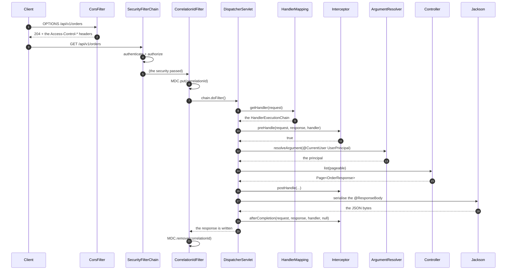
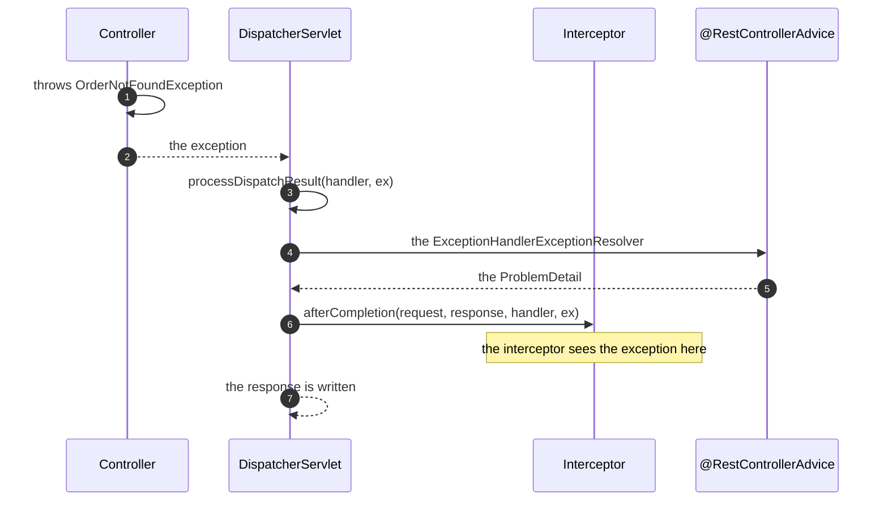

# 05 · Filters, Interceptors, Argument Resolvers & Files

> **Level:** Intermediate → Advanced
> **Interview Frequency:** ★★★☆☆ (Common as "where do you put the cross-cutting logic?")
> **Prerequisite:** [01 · Request Flow](./01-Request-Flow-and-DispatcherServlet.md)
> **Last Updated:** 2026

---

## 📋 Table of Contents
- [0. TL;DR — The 30-Second Answer](#0-tldr--the-30-second-answer)
- [1. What & Why](#1-what--why)
- [2. Mental Model — the extension points](#2-mental-model--the-extension-points)
- [3. Deep Dive — Theory](#3-deep-dive--theory)
- [4. Internal Working Mechanism](#4-internal-working-mechanism)
- [5. Step-by-Step Execution Flow](#5-step-by-step-execution-flow)
- [6. Architecture Diagrams](#6-architecture-diagrams)
- [7. Production-Level Use Cases](#7-production-level-use-cases)
- [8. Code Examples — Production-Grade](#8-code-examples--production-grade)
- [9. Common Mistakes & Gotchas](#9-common-mistakes--gotchas)
- [10. Performance Considerations](#10-performance-considerations)
- [11. Security Considerations](#11-security-considerations)
- [12. Best Practices — The Checklist](#12-best-practices--the-checklist)
- [13. Hands-On Exercises](#13-hands-on-exercises)
- [14. Code Challenges](#14-code-challenges)
- [15. Scenario-Based Questions](#15-scenario-based-questions)
- [16. Interview Q&A — Level-wise](#16-interview-qa--level-wise)
- [17. Counter-Questions & Traps](#17-counter-questions--traps)
- [18. Tricky Interview Questions](#18-tricky-interview-questions)
- [19. Follow-Up Questions Asked by Interviewers](#19-follow-up-questions-asked-by-interviewers)
- [20. Real 3–5 Year Experience Scenarios](#20-real-35-year-experience-scenarios)
- [21. Frequently Asked Production Issues](#21-frequently-asked-production-issues)
- [22. Debugging Scenarios](#22-debugging-scenarios)
- [23. Architecture Design Questions](#23-architecture-design-questions)
- [24. Rapid-Fire MCQs](#24-rapid-fire-mcqs)
- [25. Cheat Sheet — One-Page Summary](#25-cheat-sheet--one-page-summary)
- [26. Real-World Production Notes](#26-real-world-production-notes)
- [27. Follow-up Learning](#27-follow-up-learning)

---

## 0. TL;DR — The 30-Second Answer

- **The request pipeline, in order:**
  ```
  Servlet Filter → DispatcherServlet → HandlerInterceptor.preHandle
    → HandlerMethod argument resolution → Controller
    → HandlerInterceptor.postHandle → @ResponseBody serialisation
    → HandlerInterceptor.afterCompletion → the Filter chain returns
  ```
- **A `Filter` is a `javax.servlet`/`jakarta.servlet` concept** — it runs **before** and
  **after** the `DispatcherServlet`, it wraps **everything** (including the static resources and
  the error dispatches), and it's where Spring Security lives.
- **A `HandlerInterceptor` is a Spring MVC concept** — it runs **around the handler method**,
  after the handler is resolved (so it knows the handler), and it can handle the **exceptions**
  (`afterCompletion`).
- **A `HandlerMethodArgumentResolver`** lets you bind a custom type from the request (a
  `@CurrentUser` annotation, a `TenantId`, a `Pageable`) — it's the mechanism behind
  `@AuthenticationPrincipal`, `@RequestHeader`, and the `Pageable`/`Sort` resolvers.
- **`@ControllerAdvice` + `WebMvcConfigurer`** register the interceptors, the argument resolvers,
  the message converters, the CORS, and the async support.
- **File upload:** `MultipartFile` + `spring.servlet.multipart.*` (the size limits) + the
  streaming (don't call `getBytes()` on a big file).
- **File download:** `ResponseEntity<Resource>` + `Content-Disposition` + the streaming
  (`InputStreamResource` / `StreamingResponseBody`).
- **`OncePerRequestFilter`** — the base class that guarantees the filter runs once per request
  (not once per dispatch) — use it for the async and the error dispatch cases.
- **The one-liner:** *"Filters wrap the whole servlet (the security, the CORS, the correlation
  id, the rate limiting); interceptors wrap the handler method (the metrics, the audit, the
  pre-loading); argument resolvers bind the custom types (the current user, the tenant). Know
  which one you need — most of the mistakes come from putting the logic in the wrong one."*

---

## 1. What & Why

Cross-cutting concerns — the correlation id, the metrics, the rate limiting, the audit, the
current-user binding, the file handling — need a home. The three extension points give you
different powers:

| | Filter | Interceptor | Argument resolver |
|---|---|---|---|
| **The scope** | The whole servlet | The handler method | One parameter |
| **Knows the handler?** | No | **Yes** | Yes (after the resolution) |
| **Runs before the DispatcherServlet?** | **Yes** | No | No |
| **Handles the exceptions?** | No (it wraps them) | **Yes** (`afterCompletion`) | No |
| **Works for the static resources?** | **Yes** | No | No |
| **Works for the async requests?** | Yes (with care) | Yes | Yes |

---

## 2. Mental Model — the extension points

```text
   ┌─ SERVLET CONTAINER (Tomcat) ──────────────────────────────────────────┐
   │                                                                       │
   │   CorsFilter ──► SecurityFilterChain ──► CorrelationIdFilter        │
   │        │                   │                       │                │
   │        ▼                   ▼                       ▼                │
   │   ┌──────────────────────────────────────────────────────────────┐    │
   │   │                    DispatcherServlet                         │    │
   │   │                                                              │    │
   │   │   HandlerMapping → HandlerAdapter →                          │    │
   │   │        │                                                     │    │
   │   │        ├─► Interceptor.preHandle()                          │    │
   │   │        │        │                                             │    │
   │   │        │        ├─► ArgumentResolvers (@CurrentUser, …)      │    │
   │   │        │        │        │                                    │    │
   │   │        │        │        ▼                                    │    │
   │   │        │        │   Controller.method()                       │    │
   │   │        │        │        │                                    │    │
   │   │        │        ├─► Interceptor.postHandle()                 │    │
   │   │        │        │        │                                    │    │
   │   │        │        ├─► @ResponseBody → Jackson → the bytes      │    │
   │   │        │        │                                             │    │
   │   │        └─► Interceptor.afterCompletion(ex)  ← the exception   │    │
   │   └──────────────────────────────────────────────────────────────┘    │
   │        │                                                             │
   │        ▼   (the response goes back up)                               │
   │   ResponseCommittedFilter → the container                             │
   └───────────────────────────────────────────────────────────────────────┘
```

> **Caption:** The filter is the **outer wrapper** (it sees the request before anything else and
> the response after everything). The interceptor is the **inner wrapper** (it knows which
> handler is running). The argument resolver is a **binding** mechanism.

---

## 3. Deep Dive — Theory

### 3.1 The `Filter` — the servlet-level extension point

```java
@Component
public class CorrelationIdFilter extends OncePerRequestFilter {

    @Override
    protected void doFilterInternal(HttpServletRequest request, HttpServletResponse response,
                                    FilterChain filterChain) throws ServletException, IOException {
        String correlationId = request.getHeader("X-Correlation-Id");
        if (correlationId == null || correlationId.isBlank()) {
            correlationId = UUID.randomUUID().toString();
        }
        MDC.put("correlationId", correlationId);
        response.setHeader("X-Correlation-Id", correlationId);
        try {
            filterChain.doFilter(request, response);
        } finally {
            MDC.remove("correlationId");
        }
    }
}
```

**The `Filter` interface:**
```java
public interface Filter {
    default void init(FilterConfig filterConfig) throws ServletException { }
    void doFilter(ServletRequest request, ServletResponse response, FilterChain chain)
            throws IOException, ServletException;
    default void destroy() { }
}
```

**Registration options:**
```java
// ① A @Component → auto-registered for all the URLs (the order is undefined!)
@Component
public class MyFilter implements Filter { }

// ② A FilterRegistrationBean → full control over the order, the URLs, and the dispatcher types
@Bean
FilterRegistrationBean<MyFilter> myFilter() {
    FilterRegistrationBean<MyFilter> registration = new FilterRegistrationBean<>(new MyFilter());
    registration.addUrlPatterns("/api/*");
    registration.setOrder(Ordered.HIGHEST_PRECEDENCE + 10);
    registration.setDispatcherTypes(DispatcherType.REQUEST, DispatcherType.ASYNC, DispatcherType.ERROR);
    return registration;
}
```

**The filter ordering** — the security filter chain must run **before** your filters if they need
the authenticated principal:
```java
registration.setOrder(SecurityProperties.DEFAULT_FILTER_ORDER - 10);   // after the security
```
`SecurityProperties.DEFAULT_FILTER_ORDER` = `-100`.

### 3.2 `OncePerRequestFilter` — the base class you should use

**Why it exists:** a filter registered for `REQUEST` **and** `ASYNC`/`ERROR` dispatch types can
run **multiple times for the same request** (once for the initial dispatch, once for the async
dispatch, once for the error dispatch). `OncePerRequestFilter` guarantees it runs **once per
request** (it uses a request attribute as the marker) and it removes the attribute when the
request completes.

```java
public abstract class OncePerRequestFilter extends GenericFilterBean {

    @Override
    public final void doFilter(ServletRequest request, ServletResponse response, FilterChain chain) {
        if (skipDispatch(request, response, chain)) return;
        // the marker attribute prevents the re-execution
        doFilterInternal(request, response, chain);
    }

    protected boolean shouldNotFilterAsyncDispatch() { return true; }   // skip the async dispatch
    protected boolean shouldNotFilterErrorDispatch() { return true; }   // skip the error dispatch
}
```

> **The classic bug:** a filter that logs the request → after an async controller, the request is
> logged **twice** (or the `MDC` is cleared too early). Fix: use `OncePerRequestFilter` and
> handle the async dispatch explicitly.

### 3.3 The `HandlerInterceptor`

```java
@Component
public class AuditInterceptor implements HandlerInterceptor {

    // Before the handler
    @Override
    public boolean preHandle(HttpServletRequest request, HttpServletResponse response,
                             Object handler) {
        // return false → the handler is NOT called (the response is written by you)
        return true;
    }

    // After the handler, before the view rendering / the @ResponseBody serialisation
    @Override
    public void postHandle(HttpServletRequest request, HttpServletResponse response,
                           Object handler, ModelAndView modelAndView) { }

    // After the completion (including the exception)
    @Override
    public void afterCompletion(HttpServletRequest request, HttpServletResponse response,
                                Object handler, Exception ex) { }
}
```

**The registration:**
```java
@Configuration
@RequiredArgsConstructor
public class WebConfig implements WebMvcConfigurer {

    private final AuditInterceptor auditInterceptor;

    @Override
    public void addInterceptors(InterceptorRegistry registry) {
        registry.addInterceptor(auditInterceptor)
                .addPathPatterns("/api/**")
                .excludePathPatterns("/api/public/**")
                .order(1);          // the order among the interceptors
    }
}
```

**The interceptor's advantage over the filter:** it knows the **handler** (`Object handler` → a
`HandlerMethod` → the controller class and the method → the endpoint name for the metrics).

```java
if (handler instanceof HandlerMethod handlerMethod) {
    String endpoint = handlerMethod.getBeanType().getSimpleName()
                    + "#" + handlerMethod.getMethod().getName();
    MDC.put("endpoint", endpoint);
}
```

### 3.4 The `HandlerMethodArgumentResolver` — the custom binding

```java
public class CurrentUserArgumentResolver implements HandlerMethodArgumentResolver {

    private final CurrentUserService currentUserService;

    @Override
    public boolean supportsParameter(MethodParameter parameter) {
        return parameter.hasParameterAnnotation(CurrentUser.class)
                && parameter.getParameterType().equals(UserPrincipal.class);
    }

    @Override
    public Object resolveArgument(MethodParameter parameter, ModelAndViewContainer mavContainer,
                                  NativeWebRequest webRequest, WebDataBinderFactory binderFactory) {
        Authentication authentication = SecurityContextHolder.getContext().getAuthentication();
        if (authentication == null || !authentication.isAuthenticated()) {
            throw new AccessDeniedException("Not authenticated");
        }
        return currentUserService.load((UserPrincipal) authentication.getPrincipal());
    }
}
```

```java
@Target(ElementType.PARAMETER)
@Retention(RetentionPolicy.RUNTIME)
public @interface CurrentUser { }
```

```java
@GetMapping("/me")
public ProfileResponse me(@CurrentUser UserPrincipal user) { }
```

**The registration:**
```java
@Override
public void addArgumentResolvers(List<HandlerMethodArgumentResolver> resolvers) {
    resolvers.add(currentUserArgumentResolver);
}
```

> **Important:** a custom argument resolver registered via `addArgumentResolvers` has a **lower**
> priority than the built-in ones — but it's still consulted (the built-ins return `false` from
> `supportsParameter` for your custom type).

### 3.5 The built-in argument resolvers

| The resolver | The annotation | The source |
|--------------|----------------|-----------|
| `RequestParamMethodArgumentResolver` | `@RequestParam` | The query string / the form |
| `RequestResponseBodyMethodProcessor` | `@RequestBody` | The body (via the message converters) |
| `PathVariableMethodArgumentResolver` | `@PathVariable` | The URI template |
| `RequestHeaderMethodArgumentResolver` | `@RequestHeader` | The headers |
| `CookieValueMethodArgumentResolver` | `@CookieValue` | The cookies |
| `ServletModelAttributeMethodProcessor` | `@ModelAttribute` / the POJO | The query string + the form |
| `PrincipalMethodArgumentResolver` | `Principal` / `AuthenticationPrincipal` | The `SecurityContext` |
| `PageableHandlerMethodArgumentResolver` | `Pageable` / `Sort` | The query string (`page`, `size`, `sort`) |
| `RequestAttributeMethodArgumentResolver` | `@RequestAttribute` | The request attributes |
| `ExpressionMethodArgumentResolver` | `@Value` | The `Environment` (SpEL) |
| `SessionAttributeMethodArgumentResolver` | `@SessionAttribute` | The session |

### 3.6 `Pageable` — the built-in pagination resolver

```java
@GetMapping
public Page<OrderResponse> list(Pageable pageable) {
    return orderService.findAll(pageable);
}
```

```
GET /api/v1/orders?page=0&size=20&sort=createdAt,desc
```

**The configuration:**
```properties
spring.data.web.pageable.default-page-size=20
spring.data.web.pageable.max-page-size=200
spring.data.web.pageable.one-indexed-parameters=false
spring.data.web.pageable.page-parameter=page
spring.data.web.pageable.size-parameter=size
spring.data.web.pageable.sort-parameter=sort
spring.data.web.pageable.prefix=
```

**The `Sort` resolver:** `?sort=createdAt,desc` → a `Sort` object. **The danger:** the sort
property goes into the `ORDER BY` — you must allow-list it (see the JPA chapter).

### 3.7 The `WebMvcConfigurer` — the central MVC configuration point

```java
@Configuration
@RequiredArgsConstructor
public class WebConfig implements WebMvcConfigurer {

    private final CurrentUserArgumentResolver currentUserArgumentResolver;
    private final RequestLoggingInterceptor requestLoggingInterceptor;

    // The interceptors
    @Override
    public void addInterceptors(InterceptorRegistry registry) {
        registry.addInterceptor(requestLoggingInterceptor).addPathPatterns("/api/**");
    }

    // The argument resolvers
    @Override
    public void addArgumentResolvers(List<HandlerMethodArgumentResolver> resolvers) {
        resolvers.add(currentUserArgumentResolver);
    }

    // The CORS
    @Override
    public void addCorsMappings(CorsRegistry registry) {
        registry.addMapping("/api/**")
                .allowedOrigins("https://app.acme.com")
                .allowedMethods("GET", "POST", "PUT", "PATCH", "DELETE")
                .allowedHeaders("*")
                .allowCredentials(true)
                .maxAge(3600);
    }

    // The formatters
    @Override
    public void addFormatters(FormatterRegistry registry) {
        registry.addConverter(new StringToOrderStatusConverter());
        registry.addFormatter(new LocalDateFormatter());
    }

    // The message converters
    @Override
    public void extendMessageConverters(List<HttpMessageConverter<?>> converters) {
        converters.add(new MappingJackson2HttpMessageConverter(objectMapper()));
    }

    // The static resources
    @Override
    public void addResourceHandlers(ResourceHandlerRegistry registry) {
        registry.addResourceHandler("/static/**").addResourceLocations("classpath:/static/");
    }
}
```

### 3.8 The file upload

```java
@PostMapping(value = "/documents", consumes = MediaType.MULTIPART_FORM_DATA_VALUE)
public ResponseEntity<DocumentResponse> upload(
        @RequestPart("file") MultipartFile file,
        @RequestPart("metadata") @Valid DocumentMetadata metadata) {

    String storageKey = storageService.store(file, metadata);
    Document document = documentService.create(metadata, storageKey);
    return ResponseEntity.created(URI.create("/api/v1/documents/" + document.getId()))
                         .body(DocumentResponse.from(document));
}
```

**The configuration:**
```properties
spring.servlet.multipart.enabled=true
spring.servlet.multipart.max-file-size=10MB
spring.servlet.multipart.max-request-size=50MB
spring.servlet.multipart.file-size-threshold=0B      # 0 = always write to the disk
spring.servlet.multipart.location=${java.io.tmpdir}
```

**The `MultipartFile` API:**
```java
file.getName();          // the form field name
file.getOriginalFilename();  // the client's filename (UNTRUSTED)
file.getContentType();   // the client's content type (UNTRUSTED)
file.getSize();
file.isEmpty();
file.getBytes();         // ⚠ the whole file in memory
file.getInputStream();   // ✓ streaming
file.getResource();      // a Resource (for the multipart temp file)
file.transferTo(Path);   // ✓ move it without loading it
```

**The `transferTo` gotcha:** it can only be called **once**, and it fails if the file was already
read (the temp file was deleted). Use `Files.copy(file.getInputStream(), target)` for a
re-read.

**The streaming upload:**
```java
public String store(MultipartFile file) throws IOException {
    String key = UUID.randomUUID() + "-" + sanitize(file.getOriginalFilename());
    Path target = storageRoot.resolve(key);
    try (InputStream in = file.getInputStream()) {
        Files.copy(in, target, StandardCopyOption.REPLACE_EXISTING);
    }
    return key;
}
```

### 3.9 The file download

```java
@GetMapping("/documents/{id}/content")
public ResponseEntity<Resource> download(@PathVariable Long id) {
    Document document = documentService.get(id);
    Resource resource = storageService.load(document.getStorageKey());

    return ResponseEntity.ok()
            .contentType(MediaType.parseMediaType(document.getContentType()))
            .contentLength(document.getSize())
            .header(HttpHeaders.CONTENT_DISPOSITION,
                    "attachment; filename=\"" + sanitizeFilename(document.getFileName()) + "\"")
            .body(resource);
}
```

**The streaming download (for a big file):**
```java
@GetMapping("/documents/{id}/stream")
public StreamingResponseBody stream(@PathVariable Long id) {
    Document document = documentService.get(id);
    return outputStream -> {
        try (InputStream in = storageService.open(document.getStorageKey())) {
            in.transferTo(outputStream);
        }
    };
}
```

**The `Content-Disposition` values:**
- `attachment; filename="report.pdf"` → the browser downloads it.
- `inline; filename="report.pdf"` → the browser displays it (if the type is safe).
- The RFC 5987 form: `attachment; filename*=UTF-8''report%20%E2%82%AC.pdf` for the non-ASCII
  names.

**The security headers for a download:**
```java
.header(HttpHeaders.CONTENT_TYPE, "application/octet-stream")   // if the content is unknown
.header("X-Content-Type-Options", "nosniff")                     // no MIME sniffing
.header(HttpHeaders.CONTENT_DISPOSITION, "attachment; ...")       // force the download
```

### 3.10 The `ResponseBodyAdvice` — the response post-processor

```java
@Component
public class ResponseEnvelopeAdvice implements ResponseBodyAdvice<Object> {

    @Override
    public boolean supports(MethodParameter returnType, Class<? extends HttpMessageConverter<?>> converterType) {
        return true;
    }

    @Override
    public Object beforeBodyWrite(Object body, MethodParameter returnType, MediaType selectedContentType,
                                  Class<? extends HttpMessageConverter<?>> converterType,
                                  ServerHttpRequest request, ServerHttpResponse response) {
        if (body instanceof ApiResponse) return body;
        return ApiResponse.success(body);
    }
}
```

> **Use it carefully:** a global envelope changes the contract of **every** endpoint, and it
> interferes with the `ProblemDetail` (the error responses must not be wrapped) and with the file
> downloads (`Resource` bodies). Always exclude those.

### 3.11 The `RequestBodyAdvice` — the request pre-processor

```java
@Component
public class RequestIdAdvice implements RequestBodyAdvice<Object> {

    @Override
    public boolean supports(MethodParameter methodParameter, Type targetType,
                            Class<? extends HttpMessageConverter<?>> converterType) {
        return methodParameter.hasParameterAnnotation(@ValidRequest.class);
    }

    @Override
    public Object beforeBodyRead(Object body, InputMessage inputMessage, ParameterizedTypeReference<T> paramType,
                                 Type targetType, Class<? extends HttpMessageConverter<?>> converterType) {
        // Sanitise / decrypt / enrich the body before it's deserialised
        return body;
    }
}
```

### 3.12 The CORS — the configuration

```java
@Bean
CorsConfigurationSource corsConfigurationSource() {
    CorsConfiguration config = new CorsConfiguration();
    config.setAllowedOrigins(List.of("https://app.acme.com"));   // NOT "*" with the credentials
    config.setAllowedMethods(List.of("GET", "POST", "PUT", "PATCH", "DELETE", "OPTIONS"));
    config.setAllowedHeaders(List.of("Authorization", "Content-Type", "X-Correlation-Id"));
    config.setExposedHeaders(List.of("X-Correlation-Id", "Location"));
    config.setAllowCredentials(true);
    config.setMaxAge(Duration.ofHours(1));

    UrlBasedCorsConfigurationSource source = new UrlBasedCorsConfigurationSource();
    source.registerCorsConfiguration("/api/**", config);
    return source;
}
```

**The CORS flow:**
```text
  Browser: OPTIONS /api/v1/orders
    Headers: Origin: https://app.acme.com
             Access-Control-Request-Method: POST
             Access-Control-Request-Headers: authorization
        │
        ▼
  The server responds:
    Access-Control-Allow-Origin: https://app.acme.com
    Access-Control-Allow-Methods: GET, POST, …
    Access-Control-Allow-Headers: authorization
    Access-Control-Allow-Credentials: true
    Access-Control-Max-Age: 3600
        │
        ▼
  The browser sends the real request (with the Origin header)
```

> **Key:** the CORS is enforced by the **browser**, not the server. The server just tells the
> browser what it may do. A `curl`/a server-to-server call **ignores** it entirely — so the CORS
> is **not** a security control. The **CSRF** protection is.

### 3.13 The async request handling

```java
@GetMapping("/reports/{id}")
public CompletableFuture<ReportResponse> report(@PathVariable Long id) {
    return CompletableFuture.supplyAsync(() -> reportService.generate(id),
                                        reportExecutor);
}
```

**The `Callable` and `DeferredResult`:**
```java
@GetMapping("/reports")
public Callable<ReportResponse> report() {
    return () -> reportService.generate();
}
```

**The async configuration:**
```java
@Override
public void configureAsyncSupport(AsyncSupportConfigurer configurer) {
    configurer.setDefaultTimeout(30_000);
    configurer.setTaskExecutor(taskExecutor);
    configurer.setAsyncRequestTimeout(30_000);
}
```

**The async interceptors** need explicit registration:
```java
@Override
public void configureAsyncSupport(AsyncSupportConfigurer configurer) {
    configurer.registerCallableInterceptors(callableInterceptor);
    configurer.registerDeferredResultInterceptors(deferredResultInterceptor);
}
```

> **The gotcha:** in an async request, the `ThreadLocal` context (the `SecurityContext`, the
> `MDC`, the `RequestContextHolder`) is **not** propagated to the async thread by default. Use
> `SecurityContextHolder.setContext` or the `DelegatingSecurityContextExecutor` /
> `TaskDecorator`.

### 3.14 The `RequestContextHolder` and the `RequestScoped` beans

```java
@Service
@RequestScoped
public class RequestInfoService {

    private final HttpServletRequest request;   // injected as a proxy

    public String clientIp() {
        String forwarded = request.getHeader("X-Forwarded-For");
        return forwarded != null ? forwarded.split(",")[0].trim() : request.getRemoteAddr();
    }
}
```

> **Note:** the `RequestScope` requires a `WebApplicationContext` (the `request`, `session`,
> and `application` scopes come from the `WebApplicationContext`).

---

## 4. Internal Working Mechanism

### 4.1 The `FilterChain` — the servlet level

```text
  Tomcat's filter chain:
  Filter1.doFilter → Filter2.doFilter → ... → DispatcherServlet.service()
                                                │
                                                ▼
  (the response goes back up)
  DispatcherServlet.service() returns → ... → Filter2 (the code after chain.doFilter)
  → Filter1 (the code after chain.doFilter)
```

**The `DispatcherServlet.service()`:**
```java
@Override
protected void service(HttpServletRequest request, HttpServletResponse response) {
    try {
        super.service(request, response);
    } catch (Exception ex) {
        dispatchException = ex;
    }
    ...
}
```

### 4.2 The `DispatcherServlet.doDispatch()` — the interceptor chain

```java
protected void doDispatch(HttpServletRequest request, HttpServletResponse response) {
    ...
    try {
        processedRequest = checkMultipart(request);
        multipartRequestParsed = (processedRequest != request);

        // ① The HandlerExecutionChain (the handler + the interceptors)
        mappedHandler = getHandler(processedRequest);
        if (mappedHandler == null) { noHandlerFound(processedRequest, response); return; }

        // ② The interceptor's preHandle
        if (!mappedHandler.applyPreHandle(processedRequest, response)) {
            return;    // a preHandle returned false
        }

        // ③ The handler adapter
        mv = ha.handle(processedRequest, response, mappedHandler.getHandler());

        // ④ The interceptor's postHandle
        mappedHandler.applyPostHandle(processedRequest, response, mv);
    }
    catch (Exception ex) {
        dispatchException = ex;
    }
    catch (Throwable err) { ... }

    processDispatchResult(processedRequest, response, mappedHandler, mv, dispatchException);
}
```

**The `HandlerExecutionChain.applyPreHandle`:**
```java
boolean applyPreHandle(HttpServletRequest request, HttpServletResponse response) {
    for (int i = 0; i < this.interceptorList.size(); i++) {
        HandlerInterceptor interceptor = this.interceptorList.get(i);
        if (!interceptor.preHandle(request, response, this.handler)) {
            triggerAfterCompletion(request, response, null);
            return false;
        }
        this.interceptorIndex = i;
    }
    return true;
}
```

**The `triggerAfterCompletion`** (in `processDispatchResult`):
```java
if (mappedHandler != null) {
    mappedHandler.triggerAfterCompletion(request, response, null);
}
```
→ it calls `afterCompletion` on the interceptors **in reverse order**, and it **always** runs
(even if the handler threw).

> **Key:** `afterCompletion` is the only interceptor hook that sees the **exception**. The
> `preHandle`/`postHandle` don't.

### 4.3 The argument resolution

```java
// In InvocableHandlerMethod.getMethodArgumentValues()
public Object[] getMethodArgumentValues(Object... providedArgs) {
    MethodParameter[] parameters = getMethodParameters();
    Object[] args = new Object[parameters.length];
    for (int i = 0; i < parameters.length; i++) {
        MethodParameter parameter = parameters[i];
        Object arg = null;
        if (providedArgs != null && providedArgs.length == parameters.length) {
            arg = providedArgs[i];
        }
        else {
            arg = findProvidedArgument(parameter, providedArgs);
            if (arg == null) {
                if (parameter.isOptional()) { arg = resolveNullValue(parameter); }
                else if (parameter.hasParameterAnnotation(RequestParam.class) ...) {
                    arg = handleMissingValue(parameter, nestedParameter);
                }
                else {
                    arg = getArgumentResolver(parameter, nestedParameter).resolveArgument(...);
                }
            }
        }
        ...
        args[i] = arg;
    }
    return args;
}
```

**The resolver lookup:** the `HandlerMethodArgumentResolverComposite` iterates over the
resolvers in order and uses the **first** whose `supportsParameter` returns `true`. The built-in
resolvers are registered first; the custom ones (from `addArgumentResolvers`) are appended
**after** — so a custom resolver for a type that a built-in also supports (e.g. `Principal`)
**won't** be used.

### 4.4 The `WebMvcConfigurer` — the configuration internals

```java
// In WebMvcConfigurationSupport / DelegatingWebMvcConfiguration
@Autowired
void setConfigurers(List<WebMvcConfigurer> configurers) { ... }
```

Each `WebMvcConfigurer` method is delegated to the matching `xxxBuilder`:

| The `WebMvcConfigurer` method | The builder | The result |
|-------------------------------|------------|-----------|
| `addInterceptors` | `InterceptorRegistry` | The `HandlerInterceptor`s |
| `addArgumentResolvers` | `RequestMappingHandlerAdapter` | The custom resolvers |
| `addCorsMappings` | `CorsRegistry` | The CORS configuration |
| `addFormatters` | `FormatterRegistry` | The `Converter`/`Formatter`s |
| `extendMessageConverters` | `HttpMessageConverters` | The custom converters |
| `configureAsyncSupport` | `AsyncSupportConfigurer` | The async settings |
| `addResourceHandlers` | `ResourceHandlerRegistry` | The static resources |
| `configurePathMatch` | `PathMatchConfigurer` | The suffix pattern matching, the trailing slash |
| `addViewControllers` | `ViewControllerRegistry` | The view-only endpoints |
| `configureContentNegotiation` | `ContentNegotiationConfigurer` | The `favorParameter` (the `?format=json`) |
| `addCorsMappings` | — | The CORS |

### 4.5 The `FilterRegistrationBean` vs the `@Component` filter

- A `@Component` filter is registered by the `ServletContextInitializer` beans — the **order is
  undefined** (it depends on the `bean name` ordering, which is fragile).
- A `FilterRegistrationBean` gives you the explicit **order**, the **URL patterns**, and the
  **dispatcher types**.

> **The rule:** if the order matters (it usually does), use the `FilterRegistrationBean`.

---

## 5. Step-by-Step Execution Flow

### 5.1 The complete request lifecycle



### 5.2 The exception path through the interceptors



> **Key:** the `afterCompletion` receives the exception — that's where the metrics and the audit
> go (the `response.getStatus()` is the final status by then).

---

## 6. Architecture Diagrams

### 6.1 Choosing the extension point

```text
  "I need to run code for EVERY request, before anything else"
      → a FILTER  (the CORS, the correlation id, the rate limiting, the request logging)

  "I need to know WHICH endpoint is being called"
      → an INTERCEPTOR  (the per-endpoint metrics, the audit)

  "I need to bind a custom value into a controller parameter"
      → an ARGUMENT RESOLVER  (the current user, the tenant, the locale)

  "I need to change the response body shape"
      → a ResponseBodyAdvice  (carefully!)

  "I need to modify the request before it's deserialised"
      → a RequestBodyAdvice  (the decryption, the sanitisation)

  "I need to customise the CORS / the message converters / the pagination"
      → a WebMvcConfigurer
```

### 6.2 The filter ordering

```text
  Order   Filter                        Why
  ─────   ──────                        ───
  -100    SecurityFilterChain           (the default) — the auth must be first
   -90    CorsFilter                    (the preflight must not need the auth)
   -50    RequestContextFilter          (the RequestContextHolder)
   -20    CorrelationIdFilter           (the id must exist for everything after it)
     0    RateLimitFilter               (it needs the user + the id)
    10    RequestLoggingFilter          (the log needs the final status)
    20    ResponseCommittedFilter       (Spring's — the last)
```

### 6.3 The multipart upload flow

```text
  POST /api/v1/documents  (multipart/form-data)
        │
        ▼
  Tomcat parses the request → the parts are written to a temp file
        │  (or buffered in memory if under file-size-threshold)
        ▼
  Spring's MultipartHttpServletRequest → the RequestPartMethodArgumentResolver
        │
        ▼
  The controller receives a MultipartFile (a handle to the temp file)
        │
        ├─ getInputStream()  → stream it to the object storage
        ├─ transferTo(path) → move it (once only)
        └─ getBytes()       → ⚠ the whole thing in the heap
```

---

## 7. Production-Level Use Cases

| Use case | The extension point |
|----------|---------------------|
| **The correlation id** | A filter (before everything) |
| **The access logging** | A filter (the final status) or an interceptor (the endpoint name) |
| **The CORS** | Spring Security's `CorsFilter` or the `WebMvcConfigurer` |
| **The rate limiting** | A filter (before the auth? no — after, so you can use the user) |
| **The current-user binding** | An argument resolver |
| **The tenant resolution** | A filter (sets the `TenantContext`) + an argument resolver |
| **The per-endpoint metrics** | An interceptor (it knows the handler) |
| **The audit log** | An interceptor (or an AOP aspect on the service) |
| **The request id propagation** | A filter (add the header to the `RestClient` calls too) |
| **The file upload/download** | The controller + the `MultipartFile`/`Resource` |
| **The response envelope** | A `ResponseBodyAdvice` (carefully) |
| **The request decryption** | A `RequestBodyAdvice` or a filter |
| **The locale resolution** | A `LocaleResolver` (`WebMvcConfigurer`/`acceptHeaderLocaleResolver`) |
| **The API docs** | A `springdoc` filter or an interceptor |

---

## 8. Code Examples — Production-Grade

### 8.1 The correlation id filter

```java
@Component
@Order(Ordered.HIGHEST_PRECEDENCE + 10)
public class CorrelationIdFilter extends OncePerRequestFilter {

    public static final String HEADER = "X-Correlation-Id";
    public static final String MDC_KEY = "correlationId";

    @Override
    protected void doFilterInternal(HttpServletRequest request, HttpServletResponse response,
                                    FilterChain filterChain) throws ServletException, IOException {

        String correlationId = request.getHeader(HEADER);
        if (correlationId == null || correlationId.isBlank() || correlationId.length() > 64) {
            correlationId = UUID.randomUUID().toString();
        }

        MDC.put(MDC_KEY, correlationId);
        response.setHeader(HEADER, correlationId);

        try {
            filterChain.doFilter(request, response);
        } finally {
            MDC.remove(MDC_KEY);
        }
    }
}
```

### 8.2 The request logging filter (with the timing)

```java
@Component
@Order(Ordered.LOWEST_PRECEDENCE - 10)
public class RequestLoggingFilter extends OncePerRequestFilter {

    private static final Logger log = LoggerFactory.getLogger(RequestLoggingFilter.class);

    @Override
    protected void doFilterInternal(HttpServletRequest request, HttpServletResponse response,
                                    FilterChain filterChain) throws ServletException, IOException {
        long start = System.nanoTime();
        try {
            filterChain.doFilter(request, response);
        } finally {
            long durationMs = (System.nanoTime() - start) / 1_000_000;
            log.info("{} {} -> {} in {}ms [correlationId={}]",
                    request.getMethod(),
                    request.getRequestURI(),
                    response.getStatus(),
                    durationMs,
                    MDC.get("correlationId"));
        }
    }
}
```

### 8.3 The timing + the metrics interceptor

```java
@Component
public class MetricsInterceptor implements HandlerInterceptor {

    private final MeterRegistry meterRegistry;

    @Override
    public boolean preHandle(HttpServletRequest request, HttpServletResponse response, Object handler) {
        request.setAttribute("startNanos", System.nanoTime());
        return true;
    }

    @Override
    public void afterCompletion(HttpServletRequest request, HttpServletResponse response,
                                Object handler, Exception ex) {

        Object start = request.getAttribute("startNanos");
        if (!(start instanceof Long startNanos)) return;

        double durationMs = (System.nanoTime() - startNanos) / 1_000_000.0;

        String endpoint = handler instanceof HandlerMethod hm
                ? hm.getMethod().getDeclaringClass().getSimpleName() + "." + hm.getMethod().getName()
                : "unknown";

        Timer.builder("http.server.requests")
             .tag("endpoint", endpoint)
             .tag("status", String.valueOf(response.getStatus()))
             .tag("method", request.getMethod())
             .register(meterRegistry)
             .record(durationMs, TimeUnit.MILLISECONDS);
    }
}
```

### 8.4 The `@CurrentUser` argument resolver

```java
public class CurrentUserArgumentResolver implements HandlerMethodArgumentResolver {

    private final UserQueryService userQueryService;

    @Override
    public boolean supportsParameter(MethodParameter parameter) {
        return parameter.hasParameterAnnotation(CurrentUser.class)
                && UserPrincipal.class.isAssignableFrom(parameter.getParameterType());
    }

    @Override
    public Object resolveArgument(MethodParameter parameter, ModelAndViewContainer mavContainer,
                                  NativeWebRequest webRequest, WebDataBinderFactory binderFactory) {

        Authentication authentication = SecurityContextHolder.getContext().getAuthentication();
        if (authentication == null || !authentication.isAuthenticated()
                || authentication instanceof AnonymousAuthenticationToken) {
            throw new AccessDeniedException("Authentication is required");
        }
        UserPrincipal principal = (UserPrincipal) authentication.getPrincipal();
        return userQueryService.loadById(principal.id());
    }
}
```

```java
@Target(ElementType.PARAMETER)
@Retention(RetentionPolicy.RUNTIME)
@Documented
public @interface CurrentUser { }
```

### 8.5 The `WebConfig`

```java
@Configuration
@RequiredArgsConstructor
public class WebConfig implements WebMvcConfigurer {

    private final CurrentUserArgumentResolver currentUserArgumentResolver;
    private final MetricsInterceptor metricsInterceptor;

    @Override
    public void addArgumentResolvers(List<HandlerMethodArgumentResolver> resolvers) {
        resolvers.add(currentUserArgumentResolver);
    }

    @Override
    public void addInterceptors(InterceptorRegistry registry) {
        registry.addInterceptor(metricsInterceptor)
                .addPathPatterns("/api/**")
                .excludePathPatterns("/api/internal/**")
                .order(10);
    }

    @Override
    public void configureAsyncSupport(AsyncSupportConfigurer configurer) {
        configurer.setDefaultTimeout(30_000);
        configurer.setTaskExecutor(applicationTaskExecutor());
    }

    @Override
    public void configurePathMatch(PathMatchConfigurer configurer) {
        configurer.setUseTrailingSlashMatch(false);
        configurer.setUseSuffixPatternMatch(false);   // deprecated in Boot 3, but the intent matters
    }
}
```

### 8.6 The file upload (production-grade)

```java
@RestController
@RequestMapping("/api/v1/documents")
@RequiredArgsConstructor
public class DocumentController {

    private final DocumentService documentService;
    private final DocumentStorage storage;

    private static final Set<String> ALLOWED_TYPES = Set.of(
            "application/pdf", "image/png", "image/jpeg");

    private static final long MAX_SIZE_BYTES = 10 * 1024 * 1024;

    @PostMapping(consumes = MediaType.MULTIPART_FORM_DATA_VALUE)
    public ResponseEntity<DocumentResponse> upload(
            @RequestPart("file") MultipartFile file,
            @RequestPart(value = "metadata", required = false) DocumentMetadata metadata) {

        // ① The presence and the size
        if (file.isEmpty()) {
            throw new IllegalArgumentException("The file is empty");
        }
        if (file.getSize() > MAX_SIZE_BYTES) {
            throw new PayloadTooLargeException("The file exceeds the 10 MB limit");
        }

        // ② The declared content type (NOT trusted)
        String contentType = file.getContentType();
        if (contentType == null || !ALLOWED_TYPES.contains(contentType)) {
            throw new UnsupportedMediaTypeException("Only PDF, PNG and JPEG are allowed");
        }

        // ③ The actual content (the magic number) — the real check
        String detectedType = storage.detectContentType(file);
        if (!ALLOWED_TYPES.contains(detectedType)) {
            throw new UnsupportedMediaTypeException(
                    "The file content (" + detectedType + ") is not allowed");
        }

        // ④ Store it with a generated name (never the client's filename)
        Document stored = storage.store(file, detectedType);

        Document document = documentService.create(stored, metadata);
        return ResponseEntity.created(URI.create("/api/v1/documents/" + document.getId()))
                             .body(DocumentResponse.from(document));
    }
}
```

```java
@Service
public class DocumentStorage {

    private final Path root;

    public DocumentStorage(@Value("${app.storage.root}") Path root) throws IOException {
        this.root = root;
        Files.createDirectories(root);
    }

    public String detectContentType(MultipartFile file) {
        try (InputStream in = file.getInputStream()) {
            String detected = Files.probeContentType(in);
            return detected != null ? detected : "application/octet-stream";
        } catch (IOException e) {
            throw new UncheckedIOException(e);
        }
    }

    public Document store(MultipartFile file, String contentType) {
        String key = UUID.randomUUID() + extensionFor(contentType);
        Path target = root.resolve(key);
        try (InputStream in = file.getInputStream()) {
            Files.copy(in, target, StandardCopyOption.REPLACE_EXISTING);
        } catch (IOException e) {
            throw new UncheckedIOException("Failed to store the file", e);
        }
        return new Document(key, file.getOriginalFilename(), file.getSize(), contentType);
    }

    private String extensionFor(String contentType) {
        return switch (contentType) {
            case "application/pdf" -> ".pdf";
            case "image/png" -> ".png";
            case "image/jpeg" -> ".jpg";
            default -> ".bin";
        };
    }
}
```

### 8.7 The file download

```java
@GetMapping("/{id}/content")
public ResponseEntity<Resource> download(@PathVariable Long id) {
    Document document = documentService.get(id);

    Resource resource = documentStorage.load(document.getStorageKey());
    if (!resource.exists()) {
        throw new ResourceNotFoundException("The stored file no longer exists");
    }

    String encoded = URLEncoder.encode(document.getOriginalFilename(), StandardCharsets.UTF_8)
                             .replace("+", "%20");

    return ResponseEntity.ok()
            .contentType(MediaType.parseMediaType(document.getContentType()))
            .contentLength(document.getSize())
            .header(HttpHeaders.CONTENT_DISPOSITION,
                    "attachment; filename=\"" + encoded + "\"; filename*=UTF-8''" + encoded)
            .header("X-Content-Type-Options", "nosniff")
            .cacheControl(CacheControl.noStore())
            .body(resource);
}
```

### 8.8 The streaming download (a big file)

```java
@GetMapping("/{id}/stream")
public StreamingResponseBody stream(@PathVariable Long id) {
    Document document = documentService.get(id);
    return outputStream -> {
        try (InputStream in = documentStorage.open(document.getStorageKey())) {
            byte[] buffer = new byte[8192];
            int read;
            while ((read = in.read(buffer)) != -1) {
                outputStream.write(buffer, 0, read);
            }
            outputStream.flush();
        }
    };
}
```

### 8.9 The rate limiting filter (using Bucket4j)

```java
@Component
@Order(Ordered.LOWEST_PRECEDENCE - 20)
public class RateLimitFilter extends OncePerRequestFilter {

    private final Map<String, Bucket> buckets = new ConcurrentHashMap<>();

    @Override
    protected void doFilterInternal(HttpServletRequest request, HttpServletResponse response,
                                    FilterChain filterChain) throws ServletException, IOException {

        String key = resolveKey(request);
        Bucket bucket = buckets.computeIfAbsent(key, k -> newBucket());

        ConsumptionProbe probe = bucket.tryConsumeAndReturnRemaining(1);
        if (!probe.isConsumed()) {
            long retryAfterSeconds = TimeUnit.NANOSECONDS.toSeconds(probe.getNanosToWaitForRefill());
            response.setStatus(HttpStatus.TOO_MANY_REQUESTS.value());
            response.setHeader("Retry-After", String.valueOf(retryAfterSeconds));
            response.setContentType("application/problem+json");
            response.getWriter().write("""
                    {"title":"Too many requests","status":429,
                     "detail":"Rate limit exceeded. Retry after %d seconds."}"""
                    .formatted(retryAfterSeconds));
            return;
        }
        filterChain.doFilter(request, response);
    }

    private String resolveKey(HttpServletRequest request) {
        Authentication auth = SecurityContextHolder.getContext().getAuthentication();
        if (auth != null && auth.isAuthenticated() && auth.getPrincipal() instanceof UserPrincipal p) {
            return "user:" + p.id();
        }
        return "ip:" + request.getRemoteAddr();
    }
}
```

### 8.10 The `ResponseBodyAdvice` (with the exclusions)

```java
@Component
public class ResponseEnvelopeAdvice implements ResponseBodyAdvice<Object> {

    @Override
    public boolean supports(MethodParameter returnType,
                            Class<? extends HttpMessageConverter<?>> converterType) {
        // Only the API endpoints, and never the files
        Class<?> containingClass = returnType.getContainingClass();
        return containingClass != null
                && containingClass.isAnnotationPresent(RestApi.class)
                && !Resource.class.isAssignableFrom(returnType.getParameterType());
    }

    @Override
    public Object beforeBodyWrite(Object body, MethodParameter returnType, MediaType selectedContentType,
                                  Class<? extends HttpMessageConverter<?>> converterType,
                                  ServerHttpRequest request, ServerHttpResponse response) {
        if (body == null || body instanceof ApiResponse || body instanceof ProblemDetail) {
            return body;
        }
        return ApiResponse.success(body);
    }
}
```

### 8.11 The `TaskDecorator` — propagating the MDC and the security context to the async threads

```java
@Component
public class MdcTaskDecorator implements TaskDecorator {

    @Override
    public Runnable decorate(Runnable runnable) {
        Map<String, String> context = MDC.getCopyOfContextMap();
        return () -> {
            try {
                if (context != null) MDC.setContextMap(context);
                runnable.run();
            } finally {
                MDC.clear();
            }
        };
    }
}
```

```java
@Bean
TaskExecutor taskExecutor() {
    ThreadPoolTaskExecutor executor = new ThreadPoolTaskExecutor();
    executor.setCorePoolSize(20);
    executor.setMaxPoolSize(100);
    executor.setQueueCapacity(500);
    executor.setThreadNamePrefix("async-");
    executor.setTaskDecorator(new MdcTaskDecorator());
    executor.initialize();
    return executor;
}
```

---

## 9. Common Mistakes & Gotchas

| # | ❌ Wrong | ✅ Right | Why |
|---|----------|----------|-----|
| 1 | A `@Component` filter where the order matters | A `FilterRegistrationBean` | The order is undefined |
| 2 | A filter that isn't `OncePerRequestFilter` | Extend it | It runs twice with the async dispatch |
| 3 | The MDC isn't cleared in a `finally` | Always `finally` | It leaks to the next request on the pooled thread |
| 4 | The security runs **after** your filter that needs the user | Set the order (`-100` for the security) | The principal isn't there yet |
| 5 | `getBytes()` on a big upload | `getInputStream()` / `transferTo` | An OOM |
| 6 | The upload written to the temp dir with the client's filename | A generated name | A path traversal |
| 7 | Trusting `file.getContentType()` | Sniff the content | It's client-supplied |
| 8 | `file.getBytes()` twice | `transferTo` once | The temp file is deleted after the first read |
| 9 | The download without `Content-Disposition` | Set it | The browser may render the HTML (an XSS) |
| 10 | The download without `nosniff` | Add it | The MIME sniffing |
| 11 | The CORS with `allowedOrigins("*")` + `allowCredentials(true)` | The explicit origins | The browser rejects the combination |
| 12 | The sort parameter straight into the `ORDER BY` | An allow-list | The SQL injection |
| 13 | A custom argument resolver for `Principal` | Use `@AuthenticationPrincipal` | The built-in resolver wins (it's registered first) |
| 14 | The interceptor's `postHandle` expecting to change the body | Use a `ResponseBodyAdvice` | The body is serialised after `postHandle`... (actually the `@ResponseBody` handling happens in the `HandlerAdapter`, **before** `postHandle` — so `postHandle` **can** change the body) |
| 15 | `afterCompletion` expecting a non-null exception | Check for null | It's only non-null on the error path |
| 16 | The `SecurityContext` not propagated to the async thread | A `TaskDecorator` / `DelegatingSecurityContextExecutor` | The context is a `ThreadLocal` |
| 17 | A `RequestScoped` bean used outside a request | Inject `ObjectProvider` | It throws |
| 18 | The `WebMvcConfigurer` bean not picked up | It must be a `@Configuration` (a `@Bean` in a `@Configuration` class) | The proxying |
| 19 | The `Content-Security-Policy` missing | Add it | The XSS defence |
| 20 | Reading the whole body into a `String` | Stream it | The memory |

---

## 10. Performance Considerations

| Aspect | Impact | Guidance |
|--------|--------|----------|
| **The filter overhead** | Microseconds | Keep the filters thin; no I/O |
| **The MDC** | A map operation | Cheap |
| **The `getRemoteAddr()`** | The proxy headers | Use the `ForwardedHeaderFilter` + `server.forward-headers-strategy` |
| **The multipart buffering** | The heap or the disk | Set the `file-size-threshold`; the disk is safer |
| **`getBytes()`** | The whole file in the heap | Stream it |
| **The download** | The memory + the time | `Resource` + `StreamingResponseBody` |
| **The interceptor's metrics** | The timer registry | A **pre-registered** timer per (endpoint, status) — don't create the tags dynamically (the cardinality!) |
| **The `ResponseBodyAdvice`** | An extra object per response | Keep it cheap |
| **The argument resolver** | A DB call (if it loads the user!) | Cache it; use the principal's data instead |
| **The `Pageable`** | The count query | Skip the count when possible |

---

## 11. Security Considerations

| Risk | Mitigation |
|------|-----------|
| **The path traversal in the upload** | A generated name; resolve and check the path is under the root |
| **The spoofed content type** | Sniff the content |
| **The malicious upload** | The antivirus scan; the quarantine area; don't serve it from the app's origin |
| **The XSS via a download** | `Content-Disposition: attachment` + `nosniff` + a CSP |
| **The CORS misconfiguration** | The explicit origins; never `*` with the credentials |
| **The header injection** | The header values must be sanitised (no CRLF) |
| **The MDC/log injection** | Sanitise the user-controlled values in the logs |
| **The rate limit bypass** | Key by the user id, not the IP (if the users are authenticated) |
| **The `X-Forwarded-For` spoofing** | Only trust it behind a known proxy (`server.forward-headers-strategy`) |
| **The multipart DOS** | The size limits; the temp directory cleanup |
| **The `Resource` exposure** | Never build the path from the user's input |

---

## 12. Best Practices — The Checklist

- [ ] **Extend `OncePerRequestFilter`** for the filters.
- [ ] **Use `FilterRegistrationBean`** when the order matters.
- [ ] **Clear the MDC in a `finally`.**
- [ ] **Register the interceptors and the argument resolvers** in a `WebMvcConfigurer`.
- [ ] **Allow-list the sort/filter** parameters.
- [ ] **Cap the page size.**
- [ ] **Stream the uploads and the downloads.**
- [ ] **Never trust the client's filename or the content type.**
- [ ] **Set `Content-Disposition` and `nosniff`** on the downloads.
- [ ] **Configure the CORS explicitly.**
- [ ] **Propagate the MDC and the security context** to the async threads (`TaskDecorator`).
- [ ] **Keep the filters thin** — no I/O, no DB calls.
- [ ] **The metrics with a bounded cardinality** (the endpoint template, not the path).

---

## 13. Hands-On Exercises

**🧪 Lab 1 — The filter order**
1. Write two filters that log their order.
2. Register one as a `@Component` and the other as a `FilterRegistrationBean` with an explicit
   order.
3. Change the order and observe the logs.

**✅ Success signal:** You can predict the order from the configuration alone.

**🧪 Lab 2 — The async double-execution**
1. Write a plain `Filter` (not `OncePerRequestFilter`) that logs.
2. Make a controller return a `CompletableFuture`.
3. Observe the filter running **twice** → then fix it with `OncePerRequestFilter`.

**🧪 Lab 3 — The file upload**
1. Upload a 100 MB file with the limit at 10 MB → observe the `MaxUploadSizeExceededException`.
2. Upload a file with a `.pdf` extension but a PNG content → observe the mismatch.
3. Download it and check the `Content-Disposition` and `nosniff`.

**🧪 Lab 4 — The custom argument resolver**
1. Write a `@CurrentUser` resolver.
2. Register it in the `WebMvcConfigurer`.
3. Prove it works in a controller and that it doesn't work without the registration.

---

## 14. Code Challenges

### Challenge 1 — A production-grade request-context filter (medium)
**Goal:** A filter that:
- generates/propagates the correlation id,
- resolves the tenant (from a header or the token) and sets a `TenantContext`,
- sets the MDC (the correlation id, the tenant, the user id),
- clears everything in a `finally`,
- propagates the MDC to the async threads.

**Test:** a `MockMvc` test asserting the headers and the MDC state; an async test asserting the
MDC in the async thread.

### Challenge 2 — A secure file service (hard)
**Goal:** An upload/download service with:
- the size limit, the content sniffing, the antivirus hook (mocked),
- a generated storage key, the storage outside the web root,
- the streaming upload and download,
- the correct headers on the download,
- the cleanup of the orphaned temp files.

### Challenge 3 — A per-endpoint rate limiter (hard)
**Goal:** A rate limiter with:
- the token bucket, keyed by the user (or the IP for the anonymous),
- the `Retry-After`,
- a `ProblemDetail` body,
- a **bounded** memory (the eviction of the idle buckets),
- the metrics.

---

## 15. Scenario-Based Questions

**S1.** *"Our logs are missing the correlation id for the async endpoints."*
>
> **Ideal answer:** (1) **Why:** the `MDC` is a **`ThreadLocal`** — the async work runs on a
> **different thread** (the `TaskExecutor`'s pool), where the MDC is empty. The filter's `finally`
> clears the MDC on the **request thread** (correctly) — but the async thread never had it. (2)
> **Fix:** propagate it: (a) a **`TaskDecorator`** on the executor that copies the MDC
> (`MDC.getCopyOfContextMap()`) into the worker thread and restores it in a `finally`; (b) for the
> `CompletableFuture`, capture the MDC at the call site and restore it in the async stage; (c) the
> same for the `SecurityContext` — the `DelegatingSecurityContextExecutor` (or the
> `SecurityContextHolder` copy in the decorator). (3) **The same for the request attributes**
> (`RequestContextHolder`) — the `RequestContextFilter` binds them to the thread; in the async
> thread, use the `RequestContextHolder.setRequestAttributes(attrs, true)` (the inheritable
> variant). (4) **The alternative** (often better): **don't** rely on the thread-local context in
> the async code — **pass the correlation id explicitly** (a method parameter) or use the
> **reactive**/coroutine-style context propagation. (5) **The observability**: the correlation id
> must also reach the **downstream calls** — the `RestClient`'s `requestInterceptor` adds it from
> the MDC (the same problem — in the async thread, the MDC is empty unless the decorator copies
> it). (6) The senior framing: "the thread-local context is a **hidden coupling** — it works in
> the happy path and silently breaks in the async one. The **explicit propagation** (the
> decorator) is the fix; the **explicit parameter** is the better design."

**S2.** "Users report that uploaded files sometimes can't be downloaded — a 404 on the content
endpoint."
>
> **Ideal answer:** (1) **Distinguish**: the **document** exists (the metadata is there) but the
> **file** doesn't → the storage is out of sync. The likely causes: (a) the file was stored in
> the **temp** directory (the multipart temp file) and it was **deleted** — a classic bug (the
> `MultipartFile`'s temp file is removed when the request completes); (b) the file was stored on
> the **local disk** of a **pod**, and the request was routed to **another pod** (the ephemeral
> file system — the classic Kubernetes bug!); (c) the **cleanup job** deleted it prematurely (a
> TTL that was too short, or a bug in the cleanup query); (d) the **object storage** upload
> failed but the metadata was saved (no transaction between the two!). (2) **The evidence**: the
> storage key in the DB vs the object in the bucket; the pod's logs at the upload time (a
> successful storage?); the object's existence (the `headObject`). (3) **The fixes**: (a) never
> rely on the multipart temp file — copy it to a durable storage **before** the response;
> (b) **use the object storage** (S3/MinIO), not the local disk — the pods are ephemeral; (c) fix
> the cleanup's TTL; (d) make the metadata creation **conditional** on the storage's success (or
> use an outbox/reconciliation). (4) **The reconciliation job**: a scheduled job that compares the
> DB's documents with the bucket's objects and reports/fixes the orphans (the missing files and
> the unreferenced files). (5) **The prevention**: a **test** that uploads and downloads in the
> same test (the round trip) — a test with two pods isn't possible, but the "the file is on the
> local disk" is caught by a **container test** (the deployment's `readinessProbe` that checks
> the storage type). (6) The senior framing: "**the local disk is not a storage** in a
> containerised world — the file and the metadata must live in a shared, durable store, and the
> two must be kept consistent."

**S3.** "The API is slow and the profiling shows a lot of time in the filters."
>
> **Ideal answer:** (1) **Measure**: which filter? The `FilterChainTimer` (a timing filter) or
> the profiler. The common culprits: (a) a filter doing **I/O** (a DB call, an HTTP call to a
> geo-locate service, a lookup of the user's permissions in the DB on every request); (b) a filter
> that **reads the whole body** (to log it or to decrypt it) — it forces the body to be
> buffered and disables the streaming; (c) a filter doing **synchronous logging** with a slow
> appender (the disk I/O); (d) a filter that **parses the JWT** on every request without caching
> (the signature verification is a **HMAC** — cheap — but the **RSA/ECDSA** verification is
> expensive: ~1 ms per verification!); (e) the **MDC** with a huge map (no); (f) a filter that
> calls `request.getInputStream()` **and** the controller calls it again (the body can't be read
> twice without buffering!). (2) **Fix**: (a) move the I/O **out of the filter** (do it in the
> service, where you can cache it); (b) don't read the body in a filter — use a
> `ContentCachingRequestWrapper` (which buffers it — carefully, with a size limit) or do it in
> the controller; (c) use an **async** log appender; (d) **cache the JWT verification** (the
> `kid` → the key cache, and the verified-token cache with a short TTL — the `spring-security-oauth2-resource-server`
> caches the `JwtDecoder`'s keys, and the `ReactiveJwtDecoder` caches the tokens); (e) the
> **body re-read** — wrap the request in a `ContentCachingRequestWrapper`. (3) **The measurement**:
> the per-filter timing (a `FilterChainTimer` or the Micrometer's `Timer` per filter). (4) The
> senior framing: "a filter runs on **every** request, so it must be **O(1) and stateless** — any
> I/O in a filter is a latency tax on the entire API."

---

## 16. Interview Q&A — Level-wise

### 🟢 Beginner
**Q: What is a `Filter`?**
**A:** A servlet-level component that intercepts the requests **before** they reach the
`DispatcherServlet` and the responses before they go back. It's where the cross-cutting concerns
that must run for everything live (the CORS, the security, the correlation id, the rate
limiting).

**Q: What is a `HandlerInterceptor`?**
**A:** A Spring MVC component that intercepts the execution of a **handler method** — the
`preHandle` (before), the `postHandle` (after), and the `afterCompletion` (after the response,
including the exception).

**Q: What's the difference between a filter and an interceptor?**
**A:** A filter is the **servlet** level (before the `DispatcherServlet`, it wraps everything,
including the static resources and the security). An interceptor is the **Spring MVC** level
(around the handler method, it knows which handler is running, and it can see the exception).

### 🟡 Intermediate
**Q: How do you register a filter with a specific order?**
**A:** With a `FilterRegistrationBean` bean — `setOrder(int)`, `addUrlPatterns(...)`, and
`setDispatcherTypes(...)`. A `@Component` filter has an **undefined** order.

**Q: What is `OncePerRequestFilter` and why do you need it?**
**A:** A base class that guarantees the filter's logic runs **once per request**, even if the
filter is registered for the `ASYNC`/`ERROR` dispatch types (a request can be dispatched
multiple times). It also handles the "should I skip this dispatch?" logic.

**Q: How do you get the authenticated user into a controller method?**
**A:** `@AuthenticationPrincipal` (the built-in resolver) for the `UserDetails`, or a **custom
argument resolver** for your own principal type (registered via
`WebMvcConfigurer.addArgumentResolvers`).

**Q: What's the difference between `preHandle` and `afterCompletion`?**
**A:** `preHandle` runs **before** the handler (returning `false` skips it); `afterCompletion`
runs **after** the request is fully handled (including the error path) and it's the only
interceptor hook that receives the **exception**.

**Q: How do you handle the file upload?**
**A:** `@RequestPart`/`@RequestParam` on a `MultipartFile`, with the size limits configured
(`spring.servlet.multipart.max-file-size`). Stream it with `getInputStream()` or
`transferTo()` — never `getBytes()` for a big file.

### 🔴 Advanced / Senior
**Q: Where do you put the cross-cutting concerns and why?**
**A:** By the **scope and the timing**: (1) **the filter** — for the concerns that must apply to
*everything* and that need to run *before* the MVC: the CORS, the security, the correlation id,
the rate limiting, the request logging. The advantage: it works for the static resources, the
error dispatches, and the async. (2) **The interceptor** — for the concerns that need to know
*which endpoint* is being called: the per-endpoint metrics (the handler method → the endpoint
name), the audit, the pre-loading. The advantage: the bounded cardinality (the path template,
not the URL) and the handler awareness. (3) **The argument resolver** — for the concerns that
are about *binding a value* into the method signature: the current user, the tenant, the
pagination. The advantage: the method signature **documents** the dependency (and the IDE can
navigate it). (4) **The AOP aspect** — for the concerns that are about *the domain behaviour*
(the audit of the state changes, the metrics per business operation, the retry) — because it can
work on any bean, not just the web layer. The rule: "the web layer for the request concerns, the
AOP for the domain concerns."

**Q: How do you propagate the trace context to the async threads?**
**A:** The `ThreadLocal` context (the `MDC`, the `SecurityContext`, the
`RequestContextHolder`) doesn't cross the thread boundary by itself. The mechanisms: (1) a
**`TaskDecorator`** on the executor — it captures the context in the calling thread and restores
it in the worker (the `finally` clears it); (2) the `DelegatingSecurityContextExecutor` for the
security; (3) the `RequestContextHolder.setRequestAttributes(attrs, true)` (the inheritable
variant) for the request attributes; (4) the **reactive** context (`ContextRegistry`) in WebFlux.
The better design, when you can: pass the identifier **explicitly** as a parameter — the
thread-local context is an implicit dependency that's easy to lose.

**Q: How do you implement a file download efficiently?**
**A:** Return a `ResponseEntity<Resource>` — the `ResourceHttpMessageConverter` **streams** it
(the body isn't loaded into the memory). Set the `Content-Type`, the `Content-Length` (if known),
the `Content-Disposition` (`attachment; filename=...`), and `X-Content-Type-Options: nosniff`. For
a very large file or a dynamically generated one, use a `StreamingResponseBody` (the async
write). The **security**: the storage key must be **server-generated** (never from the user's
input), the path must be resolved and verified to be under the root (a path traversal), the
content type must be validated (or forced to `application/octet-stream`), and the download must
be authorised (the resource must belong to the user). And the **performance**: the `Resource` for
a file on the disk is streamed by the container (no buffering); for the object storage, use the
SDK's streaming API.

**Q: How do you configure the CORS properly?**
**A:** In Spring Security, the `CorsConfigurationSource` bean (or the `http.cors()` with the
`CorsConfigurationSource` bean) — it plugs into the security filter chain, so the preflight
(`OPTIONS`) is handled **before** the authentication (otherwise the preflight gets a 401). The
configuration: the explicit `allowedOrigins` (never `*` with `allowCredentials(true)` — the
browser rejects it), the `allowedMethods`, the `allowedHeaders`, the `exposedHeaders` (the
headers the browser can read — e.g. `Location`, `X-Correlation-Id`), the `allowCredentials`, and
the `maxAge` (the preflight caching — 1 hour is typical). And the **security note**: the CORS is
**not** a security control (it's enforced by the browser only); the **CSRF** protection is.

### ⚫ Expert / Principal
**Q: Design the web-layer cross-cutting architecture for a multi-tenant platform.**
> **Answer structure:** (1) **The filter chain** — an explicit order: the CORS → the security →
> the request context (the correlation id, the MDC) → the tenant resolution → the rate limiting
> → the request logging. Each with an explicit `FilterRegistrationBean` order. (2) **The request
> context** — a `RequestContextHolder`-based holder (or the MDC) carrying the correlation id, the
> tenant id, the user id, the request start time; set once at the boundary and propagated to
> the async threads with a `TaskDecorator`. (3) **The tenant isolation** — resolved **once** at
> the boundary (from the **token**, never from a forgeable header) and stored in the context; the
> repositories apply it (the `@TenantFilter`/the Hibernate filter, or the explicit predicates);
> a **test** proves the isolation. (4) **The observability** — the metrics per endpoint (the
> **template**, the bounded cardinality), the per-tenant metrics (a bounded dimension — the top-N
> tenants, not all of them), the tracing (the correlation id → the trace id), and the structured
> logs. (5) **The resilience** — the rate limiting per tenant (a token bucket), the timeouts, the
> circuit breakers, the bulkheads — in the filters (before the expensive work). (6) **The security**
> — the CORS, the CSRF, the security headers (a `SecurityHeadersConfigurer`), the request size
> limits, the body size limits, the file upload validation. (7) **The async** — the context
> propagation, the `TaskDecorator`, the graceful shutdown (the in-flight requests). (8) **The
> testing** — the `MockMvc` tests for the filters (the order, the headers, the MDC), the
> integration tests (Testcontainers), and the **contract tests** for the error shape.

---

## 17. Counter-Questions & Traps

### CQ1. "Filter or interceptor for the cross-cutting logic?"
- **Naive answer:** "It doesn't matter."  ← the most common answer, and the wrong one
- **The trap:** The choice determines whether it runs for the static resources, whether it can
> see the handler, and whether it sees the exceptions.
- **Expert answer:** It **matters a lot**. Use a **filter** when: (1) it must run **before** the
> MVC (the security, the CORS, the request size limiting); (2) it must apply to **everything**
> (the static resources, the error pages, the actuator); (3) it must wrap the **response**
> (the compression, the caching headers, the async). Use an **interceptor** when: (1) you need to
> know the **handler** (the per-endpoint metrics, the audit); (2) you want the **exception** (the
> `afterCompletion`); (3) it applies only to the **MVC** endpoints (not the static resources).
> And use an **AOP aspect** when the concern is about the **domain behaviour**, not the request.

### CQ2. "Is a `Filter` a Spring bean? Can I inject into it?"
- **Naive answer:** "Yes, it's a `@Component`."  ← partly true
- **The trap:** A `@Component` filter **is** a Spring bean (it's created by the container), so you
> **can** inject. But a filter created with `new` in a `FilterRegistrationBean` is **not** — you
> must pass the dependencies in the constructor.
- **Expert answer:** A `@Component` filter is a Spring bean (the `ServletContextInitializer` picks
> up the `Filter` beans), so the constructor injection works. A filter instantiated with `new` in
> a `FilterRegistrationBean` is **not** managed by Spring — pass the collaborators explicitly (or
> get them from the `WebApplicationContext` via `WebApplicationContextUtils.getRequiredWebApplicationContext(...)`).
And remember: the **filter's lifecycle** is the servlet container's, not Spring's (the
`@PreDestroy` works only for the Spring-managed ones).

### CQ3. "Why does my filter run twice?"
- **Naive answer:** "It's registered twice."  ← often right
- **The trap:** The real cause is usually the **async/error dispatch**, not a double
> registration.
- **Expert answer:** Two causes: (1) the filter is registered **twice** (a `@Component` **and** a
> `FilterRegistrationBean` for the same filter — a classic mistake; the `@Component` is
> auto-registered too); (2) the request is **dispatched multiple times** (the async dispatch, the
> error dispatch) and the filter is registered for those dispatcher types. The fix for (2) is
> `OncePerRequestFilter` (which handles it for you) or `shouldNotFilterAsyncDispatch()`.

### CQ4. "Why isn't my custom argument resolver called?"
- **Naive answer:** "The registration is wrong."  ← sometimes
- **The trap:** The built-in resolvers are registered **first** and they win if their
> `supportsParameter` returns true.
- **Expert answer:** The `HandlerMethodArgumentResolverComposite` takes the **first** matching
> resolver. The built-ins are registered first, so a custom resolver for a type they also
> support (e.g. `Principal`, `Authentication`, `Locale`, `Pageable`, `InputStream`,
> `ServletRequest`) is **never** consulted. Your resolver must be for a type the built-ins don't
> handle. Other causes: the `supportsParameter` returns false (the annotation isn't on the
> parameter, or the type check is wrong — use `isAssignableFrom` for the subtypes), the bean isn't
> registered in the `WebMvcConfigurer`, or the resolver is registered on the wrong application
> context.

### CQ5. "Why is the response committed before my interceptor can change it?"
- **Naive answer:** "The interceptor runs too late."  ← partly right
- **The trap:** The `@ResponseBody` serialisation happens in the `HandlerAdapter` **before**
> `postHandle` — so `postHandle` **can** still change the body (it hasn't been written yet).
> But once the **response is flushed** (the buffer is full, or the streaming started), nothing can
> change it.
- **Expert answer:** The order is: the handler → the `@ResponseBody` serialisation (in the
> `HandlerAdapter`) → `postHandle` → the actual write to the output stream. So `postHandle` can
> still modify the body (via the `ModelAndView`'s model for a view, or by wrapping the
> `ResponseBodyAdvice` for a `@ResponseBody`). But if the response was **flushed** (a big body
> that overflowed the buffer, or a `StreamingResponseBody`), the status and the headers are
> **locked**. That's why the error handling for a streaming response is limited.

### CQ6. "Filter vs `HandlerInterceptor` vs AOP — what's the difference for the audit?"
- **Naive answer:** "The filter, for the audit."  ← usually not the best
- **The trap:** The audit at the HTTP level records "the user called the endpoint" — but not
> *what changed*.
- **Expert answer:** They answer different questions: (1) the **filter/interceptor** audits the
> **request** (who, what, when, the outcome) — the access log. (2) The **AOP aspect** audits the
> **domain action** (the state change: the old value, the new value, the reason) — which is what
> an auditor actually wants. In a regulated system you often want **both**: the access log
> (the HTTP layer) and the change log (the domain layer). The filter is a poor audit because it
> doesn't know the semantics, and it records the data you might not want to log (the PII in the
> body).

### CQ7. "Why doesn't the CORS work in the browser?"
- **Naive answer:** "The configuration is wrong."  ← true 90 % of the time, but there's a
> specific trap
- **The trap:** The most common cause is the **preflight being rejected by the security** (the
> `OPTIONS` request needs the authentication, but it doesn't carry the `Authorization` header).
- **Expert answer:** The checklist: (1) the **preflight** (`OPTIONS`) must be handled **before**
> the authentication — in Spring Security, configure the `CorsConfigurationSource` so the CORS
> filter runs first (the `http.cors()` with the bean); (2) the `allowedOrigins` must **exactly**
> match the `Origin` (no the trailing slash, no the wildcard with the credentials); (3) the
> `allowedMethods` must include the method; (4) the `allowedHeaders` must include the custom
> headers (e.g. `Authorization`); (5) the `exposedHeaders` for the headers the client must read;
> (6) the **credentials**: `allowCredentials(true)` requires an explicit origin (not `*`); (7)
> the `maxAge` for the preflight caching (the browser caches it). And remember: the CORS only
> applies to the **browser** — a server-to-server call ignores it entirely.

### CQ8. "Why is the MDC empty in my logs after the first request?"
- **Naive answer:** "The MDC isn't set."  ← the symptom, not the cause
- **The trap:** The MDC is a **`ThreadLocal`** on a **pooled** thread. If it isn't cleared, the
> next request on that thread **inherits** the previous request's context (a leak — the wrong
> correlation id in the logs!).
- **Expert answer:** The MDC must be set at the **start** of the request and **cleared in a
> `finally`** — otherwise the pooled thread carries it into the next request (a subtle, nasty
> bug: the logs of request B show request A's correlation id). The `finally` is essential: an
> exception thrown before the `clear` would leak it. And in the async threads, the MDC has to be
> **propagated** explicitly (a `TaskDecorator`).

### CQ9. "How do I get the client's IP address?"
- **Naive answer:** "`request.getRemoteAddr()`."  ← it gives the **proxy's** IP
- **The trap:** Behind a load balancer or an ingress, `getRemoteAddr()` is the proxy's address —
> so your rate limiting by IP is broken (everyone shares one IP).
- **Expert answer:** Use the **forwarded headers** — configure Spring to trust them:
> `server.forward-headers-strategy=framework` (or `native`) registers the `ForwardedHeaderFilter`
> (or the Tomcat's remoteip valve), which rewrites `getRemoteAddr()`/`getServerName()` from the
> `X-Forwarded-For`/`Forwarded` headers. But **only** if you know the proxy is the only path in
> (otherwise a client can spoof the header). In Kubernetes, the ingress is the only path, so it's
> safe. For the rate limiting, prefer the **user id** (when authenticated) over the IP anyway.

### CQ10. "Why is my filter slowing down every request?"
- **Naive answer:** "The filter does too much."  ← true but vague
- **The trap:** The most common specific culprits: an I/O call in the filter, and **reading the
> request body** (which forces the buffering and breaks the downstream reading).
- **Expert answer:** Instrument it: add a `Timer` around the `chain.doFilter()` call. The
> usual suspects: (1) the **I/O** in the filter (a DB, an HTTP call, a geo-IP lookup) — move it
> into the service where you can **cache** it; (2) the **body reading** — the filter reads the
> input stream, and then the controller can't read it again (the servlet container allows one
> read) → you get an empty body or you buffer it (a `ContentCachingRequestWrapper`, with a size
> limit); (3) the **JWT verification** with an RSA key (~1 ms) — cache the verification result;
> (4) the **synchronous logging** to a slow appender; (5) the **MDC** with a huge context (no);
> (6) the **filter's order** (it runs before the compression, so it sees the uncompressed body —
> no). The rule: "a filter must be **O(1), stateless, and I/O-free**."

---

## 18. Tricky Interview Questions

**T1. "Can a filter change the response status after the handler?"**
> Yes — the filter wraps the response, so after `chain.doFilter()` returns, it can still modify
> the status and the headers (as long as the response isn't committed). That's how the
> correlation-id header is added.

**T2. "What does `preHandle` returning `false` do?"**
> The handler is **not** executed; the interceptor chain stops; the `afterCompletion` is called
> for the interceptors whose `preHandle` already returned true (in reverse order). You must
> write the response yourself.

**T3. "Is `postHandle` called when the handler throws?"**
> **No.** The `postHandle` is only called on the **success** path. The error path calls
> `afterCompletion` (with the exception). That's why the metrics belong in `afterCompletion`.

**T4. "What's the difference between `postHandle` and `afterCompletion` for a `@ResponseBody`?"**
> `postHandle` runs **after** the `@ResponseBody` has been serialised into the `ModelAndView`/
> the response body (the `HandlerAdapter` does it) but **before** it's written to the output
> stream. `afterCompletion` runs after everything. So `postHandle` can still change the body;
> `afterCompletion` cannot.

**T5. "How do you get the handler method in a filter?"**
> You can't directly (the filter runs before the handler is resolved). You can read it from the
> `HandlerInterceptor` (the `handler` argument) or from the `HandlerMapping.BEST_MATCHING_PATTERN_ATTRIBUTE`
> (the pattern attribute is set on the request by the `AbstractHandlerMapping`). Or use the
> interceptor for the endpoint-aware logic.

**T6. "Can a filter be registered for a specific HTTP method?"**
> No — the `FilterRegistrationBean` supports the **URL patterns** and the **dispatcher types**,
> not the methods. You filter by the method inside the filter's code (or use the interceptor).

**T7. "What is the `ContentCachingRequestWrapper`?"**
> A wrapper that **caches** the request body as it's read, so it can be read **twice** (once by
> the filter for the logging/signature verification, once by the controller). The caveat: it
> **buffers the whole body in memory** — always configure a size limit
> (`setContentCachingLimit`), and don't use it for the uploads.

**T8. "How do you handle the async in a filter?"**
> With `OncePerRequestFilter` (the `shouldNotFilterAsyncDispatch()` returning `true` by
> default), the filter's `finally` runs **before** the async work completes — so the `MDC`/
> the context is cleared too early. For the async, either register the filter for the `ASYNC`
> dispatch type (and override `shouldNotFilterAsyncDispatch()` to return `false`), or propagate
> the context explicitly into the async task.

**T9. "What is the `RequestContextHolder`?"**
> A holder that binds the `ServletRequestAttributes` (or the `RequestAttributes`) to the
> **current thread**. The `RequestContextFilter` (or the `DispatcherServlet`) populates it, and
> `RequestContextHolder.getRequestAttributes()` reads it. It's how a non-web-layer component
> (a service, a repository) can access the current request. It's a **thread-local** — the same
> async caveats apply.

**T10. "How do you serve a file from the classpath?"**
> `ClassPathResource` + the `ResourceHttpMessageConverter`:
> `new ClassPathResource("static/report.pdf")`. For the **static** resources, put them in
> `src/main/resources/static/` and the `ResourceHttpRequestHandler` serves them (with the
> caching headers and the ETag support). Note: the resources in the **jar** are served with a
> different caching behaviour (the `Last-Modified` can't be set).

**T11. "How do you return a `byte[]` vs a `Resource`?"**
> A `byte[]` is serialised into the memory and written; a `Resource` is **streamed** by the
> `ResourceHttpMessageConverter` (the `InputStreamResource`/`FileSystemResource`/the S3 object).
> For anything but a tiny payload, use the `Resource`.

**T12. "What does the `DispatcherType` do in the filter registration?"**
> It decides which **dispatches** the filter applies to: `REQUEST` (the initial), `FORWARD`
> (a `RequestDispatcher.forward`), `INCLUDE`, `ERROR` (the error dispatch), and `ASYNC` (the
> async dispatch). The default is `REQUEST` only. The `ERROR` and `ASYNC` types are the ones
> that cause the double execution.

---

## 19. Follow-Up Questions Asked by Interviewers

**F1** (after "where do you put the cross-cutting logic?") → *"How would you make it
testable?"*
→ The filters and the interceptors are plain classes — unit-test them by calling
`doFilter(request, response, chain)` with a mock chain and asserting the interactions. The
`MockMvc` test exercises the whole stack (`@WebMvcTest` + the filters). The argument resolver:
call `resolveArgument(...)` with a `MockHttpServletRequest`.

**F2** (after "the file upload") → *"How do you handle a very large file?"*
→ The **streaming** upload (`getInputStream()` → the object storage's streaming API), the size
limits (the container's, before the app sees the body), the multipart temp directory on a fast
disk (or a dedicated volume), and the **pre-signed URLs** for the biggest files (the client
uploads directly to the storage, bypassing your app entirely).

**F3** (after "the async") → *"What happens to the transaction in the async method?"*
→ Nothing — the transaction is bound to the **thread**. An `@Async` method runs on a different
thread with **no** transaction (you must add `@Transactional` to the async method itself). And
the `SecurityContext`/`MDC` are gone unless propagated.

**F4** (after "the CORS") → *"Is the CORS a security control?"*
→ No — it's enforced by the **browser**. A non-browser client ignores it. The real controls are
the authentication, the authorisation, and the CSRF.

**F5** (after "the rate limiting") → *"In-memory or distributed?"*
→ In-memory (a local map) is per-instance — the effective limit is multiplied by the number of
instances. A distributed limiter (Redis) gives a global limit. The trade-off: the Redis call
adds a latency and a failure mode. A common pattern: the **local** limiter (fast, protects the
instance) + the **global** limiter (Redis, the shared quota).

---

## 20. Real 3–5 Year Experience Scenarios

**R1. "After deploying to Kubernetes, the file uploads work but the downloads 404 for some
users."**
>
> **Ideal answer:** (1) **Hypothesise**: the pods are **ephemeral** — the file was written to
> the pod's local disk, and the download request was routed to a **different pod** (the
> `Service` load-balances across the pods). Some users are lucky (the sticky session or the
> same pod), most are not. This is the classic "stateful in a stateless deployment" bug. (2)
> **Confirm**: check the pod's disk (`kubectl exec` → `ls /app/uploads`) — the file is there, in
> **one** pod; the other pods don't have it. The logs show the upload and the download hitting
> different pod names. (3) **Fix (immediate)**: a **sticky session** (the session affinity on
> the `Service`) — a **workaround**, not a fix (it breaks the rolling deploys and the autoscaling
> correctness). (4) **Fix (real)**: move the storage to a **shared, durable** store: the object
> storage (S3/MinIO) or a shared volume (an `EBS`/`ReadWriteMany` PVC). The code change: the
> `DocumentStorage` writes to the S3 client and the download streams from it. (5) **The data
> migration**: the existing files on the pods' disks → upload them to the bucket before the
> switch (a one-off script). (6) **The prevention**: (a) a **liveness/readiness probe** that
> checks the storage's availability, not just the app's; (b) a **deployment checklist** ("no
> local state in a stateless service"); (c) an **integration test** that runs against the real
> storage (Testcontainers with MinIO) so the local-disk assumption can't come back; (d) the
> **ephemeral-volume warning** in the CI (a check that the `Dockerfile` doesn't rely on the
> writable layer for the data). (7) The senior framing: "a containerised service must be
> **stateless** — the local disk is a cache, not a store. The bug wasn't in the code; it was in
> the **deployment model**."

**R2. "We need to add a new cross-cutting concern (the request budget) to 12 services without
touching every controller."**
>
> **Ideal answer:** (1) **Choose the extension point by the requirement's nature**: the request
> budget is a **request-scoped** concern that must run **before** the expensive work and must
> count the downstream calls → a **filter** (with a `FilterRegistrationBean`) or, better, an
> **interceptor** (if it needs the handler) — but the *downstream call counting* is a
> **cross-cutting** concern inside the service → an **AOP aspect** or a **`RestClient`
> interceptor** (the `ClientHttpRequestInterceptor` counts the outgoing calls). (2) **Build it as
> a shared starter** (a `common-web` module) so the 12 services get it by **adding the
> dependency** + a **property** — not by editing the code. The starter: the filter/aspect, the
> properties (`@ConfigurationProperties`), the auto-configuration (`@AutoConfiguration` with the
> `@ConditionalOnProperty`), and the **metrics**. (3) **The rollout**: (a) the dependency added
> with the feature **off** (`app.budget.enabled=false`); (b) the **metrics** first (observe the
> distribution for a week — you don't know the right limit yet!); (c) enable it in **shadow mode**
> (the counter runs but doesn't block) → tune the limit; (d) enforce it, starting with the
> **warning** (a log + a metric) before the **rejection** (a 429). (4) **The design decisions**:
> the **granularity** (per request, per user, per tenant), the **storage** (in-memory per
> instance vs a distributed store — the accuracy vs the latency trade-off), the **response** (a
> 429 with a `Retry-After`), and the **propagation** (the `X-Budget-Remaining` header so the
> clients can back off proactively). (5) **The tests**: a unit test for the counter, a
> `MockMvc` test for the filter, and a **contract test** in the starter so all 12 services behave
> the same. (6) The senior framing: "the **shared starter** is the key — it turns 12 code changes
> into 12 dependency changes, and it guarantees the behaviour is identical everywhere."

**R3. "Our p99 latency jumped after the last release. The only change was a new filter."**
>
> **Ideal answer:** (1) **Measure**: the filter's own timing (add a `Timer` around the
> `chain.doFilter()`), the trace spans (the filter's span), and the **comparison** with the
> previous version. (2) **The suspects** in a new filter: (a) the **I/O** (a DB, an HTTP call, a
> Redis call, a **geo-IP lookup**) — the most likely; (b) the **body reading** (the buffering);
> (c) the **JWT verification** (the RSA verification is ~1 ms per request, and if it's done per
> request without caching, it adds up — and the **p99** is hit by the requests with the cold key
> cache); (d) the **synchronous logging** (a slow appender, a full disk); (e) the **lock
> contention** (a `synchronized` block, a `ConcurrentHashMap` with a hot key, a **cache stampede**
> — many threads computing the same thing at once after the cache expires); (f) the **filter
> order** (it now runs before the **compression**, so it reads the uncompressed body); (g) the
> **regex** (a catastrophic backtracking on a header). (3) **Isolate**: the bisect — disable the
> filter (a feature flag) and re-measure; the difference is the filter's contribution. Then
> **profile** it. (4) **Fix**: (a) move the I/O out of the filter (into the service, cached); (b)
> the body — don't read it; (c) cache the JWT verification (the `kid` → key, and the verified
> token with a short TTL); (d) the async log appender (or a `Logback` async appender); (e) the
> cache — a single-flight (a `Caffeine` `CacheLoader` with the `refreshAfterWrite`, or a
> `ConcurrentHashMap.computeIfAbsent` — careful: it holds a lock on the bin!); (f) the order;
> (g) fix the regex. (5) **Prevent**: (a) a **filter's performance test** (a load test that
> asserts the p99); (b) the **budget** — every filter declares its expected cost; (c) the
> **tracing** (the span per filter) — the observability is the answer to "which filter is slow?"
> (6) The senior framing: "a filter runs on **every** request — it's the most dangerous place to
> put a slow operation. The rule: the filters must be **O(1) and I/O-free**."

---

## 21. Frequently Asked Production Issues

| Symptom | Cause | Diagnosis | Fix |
|---------|-------|-----------|-----|
| The filter runs twice | A double registration, or the async dispatch | The logs | Remove the duplicate; use `OncePerRequestFilter` |
| The filter's order is wrong | A `@Component` filter | The logs | A `FilterRegistrationBean` with `setOrder` |
| The MDC leaks between the requests | No `finally` | The wrong correlation id in the logs | Clear it in a `finally` |
| The custom argument resolver isn't called | A built-in resolver handles the type | The type | Use a custom type |
| The `Content-Type` of the upload is trusted | The client spoofs it | A mismatch | Sniff the content |
| The upload fails with a 500 | The temp file was deleted | The logs | Copy it before the response |
| The download returns the HTML instead of the file | The content type | The response | `Content-Disposition: attachment` + `nosniff` |
| The CORS fails in the browser | The preflight is rejected by the security | The browser's console | Configure the `CorsConfigurationSource` |
| The CORS works in `curl` but not in the browser | The CORS is browser-only | — | Expected; check the config |
| The async logs have no correlation id | The MDC isn't propagated | The logs | A `TaskDecorator` |
| The rate limit doesn't work behind the proxy | `getRemoteAddr()` is the proxy | — | The forwarded headers |
| The static resources are slow | The caching is off | The headers | The `Cache-Control` / the ETag |

---

## 22. Debugging Scenarios

**D1. "Which filter is slow?"**
```java
public class FilterChainTimer extends OncePerRequestFilter {
    @Override
    protected void doFilterInternal(HttpServletRequest req, HttpServletResponse res,
                                    FilterChain chain) throws ServletException, IOException {
        long start = System.nanoTime();
        try {
            chain.doFilter(req, res);
        } finally {
            log.info("{} {} took {}ms", req.getMethod(), req.getRequestURI(),
                     (System.nanoTime() - start) / 1_000_000);
        }
    }
}
```
Register it **first** (the lowest order) — but then it measures everything, not each filter. For
each filter, wrap it individually.

**D2. "Which handler is running?"**
```java
// In an interceptor
if (handler instanceof HandlerMethod hm) {
    log.info("Handler: {}.{}", hm.getBeanType().getSimpleName(), hm.getMethod().getName());
}
```

**D3. "Is the response committed?"**
```java
log.info("committed={} status={}", response.isCommitted(), response.getStatus());
```

**D4. "What are the registered filters and their order?"**
```
logging.level.org.springframework.boot.web.servlet.ServletContextInitializerBeans=DEBUG
```
or
```java
@Autowired ServletContext servletContext;
servletContext.getFilterRegistrations().forEach((name, reg) ->
        log.info("{}: {} order={}", name, reg.getClassName(), reg.getAsyncSupported()));
```
(the `order` isn't exposed on the registration — enable the Spring Boot's `DEBUG` logging to see
the order.)

**D5. "Why is the request body empty in the controller?"**
A filter (or an interceptor) read the input stream. The servlet container allows **one** read. Use
a `ContentCachingRequestWrapper` (with a size limit) if you need to read it twice.

---

## 23. Architecture Design Questions

**Q1. 🏗️ Design the web-layer cross-cutting architecture for a multi-tenant platform.**
> (Covered in the Expert Q&A above — the key points: the explicit filter order, the request
> context, the tenant isolation, the bounded-cardinality observability, the resilience in the
> filters, the security headers, the async propagation, and the testing.)

**Q2. 🏗️ Design the file upload/download service for a platform with 100 GB of documents.**
> **Answer structure:** (1) **The ingress** — a **pre-signed URL** (the client uploads directly
> to the object storage; your app only issues the URL and records the metadata) — your app never
> proxies the bytes (no bandwidth cost, no memory pressure). (2) **The lifecycle** — the
> `PENDING` → `UPLOADED` → `SCANNED` → `AVAILABLE` state machine; the client confirms the upload
> (a `POST /documents/{id}/complete`), the app verifies the object (the `headObject`, the size,
> the content type) and the scan. (3) **The security** — the pre-signed URL is short-lived and
> scoped (the content type, the size, the key prefix); the scan (the antivirus) before the file
> becomes available; the generated keys; the download via a pre-signed URL too (or a streaming
> proxy with the authorisation). (4) **The storage** — the object storage (S3/MinIO), the
> multipart upload for the big files, the lifecycle policies (the TTL for the temporary files).
> (5) **The metadata** — in the DB (the Postgres), with the object key as the reference; the
> **reconciliation** job (the DB vs the bucket). (6) **The performance** — the CDN in front of
> the downloads (with the signed cookies/URLs), the range requests (the resumable downloads), the
> parallel multipart uploads. (7) **The compliance** — the encryption at rest, the retention
> policies, the deletion (the GDPR's "right to be forgotten" → a soft delete + a purge job), the
> audit log.

**Q3. 🏗️ Design the rate limiting for a public API with 10,000 rps.**
> **Answer structure:** (1) **The layers** — (a) the **edge** (the CDN/WAF/ingress — the coarse
> limit, per IP, before it reaches your app); (b) the **per-instance** limit (a local token
> bucket — fast, no dependencies, protects the instance); (c) the **global** limit (a Redis
> token bucket — the shared quota, per user/API key/tenant). (2) **The algorithm** — a token
> bucket (the burst) or a sliding window (the precise quota); the leaky bucket for the smoothing.
> (3) **The keys** — the authenticated principal (the API key/the user id) first, the IP as the
> fallback for the anonymous; a **tenant** dimension for the multi-tenant. (4) **The response** —
> the 429 with the `Retry-After`, the `X-RateLimit-Limit`/`Remaining`/`Reset` headers, and a
> `ProblemDetail` body. (5) **The failure modes** — the Redis is down → **fail open** (or
> fail closed for the critical endpoints — a decision); the local limit is per-instance (so the
> effective limit scales with the replicas — account for it). (6) **The observability** — the
> 429 rate per key (the top offenders), the rejection reason. (7) **The fairness** — the
> per-tenant quotas so one tenant can't starve the others.

---

## 24. Rapid-Fire MCQs

**1.** The Spring Security filter chain is a:
A) Filter  B) Interceptor  C) Argument resolver  D) Aspect
**✅ A**

**2.** The `preHandle` returning `false`:
A) Skips the handler  B) Throws an exception  C) Skips the `postHandle` only  D) Commits the response
**✅ A**

**3.** The interceptor hook that receives the exception:
A) `preHandle`  B) `postHandle`  C) `afterCompletion`  D) None
**✅ C**

**4.** The extension point that knows the handler method:
A) The filter  B) The interceptor  C) The argument resolver  D) None
**✅ B**

**5.** The base class to avoid the double execution:
A) `GenericFilterBean`  B) `OncePerRequestFilter`  C) `HandlerInterceptorAdapter`  D) `AbstractFilter`
**✅ B**

**6.** The way to control the filter's order:
A) `@Order` on the `@Component`  B) `FilterRegistrationBean.setOrder()`  C) The alphabetical bean name  D) The `@Priority`
**✅ B** (the `@Order` on a `@Component` filter is unreliable)

**7.** The built-in resolver for the current user:
A) `@CurrentUser`  B) `@AuthenticationPrincipal`  C) `@User`  D) `@Principal` (the Spring Security one)
**✅ B**

**8.** The upload's size limit is configured with:
A) `spring.servlet.multipart.max-file-size`  B) `spring.http.max-size`  C) `spring.mvc.upload.limit`  D) `server.tomcat.max-swallow-size`
**✅ A**

**9.** `file.getBytes()` on a 100 MB file:
A) Streams it  B) Loads it into the heap  C) Writes it to the disk  D) Throws
**✅ B**

**10.** The CORS configuration with `allowedOrigins("*")` + `allowCredentials(true)`:
A) Is valid  B) Is rejected by the browser  C) Ignores the credentials  D) Works only for the GETs
**✅ B**

**11.** The CORS is enforced by:
A) The server  B) The browser  C) The gateway  D) The client
**✅ B**

**12.** The `MDC` must be cleared:
A) At the start  B) In a `finally`  C) After the response  D) Never
**✅ B**

**13.** The `Pageable` is bound from:
A) The headers  B) The query string (`page`, `size`, `sort`)  C) The body  D) The session
**✅ B**

**14.** The `Sort` from the query string must be:
A) Passed directly to the repository  B) Validated against an allow-list  C) Ignored  D) Trimmed
**✅ B**

**15.** The `Content-Disposition: attachment` prevents:
A) The download  B) The browser rendering the content (an XSS)  C) The CORS  D) The caching
**✅ B**

**16.** The extension point for a custom `@CurrentUser` binding:
A) A filter  B) An interceptor  C) A `HandlerMethodArgumentResolver`  D) An aspect
**✅ C**

**17.** The `WebMvcConfigurer` registers the interceptors via:
A) `addInterceptors`  B) `registerInterceptors`  C) `addFilters`  D) `addHandlers`
**✅ A**

**18.** The `ResponseBodyAdvice` is invoked:
A) Before the controller  B) After the handler, before the write  C) After the write  D) Only on the errors
**✅ B**

**19.** The MDC in an async thread:
A) Is propagated automatically  B) Must be propagated explicitly  C) Is empty always  D) Is inherited via the thread pool
**✅ B**

**20.** The `RequestContextHolder` uses:
A) A static field  B) A `ThreadLocal`  C) The session  D) The `RequestContextFilter` only
**✅ B**

---

## 25. Cheat Sheet — One-Page Summary

```text
┌──────────────────────────────────────────────────────────────────────────────┐
│  THE WEB EXTENSION POINTS                                                     │
├──────────────────────────────────────────────────────────────────────────────┤
│  FILTER (servlet level) — before AND after the DispatcherServlet            │
│    • OncePerRequestFilter • FilterRegistrationBean (the order!)              │
│    • The CORS, the security, the correlation id, the rate limiting,          │
│      the request logging, the response caching                              │
├──────────────────────────────────────────────────────────────────────────────┤
│  INTERCEPTOR (Spring MVC) — around the handler method                       │
│    • preHandle (return false → skip) • postHandle • afterCompletion (the ex)│
│    • The per-endpoint metrics, the audit, the handler-aware logic           │
├──────────────────────────────────────────────────────────────────────────────┤
│  ARGUMENT RESOLVER — binds a custom value into a parameter                  │
│    • The current user, the tenant, the pagination                            │
│    • Registered via WebMvcConfigurer.addArgumentResolvers                    │
│    • The built-in resolvers win for the types they support                  │
├──────────────────────────────────────────────────────────────────────────────┤
│  FILES                                                                       │
│    Upload: MultipartFile + spring.servlet.multipart.max-file-size            │
│            → getInputStream()/transferTo (NEVER getBytes for a big file)    │
│    Download: ResponseEntity<Resource> + Content-Disposition + nosniff       │
│            → StreamingResponseBody for the big/dynamic files                │
├──────────────────────────────────────────────────────────────────────────────┤
│  ⚠ The MDC: set at the start, clear in a finally, propagate to the async    │
│  ⚠ The filter order: explicit (FilterRegistrationBean)                      │
│  ⚠ The sort/filter parameters: allow-list them (the SQL injection)         │
│  ⚠ Never trust the client's filename or content type                         │
│  ⚠ The CORS is not a security control; the CSRF is                           │
└──────────────────────────────────────────────────────────────────────────────┘
```

---

## 26. Real-World Production Notes

- **The filters are the most dangerous place to put a slow operation.** They run on every
  request. Keep them I/O-free.
- **The interceptor is the right place for the endpoint-aware logic** (the metrics, the audit) —
  and the endpoint **template** (not the URL) keeps the metric cardinality bounded.
- **The argument resolver makes the dependency visible** in the method signature — prefer it to
  a service-locator-ish `SecurityContextHolder.getContext()` inside the controller.
- **The file handling is a security surface**: the generated names, the content sniffing, the
  download headers, and the shared storage.
- **The thread-local context is a hidden coupling** — it silently breaks in the async code.

---

## 27. Follow-up Learning

- → [05 · Spring Security](../05-Spring-Security/README.md) — the security filter chain (a filter!).
- → [02 · Dependency Injection](../02-Spring-Core/02-Dependency-Injection.md) — the AOP proxies
  (for the domain-level cross-cutting concerns).
- → [12 · System Design](../12-System-Design-for-Java-Backend/README.md) — the API gateway and
> the rate limiting at scale.

---
**Next Chapter:** → [Topic 04 · Spring Data JPA & Hibernate](../04-Spring-Data-JPA-Hibernate/README.md)
**Previous Chapter:** ← [04 · Exception Handling](./04-Exception-Handling.md)
