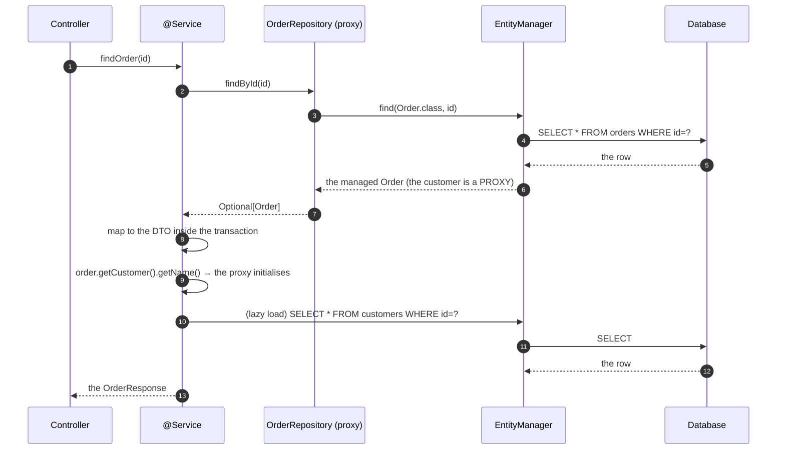
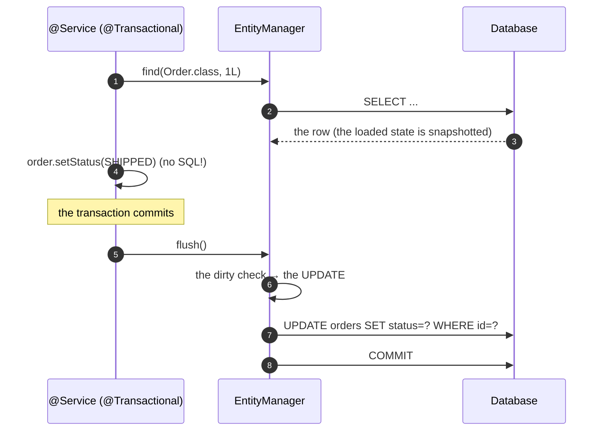

# 01 · ORM Theory & JPA Fundamentals

> **Level:** Beginner → Advanced
> **Interview Frequency:** ★★★★★ (Every backend interview asks at least one ORM question)
> **Prerequisite:** [03 · Spring MVC](../03-Spring-MVC/README.md)
> **Last Updated:** 2026

---

## 📋 Table of Contents
- [0. TL;DR — The 30-Second Answer](#0-tldr--the-30-second-answer)
- [1. What & Why](#1-what--why)
- [2. Mental Model — the ORM layer](#2-mental-model--the-orm-layer)
- [3. Deep Dive — Theory](#3-deep-dive--theory)
- [4. Internal Working Mechanism](#4-internal-working-mechanism)
- [5. Step-by-Step Execution Flow](#5-step-by-step-execution-flow)
- [6. Architecture Diagrams](#6-architecture-diagrams)
- [7. Production-Level Use Cases](#7-production-level-use-cases)
- [8. Code Examples — Production-Grade](#8-code-examples--production-grade)
- [9. Common Mistakes & Gotchas](#9-common-mistakes--gotchas)
- [10. Performance Considerations](#10-performance-considerations)
- [11. Security Considerations](#11-security-considerations)
- [12. Best Practices — The Checklist](#12-best-practices--the-checklist)
- [13. Hands-On Exercises](#13-hands-on-exercises)
- [14. Code Challenges](#14-code-challenges)
- [15. Scenario-Based Questions](#15-scenario-based-questions)
- [16. Interview Q&A — Level-wise](#16-interview-qa--level-wise)
- [17. Counter-Questions & Traps](#17-counter-questions--traps)
- [18. Tricky Interview Questions](#18-tricky-interview-questions)
- [19. Follow-Up Questions Asked by Interviewers](#19-follow-up-questions-asked-by-interviewers)
- [20. Real 3–5 Year Experience Scenarios](#20-real-35-year-experience-scenarios)
- [21. Frequently Asked Production Issues](#21-frequently-asked-production-issues)
- [22. Debugging Scenarios](#22-debugging-scenarios)
- [23. Architecture Design Questions](#23-architecture-design-questions)
- [24. Rapid-Fire MCQs](#24-rapid-fire-mcqs)
- [25. Cheat Sheet — One-Page Summary](#25-cheat-sheet--one-page-summary)
- [26. Real-World Production Notes](#26-real-world-production-notes)
- [27. Follow-up Learning](#27-follow-up-learning)

---

## 0. TL;DR — The 30-Second Answer

- **An ORM maps the object model to the relational model.** It removes the boilerplate of the
  CRUD, the SQL generation, the result-set mapping, and the identity management — at the cost of
  an abstraction you must understand to use it well.
- **The three levels:**
  - **JPA (Jakarta Persistence API)** — the **specification**: the annotations, the `EntityManager`,
    the JPQL, the Criteria API. `jakarta.persistence.*`.
  - **Hibernate** — the **implementation** (the most popular one; the de-facto reference).
  - **Spring Data JPA** — the **abstraction on top**: the repository interfaces, the query
    derivation, the paging, the specifications.
- **The core concepts:**
  - **The Entity** — a class mapped to a table (`@Entity`, `@Id`, `@Column`).
  - **The Persistence Context** — the in-memory object graph of a unit of work.
  - **The EntityManager** — the API for the persistence context (inside a transaction, it's
    thread-bound).
  - **The Unit of Work** — the pattern: everything is flushed and the changes are written at the
    **end of the transaction**.
  - **The Identity Map** — within a persistence context, two references to the same row are the
    **same object**.
  - **The Dirty Checking** — the ORM compares the state and issues the `UPDATE`s for you.
- **The fetch strategies:** `LAZY` (the default for the associations), `EAGER` (the default for
  `@ManyToOne`/`@OneToOne`), and the **N+1** problem.
- **`open-in-view`** — the Boot default is `false` and it should stay `false`: it holds the
  connection and the persistence context for the whole request.
- **The one-liner:** *"The ORM gives you the CRUD for free; what it doesn't give you is the
  **query design** — the N+1, the missing indexes, and the unbounded queries are all ORM
  problems, not SQL problems."*

---

## 1. What & Why

**The problem:** the impedance mismatch between the object model and the relational model.
- The **objects** are graphs (the references).
- The **tables** are sets of rows (the foreign keys).
- The objects have **behaviour**; the tables have **constraints**.

**The ORM's job:**
1. Map the classes to the tables (the metadata).
2. Generate the SQL (the `INSERT`, the `UPDATE`, the `DELETE`, the `SELECT`).
3. Map the result sets to the objects.
4. Manage the **identity** (the same row → the same object).
5. Manage the **transactions** and the **dirty checking**.
6. Manage the **lazy loading** (the transparent proxy).

**The trade-off:** the abstraction hides the SQL. When it goes wrong (the N+1, the missing
index), you need to see through it — that's what this chapter is for.

---

## 2. Mental Model — the ORM layer

```text
   ┌──────────────────────────────────────────────────────────────┐
   │  YOUR CODE                                                  │
   │    OrderRepository.findByCustomerId(id)                     │
   └───────────────────────────┬──────────────────────────────────┘
                               ▼
   ┌──────────────────────────────────────────────────────────────┐
   │  SPRING DATA JPA                                            │
   │    • the repository proxy                                    │
   │    • the query derivation (the method name → the JPQL/SQL)   │
   │    • the paging, the sorting, the Specifications             │
   └───────────────────────────┬──────────────────────────────────┘
                               ▼
   ┌──────────────────────────────────────────────────────────────┐
   │  JPA (the specification)                                    │
   │    EntityManager · PersistenceContext · JPQL · Criteria      │
   │    • the entity lifecycle callbacks                          │
   │    • the flush, the clear, the detach                        │
   └───────────────────────────┬──────────────────────────────────┘
                               ▼
   ┌──────────────────────────────────────────────────────────────┐
   │  HIBERNATE (the implementation)                             │
   │    • the metadata, the entity persister, the SQL AST         │
   │    • the proxies, the dirty checking, the 2nd-level cache    │
   │    • the query plan cache                                    │
   └───────────────────────────┬──────────────────────────────────┘
                               ▼
   ┌──────────────────────────────────────────────────────────────┐
   │  JDBC + HikariCP                                            │
   └───────────────────────────┬──────────────────────────────────┘
                               ▼
                        ┌─────────────┐
                        │   DATABASE   │
                        └─────────────┘
```

---

## 3. Deep Dive — Theory

### 3.1 The JPA specification vs Hibernate vs Spring Data

| Layer | What it gives you | The artifact |
|-------|-------------------|--------------|
| **JPA (Jakarta Persistence 3.1)** | The spec: the annotations, the `EntityManager`, the JPQL, the Criteria, the lifecycle, the transactions | `jakarta.persistence-api` |
| **Hibernate ORM 6.x** | The implementation (and more): the proxies, the 2nd-level cache, the `@Fetch`, the statement inspector | `hibernate-core` |
| **Spring Data JPA** | The repositories, the query derivation, the paging, the Specifications, the `@Query`, the projections, the auditing | `spring-data-jpa` |
| **Spring ORM** | The integration: the `JpaTransactionManager`, the `@Transactional`, the repository factory, the exception translation | `spring-orm` |

> **Boot 3 note:** the Jakarta namespace (`jakarta.persistence.*`, `jakarta.validation.*`,
> `jakarta.transaction.*`). Hibernate 6 supports Jakarta Persistence 3.1. Spring Boot 3.2 uses
> Hibernate 6.4.

### 3.2 The Entity — the mapping

```java
@Entity
@Table(name = "orders", indexes = {
        @Index(name = "idx_orders_customer_id", columnList = "customer_id"),
        @Index(name = "idx_orders_status", columnList = "status")
})
public class Order {

    @Id
    @GeneratedValue(strategy = GenerationType.IDENTITY)
    private Long id;

    @Column(nullable = false, length = 32, unique = true)
    private String orderNumber;

    @Enumerated(EnumType.STRING)
    @Column(nullable = false, length = 20)
    private OrderStatus status;

    @Column(nullable = false, precision = 19, scale = 2)
    private BigDecimal total;

    @Column(nullable = false, updatable = false)
    private Instant createdAt;

    @Version
    private Long version;

    @ManyToOne(fetch = FetchType.LAZY, optional = false)
    @JoinColumn(name = "customer_id", nullable = false)
    private Customer customer;
}
```

### 3.3 The identifier generation strategies

| Strategy | How it works | The pros | The cons |
|----------|--------------|----------|----------|
| **`IDENTITY`** | The DB's auto-increment; the `INSERT` is executed **immediately** to get the id | Simple, no extra round trip, the ids are sequential | The `INSERT` happens **before** the transaction commits (you can't batch it); the DB-specific; the id is burned on a rollback |
| **`SEQUENCE`** | A DB sequence (`nextval`); the id is fetched separately | The ids are fetched in **batches** (Hibernate's `allocationSize`); DB-portable | Needs a sequence to exist; the ids have gaps |
| **`TABLE`** | A table with a counter row | DB-portable | Horrible for the concurrency (the row lock) |
| **`AUTO`** | The provider's choice | — | **Non-deterministic** — never use it in production |

```java
@Id
@GeneratedValue(strategy = GenerationType.SEQUENCE, generator = "order_seq")
@SequenceGenerator(name = "order_seq", sequenceName = "order_id_seq", allocationSize = 50)
private Long id;
```

> **The `allocationSize`:** Hibernate fetches **50** ids at a time and uses them from the pool —
> one `nextval` per 50 inserts. The trade-off: the gaps (up to 50 ids are "lost" on a restart)
> vs the performance. Set it to **50** for a high-volume table (the default is 50 in Hibernate 6
> for the sequences, but the **default for the `@GeneratedValue` without a generator** is
> `allocationSize=50`).

### 3.4 The relationships

```java
// ── One-to-many (the parent → the children) ──────────────────────────
@Entity
public class Customer {

    @Id @GeneratedValue(strategy = GenerationType.IDENTITY)
    private Long id;

    @OneToMany(mappedBy = "customer", cascade = CascadeType.ALL, orphanRemoval = true)
    private List<Order> orders = new ArrayList<>();

    public void addOrder(Order order) {
        orders.add(order);
        order.setCustomer(this);
    }
}

// ── Many-to-one (the child → the parent) ─────────────────────────────
@Entity
public class Order {

    @ManyToOne(fetch = FetchType.LAZY, optional = false)
    @JoinColumn(name = "customer_id", nullable = false)
    private Customer customer;
}
```

| The relationship | The annotation | The owner | The FK |
|------------------|----------------|----------|--------|
| One-to-many | `@OneToMany(mappedBy = ...)` | The **many** side | On the many table |
| Many-to-one | `@ManyToOne` | The **many** side | On the many table |
| One-to-one | `@OneToOne` | The side with the FK | On the owner table |
| Many-to-many | `@ManyToMany` | Both (the join table) | The join table |
| One-to-one (the shared PK) | `@MapsId` | The dependent side | The **shared** PK |

### 3.5 The cascade rules

| `CascadeType` | The effect |
|---------------|-----------|
| `PERSIST` | The child is saved with the parent |
| `MERGE` | The child is merged with the parent |
| `REMOVE` | The child is deleted with the parent |
| `REFRESH` | The child's state is refreshed from the DB |
| `DETACH` | The child is detached with the parent |
| `ALL` | All of the above |
| `NONE` | Nothing (the default) |

```java
@OneToMany(mappedBy = "customer", cascade = CascadeType.ALL, orphanRemoval = true)
private List<Order> orders = new ArrayList<>();
```

> **`CascadeType.ALL` + `REMOVE` is the dangerous one:** deleting the parent silently deletes
> the children. In a production system, prefer an explicit **soft delete** or a **database
> constraint** with `ON DELETE RESTRICT` — and the cascade only for the `PERSIST`/`MERGE`/
> `REMOVE` where the ownership is genuinely aggregate-scoped.

> **`orphanRemoval = true`** means: removing a child from the collection **deletes** it from the
> DB. Without it, the child would be **orphaned** (its FK would be null or it would be deleted by
> the cascade anyway). It's a JPA-only concept (no SQL equivalent).

### 3.6 The fetch strategies

```java
@ManyToOne(fetch = FetchType.LAZY)     // the default for @ManyToOne
@ManyToOne(fetch = FetchType.EAGER)    // the default for @OneToOne
@ManyToMany(fetch = FetchType.LAZY)    // the default for @ManyToMany/@OneToMany
```

**The defaults (a classic trap):**
- `@ManyToOne` → **EAGER** by default.
- `@OneToOne` → **EAGER** by default.
- `@OneToMany` / `@ManyToMany` → **LAZY** by default.

> **The recommendation:** make **everything** `LAZY` explicitly. The eager `@ManyToOne` is the
> silent cause of the "one query per table" behaviour that surprises people. The eager
> `@ManyToOne` is also the reason a `findAll()` on a child table does a join with the parent.

### 3.7 The JPQL vs the native SQL

```java
// ── JPQL (the JPA query language) — the entity names, not the table names ──
@Query("select o from Order o where o.status = :status and o.total > :min")
List<Order> findByStatusAndTotalGreaterThan(@Param("status") OrderStatus status,
                                             @Param("min") BigDecimal min);

// ── The JPQL with a constructor (a DTO projection) ─────────────────────────
@Query("select new com.acme.dto.OrderSummary(o.id, o.orderNumber, o.status, o.total) " +
       "from Order o where o.customer.id = :customerId")
List<OrderSummary> findSummariesByCustomer(@Param("customerId") Long customerId);

// ── The native SQL ──────────────────────────────────────────────────────────
@Query(value = "select * from orders where created_at > :since", nativeQuery = true)
List<Order> findRecent(@Param("since") Instant since);
```

**JPQL vs HQL vs SQL:**

| | JPQL | HQL | SQL |
|---|---|---|---|
| **The standard** | ✅ (JPA) | ❌ (Hibernate) | ✅ |
| **The entities** | `from Order o` | `from Order o` | `from orders o` |
| **The columns** | `o.orderNumber` | `o.orderNumber` | `o.order_number` |
| **The polymorphism** | ✅ | ✅ | ❌ |
| **The database independence** | ✅ | ✅ | ❌ |

> **Use JPQL** (portable, understands the entity model). Use the **native SQL** only for the
> database-specific features (the window functions, the `INSERT ... ON CONFLICT`, the recursive
> CTEs) — and then you lose the portability and the automatic mapping (the native query returns
> the entities by matching the column names).

### 3.8 The Spring Data query derivation

```java
public interface OrderRepository extends JpaRepository<Order, Long> {

    // ── The derivation ────────────────────────────────────────────────────
    List<Order> findByStatus(OrderStatus status);
    List<Order> findByStatusAndTotalGreaterThan(OrderStatus status, BigDecimal min);
    List<Order> findByCustomerId(Long customerId);
    List<Order> findByCreatedAtBetween(Instant from, Instant to);
    List<Order> findByStatusIn(Collection<OrderStatus> statuses);
    List<Order> findTop10ByStatusOrderByCreatedAtDesc(OrderStatus status);
    List<Order> findByCustomerEmailIgnoreCase(String email);
    boolean existsByOrderNumber(String orderNumber);
    long countByStatus(OrderStatus status);
    Optional<Order> findFirstByOrderNumber(String orderNumber);
    void deleteByStatus(OrderStatus status);

    // ── The keywords ──────────────────────────────────────────────────────
    // And, Or, Not, Is, Equals, Between, LessThan, LessThanEqual,
    // GreaterThan, GreaterThanEqual, After, Before, In, NotIn, IgnoreCase,
    // True, False, Null, NotNull, First, Top, Distinct, Between, StartingWith,
    // EndingWith, Containing, Like, OrderBy, Top/First, IsBetween, ...
}
```

**The limits of the derivation:**
- It can't express a **join** (well, it can: `findByCustomerAddressCity` — but it generates a
  join, and the semantics get subtle).
- It can't express the **aggregations** (use `@Query`).
- It can't express the **dynamic** conditions (use the **Specifications** or the
  `JpaSpecificationExecutor`).

### 3.9 The Spring Data repository hierarchy

```java
public interface OrderRepository extends JpaRepository<Order, Long> {

    // The marker interface
    public interface OrderRepositoryCustom {
        List<Order> findComplex(OrderFilter filter);
    }

    // The fragment implementation (the "custom" part)
    class OrderRepositoryImpl implements OrderRepositoryCustom {
        private final EntityManager em;
        // ...
    }
}
```

**The `JpaRepository` hierarchy:**
```text
  PagingAndSortingRepository<T, ID>
      └── CrudRepository<T, ID>
              └── ListCrudRepository<T, ID>
                      └── ListPagingAndSortingRepository<T, ID>
                              └── JpaRepository<T, ID>
                                      ├── QueryByExampleExecutor<T>
                                      └── (your interface)
```

**The `JpaRepository` methods:**

| Method | What it does |
|--------|--------------|
| `save(T)` | Insert or update (it calls `persist` for a new id, `merge` for an existing one) |
| `findById(ID)` | `Optional<T>` |
| `findAll()` | `List<T>` |
| `findAll(Pageable)` | `Page<T>` |
| `findAll(Sort)` | `List<T>` |
| `existsById(ID)` | `boolean` |
| `count()` | `long` |
| `delete(T)` / `deleteById(ID)` / `deleteAll()` | The deletes |
| `flush()` | Force the flush of the pending changes |
| `saveAll(Iterable<T>)` | The batch save |
| `getOne(ID)` / `getById(ID)` | **Deprecated** — a proxy (an `EntityNotFoundException` on access) |

### 3.10 The `@Entity` lifecycle

```text
   ┌──────────┐   persist()    ┌────────────┐   flush()    ┌──────────┐
   │  NEW     │───────────────►│  MANAGED   │─────────────►│ PERSISTENT│
   │(transient)│                │ (in the PC)│              │(in the DB)│
   └──────────┘                └─────┬──────┘              └────┬─────┘
                                     │ remove()                  │ evict()
                                     ▼                           ▼
                               ┌──────────┐                ┌──────────┐
                               │  REMOVED │                │ DETACHED │
                               │(deleted) │                │          │
                               └──────────┘                └──────────┘
                                     │ evict()
                                     ▼
                               ┌──────────┐
                               │  NEW     │
                               └──────────┘
```

| The state | In the DB? | In the persistence context? | The dirty check? |
|-----------|-----------|-----------------------------|-----------------|
| **new / transient** | ❌ | ❌ | ❌ |
| **managed / persistent** | ✅ | ✅ | ✅ (auto-updated on the flush) |
| **removed** | ✅ (until the flush) | ✅ (scheduled for the delete) | — |
| **detached** | ✅ | ❌ | ❌ |

### 3.11 The persistence context — the Unit of Work

```java
@Transactional
public void transferMoney(Long fromId, Long toId, BigDecimal amount) {
    Account from = accountRepository.findById(fromId).orElseThrow();
    Account to = accountRepository.findById(toId).orElseThrow();

    from.debit(amount);
    to.credit(amount);

    // No explicit save() — the flush at the end of the transaction writes both.
}
```

**The four guarantees of the Unit of Work:**
1. **The Identity Map** — one row → one object per persistence context.
2. **The Dirty Checking** — the changed state is detected and written at the flush.
3. **The transactional write** — the changes are written at the commit.
4. **The deferred flush** — the SQL is issued at the flush/commit, not at the setter.

**The Identity Map in action:**
```java
Order a = orderRepository.findById(1L).orElseThrow();
Order b = orderRepository.findById(1L).orElseThrow();
System.out.println(a == b);   // true — the same object from the first-level cache
```

### 3.12 The dirty checking

```java
@Transactional
public void rename(Long id, String newName) {
    Order order = orderRepository.findById(id).orElseThrow();
    order.setOrderNumber(newName);
    // The UPDATE is issued at the flush — no save() call needed
}
```

> **The dirty checking requires the entity to be **managed**.** If the entity is **detached**
> (it came from a different transaction, or it was serialized), the changes are **not** persisted
> — you need `save()` (a `merge`).

### 3.13 The `flush` vs the `commit`

```text
  persist()  → the entity enters the PC (the ID is assigned for the IDENTITY strategy)
  flush()    → the SQL is issued NOW (the INSERTs, the UPDATEs, the DELETEs are executed)
              → but the transaction is still open (the changes can still be rolled back)
  commit()   → the flush happens (if not already) + the transaction commits
  clear()    → the PC is cleared (all the managed entities become detached)
  detach(e) → one entity is detached
```

**Why does `flush()` matter?**
1. To get the **generated keys** (the `IDENTITY` strategy generates them at the insert).
2. To **see the changes** in a subsequent native query (the native query doesn't see the pending
   changes unless you flush).
3. To force the **constraint violations** early (a better error message, at the right place).
4. Before a **bulk operation** (a bulk JPQL update doesn't trigger the flush automatically).

### 3.14 The `open-in-view` — the Boot default is `false`

```properties
spring.jpa.open-in-view=false
```

**What it does:** when `true` (the old default), the `OpenEntityManagerInViewInterceptor` keeps
the persistence context open for the **whole HTTP request** — so the lazy loading works during
the JSON serialisation.

**Why `false` is right:**
1. **The connection is held** for the whole request (the pool exhaustion).
2. **The N+1 is hidden** — it happens during the serialisation, invisible in the code.
3. **The transaction boundary is violated** — the lazy loading happens outside the transaction
   (which works only because the context is still open — a fragile design).
4. **The view layer is coupled to the persistence layer** — the DTOs should be built inside the
   service.

> **The migration pain:** turning it off breaks the code that relied on the lazy loading during
> the serialisation → `LazyInitializationException`. The fix: map to a DTO **inside** the
> `@Transactional(readOnly = true)` service method.

---

## 4. Internal Working Mechanism

### 4.1 The `EntityManager` — the JPA API

```java
@PersistenceContext
private EntityManager entityManager;

Order order = entityManager.find(Order.class, 1L);
entityManager.persist(order);
entityManager.merge(order);
entityManager.remove(order);
entityManager.flush();
entityManager.clear();
entityManager.detach(order);
entityManager.lock(order, LockModeType.PESSIMISTIC_WRITE);
```

**The `EntityManager` inside a transaction is a **proxy** to the "real" one — the
`SharedEntityManagerCreator` delegates to the `EntityManager` bound to the current transaction
(by the `TransactionSynchronizationManager`). Outside a transaction, each call gets a **new**
`EntityManager` (and a new persistence context) — which is why the lazy loading fails outside a
transaction.

### 4.2 The Spring Data repository proxy

```java
// SimpleJpaRepository implements JpaRepository
public class SimpleJpaRepository<T, ID> implements JpaRepository<T, ID> {

    private final EntityManager entityManager;
    private final JpaEntityInformation<T, ID> entityInformation;
    private final JpaMetamodelEntityInformation<T, ID> metamodelEntityInformation;

    @Override
    public Optional<T> findById(ID id) {
        Assert.notNull(id, "The id must not be null");
        return findById(id, Sort.unsorted());   // → entityManager.find()
    }
    ...
}
```

**The proxy:** the `RepositoryFactoryBean` creates a JDK dynamic proxy that intercepts the calls
and routes them to the `SimpleJpaRepository` implementation or to the **query method** execution
(`QueryExecutor` → the `JpaQueryCreator` → the JPQL → the `Query` → the execution).

### 4.3 The query derivation — `PartTree`

```text
  findByStatusAndTotalGreaterThanOrderByCreatedAtDesc
  │     │    │   │    │                │        │
  │     │    │   │    │                │        └── "Desc"
  │     │    │   │    │                └── "OrderByCreatedAt"
  │     │    │   │    └── "TotalGreaterThan"
  │     │    │   └── "And"
  │     │    └── "Status"
  │     └── "By"
  └── "find"
```

**The `PartTree` parser:**
```java
TreeParser<String> parser = new TreeParser<>(new PartTreeSource(...),
        OrderBySource::parse);   // → a JpaQueryCreator
```

**The `JpaQueryCreator` → the criteria → the JPQL:**
```java
// The PartTree → the Criteria → the TypedQuery
protected TypedQuery<X> createQuery(@Nullable Sort sort) {
    CriteriaBuilder builder = entityManager.getCriteriaBuilder();
    CriteriaQuery<X> query = builder.createQuery(domainClass);
    Root<U> root = applySpecificationToCriteria(query, domainClass, root);
    query.select(root);
    if (sort.isSorted()) {
        query.orderBy(toOrders(sort, root, builder));
    }
    return applyRepositoryMethodMetadata(entityManager.createQuery(query));
}
```

### 4.4 The Hibernate session = the persistence context

```text
  EntityManager (JPA)
      │  (Hibernate's implementation)
      ▼
  Session (Hibernate)
      │
      ├─ the persistence context (the entity entries)
      ├─ the action queue (the pending INSERT/UPDATE/DELETE)
      ├─ the event listeners (the flush)
      └─ the interceptors
```

**The `SessionImpl`'s internals:**
```text
  persistenceContext
    ├─ entitiesByKey (the identity map: the entity key → the entity)
    ├─ entitiesWithAddedToActionQueue
    ├─ collectionEntries
    ├─ nullabilityTransientEntities
    └─ the interceptor (the "dirty" tracking)
```

### 4.5 The flush — the algorithm

```text
  flush()
    │
    ├─ ① The dirty check: compare the loaded state with the current state
    │      → the "property" snapshots (the loaded state is stored in the entity entry)
    ├─ ② The action queue: the ordered actions
    │      → the collection actions → the orphan removals → the entity inserts
    │      → the updates → the the collection recreations → the deletes
    ├─ ③ The SQL generation (the per-action)
    │      → the SQL AST → the JDBC → the PreparedStatement
    └─ ④ The post-insert callbacks (the @Version, the @PostPersist)
```

**The dirty check's snapshot:** when the entity is loaded, Hibernate stores the **loaded state**
in the `EntityEntry`. At the flush, it compares (via the dirty tracker or the bytecode enhancement)
→ the changed properties → the `UPDATE`.

### 4.6 The Hibernate proxies — the lazy loading

```java
Customer customer = order.getCustomer();     // a proxy (a subclass of Customer)
String name = customer.getName();            // the proxy initialises on the getter
```

**The proxy mechanics:**
- Hibernate creates a **runtime subclass** (via a bytecode generator) of the entity class.
- The proxy holds the **id** and a reference to the `Session`.
- On the **first method call** (that isn't a getter of the id), it **initialises** — it loads the
  entity from the DB (a `SELECT`).
- If the entity doesn't exist → a `EntityNotFoundException`.

**The gotchas:**
- The proxy is only for the **entity classes** (not the final ones — a `final` class can't be
  proxied!); the entity class **can't be final** and the lazy getter **can't be final**.
- `equals()`/`hashCode()` on a proxy can trigger the initialisation (a surprise query).
- The proxy is **bound to the session** — using it outside the session → a `LazyInitializationException`.

### 4.7 The `EntityManagerFactory` and the `SessionFactory`

```text
  Spring Boot
      │
      ├─ LocalContainerEntityManagerFactoryBean
      │     └─ HibernateJpaVendorAdapter
      │           └─ EntityManagerFactory
      │                 └─ SessionFactory
      │                       └─ the metadata (the mappings, the queries, the entity persister)
      │
      └─ the EntityManager beans (the @PersistenceContext)
```

**The metadata is built at startup** — the annotations are parsed, the entity persister is built,
the queries are validated (a JPQL error fails the **startup**, not the runtime!). That's a big
benefit: `spring.jpa.properties.hibernate.hbm2ddl.auto=validate` (the default in Boot) checks the
schema at startup.

---

## 5. Step-by-Step Execution Flow

### 5.1 A read with a lazy association



### 5.2 A write with the dirty checking



---

## 6. Architecture Diagrams

### 6.1 The layers of the persistence

```text
┌──────────────────────────────────────────────────────────────────────────┐
│  REPOSITORY LAYER — the Spring Data interfaces                          │
│    the derived queries, the @Query, the Specifications, the projections  │
├──────────────────────────────────────────────────────────────────────────┤
│  SERVICE LAYER — the @Transactional boundary                            │
│    the transaction starts HERE and ends HERE                             │
│    the DTO mapping happens HERE (inside the transaction)                 │
├──────────────────────────────────────────────────────────────────────────┤
│  PERSISTENCE CONTEXT — the Unit of Work                                  │
│    the identity map, the dirty checking, the deferred flush              │
│    the first-level cache (the session cache)                             │
├──────────────────────────────────────────────────────────────────────────┤
│  HIBERNATE — the SQL generation, the proxies, the 2nd-level cache        │
├──────────────────────────────────────────────────────────────────────────┤
│  JDBC + HIKARICP — the connection pool                                  │
├──────────────────────────────────────────────────────────────────────────┤
│  DATABASE                                                                │
└──────────────────────────────────────────────────────────────────────────┘
```

### 6.2 The transaction boundary — where it goes

```text
  ❌ WRONG                                  ✅ RIGHT
  ──────────────────────────────────────    ──────────────────────────────────────
  @Transactional on the controller          @Transactional on the service

  Controller                                Controller
    └─► Service                               └─► Service
          └─► Repository                            └─► Repository
                                                 ← the transaction ends here
  The tx spans the serialisation!           The DTO is built inside the tx
  The connection is held during             The connection is released
    the JSON serialisation                   before the serialisation
```

### 6.3 The N+1 — visualised

```text
  findAll() on 100 orders:
    SELECT * FROM orders;          -- 1 query

  Then, for each order, the customer is touched:
    SELECT * FROM customers WHERE id=1;   -- query 2
    SELECT * FROM customers WHERE id=2;   -- query 3
    SELECT * FROM customers WHERE id=3;   -- query 4
    ... 100 queries

  TOTAL: 101 queries for 100 rows.

  WITH A JOIN FETCH:
    SELECT o.*, c.* FROM orders o JOIN customers c ON o.customer_id = c.id;   -- 1 query

  TOTAL: 1 query.
```

---

## 7. Production-Level Use Cases

| Use case | The pattern |
|----------|-------------|
| **A CRUD service** | The repository + the DTO mapping inside a `@Transactional(readOnly = true)` service |
| **A read-heavy list endpoint** | A **DTO projection** query (`select new Dto(...)`) — one query, no entities |
| **A search with the filters** | The **Specifications** (the dynamic criteria) |
| **A bulk update** | A `@Modifying` JPQL update — with the **caveats** (the bulk cache invalidation, the managed entities) |
| **A report** | A **native query** with the database-specific features, mapped to a projection |
| **A soft delete** | A `deletedAt` field + a `@Where`/`@SQLRestriction` + a `@SQLDelete` |
| **A multi-tenant model** | A shared table with a `tenant_id` + a Hibernate filter (or an explicit predicate) |
| **The optimistic locking** | The `@Version` field + a retry on the `OptimisticLockingFailureException` |
| **The auditing** | `@CreatedDate`/`@LastModifiedDate` with `@EnableJpaAuditing` |
| **The soft delete + the unique constraint** | A partial unique index (the DB) — the `deletedAt` in the predicate |

---

## 8. Code Examples — Production-Grade

### 8.1 The entity with the auditing and the soft delete

```java
@Entity
@Table(name = "orders", indexes = {
        @Index(name = "idx_orders_customer_created", columnList = "customer_id, created_at"),
        @Index(name = "idx_orders_status", columnList = "status")
})
public class Order {

    @Id
    @GeneratedValue(strategy = GenerationType.IDENTITY)
    private Long id;

    @Column(name = "order_number", nullable = false, length = 32, unique = true)
    private String orderNumber;

    @Enumerated(EnumType.STRING)
    @Column(nullable = false, length = 20)
    private OrderStatus status;

    @Column(name = "total_amount", nullable = false, precision = 19, scale = 2)
    private BigDecimal total;

    @Column(name = "currency", nullable = false, length = 3)
    private String currency;

    @ManyToOne(fetch = FetchType.LAZY, optional = false)
    @JoinColumn(name = "customer_id", nullable = false)
    private Customer customer;

    @OneToMany(mappedBy = "order", cascade = CascadeType.ALL, orphanRemoval = true)
    private List<OrderLine> lines = new ArrayList<>();

    @Version
    @Column(nullable = false)
    private Long version;

    @CreatedDate
    @Column(name = "created_at", nullable = false, updatable = false)
    private Instant createdAt;

    @LastModifiedDate
    @Column(name = "updated_at", nullable = false)
    private Instant updatedAt;

    @CreatedBy
    @Column(name = "created_by", updatable = false, length = 64)
    private String createdBy;

    @Column(name = "deleted_at")
    private Instant deletedAt;

    protected Order() { }   // the JPA constructor

    public Order(String orderNumber, Customer customer, BigDecimal total, String currency) {
        this.orderNumber = orderNumber;
        this.customer = customer;
        this.total = total;
        this.currency = currency;
        this.status = OrderStatus.CREATED;
    }

    // The behaviour, not just the getters
    public void ship() {
        if (this.status != OrderStatus.PAID) {
            throw new IllegalStateException("Only a paid order can be shipped");
        }
        this.status = OrderStatus.SHIPPED;
    }

    public void cancel() {
        if (this.status == OrderStatus.SHIPPED) {
            throw new IllegalStateException("A shipped order cannot be cancelled");
        }
        this.status = OrderStatus.CANCELLED;
    }

    public void addLine(OrderLine line) {
        lines.add(line);
        line.setOrder(this);
    }
}
```

### 8.2 The repository

```java
public interface OrderRepository extends JpaRepository<Order, Long>,
                                     JpaSpecificationExecutor<Order> {

    Optional<Order> findByOrderNumber(String orderNumber);

    boolean existsByOrderNumber(String orderNumber);

    @Query("""
           select new com.acme.dto.OrderSummary(o.id, o.orderNumber, o.status, o.total, o.currency)
           from Order o
           where o.customer.id = :customerId and o.deletedAt is null
           order by o.createdAt desc
           """)
    List<OrderSummary> findSummariesByCustomerId(@Param("customerId") Long customerId,
                                                  Pageable pageable);

    @Query("""
           select o from Order o
           join fetch o.customer
           left join fetch o.lines
           where o.id = :id
           """)
    Optional<Order> findByIdWithDetails(@Param("id") Long id);

    @Modifying(clearAutomatically = true, flushAutomatically = true)
    @Query("update Order o set o.status = :status, o.updatedAt = CURRENT_TIMESTAMP " +
           "where o.id in :ids and o.status = :expectedStatus")
    int bulkUpdateStatus(@Param("ids") Collection<Long> ids,
                         @Param("status") OrderStatus status,
                         @Param("expectedStatus") OrderStatus expectedStatus);

    @Query("select count(o) from Order o where o.customer.id = :customerId and o.status = :status")
    long countByCustomerAndStatus(@Param("customerId") Long customerId,
                                   @Param("status") OrderStatus status);
}
```

### 8.3 The service — the transaction boundary and the DTO mapping

```java
@Service
@RequiredArgsConstructor
@Slf4j
public class OrderService {

    private final OrderRepository orderRepository;
    private final OrderMapper mapper;

    @Transactional(readOnly = true)
    public OrderResponse getById(Long id) {
        Order order = orderRepository.findByIdWithDetails(id)
                .orElseThrow(() -> new OrderNotFoundException(id));
        return mapper.toResponse(order);           // inside the transaction!
    }

    @Transactional(readOnly = true)
    public Page<OrderSummary> listByCustomer(Long customerId, Pageable pageable) {
        return orderRepository.findSummariesByCustomerId(customerId, pageable)
                .map(mapper::toSummary);
    }

    @Transactional
    public OrderResponse create(CreateOrderCommand command) {
        if (orderRepository.existsByOrderNumber(command.orderNumber())) {
            throw new DuplicateOrderNumberException(command.orderNumber());
        }
        Customer customer = customerRepository.getReferenceById(command.customerId());
        Order order = new Order(command.orderNumber(), customer, command.total(), command.currency());
        command.lines().forEach(l -> order.addLine(new OrderLine(l.productId(), l.quantity(), l.unitPrice())));
        Order saved = orderRepository.save(order);
        return mapper.toResponse(saved);
    }

    @Transactional
    public OrderResponse ship(Long id) {
        Order order = orderRepository.findById(id)
                .orElseThrow(() -> new OrderNotFoundException(id));
        order.ship();                     // the domain rule → an IllegalStateException
        return mapper.toResponse(order);
    }

    @Transactional
    public void cancel(Long id) {
        Order order = orderRepository.findById(id)
                .orElseThrow(() -> new OrderNotFoundException(id));
        order.cancel();
    }
}
```

### 8.4 The Specifications — the dynamic filters

```java
public class OrderSpecifications {

    public static Specification<Order> hasStatus(OrderStatus status) {
        return (root, query, cb) -> cb.equal(root.get("status"), status);
    }

    public static Specification<Order> hasCustomer(Long customerId) {
        return (root, query, cb) -> cb.equal(root.get("customer").get("id"), customerId);
    }

    public static Specification<Order> createdAfter(Instant from) {
        return (root, query, cb) -> cb.greaterThanOrEqualTo(root.get("createdAt"), from);
    }

    public static Specification<Order> notDeleted() {
        return (root, query, cb) -> cb.isNull(root.get("deletedAt"));
    }

    public static Specification<Order> withTotalGreaterThan(BigDecimal min) {
        return (root, query, cb) -> cb.greaterThan(root.get("total"), min);
    }
}
```

```java
@Transactional(readOnly = true)
public Page<OrderSummary> search(OrderFilter filter, Pageable pageable) {
    Specification<Order> spec = Specification.where(OrderSpecifications.notDeleted())
            .and(OrderSpecifications.hasCustomer(filter.customerId()))
            .and(filter.status() != null ? OrderSpecifications.hasStatus(filter.status()) : null)
            .and(filter.from() != null ? OrderSpecifications.createdAfter(filter.from()) : null);

    return orderRepository.findAll(spec, pageable).map(mapper::toSummary);
}
```

### 8.5 The projections

```java
// ── ① The interface projection (a proxy — the "open" projection) ─────────
public interface OrderSummaryView {
    Long getId();
    String getOrderNumber();
    OrderStatus getStatus();
    BigDecimal getTotal();
}

// ── ② The DTO projection (the constructor expression — the "closed" projection) ──
public record OrderSummary(Long id, String orderNumber, OrderStatus status,
                            BigDecimal total, String currency) { }

// ── ③ The usage ────────────────────────────────────────────────────────────
@Query("select o.id as id, o.orderNumber as orderNumber, o.status as status, o.total as total " +
       "from Order o where o.customer.id = :customerId")
List<OrderSummaryView> findViewsByCustomer(@Param("customerId") Long customerId);
```

> **The interface projection** creates a **dynamic proxy** — the property access triggers a
> **lazy query per property** (an N+1 in disguise!). Use it only for a **single, flat** entity
> (or with a join fetch). The **DTO projection** (`select new Dto(...)`) is one query, no proxies
> — it's the safe choice.

### 8.6 The optimistic locking with the retry

```java
@Service
@RequiredArgsConstructor
public class OrderService {

    private final OrderRepository orderRepository;
    private final RetryTemplate retryTemplate;

    @Transactional
    public OrderResponse updateStatus(Long id, OrderStatus status) {
        Order order = orderRepository.findById(id)
                .orElseThrow(() -> new OrderNotFoundException(id));
        order.changeStatus(status);
        return mapper.toResponse(order);
    }
}
```

```java
@Bean
RetryTemplate retryTemplate(RetryInterceptor retryInterceptor) {
    return RetryTemplate.builder()
            .maxAttempts(3)
            .exponentialBackoff(Duration.ofMillis(50), 2.0, Duration.ofSeconds(1))
            .retryOn(OptimisticLockingFailureException.class)
            .build();
}
```

> **The retry must be in a NEW transaction** — the failed transaction is rolled back and can't
> be reused. The `RetryTemplate` + the `@Retryable` (Spring Retry) handle it if the retry is
> **outside** the transactional method (e.g. on the calling service).

### 8.7 The auditing

```java
@Configuration
@EnableJpaAuditing(auditorAwareRef = "auditorProvider")
public class JpaAuditingConfig {

    @Bean
    AuditorAware<String> auditorProvider() {
        return () -> {
            Authentication auth = SecurityContextHolder.getContext().getAuthentication();
            if (auth == null || !auth.isAuthenticated()) return "system";
            return auth.getName();
        };
    }
}
```

### 8.8 The `application.yml` for the JPA

```yaml
spring:
  datasource:
    url: jdbc:postgresql://localhost:5432/orders
    username: ${DB_USER}
    password: ${DB_PASSWORD}
    hikari:
      maximum-pool-size: 20
      minimum-idle: 5
      connection-timeout: 30000
      idle-timeout: 600000
      max-lifetime: 1800000
      leak-detection-threshold: 60000     # log the long-held connections
      pool-name: orders-pool
  jpa:
    open-in-view: false                  # ✓ always
    show-sql: false
    properties:
      hibernate:
        format_sql: false
        jdbc:
          batch_size: 50                 # the JDBC batching
          time_zone: UTC
        order_inserts: true              # group the inserts by type
        order_updates: true
        query:
          in_clause_parameter_padding: true
        generate_statistics: false
  jpa.properties.hibernate.dialect: org.hibernate.dialect.PostgreSQLDialect
```

---

## 9. Common Mistakes & Gotchas

| # | ❌ Wrong | ✅ Right | Why |
|---|----------|----------|-----|
| 1 | `open-in-view=true` | `false` | The connection is held; the N+1 is hidden |
| 2 | The lazy loading outside the transaction | Map to a DTO inside the service | `LazyInitializationException` |
| 3 | The `@ManyToOne` left eager | `fetch = LAZY` explicitly | The silent join |
| 4 | The `save()` on a detached entity | `merge` (the `save` does it) | The detached changes are lost |
| 5 | The N+1 in the list endpoint | A join fetch / a DTO projection | 101 queries |
| 6 | The `findAll()` with no pagination | `Pageable` with a capped size | The memory blow-up |
| 7 | The `@Modifying` without `clearAutomatically` | `clearAutomatically = true, flushAutomatically = true` | The stale first-level cache |
| 8 | The native query without a flush | `flushAutomatically = true` | The native query doesn't see the pending changes |
| 9 | The `@Column` without a `nullable=false` | Set it | The DB constraint is the truth |
| 10 | The entity with a `public` no-arg constructor + the setters | The protected constructor + the behaviour methods | The encapsulation; the anemic domain model |
| 11 | The `Optional<T>` for the entity's field | The direct reference | The `Optional` as a field is a JPA anti-pattern |
| 12 | The `BigDecimal` with a double arithmetic | `BigDecimal` with the scale and the rounding | The precision |
| 13 | The `equals`/`hashCode` on the JPA entity | The business key or the id with the `getClass()` check | The proxy's `equals` triggers the lazy load; the hash changes on the persist |
| 14 | The `final` entity class | Not final | It can't be proxied |
| 15 | The `long` transaction (the I/O inside it) | Keep the transaction short | The connection is held during the HTTP call |
| 16 | The `deleteAll()` in a loop | A bulk delete | N queries |
| 17 | The `save()` in a loop | `saveAll()` | N inserts (without the batching) |
| 18 | The cascade `REMOVE` on a big tree | A soft delete or `ON DELETE RESTRICT` | The accidental data loss |
| 19 | The `System.currentTimeMillis()` in the entity | The auditing (`@CreatedDate`) | The testability and the clock |
| 20 | The `orderRepository.findById(id).get()` | `orElseThrow(...)` | The `NoSuchElementException` |

---

## 10. Performance Considerations

| Aspect | Impact | Guidance |
|--------|--------|----------|
| **The N+1** | 1 → N queries | The join fetch / the DTO projection / `@BatchSize` |
| **The `open-in-view`** | The connection held for the request | `false` |
| **The unbounded `findAll()`** | The heap | Always paginate |
| **The `count(*)`** | Expensive on a big table | The keyset pagination; a skip the count |
| **The JDBC batching** | The round trips | `hibernate.jdbc.batch_size=50` + `order_inserts=true` + `saveAll` |
| **The projections** | Only the needed columns | The DTO projection |
| **The indexes** | The query plan | The `@Index` on the filtered/sorted columns; the composite index |
| **The `LAZY` vs `EAGER`** | The query count | Lazy + an explicit fetch |
| **The connection pool** | The throughput | HikariCP: the size ≈ the CPU cores × 2 + the spindles (for a DB-bound app) |
| **The transaction duration** | The lock holding | Keep it short; no I/O inside |
| **The `existsBy...` check** | An extra query | Accept it, or rely on the DB constraint |
| **The pagination's `offset`** | The deep pages get slow | The keyset pagination |
| **The `@Version`** | An extra column + the check | Cheap; keep it |

---

## 11. Security Considerations

| Risk | Mitigation |
|------|-----------|
| **The mass assignment** | Never bind the HTTP body to an entity; use a DTO |
| **The SQL injection via the JPQL** | The JPQL is parameterised; but the **native query** with a string concatenation is not |
| **The SQL injection via the sort/filter** | The allow-list (Spring Data's `Sort` is **not** validated by default!) |
| **The data leak via the eager join** | The eager `@ManyToOne` can pull in the rows the user shouldn't see |
| **The multi-tenant leak** | The tenant predicate on every query; the repository-level enforcement |
| **The PII in the logs** | The SQL logging can print the parameters — disable it in production |
| **The soft-delete bypass** | The `deletedAt` predicate must be on **every** query (a `@SQLRestriction` in Hibernate 6.4+) |
| **The mass deletion** | The `@Modifying` bulk operations must have a `WHERE` clause |

---

## 12. Best Practices — The Checklist

- [ ] **`open-in-view=false`** — always.
- [ ] **The DTO mapping inside the `@Transactional` service.**
- [ ] **Everything `LAZY`** explicitly.
- [ ] **The DTO projections** for the read endpoints (one query, no entities).
- [ ] **The pagination** everywhere, with a capped page size.
- [ ] **The allow-list** for the sort and the filter fields.
- [ ] **The `@Version`** for the optimistic locking.
- [ ] **The transactions** short; no I/O inside.
- [ ] **The `readOnly = true`** for the read transactions (the Hibernate optimisation: no dirty
      checking, no flush).
- [ ] **The auditing** (`@CreatedDate`) instead of the manual timestamps.
- [ ] **The indexes** on the filtered and the sorted columns.
- [ ] **The JDBC batching** for the bulk writes.
- [ ] **The explicit `nullable`/`length`** on the `@Column`s (the DB is the truth).
- [ ] **The entity with the behaviour** (not an anemic data holder).

---

## 13. Hands-On Exercises

**🧪 Lab 1 — The N+1, measured**
1. Create a `Customer` with 100 `Order`s.
2. Write a `findAll()` + a loop that touches `order.getCustomer().getName()`.
3. Enable the SQL logging and count the queries.
4. Fix it with a DTO projection and count again.

**✅ Success signal:** 101 → 1.

**🧪 Lab 2 — The `open-in-view`**
1. Set `open-in-view=true`, return the entities from the controller, and see it work.
2. Set it to `false` → the `LazyInitializationException`.
3. Fix it by mapping to the DTO inside the service.

**🧪 Lab 3 — The dirty checking**
1. In a `@Transactional` method, load an entity and change a field. **Don't** call `save()`.
2. Check the SQL — the `UPDATE` is issued at the commit.
3. Do the same **outside** a transaction → no `UPDATE`.

**🧪 Lab 4 — The `@Modifying` staleness**
1. Load an entity, then run a bulk `@Modifying` query, then re-read the entity → the **stale**
   value (the first-level cache).
2. Add `clearAutomatically = true` → fixed.

---

## 14. Code Challenges

### Challenge 1 — A multi-tenant repository (hard)
**Goal:** Every query is automatically scoped to the current tenant.
**Requirements:**
- a `tenant_id` column on every table,
- the tenant resolved from the security context,
- the enforcement at the repository level (not the call site),
- a **test** that proves the isolation (two tenants, one JVM).

**Hints:** a Hibernate `@Filter` with a `TenantContext`, or the Spring Data's base repository
with the tenant in the criteria.

### Challenge 2 — A paged list without the N+1 (medium)
**Goal:** A list endpoint that returns 50 orders with their customer and their lines, in **one**
query, with the total count optional.
**Requirements:** the DTO projection, the keyset pagination option, and the benchmark.

### Challenge 3 — The soft delete with the unique constraint (hard)
**Goal:** A soft delete that still allows a re-creation (the same email/order number).
**Requirements:** a partial unique index (`WHERE deleted_at IS NULL`), a `@SQLRestriction` (or a
`@Where`), the repository that excludes the deleted, and the **restore** operation.

---

## 15. Scenario-Based Questions

**S1.** *"The list endpoint became slow after we added a field to the entity. It used to be 50
ms."*
>
> **Ideal answer:** (1) **Measure**: the SQL log / the APM trace. The likely cause: the new
> field is a **relation** (a `@ManyToOne`) that is **eager** by default → the query now joins
> the new table. Or the new field is in the **select clause** and the entity grew (the
> serialisation). Or the **index** was broken by the new column. (2) **Isolate**: (a) look at
> the generated SQL (is there a new JOIN?); (b) run the query in the DB with `EXPLAIN ANALYZE` —
> has the plan changed (a seq scan instead of an index scan)?; (c) compare the row counts.
> (3) **Fix** by the cause: (a) make the relation **lazy** and add an explicit fetch where
> needed; (b) use a **DTO projection** so the extra field isn't loaded if it isn't needed; (c)
> add/repair the index; (d) check the **plan** (the statistics — `ANALYZE`, or a new column makes
> the stats stale). (4) **Prevent**: (a) the **query count assertions** in the integration tests
> (a Hibernate statistics-based test — `sessionFactory.getStatistics().getQueryExecutionCount()`);
> (b) the **performance budgets** in CI (a load test asserting the p95); (c) the **DTO
> projections** by default for the read endpoints; (d) the **code review** rule — "no eager
> associations". (5) The senior framing: "the ORM's defaults are the trap — a new relation is
> eager by default, so a small mapping change can silently multiply the query cost. The defence
> is the **explicit laziness** and the **query-count test**."

**S2.** *"We're getting 'could not execute statement' / 'too many connections' in production
under load."*
>
> **Ideal answer:** (1) **Diagnose**: (a) the **pool metrics** — the active/pending/idle counts
> (the Hikari's `hikaricp.connections.*` metrics); (b) the **DB** — the `pg_stat_activity`
> (the idle-in-transaction sessions, the long-running queries); (c) the **leak detection** —
> Hikari's `leak-detection-threshold` logs the stack trace of a connection held for too long.
> (2) **The usual causes**: (a) the **pool is too small** for the concurrency (the DB's
> `max_connections` vs the instances × the pool size — the classic: 10 pods × 20 = 200
> connections > Postgres's 100 default!); (b) the **connections are held too long** — the
> `open-in-view=true` (the connection is held during the serialisation), a long transaction, the
> I/O inside a transaction; (c) the **leak** — a connection not returned (a missing
> `finally`, an exception in a manual JDBC path); (d) the **slow queries** holding the
> connections (the N+1, the missing index); (e) the **DB's bottleneck** (a lock, a slow query
> blocking everything). (3) **Fix**: (a) size the pool: the total (instances × the pool) must be
> below the DB's limit — and use a **connection pooler** (PgBouncer) if you can't; (b) the
> `open-in-view=false`, the short transactions, no I/O inside; (c) the leak detection in the
> non-prod; (d) the query optimisation; (e) the DB tuning (`statement_timeout`,
> `lock_timeout`) + the **query timeouts** in the app (`spring.jpa.properties.jakarta.persistence.query.timeout`).
> (4) **Prevent**: the **pool metrics** dashboard, the **alert** on the pending connections, the
> **DB connection budget** in the deployment (a documented formula), the load tests with the
> production-like pool sizes. (5) The senior framing: "the connection pool is the **shared
> resource** — its sizing is a **fleet-wide** decision, not a per-service one. The formula:
> `the total pool ≤ the DB's max_connections - the headroom`, and the DB is usually the first
> bottleneck, not the app."

**S3.** *"We added a column to a table and the deploy failed with a schema validation error. How
do you handle schema changes in production?"**
>
> **Ideal answer:** (1) **The rule**: the app and the schema must be **compatible in both
> directions** during the rollout — the **expand-and-contract** pattern. (2) **Expand**:
> (a) add the **nullable** column (or with a default that doesn't rewrite the table — in
> Postgres, `ADD COLUMN ... DEFAULT` is fast since 11); (b) **deploy** the app version that
> reads it defensively (the new column nullable → the old rows have `null`); (c) backfill the
> data (a background job, in batches, with the rate limiting); (d) deploy the app version that
> writes it. (3) **Contract** (after everything is migrated and the old version is gone):
> (a) make the column `NOT NULL` (with a validated constraint: `ADD CONSTRAINT ... NOT VALID`
> then `VALIDATE CONSTRAINT` — this avoids the long lock); (b) drop the old column. (4) **The
> tooling**: **Liquibase** or **Flyway** — the migrations are **versioned**, **immutable** (never
> edit an applied migration!), and run by a **separate step** (not by the app on startup — the
> classic "multiple instances racing on the migration" problem). (5) **The validation**: the
> `hibernate.hbm2ddl.auto=validate` (the Boot default) checks the schema at startup — it
> catches the mismatch, but it means a **failed deploy**; the better practice is to run the
> migration **before** the deploy (a CI/CD step). (6) **The lock risk**: the DDL in Postgres takes
> an `ACCESS EXCLUSIVE` lock — use `CONCURRENTLY` for the index creation (outside a transaction!)
> and the `NOT VALID` trick for the constraints. (7) The senior framing: "the schema change is a
> **multi-step, multi-deploy** operation — the migration is not 'part of the deploy', it's a
> separate, carefully orchestrated step. The `validate` on the startup is a **safety net**, not a
> strategy."

---

## 16. Interview Q&A — Level-wise

### 🟢 Beginner
**Q: What is an ORM and what does it give me?**
**A:** An ORM maps the object model to the relational model. It gives you: the entity mapping
(annotations), the CRUD without the SQL, the identity management (the same row → the same
object), the dirty checking (the automatic `UPDATE`s), the lazy loading, the transaction
integration, and the query abstraction (JPQL, the Criteria).

**Q: What is the difference between JPA and Hibernate?**
**A:** **JPA** is the **specification** (the annotations, the `EntityManager`, the JPQL, the
lifecycle) — the "interface". **Hibernate** is the **implementation** — the "class". Spring Data
JPA is the abstraction on top (the repositories, the derived queries).

**Q: What is the `@Entity`?**
**A:** The annotation that marks a class as a JPA entity (mapped to a table). It needs an `@Id`
field (the primary key), a no-arg constructor (protected is fine), and it shouldn't be `final`.

**Q: What does `save()` do?**
**A:** It `persist`s a new entity (the id is null) or `merge`s an existing one (the id is set).
The `merge` copies the state into the managed entity and returns the managed instance.

### 🟡 Intermediate
**Q: What is the N+1 problem and how do you solve it?**
**A:** The N+1 is: one query loads a collection, and then each element's association triggers
another query (1 + N). The solutions: (1) the **join fetch** (`@EntityGraph` or a JPQL
`join fetch`) — one query with a join; (2) the **DTO projection** (`select new Dto(...)`) — one
query, only the needed columns, no entities; (3) the **entity graphs**; (4) the **`@BatchSize`**
(batches the lazy loads); (5) the **sub-select** fetch. The best for the read endpoints is the
DTO projection.

**Q: What is the persistence context?**
**A:** The in-memory registry of the entities loaded within a unit of work. It provides the
**identity map** (the same row → the same object), the **dirty checking** (the automatic
`UPDATE`s), and the **first-level cache**. It's bound to the `EntityManager`, which inside a
transaction is thread-bound.

**Q: What is the difference between `LAZY` and `EAGER`?**
**A:** `LAZY` defers the load until the association is accessed (via a proxy); `EAGER` loads it
immediately with the owner. The defaults: `@ManyToOne` and `@OneToOne` are **eager**,
`@OneToMany` and `@ManyToMany` are **lazy**. The recommendation: **everything lazy**, explicitly
— the eager defaults cause the silent joins and the N+1.

**Q: What is `open-in-view`?**
**A:** A Spring Boot property (the default `false` since Boot 2.2) that, when `true`, keeps the
persistence context open for the whole HTTP request so the lazy loading works during the JSON
serialisation. It's an anti-pattern: the connection is held for the whole request, the N+1 is
hidden, and the transaction boundary is broken. Keep it `false` and map to the DTO inside the
transaction.

**Q: What is the difference between `flush()` and `commit()`?**
**A:** The `flush` writes the pending changes to the DB (the SQL is executed) but the
transaction is still open (it can be rolled back). The `commit` flushes (if needed) and commits
the transaction.

### 🔴 Advanced / Senior
**Q: How do you design the persistence layer for a production service?**
**A:** (1) **The entity design** — the behaviour in the entity (not an anemic data holder), the
protected constructor, the business-key `equals`/`hashCode`, the `@Version` for the optimistic
locking, the auditing. (2) **The fetch strategy** — everything `LAZY`, explicitly. (3) **The
read paths** — the **DTO projections** for the list/read endpoints (one query, only the needed
columns, no entities, no lazy loading) and the `join fetch` for the aggregate loads. (4) **The
write paths** — the transactions in the **service** (short), the `readOnly=true` for the reads,
the bulk operations with `@Modifying(clearAutomatically = true, flushAutomatically = true)`.
(5) **The dynamic queries** — the **Specifications** (not the string-concatenated JPQL). (6)
**The indexes** — on the filtered/sorted columns, the composite indexes for the common
access patterns; the schema is managed by **Flyway/Liquibase** (not by the app). (7) **The
pagination** — always, with a capped size; the keyset for the deep pages. (8) **The connection
pool** — the size is a fleet-wide decision (the total ≤ the DB's limit); the metrics; the leak
detection. (9) **The multi-tenancy** — the tenant in the predicate at the repository level. (10)
**The observability** — the query count in the tests, the slow query log, the pool metrics.

**Q: How do you handle the optimistic locking conflict in production?**
**A:** (1) The `@Version` field: Hibernate adds `WHERE version = ?` to the `UPDATE` and checks
the affected rows; a mismatch → an `OptimisticLockingFailureException`. (2) The **mapping**: a
**409 Conflict** with "reload and retry" (not a 500). (3) The **retry**: a bounded retry (2–3
attempts) with a small backoff, **in a new transaction** (the failed one is rolled back) — and
only for the operations where a retry is safe. (4) The **client contract**: the `ETag`/`If-Match`
(the HTTP-level optimistic locking) — the client sends the version it read, the server rejects it
with a **412** if it's stale. (5) The **avoidance**: for the high-contention rows (a hot row), the
optimistic locking isn't enough — use the **pessimistic** locking (`@Lock(PESSIMISTIC_WRITE)`)
or the **atomic update** (`UPDATE ... SET stock = stock - 1 WHERE stock > 0` — the check-and-set
in one statement, no lock needed). (6) The **observability**: the conflict rate per endpoint (a
spike = a contention problem).

**Q: How do you prevent the N+1 in a codebase with 100 endpoints?**
**A:** (1) **The default** — the DTO projections for the read endpoints (the design makes the
N+1 impossible); the entity's associations are lazy; the `join fetch` only where the aggregate
is genuinely needed. (2) **The tooling** — (a) a **Hibernate statistics**-based test (the
`getQueryExecutionCount()` assertion — the "no more than N queries" test); (b) the
**datasource-proxy** or the `p6spy` in the dev environment (the query log in the logs); (c) the
**Spring Data's `@EntityGraph`** as the standard escape hatch. (3) **The review rule** — "no
eager associations"; the `@ManyToOne(fetch = LAZY)` explicitly (a linter rule or a custom
ArchUnit test). (4) **The monitoring** — the query count per request (a Hibernate interceptor
that counts) in the non-prod, with an alert. (5) The **education** — the N+1 is in the
interview questions for a reason; the team must know it.

**Q: What happens with the `@Modifying` query and the persistence context?**
**A:** The bulk `@Modifying` JPQL/native query **bypasses** the persistence context: the entities
already loaded in the session are **not** updated (they keep the stale state), and the query
**doesn't** flush the pending changes before executing (it can also cause the
`HibernateException: a different object with the same identifier value was already associated
with the session`). The fix: `@Modifying(clearAutomatically = true, flushAutomatically = true)` —
the flush before, the clear after (the stale entities are detached; the next read gets the fresh
data). The caveats: (1) the clear detaches **everything** in the context (the other pending
changes are lost if they weren't flushed — the `flushAutomatically` handles it); (2) the bulk
operation **doesn't** fire the entity callbacks (`@PreUpdate`) or update the `@Version`; (3) it
bypasses the **second-level cache** invalidation for the affected entities (Hibernate 6 does
invalidate the query cache, but the entity cache may be stale — use `evict` explicitly).

### ⚫ Expert / Principal
**Q: Design the persistence layer for a high-throughput, multi-tenant platform.**
> **Answer structure:** (1) **The tenancy** — the shared schema with the `tenant_id` on every
> table, enforced at the **repository** level (a Hibernate filter or the base repository), not at
> the call site; the **indexes** always start with the `tenant_id` (the composite index). (2)
> **The read strategy** — the **DTO projections** for the list endpoints (one query); the
> **read replicas** for the read-heavy traffic (the routing by the replica, with the
> read-after-write consistency handled by the token pinning or the "write then read from the
> primary" rule); the **cache** (the second-level for the hot reference data, the Redis for the
> hot entities) — the cache keys include the tenant. (3) **The write strategy** — the partition
> the hot tables (the tenant_id, the time range), the **idempotent writes** (the natural keys),
> the **bulk operations** (the JDBC batching, the `COPY` for the huge imports), the **async** for
> the non-critical writes. (4) **The schema management** — the migrations (Flyway) as a separate
> CI/CD step, the expand-and-contract, the online DDL (`CONCURRENTLY`), the **no-downtime**
> discipline. (5) **The connection budget** — the fleet-wide formula, the PgBouncer, the
> read/write splitting. (6) **The consistency** — the optimistic locking, the idempotency keys,
> the outbox pattern for the events. (7) **The observability** — the query count, the slow query
> log, the pool metrics, the per-tenant query volume (the tenant's DB cost). (8) **The
> testing** — the Testcontainers-based integration tests, the query-count assertions, the
> migration tests (the schema is applied from scratch).

---

## 17. Counter-Questions & Traps

### CQ1. "Does the ORM make the queries faster?"
- **Naive answer:** "Yes, the ORM generates the optimised SQL."  ← the wrong framing
- **The trap:** The ORM generates **reasonable** SQL, not **optimal** SQL. The performance comes
> from the **schema design** (the indexes) and the **query design** (the fetch strategies).
- **Expert answer:** "The ORM is a **productivity** tool, not a performance tool." It removes
> the boilerplate, but the N+1, the missing index, and the unbounded query are all **ORM
> problems** — the ORM faithfully executes the query you asked for. The performance work is:
> the fetch strategies, the projections, the indexes, the pagination, and the connection pool.
> A good answer also notes the ORM's **overhead**: the first-level cache (the memory), the dirty
> checking (the snapshot per entity), and the proxy interception.

### CQ2. "Should I use the JPA or the plain JDBC?"
- **Naive answer:** "JPA, always."  ← usually right for a CRUD app
- **The trap:** The answer depends on the **access pattern**. A heavy reporting query with
> complex joins might be faster in the native SQL (and the ORM's overhead is wasted).
- **Expert answer:** The decision matrix: (1) the **CRUD domain** → JPA (the productivity is
> enormous); (2) the **complex analytics/reporting** → the native SQL (a projection, a `JdbcTemplate`,
> or a lighter library like jOOQ); (3) the **extreme performance** (the sub-millisecond
> requirement) → a hand-written JDBC or a query-optimised native query; (4) the **schema with
> the non-relational aspects** (the JSON columns, the graph traversals) → a hybrid. The pragmatic
> answer: "the JPA for the domain, the native SQL (with the projections) for the reports — the
> JPA doesn't forbid the native queries, it just doesn't optimise them for you." And the hybrid
> answer: **jOOQ** (the type-safe SQL with the JPA for the transactions) — a real option for the
> projects that need the type safety without the ORM's magic.

### CQ3. "Is the second-level cache worth it?"
- **Naive answer:** "Yes, it makes everything fast."  ← and it introduces the staleness
- **The trap:** The 2nd-level cache is a **shared** cache with the invalidation problems — and
> in a clustered deployment, you need the distributed invalidation.
- **Expert answer:** It depends: (1) the **reference data** that changes rarely (the countries,
> the product categories) → yes, the 2nd-level cache (or the Redis) is a big win; (2) the
> **transactional data** → no, the staleness is a correctness bug. The caveats: the invalidation
> is **cluster-unaware** by default (Hibernate's 2nd-level cache needs the
> `hibernate.cache.use_second_level_cache` + the region factory; the clustered invalidation needs
> a distributed cache like the JCache + the Hazelcast/Infinispan, or the **Redis** hibernate
> cache); the **query cache** is even more dangerous (the stale query results). The pragmatic
> advice: "the 2nd-level cache for the read-mostly reference data with a short TTL; the Redis
> cache (the explicit, the application-level) for the hot entities — with the tenant in the key
> and an explicit invalidation."

### CQ4. "Why does my `save()` not update the entity?"
- **Naive answer:** "The `save` is broken."  ← usually the detached entity
- **The trap:** The `save` on a **detached** entity does a `merge` — it copies the state into
> the **managed** instance and returns it; **your** instance stays unchanged (the stale
> `id`/the version).
- **Expert answer:** The dirty checking only works for the **managed** entities. If the entity
> came from another transaction (or was deserialized), it's **detached** → the changes aren't
> tracked → you must `save()` (a `merge`). And the `merge` returns a **different** instance (the
> managed one) — the classic bug is ignoring the return value:
```java
order.setName("new");
orderRepository.save(order);     // the merge happened, but your `order` is still stale
```
The fixes: use the returned instance, or keep the entity managed (do the work inside the
transaction).

### CQ5. "What's the difference between `persist` and `merge`?"
- **Naive answer:** "Persist is for the new, merge is for the existing."  ← correct but shallow
- **The trap:** The real difference is the **state transition** and the **return value**.
- **Expert answer:** `persist` takes a **new** entity and makes it **managed** (the id is
assigned, it's in the persistence context; the id must be null, otherwise it's an error). `merge`
takes a **detached** entity (or a new one — in which case it's a persist) and returns the
**managed** instance with the state copied over — the original stays detached. The consequences:
the merged instance's **non-null** fields overwrite the managed one's; the `null` fields do
**not** (the JPA spec says the nulls are ignored — a Hibernate behaviour that surprises people);
the merge can trigger a **SELECT** (to load the managed state) and an extra **UPDATE** (the
version check). And the practical advice: "prefer the dirty checking — do the work inside the
transaction and don't call `save` at all."

### CQ6. "Why is my entity's `hashCode` changing?"
- **Naive answer:** "Because I used a mutable field."  ← the right idea
- **The trap:** The entity in a `HashSet`/`HashMap` (or the session's identity map) → the hash
> changes → the object can't be found.
- **Expert answer:** The `equals`/`hashCode` must be based on the **immutable** state — the
> business key (the `orderNumber`) or the `id` (with the `getClass()` check for the proxies).
The `id` is null before the persist → the hash changes at the persist. The practical advice:
either use the **business key** (immutable) or exclude the entity from the hash-based
collections. And the Hibernate-specific trap: `equals` on an entity with a **lazy** association
triggers the lazy load (an unexpected query in a `HashSet`!).

### CQ7. "How do you handle the schema migrations in a production deploy?"
- **Naive answer:** "Hibernate updates the schema."  ← **never** in production
- **The trap:** `hbm2ddl.auto=update` is dangerous (it can drop the columns, it does the DDL at
> the startup with the race between the instances, and it can't do the data migrations).
- **Expert answer:** **Never** `update` in production. Use **Flyway** or **Liquibase** with the
versioned, immutable migrations, run as a **separate CI/CD step** (before the app deploy) — not
by the app on the startup. The Boot default is `validate` (a startup check that the schema
matches) — that's a **safety net**, not a migration strategy. The migration must be
**backwards compatible** with the running version (the expand-and-contract) so a rolling deploy
doesn't break. And the DDL must be **online** (`CREATE INDEX CONCURRENTLY`, the `NOT VALID`
constraints).

### CQ8. "Why is my `findAll()` returning stale data?"
- **Naive answer:** "The cache."  ← which cache?
- **The trap:** The **first-level cache** (the persistence context) is the usual answer — within
> a transaction, the entity is cached; if you modify it in the DB externally, the session still
> has the old state.
- **Expert answer:** (1) The **first-level cache** (the session) — within the transaction, the
same row is returned from the session. Fix: `em.refresh(entity)` or `em.clear()`. (2) The
**second-level cache** — a stale entity; fix: the TTL / the invalidation / the eviction.
(3) The **query cache** — a stale query result; fix: disable it or the TTL. (4) The **DB
replica** — a replication lag; fix: the read-after-write consistency. (5) The **application
cache** (the Redis) — the most common in production; fix: the invalidation. The diagnostic
question: "is it stale within a request (the session), across requests (the 2nd-level/app
cache), or only on the replicas (the lag)?"

### CQ9. "Is the JPA thread-safe?"
- **Naive answer:** "Yes."  ← **no**
- **The trap:** The `EntityManager` is **not** thread-safe; the Spring bean is a proxy that
delegates to the **thread-bound** `EntityManager` (from the `TransactionSynchronizationManager`).
- **Expert answer:** The `EntityManager` and the Hibernate `Session` are **not** thread-safe —
they're bound to a thread (and to a transaction). The Spring-injected `EntityManager` is a
**shared proxy** that resolves the thread-bound instance per call. So: the **bean** is safe to
inject everywhere, but you must not **share the entity** across the threads (the entities are
not thread-safe either — the lazy loading would run in the wrong session). The rule: "the
entities are not thread-safe — don't pass them to an executor; pass the ids."

### CQ10. "How do you choose between `JOIN FETCH` and a DTO projection?"
- **Naive answer:** "The join fetch for the entities, the projection for the DTOs."  ← right
- **The trap:** The join fetch with **two collections** produces a **cartesian product** (the
rows multiply).
- **Expert answer:** The join fetch loads the **entities** (the full aggregate) — use it when
you need to **modify** them or when the aggregate is small. The DTO projection loads **only the
columns** into a DTO — use it for the **read endpoints** (it's the fastest and the safest). The
**cartesian product** trap: `join fetch o.lines join fetch o.tags` on 10 orders × 5 lines × 3
tags = 150 rows (instead of 10) — the memory and the transfer cost. The fixes: the **DTO
projection** (the SQL is flat), the **`@BatchSize`** (the batched lazy loading — the second-level
cache helps), or the **two queries** (the `@EntityGraph` with the sub-select). And the Hibernate
6.x improvement: the `@Fetch(SUBSELECT)` or the **"the entity graph with the to-many"**.

---

## 18. Tricky Interview Questions

**T1. "What is the difference between a `join fetch` and an `@EntityGraph`?"**
> The **join fetch** is a JPQL/HQL construct (an explicit join in the query); the `@EntityGraph`
is a **JPA** construct (a declarative fetch plan) that Hibernate turns into a join (or a batch).
With the `@EntityGraph`, the query stays simple (`findAll`) and the graph is defined separately
— and it can be defined **dynamically** (the `EntityGraph` built at runtime, with the
`EntityGraphUtils`/`JpaEntityGraph`), which is a big win for the dynamic fetch strategies.

**T2. "What does `em.refresh(entity)` do?"**
> It **reloads** the entity from the DB, discarding the in-memory changes and refreshing the
associations (depending on the `LoadType`s). It's the way to get the fresh state inside a
transaction (after an external change).

**T3. "What is the difference between `em.detach` and `em.clear`?"**
> `detach(entity)` detaches **one** entity; `clear()` detaches **everything** in the
persistence context (and the subsequent operations get a fresh context). The `clear()` is the
one used after a bulk `@Modifying` query.

**T4. "Why does my `@OneToOne` with `LAZY` still load eagerly?"**
> (1) The `@OneToOne` with a **nullable=false** FK on the **owning** side can't be lazy
(effectively) — the optionality forces the eager load (Hibernate's behaviour); (2) the lazy
loading of a `Optional`-like one-to-one (the `@OneToOne` with the mappedBy, the "shared PK")
requires the bytecode enhancement or a special handling — the lazy proxy can't be created
without the id; (3) the **bytecode enhancement** (`hibernate.bytecode.provider=bytebuddy`) is
needed for the lazy loading of the **final** methods and the "lazy attributes" (the
`@LazyGroup`/`@LazyToOne`); (4) the eager load can also come from a **to-one** association
that Hibernate considers "not nullable" or from the `@ManyToOne` mapped-by. The general advice:
the lazy one-to-one (the shared PK) is finicky — the `Optional` wrapper (the "optional one-to-one")
requires the enhancement.

**T5. "What is the difference between `PESSIMISTIC_WRITE` and `OPTIMISTIC`?"**
> The **optimistic** (the `@Version`) doesn't lock anything — it checks the version at the `UPDATE`
time and fails if it changed. The **pessimistic** (`@Lock(PESSIMISTIC_WRITE)`) issues a
`SELECT ... FOR UPDATE` — the row is locked until the transaction ends. The optimistic is
better for the low-contention (no lock overhead, no blocking); the pessimistic for the
high-contention (or when you need to read-then-write consistently). The pessimistic has the
risks: the **deadlocks** (always order the locks consistently), the **lock contention** (the
other transactions block), and it requires a transaction.

**T6. "What is a `PESSIMISTIC_READ`?"**
> A `SELECT ... FOR SHARE` — it blocks the writers but not the other readers. It's used for the
"read the stable value" scenarios (a read-modify-write with a shared lock).

**T7. "What happens if you call `save()` on a new entity with an assigned id?"**
> With the `IDENTITY`/`SEQUENCE` strategy, the id is **generated** — your assigned id is
overwritten (or ignored). With the `@Version` and a manual id, the `save` would try an insert
with your id. The `persist` on an entity with a non-null id → a `PersistentObjectException`
("detached entity passed to persist"). The practical advice: use the generated ids.

**T8. "What is the `FlushModeType`?"**
> It controls when the flush happens: `AUTO` (the default — before a query that overlaps the
pending changes), `COMMIT` (only at the commit), `ALWAYS` (every query). `COMMIT` is used when
you want to avoid the intermediate flushes (the batch performance) — with the risk of a
constraint violation at the commit.

**T9. "What is the difference between `save` and `saveAll`?"**
> `saveAll` iterates and calls `save` (or `persist`) for each — but within the same transaction
and the same persistence context, so the **JDBC batching** can group the inserts (with
`hibernate.jdbc.batch_size`). The real difference is the round trips (one transaction, one
flush).

**T10. "How do you delete a large number of rows without loading them all?"**
> (1) A **bulk `@Modifying` query** (`delete from Order o where o.createdAt < :cutoff`) — one
statement, no entities loaded (but it bypasses the callbacks and the cascades). (2) A **native
bulk delete**. (3) For a very large table, a **batched, keyset-paginated** delete in a job (to
avoid the long lock and the replication lag). (4) The soft delete is an `UPDATE` (which is also
expensive on a big table — the bloat, the vacuum).

**T11. "What is the `EntityGraph` used for in the `@Query`?"**
> You can define a named graph (`@NamedEntityGraph`) and reference it with
`@EntityGraph(attributePaths = ...)` or with the `hint`. The Hibernate-specific
`@FetchProfile`/`@Fetch` (`JOIN`, `SELECT`, `SUBSELECT`) controls **how** the association is
fetched (the sub-select = one query per collection, not per row!).

**T12. "What is the difference between the JPQL and the Criteria API?"**
> The JPQL is a **string** query (parsed at startup — a syntax error fails the startup); the
Criteria API is a **type-safe, programmatic** builder (the API is refactor-safe). The Criteria
is used by the Specifications and the dynamic filters; the JPQL by the static queries. The
JPQL's advantage: it's readable and it can be defined in the annotations.

---

## 19. Follow-Up Questions Asked by Interviewers

**F1** (after "the N+1") → *"How would you detect it in the codebase?"*
→ The **Hibernate statistics** (`sessionFactory.getStatistics().getQueryExecutionCount()`) in
the integration tests; the **datasource-proxy** in the dev environment (the query count per
request in the logs); the **APM** (the spans per request — more than one query per endpoint is
visible); the **`spring.jpa.properties.hibernate.generate_statistics=true`** (the dev only).

**F2** (after "the transactions") → *"What if the transaction is long?"*
→ The connection is held, the locks are held, the replication lag grows. The causes: the I/O
inside the transaction (an HTTP call!), the big loops, the interactive input. The fixes: move
the I/O out (the "the transaction does the DB work, the service orchestrates" pattern), the
shorter units of work, the `@Transactional(propagation = REQUIRES_NEW)` for the independent
parts (carefully — it breaks the atomicity).

**F3** (after "the optimistic locking") → *"How do you test it?"*
→ Two transactions: the first loads the entity and changes it; the second loads and changes it
too; the first commits; the second commits → the `OptimisticLockingFailureException`. In a
test with `@Transactional` (the test's transaction), you need `TransactionTemplate` with the
`PROPAGATION_REQUIRES_NEW` to get the real concurrent transactions — or use the
`TestTransaction` API.

**F4** (after "the entity design") → *"Why the protected constructor?"**
> The JPA requires a no-arg constructor (it uses reflection to instantiate), but making it
`public` invites the invalid state (an entity with no fields set). The `protected` version
satisfies the JPA and keeps the invariants — the entities are created through the factory
methods or the constructors that set the required state.

**F5** (after "the DTO projection") → *"What if the query needs 20 fields?"*
> The projection still works (the constructor with 20 arguments), but the **DTO evolution** gets
painful (the constructor changes → the query changes). The alternatives: (1) the **interface
projection** (but the lazy-loading trap); (2) the **native query** with the `Object[]`/the
`RowMapper` (the flexible, but the type-unsafe); (3) the **MapSqlParameterSource**; (4)
**jOOQ** (the type-safe, the generated classes, the best for the complex queries). The pragmatic
answer: for the simple projections use the JPQL constructor; for the complex reports use the
native query with a `RowMapper` (or jOOQ).

---

## 20. Real 3–5 Year Experience Scenarios

**R1. "A scheduled job that processes 5 million orders is running for 6 hours. It used to take
20 minutes."**
>
> **Ideal answer:** (1) **Measure**: the query count (the job's queries), the DB's stats
(`pg_stat_statements` — the total time, the calls, the mean), the execution plan, and the
**lock/contention**. (2) **The likely causes**: (a) the **N+1** in the job (the job iterates and
touches the associations — the classic); (b) the **missing index** (a new query, or the plan
changed after the statistics went stale — the `ANALYZE`); (c) the **lock contention** (the job
conflicts with the live traffic — the row locks on the hot rows); (d) the **table bloat** (the
dead tuples from the previous runs → the vacuum hasn't kept up → the seq scans on the bloated
table); (e) the **batch size** changed (the batching disabled → one INSERT per row); (f) the
**job's query pattern** — the `findAll()` without a limit, the offset pagination over 5M rows
(the OFFSET is O(offset)!). (3) **Fix**: (a) the **keyset pagination** (`where id > :lastId
order by id limit :batchSize`) instead of the offset — this alone is often the 10× win; (b) the
**DTO projection** for the read + a bulk update; (c) the **batch** the writes with the JDBC
batching; (d) the **index** (and the `ANALYZE`); (e) the **off-peak** scheduling + the
**skip-locked** (`for update skip locked`) to avoid the contention with the live traffic; (f) the
**incremental** processing (the watermark table — the last processed id/timestamp — so the job
resumes instead of restarting). (4) **The design**: the job should be **incremental** and
**idempotent** (a checkpoint), the batch size should be **tunable** (a config), and the runtime
should be **monitored** (a metric + an alert if it exceeds the budget). (5) **The prevention**:
(a) the **performance test** for the job (a representative dataset — the Testcontainers with
the generated data); (b) the **query count assertion**; (c) the **DB stats** monitoring (the
bloat, the cache hit ratio, the seq scans); (d) the **migrations** with the index analysis. (6)
The senior framing: "a 5M-row job is a **batch pipeline**, not a loop — the design is the
**incremental checkpointing** + the **keyset pagination** + the **batching**; the 6 hours is
almost always the offset pagination or the N+1."

**R2. "Two services write to the same table and the data is inconsistent."**
>
> **Ideal answer:** (1) **Understand the write paths**: both services write directly to the
shared table — the **shared database** antipattern (a microservice owns its data). (2) **The
symptoms** to check: (a) the **last-write-wins** — the two services overwrite each other's
columns (the classic: service A updates the `status`, service B updates the `total` from a
stale read → the `total` is lost). The fix: the **optimistic locking** (`@Version`) or the
**partial updates** (the targeted `UPDATE ... SET status = ? WHERE id = ?` — no read-modify-write);
(b) the **duplicate rows** — the missing unique constraint (the natural key!) → a **unique
index**; (c) the **schema drift** — the two services have different entity versions → the
**expand-and-contract** migration; (d) the **transaction boundaries** — one service's transaction
covers both services' writes → a **distributed transaction** (a bad idea) → the **outbox
pattern** or the **saga**. (3) **The architectural fix**: the service that **owns** the data
exposes an API; the other calls it (or subscribes to the events). If the shared table must
stay (a legacy system), then: (a) the **ownership contract** (who writes which columns), (b)
the **optimistic locking** everywhere, (c) the **database constraints** as the arbiter, (d) the
**audit** of the writes (who changed what) to find the offending code path. (4) **The
migration**: (a) identify the owner; (b) add the API + the events; (c) migrate the callers; (d)
remove the direct writes. (5) The senior framing: "**a shared table has one owner** — if two
services write it, you have one service with a distributed-systems problem. The intermediate
state (the contract + the constraints + the locking) is a mitigation, not a fix."

**R3. "After the upgrade to Spring Boot 3, the app fails at startup with a schema validation
error."**
>
> **Ideal answer:** (1) **The cause**: the Jakarta migration (or a real schema drift). The
`hibernate.hbm2ddl.auto=validate` (the Boot default) checks the schema at the startup and fails
if it doesn't match the entity mappings. (2) **Diagnose**: (a) the error message lists the
**missing/extra columns** and the **types** — compare them with the entity; (b) check the
**namespace**: a `javax.persistence` entity in Boot 3 → the entity isn't even mapped (the
`@Entity` is ignored!) → the validation would complain about the **missing tables**; (c) the
**migration** wasn't run (the app's startup doesn't run the migrations — by design!); (d) the
**type change**: the `BigDecimal`/`Integer`/`String` mismatch, the `boolean` vs the `smallint`,
the `@Enumerated(STRING)` vs the `ORDINAL` (a **data** problem, not just a schema one!), the
`length` mismatch. (3) **Fix**: (a) run the **Flyway/Liquibase migrations** (the separate step)
before the deploy; (b) fix the entity or the migration to match; (c) for the `ORDINAL` → `STRING`
change, the migration must **convert the data** (a `USING` clause or an application migration)
— a classic production incident. (4) **The prevention**: (a) the migrations in the CI (the
schema is applied from scratch and the integration tests run against it — a migration that
breaks the app fails the build, not the deploy); (b) the **schema diff check** in the PR (the
migration vs the entity — a tool like ` liquibase diff` or the Hibernate's schema export vs the
migration files); (c) the `validate` (it caught it — that's its job: a **fast** failure, not a
silent corruption); (d) the staging environment with a **production-like** dataset. (5) The
senior framing: "the validation error at the startup is the **best** outcome — the alternative
is a silent runtime failure on the first query. The real gap is the **migration in the CI**."

---

## 21. Frequently Asked Production Issues

| Symptom | Cause | Diagnosis | Fix |
|---------|-------|-----------|-----|
| `LazyInitializationException` | The lazy access outside the transaction / `open-in-view=false` | The stack trace | Map to a DTO inside the transaction |
| The N+1 | The lazy access in a loop | The SQL log | The join fetch / the DTO projection |
| `could not execute statement` / the too many connections | The pool/DB limit, the long transactions | The pool metrics, `pg_stat_activity` | The pool sizing, the short transactions |
| `ObjectOptimisticLockingFailureException` | The concurrent modification | The version column | The 409 + the retry |
| `A different object with the same identifier value was already associated` | A bulk `@Modifying` without a flush/clear | The stack trace | `flushAutomatically` + `clearAutomatically` |
| `PropertyAccessException` | The getter/setter mismatch (the field access vs the property access) | The stack trace | Use the field access consistently |
| `Schema-validation: missing table/column` | The migration wasn't run / the mismatch | The startup log | Run the migration |
| The stale data after a bulk update | The first-level cache | The comparison | `clearAutomatically = true` |
| The slow `findAll` | The unbounded query / the missing index | `EXPLAIN ANALYZE` | Paginate, add the index |
| The `OutOfMemoryError` on a big load | The unbounded `findAll` | The heap dump | Paginate / the projection |
| The `PSQLException: duplicate key` | The missing unique constraint / a race | The DB log | The unique index + the 409 |
| The `HHH000030: Converting multiple to one` | A duplicate join fetch | The SQL | The DTO projection / the `@BatchSize` |

---

## 22. Debugging Scenarios

**D1. "Show me the generated SQL."**
```properties
spring.jpa.show-sql=true
spring.jpa.properties.hibernate.format_sql=true
logging.level.org.hibernate.SQL=DEBUG
logging.level.org.hibernate.orm.jdbc.bind=TRACE   # the parameters (the PII warning!)
```

**D2. "How many queries did this request make?"**
```java
SessionFactory sessionFactory = emf.getSessionFactory();
Statistics stats = sessionFactory.getStatistics();
stats.setStatisticsEnabled(true);
// ... run the request ...
stats.getQueryExecutionCount();
stats.getEntityLoadCount();     // ← the N+1 detector
stats.getEntityFetchCount();
```

**D3. "What SQL does this repository method generate?"**
```java
// The Spring Data's query logging
logging.level.org.springframework.data.jpa.repository.query=DEBUG
// The Hibernate's statement inspection
logging.level.org.hibernate.SQL=DEBUG
```

**D4. "Is the transaction active?"**
```java
TransactionSynchronizationManager.isActualTransactionActive();
```

**D5. "Is the entity managed?"**
```java
em.contains(entity);     // the persistence context check
```

**D6. "Why is the UPDATE not issued?"**
Check: (1) is the entity **managed** (`em.contains`)? (2) is the transaction **active**? (3) is
the changed field **mapped** (`@Transient`? a `final` field? the field access vs the property
access)? (4) is the session **read-only** (`session.setDefaultReadOnly(true)` /
`FlushModeType.COMMIT`)? (5) did the `flush` already happen and the entity is **clean**?

---

## 23. Architecture Design Questions

**Q1. 🏗️ Design the persistence layer for a high-throughput, multi-tenant platform.**
> (Covered in the Expert Q&A above — the key points: the tenant at the repository level, the
> DTO projections, the read replicas, the caching, the write strategy, the schema management,
> the connection budget, the observability, and the testing.)

**Q2. 🏗️ Design the schema and the access patterns for an order system.**
> **Answer structure:** (1) **The tables** — the `orders` (the header), the `order_lines` (the
> items), the `customers`, the `payments`, the `shipments`. (2) **The relationships** — the
`orders.customer_id` (the FK, indexed), the `order_lines.order_id` (the FK, indexed), the
`payments.order_id` (a 1:1 or 1:N with a unique constraint for the single-payment case). (3)
**The access patterns → the indexes**: "the orders of a customer, newest first" →
`idx_orders(customer_id, created_at DESC)`; "the orders in a status" →
`idx_orders(status, created_at)`; "the lines of an order" → `idx_order_lines(order_id)`;
"the duplicate check" → the unique on `order_number`. (4) **The data types** — the
`BigDecimal(19,2)` for the money, the `timestamptz` for the time (always UTC!), the
`varchar(32)` for the order number (not a UUID — the sequential/short IDs are better for the
indexes and the URLs), the `enum`/`varchar` for the status (the `ORDINAL` enum is a **bad**
choice — the reordering breaks the data!). (5) **The constraints** — the `NOT NULL`s, the
`CHECK`s (the amount > 0), the uniques, the FKs with the `ON DELETE` behaviour (the
`RESTRICT` vs the `CASCADE` — a deliberate decision). (6) **The partitioning** — the
`order_lines` or the `events` by the time range (for the archival), the `orders` by the tenant
(for the multi-tenant). (7) **The migrations** — the expand-and-contract, the online DDL.
(8) **The access through the repository** — the Specifications for the dynamic filters, the
projections for the reads.

**Q3. 🏗️ Design the data access for an event-driven system (the read models).**
> **Answer structure:** (1) The **write model** (the JPA entities) is the source of truth for the
aggregates; the **events** are published via the **outbox** (the transactional outbox — the
`outbox` table written in the same transaction as the state change, then published by a
poller). (2) The **read models** (the projections) are built by the **consumers** — either into
the **same DB** (the projection tables, updated idempotently) or into a **separate store**
(the Elasticsearch for the search, the Redis for the hot reads, a data warehouse for the
analytics). (3) The **consistency** is **eventual** — the read model can lag; the UI must
handle it (the "the order was just placed" → the projection isn't there yet → the client polls
or the API returns the state from the write model). (4) The **idempotency** — the consumers
deduplicate by the event id (the processed-event table, or the Kafka's exactly-once with the
transactional producer). (5) The **schema** — the projection tables are designed for the **read
pattern** (the denormalised, the indexed for the query) — the classic CQRS. (6) The **rebuild**
— the projections can be rebuilt from the event log (the replay) — a huge operational advantage.

---

## 24. Rapid-Fire MCQs

**1.** JPA is:
A) An implementation  B) A specification  C) A framework  D) An ORM
**✅ B**

**2.** Hibernate is:
A) A specification  B) An implementation of JPA  C) A database  D) A build tool
**✅ B**

**3.** The default fetch type of `@ManyToOne`:
A) LAZY  B) EAGER  C) Neither  D) It depends
**✅ B** — the classic trap.

**4.** The default fetch type of `@OneToMany`:
A) LAZY  B) EAGER  C) Neither  D) It depends
**✅ A**

**5.** The Spring Boot default for `spring.jpa.open-in-view`:
A) true  B) false  C) null  D) It depends on the version
**✅ B**

**6.** The persistence context provides:
A) The transaction  B) The identity map + the dirty checking  C) The connection pool  D) The second-level cache
**✅ B**

**7.** The dirty checking requires the entity to be:
A) New  B) Managed  C) Detached  D) Serializable
**✅ B**

**8.** The N+1 is solved by:
A) The eager loading  B) The join fetch / the DTO projection  C) The bigger pool  D) The second-level cache
**✅ B**

**9.** `flush()`:
A) Commits the transaction  B) Writes the pending SQL (the transaction stays open)  C) Closes the session  D) Detaches the entities
**✅ B**

**10.** The default rollback rule applies to:
A) The checked exceptions  B) The RuntimeExceptions  C) All the exceptions  D) None
**✅ B**

**11.** The `@Version` field implements:
A) The pessimistic locking  B) The optimistic locking  C) The dirty checking  D) The caching
**✅ B**

**12.** `@Modifying` queries require:
A) `@Transactional`  B) `clearAutomatically = true`  C) `@Version`  D) Nothing
**✅ B** — and the flush handling.

**13.** Spring Data's `save()` on a new entity calls:
A) `merge`  B) `persist`  C) `flush`  D) `getReferenceById`
**✅ B**

**14.** The interface projection creates:
A) A DTO  B) A dynamic proxy (a lazy query per property)  C) A native query  D) A view
**✅ B**

**15.** The DTO projection (`select new Dto(...)`) is:
A) One query, only the needed columns  B) N+1  C) An eager join  D) A native query
**✅ A**

**16.** The `EntityManager` inside a Spring transaction is:
A) A new instance per call  B) Thread-bound  C) A singleton  D) Not thread-safe but shared
**✅ B**

**17.** The `Specification` API is for:
A) The static queries  B) The dynamic filters  C) The native queries  D) The caching
**✅ B**

**18.** The JPQL operates on:
A) The tables  B) The entities  C) The columns  D) The SQL
**✅ B**

**19.** The native SQL query operates on:
A) The entities  B) The tables/columns  C) The DTOs  D) The JPQL
**✅ B**

**20.** In production, the schema management should be:
A) `hbm2ddl.auto=update`  B) `validate` + the versioned migrations (Flyway/Liquibase)  C) `create`  D) Manual
**✅ B**

---

## 25. Cheat Sheet — One-Page Summary

```text
┌──────────────────────────────────────────────────────────────────────────────┐
│  JPA / HIBERNATE / SPRING DATA                                              │
├──────────────────────────────────────────────────────────────────────────────┤
│  THE LAYERS: JPA (the spec) → Hibernate (the impl) → Spring Data (the repos) │
├──────────────────────────────────────────────────────────────────────────────┤
│  THE CONCEPTS                                                             │
│    EntityManager / Session = the persistence context = the Unit of Work     │
│    The identity map (the same row → the same object)                       │
│    The dirty checking (the managed entities are auto-updated)              │
│    The 1st-level cache (the session) · the 2nd-level cache (the region)   │
│    The lifecycle: new → managed → removed / detached                        │
├──────────────────────────────────────────────────────────────────────────────┤
│  THE DEFAULTS TO CHANGE                                                    │
│    ⚠ @ManyToOne is EAGER by default → make everything LAZY explicitly     │
│    ⚠ open-in-view=false (the Boot default) → keep it                       │
├──────────────────────────────────────────────────────────────────────────────┤
│  THE RULES                                                                │
│    ⚠ Map to the DTO INSIDE the @Transactional service (not the controller) │
│    ⚠ Use the DTO PROJECTIONS for the read endpoints (1 query, no entities) │
│    ⚠ The bulk @Modifying → clearAutomatically + flushAutomatically        │
│    ⚠ The transactions are SHORT; no HTTP calls inside                      │
│    ⚠ The @Version for the optimistic locking → a 409 + a retry             │
│    ⚠ The JPQL is parameterised; the native SQL with a string concat = SQLi │
│    ⚠ The sort/filter fields → an ALLOW-LIST (the Spring Data Sort is not  │
│      validated by default!)                                                 │
│    ⚠ The schema migrations are a separate CI/CD step (Flyway/Liquibase)    │
└──────────────────────────────────────────────────────────────────────────────┘
```

---

## 26. Real-World Production Notes

- **The ORM is a productivity tool, not a performance tool.** The performance is in the schema
  and the query design.
- **The defaults are the traps:** the eager `@ManyToOne` and the `open-in-view`.
- **The transaction boundary is a design decision**, not an annotation. Put it in the service.
- **The DTO projection is the single biggest performance win** in a typical JPA codebase.
- **The `@Version` is cheap insurance** — enable it everywhere.

---

## 27. Follow-up Learning

- → [02 · JPA Internals & Persistence Context](./02-JPA-Internals-and-Persistence-Context.md) —
  the deep internals.
- → [03 · Entity Lifecycle & Mappings](./03-Entity-Lifecycle-and-Mappings.md) — the mapping
  patterns.
- → [05 · Transactions & Query Optimisation](./05-Transactions-and-Query-Optimization.md) — the
  transaction semantics and the query tuning.
- → [11 · Database Design & Optimisation](../11-Database-Design-Optimization/README.md) — the
  indexes, the isolation levels, the locks.

---
**Next Chapter:** → [02 · JPA Internals & Persistence Context](./02-JPA-Internals-and-Persistence-Context.md)
**Previous Chapter:** ← [Topic 03 · Spring MVC](../03-Spring-MVC/README.md)
