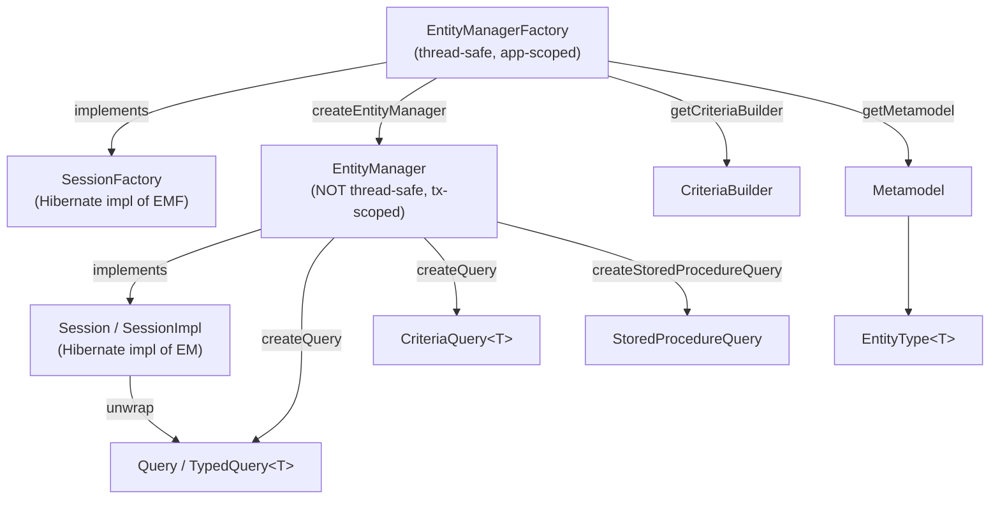
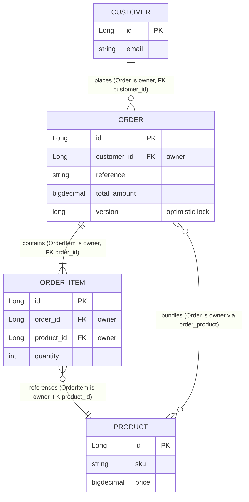
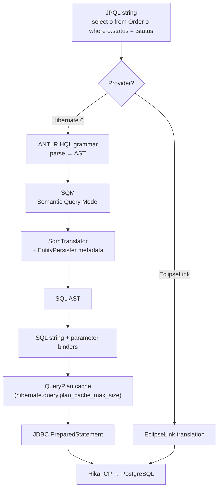
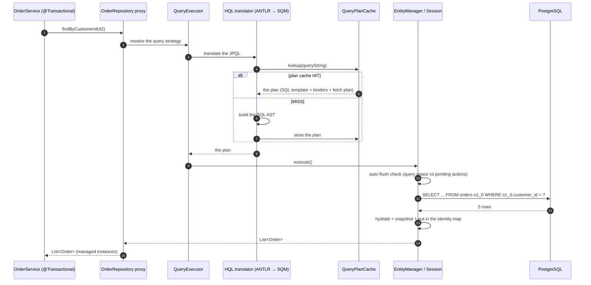
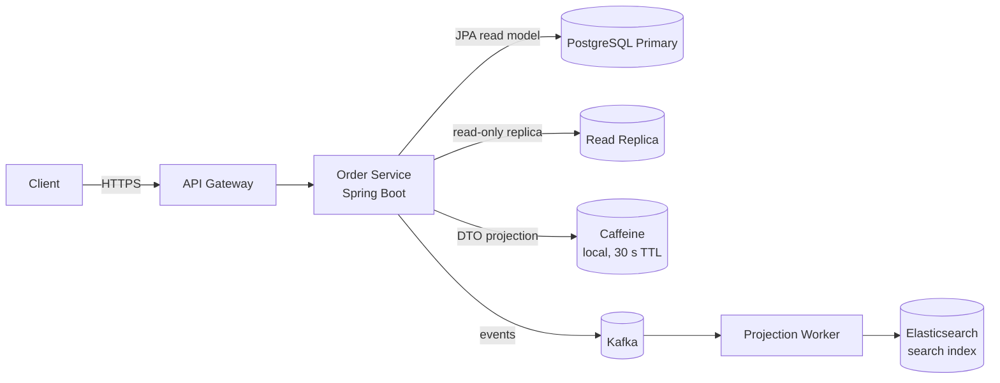

# 01 — ORM Theory & JPA Internals

> **Level:** Beginner → Advanced
> **Interview Frequency:** ★★★★★ (every backend interview asks *JPA vs Hibernate*, *EntityManager vs EntityManagerFactory*, and *"how do you map a many-to-many"*)
> **Prerequisites:** [CORE_JAVA/16-JDBC/01-JDBC-Basics.md](../../CORE_JAVA/16-JDBC/01-JDBC-Basics.md) · [02 · Spring Core & Framework](../02-Spring-Core-Framework/README.md)
> **Last Updated:** 2026

---

## 📋 Table of Contents

- [0. TL;DR — The 30-Second Answer](#0-tldr--the-30-second-answer)
- [1. What & Why — The Problem This Solves](#1-what--why--the-problem-this-solves)
- [2. Mental Model — The One Picture](#2-mental-model--the-one-picture)
- [3. Deep Dive — Theory (Beginner → Advanced)](#3-deep-dive--theory-beginner--advanced)
  - [3.1 Beginner Level](#31-beginner-level)
  - [3.2 Intermediate Level](#32-intermediate-level)
  - [3.3 Advanced Level](#33-advanced-level)
  - [3.4 Expert Level](#34-expert-level)
- [4. Internal Working Mechanism](#4-internal-working-mechanism)
- [5. Step-by-Step Execution Flow](#5-step-by-step-execution-flow)
- [6. Visualizations](#6-visualizations)
- [7. Production-Level Use Cases & Real Industry Examples](#7-production-level-use-cases--real-industry-examples)
- [8. Worked Examples (with Output + Dry Run)](#8-worked-examples-with-output--dry-run)
- [9. Code from Scratch — Production-Grade](#9-code-from-scratch--production-grade)
- [10. Common Mistakes & Gotchas](#10-common-mistakes--gotchas)
- [11. Performance Considerations](#11-performance-considerations)
- [12. Security Considerations](#12-security-considerations)
- [13. Best Practices](#13-best-practices)
- [14. Hands-On Exercises & Code Challenges](#14-hands-on-exercises--code-challenges)
- [15. Interview Q&A — Level-wise](#15-interview-qa--level-wise)
- [16. Scenario-Based & Real-Experience Scenarios (3–5 yrs)](#16-scenario-based--real-experience-scenarios-35-yrs)
- [17. Counter-Questions, Tricky Questions & Follow-Ups](#17-counter-questions-tricky-questions--follow-ups)
- [18. Frequently Asked Production Issues & Debugging Scenarios](#18-frequently-asked-production-issues--debugging-scenarios)
- [19. Architecture Design Questions](#19-architecture-design-questions)
- [20. Rapid-Fire MCQs](#20-rapid-fire-mcqs)
- [21. Cheat Sheet / One-Page Summary](#21-cheat-sheet--one-page-summary)
- [22. Real-World Production Notes](#22-real-world-production-notes)
- [23. Follow-up Learning](#23-follow-up-learning)

---

## 0. TL;DR — The 30-Second Answer

- **JPA is the standard, Hibernate is one implementation.** Jakarta Persistence 3.1 defines the interfaces; Hibernate 6.2+ implements them; EclipseLink and OpenJPA are alternatives. **Spring Data JPA is a third layer** — it builds repository proxies *on top of* the standard, and it is not the same thing as Spring Data JDBC.
- **The ORM exists to defeat the object/relational impedance mismatch**: objects have identity, inheritance and references; tables have rows, foreign keys and no inheritance. The ORM is a *mapping + unit-of-work + persistence-context* machine, not a "SQL generator".
- **`EntityManagerFactory` is thread-safe and application-scoped; `EntityManager` is NOT thread-safe and is transaction-scoped.** One EMF per application (it holds the metadata + query plan cache, and it is expensive to build); one EM per transaction (it *is* the persistence context).
- **The persistence context is an identity map**: one managed instance per (entity type, id) per context. Load the same row twice → **one** SQL statement, **one** Java object.
- **The four entity states are transient, persistent, removed, detached.** `persist` → managed; `remove` → deleted at flush; `merge` → **returns a new managed copy** and leaves your object detached forever.
- **The identifier strategy is a performance decision, not a style choice.** `IDENTITY` forces an immediate `INSERT` per row and **disables JDBC batching**; `SEQUENCE` allows batching but needs a pool sized to your write concurrency.
- **The owning side of a relationship is the side that owns the foreign key.** `@ManyToOne` and the `@OneToOne` with a `@JoinColumn` are owners; the `mappedBy` side is the inverse and **cannot** write the FK.
- **JPQL is portable, HQL is Hibernate's superset, native SQL is not.** JPQL is translated by the provider into SQL — that translation is exactly where the N+1 is born.
- **`ddl-auto` must be `validate` or `none` in production.** `update` does **not** alter existing columns; it only adds missing ones. Flyway or Liquibase owns your schema.
- **`@Version` gives you optimistic locking** — the `UPDATE` becomes `... where id = ? and version = ?` and a concurrent writer gets `ObjectOptimisticLockingFailureException` instead of silently overwriting your row.
- **The cost of an ORM is that you must reason about *when* SQL runs.** Lazy means *later*, not *never*; the transaction boundary decides whether "later" is ever.

---

## 1. What & Why — The Problem This Solves

**The problem.** Your domain model is objects. Your database is tables. They do not agree on
anything:

```text
   THE IMPEDANCE MISMATCH — a table of every disagreement
   ┌────────────────────────┬───────────────────────────┬──────────────────────────────┐
   │ OBJECT WORLD           │ RELATIONAL WORLD          │ WHAT BREAKS                 │
   ├────────────────────────┼───────────────────────────┼──────────────────────────────┤
   │ Object identity        │ Primary key               │ Two objects, one row        │
   │ (reference ==)         │ (value equality)          │ → last write wins           │
   ├────────────────────────┼───────────────────────────┼──────────────────────────────┤
   │ Inheritance / subtype  │ Flat tables + JOINs       │ No polymorphic query       │
   ├────────────────────────┼───────────────────────────┼──────────────────────────────┤
   │ Object graph           │ Foreign keys              │ N+1 selects                 │
   ├────────────────────────┼───────────────────────────┼──────────────────────────────┤
   │ Behaviour & invariants │ Tables have none           │ Rules live in 200 services  │
   ├────────────────────────┼───────────────────────────┼──────────────────────────────┤
   │ Collection / Map       │ Child table + FK           │ Null-object handling        │
   └────────────────────────┴───────────────────────────┴──────────────────────────────┘
```

Hand-rolled JDBC fixes the *mapping* problem and re-creates the other five — one `ResultSet`
mapper per entity, manual `INSERT` per association, and no unit of work, so a 5-table save is
five separate commits and can be half-applied.

**The ORM's answer is three mechanisms, not one:**

| Mechanism | What it does | Concrete class |
|---|---|---|
| **Mapping** | Declares how a class ↔ a table correspond | `@Entity`, `@Column`, `@ManyToOne` |
| **Unit of Work** | Tracks what changed and emits SQL once, at commit | `SessionImpl` + `ActionQueue` |
| **Persistence context (identity map)** | Guarantees one object per identity per transaction | `StatefulPersistenceContext` |

**Who does what — the four styles you will be asked to compare:**

| Style | Shape | Example | Where it fits |
|---|---|---|---|
| **DAO / hand-written JDBC** | You write `SELECT` + a row mapper | `JdbcTemplate` / `NamedParameterJdbcTemplate` | Hot paths, bulk loads, and anything needing exact SQL control |
| **Active Record** | The entity itself has `save()`/`find()` | jOOQ's record, Micronaut Data, Rails/ActiveRecord | Rare in Spring; couples the domain to the framework |
| **Query DSL / type-safe SQL** | A Java DSL builds the SQL | jOOQ, QueryDSL, Spring Data JDBC | Read-heavy reporting where you want SQL-level control with compile-time safety |
| **ORM / Active Record-ish JPA** | You declare a mapping; the ORM emits SQL | JPA + Hibernate + Spring Data JPA | The default for transactional domain models with relations |

> 💡 **The interview framing.** "ORM vs DAO" is not a religion question — it is a *shape of the
> problem* question. An ORM wins when your domain has relationships, invariants and a unit of
> work. A DAO wins when the query is complex, the result set is huge, or you need a bulk
> operation that must bypass the identity map. Most production systems use **both**: JPA for the
> domain, `JdbcTemplate` for the bulk.

---

## 2. Mental Model — The One Picture

```text
   THE LAYERS, AND WHO OWNS WHAT
   ═════════════════════════════

   ┌──────────────────────────────────────────────────────────────┐
   │  SPRING DATA JPA                                            │
   │  JpaRepository<T,ID>  ← you write an INTERFACE               │
   │  SimpleJpaRepository  ← the generated implementation         │
   │  QueryExecutor / JpaQueryExecution / Specification          │
   ├──────────────────────────────────────────────────────────────┤
   │  SPRING ORM                                                 │
   │  PersistenceExceptionTranslator                             │
   │  JpaTransactionManager (a PlatformTransactionManager)       │
   │  SharedEntityManagerCreator (the @PersistenceContext proxy)  │
   ├──────────────────────────────────────────────────────────────┤
   │  JPA (Jakarta Persistence 3.1)  ← THE CONTRACT               │
   │  EntityManagerFactory → EntityManager                       │
   │  Query / TypedQuery / CriteriaQuery / StoredProcedureQuery  │
   ├──────────────────────────────────────────────────────────────┤
   │  HIBERNATE 6.2+  ← ONE IMPLEMENTATION                      │
   │  SessionFactory → SessionImpl                              │
   │  EntityPersister · ActionQueue · StatefulPersistenceContext │
   ├──────────────────────────────────────────────────────────────┤
   │  JDBC → HikariCP → PostgreSQL                               │
   └──────────────────────────────────────────────────────────────┘

   THE LIFECYCLE OF EVERYTHING ABOVE:
   ┌────────────────────┐  once per app   ┌────────────────────┐
   │  EntityManagerFactory│──────────────▶│  SessionFactory     │
   │  (thread-safe, heavy)│                │  (metadata, plans)  │
   └────────────────────┘                └────────────────────┘
              │                                        │ creates
              │                                        ▼
              │                              ┌────────────────────┐
              │                              │   EntityManager     │
              │                              │  (a PersistenceCtx) │
              │                              │  NOT thread-safe   │
              │                              └────────────────────┘
              │                                        │ per transaction
              ▼                                        ▼
     ┌──────────────────┐                 ┌──────────────────┐
     │  Metamodel        │                 │  Identity map     │
     │  EntityType<T>    │                 │  + ActionQueue    │
     │  Attribute<T,X>   │                 │  = the Unit of    │
     └──────────────────┘                 │    Work           │
                                          └──────────────────┘
```

**What to look at:** the *only* thing that changes per transaction is the `EntityManager` and
its contents. The expensive, immutable, thread-safe stuff (`EntityManagerFactory`, the
`SessionFactory`, the metamodel, the query plan cache) is created **once** at startup.

---

## 3. Deep Dive — Theory (Beginner → Advanced)

### 3.1 Beginner Level

#### The four JPA interfaces you must know by heart

```java
package jakarta.persistence;

/** Application-scoped, thread-safe, expensive. Holds the metadata + the query plan cache. */
public interface EntityManagerFactory {
    EntityManager createEntityManager();
    EntityManager createEntityManager(Map<String, Object> map);
    EntityManager createEntityManager(SynchronizationType synchronizationType, Map<String, Object> map);
    CriteriaBuilder getCriteriaBuilder();
    Metamodel getMetamodel();
    PersistenceUnitUtil getPersistenceUnitUtil();
    boolean isOpen();
    void close();
    Map<String, Object> getProperties();
    PersistenceUnitUtil getPersistenceUnitUtil();
}

/** Transaction-scoped, NOT thread-safe. This IS the persistence context. */
public interface EntityManager {
    void persist(Object entity);
    <T> T merge(T entity);
    void remove(Object entity);
    <T> T find(Class<T> entityClass, Object primaryKey);
    <T> T getReference(Class<T> entityClass, Object primaryKey);
    void detach(Object entity);
    void clear();
    void flush();
    void refresh(Object entity);
    boolean contains(Object entity);
    void lock(Object entity, LockModeType lockMode);
    <T> T unwrap(Class<T> cls);
    void setFlushMode(FlushModeType flushMode);
    Query createQuery(String qlString);
    <T> TypedQuery<T> createQuery(CriteriaQuery<T> criteriaQuery);
    TypedQuery<?> createNamedQuery(String name);
    StoredProcedureQuery createStoredProcedureQuery(String procedureName);
    // ... set/get properties, getEntityManagerFactory(), getDelegate()
}
```

**The one-liner that gets you the follow-up right:**

> "`EntityManagerFactory` is the **application-scoped, thread-safe** owner of the mapping
> metadata. `EntityManager` is the **transaction-scoped, non-thread-safe** unit of work that
> holds the identity map. You must never share an `EntityManager` across threads; the
> `EntityManagerFactory` is designed to be shared."

#### Hibernate's names for the same things

| JPA term | Hibernate term | Concrete class |
|---|---|---|
| `EntityManagerFactory` | `SessionFactory` | `org.hibernate.SessionFactory` (extends `EntityManagerFactory`) |
| `EntityManager` | `Session` | `org.hibernate.Session` (extends `EntityManager`) |
| Persistence context | `StatefulPersistenceContext` | `org.hibernate.engine.internal.StatefulPersistenceContext` |
| Unit of work | `ActionQueue` | `org.hibernate.engine.spi.ActionQueue` |
| Per-entity metadata + SQL templates | `EntityPersister` | `org.hibernate.persister.entity.AbstractEntityPersister` |
| Bulk HQL/Criteria | `BulkOperationCleanupAction` | `org.hibernate.action.internal.BulkOperationCleanupAction` |

A Hibernate `Session` **is-a** JPA `EntityManager`, so every JPA API works on it — that is why
`em.unwrap(Session.class)` gives you the Hibernate-specific API (e.g. `session.createQuery`,
`session.setJdbcBatchSize`).

#### The persistence unit

A **persistence unit** is a named set of entity classes + configuration + a JDBC connection
factory. `persistence.xml` declares it for a plain Java SE app; in Spring Boot there is no
`persistence.xml` — Boot **builds one programmatically** (`LocalContainerEntityManagerFactoryBean`
plus a `PersistenceUnitInfo`). The persistence unit is the bridge between "the container" and
"the ORM": the container tells the ORM *which classes are entities* and *where the DataSource
is*.

#### The four query APIs

| API | Type-safe? | Portable? | Typical use |
|---|---|---|---|
| **JPQL** (`"select o from Order o"`) | No (string) | ✅ yes | The default query language of JPA |
| **HQL** (`"select o from Order o"`) | No (string) | ❌ Hibernate-only | HQL is a **superset of JPQL** — adds `limit`, `with`, `join hints` |
| **Criteria API** (`cb.equal(root.get("status"), ...)`) | ✅ yes | ✅ yes | Dynamic queries, Spring Data `Specification` |
| **Native SQL** (`"select * from orders"`) | No | ❌ DB-specific | Reports, DB-specific functions, bulk DML |
| **Spring Data derived queries** (`findByCustomerIdAndStatus`) | Method-name | ✅ yes | Simple, readable lookups |
| **`@Query` with JPQL** | No (string) | ✅ yes | Complex static queries |
| **`@Query(nativeQuery = true)`** | No (string) | ❌ DB-specific | The escape hatch |

> ⚠️ **A trap people fall into:** "Criteria API is type-safe" is *mostly* true, but
> `root.get("custmomer")` compiles fine and fails at runtime. Type-safety in the Criteria API is
> **compile-time for the API shape, runtime for the attribute names**. Spring Data's
> `Specification` inherits exactly that weakness.

### 3.2 Intermediate Level

#### Basic mapping annotations

```java
@Entity                       // the class is an entity (has an identity)
@Table(name = "orders")       // the table name (else: entity simple name)
public class Order {

    @Id
    @GeneratedValue(strategy = GenerationType.IDENTITY)
    @Column(name = "id")
    private Long id;

    @Column(name = "reference", nullable = false, length = 32, unique = true)
    private String reference;

    @Enumerated(EnumType.STRING)     // store 'PAID', not 2
    @Column(name = "status", nullable = false)
    private OrderStatus status;

    @Version
    @Column(name = "version")
    private long version;            // optimistic lock

    @Column(name = "total_amount", precision = 19, scale = 4)
    private BigDecimal total;

    @CreatedDate
    @Column(name = "created_at", nullable = false, updatable = false)
    private Instant createdAt;
}
```

**Rules that are not negotiable:**

- **No public no-arg constructor** is *not* required by JPA (Hibernate uses `Unsafe`/bytecode
  enhancement), but you should still provide a protected one — proxies need a non-private
  constructor and `final` classes cannot be proxied.
- **No `final` on the class and no `final` on the fields** you want lazy-loaded — a Hibernate
  proxy is a *subclass*, and `final` methods are not overridden, so a `final` getter on a lazy
  association **forces a database hit on every call** and defeats the proxy.
- **Never use `equals`/`hashCode` on an entity that uses `GENERATED` ids** before the id is
  assigned. The classic bug: a `HashSet<Order>` containing a transient `Order` with a `null` id
  → two different instances with `null` ids are "equal" → the second one is dropped.
  Override with the business key, or use `EqualsVerifier` in a test.

#### Identifier generation strategies

| Strategy | How it works | Batching | Portability | Use when |
|---|---|---|---|---|
| `IDENTITY` | DB auto-increment; `INSERT` executed **immediately** to read the key back | ❌ **breaks batching** | ✅ | Low-write tables, legacy schemas |
| `SEQUENCE` | DB sequence; the provider may **pre-fetch** a block | ✅ **works** | ✅ | **Default choice for high-write tables** |
| `TABLE` | A single `_hibernate_sequence` table row, locked | ⚠️ contended | ✅ | Never — it is a global bottleneck |
| `AUTO` | The provider picks (Hibernate 6 → `SequenceStyleGenerator`, i.e. a sequence) | ✅ | ✅ | Fine, but be explicit |

**The production argument for `SEQUENCE`:** Hibernate's `SequenceStyleGenerator` can allocate a
**pool** of ids (`hibernate.id.optimizer.pool_size`, default 50) with a single `select nextval`
per 50 inserts, so the sequence is hit 50× less often and the `INSERT`s can be **batched** into
one JDBC round trip.

#### Relationships, and the owning-side rule

```text
   WHO OWNS THE FOREIGN KEY?
   ════════════════════════════════

   @ManyToOne   ──▶ ALWAYS the OWNER (it holds the FK column)
       Order.customer_id  →  Customer.id

   @OneToOne    ──▶ the side with @JoinColumn is the OWNER
       User.address_id → Address.id
       (the Address side is @OneToOne(mappedBy="user"))

   @OneToMany   ──▶ ALWAYS the INVERSE (mappedBy="order")
       Order.items ← mapped by OrderItem.order

   @ManyToMany  ──▶ the side with @JoinTable is the OWNER
       Order.products  ──▶  order_product (join table)
       Product.orders  ──▶ @ManyToMany(mappedBy="products")   ← inverse
```

```java
// ── OWNER SIDE ───────────────────────────────────────────────
@Entity
public class Order {
    @Id @GeneratedValue(strategy = GenerationType.SEQUENCE)
    private Long id;

    @ManyToOne(fetch = FetchType.LAZY, optional = false)
    @JoinColumn(name = "customer_id", nullable = false)
    private Customer customer;

    @OneToMany(mappedBy = "order", cascade = CascadeType.ALL, orphanRemoval = true)
    private List<OrderItem> items = new ArrayList<>();

    @ManyToMany
    @JoinTable(name = "order_product",
               joinColumns = @JoinColumn(name = "order_id"),
               inverseJoinColumns = @JoinColumn(name = "product_id"))
    private Set<Product> products = new HashSet<>();
}

// ── INVERSE SIDE ─────────────────────────────────────────────
@Entity
public class OrderItem {
    @Id @GeneratedValue(strategy = GenerationType.SEQUENCE)
    private Long id;

    @ManyToOne(fetch = FetchType.LAZY, optional = false)
    @JoinColumn(name = "order_id", nullable = false)
    private Order order;          // ← the FK lives here

    @ManyToOne(fetch = FetchType.LAZY)
    @JoinColumn(name = "product_id")
    private Product product;
}
```

**The two rules that matter:**

1. **You may only write to the owning side.** `order.getItems().add(item)` works.
   `item.getOrder().setStatus(PAID)` on an *inverse* `Order.items` collection does **not**
   persist — you must set `item.setOrder(order)` (the owner) instead.
2. **The inverse side needs `mappedBy`**, and `mappedBy` must name the field on the owner.

#### Fetch defaults (memorise this table)

| Association | Default fetch | Why |
|---|---|---|
| `@OneToOne` | **EAGER** | JPA spec default |
| `@ManyToOne` | **EAGER** | JPA spec default |
| `@OneToMany` | **LAZY** | JPA spec default |
| `@ManyToMany` | **LAZY** | JPA spec default |

The EAGER defaults on the "to-one" side are a **historical spec artefact** (a to-one is assumed
to be cheap and always needed). In practice most production teams set **everything to LAZY**
explicitly and fetch deliberately. See [04 · Lazy/Eager & Fetch Strategies](04-Lazy-Eager-N-plus-1-and-Fetch-Strategies.md).

#### `cascade` and `orphanRemoval`

```java
cascade = CascadeType.ALL
//  PERSIST  → saving the parent saves the children
//  MERGE   → merging the parent merges the children
//  REMOVE  → deleting the parent DELETEs the children   ⚠ the dangerous one
//  REFRESH → reloading the parent reloads the children
//  DETACH  → detaching the parent detaches the children
```

`orphanRemoval = true` is **different** from `cascade = REMOVE`: it means *"a child removed
from the collection is deleted"*. It is the correct choice for a **composition** relationship
(an order item cannot exist without its order). It is the wrong choice for a **shared**
relationship.

> ⚠️ The single most destructive JPA bug: `cascade = CascadeType.ALL` on a
> `@OneToMany` + a call to `orderRepository.delete(order)` → Hibernate deletes every row in
> `ORDER_ITEM` **and** in `ORDER_PRODUCT` — with no warning. See
> [02 · Entity Lifecycle](02-Entity-Lifecycle-Persistence-Context-and-Caches.md) for the full
> incident walkthrough.

### 3.3 Advanced Level

#### Spring Boot auto-configuration — what actually happens

```text
   Boot's JPA auto-configuration chain
   ═════════════════════════════════════

   @SpringBootApplication
        │  @EnableAutoConfiguration
        ▼
   AutoConfiguration.imports
        │  → org.springframework.boot.autoconfigure.orm.jpa.HibernateJpaAutoConfiguration
        ▼
   @ConditionalOnClass({ EntityManager.class, HibernateJpaVendorAdapter.class })
   @ConditionalOnMissingBean({ EntityManagerFactory.class, EntityManagerFactoryBuilder.class })
        ▼
   HibernateJpaAutoConfiguration
        │  ├─ entityManagerFactoryBuilder   (EntityManagerFactoryBuilder)
        │  ├─ jpaProperties                (JpaProperties → spring.jpa.*)
        │  ├─ hibernateProperties          (HibernateProperties → spring.jpa.hibernate.*, Boot 3.2+)
        │  └─ mappingLocations / packagesToScan
        ▼
   LocalContainerEntityManagerFactoryBean
        │  .setDataSource(dataSource)
        │  .setPackagesToScan("com.example")     ← or @EntityScan on your @SpringBootApplication
        │  .setPersistenceUnitName("default")
        │  .setJpaVendorAdapter(new HibernateJpaVendorAdapter())
        │  .setJpaPropertyMap(jpaProperties.getProperties())
        ▼
   EntityManagerFactoryBuilder.build()
        │  → HibernatePersistenceProvider.createContainerEntityManagerFactory(...)
        ▼
   SessionFactory (Hibernate)
        │  metadata · query plan cache · connection provider · caches
        ▼
   EntityManagerFactory  ← injected everywhere as a singleton bean
```

**`packagesToScan` vs `@EntityScan`:**

| Mechanism | Where | Scope | Use when |
|---|---|---|---|
| `packagesToScan` on `LocalContainerEntityManagerFactoryBean` | Direct bean configuration | One package root | You are building the EMF yourself |
| `@EntityScan(basePackages = "...")` | On your `@SpringBootApplication` class | One package root | You want to override the auto-detected scan root |
| Boot's default | `@SpringBootApplication`'s package | Everything below it | The normal case |

**Important:** Boot scans **from the `@SpringBootApplication` package downwards**. If your
entities live in `com.example.domain` but your app class is in `com.example.app`, the entities
are **not found** and you get *"No Persistence provider for EntityManagerFactory named
default"* or a silently empty persistence unit. The error message names this explicitly:

```text
   *************************** ERROR ****************************
   Description:

   Spring Boot found no @Entity classes in the package 'com.example.app'.

   Recommended action:

   Check your application's configuration and make sure your @Entity classes are in the
   correct package. By default, Spring Boot searches for @Entity classes in the package of
   your @SpringBootApplication class and below.
```

#### `spring.jpa.properties.*` vs `spring.jpa.hibernate.*`

```yaml
spring:
  jpa:
    properties:
      hibernate:
        format_sql: true
        jdbc:
          batch_size: 50
    show-sql: false              # never in production
    open-in-view: false          # Boot's default is TRUE — you should change it
    database-platform: org.hibernate.dialect.PostgreSQLDialect
    hibernate:
      ddl-auto: validate         # Boot 3.2+ shorthand for spring.jpa.properties.hibernate.hbm2ddl.auto
      naming:
        physical-strategy: org.springframework.boot.orm.jpa.hibernate.SpringPhysicalNamingStrategy
```

| Prefix | Reaches | Notes |
|---|---|---|
| `spring.jpa.properties.*` | The **raw** JPA/Hibernate property map | The escape hatch — always works |
| `spring.jpa.hibernate.*` | Spring Boot 3.2+ binds these and **merges them into the same map** | Shorter; conflicts are resolved in favour of `spring.jpa.properties.*` |
| `spring.jpa.show-sql` | Boot's own `System.out` printer | **Deprecated-ish**: it prints to stdout, ignores the log framework, and does not show parameters |
| `logging.level.org.hibernate.SQL=DEBUG` | The real Hibernate logger | Use this instead of `show-sql` |

#### `ddl-auto` — the values and the ban

| Value | What it does | Production? |
|---|---|---|
| `none` | Does nothing to the schema | ✅ **use with Flyway/Liquibase** |
| `validate` | Checks that the entity mappings match the existing schema; **fails fast** on a mismatch | ✅ **use in production** |
| `update` | **Adds missing tables/columns**; does **not** alter, rename, drop or change types of existing ones | ❌ **banned** |
| `create` | Drops and recreates the schema at startup | ❌ dev only |
| `create-drop` | `create` at startup, drop at shutdown | ❌ dev/test only |

**Why `update` is genuinely dangerous (not just "not best practice"):**

1. **It never alters an existing column.** Rename `status` → `order_status` in the entity →
   `update` creates `order_status` (nullable) and **leaves `status` in place**, silently
   splitting the data across two columns. Every query that reads `status` now returns NULL.
2. **It can drop things.** If a table is missing from the entity model, `update` may issue a
   `drop table`. On a production database where one module was temporarily removed from the
   deployment, that is a data-loss event with no confirmation prompt.
3. **It is not a migration.** There is no version, no rollback, no ordering, no audit trail.
   With 4 instances starting at once, they race to alter the schema.
4. **It cannot express what you actually want** — adding a FK constraint, creating an index
   with `CONCURRENTLY`, backfilling data, adding a `NOT NULL` column to a 500M-row table.

> **The production answer:** `spring.jpa.hibernate.ddl-auto=validate` + **Flyway** (or
> Liquibase). Flyway applies versioned, ordered, checksummed SQL migrations at startup and
> refuses to start if a checksum changed. `validate` then proves the entities still match the
> migrated schema.

#### Projections and DTO reads

```java
// ① Interface projection — Spring Data creates a proxy, no entity is loaded
public interface OrderSummary {
    Long getId();
    String getReference();
    BigDecimal getTotal();
}

public interface OrderRepository extends JpaRepository<Order, Long> {
    List<OrderSummary> findByStatus(OrderStatus status);   // ✅ no N+1, no entity in memory
}

// ② JPQL constructor expression — a record, fully typed
public record OrderDto(Long id, String reference, BigDecimal total) {}

@Query("select new com.example.dto.OrderDto(o.id, o.reference, o.total) from Order o where o.status = :status")
List<OrderDto> findSummaries(@Param("status") OrderStatus status);

// ③ Native query + interface projection
@Query(value = "select id, reference, total_amount as total from orders where status = :status", nativeQuery = true)
List<OrderSummary> findNative(@Param("status") String status);
```

> ⚠️ **Hibernate 6 / Spring Data JPA 3.1 note:** the old `ClosedProjection` /
> `OpenProjection` marker interfaces were **removed**. Interface projections now support
> `Optional<T>`, `List<T>`, `Stream<T>`, `Page<T>` and `Map` return types directly.

### 3.4 Expert Level

#### The metamodel — introspecting your own mappings at runtime

```java
@PersistenceContext EntityManager em;

Metamodel metamodel = em.getMetamodel();
for (EntityType<?> type : metamodel.getEntities()) {
    System.out.println(type.getJavaType().getSimpleName()
            + "  id=" + type.getIdType().getJavaType().getSimpleName()
            + "  version=" + (type.hasVersionAttribute() ? "yes" : "no"));
    for (Attribute<?, ?> attr : type.getAttributes()) {
        System.out.println("   - " + attr.getName()
                + " : " + attr.getPersistentAttributeType()
                + " : " + attr.getJavaType().getSimpleName());
    }
}
```

`Metamodel` → `EntityType<T>` → `Attribute<X, Y>` → `SingularAttribute` / `PluralAttribute`.
This is what dynamic mapping tools, admin panels and schema-diff tools are built on. It is also
how Hibernate can tell at runtime whether an attribute is an association or a basic value.

#### `EntityPersister` — the per-entity SQL factory

Every entity has an `EntityPersister` that holds:

- the mapping metadata (columns ↔ attributes),
- **the SQL templates** (`<loader>`, `<insert>`, `<update>`, `<delete>`, `<collection-load>`),
- the `EntityKey`/`EntityEntry` bookkeeping hooks,
- the **loader** (a `QueryLoader` that knows how to build the SELECT for that entity),
- the **cascading** and **orphan** action planners.

When you change a mapping, the persister is rebuilt — that is why `hibernate.hbm2ddl.auto=validate`
fails fast: validation compares the persister's expected column list with the JDBC metadata.

#### The query plan cache

Hibernate does not re-parse JPQL on every call. It translates the query **once** and caches the
resulting plan (the SQL template + the parameter binders + the fetch plan).

```text
   "select o from Order o where o.status = ?1"
        │
        │  HQL ANTLR parser (Hibernate 6)
        ▼
   Semantic Query Model (SQM)
        │  SqmTranslator → SQL AST
        ▼
   SQL template:  select o1_0.id, o1_0.reference, ... from orders o1_0 where o1_0.status=?
        │  + QueryPlan  (bound parameter positions, entity persister refs)
        ▼
   PLAN CACHE  (hibernate.query.plan_cache_max_size = 2048)
        │  same query string → plan reused → no re-parse, no re-translation
        ▼
   JDBC PreparedStatement (driver-level statement cache may also apply)
```

**Two consequences:**

1. **A query string built by string concatenation defeats the plan cache** — every distinct
   string is a new plan. That is why Spring Data's derived queries and `@Query` with named
   parameters are non-negotiable; `?1` placeholders, never `"... where id = " + id`.
2. **`hibernate.query.plan_cache_max_size` (default 2048)** — if you exceed it, plans are
   evicted and re-translated, which shows up as CPU burn without any SQL change.

#### Multi-tenancy (the expert's "have you thought about…?" follow-up)

| Strategy | Key | Notes |
|---|---|---|
| **Single schema** | Tenant id column + a filter | Cheapest; add `tenant_id` to every table and a `WHERE tenant_id = ?` |
| **Schema per tenant** | Tenant id → schema name | Hibernate `CurrentTenantIdentifierResolver`; 1 000 tenants = 1 000 schemas |
| **Discriminator column** | Tenant id column | One table, one `tenant_id`; needs it on every table |
| **DATABASE per tenant** | Tenant id → JDBC URL | Strongest isolation; a connection pool per database |

#### The provider landscape

| Provider | Package | Notes |
|---|---|---|
| **Hibernate ORM 6** | `org.hibernate` | The default in Spring Boot; the richest feature set |
| **EclipseLink** | `org.eclipse.persistence` | The reference implementation of the JPA spec; strong MOXy support |
| **Apache OpenJPA` | `org.apache.openjpa` | Rarely used in greenfield |
| **Spring Data JDBC** | `org.springframework.data.jdbc` | **Not an ORM** — no dirty checking, no lazy loading, no identity map |

> **The expert distinction:** Spring Data JDBC is *not* a competing JPA implementation; it is a
> **different data-access style** on top of the same Spring Data repository abstraction, built
> on plain JDBC with aggregate-root-only persistence and no unit of work. Knowing that
> difference is a strong signal.

---

## 4. Internal Working Mechanism

**Which class calls which, in what order.** Two chains: *startup* and *query*.

### Chain A — startup

```text
1.  SpringApplication.run()
      └─ SpringApplication.refreshContext()
           └─ ConfigurationClassPostProcessor (auto-config import)

2.  HibernateJpaAutoConfiguration matched
      ├─ @ConditionalOnClass(EntityManager.class, HibernateJpaVendorAdapter.class)
      ├─ @ConditionalOnMissingBean(EntityManagerFactory.class)
      └─ creates: EntityManagerFactoryBuilder, JpaProperties, HibernateProperties

3.  JpaBaseConfiguration#entityManagerFactory(...)
      └─ new LocalContainerEntityManagerFactoryBean()
           .setDataSource(dataSource)                      ← the Hikari pool
           .setPackagesToScan(packagesToScan)              ← from @EntityScan or the app package
           .setPersistenceUnitName(persistenceUnitName)
           .setJpaVendorAdapter(new HibernateJpaVendorAdapter())
           .setJpaPropertyMap(jpaProperties.getProperties())
           .setBeanClassLoader(...)
      └─ .afterPropertiesSet()
           └─ buildNativeEntityManagerFactory(...)
                └─ HibernatePersistenceProvider
                     .createContainerEntityManagerFactory(pui, props)
                          └─ SessionFactoryBuilder
                               ├─ scan the classpath for @Entity / @Embeddable / @Converter
                               ├─ build the Metamodel (EntityType, Attribute)
                               ├─ build an EntityPersister per entity (SQL templates)
                               ├─ create the QueryPlanCache
                               ├─ create the ConnectionProvider (from the DataSource)
                               └─ create the caches (1st level per-session, 2nd level if enabled)
      └─ exposed as the singleton bean `entityManagerFactory`

4.  JpaRepositoriesAutoConfiguration
      └─ @EnableJpaRepositories → RepositoryFactoryBeanSupport
           └─ JpaRepositoryFactory
                └─ creates a JDK dynamic PROXY for each repository interface
                   (implements your interface; the InvocationHandler dispatches to
                    SimpleJpaRepository / QueryExecutor)

5.  Transaction management: JpaTransactionManager is registered as the
    PlatformTransactionManager (because an EntityManagerFactory bean exists).
```

### Chain B — a repository call

```text
1.  orderRepository.findByCustomerId(42L)
      └─ JDK proxy InvocationHandler
           └─ QueryExecutor (SimpleJpaRepository delegates here)
                └─ QueryLookupStrategy resolves the method:
                     derived query?  → build a JPQL string from the method name
                     @Query?         → use the declared JPQL / native SQL
                     declared query? → use the named query
                  ▼
2.  QueryTranslator (Hibernate 6: HQL ANTLR parser → SQM → SQL AST)
      └─ QueryPlanCache lookup → hit: reuse the plan; miss: build + store
           ▼
3.  EntityManager (a Hibernate SessionImpl)
      ├─ AUTO-FLUSH check: does the query space overlap the pending changes?
      │    → if yes: flush() first (the ActionQueue emits the pending SQL)
      ├─ Query.execute()
      │    → builds the SQL, binds the parameters
      │    → JDBC PreparedStatement via JdbcCoordinator / LogicalConnection
      │    → HikariCP → PostgreSQL
      └─ ResultSet → EntityPersister.hydrate()
           → creates the EntityEntry (loaded-state snapshot) in the StatefulPersistenceContext
           → stores the instance in the identity map
           ▼
4.  Hydration of associations: EAGER ones are loaded now (extra SQL or a join);
    LAZY ones become proxies (a subclass instance) — no SQL yet
           ▼
5.  The repository returns either the entity (managed) or a projection (interface proxy / record)
```

**The extension points an interviewer will ask about:**

| SPI / Hook | Interface | When to use it |
|---|---|---|
| Custom id generation | `org.hibernate.id.IdentifierGenerator` | Sharded ids, ULIDs, snowflake |
| Custom type | `jakarta.persistence.AttributeConverter` | Enum ↔ code, `String` ↔ JSON column |
| Auditing | `AuditingEntityListener` + `@EnableJpaAuditing` | `createdAt`, `createdBy` |
| Event listeners | `PostInsertEventListener`, `PostUpdateEventListener`, `PostDeleteEventListener` | Write to a search index, publish an event |
| SQL rewriting | `org.hibernate.resource.jdbc.spi.StatementInspector` | Tag SQL with a trace id |
| Global filters | `@Filter` / `@FilterDef` | Soft delete, multi-tenant row filter |
| Interceptor | `org.hibernate.Interceptor` | Cross-cutting auditing on `onFlushDirty` |
| Specification | Spring Data `Specification<T>` | Reusable, composable query predicates |

---

## 5. Step-by-Step Execution Flow

**Flow 1 — Application startup (what happens before the first request).**

1. `SpringApplication.run()` → `refreshContext()`.
2. Auto-configuration import file lists `HibernateJpaAutoConfiguration`; conditions are evaluated
   (`EntityManager` on the classpath, **no** user-defined `EntityManagerFactory` bean).
3. `EntityManagerFactoryBuilder` is created with the `DataSource`, the `MappingResources`,
   the `JpaVendorAdapter` and the merged property map.
4. `LocalContainerEntityManagerFactoryBean.afterPropertiesSet()` → Hibernate builds the
   `SessionFactory`: classpath scan → metamodel → entity persisters → query plan cache →
   connection provider.
5. The `EntityManagerFactory` is published as a singleton bean.
6. `JpaRepositoriesAutoConfiguration` registers the repository proxies.
7. `JpaTransactionManager` is registered as the `PlatformTransactionManager`.
8. HikariCP starts the pool and opens the minimum idle connections (`minimum-idle`, default 10).
9. Flyway/Liquibase (if present) runs **before** the `EntityManagerFactory` is used — Boot's
   `FlywayMigrationInitializer` depends on the `DataSource`, and `HibernateJpaAutoConfiguration`
   is ordered after it, so migrations land first.
10. The web server starts. The first request now finds a warm `SessionFactory`.

**Flow 2 — `orderRepository.findByCustomerId(42L)` inside a `@Transactional` method.**

1. The service method is invoked through the **`@Transactional` proxy** → a transaction starts →
   a JDBC connection is taken from Hikari → `autoCommit=false` → an `EntityManager` is created
   (bound to the thread).
2. The repository proxy receives the call and resolves the query strategy → builds
   `select o1_0.* from orders o1_0 where o1_0.customer_id=?`.
3. The plan is looked up in the query plan cache; on a miss it is translated and stored.
4. Auto-flush check: are there pending changes whose query space overlaps? → flush if needed.
5. JDBC `PreparedStatement` is executed; the `ResultSet` is hydrated.
6. Each row becomes a managed instance; the `EntityEntry` snapshot is recorded for dirty checking.
7. The repository returns the `List<Order>` (managed instances).
8. The transaction commits: the `ActionQueue` is flushed (any pending INSERTs/UPDATEs/DELETEs
   are sent), the connection is committed and returned to the pool.

---

## 6. Visualizations

### 6.1 The JPA interface hierarchy (and Hibernate's concrete classes)



**Caption:** Hibernate's `SessionFactory`/`Session` *extend* the JPA interfaces, so every JPA
API works unchanged and `em.unwrap(Session.class)` is the door to the Hibernate-only API.
Note the direction of the arrows: the factory **creates** the manager, and only the factory is
thread-safe.

### 6.2 The entity model and its owning sides



**Caption:** Every FK column lives on the **owning** side, and only the owning side is written
by Hibernate. `Product` is the pure inverse side of the many-to-many — it never writes the
`order_product` table. `ORDER.version` is the `@Version` column that turns a lost update into
an exception instead of silent data loss.

### 6.3 The `EntityManager` scope — one per transaction, never shared

```text
   ONE EM PER TRANSACTION — the scope rule

   Thread A (request 1)                 Thread B (request 2)
   ─────────────────────                ─────────────────────
   ┌─ tx starts ─────────┐              ┌─ tx starts ─────────┐
   │ EM #1 (new)         │              │ EM #2 (new)         │
   │  identity map:      │              │  identity map:      │
   │   Order#1           │              │   Order#1 (OTHER    │
   │   Customer#7        │              │    INSTANCE)         │
   │  ActionQueue:       │              │  ActionQueue:       │
   │   [INSERT Order]    │              │   []                 │
   └─ tx commits ────────┘              └─ tx commits ────────┘
        │                                     │
        ▼                                     ▼
   connection returned                  connection returned
   (from Hikari)                        (from Hikari)

   ❌ NEVER DO THIS:
      @Autowired EntityManager em;      // field in a singleton bean
      @PostConstruct void init() {
          em.find(Order.class, 1L);     // EM is closed / unbound here
      }

   ✅ DO THIS INSTEAD:
      // ① ask the factory for a short-lived EM
      emFactory.createEntityManager().find(Order.class, 1L);
      // ② or let Spring manage it (@PersistenceContext on a request-scoped bean)
      // ③ or use a repository — it manages the EM for you
```

**Caption:** `EntityManager` is a **thread-bound** object. Spring's `SharedEntityManager`
(injected via `@PersistenceContext`) is a *proxy* that looks up the thread-bound instance —
that indirection is exactly why it is safe to inject into a singleton bean, but it also means
it only works **inside a transaction**.

### 6.4 How JPQL becomes SQL



**Caption:** The translation is **provider-specific**, which is exactly why JPQL is the portable
choice and native SQL is not. The plan cache means the translation happens **once per distinct
query string** — so building SQL by concatenation destroys both portability and the cache.

### 6.5 A repository call, end to end



**Caption:** The whole path from a method call to hydrated entities. Note where the
**plan cache** sits — it is the difference between "the query is translated once" and
"the query is translated on every call", and it is keyed by the **query string**, which
is why a parameterised query is essential.

---

## 7. Production-Level Use Cases & Real Industry Examples

### 7.1 E-commerce order capture — 40 000 orders/minute peak

**Domain:** an order platform taking **40 000 orders/minute** at Black Friday peak (≈670/s),
**2.1 billion** rows in `ORDERS` over 3 years, PostgreSQL 15 primary + 1 read replica.

**Why an ORM here, and what it cost:**

- The `Order → OrderItem → Product` graph has 3 levels of nesting and real invariants
  (total = Σ items) — a hand-written DAO would re-implement the unit of work badly.
- `Order` is the **aggregate root**: everything is saved through `orderRepository.save(order)`.
  `cascade = ALL` + `orphanRemoval = true` on `items` is correct because an item has no
  meaning without its order.
- `Product` is a **shared entity** — so it is **not** cascaded and the association is
  `fetch = LAZY`. Cascading `REMOVE` to products would delete catalogue rows.
- **Identifier:** `SEQUENCE` with a pool of 50 (`@SequenceGenerator(sequenceName = "order_seq",
  allocationSize = 50)`). With `IDENTITY`, the 670 inserts/s could not be batched and each
  one cost a round trip → the insert path became the bottleneck at ~11 k inserts/s.
- **Read path:** a separate read model (`OrderSummaryView`) served from a DTO projection, not
  from the entity graph — the order list endpoint returns **20 rows in 1 query, 38 ms p99**
  instead of 21 queries.

### 7.2 Banking ledger — 12 million postings/day, zero tolerance for silent loss

**Domain:** a core-banking ledger writing **12 M postings/day**, ~40 concurrent write threads
per instance, 4 application instances.

- Every posting entity carries `@Version`. A debit and a credit posted to the same account
  concurrently cannot both win: the loser gets `ObjectOptimisticLockingFailureException` and
  the posting is **retried**, not silently applied.
- The retry is explicit and bounded (3 attempts, exponential backoff) — not left to the
  framework, because a blind retry can starve a hot row.
- `ddl-auto=validate` in production; **Flyway** owns 240 versioned migrations. The entity
  mapping is validated against the migrated schema at every startup — a mismatch fails the
  pod's readiness probe rather than corrupting data.
- `SEQUENCE` ids with `allocationSize = 100`, because the ledger is write-heavy.
- Batch inserts of **500 postings** per statement (`hibernate.jdbc.batch_size = 50`,
  `order_inserts = true`) — the write path dropped from 8 400 ms to 410 ms for the nightly
  reconciliation import.

### 7.3 SaaS multi-tenant reporting — 3 200 tenants

**Domain:** a B2B analytics product, **3 200 tenants**, 60 concurrent users per tenant peak,
read-heavy (95 % reads / 5 % writes), 1.4 TB of data.

- Entities are mapped with an explicit `tenant_id` column; a Hibernate **global filter**
  (`@FilterDef` + `@Filter`) applies `tenant_id = :currentTenant` so a missing `where` clause
  cannot leak another tenant's rows. Defence in depth: the filter is enabled by a servlet
  filter that sets the tenant parameter **from the authenticated token, never from a request
  parameter**.
- Read models use **DTO projections** (`record`-based) — a tenant's dashboard query returns
  **1 query** returning 30 rows of 6 columns, not 30 entities with 8 eager associations.
- The second-level cache is **disabled**: with 4 instances and a shared read replica, a
  per-instance L2 cache serves stale rows for up to the TTL. Instead, a Caffeine **application
  cache** with a 30-second TTL fronts the hot tenant-summary query.

### 7.4 Logistics fleet tracking — 90 000 GPS pings/minute

**Domain:** a fleet-tracking system ingesting **90 000 pings/minute** from devices.

- Ingestion is a **bulk path**, not an ORM path: `JdbcTemplate.batchUpdate` with a 1 000-row
  batch — the ORM's unit of work would hold 1 000 managed entities in the identity map for
  nothing, and the identity map gives no benefit for write-only data.
- Reads use **DTO projections** over a read replica; the entity model is used only where the
  aggregate needs invariants (a delivery with its stops).

> **The takeaway for the interview:** the ORM is for the *domain*, not for the *pipe*. Real
> systems mix JPA with `JdbcTemplate` for ingestion and reporting.

---

## 8. Worked Examples (with Output + Dry Run)

### 8.1 Mapping `Order` / `OrderItem` / `Product` correctly

**Problem.** A junior maps a one-to-many and gets a broken schema: two FK columns on
`ORDER_ITEM`, and deleting an order leaves orphan rows.

**The correct mapping:**

```java
package com.example.shop.domain;

import jakarta.persistence.*;
import java.math.BigDecimal;
import java.util.ArrayList;
import java.util.LinkedHashSet;
import java.util.List;
import java.util.Set;

@Entity
@Table(name = "orders")
public class Order {

    @Id
    @GeneratedValue(strategy = GenerationType.SEQUENCE, generator = "order_seq")
    @SequenceGenerator(name = "order_seq", sequenceName = "order_seq", allocationSize = 50)
    @Column(name = "id")
    private Long id;

    @Column(name = "reference", nullable = false, length = 32, unique = true)
    private String reference;

    @ManyToOne(fetch = FetchType.LAZY, optional = false)
    @JoinColumn(name = "customer_id", nullable = false)
    private Customer customer;

    @OneToMany(mappedBy = "order", cascade = CascadeType.ALL, orphanRemoval = true)
    private List<OrderItem> items = new ArrayList<>();

    @ManyToMany
    @JoinTable(name = "order_product",
               joinColumns = @JoinColumn(name = "order_id"),
               inverseJoinColumns = @JoinColumn(name = "product_id"))
    private Set<Product> products = new LinkedHashSet<>();

    @Version
    @Column(name = "version", nullable = false)
    private long version;

    protected Order() {                 // required by the proxy machinery
    }

    public Order(String reference, Customer customer) {
        this.reference = reference;
        this.customer = customer;
    }

    // ── the owning side is the parent, so the helper mutates the CHILD ──
    public void addItem(OrderItem item) {
        item.setOrder(this);            // ✅ set the owner, not the inverse
        items.add(item);
    }

    public void removeItem(OrderItem item) {
        items.remove(item);
        item.setOrder(null);            // ✅ orphanRemoval deletes the row
    }
}
```

```java
package com.example.shop.domain;

import jakarta.persistence.*;
import java.math.BigDecimal;

@Entity
@Table(name = "order_item")
public class OrderItem {

    @Id
    @GeneratedValue(strategy = GenerationType.SEQUENCE, generator = "order_item_seq")
    @SequenceGenerator(name = "order_item_seq", sequenceName = "order_item_seq", allocationSize = 50)
    @Column(name = "id")
    private Long id;

    @ManyToOne(fetch = FetchType.LAZY, optional = false)
    @JoinColumn(name = "order_id", nullable = false)
    private Order order;                // ✅ OWNER of the FK

    @ManyToOne(fetch = FetchType.LAZY, optional = false)
    @JoinColumn(name = "product_id", nullable = false)
    private Product product;            // ✅ OWNER of the FK

    @Column(name = "quantity", nullable = false)
    private int quantity;

    @Column(name = "unit_price", nullable = false, precision = 19, scale = 4)
    private BigDecimal unitPrice;

    protected OrderItem() {
    }

    public OrderItem(Product product, int quantity, BigDecimal unitPrice) {
        this.product = product;
        this.quantity = quantity;
        this.unitPrice = unitPrice;
    }

    public BigDecimal lineTotal() {
        return unitPrice.multiply(BigDecimal.valueOf(quantity));
    }

    void setOrder(Order order) {         // package-private: only the aggregate mutates it
        this.order = order;
    }

    public Order getOrder() {
        return order;
    }
}
```

**Expected schema (generated by `ddl-auto=create` in a dev profile):**

```text
   create table orders (
       id          bigint       not null,
       reference   varchar(32)  not null,
       customer_id bigint       not null,
       version     bigint       not null,
       primary key (id),
       unique (reference)
   )

   create table order_item (
       id         bigint      not null,
       order_id   bigint      not null,
       product_id bigint      not null,
       quantity   integer     not null,
       unit_price numeric(19,4) not null,
       primary key (id),
       foreign key (order_id)   references orders (id),
       foreign key (product_id) references product (id)
   )

   create table order_product (
       order_id   bigint not null,
       product_id bigint not null,
       primary key (order_id, product_id),
       foreign key (order_id)   references orders (id),
       foreign key (product_id) references product (id)
   )
```

**Dry run — what Hibernate emits when you save an order with two items:**

```text
1. em.persist(order)                 → INSERT INTO orders (reference, customer_id, version)
                                        VALUES ('ORD-1001', 7, 0)
                                     → the SEQUENCE gives id = 1001
2. flush
   INSERT INTO orders (id, reference, customer_id, version) VALUES (1001, 'ORD-1001', 7, 0)
   INSERT INTO order_item (id, order_id, product_id, quantity, unit_price)
        VALUES (5001, 1001, 42, 2, 19.99)
   INSERT INTO order_item (id, order_id, product_id, quantity, unit_price)
        VALUES (5002, 1001, 77, 1, 5.50)
3. commit
```

> **Note the order:** Hibernate inserts the parent **first** (to get the id), then the children.
> That ordering is enforced by the `ActionQueue` — see
> [05 · Hibernate Internals](05-Hibernate-Internals-and-Performance-Tuning.md).

**The three mistakes this mapping avoids:**

| Mistake | Symptom | Fix here |
|---|---|---|
| `mappedBy` missing on `Order.items` | Two FK columns (`order_id` **and** `items_order_id`), or a broken join | `mappedBy = "order"` |
| The FK declared on the inverse side | `order_item.order_id` never populated | `@JoinColumn` on `OrderItem.order` |
| `orphanRemoval` absent | Removing an item from the collection leaves the row in the DB | `orphanRemoval = true` + `item.setOrder(null)` |

### 8.2 `@Version` — a concurrent update, with the exact SQL and the exact exception

**Problem.** Two operators edit the same order. The second save silently overwrites the first.

```java
package com.example.shop.domain;

import jakarta.persistence.*;
import org.springframework.data.jpa.repository.JpaRepository;

public interface OrderRepository extends JpaRepository<Order, Long> {
}
```

```java
// ── Operator A and Operator B both hold a detached copy of order 1001 ──

@Service
public class OrderEditingService {

    private final OrderRepository orderRepository;
    private final EntityManagerFactory emf;

    public OrderEditingService(OrderRepository orderRepository, EntityManagerFactory emf) {
        this.orderRepository = orderRepository;
        this.emf = emf;
    }

    /**
     * Simulates the "load in a web request, edit later" flow of a naive implementation.
     */
    public Order loadDetached(Long id) {
        // A real app would load it in request 1 and submit a form in request 2.
        return emf.createEntityManager()
                  .find(Order.class, id);   // this EM closes immediately → DETACHED
    }
}
```

**Now the two concurrent edits:**

```java
@Transactional
public void operatorASaves(Long id) {
    Order order = orderRepository.findById(id).orElseThrow();
    order.setReference("ORD-1001-A");      // changes the reference
    orderRepository.save(order);           // managed instance → dirty checking picks it up
}
```

```java
@Transactional
public void operatorBSaves(Long id) {
    Order order = orderRepository.findById(id).orElseThrow();
    order.setReference("ORD-1001-B");      // the SAME column, a different value
    orderRepository.save(order);
}
```

**Dry run — the interleaving that produces the lost update:**

```text
T0:  SELECT version FROM orders WHERE id = 1001     → version = 3
T1:  A: SELECT ... FROM orders WHERE id = 1001     → version = 3   (managed copy A)
T2:  B: SELECT ... FROM orders WHERE id = 1001     → version = 3   (managed copy B)
T3:  A: UPDATE orders SET reference='ORD-1001-A', version=4
        WHERE id=1001 AND version=3                → 1 row affected ✅
T4:  B: UPDATE orders SET reference='ORD-1001-B', version=4
        WHERE id=1001 AND version=3                → 0 rows affected 💥
```

**The exact error the caller sees (Spring translates the JPA exception):**

```text
org.springframework.orm.ObjectOptimisticLockingFailureException:
  Row was updated or deleted by another transaction (or unsaved-value mapping was incorrect)
  for [Order#1001]

Caused by: jakarta.persistence.OptimisticLockException
  Row was updated or deleted by another transaction (or unsaved-value mapping was incorrect)
  for [Order#1001]

Caused by: org.hibernate.StaleObjectStateException
  Row was updated or deleted by another transaction (or unsaved-value mapping was incorrect)
  for [Order#1001]
```

**The layered exception, from the inside out:**

| Layer | Exception | Meaning |
|---|---|---|
| Hibernate | `org.hibernate.StaleObjectStateException` | The `UPDATE ... where version = ?` matched 0 rows |
| JPA | `jakarta.persistence.OptimisticLockException` | The standard wrapper |
| Spring ORM | `ObjectOptimisticLockingFailureException` | The translated, uniform Spring exception |

> ⚠️ **The trap:** `OptimisticLockException` is a **runtime** exception, so the transaction
> rolls back by default — the failure is loud. But a `@Controller` that catches
> `Exception` and returns `500` turns it into an ugly failure. Map it to **409 Conflict**
> (see [§10](#10-common-mistakes--gotchas)).

**The correct fix — catch it and translate to a 409:**

```java
@RestControllerAdvice
public class OptimisticLockExceptionHandler {

    @ExceptionHandler(ObjectOptimisticLockingFailureException.class)
    public ResponseEntity<ProblemDetail> handle(ObjectOptimisticLockingFailureException ex) {
        ProblemDetail body = ProblemDetail.forStatusAndDetail(
                HttpStatus.CONFLICT,
                "The record was modified by another user. Reload and try again.");
        body.setProperty("entity", ex.getPersistentClassName());
        body.setProperty("identifier", ex.getIdentifier());
        return ResponseEntity.status(HttpStatus.CONFLICT).body(body);
    }
}
```

**What the version check actually is, precisely:** at flush time Hibernate compares the
current in-memory state against the **loaded-state snapshot** it recorded when the entity was
loaded. If the snapshot's `version` is not what the DB has, the `UPDATE` includes
`and version = <snapshot>` and affects 0 rows → `StaleObjectStateException`. If the version is
unchanged but a *different* column changed, the `UPDATE` still carries `and version = <snapshot>`,
so two threads editing **different** columns still conflict — that is a deliberate design
choice (whole-row optimistic locking, not per-column).

### 8.3 `SEQUENCE` vs `IDENTITY` — the insert-pattern difference

**Problem.** A nightly import writes 20 000 `payment` rows. The import takes 34 seconds.

**Version A — `IDENTITY`:**

```java
@Entity
@Table(name = "payment")
public class Payment {

    @Id
    @GeneratedValue(strategy = GenerationType.IDENTITY)
    @Column(name = "id")
    private Long id;
}
```

```java
@Transactional
public void importWithIdentity(List<Payment> payments) {
    for (Payment p : payments) {
        paymentRepository.save(p);
    }
    // 20 000 rows → 20 000 individual INSERTs, each immediately flushed
}
```

**The SQL log (abridged):**

```text
insert into payment (amount, currency, created_at) values (?, ?, ?)      -- row 1
insert into payment (amount, currency, created_at) values (?, ?, ?)      -- row 2
insert into payment (amount, currency, created_at) values (?, ?, ?)      -- row 3
... (20 000 lines)
```

**Why?** With `IDENTITY`, Hibernate must **know the generated id** before it can build the next
statement (and before it can insert children). The only way to learn the id is to execute the
`INSERT` and read `getGeneratedKeys()` — so the insert **cannot be deferred to the flush**, and
it **cannot be batched**.

**Version B — `SEQUENCE` with a pool:**

```java
@Entity
@Table(name = "payment")
public class Payment {

    @Id
    @GeneratedValue(strategy = GenerationType.SEQUENCE, generator = "payment_seq")
    @SequenceGenerator(name = "payment_seq", sequenceName = "payment_seq", allocationSize = 100)
    @Column(name = "id")
    private Long id;
}
```

```java
@Transactional
public void importWithSequence(List<Payment> payments) {
    paymentRepository.saveAll(payments);   // one flush at the end
}
```

```yaml
spring:
  jpa:
    properties:
      hibernate:
        jdbc:
          batch_size: 100
        order_inserts: true
```

**The SQL log:**

```text
select nextval('payment_seq')                       -- one call, gets 100 ids: 90001..90100
insert into payment (id, amount, currency, created_at) values (?, ?, ?, ?)   -- × 100, batched
insert into payment (id, amount, currency, created_at) values (?, ?, ?, ?)   -- × 100, batched
... (200 lines, 2 network round trips for 20 000 rows)
```

**Dry run — the numbers:**

| Metric | `IDENTITY` | `SEQUENCE` (pool 100) | Batch |
|---|---:|---:|---:|
| `INSERT` statements | 20 000 | 20 000 | — |
| **Network round trips** | **20 000** | **200** | **100× fewer** |
| `select nextval` calls | 0 | 200 | — |
| Wall clock (1 ms RTT, local) | ≈ 21.4 s | ≈ 0.6 s | ≈ 35× faster |
| `getGeneratedKeys` round trips | 20 000 | 0 | — |

**The cost of `SEQUENCE`:** ids are **not dense**. With `allocationSize = 100`, the ids jump
(`90001, 90002, …, 90100, 91001, …`) — after a crash, 99 ids are burned. That is fine for a
`BIGINT` PK; it is **not** fine if you use the id as a customer-facing number, and it makes
B-tree inserts slightly less cache-friendly (a real, measurable but small effect — roughly
1–3 % on insert-heavy tables).

**The `SEQUENCE` caveat you must mention in the interview:** with `allocationSize = 100` and
**100 concurrent transactions**, 100 threads could each hold a different block — you need the
pool to be at least as large as your concurrent writers, or the sequence is hit on every
insert. That is a **contention** trade-off, not a correctness one: it is always correct, just
slower.

---

## 9. Code from Scratch — Production-Grade

A minimal but *correct* production module: a `Product` aggregate, a repository with a
projection, an `AttributeConverter`, auditing, and the configuration that makes it
production-safe.

```java
package com.example.shop.domain;

import jakarta.persistence.Column;
import jakarta.persistence.Convert;
import jakarta.persistence.Converter;
import jakarta.persistence.Enumerated;
import jakarta.persistence.EnumType;

/**
 * WHY a converter instead of @Enumerated(STRING):
 *  - @Enumerated(STRING) stores the constant NAME → renaming the enum constant breaks the data.
 *  - @Enumerated(ORDINAL) stores the position → reordering the enum silently corrupts the data.
 *  - A converter stores an explicit, stable CODE → safe to rename/reorder the enum.
 */
@Converter(autoApply = false)
public class OrderStatusConverter implements AttributeConverter<OrderStatus, String> {

    @Override
    public String convertToDatabaseColumn(OrderStatus attribute) {
        return attribute == null ? null : attribute.code();
    }

    @Override
    public OrderStatus convertToEntityAttribute(String dbData) {
        return dbData == null ? null : OrderStatus.fromCode(dbData);
    }
}
```

```java
package com.example.shop.domain;

import jakarta.persistence.*;
import java.math.BigDecimal;
import java.time.Instant;
import java.util.Objects;

@Entity
@Table(name = "product", indexes = {
        @Index(name = "idx_product_sku", columnList = "sku", unique = true)
})
public class Product {

    @Id
    @GeneratedValue(strategy = GenerationType.SEQUENCE, generator = "product_seq")
    @SequenceGenerator(name = "product_seq", sequenceName = "product_seq", allocationSize = 50)
    @Column(name = "id")
    private Long id;

    @Column(name = "sku", nullable = false, length = 40)
    private String sku;

    @Column(name = "name", nullable = false, length = 200)
    private String name;

    @Column(name = "price", nullable = false, precision = 19, scale = 4)
    private BigDecimal price;

    @Convert(converter = OrderStatusConverter.class)   // explicit converter
    @Column(name = "status", nullable = false, length = 16)
    private OrderStatus status = OrderStatus.ACTIVE;

    @Version
    @Column(name = "version", nullable = false)
    private long version;

    @Column(name = "created_at", nullable = false, updatable = false)
    private Instant createdAt = Instant.now();

    protected Product() {
        // JPA/Hibernate needs a no-arg constructor it can use; protected keeps it out of the API.
    }

    public Product(String sku, String name, BigDecimal price) {
        this.sku = sku;
        this.name = name;
        this.price = price;
    }

    public void changePrice(BigDecimal newPrice) {
        if (newPrice == null || newPrice.signum() < 0) {
            throw new IllegalArgumentException("price must be non-negative");
        }
        this.price = newPrice;
    }

    // WHY equals/hashCode use the BUSINESS KEY and not the id:
    //  - the id is null before the INSERT → two transient instances with null ids would be
    //    "equal" and one would silently vanish from a HashSet;
    //  - the id changes semantics once the entity is detached and re-attached.
    @Override
    public boolean equals(Object o) {
        if (this == o) {
            return true;
        }
        if (!(o instanceof Product other)) {
            return false;
        }
        return sku != null && sku.equals(other.sku);
    }

    @Override
    public int hashCode() {
        return Objects.hashCode(sku);
    }

    public Long getId() {
        return id;
    }

    public String getSku() {
        return sku;
    }

    public String getName() {
        return name;
    }

    public BigDecimal getPrice() {
        return price;
    }

    public OrderStatus getStatus() {
        return status;
    }

    public long getVersion() {
        return version;
    }

    public Instant getCreatedAt() {
        return createdAt;
    }
}
```

```java
package com.example.shop.domain;

import org.springframework.data.jpa.repository.JpaRepository;
import org.springframework.data.jpa.repository.Query;
import org.springframework.data.repository.query.Param;

import java.math.BigDecimal;
import java.util.List;

public interface ProductRepository extends JpaRepository<Product, Long> {

    // ── ① derived query: the method name becomes JPQL ──
    List<Product> findByStatusAndPriceLessThan(OrderStatus status, BigDecimal maxPrice);

    // ── ② DTO projection via an interface: NO entity is loaded → no N+1 ──
    interface ProductSummary {
        Long getId();
        String getSku();
        String getName();
        BigDecimal getPrice();
    }

    @Query("select p.id as id, p.sku as sku, p.name as name, p.price as price "
         + "from Product p where p.status = :status order by p.name")
    List<ProductSummary> findSummaries(@Param("status") OrderStatus status);

    // ── ③ constructor expression → a record; fully typed, no reflection ──
    record ProductPrice(Long id, BigDecimal price) { }

    @Query("select new com.example.shop.domain.ProductRepository$ProductPrice(p.id, p.price) "
         + "from Product p where p.id in :ids")
    List<ProductPrice> findPrices(@Param("ids") List<Long> ids);
}
```

```java
package com.example.shop.config;

import org.springframework.boot.autoconfigure.domain.EntityScan;
import org.springframework.context.annotation.Configuration;
import org.springframework.data.jpa.repository.config.EnableJpaAuditing;
import org.springframework.transaction.annotation.EnableTransactionManagement;

/**
 * WHY @EnableTransactionManagement explicitly:
 *  Boot auto-configures it, but declaring it makes the requirement visible and lets you
 *  choose the ordering. @EnableJpaAuditing needs it to be active before the listeners run.
 */
@Configuration
@EnableTransactionManagement
@EnableJpaAuditing
@EntityScan(basePackages = "com.example.shop.domain")
public class JpaConfiguration {
}
```

```yaml
# application.yml — the production-safe baseline
spring:
  jpa:
    # WHY false: it keeps the session open for the whole HTTP response, holds a DB connection
    # during JSON rendering, and hides N+1 bugs until they reach production.
    open-in-view: false
    hibernate:
      ddl-auto: validate          # NEVER 'update' in production
    properties:
      hibernate:
        jdbc:
          batch_size: 50
          time_zone: UTC
        order_inserts: true
        order_updates: true
        format_sql: false
        generate_statistics: false # turn on per-environment, never globally
  flyway:
    enabled: true
    locations: classpath:db/migration

logging:
  level:
    org.hibernate.SQL: INFO
    org.hibernate.orm.jdbc.bind: INFO   # TRACE shows the parameters — a secret-leak risk in prod
```

---

## 10. Common Mistakes & Gotchas

| # | ❌ Wrong | ✅ Right | Why it breaks |
|---|---|---|---|
| 1 | `spring.jpa.hibernate.ddl-auto=update` in production | `validate` + Flyway/Liquibase | `update` never alters an existing column → silent data split; it can also drop tables it thinks are unused |
| 2 | `@ManyToOne` + `cascade = CascadeType.ALL` on a shared entity | No cascade on shared associations | Deleting an order would delete the referenced `Customer` and every other order pointing at it |
| 3 | `@OneToMany` without `mappedBy` | `mappedBy = "order"` | Hibernate creates a **second** FK column or a broken join table |
| 4 | Mutating the inverse side only | Mutate the **owning** side (`item.setOrder(order)`) | The inverse side has no FK column — the change is never written |
| 5 | `GenerationType.IDENTITY` on a high-write table | `SEQUENCE` with an allocation pool | `IDENTITY` forces an immediate insert per row → JDBC batching is impossible |
| 6 | `GenerationType.TABLE` | `SEQUENCE` | A single global row, locked on every id allocation → a serialisation point |
| 7 | `public class Foo { @Id private Long id; }` with `equals` on the id | `equals`/`hashCode` on the business key | Two transient instances with `null` ids collide in a `HashSet` |
| 8 | `@ManyToMany` with a `List` and no `Set` | `Set` (or a `List` + `@OrderColumn`) | A bag has no stable order → Hibernate cannot `distinct` it without exploding the rows |
| 9 | `final` on a lazy association's getter | Remove `final` | Hibernate proxies override the getter; `final` forces a real DB hit per call |
| 10 | `fetch = FetchType.EAGER` "to be safe" | `LAZY` + deliberate fetching | Eager associations multiply the rows of every query — a cartesian product |
| 11 | Native SQL everywhere | JPQL for portable queries | Native SQL breaks the moment you change database, and bypasses the entity mapping entirely |
| 12 | Building JPQL by concatenation | Named parameters (`:status`) | Defeats the query plan cache and is an injection risk |
| 13 | `em.persist()` on a detached entity | `em.merge()` — or `repository.save()` | `persist` throws `PersistentObjectException` on a detached instance with an id |
| 14 | Injecting `EntityManager` and calling it outside a transaction | Use a repository, or `EntityManagerFactory` + your own EM | Outside a transaction there is no bound `EntityManager` → `IllegalStateException` / `NoTransactionException` |
| 15 | `equals`/`hashCode` including a `@ManyToOne` | Include only the id or the business key | Lazy association in `hashCode` → a DB hit per `HashSet` operation, or a `LazyInitializationException` |
| 16 | `@Enumerated(EnumType.ORDINAL)` | `@Enumerated(STRING)` or a converter | Inserting a new enum constant in the middle shifts every subsequent ordinal → silent data corruption |
| 17 | `@Column(columnDefinition = "text")` for portability | Use the DB's own type via a Flyway migration | `columnDefinition` is vendor SQL in a Java annotation — it silently breaks portability |
| 18 | A `@ElementCollection` of entities | `@ElementCollection` of **embeddables** only | A collection of entities needs a real `@OneToMany` with a join table |
| 19 | `spring.jpa.show-sql=true` in production | `logging.level.org.hibernate.SQL=DEBUG` | `show-sql` prints to stdout, ignores the log pipeline, and cannot be sampled or shipped |
| 20 | `save()` inside a `@Transactional` method to "write it now" | `save()` + let the flush happen, or `saveAndFlush()` | `save()` on a *new* entity already inserts (to get the id); `saveAndFlush()` on an existing entity forces an UPDATE round trip you may not want |

---

## 11. Performance Considerations

| Concern | Lever | Default | When to change |
|---|---|---|---|
| **Row multiplication** | `fetch = LAZY` + explicit fetch | `@ManyToOne`/`@OneToOne` are EAGER by spec | Almost always: set everything LAZY and fetch deliberately |
| **Round trips** | join fetch / `@EntityGraph` / `@BatchSize` / DTO projections | none | Any list endpoint that renders a relation |
| **Insert throughput** | `SEQUENCE` + `batch_size` + `order_inserts` | `batch_size = 30` (Hibernate 6), `order_inserts = false` | Bulk imports: `batch_size = 50–200`, `order_inserts = true` |
| **Id allocation** | `allocationSize` | 50 | Raise it (100–1000) for bulk writers; lower it if you waste ids |
| **Plan cache pressure** | `hibernate.query.plan_cache_max_size` | 2048 | Raise it if you have thousands of distinct query strings |
| **Statement cache** | `hibernate.jdbc.fetch_size` | 0 (driver default) | PostgreSQL: `fetch_size = 50` helps large result sets |
| **Schema validation cost** | `ddl-auto=validate` | `validate` in prod | Keep it — it costs milliseconds at startup and prevents a corrupt deploy |
| **Connection hold time** | short transactions | — | Never call an HTTP service inside a transaction (see [03 · Transactions](03-Transactions-Propagation-and-Isolation.md)) |
| **Serialization cost** | DTO projections | entities by default | Any read-only endpoint |

**What to measure (not what to guess):**

```text
   MEASURE THESE FOUR NUMBERS
   ───────────────────────────
   ① queryExecutionCount  (Hibernate Statistics) — how many statements per request
   ② entityLoadCount      (Hibernate Statistics) — how many rows hydrated
   ③ prepareStatementCount(Hibernate Statistics) — how many JDBC statements
   ④ rows returned vs rows needed — the cartesian-product ratio
```

A healthy repository call for a 20-row list with one relation is
`queryExecutionCount = 1`, `entityLoadCount = 20`. If `entityLoadCount` is 400, you have an N+1.
See [05 · Hibernate Internals](05-Hibernate-Internals-and-Performance-Tuning.md) for the
`StatisticsMBean` drill.

---

## 12. Security Considerations

| Threat | Attack path | The Spring/JPA-specific defence |
|---|---|---|
| **SQL injection via JPQL/native query** | User input concatenated into a query string | Always bind parameters. Spring Data's derived queries and `@Query` with `:param` bind safely. **Never** concatenate into a native `@Query` |
| **SQL injection via identifier** | A sort column or table name taken from the request | Identifiers **cannot** be parameterised — use an allow-list: `Map<String, String> ALLOWED_SORTS = Map.of("date", "created_at")` and look the value up |
| **Mass assignment** | A JSON body binding straight onto an entity, setting `version`, `status` or `role` | Bind to a **DTO**, never to an entity. Never expose `setId`/`setVersion`/`setRole` on an input DTO |
| **Over-fetching sensitive columns** | A `User` entity with a password hash loaded into a list endpoint | Use a **projection** that selects only the columns the endpoint needs; never serialise an entity directly (it also leaks lazy proxies as 500s) |
| **Lazy-loading data leak / timing oracle** | A lazy association loaded only for some rows (the entity exists but the relation does not) | Fetch relations explicitly with `@EntityGraph` so the data set is uniform |
| **Multi-tenant leakage** | A missing `tenant_id` predicate returns another tenant's rows | A Hibernate **global filter** applied from the authenticated token, plus the schema-level default |
| **Soft-delete bypass** | A `@Where` filter (Hibernate-specific) is bypassed by a native query | Do not rely on `@Where`; use a global filter + a `deleted_at` predicate in every JPQL, and a DB-level `WHERE` in the view |
| **Blind "audit" table write** | An attacker triggers an insert to flood the audit log | Rate-limit writes and validate the payload with Bean Validation before it reaches the DB |

```java
// ❌ NEVER: a native query built by concatenation
@Query("SELECT * FROM product WHERE name = '" + name + "'")   // injection
String findUnsafe(String name);

// ✅ ALWAYS: bind the parameter
@Query("SELECT p FROM Product p WHERE p.name = :name")
List<Product> findByName(@Param("name") String name);
```

```java
// ❌ NEVER: bind the request body straight onto an entity
@PostMapping("/orders")
Order create(@RequestBody Order order) { ... }

// ✅ ALWAYS: bind to a DTO and map explicitly
@PostMapping("/orders")
OrderResponse create(@Valid @RequestBody CreateOrderRequest request) {
    Order order = orderMapper.toEntity(request);   // explicit, reviewable field mapping
    return orderMapper.toResponse(orderRepository.save(order));
}
```

> **The security interview framing:** "the entity is not your API model". A JPA entity is a
> **persistence model** — it carries identity, lazy proxies and `@Version`. Exposing it over
> HTTP leaks fields, breaks on lazy proxies, and lets a client set server-controlled fields.

---

## 13. Best Practices

1. **Make the aggregate root the only write entry point.** `orderRepository.save(order)` and
   nothing else. A repository per entity invites inconsistency.
2. **Set `fetch = LAZY` explicitly on every association.** Do not rely on the spec defaults —
   they are EAGER for to-one, and EAGER is a trap.
3. **Always define the owning side.** `@JoinColumn` on the owner, `mappedBy` on the inverse.
   Write a test that asserts the FK column exists.
4. **Use `SEQUENCE` (or UUIDv7 for distributed writers) — never `TABLE`.** Reserve `IDENTITY`
   for legacy schemas.
5. **Use `@Version` on any entity two people can edit.** The cost is one `BIGINT` column and one
   extra predicate in the `UPDATE`.
6. **Read with DTO projections.** `interface` projections for dynamic shapes, `record`
   constructor expressions for fixed ones. No entity in memory, no N+1.
7. **Never expose an entity over HTTP.** DTO in, DTO out.
8. **`ddl-auto=validate` + Flyway/Liquibase.** Schema changes are versioned, ordered artefacts.
9. **No `equals`/`hashCode` on the generated id.** Use the business key.
10. **Keep the transaction in the service layer, not the repository.** One business operation =
    one transaction. See [03 · Transactions](03-Transactions-Propagation-and-Isolation.md).
11. **Map collections to `Set`** unless the order is semantically meaningful — in which case use
    a `List` + `@OrderColumn`.
12. **Prefer `@Convert` over `@Enumerated(ORDINAL)`**; use `@Enumerated(STRING)` only if the
    enum names are frozen forever.
13. **Name every index in the mapping** (`@Table(indexes = @Index(...))`) so it is reviewable
    next to the entity — but create it in Flyway, not with `ddl-auto`.
14. **Log SQL with the framework, not `show-sql`.**
    `logging.level.org.hibernate.SQL=DEBUG` + `org.hibernate.orm.jdbc.bind=TRACE` in a
    non-production profile only.

---

## 14. Hands-On Exercises & Code Challenges

### Exercise 1 — Map a 4-entity domain (90 min)

**Goal.** Prove you can map a real graph correctly.

1. Create `Customer` 1—* `Order` 1—* `OrderItem` *—1 `Product`, plus `Order` *—* `Product`
   (a bundle).
2. Set **every** association to `FetchType.LAZY` explicitly.
3. Use `SEQUENCE` for every id, with `allocationSize = 50`.
4. Write the entities so that **only** `Order` is an aggregate root: `OrderItem` has no public
   repository; `Product` is shared and is never cascaded.
5. **Acceptance criteria**
   - `ddl-auto=create` produces exactly **one** FK column on `ORDER_ITEM` for the order and
     **one** for the product, and a `ORDER_PRODUCT` join table with a composite PK.
   - `delete(order)` deletes the `ORDER_ITEM` rows but **not** the `PRODUCT` rows.
   - Removing an item from `order.getItems()` and saving deletes that `ORDER_ITEM` row
     (`orphanRemoval = true`).
   - `show-sql` shows the parent `INSERT` **before** the child `INSERT`s.

### Exercise 2 — Prove the optimistic lock (60 min)

1. Add `@Version` to `Order`.
2. Write a test that opens two transactions, loads the same row in both, updates it in both,
   and commits the second.
3. **Acceptance criteria**
   - The second commit throws `ObjectOptimisticLockingFailureException`.
   - The generated SQL is `update orders set ... where id=? and version=?`.
   - The first transaction's value is still in the database (the loser did not overwrite).
   - The exception is mapped to HTTP **409** by your `@RestControllerAdvice`.

### Exercise 3 — Measure the mapping cost (45 min)

1. Turn on `spring.jpa.properties.hibernate.generate_statistics=true`.
2. Call `GET /orders?customerId=42` once; read `queryExecutionCount` and `entityLoadCount`.
3. Change the endpoint to return a DTO projection; re-measure.
4. **Acceptance criteria**
   - Before: `entityLoadCount` grows with the number of orders (the N+1 signature).
   - After: `entityLoadCount` stays flat and `queryExecutionCount = 1`.
   - You can state the before/after SQL count in a sentence.

### Code Challenge A — A safe identifier-strategy switch

**Task.** Convert an `IDENTITY` entity to `SEQUENCE` without losing data.

**Acceptance criteria**
- A Flyway migration creates the sequence and backfills `id` from the existing column.
- The entity uses `@GeneratedValue(strategy = SEQUENCE, generator = "...")` with
  `allocationSize` documented in a comment.
- `hibernate.jdbc.batch_size = 100` and `order_inserts = true` are set.
- A test proves 200 inserts produce **2** JDBC round trips (assert on
  `prepareStatementCount` or on the SQL log).
- **Stretch goal:** measure the wall-clock difference and record it in the PR description.

### Code Challenge B — A schema-drift guard

**Task.** Build a check that fails the build when the entity model and the migrated schema
disagree.

**Acceptance criteria**
- `ddl-auto=validate` is active in the test profile, so a mismatch throws at context startup.
- A test changes a column length in an entity and asserts that the context fails to start.
- The error message names the entity and the column.
- **Stretch goal:** add a test that runs the entity model against a `Testcontainers` PostgreSQL
  started from an **older** Flyway version and lists every difference.

---

## 15. Interview Q&A — Level-wise

### 🟢 Beginner

**Q1. What is an ORM, and what problem does it solve?**
**A:** An ORM maps objects to tables so you stop writing SQL and row mappers by hand. It solves
the object/relational impedance mismatch — object identity, inheritance and references versus
rows, foreign keys and no inheritance. It gives you three things: a **mapping**, a **unit of
work** (changes are batched and flushed at commit), and a **persistence context** (one managed
instance per identity). The cost is that you must reason about *when* SQL runs.

**Q2. What is the difference between JPA and Hibernate?**
**A:** JPA (Jakarta Persistence) is the **standard** — a set of interfaces (`EntityManager`,
`EntityManagerFactory`, `Query`) and rules. Hibernate is **one implementation** of it; EclipseLink
and OpenJPA are others. So "using JPA" does not mean "using Hibernate" — although in practice
Spring Boot uses Hibernate because it implements the most of the spec. Spring Data JPA is a
further layer above the standard that generates repository implementations for you.

**Q3. What is the difference between `EntityManagerFactory` and `EntityManager`?**
**A:** The factory is created once per application, is thread-safe, and holds the mapping
metadata and the query plan cache — it is expensive, so you build it once and share it. The
`EntityManager` is created per transaction, is **not** thread-safe, and *is* the persistence
context — it holds the identity map and the pending changes. The rule: share the factory,
never share the manager.

**Q4. What is `persist` vs `merge`?**
**A:** `persist` takes a **new** object and makes it managed — from that point Hibernate tracks
its changes and writes it at flush. `merge` takes a **detached** object and copies its state
into a new managed instance, which it returns; your original object stays detached and is
never updated. The classic bug is mutating the detached object and expecting the change to
persist — it does not.

**Q5. What does `@Entity` do?**
**A:** It tells the persistence provider that this class is a persistent type with a database
identity. It requires an `@Id` property. It also means the class gets a proxy, so it should not
be `final` and should have a non-private no-arg constructor.

**Q6. Why does an entity need a no-arg constructor?**
**A:** The JPA spec requires it so the provider can instantiate the entity without your
constructor logic, and Hibernate's proxies need to be able to subclass it. Make it `protected`
rather than `public` so it is not part of your public API.

### 🟡 Intermediate

**Q7. What is the difference between `save()` and `saveAndFlush()` in Spring Data JPA?**
**A:** `save()` on a new entity triggers an INSERT **immediately**, because the generated id is
needed; on an existing entity with a non-null id it performs a `merge`. `saveAndFlush()` forces
the SQL to be sent to the database but keeps the transaction open. You usually want `save()`
and let the transaction commit flush everything; use `saveAndFlush()` when you need the
generated key or the constraint violation **now** — e.g. to return the id in the same request
or to catch a `DataIntegrityViolationException` and translate it.

**Q8. What is `mappedBy` and when do I need it?**
**A:** `mappedBy` marks the **inverse** side of a bidirectional association and names the field
on the owning side that holds the relationship. It is required on `@OneToMany` and on the
inverse `@OneToOne`/`@ManyToMany`. Without it Hibernate thinks it owns the relationship and
creates an extra join column. The rule to remember: the side with the `@JoinColumn` (or the
`@JoinTable`) is the owner and can write the FK.

**Q9. What is the difference between `cascade = REMOVE` and `orphanRemoval = true`?**
**A:** `cascade = REMOVE` means "when I delete the parent, delete the children too" — a
bulk operation on the parent's lifecycle. `orphanRemoval = true` means "when a child is removed
from my collection, delete that child" — it handles the collection-diffing case. Use
`orphanRemoval` for a **composition** (a child that cannot exist alone) and `cascade = REMOVE`
only when you truly want a cascade delete.

**Q10. What are the default fetch types, and why are they a problem?**
**A:** `@OneToOne` and `@ManyToOne` default to **EAGER**; `@OneToMany` and `@ManyToMany` default
to **LAZY**. The EAGER defaults are a JPA spec artefact from when a to-one was assumed to be
cheap and always needed. In practice EAGER on a to-one multiplies the rows of every query that
joins it and turns "fetch the customer" into "fetch the customer for every row". Production
code sets everything to LAZY and fetches deliberately.

**Q11. `IDENTITY` vs `SEQUENCE` — which should I use?**
**A:** `SEQUENCE` for anything with meaningful write volume. With `IDENTITY`, Hibernate must
execute the INSERT immediately to read the generated key back, so it cannot defer the insert to
the flush and cannot batch it — every row becomes its own round trip. With `SEQUENCE`, Hibernate
can allocate a block of ids from the sequence and batch the inserts, turning 1 000 round trips
into 10. The trade-off is non-dense ids and a sequence pool that must be at least as large as
your concurrent writers.

**Q12. What is the difference between `save()` and `persist()`?**
**A:** `persist` is the JPA API: it makes a **new** instance managed and throws if the instance
already has an id. `save` is the Spring Data API: it decides for you — if the id is null it
calls `persist`, otherwise it calls `merge`. The Spring Data behaviour is what surprises
people: `save()` on a detached entity does **not** throw, it silently merges.

### 🔴 Advanced / Senior

**Q13. Why is `ddl-auto=update` banned in production?**
**A:** Three reasons. First, it **never alters an existing column** — if you rename a column in
the entity it adds a new nullable column and leaves the old one populated, so the data splits
silently. Second, it can **drop** tables it believes are unused — if a module is missing from
one deployment, its tables can be dropped. Third, it is not a migration tool: no version, no
ordering, no rollback, no audit trail, and 4 instances starting simultaneously race each other.
The production setup is `ddl-auto=validate` plus Flyway or Liquibase, which gives you ordered,
checksummed, reversible migrations and a fail-fast check that the entity model still matches.

**Q14. What exactly is the persistence context, and what does the identity map guarantee?**
**A:** The persistence context is the set of managed instances plus their pending changes; in
JPA terms it *is* the `EntityManager`. It behaves as an identity map keyed by
(entity type, id): within one context there is exactly **one** managed instance per identity.
So loading the same row twice issues one query and returns the same Java object. This is what
makes dirty checking reliable — there is only one object whose state can diverge from the
database.

**Q15. Explain `@Version` and the exact SQL it produces.**
**A:** `@Version` adds a numeric column that Hibernate increments on every update. The
generated SQL becomes `update orders set ..., version = 4 where id = 1001 and version = 3`. If
another transaction updated the row in between, the predicate matches 0 rows and Hibernate
throws `StaleObjectStateException`, which JPA wraps in `OptimisticLockException` and Spring
translates to `ObjectOptimisticLockingFailureException`. Note it is **whole-row** optimistic
locking: two transactions editing *different* columns still conflict, because the version
predicate is on the row, not the column.

**Q16. How does the flush order work, and why do I care?**
**A:** Hibernate queues actions in an `ActionQueue` and executes them in a fixed order at
flush: **inserts first** (so children have their parent's id), then **updates**, then
**collection actions** and **deletes**, with orphan deletions last. It matters because (a) a
child insert before its parent insert would violate the FK, and (b) the batching depends on
`order_inserts`/`order_updates` to group similar statements so they can be batched.

**Q17. What is the query plan cache and why should you care?**
**A:** Hibernate parses and translates a query **once** and caches the resulting plan — the SQL
template, the parameter binders and the fetch plan — keyed by the query string. Two
consequences: building a query by string concatenation creates a new plan for every distinct
string (a CPU leak that never shows up in the SQL log), and the cache is bounded
(`hibernate.query.plan_cache_max_size`, default 2048) so exceeding it causes eviction and
re-translation. Named parameters and derived queries exist precisely so the plan cache works.

### ⚫ Expert / Principal

**Q18. Why does `merge` return a different object, and what is the correct detached-entity pattern?**
**A:** Because the persistence context guarantees **one** managed instance per identity. If the
context already holds `Order#1001`, `merge` cannot make your detached instance managed — that
would break the identity map — so it copies your state into the managed instance and returns
*that*. The correct patterns are: (a) load and mutate inside one transaction (the simplest),
(b) explicitly `merge` and use the **returned** object, or (c) use a **stateless update
query** (`@Modifying @Query("update Order o set o.status = :s where o.id = :id")`) that never
loads the entity at all. The anti-pattern is mutating a detached object and expecting it to be
saved.

**Q19. How would you migrate an entity model safely when the mapping changes?**
**A:** Never rely on `ddl-auto`. Sequence: (1) write a **backward-compatible** Flyway migration
(add the new column as nullable, backfill it, add the new FK/index), (2) deploy the application
version that writes both the old and the new column (or reads the old one and writes the new),
(3) backfill and verify, (4) deploy the version that reads only the new column, (5) drop the
old column in a later migration. Throughout, `ddl-auto=validate` catches any mapping/schema
mismatch at startup. If the mapping changes in a way that is not backward compatible (a type
change, a renamed association), use a dual-write or a backfill job with a verification query
comparing old and new columns.

**Q20. Explain the whole path from `repository.findByCustomerId(42)` to a row in PostgreSQL.**
**A:** The repository is a JDK dynamic proxy; the invocation handler resolves the query
strategy, builds the JPQL from the method name, and hands it to Hibernate's translator (HQL
ANTLR parser → SQM → SQL AST). The plan is looked up in the query plan cache — on a miss it is
built and stored. The `EntityManager` (a Hibernate `Session`) performs the auto-flush check,
then executes the SQL through the `JdbcCoordinator`/`LogicalConnection` to a JDBC
`PreparedStatement` on a HikariCP connection. The `ResultSet` is hydrated by the
`EntityPersister`, which creates the `EntityEntry` snapshot for dirty checking and stores the
instance in the identity map. EAGER associations are loaded now; LAZY ones become proxies.

**Q21. When would you choose Spring Data JDBC over Spring Data JPA, and what do you give up?**
**A:** Spring Data JDBC fits an aggregate-oriented model: one table (or a few) per aggregate
root, no lazy loading, no dirty checking, no identity map, no cascade beyond the aggregate.
You give up the object graph — you must load the whole aggregate in one query — and you lose
the first-level cache's identity guarantee and `merge`. You gain: no N+1 surprises, no
`LazyInitializationException`, simpler mental model, and often better write performance since
there is no unit of work to flush. The trap: Spring Data JDBC is **not** an alternative ORM
implementation — it does not implement JPA, so mixing it with JPA entities in one aggregate is
not supported.

**Q22. How do you implement soft delete, and what are the traps?**
**A:** Add `deleted_at` (nullable timestamp) and filter on it. The JPA way is a Hibernate
global filter (`@FilterDef`/`@Filter`) or a Hibernate `@Where` clause. The traps: a **native
query bypasses both**, so every native query needs the predicate manually — that is the classic
"the list is filtered but the export is not" bug. `@Where` is also Hibernate-specific and is
silently dropped by native queries. A robust design uses a DB-level `VIEW` with the predicate
baked in for reporting, plus a global filter for the JPA path, and an audit of every native
query.

---

## 16. Scenario-Based & Real-Experience Scenarios (3–5 yrs)

### Scenario 1 — "The order list is slow, but only for big customers"

**The situation.** You are on the on-call rota. A ticket says the "My Orders" endpoint takes
9 seconds for enterprise customers with 4 000 orders and 120 ms for retail customers with 12
orders. The endpoint has not changed in four months.

**Your first move.** Reproduce with a customer that has 4 000 orders, turn on
`logging.level.org.hibernate.SQL=DEBUG`, and count the statements. You see **4 001** statements:
one `select ... from orders where customer_id = ?` and then one `select ... from product where
id = ?` per line item.

**The trap.** The tempting fix is `fetch = FetchType.EAGER` on the `Product` association. That
"fixes" the N+1 by producing a single query — and introduces a cartesian product, because the
result now has 4 000 orders × their items as rows, with the product columns repeated. The query
gets *slower* and the memory spike OOMs the pod. The second trap is "let me just add an index"
— an index on `order_item.product_id` does not help, because the problem is the **number of
round trips**, not the per-query cost.

**The resolution.** The read endpoint only needs `sku`, `name` and `quantity` — it does not need
entities at all. Replace the entity return type with a DTO projection:

```java
@Query("""
       select new com.example.shop.api.OrderLineDto(
           o.id, o.reference, o.createdAt, p.sku, p.name, i.quantity)
       from Order o
       join o.items i
       join i.product p
       where o.customer.id = :customerId
       order by o.createdAt desc
       """)
Page<OrderLineDto> findOrderLines(@Param("customerId") Long customerId, Pageable pageable);
```

The statement count goes from **4 001 to 1**, the rows returned drop from ~28 000 to ~9 500
(the real number of lines), and p99 goes from 9 100 ms to 210 ms. Note the query uses
`join o.items i` — a JPQL join, **not** `join fetch`, so pagination stays in the database.

**The lesson.** "Slow for some users" almost always means *data-dependent* behaviour, and in JPA
that is either an N+1 or a cartesian product. Measure the statement count per request, not the
total latency.

### Scenario 2 — "We renamed a column and production broke"

**The situation.** A team renamed the `orders.status` column to `order_status` in the entity
and pushed it. `ddl-auto=update` was set in production because "that is what we have always
used". After the deploy, the orders list is empty and support is asking what happened.

**Your first move.** `SELECT count(*) FROM orders WHERE status IS NOT NULL` → 1 200 000.
`SELECT count(*) FROM orders WHERE order_status IS NOT NULL` → 0. The new column exists and is
empty; the old column still holds all the data. `update` created the column but **never moved
the data** — it does not write to an existing table, and it certainly does not migrate data.

**The trap.** The team's first instinct is to run an `UPDATE` to copy the data. That works, but
it is done **by hand, in production, without a versioned script** — and the application is still
running the old code in some pods (a rolling deploy), which writes to the **old** column. The
manual copy is immediately inconsistent: rows written by the old pods after the copy are lost
from the new column. The second trap is that `update` may also have created an index on the new
column that nobody asked for, and it may have dropped a table belonging to a module that was
temporarily removed from the deployment.

**The resolution.**

1. Roll the deploy back — the old code + old column are consistent again.
2. Write a **Flyway migration** `V104__rename_status_to_order_status.sql` that renames the
   column (a metadata-only operation on PostgreSQL) and verifies the row count.
3. Deploy the new code with `ddl-auto=validate` and the migration applied by Flyway.
4. Add a startup check: `ddl-auto=validate` makes the mismatch a **startup failure**, not a
   runtime surprise.

**The lesson.** `ddl-auto=update` is not a migration tool; it is a development convenience
that hides the fact that schema change is a *process* (versioned, ordered, reviewed,
reversible). This incident is also the standard way to justify Flyway to a sceptical team.

### Scenario 3 — "A nightly job deleted 40 000 rows"

**The situation.** A "cleanup" job runs at 02:00 to remove soft-deleted carts. At 02:03 the
on-call engineer gets a page: **40 000 `ORDER_ITEM` rows are gone**, and 12 000 orders now have
no items. The cleanup job was supposed to delete 300 rows.

**Your first move.** Read the job's code. It calls `cartRepository.delete(cart)` for each cart
whose `expiresAt` is in the past — and `Cart` has
`@OneToMany(mappedBy = "cart", cascade = CascadeType.ALL)`.

**The trap.** `cascade = CascadeType.ALL` includes `REMOVE`. Deleting the cart deletes its
items — but the cart's items are **not** the cart's own children in this domain: a cart that
became an order **shares** the same `ORDER_ITEM` rows (the promotion code copies the cart's
items into the order and nulls the cart's FK). So the cascade deleted rows that belonged to
real orders. The `orphanRemoval` flag was correctly `false`; `cascade = ALL` was the bug.

**The resolution.**

1. Stop the job; restore from the replica/binlog.
2. Change the mapping: `cascade = {CascadeType.PERSIST, CascadeType.MERGE}` — remove `REMOVE`.
3. Delete carts with an explicit, bounded query instead of entity removal:
   `@Modifying @Query("delete from Cart c where c.expiresAt < :cutoff")`.
4. Add a **cascade audit**: a test that asserts deleting an aggregate does not delete rows
   outside its subtree.

**The lesson.** `cascade = CascadeType.ALL` is a shortcut that includes the most destructive
operation. Use the explicit list. And when a delete can reach a large number of rows, prefer a
bounded bulk JPQL delete with an explicit predicate over entity-by-entity removal — it is one
statement, it is fast, and it cannot surprise you with a cascade.

---

## 17. Counter-Questions, Tricky Questions & Follow-Ups

### CQ1. "JPA is just a wrapper around SQL — isn't it just overhead?"

- **Naive answer:** "Yes, JPA adds overhead, but it saves you time." ← incomplete
- **The trap:** It implies the overhead is inherent to *writing* the code. The real overhead is
  **specific and avoidable**: the N+1 (extra round trips), the cartesian product (extra rows),
  and the identity map (memory). A DTO projection with a JPQL join has **zero** ORM overhead
  relative to hand-written JDBC — it is the same SQL. The ORM overhead is only real when you
  navigate an object graph.
- **Expert answer:** "The right question is where the ORM cost actually is. For a simple
  insert, Hibernate 6 with batching does the same round trips as `JdbcTemplate`. The cost
  appears in three places: (1) the **identity map** holds every loaded entity, which is memory
  you pay for on large result sets; (2) **lazy loading** turns one query into N+1 unless you
  fetch deliberately; (3) **automatic dirty checking** means an UPDATE is issued for any
  entity whose snapshot differs — including ones you did not mean to modify. A read-only
  endpoint using a DTO projection has essentially the same cost profile as hand-written JDBC.
  The ORM's value is the *unit of work* and the *mapping*, not the SQL generation."

### CQ2. "Why not just use Spring Data JDBC / MyBatis / jOOQ instead?"

- **Naive answer:** "JPA is more standard." ← incomplete
- **The trap:** The real difference is not "standard vs proprietary" — it is **what unit of work
  you want**. MyBatis gives you SQL control with no session; jOOQ gives you a type-safe SQL
  generator with no session; Spring Data JDBC gives you a repository with a *single-aggregate*
  persistence model but no lazy loading and no dirty checking. JPA gives you the object graph
  and automatic dirty checking — and with them the N+1, the identity map and the
  `LazyInitializationException`.
- **Expert answer:** "It depends on the shape of the problem. If your aggregates are small and
  your reads are the bulk of the load, jOOQ or MyBatis wins — you get exact SQL and no session
  semantics to reason about. If your domain is a rich object graph with invariants enforced
  across entities, JPA's unit of work is worth its cost. Spring Data JDBC is the interesting
  middle: it keeps the repository abstraction but drops the object graph, so you load a whole
  aggregate in one query — no N+1, no lazy loading — at the price of no automatic dirty
  checking. In a mature system you will often see jOOQ for reads and JPA for the write model."

### CQ3. "Why is `IDENTITY` faster than `SEQUENCE` for a single insert? Isn't the sequence an extra round trip?"

- **Naive answer:** "IDENTITY is faster because there's no extra `nextval` call." ← true but incomplete
- **The trap:** It compares **one** insert against **one** insert. The comparison that matters
  is *N* inserts. `IDENTITY` requires the INSERT to be executed immediately (to read
  `getGeneratedKeys()`), so it can never be batched — N inserts means N round trips plus N
  key reads. `SEQUENCE` amortises: with `allocationSize = 100`, 100 inserts cost 1 `nextval`
  plus 1 batched round trip. The single-insert case is the *only* case where `IDENTITY` wins.
- **Expert answer:** "Correct for a single row: `IDENTITY` is one round trip, `SEQUENCE` is two.
  But `IDENTITY` cannot be batched because Hibernate must know the id before it can prepare the
  next statement. So for N rows, `IDENTITY` costs N round trips and N `getGeneratedKeys`
  reads, while `SEQUENCE` with allocationSize K costs ⌈N/K⌉ `nextval` calls and ⌈N/batch⌉
  round trips. The crossover is around 3–5 rows. Below that, `IDENTITY` is fine; above it,
  `SEQUENCE` wins by an order of magnitude. The cost of `SEQUENCE` is non-dense ids and a
  sequence pool that must be ≥ your concurrent writers to avoid a `nextval` per insert."

### CQ4. "Is `ddl-auto=update` really that bad? It saves us writing migrations."

- **Naive answer:** "It's not recommended in production." ← weak
- **The trap:** It invites you to argue about style instead of behaviour. The **behavioural**
  facts are: `update` **never alters an existing column** (so a rename produces two columns
  and a silent data split), it can **drop** tables it believes are unused, it has no ordering
  or versioning, and with multiple instances it races. The number to quote: on a 3-instance
  deploy, three schema-altering processes run concurrently at startup.
- **Expert answer:** "The problem is not style, it is that `update` performs the wrong
  operation. It answers 'which tables/columns are missing?' and not 'how do I get from schema A
  to schema B?'. A rename, a type change, a new NOT NULL column on a 500 M-row table, adding a
  foreign key, or a concurrent index build are all operations `update` either cannot do or does
  badly. Flyway gives you an ordered, checksummed, versioned history — and `ddl-auto=validate`
  then proves the entity model still matches. The migration cost is writing the same DDL you
  would have written by hand, once, in version control."

### CQ5. "Why not just make everything EAGER and avoid lazy-loading issues?"

- **Naive answer:** "Eager loading avoids `LazyInitializationException`." ← incomplete
- **The trap:** Eager loading trades a *runtime error* for a *silent data-explosion*. A
  collection fetched eagerly multiplies the parent rows by the child count: 50 orders × 12 items
  = 600 rows, each repeating the order columns. Two eager collections = the product of both.
  And the eager fetch happens **inside the transaction**, so the memory cost lands on the
  request thread.
- **Expert answer:** "Eager is a decision about *when* to fetch, and the default EAGER on
  `@ManyToOne` means every query that touches an order also joins the customer — which
  multiplies rows when the query also fetches a collection. Lazy is the right default because
  it defers the decision to the query, and the fix for `LazyInitializationException` is to
  fix the *boundary* (fetch what you need inside the transaction, or use a DTO projection), not
  to remove laziness. `open-in-view=true` already papers over the exception — at the cost of
  holding the connection through JSON rendering, which is a worse production problem than the
  exception it hides."

### CQ6. "Can two entities have a `@ManyToMany` without a join table?"

- **Naive answer:** "No, `@ManyToMany` always needs a `@JoinTable`." ← mostly right
- **The trap:** It misses the three-way problem: a many-to-many with **attributes on the
  relationship** (a role, a quantity, a granted-at timestamp) cannot be a `@ManyToMany` at all.
  The join table only holds the two FKs — there is nowhere to put the extra column.
- **Expert answer:** "A plain `@ManyToMany` maps to a join table with the two FKs and a
  composite primary key. But if the relationship has its own data — a `Product` a customer
  bought has a quantity and a purchase date — you must model it as an **entity**
  (`OrderLine`) with two `@ManyToOne`s and its own columns. That entity then becomes an
  aggregate of its own, or a member of the `Order` aggregate. The `@ManyToMany` shorthand is
  for relationships that are pure membership, like tags on a product. The same reasoning
  applies to `@ElementCollection`: it only works for `@Embeddable` types, not entities, for
  exactly the same reason."

### CQ7. "Does `@Version` work with the `IDENTITY` strategy?"

- **Naive answer:** "Yes, the version column is independent of the id." ← correct but incomplete
- **The trap:** It is correct, but it invites a follow-up you should be ready for: with
  `IDENTITY`, the insert happens immediately, so the version is set at insert time; the
  concurrency check only protects **updates**. There is no protection against two transactions
  inserting "the same" logical row — that is a **unique constraint**'s job, not `@Version`'s.
  The expert distinguishes the two mechanisms: `@Version` protects against lost updates;
  a unique index protects against duplicate inserts.
- **Expert answer:** "Yes — the version column is orthogonal to the id generation. What
  `@Version` gives you is protection on UPDATE: the statement becomes
  `... where id = ? and version = ?` and a stale writer affects 0 rows and gets
  `OptimisticLockException`. It does **not** protect inserts — two transactions can both
  insert a row that violates a business uniqueness rule, because no version exists yet. That
  needs a database unique constraint. In practice you want both: `@Version` for the
  read-modify-write race and a unique index for the insert race."

### CQ8. "How do you know which query Hibernate will actually run? The JPQL is not SQL."

- **Naive answer:** "Turn on `show-sql`." ← partially right
- **The trap:** `show-sql` prints to `System.out`, bypasses the logging framework (so it cannot
  be shipped, sampled or filtered by environment), and it does **not** show the bound
  parameters — you see `where customer_id = ?` with no value. The better answer is the
  Hibernate logger plus the bind logger.
- **Expert answer:** "Use `logging.level.org.hibernate.SQL=DEBUG` for the SQL and
  `logging.level.org.hibernate.orm.jdbc.bind=TRACE` for the parameters — that gives you the
  exact statement that will run, with values. For the plan, `hibernate.generate_statistics`
  plus the `StatisticsMBean` gives you the query execution count and the entity load count,
  which is how you *prove* an N+1 rather than guess. For the SQL text itself, set
  `logging.level.org.hibernate.SQL=DEBUG` and `spring.jpa.properties.hibernate.format_sql=true`
  — and remember that `format_sql` is whitespace-only, so the bound values still come from the
  bind logger. In production, keep the bind logger off — it prints personal data and secrets."

### CQ9. "Is the second-level cache worth enabling?"

- **Naive answer:** "It would speed up reads." ← incomplete
- **The trap:** It ignores the **correctness** dimension. A second-level cache is shared
  across transactions, so it must be invalidated when any instance writes. With a local
  provider (Ehcache) and 4 application instances, instance A's write does **not** invalidate
  instance B's cache → B serves stale data until the TTL expires. The moment you need
  correctness, you need a **distributed** provider (Hazelcast, Infinispan) with a proper
  invalidation protocol — which costs a network round trip per invalidation.
- **Expert answer:** "For a single-instance application, the second-level cache is often not
  worth it: the first-level cache already covers the common case of the same entity being
  loaded twice in one transaction, and the OS page cache plus your database buffer pool already
  cache the data. The second-level cache pays off when the *same read* repeats across
  transactions and the entity is stable — reference data, product catalogues, country lists. In
  a multi-instance deployment, enable it only with a shared provider, and prefer
  `read-only` or `nonstrict-read-write` for genuinely immutable data. Most teams end up putting
  a Caffeine or Redis cache in front of a DTO projection instead, because that gives them
  explicit TTL and invalidation control."

### CQ10. "If `merge` returns a new object, how do I get the managed one?"

- **Naive answer:** "Just use the returned value." ← right, but the question usually comes
  from a bug
- **The trap:** The naive answer is correct but does not explain **why the original object is
  not the managed one** — and that is what the interviewer is probing. The deeper trap: the
  common bug is `entityManager.merge(detached)` where the return value is **discarded**, and
  then the code keeps mutating the detached object — which nothing will ever save.
- **Expert answer:** "`merge` must return a new managed instance because the persistence
  context guarantees one managed instance per identity — if the context already holds
  `Order#1001`, your detached object cannot become the managed one without breaking that
  guarantee. So `merge` copies your state into the managed instance and returns it. Always use
  the return value:
  `Order managed = em.merge(detached); managed.setStatus(PAID);`
  If you do not need the entity at all — a status change, a counter — use a stateless update
  query, which skips the load and the merge entirely and issues a single UPDATE."

---

## 18. Frequently Asked Production Issues & Debugging Scenarios

### Issue 1 — `org.hibernate.SQLGrammarException: column ... does not exist`

**Symptom.** A `BadSqlGrammarException` at runtime:
`could not extract value from result set` / `column order_status does not exist`.

**Diagnostic commands:**

```bash
# 1. What schema does the app actually see? (container name + schema from the JDBC URL)
kubectl exec -it deploy/api -- env | grep SPRING_DATASOURCE_URL

# 2. Does the column exist in the DB?
psql "$DATABASE_URL" -c "\d+ orders"

# 3. What does Hibernate THINK the schema is? (the persister's expected column list)
#    Startup with validate gives you the exact difference:
#    org.hibernate.tool.schema.spi.SchemaManagementException: Schema-validation: missing column [order_status]
kubectl logs deploy/api | grep -i "schema-validation"

# 4. Compare with the migration history
psql "$DATABASE_URL" -c "select installed_rank, version, description, success from flyway_schema_history order by installed_rank desc limit 10"
```

**Expected signal.** The `validate` startup error names the entity and the column. If the
column **does** exist in the DB but Hibernate says it is missing, the cause is usually a
**schema mismatch**: the app points at a different schema than you inspected (`search_path`),
or the entity is in a **different persistence unit** than the one you think, or the
`@Column(name=...)` has a typo/case difference (PostgreSQL folds unquoted identifiers to lower
case — `orderStatus` ≠ `order_status`).

**Fix.** Align the mapping with the schema (or write a migration). Never "fix" it by adding
`ddl-auto=update`.

### Issue 2 — `org.hibernate.exception.SQLGrammarException: relation "order_seq" does not exist`

**Symptom.** A `SEQUENCE`-based entity fails on insert:
`ERROR: relation "order_seq" does not exist`.

**Diagnostic commands:**

```bash
# 1. Does the sequence exist in the schema the app uses?
psql "$DATABASE_URL" -c "\ds"          # list sequences
psql "$DATABASE_URL" -c "select last_value, is_called from order_seq"

# 2. Which schema is on the search_path for the app's connection?
psql "$DATABASE_URL" -c "show search_path"

# 3. Did the migration that creates the sequence actually run?
psql "$DATABASE_URL" -c "select version, description, success from flyway_schema_history where description like '%seq%'"

# 4. Is the generator pointing at the right name?
grep -rn "SequenceGenerator\|sequenceName" src/main/java
```

**Expected signal.** The sequence is missing from `\ds` → the migration was not applied
(it may have been added to a `db/migration` folder after the image was built, or the
migration is in a non-default location). The sequence exists but the app still fails → the
app's connection has a different `search_path` or a different database than the one you
queried.

**Fix.** Add the sequence to a Flyway migration (`CREATE SEQUENCE IF NOT EXISTS order_seq
START WITH 1 INCREMENT BY 1 NO CYCLE;`) and make sure `allocationSize` matches the sequence's
`INCREMENT BY` — a mismatch (`allocationSize = 50` against `INCREMENT BY 1`) produces
**duplicate keys** or gaps.

### Issue 3 — "The table was not created by `ddl-auto=update`"

**Symptom.** A new entity is added; after the restart the table still does not exist.

**Diagnostic commands:**

```bash
# 1. What is the effective ddl-auto?
kubectl exec -it deploy/api -- env | grep -i ddl
kubectl logs deploy/api | grep -i "ddl-auto\|schema"

# 2. Is the entity in the scanned package?
kubectl exec -it deploy/api -- sh -c "ls /app/classes/com/example/shop/domain"
#    The entity class must be on the classpath UNDER the @SpringBootApplication package
```

**Expected signal.** The most common cause is that the entity is in a package **outside** the
`@SpringBootApplication` package tree — Boot scans downwards from the app class, so
`com.example.shop.domain` is found only if the app class is in `com.example` or above. Boot
also logs it explicitly:
`Spring Boot found no @Entity classes in the package 'com.example.app'`.

**The second cause** is that `ddl-auto=update` **does not alter existing tables** — it only
creates missing ones. If the *table* already exists but is missing a *column*, `update` will
**not** add it. That is the classic "I added the column to the entity and nothing happened"
moment: `update` adds missing **tables**, and it adds missing columns only for entities whose
table does not exist at all.

**Fix.** Use `ddl-auto=create` (dev) or `validate` (prod) and write a proper Flyway migration.

### Issue 4 — "The delete did not cascade"

**Symptom.** `orderRepository.delete(order)` succeeds, but the `ORDER_ITEM` rows remain.

**Diagnostic commands:**

```bash
# 1. Did the delete even issue a DELETE for the children?
#    Enable the SQL logger and look for "delete from order_item"
kubectl logs deploy/api | grep -i "delete from order"

# 2. What is the mapping actually configured with?
grep -rn "cascade\|orphanRemoval" src/main/java/com/example/shop/domain/
```

**Expected signal.** No `delete from order_item` in the log → the mapping has no
`cascade = REMOVE` (or `ALL`) on `Order.items`, and `orphanRemoval` only fires when a child is
**removed from a managed collection**, not when the parent is deleted. The `delete from orders`
happens, the children stay → the relationship is a composition and the cascade is missing.

**Fix.** Decide the domain rule first: if an order cannot exist without its items, add
`cascade = {PERSIST, MERGE, REMOVE}` (or `ALL`) **plus** `orphanRemoval = true`. If the items
can be shared, do **not** cascade — delete them explicitly.

**Watch out for the inverse:** if the cascade is configured but you still see no child delete,
check that `Order.items` is the **owning** side (`mappedBy` present). Hibernate will not
cascade from an inverse-only mapping in the way you expect.

---

## 19. Architecture Design Questions

### Design 1 — "Read-heavy SaaS with 3 200 tenants and a 200 ms p99 SLO"

**The reference design:**



**Components and data flow:**

1. **Write path** — the aggregate root (`Order`) is persisted with JPA, in one transaction,
   with `@Version` and `SEQUENCE` ids. The transaction publishes an event **after commit**
   (`@TransactionalEventListener(phase = AFTER_COMMIT)`).
2. **Read path** — the list/detail endpoints use **DTO projections** over JPQL joins, never
   entities. The projections are served from the **read replica** to keep the primary's write
   capacity, using a **separate `EntityManagerFactory`** pointing at the replica
   (`@Qualifier("replicaEntityManagerFactory")`) and `REQUIRES_NEW` so the replica read is not
   pinned to the write transaction.
3. **Hot data** — a Caffeine cache in front of the most expensive projection (the tenant
   dashboard), with a 30-second TTL and a max size of 10 000 entries. Cache **keys include the
   tenant id** — a cache key that omits the tenant is a cross-tenant data leak.
4. **Search** — an asynchronous projection into Elasticsearch; the UI never queries the
   transactional database for free-text search.
5. **Tenant isolation** — a Hibernate global filter applying `tenant_id` from a
   `TenantContext` populated by a servlet filter from the **authenticated JWT claim** (never
   from a request parameter).

**Trade-offs the interviewer wants to hear:**

| Decision | Trade-off |
|---|---|
| DTO projections instead of entities | Loses the object graph and lazy loading on the read path — you must write the join explicitly; gains a 10–50× reduction in rows transferred and eliminates the N+1 class of bugs |
| Read replica for reads | Replication lag (typically 50–200 ms) means a user may not see their own write immediately — acceptable for a dashboard, not for "order just placed" confirmation; needs a read-your-writes path (route to primary for the minutes after a write) |
| Local Caffeine cache | Per-instance → no cross-instance invalidation, and a 30 s staleness window; but zero network cost. A Redis cache would give shared invalidation at the cost of a network round trip per hit |
| Async projection to Elasticsearch | Eventual consistency (seconds); a search index can be rebuilt from the primary, which is a real operational advantage |
| JPA for writes, projections for reads | Two access paths to maintain — but the write model keeps its invariants, and the read model stays fast |

### Design 2 — "Migrate a monolith's persistence layer from hand-written JDBC to JPA without a rewrite"

**The reference design — a strangler approach, three phases:**

```text
   PHASE 1 — PARALLEL RUN (no behaviour change)
   ┌──────────────┐        ┌────────────────────┐
   │ Legacy DAO   │───────▶│  Same tables       │
   │ (JDBC)       │        │  (single schema)   │
   └──────────────┘        └────────────────────┘
          │                        ▲
          │ writes                 │ reads (new path)
          ▼                        │
   ┌──────────────┐        ┌────────────────────┐
   │ JPA mapping  │───────▶│  Shadow-read       │
   │ (new)        │        │  comparison service │
   └──────────────┘        └────────────────────┘
```

1. **Phase 1 — map, do not switch.** Map one bounded context (`Product`) with JPA entities
   that match the **existing** schema exactly (`ddl-auto=validate` against the current
   schema, so the mapping is proven correct without a migration). Keep the legacy DAO writing.
   Add a **shadow-read comparator**: for a sample of production ids, load via JDBC and via
   JPA and assert the projections match. This catches mapping errors (wrong join, wrong
   `mappedBy`, wrong nullability) *before* any behaviour changes.
2. **Phase 2 — switch reads, keep writes.** Route the read endpoints to the JPA repository,
   still with the legacy DAO writing. Now the ORM is reading rows the legacy code wrote — the
   risk is now in the *write* path (a JPA `save` may write different values than the DAO).
3. **Phase 3 — switch writes.** Move the write path behind the aggregate root, with
   `@Version` for the concurrency control the legacy DAO never had. Enable
   `ddl-auto=validate`, add the Flyway baseline at this point (never before — you would
   baseline a schema you do not yet control).

**Trade-offs:**

| Decision | Trade-off |
|---|---|
| Shadow-read comparison | Doubles the read load on the sampled tables during phase 1 — sample at 0.1–1 % of traffic, not 100 % |
| JPA for reads first | The read path is where the N+1 risk lives; it is also the easiest to roll back (flip a flag) |
| Keep the legacy DAO writing | Two write paths must agree on the schema — enforced by `validate` |
| Do not baseline Flyway until phase 3 | You cannot manage migrations for a schema you do not own; baselining early risks Flyway "repairing" a schema it does not understand |
| Add `@Version` in phase 3 | Introducing optimistic locking changes the failure mode of concurrent writes — from "last write wins" to an exception; the callers must handle 409 |

---

## 20. Rapid-Fire MCQs

**Q1.** JPA stands for…
- A) Java Persistence API  B) **Java Persistence Architecture**  C) Java Provider API  D) Jakarta Persistence Application

**Q2.** In Spring Boot, `EntityManagerFactory` is…
- A) Created per transaction  B) **Created once per application context and shared**  C) Created per repository  D) Created per entity class

**Q3.** Which of these is NOT thread-safe?
- A) `EntityManagerFactory`  B) `SessionFactory`  C) **`EntityManager`**  D) `Metamodel`

**Q4.** `em.merge(detachedEntity)` returns…
- A) The same instance  B) **A new managed copy**  C) `null`  D) The entity id

**Q5.** `em.getReference(Order.class, 1L)` returns…
- A) A fully loaded entity  B) **A proxy — no SQL is executed until a method is called**  C) `null`  D) An `Optional`

**Q6.** The default fetch type for `@ManyToOne` is…
- A) LAZY  B) **EAGER**  C) Neither  D) Depends on the provider

**Q7.** The default fetch type for `@OneToMany` is…
- A) **LAZY**  B) EAGER  C) Neither  D) Depends on the provider

**Q8.** Which side of a bidirectional `@OneToMany` owns the foreign key?
- A) The `@OneToMany` side  B) **The `@ManyToOne` side**  C) Both  D) Neither

**Q9.** `mappedBy` must name…
- A) The primary key  B) **The field on the owning side**  C) The cascade type  D) The table

**Q10.** With `GenerationType.IDENTITY`, JDBC batching…
- A) Works best  B) **Is impossible — the insert is executed immediately**  C) Requires `@BatchSize`  D) Requires a second connection

**Q11.** `@Enumerated(EnumType.ORDINAL)` is dangerous because…
- A) It is slow  B) **Reordering the enum changes the stored meaning**  C) It cannot be indexed  D) It requires a converter

**Q12.** `@Version` protects against…
- A) SQL injection  B) **Lost updates**  C) Duplicate inserts  D) N+1 queries

**Q13.** The exception Spring throws on a version conflict is…
- A) `DataIntegrityViolationException`  B) `ObjectOptimisticLockingFailureException`  C) `InvalidDataAccessApiUsageException`  D) `PessimisticLockException`

**Q14.** `ddl-auto=update` in production…
- A) Is recommended  B) **Never alters existing columns and can drop tables**  C) Is faster than Flyway  D) Is required by Hibernate 6

**Q15.** JPQL is translated into SQL by…
- A) The application  B) **The persistence provider**  C) The JDBC driver  D) The database

**Q16.** Which is *not* portable across JPA providers?
- A) JPQL  B) Criteria API  C) **Native SQL**  D) Derived query methods

**Q17.** The `EntityManager` is the persistence context. The persistence context guarantees…
- A) At most one row per table  B) **One managed instance per identity**  C) Thread safety  D) Automatic locking

**Q18.** `CascadeType.ALL` includes…
- A) Only PERSIST  B) **REMOVE — including the destructive cascade delete**  C) Only MERGE  D) DETACH only

**Q19.** `orphanRemoval = true` means…
- A) Deleting the parent deletes the children  B) **A child removed from the collection is deleted**  C) The child is detached  D) The FK is set to null

**Q20.** Spring Data's `save()` on an entity with a **non-null id** performs…
- A) A `persist`  B) **A `merge`**  C) An `UPDATE` immediately  D) Nothing

**Q21.** `hibernate.query.plan_cache_max_size` controls the size of…
- A) The connection pool  B) **The query plan cache**  C) The L2 cache  D) The statement batch

**Q22.** A second-level cache in a multi-instance deployment requires…
- A) Nothing special  B) **A shared cache provider, or entries go stale per instance**  C) `hibernate.jdbc.batch_size`  D) `open-in-view=false`

**Q23.** `open-in-view=false` (Boot's recommendation) means the session is closed…
- A) At application startup  B) **At the transaction boundary**  C) After every query  D) Never

**Q24.** Spring Data's interface projection (`interface OrderSummary { ... }`) causes…
- A) The entity to be loaded fully  B) **Only the selected columns to be loaded — no entity in memory**  C) An N+1  D) A lazy proxy per row

### ✅ Answer Key

| # | Answer | One-line explanation |
|---|--------|----------------------|
| 1 | **B** | It is Java Persistence Architecture — the *specification*, not an API product. |
| 2 | **B** | One EMF per application context; it holds the metadata and the plan cache. |
| 3 | **C** | The `EntityManager` is transaction-scoped and must never be shared across threads. |
| 4 | **B** | `merge` copies the state into the managed instance and returns *that*. |
| 5 | **B** | `getReference` returns a proxy — the SQL runs on first method call. |
| 6 | **B** | The JPA spec defaults to-one associations to EAGER. |
| 7 | **A** | The JPA spec defaults to-many associations to LAZY. |
| 8 | **B** | The `@ManyToOne` side holds the FK column and is therefore the owner. |
| 9 | **B** | `mappedBy` names the property on the owning side that holds the relationship. |
| 10 | **B** | Hibernate must read the generated key back, so the INSERT cannot be deferred or batched. |
| 11 | **B** | The stored integer is the *position* in the enum, so inserting a constant shifts every later one. |
| 12 | **B** | The version predicate turns a lost update into an exception. |
| 13 | **B** | `ObjectOptimisticLockingFailureException` is the translated Spring exception. |
| 14 | **B** | `update` only adds missing objects; it never alters or migrates, and it can drop tables. |
| 15 | **B** | The provider (Hibernate) does the translation — that is why JPQL is portable. |
| 16 | **C** | Native SQL is written against one database's dialect and syntax. |
| 17 | **B** | The identity map guarantees a single managed instance per (type, id). |
| 18 | **B** | `ALL` includes `REMOVE` — the cascade delete that causes the "40 000 rows gone" incident. |
| 19 | **B** | It is about the collection diff, not about the parent's deletion. |
| 20 | **B** | `SimpleJpaRepository.save` calls `em.merge` when the id is not null. |
| 21 | **B** | It bounds the number of cached translation plans (default 2048). |
| 22 | **B** | A local L2 cache is per-instance, so writes on one instance do not invalidate the others. |
| 23 | **B** | The session is closed when the transaction ends — which is what surfaces `LazyInitializationException`. |
| 24 | **B** | The projection selects only the projected columns, so no entity is hydrated and no N+1 is possible. |

---

## 21. Cheat Sheet / One-Page Summary

```text
┌──────────────────────────────────────────────────────────────────────────────┐
│                        THE JPA / HIBERNATE MAP                              │
├──────────────────────────┬───────────────────────────────────────────────────┤
│ EMF                      │ thread-safe, app-scoped, expensive, singleton       │
│ EM / Session             │ NOT thread-safe, tx-scoped, = persistence context  │
│ PersistenceContext       │ identity map: one managed instance per (type,id)   │
│ ActionQueue              │ pending INSERT/UPDATE/DELETE, flushed at commit    │
│ EntityPersister          │ per-entity metadata + the SQL templates           │
│ QueryPlanCache           │ translated query plans, `plan_cache_max_size=2048` │
├──────────────────────────┼───────────────────────────────────────────────────┤
│ persist                  │ transient → managed (new objects only)             │
│ merge                    │ detached → NEW managed copy (use the return value)│
│ remove                   │ managed → removed (DELETE at flush)               │
│ find                     │ eager load, returns the managed instance          │
│ getReference             │ lazy proxy, NO SQL until a method is called       │
│ detach / clear           │ evict one / everything from the context           │
│ flush                    │ send the SQL now; the transaction is still open   │
│ commit                   │ flush + end the transaction                       │
├──────────────────────────┼───────────────────────────────────────────────────┤
│ @OneToOne / @ManyToOne   │ default EAGER — set LAZY explicitly              │
│ @OneToMany / @ManyToMany │ default LAZY                                     │
│ Owner of a to-one        │ the @ManyToOne / the side with @JoinColumn       │
│ Owner of a to-many       │ the side with @JoinTable                          │
│ mappedBy                 │ on the INVERSE side, names the owner's field      │
├──────────────────────────┼───────────────────────────────────────────────────┤
│ IDENTITY                 │ insert-immediate, NO batching                    │
│ SEQUENCE                 │ batchable, needs a pool ≥ concurrent writers      │
│ TABLE                    │ serialisation point — never use it               │
│ @Version                 │ optimistic lock: `where id=? and version=?`        │
└──────────────────────────┴───────────────────────────────────────────────────┘
```

```text
┌──────────────────────────────────────────────────────────────────────────────┐
│                       THE FIVE PRODUCTION DEFAULTS                           │
├──────────────────────────────────────────────────────────────────────────────┤
│ spring.jpa.hibernate.ddl-auto=validate      ← never 'update' in production  │
│ spring.jpa.open-in-view=false                ← closes the session at the    │
│                                                 transaction boundary        │
│ spring.jpa.properties.hibernate.jdbc.        ← batch_size=50 for write paths│
│   batch_size=50                                                             │
│ logging.level.org.hibernate.SQL=INFO         ← not 'show-sql'              │
│ logging.level.org.hibernate.orm.jdbc.        ← TRACE = a secret-leak risk   │
│   bind=INFO                                                              │
└──────────────────────────────────────────────────────────────────────────────┘
```

---

## 22. Real-World Production Notes

| Knob | Default | Deviation rule |
|---|---|---|
| `spring.jpa.hibernate.ddl-auto` | `none` (embedded DB: `create-drop`) | `validate` in prod; Flyway owns the schema |
| `spring.jpa.open-in-view` | `true` (Boot warns at startup) | `false` in prod — it hides N+1 and holds connections |
| `spring.jpa.show-sql` | `false` | Never `true` in prod — use the logger |
| `logging.level.org.hibernate.SQL` | `INFO` | `DEBUG` in a non-prod profile |
| `logging.level.org.hibernate.orm.jdbc.bind` | `INFO` | `TRACE` only in a local profile — it prints PII and secrets |
| `hibernate.jdbc.batch_size` | `30` (Hibernate 6) | `50–200` for write-heavy paths; requires `SEQUENCE` ids |
| `hibernate.order_inserts` / `order_updates` | `false` | `true` when batching — it groups similar statements |
| `hibernate.jdbc.fetch_size` | `0` (driver default) | `50` for PostgreSQL large result sets |
| `hibernate.query.plan_cache_max_size` | `2048` | Raise if you have thousands of distinct query strings |
| `hibernate.generate_statistics` | `false` | `true` in a diagnostic profile — it is not free |
| `hibernate.id.optimizer.pool_size` | `50` | Raise to `100–500` for bulk writers; lower to save ids |
| `hibernate.jdbc.time_zone` | JVM default | Set to `UTC` explicitly — a server timezone change silently shifts stored timestamps |
| `hibernate.format_sql` | `false` | `true` in dev for readability |

**Metrics worth watching:**

| Metric | Source | What it tells you |
|---|---|---|
| `queryExecutionCount` | Hibernate Statistics | Statements per request — the N+1 signal |
| `entityLoadCount` | Hibernate Statistics | Rows hydrated — compare with `queryExecutionCount` |
| `prepareStatementCount` | Hibernate Statistics | JDBC statements; compare with `queryExecutionCount` for batching |
| `hibernate.query.plan_cache_hit_rate` | Statistics | A low rate means the queries are not being reused (string concatenation) |
| Hikari `pending` | `/actuator/metrics/hikaricp.connections.pending` | Threads waiting for a connection — a long transaction |
| Hikari `active` | `/actuator/metrics/hikaricp.connections.active` | Should be ≪ the pool size |

**Deviations I have seen work, and the ones I avoid:**

- ✅ `SEQUENCE` + `allocationSize` tuned to the write concurrency, `batch_size` tuned to the
  round-trip budget. Measurable and predictable.
- ✅ `open-in-view=false` even though it "breaks" existing code — it surfaces the N+1 bugs
  before customers do.
- ✅ `hibernate.jdbc.time_zone=UTC` pinned, regardless of the server timezone.
- ❌ A second-level cache in a multi-instance deployment without a distributed provider.
- ❌ `SERIALIZABLE` isolation to "fix" a concurrency bug that should be fixed with a version
  column or a unique constraint.

---

## 23. Follow-up Learning

| Topic | Where to go next |
|---|---|
| Entity states, the identity map, `merge` | [02 · Entity Lifecycle, Persistence Context & Caches](02-Entity-Lifecycle-Persistence-Context-and-Caches.md) |
| Transactions, propagation, isolation | [03 · Transactions, Propagation & Isolation](03-Transactions-Propagation-and-Isolation.md) |
| N+1, join fetch, `@EntityGraph`, DTO projections | [04 · Lazy/Eager, N+1 & Fetch Strategies](04-Lazy-Eager-N-plus-1-and-Fetch-Strategies.md) |
| `ActionQueue`, dirty checking, `StatisticsMBean`, batching | [05 · Hibernate Internals & Performance Tuning](05-Hibernate-Internals-and-Performance-Tuning.md) |
| JDBC transactions and the four isolation levels | [CORE_JAVA/16-JDBC/01-JDBC-Basics.md](../../CORE_JAVA/16-JDBC/01-JDBC-Basics.md) |
| Indexes, `EXPLAIN ANALYZE`, deadlocks, pool sizing | 11 · Database Design & Optimization (sibling folder) |
| The raw JDBC layer under the ORM | [CORE_JAVA/16-JDBC/01-JDBC-Basics.md](../../CORE_JAVA/16-JDBC/01-JDBC-Basics.md) |
| Spring AOP proxies (why `@Transactional` needs a proxy) | [02 · Spring Core & Framework](../02-Spring-Core-Framework/README.md) |

---

**Next Chapter:** → [02 · Entity Lifecycle, Persistence Context & Caches](02-Entity-Lifecycle-Persistence-Context-and-Caches.md)
**Previous Chapter:** ← [← Folder Index](README.md)
**Standard followed:** [../STANDARD.md](../STANDARD.md) · **Updated:** 2026
