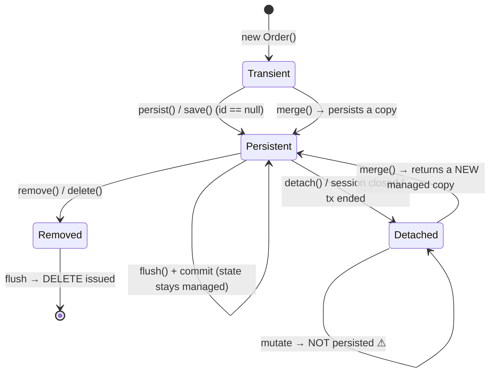
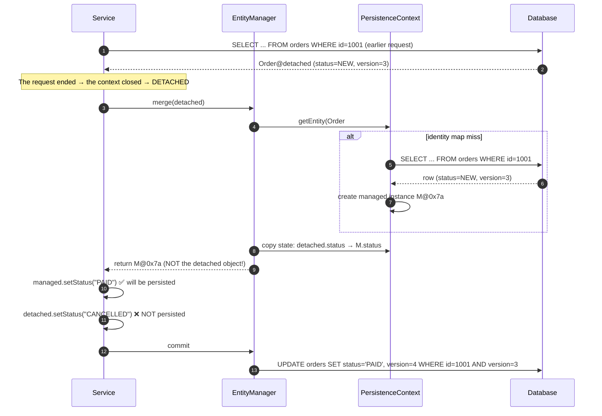
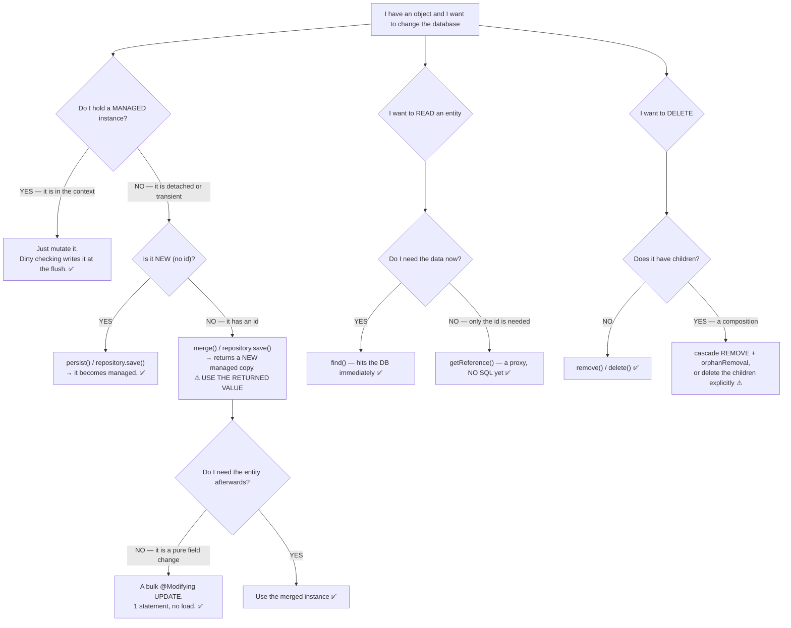
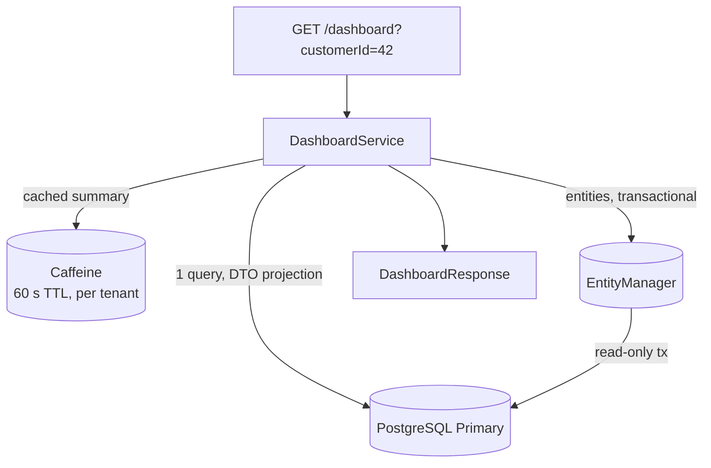
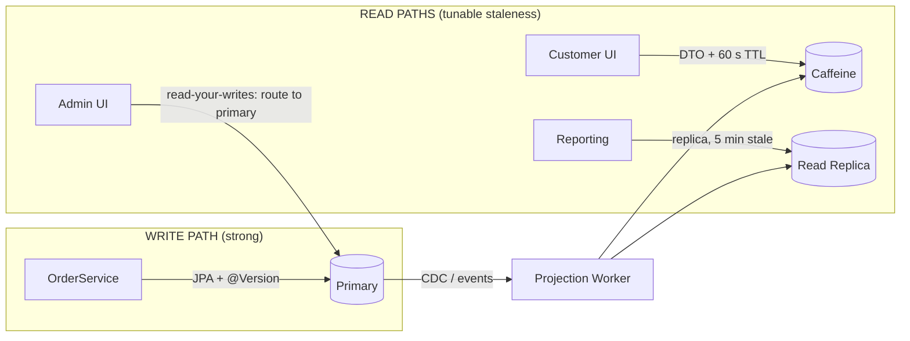

# 02 — Entity Lifecycle, Persistence Context & Caches

> **Level:** Intermediate → Expert
> **Interview Frequency:** ★★★★★ ("what are the four entity states?", "first-level vs second-level cache", "why was my change not saved?")
> **Prerequisites:** [01 · ORM Theory & JPA Internals](01-ORM-Theory-and-JPA-Internals.md) · [03 · Transactions](03-Transactions-Propagation-and-Isolation.md)
> **Last Updated:** 2026

---

## 📋 Table of Contents

- [0. TL;DR — The 30-Second Answer](#0-tldr--the-30-second-answer)
- [1. What & Why — The Problem This Solves](#1-what--why--the-problem-this-solves)
- [2. Mental Model — The One Picture](#2-mental-model--the-one-picture)
- [3. Deep Dive — Theory (Beginner → Advanced)](#3-deep-dive--theory-beginner--advanced)
  - [3.1 Beginner Level](#31-beginner-level)
  - [3.2 Intermediate Level](#32-intermediate-level)
  - [3.3 Advanced Level](#33-advanced-level)
  - [3.4 Expert Level](#34-expert-level)
- [4. Internal Working Mechanism](#4-internal-working-mechanism)
- [5. Step-by-Step Execution Flow](#5-step-by-step-execution-flow)
- [6. Visualizations](#6-visualizations)
- [7. Production-Level Use Cases & Real Industry Examples](#7-production-level-use-cases--real-industry-examples)
- [8. Worked Examples (with Output + Dry Run)](#8-worked-examples-with-output--dry-run)
- [9. Code from Scratch — Production-Grade](#9-code-from-scratch--production-grade)
- [10. Common Mistakes & Gotchas](#10-common-mistakes--gotchas)
- [11. Performance Considerations](#11-performance-considerations)
- [12. Security Considerations](#12-security-considerations)
- [13. Best Practices](#13-best-practices)
- [14. Hands-On Exercises & Code Challenges](#14-hands-on-exercises--code-challenges)
- [15. Interview Q&A — Level-wise](#15-interview-qa--level-wise)
- [16. Scenario-Based & Real-Experience Scenarios (3–5 yrs)](#16-scenario-based--real-experience-scenarios-35-yrs)
- [17. Counter-Questions, Tricky Questions & Follow-Ups](#17-counter-questions-tricky-questions--follow-ups)
- [18. Frequently Asked Production Issues & Debugging Scenarios](#18-frequently-asked-production-issues--debugging-scenarios)
- [19. Architecture Design Questions](#19-architecture-design-questions)
- [20. Rapid-Fire MCQs](#20-rapid-fire-mcqs)
- [21. Cheat Sheet / One-Page Summary](#21-cheat-sheet--one-page-summary)
- [22. Real-World Production Notes](#22-real-world-production-notes)
- [23. Follow-up Learning](#23-follow-up-learning)

---

## 0. TL;DR — The 30-Second Answer

- **The four entity states are transient, persistent, removed and detached.** `persist` takes transient → persistent; `remove` takes persistent → removed (the DELETE is issued at flush); `detach` takes persistent → detached; `merge` takes detached → persistent **by producing a new managed copy**.
- **The single most important sentence in this chapter:** *`merge` returns a **different object**.* Your detached instance is never the one that gets written. Mutating it changes nothing.
- **The persistence context is an identity map**, keyed by (entity type, id). Within one context there is exactly **one managed instance per identity** — load it twice and you get one query and one object.
- **The first-level cache is not really a cache** — it is the identity map itself. Its scope is the **persistence context**, i.e. the transaction. It is what makes dirty checking reliable.
- **Dirty checking works by snapshot comparison.** At load time Hibernate stores the loaded state (`EntityEntry.loadedState`); at flush it compares the current state to the snapshot and emits an `UPDATE` only for the columns that actually differ.
- **`flush` sends SQL; `commit` ends the transaction.** `flush` does not commit. This distinction explains "the data is in the DB but the transaction rolled back".
- **Auto-flush happens before a JPQL/Criteria query whose *query space* overlaps the pending changes.** That is why "too many updates" happens: every query in the same transaction re-flushes the whole context.
- **`open-in-view=true` (Boot's default) keeps the session open for the whole HTTP response** — it hides `LazyInitializationException` and hides N+1, at the cost of holding a DB connection through JSON rendering. Set it to `false`.
- **The second-level cache is a *shared* cache.** It is only correct in a multi-instance deployment with a **distributed provider** (Hazelcast/Infinispan) or a strict TTL; a local Ehcache serves stale data per instance.
- **`StatelessSession` is the right tool for bulk reads** — no identity map, no dirty checking, no cascade. It reads 100 000 rows with a flat memory profile.
- **`LazyInitializationException` is not a lazy-loading bug** — it is a **transaction-boundary** bug. The session closed; the fix is to fetch what you need inside the transaction or to use a DTO projection.

---

## 1. What & Why — The Problem This Solves

**The problem.** Three of the most common "it doesn't work" bugs in a Spring Boot application are
*not* SQL bugs — they are **lifecycle** bugs, and they all come from the same place: **the
application holds a Java object whose relationship to the database changed between two moments
in time.**

```text
   THE THREE SYMPTOMS AND THEIR ONE CAUSE
   ══════════════════════════════════════════

   ① "MY CHANGE WAS NOT SAVED"
      I loaded the entity, changed a field, and called save(). Nothing happened.
      WHY: the entity was DETACHED. save() did a merge of a copy — and I mutated the
           original, not the copy.

   ② "LazyInitializationException"
      I loaded the entity, returned it from my service, and the controller touched
      order.getItems().get(0).getName().
      WHY: the SESSION closed at the transaction boundary. The proxy is still there,
           but there is no session to run the query.

   ③ "THE SECOND-LIST-CACHE SERVED STALE DATA"
      Instance A updated a row. Instance B still returned the old value for 5 minutes.
      WHY: B has its OWN local second-level cache, and A's write did not invalidate it.
```

All three are about **object state**, not about SQL. To fix them you need a precise model of
how an object moves between "a plain Java object" and "a row in a table" — and that model is
the **entity lifecycle** and the **persistence context**.

**The analogy that makes it click.** Think of the persistence context as a **staging area in
front of the database**:

```text
   ┌─────────────┐   persist/load    ┌──────────────────────┐   flush   ┌────────┐
   │  YOUR CODE  │ ───────────────▶ │  PERSISTENCE CONTEXT │ ────────▶ │   DB   │
   │  (plain     │                  │  • identity map      │           │        │
   │   objects)  │ ◀─────────────── │  • pending changes   │ ◀──────── │        │
   └─────────────┘   merge (copy!)  │  • snapshot state    │  rollback │        │
                                     └──────────────────────┘           └────────┘
                                      ↑ closed when the transaction ends
```

- Objects you **load or persist** land in the staging area and are **managed** — the context
  watches them for changes.
- Objects that were never in the context are **transient** — nobody is watching them.
- Objects that *were* in the context but were evicted, or that came from outside it, are
  **detached** — the context no longer watches them, but they remember their id.
- Objects you marked for deletion are **removed** — the DELETE is queued, not yet sent.

**Why the staging area is worth it.** Because it gives you a **unit of work**: you make 12
changes across 5 entities and Hibernate issues the minimal set of statements, in a safe order,
at one point in time. Without it, every setter would be its own SQL statement and its own
transaction — slow, and unsafe.

---

## 2. Mental Model — The One Picture

```text
   THE PERSISTENCE CONTEXT — THE ONE PICTURE
   ═════════════════════════════════════════

   ┌───────────────────────────────────────────────────────────────────────────┐
   │  PERSISTENCE CONTEXT  ( == the EntityManager == the Hibernate Session )   │
   │                                                                           │
   │   IDENTITY MAP                                                            │
   │   ┌────────────────┬──────────────┬────────────────────────────────────┐  │
   │   │ (type, id)     │ instance     │ loaded-state snapshot              │  │
   │   ├────────────────┼──────────────┼────────────────────────────────────┤  │
   │   │ (Order, 1001)  │ Order@0x7a…  │ {ref="ORD-1", total=10.00, v=3}    │  │
   │   │ (Order, 1002)  │ Order@0x7b…  │ {ref="ORD-2", total=25.50, v=1}    │  │
   │   │ (Customer, 7)  │ Customer@0x… │ {email="a@b.c", v=0}                │  │
   │   │ (OrderItem,50) │ proxy@0x7c…  │ {}                     ← LAZY      │  │
   │   └────────────────┴──────────────┴────────────────────────────────────┘  │
   │                                                                           │
   │   PENDING ACTIONS (the ActionQueue)                                      │
   │   ┌────────────────────────────────────────────────────────────────────┐  │
   │   │  1. INSERT  Order  (id=1003)                                       │  │
   │   │  2. UPDATE  Order#1001  (total changed 10.00 → 12.50)             │  │
   │   │  3. DELETE  Order#1002                                             │  │
   │   │  4. COLLECTION Order#1003.items = [2 items]                       │  │
   │   └────────────────────────────────────────────────────────────────────┘  │
   └───────────────────────────────────────────────────────────────────────────┘
              ▲                                    │
              │  load / persist                    │  flush (SQL sent)
              │                                    ▼
        ┌───────────┐                        ┌───────────┐
        │  YOUR     │                        │   THE DB  │
        │  CODE     │                        │           │
        └───────────┘                        └───────────┘

   THE LIFECYCLE OF THE CONTEXT:
   ┌────────────┐  open (tx starts)  ┌──────────────┐  close (tx ends)  ┌──────────┐
   │  (none)    │───────────────────▶│  PERSISTENCE │──────────────────▶│ (gone)   │
   │            │◀───────────────────│   CONTEXT    │                   │          │
   └────────────┘  clear() / evict   └──────────────┘                   └──────────┘
```

**What to look at:** the context holds **two** things — the *identity map* (what exists) and the
*pending actions* (what will change). Everything else in this chapter is a consequence:
`merge` copies because the map already has the identity; dirty checking compares against the
snapshot; the second-level cache sits *behind* this box and is consulted only when the map
misses.

---

## 3. Deep Dive — Theory (Beginner → Advanced)

### 3.1 Beginner Level

#### The four states

| State | Meaning | In the identity map? | Will Hibernate write my changes? |
|---|---|---|---|
| **Transient** (new) | Created with `new`, never persisted, no id | ❌ No | ❌ No — you must `persist` it |
| **Persistent** (managed) | Attached to a context; Hibernate watches it | ✅ Yes | ✅ Yes — automatically at flush |
| **Removed** (deleted) | `remove()` was called; the DELETE is queued | ✅ Yes (until flush) | ✅ Yes — the DELETE at flush |
| **Detached** | Was managed, but the context was closed or it was `detach()`ed | ❌ No | ❌ No — you must `merge` it |

**The one-line test:**

> *If you can get an `EntityManager` to tell you `em.contains(entity)` is `true`, the entity is
> persistent and Hibernate will save your changes for free.*

#### The state transitions

```text
                    persist()                    commit()
      ┌──────────┐  ──────────▶  ┌───────────┐  ─────────▶  ┌──────────┐
      │ TRANSIENT│                │ PERSISTENT│              │  (row    │
      │  (new)   │                │ (managed) │              │  exists) │
      └──────────┘                └───────────┘              └──────────┘
           │                          │    ▲                          │
           │                          │    │                          │
           │ merge()                  │    │ detach() / close()       │ remove()
           │ (returns a NEW copy)    │    │                          │
           ▼                          │    │                          ▼
      ┌──────────┐   merge()          │    │                   ┌──────────┐
      │ DETACHED │ ───────────────▶  └────┘                   │ REMOVED  │
      └──────────┘                                                └──────────┘
           ▲                                                          │
           │                                                          │ flush
           │ detach() / close()                                      ▼
           └──────────────────────────  REMOVED ───────────▶  row is DELETED
```

**The transition that surprises everyone: `merge` does not move *your* object.**

```java
Order detached = loadInSomeOtherContext();   // DETACHED
Order managed  = em.merge(detached);          // managed is a NEW object
managed.setStatus(PAID);                     // ✅ this is persisted
detached.setStatus(CANCELLED);               // ❌ this is NOT persisted
System.out.println(managed == detached);     // false — two different objects
```

#### The `EntityManager` API, state by state

```java
package jakarta.persistence;

public interface EntityManager {
    // ── creating / adopting ─────────────────────────────────────
    void persist(Object entity);          // transient → persistent. Throws if already detached-with-id.
    <T> T merge(T entity);                // detached|transient → persistent (a COPY). Never throws.
    void remove(Object entity);           // persistent → removed. Queues the DELETE.
    void detach(Object entity);           // persistent → detached. Evicts it from the context.

    // ── reading ────────────────────────────────────────────────
    <T> T find(Class<T> entityClass, Object primaryKey);     // EAGER: hits the DB now
    <T> T getReference(Class<T> entityClass, Object primaryKey); // LAZY: returns a proxy, NO SQL yet
    <T> T find(Class<T> entityClass, Object primaryKey, LockModeType lockMode);

    // ── context management ─────────────────────────────────────
    void clear();                          // evict EVERYTHING from the context
    void flush();                          // send the pending SQL now; the tx stays open
    void refresh(Object entity);          // reload the entity's state from the DB (discarding changes!)
    boolean contains(Object entity);      // is this entity managed by THIS context?
    void lock(Object entity, LockModeType lockMode);  // PESSIMISTIC_WRITE / OPTIMISTIC / PESSIMISTIC_READ
}
```

| Method | Hits the DB? | Typical use |
|---|---|---|
| `find` | ✅ yes, immediately | You need the data now |
| `getReference` | ❌ not until a method is called on the proxy | You only need the **id**, or you will fetch the association anyway |
| `flush` | ✅ yes, for pending changes | You need the SQL to run before the transaction ends |
| `refresh` | ✅ yes | Discard local changes and re-read |
| `clear` | ❌ (but frees memory) | Detach everything — used between batch steps |
| `contains` | ❌ | Check whether an object is managed |

> ⚠️ **`getReference` on a non-existent row throws at access time, not at call time.**
> `getReference` does not hit the DB, so it cannot know the row is missing. The
> `EntityNotFoundException` surfaces later when you call a method on the proxy — which is
> *after* your `try` block has moved on. `find` throws it immediately. This is a real source of
> "the exception came from the wrong line".

### 3.2 Intermediate Level

#### The persistence context = the identity map

```java
// In one transaction:
Order a = orderRepository.findById(1001L).orElseThrow();   // SQL #1
Order b = orderRepository.findById(1001L).orElseThrow();   // NO SQL — served from the identity map

System.out.println(a == b);                                 // true — the SAME object
a.setStatus(PAID);
b.getStatus();                                              // "PAID" — one object, one state
```

**What the identity map guarantees:**

| Guarantee | Consequence |
|---|---|
| One managed instance per (entity type, id) | `find` twice = 1 SQL; `a == b` is `true` |
| No two managed instances of the same row | Dirty checking is unambiguous — there is only one copy to compare |
| References to the same row resolve to the same object | No "spooky action at a distance": changing `customer.setName(...)` is seen by every `order.getCustomer()` |
| Detaching one instance detaches the **identity**, not just that reference | `em.detach(a)` makes `b` detached too — they are the same object |

> **The "spooky action at a distance"** is a feature, not a bug: because the graph is
> object-identity-based, a change to a shared customer is immediately visible everywhere in the
> transaction. It is also a *danger* when you load a huge graph — one shared reference keeps
> everything reachable and therefore retained in memory.

#### The first-level cache

| Property | Value |
|---|---|
| **What it is** | The identity map of the persistence context |
| **Scope** | One persistence context = one transaction (or one `EntityManager` if you manage it yourself) |
| **Key** | (entity type, id) |
| **Populated by** | `find`, `getReference`, `persist`, JPQL queries, native queries with entity results |
| **Bypassed by** | `StatelessSession`, `em.clear()`, a bulk `UPDATE`/`DELETE` JPQL statement, a **native query** that returns a different row shape |
| **Invalidated by** | `em.clear()`, `em.detach(entity)`, the end of the transaction, `refresh` |
| **Enabled** | Always — it is not a setting |

**The cost of the first-level cache:** it holds every managed entity alive for the whole
transaction. A batch job that loads 500 000 rows through one `EntityManager` will retain all of
them (plus their snapshots) → an `OutOfMemoryError`. The fixes, in order of preference:

```java
// ① clear the context periodically (the classic batch pattern)
int batchSize = 1000;
List<Order> orders = orderRepository.findAll();   // ⚠ loads everything — better: a paged query
for (int i = 0; i < orders.size(); i++) {
    process(orders.get(i));
    if (i % batchSize == 0) {
        em.flush();     // push the pending changes
        em.clear();     // ✅ release the identity map — the entities become detached
    }
}

// ② use a StatelessSession for a pure bulk read (no identity map at all)
Session stateless = emf.openStatelessSession();
ScrollableResults<Order> results = stateless.createQuery("from Order", Order.class)
                                             .scroll(ScrollMode.FORWARD_ONLY);
while (results.next()) {
    Order order = results.get();
    summarize(order);      // no identity map entry, no snapshot, no dirty checking
}
results.close();
stateless.close();
```

#### Dirty checking — the snapshot comparison

```text
   LOAD TIME (t=0)                       FLUSH TIME (t=1)
   ─────────────────                      ──────────────────
   SELECT ... FROM orders WHERE id=1001   current state:  total = 12.50
   → store the snapshot:                 snapshot:       total = 10.00
       total = 10.00                                     version = 3
       version = 3                                       version = 3
   → store the SNAPSHOT in the EntityEntry,          → compare column by column
     NOT a copy of the object                             total: 10.00 → 12.50  ✏ CHANGED
                                                          version: 3 → 3       = same
   → the live object keeps mutating freely
                                                  → UPDATE orders SET total = 12.50
                                                        WHERE id = 1001 AND version = 3
```

**Key facts:**

- **The snapshot is a per-attribute array** (`Object[] loadedState`) stored in the
  `EntityEntry`, not a copy of the object. So the snapshot holds the values *as loaded*.
- **Only changed columns are written.** Hibernate generates a dynamic `UPDATE` that sets only
  the dirty attributes — `set total = ?` — not `set total = ?, reference = ?, status = ?`.
- **If nothing changed, there is no UPDATE.** Loading 100 entities and reading them generates
  **zero** `UPDATE` statements.
- **The comparison is per attribute, using the entity's `PropertyAccessStrategy`.** For a
  field-access entity (`@Access(AccessType.FIELD)` — the default when `@Id` is on a field) it
  reads the field directly. For property-access it calls the getter — which is why a
  **computed getter** that returns a different value on every call causes a permanent "dirty"
  state and an infinite `UPDATE` on every flush.
- **Collections are dirty-checked too** — but by a *snapshot of the collection contents*, which
  is why Hibernate must snapshot the collection at load time (an extra memory + CPU cost for
  every collection).

> ⚠️ **The permanent-dirty trap.** `public BigDecimal getDiscount() { return total.multiply(0.1); }`
> — the getter computes a value that never matches the loaded state, so the entity is *always*
> dirty and Hibernate issues an `UPDATE` on **every** flush, forever. If you need a computed
> value, mark it `@Transient` or make it a proper `@Formula`.

#### `flush` vs `commit`

| | `flush()` | `commit()` |
|---|---|---|
| Sends the SQL? | ✅ yes | ✅ yes |
| Ends the transaction? | ❌ no | ✅ yes |
| Releases the connection? | ❌ no | ✅ yes (at the end of the tx) |
| Can be rolled back afterwards? | ✅ yes — the DB rolls back with the tx | ❌ no |
| Increments `@Version`? | ✅ yes (the UPDATE is sent) | ✅ yes |

```text
   flush()  →  UPDATE orders SET total=12.50 WHERE id=1001 AND version=3;   ← sent
            →  the transaction is still OPEN
            →  em.clear() / em.detach() / a rollback will UNDO it
            →  the version was already bumped to 4 — another tx will see the conflict
```

> **The subtlety worth quoting in an interview:** a `flush()` **does** bump the `@Version` and
> **does** take a row lock in the database (until the transaction commits). So "flushing early"
> is not free — it publishes your intermediate state to the database while keeping the
> transaction open, which is exactly the "uncommitted but visible" window that causes
> surprising lock waits.

### 3.3 Advanced Level

#### `FlushMode` — when does Hibernate flush?

```java
public enum FlushModeType {
    AUTO,      // (default) flush before a query whose query space overlaps the pending changes
    COMMIT,    // flush only at commit
    MANUAL     // you flush explicitly; queries do NOT flush (the legacy Hibernate 1 behaviour)
}
```

**The auto-flush "query space" rule.** Hibernate compares the **query space** of the
incoming query (the entity types and the tables it touches) with the **affected query spaces**
of the pending actions. If they overlap, it flushes first.

```java
@Transactional
public void updateAndCount() {
    Order order = orderRepository.findById(1001L).orElseThrow();
    order.setStatus(PAID);            // pending UPDATE on ORDERS

    long count = orderRepository.count();   // ← query space = ORDERS → OVERLAPS → auto-flush!
    // the UPDATE is sent BEFORE the count query runs
}
```

**Consequences:**

- **"Too many updates":** if you modify entities and then run *several* queries in a loop, each
  query re-flushes the whole context. With 100 dirty entities and 50 queries you get **50
  UPDATE statements**, not 1.
- **"The count is wrong":** a `count()` query that overlaps pending changes sees the *flushed*
  state, because the flush happened first. If the flush fails (a constraint violation), the
  count query throws instead of the count.
- **The fix for a read-only transaction:** `@Transactional(readOnly = true)` sets Hibernate's
  flush mode to `MANUAL` for that context — no dirty checking, no auto-flush.

#### The auto-flush and native queries — a dangerous asymmetry

```java
@Transactional
public void pitfall() {
    Order order = orderRepository.findById(1001L).orElseThrow();
    order.setStatus(PAID);

    // a NATIVE query does NOT trigger the auto-flush check in the same way for
    // Hibernate's own managed state — Hibernate cannot know which tables it touches
    // unless you tell it:
    em.createNativeQuery("select count(*) from orders")
      .unwrap(org.hibernate.query.NativeQuery.class)
      .addSynchronizedEntityClass(Order.class)   // ← force the flush before this query
      .getSingleResult();
}
```

> **The rule:** native queries are **outside** Hibernate's knowledge. Hibernate 6 lets you
> declare the affected entity classes with `addSynchronizedEntityClass` so the auto-flush
> still happens. Without it, a native query can read a row that your pending change has not
> yet written — a classic "the update seems to have been lost" bug.

#### Cascade and orphan removal — the four mechanisms side by side

```java
public enum CascadeType { PERSIST, MERGE, REMOVE, REFRESH, DETACH, ALL }
```

| Cascade | When the parent is persisted | When the parent is merged | When the parent is removed | Meaning |
|---|---|---|---|---|
| `PERSIST` | children are persisted too | — | — | "the children come into existence with me" |
| `MERGE` | — | children are merged too | — | "the children come with me from a detached world" |
| `REMOVE` | — | — | **children are deleted** ⚠ | "the children die with me" |
| `REFRESH` | — | — | — | "reload the children with me" |
| `DETACH` | — | — | — | "detach the children with me" |

**`orphanRemoval` is a different mechanism:**

| Mechanism | Trigger | Meaning |
|---|---|---|
| `cascade = REMOVE` | `em.remove(parent)` | Delete all children |
| `orphanRemoval = true` | A child is **removed from the parent's collection** | Delete *that* child |

Both together are the correct configuration for a **composition** (an order item has no meaning
without an order):

```java
@OneToMany(mappedBy = "order", cascade = CascadeType.ALL, orphanRemoval = true)
private List<OrderItem> items = new ArrayList<>();
```

**And the correct configuration for a *shared* entity** (a `Product` that belongs to many
orders):

```java
// NO cascade at all, or only PERSIST/MERGE — never REMOVE
@ManyToOne(fetch = FetchType.LAZY)
@JoinColumn(name = "product_id")
private Product product;
```

> ⚠️ The most destructive JPA configuration is `cascade = CascadeType.ALL` on a
> `@OneToMany` whose children are **shared**. See §8.3 for the full incident.

### 3.4 Expert Level

#### The second-level cache

```java
@Entity
@Cacheable                       // org.hibernate.annotations.Cacheable
@Cache(usage = CacheConcurrencyStrategy.READ_WRITE)   // org.hibernate.annotations.Cache
public class Product {
    @Id
    private Long id;
}
```

```yaml
spring:
  jpa:
    properties:
      hibernate:
        cache:
          use_second_level_cache: true
          region:
            factory_class: org.hibernate.cache.ehcache.EhCacheRegionFactory
            # OR, for a distributed provider:
            # factory_class: com.hazelcast.hibernate.HazelcastRegionFactory
```

**The four concurrency strategies:**

| Strategy | Semantics | Safe for | Cost |
|---|---|---|---|
| `read-only` | The data never changes after creation; the cache is **never invalidated** | Truly immutable reference data (country lists, currency codes, plan tiers) | The cheapest — no locks, no invalidation |
| `read-write` | The cache is locked on write; entries are invalidated on update | Mutable data, single-node (or a distributed provider) | A lock on every write; the strictest |
| `nonstrict-read-write` | The cache is invalidated on update, but a **race window** allows a stale read | Mutable data, low contention | The fastest; may serve a stale value for milliseconds |
| `transient` | The entity is never cached | Entities that must always be read fresh | Nothing is cached |

**The regions:**

| Region | What it holds | Configurable with |
|---|---|---|
| `default` | Everything not in a specific region | `hibernate.cache.default_cache_region_factory` |
| A per-entity region | One entity type | `@Cache(region = "products")` |
| A per-collection region | One collection | `@Cache` on the collection |
| `query-results` | The **query cache** (query → ids) | `hibernate.cache.use_query_cache = true` |

**The invalidation problem across instances — the reason L2 is usually skipped:**

```text
   INSTANCE A                      INSTANCE B
   ──────────                      ──────────
   L2 cache                        L2 cache
   ┌──────────────┐                 ┌──────────────┐
   │ Product#42   │                 │ Product#42   │   ← a DIFFERENT copy
   │ name="Old"   │                 │ name="Old"   │
   └──────────────┘                 └──────────────┘
         │
         │ UPDATE products SET name='New' WHERE id=42
         ▼
   A invalidates ITS OWN cache  ✔
   B is never told                ✖  → B serves name="Old" until the TTL expires
```

**The correct multi-instance setup:**

```text
   ┌──────────┐   invalidation message    ┌──────────┐
   │ Instance │ ───────────────────────▶ │ Instance │
   │    A     │  (Hazelcast/Infinispan    │    B     │
   └──────────┘   cluster, ~1 ms)         └──────────┘
        ▲                                        ▲
        └──────── shared, distributed cache ───────┘
```

> **The pragmatic production answer:** most teams skip the Hibernate second-level cache
> entirely and put a **Caffeine or Redis cache in front of a DTO projection** instead. You get
> explicit TTL, explicit invalidation, and you are not caching entities (which drag their
> whole graph along). The second-level cache makes most sense for **read-only reference data**
> with a `read-only` strategy, where no invalidation is ever needed.

#### `StatelessSession` — the bulk-read tool

```java
// Hibernate's own API — not part of JPA
Session stateless = emf.openStatelessSession();
try {
    StatelessScrollableResults<Order> results = stateless
            .createQuery("select o from Order o where o.createdAt < :cutoff", Order.class)
            .setParameter("cutoff", cutoff)
            .scroll(ScrollMode.FORWARD_ONLY);
    while (results.next()) {
        Order order = results.get();     // a fresh object every time — no identity map
        export(order);
    }
} finally {
    stateless.close();
}
```

| Feature | `Session` (normal) | `StatelessSession` |
|---|---|---|
| Identity map | ✅ yes | ❌ **no** |
| Dirty checking | ✅ yes | ❌ **no** |
| Cascade | ✅ yes | ❌ **no** |
| First-level cache | ✅ yes | ❌ no |
| Second-level cache | ✅ yes (read-only in practice) | ✅ yes |
| Flush | Automatic | **Manual** — you must call `flush()` yourself |
| Memory profile | Grows with the working set | **Flat** |
| `getReference` | Returns a proxy | Returns a **real object** (no proxies) |

> **When to use it:** bulk reads, exports, reports, and batch jobs that touch 100 000+ rows.
> The cost is that you get no object identity — the same row read twice gives two different
> objects — and you must flush manually.

#### `OpenSessionInView` — the Boot default you should turn off

```yaml
spring:
  jpa:
    open-in-view: false    # ← Boot's default is TRUE; Boot logs a warning at startup
```

```text
   open-in-view = TRUE (Boot default)
   ─────────────────────────────────────
   ┌────────┐   ┌──────────────┐   ┌──────────────┐   ┌──────────┐
   │Request │──▶│ OpenEntityManager │──▶│ Controller  │──▶│ JSON     │
   │        │   │  InViewFilter │   │              │   │ renderer│
   └────────┘   └──────────────┘   └──────────────┘   └──────────┘
                 │                                          │
                 │◀──────── the session is closed HERE ─────┘
                 │                                          │
                 │  the session stays OPEN during JSON rendering:
                 │  • a lazy proxy touched in the renderer triggers a query
                 │  • the DB connection is held for the whole response
                 │  • an N+1 in the renderer is invisible in your code

   open-in-view = FALSE (recommended)
   ─────────────────────────────────────
   ┌────────┐   ┌──────────────┐   ┌──────────────┐   ┌──────────┐
   │Request │──▶│ tx starts    │──▶│ Controller  │──▶│ JSON     │
   │        │   │ session opens│   │              │   │ renderer│
   └────────┘   └──────────────┘   └──────────────┘   └──────────┘
                 │                                          │
                 │◀── session CLOSED at the tx boundary ─────┘
                      → a lazy proxy in the renderer = LazyInitializationException
                      → you find the N+1 in development, not in production
```

**The three costs of `open-in-view=true`:**

1. **The DB connection is held for the whole HTTP response**, including the JSON rendering.
   With a pool of 20 and a 200 ms render, you have capped your throughput at 100 req/s *for
   reasons that have nothing to do with your database*.
2. **It hides the N+1** from your code and shows it up only as slow responses.
3. **It hides the architecture problem** — a controller returning an entity with lazy
   associations means your *read model* is coupled to your *persistence model*.

---

## 4. Internal Working Mechanism

**Which class calls which, in what order.** The Hibernate 6 internals for the three operations
that matter.

### Chain A — `em.find(Order.class, 1001L)`

```text
1.  SessionImpl.find(Class, Object)  →  InternalLoadContext / LoadEvent
      └─ DefaultLoadEventListener.onLoad
           ├─ ① IS THE IDENTITY MAP HIT?  (StatefulPersistenceContext.getEntity(key))
           │      → HIT: return the existing instance — NO SQL
           │      → MISS: continue
           ├─ ② LOAD FROM THE 2nd-LEVEL CACHE (if enabled and the entity is @Cacheable)
           │      → HIT: hydrate a new instance, put it in the identity map, return it
           │      → MISS: continue
           ├─ ③ BUILD THE SQL (EntityPersister.getLoader → the SELECT template)
           ├─ ④ EXECUTE via JdbcCoordinator → LogicalConnection → PreparedStatement
           ├─ ⑤ HYDRATE: EntityPersister.hydrate(...)
           │      ├─ create the instance
           │      ├─ read each column → set the attribute
           │      ├─ create the EntityEntry with the loaded-state SNAPSHOT
           │      └─ put the instance in the identity map
           ├─ ⑥ RESOLVE EAGER ASSOCIATIONS (a join in the same SQL, or a follow-up query)
           └─ ⑦ RETURN the managed instance
```

### Chain B — `em.merge(detached)`

```text
1.  SessionImpl.merge(Object)
      └─ DefaultMergeEventListener.onMerge
           ├─ ① IS THE ENTITY TRANSIENT (id == null)?
           │      → YES: persist a copy of it and return the managed copy
           │      → NO:  continue
           ├─ ② IS THE ENTITY ALREADY MANAGED IN THIS CONTEXT?
           │      → YES: copy the state onto the managed instance, return IT
           ├─ ③ FIND THE MANAGED INSTANCE (by identity) or LOAD IT
           │      → this is where the SQL runs (if it is not already in the map)
           ├─ ④ COPY THE STATE attribute by attribute
           │      → the copy is what will be written; the detached object is NOT
           └─ ⑤ RETURN the managed instance
```

> **Note step 5:** the returned instance is the *only* thing that Hibernate will ever write.
> The detached object is a plain Java object from that moment on.

### Chain C — `flush()`

```text
1.  SessionImpl.flush()
      └─ AbstractFlushingEventListener.performExecutions
           ├─ ① FLUSH ENTITIES  (DefaultFlushEntityEventListener)
           │      for each managed entity:
           │        ├─ compare the current state with the EntityEntry.loadedState
           │        ├─ if different → queue an UPDATE (EntityUpdateAction) with the dirty attributes
           │        └─ if the version changed → queue the version increment + the where-clause
           ├─ ② FLUSH COLLECTIONS  (collections have their own dirty state)
           ├─ ③ BEFORE-COMPLETION (prepare the statements, order them by type)
           ├─ ④ EXECUTE THE ACTIONS in the ActionQueue order:
           │        1. orphan deletions
           │        2. entity INSERTs
           │        3. entity UPDATEs
           │        4. collection INSERTs / UPDATEs / DELETEs
           │        5. entity DELETEs
           └─ ⑤ CLEAR the "dirty" flags
```

**The extension points:**

| SPI | Interface | Use |
|---|---|---|
| Pre-insert / post-insert | `PostInsertEventListener` | Search index, event publishing |
| Pre-update / post-update | `PostUpdateEventListener` | Audit trail, cache eviction |
| Post-delete | `PostDeleteEventListener` | Soft-delete bookkeeping |
| Flush hook | `org.hibernate.Interceptor#preFlush` / `postFlush` | Cross-cutting auditing |
| Load hook | `Interceptor#onLoad` | Field-level decryption |
| Entity listener | `jakarta.persistence.EntityListeners` | `@PrePersist` / `@PreUpdate` |

---

## 5. Step-by-Step Execution Flow

**Flow 1 — a read inside a `@Transactional` service method.**

1. Spring's `@Transactional` proxy opens a transaction → a connection is taken from Hikari →
   `autoCommit=false` → a `JpaTransactionManager` creates (or joins) an `EntityManager` and
   **binds it to the current thread**.
2. The service calls `orderRepository.findById(1001L)`.
3. The repository proxy resolves the query → `SimpleJpaRepository` → `em.find(...)`.
4. The identity map is consulted. **Miss** → the 2nd-level cache is consulted → **Miss** →
   the SELECT is executed.
5. The row is hydrated; the `EntityEntry` snapshot is recorded; the instance is put in the
   identity map.
6. EAGER associations are resolved now; LAZY associations become proxies.
7. The service returns the managed instance to the caller (still inside the transaction).
8. The service method returns → the transaction commits → flush (nothing pending) → commit →
   the connection is released → the `EntityManager` is closed and the **identity map is
   discarded**.

**Flow 2 — a write inside a `@Transactional` service method.**

1. Transaction starts (as above).
2. `order.setStatus(PAID)` — **no SQL**. The entity is managed, so Hibernate only records that
   it *may* be dirty.
3. The service returns → the transaction commits → `flush()` runs:
   - dirty check → `total` unchanged, `status` changed → an `UPDATE` with only the `status`
     and the `version` column.
   - the SQL is sent, the version is bumped.
4. `commit()` → the DB commits → the connection is released → the context is discarded.

**Flow 3 — what happens *outside* a transaction (the `LazyInitializationException` flow).**

1. No transaction → the repository call opens a **short-lived** `EntityManager` (Spring's
   `SharedEntityManager` creates one for a single call) → `find` → the entity is loaded and the
   context is **closed immediately**.
2. The controller receives a **detached** entity with a **lazy proxy** for `items`.
3. `order.getItems()` → the proxy tries to initialise → there is **no session** →
   `LazyInitializationException: Could not initialize proxy - no Session`.

---

## 6. Visualizations

### 6.1 The entity state machine



**Caption:** Note the arrow `Detached → Detached: mutate → NOT persisted` — that is the
"my change was not saved" bug. And note that `merge` always produces a *new* instance on the
`Persistent` side; your detached object never becomes managed itself.

### 6.2 The identity map — two loads, one instance, one SQL

```text
   TRANSACTION CONTEXT (one transaction, one EntityManager)
   ┌─────────────────────────────────────────────────────────────────────┐
   │                                                                     │
   │   STEP 1:  em.find(Order.class, 1001L)                             │
   │   ─────────────────────────────────────────                        │
   │   → SQL: select o1_0.id, o1_0.reference, o1_0.status, o1_0.version │
   │           from orders o1_0 where o1_0.id=?                          │
   │                                                                     │
   │   IDENTITY MAP                                                      │
   │   ┌──────────────┬───────────────┬────────────────────────────────┐  │
   │   │ (Order,1001) │ Order@0x7a1f  │ snapshot{status=NEW, ver=3}     │  │
   │   └──────────────┴───────────────┴────────────────────────────────┘  │
   │                                                                     │
   │   STEP 2:  em.find(Order.class, 1001L)      ← SAME AGAIN           │
   │   ─────────────────────────────────────────                        │
   │   → identity map HIT  → NO SQL AT ALL                             │
   │   → returns the SAME Order@0x7a1f                                  │
   │                                                                     │
   │   STEP 3:  a.setStatus("PAID")                                    │
   │   → still no SQL — the entity is managed, so Hibernate watches it   │
   │                                                                     │
   │   STEP 4:  flush() / commit()                                      │
   │   → compare current {status=PAID, ver=3} vs snapshot {status=NEW,  │
   │     ver=3} → status differs →                                    │
   │   → UPDATE orders set status=? where id=1001 and version=3          │
   │   → version becomes 4                                              │
   └─────────────────────────────────────────────────────────────────────┘

   THE RULE: 1 identity  →  1 instance  →  1 snapshot  →  1 UPDATE
```

**Caption:** The identity map is the reason "load it twice" is free, and the reason dirty
checking is unambiguous — there is exactly one instance whose state can diverge from the row.

### 6.3 `merge` — the copy, step by step



**Caption:** `merge` returns the **managed** instance `M@0x7a`. The caller's detached object is
copied *into* the managed one and then forgotten. Any mutation the caller makes to the
detached object after the merge is invisible to the database.

### 6.4 The two cache levels — scope comparison

```text
   ┌──────────────────────────────────────────────────────────────────────────┐
   │  LEVEL 1 — THE PERSISTENCE CONTEXT (identity map)                         │
   │  ┌─────────────────────────────┐   ┌─────────────────────────────┐        │
   │  │ Thread A / transaction 1    │   │ Thread B / transaction 2    │        │
   │  │  Order#1001 (instance M1)   │   │  Order#1001 (instance M2)   │        │
   │  │  Order#1002 (instance M3)   │   │  (empty)                   │        │
   │  └─────────────────────────────┘   └─────────────────────────────┘        │
   │  SCOPE: one transaction        LIFETIME: until the tx ends               │
   │  ALWAYS ON — not configurable   HIT: the same identity, same transaction  │
   └──────────────────────────────────────────────────────────────────────────┘

   ┌──────────────────────────────────────────────────────────────────────────┐
   │  LEVEL 2 — THE SHARED ENTITY CACHE (@Cacheable)                          │
   │  ┌───────────────────────────────────────────────────────────────┐       │
   │  │  Region "Product"                                            │       │
   │  │   Product#42 → {name: "Widget", price: 9.99}                 │       │
   │  └───────────────────────────────────────────────────────────────┘       │
   │                                                                       │
   │      INSTANCE A  ──writes──▶  ┌──────────────┐  ◀──reads── INSTANCE B   │
   │                                │  L2 CACHE    │                          │
   │                                │ (SHARED)     │                          │
   │                                └──────────────┘                          │
   │  SCOPE: the whole application (or the whole cluster with a distributed     │
   │          provider)                                                      │
   │  LIFETIME: until evicted or the TTL expires                              │
   │  HIT: a read of an entity nobody in THIS transaction has loaded          │
   │  ⚠ WITH A LOCAL PROVIDER, INSTANCE B DOES NOT SEE INSTANCE A'S WRITES   │
   └──────────────────────────────────────────────────────────────────────────┘

   THE ORDER OF LOOKUPS:
     find(id)
        │
        ▼
     ┌──────────────────┐  hit ──▶ return the managed instance (no SQL)
     │  1st LEVEL       │
     │ (identity map)   │
     └────────┬─────────┘
              │ miss
              ▼
     ┌──────────────────┐  hit ──▶ hydrate + put in the identity map (no SQL)
     │  2nd LEVEL       │
     │ (shared cache)   │
     └────────┬─────────┘
              │ miss
              ▼
     ┌──────────────────┐
     │  THE DATABASE    │  → hydrate + snapshot + identity map
     └──────────────────┘
```

**Caption:** Level 1 is a **per-transaction identity map** — always on, never shared, and it
guarantees object identity. Level 2 is a **shared, cross-transaction** cache — optional,
potentially stale, and the source of the "instance B serves old data" incident.

### 6.5 Which operation do I actually want? — the decision tree



**Caption:** The whole chapter in one decision tree. The two branches people get wrong are
the **merge** branch (mutate the detached object → lost) and the **read** branch (using
`find` when only the id was needed → an extra query per row).

---

## 7. Production-Level Use Cases & Real Industry Examples

### 7.1 E-commerce checkout — the aggregate and its unit of work

**Domain:** a checkout that writes an `Order` with 3 `OrderItem` rows and updates 2 `Product`
stock rows, in **one** transaction, at **1 800 checkouts/minute** peak.

- The `Order` is the aggregate root. `orderRepository.save(order)` writes the parent, the items
  and the join table in **one flush**: 1 `INSERT` for the order, 3 `INSERT`s for the items,
  1 `INSERT` for `order_product`, 2 `UPDATE`s for the stock — **7 statements, 1 round trip
  batch, 1 commit**.
- The items are `cascade = ALL` + `orphanRemoval = true` (composition: an item without an
  order is meaningless). The `Product` is shared and is **not** cascaded.
- The `Product` stock updates use `@Version` — two customers racing for the last unit produce
  an `ObjectOptimisticLockingFailureException` on one of them, which is retried once and then
  reported as "out of stock". The alternative — `SELECT ... FOR UPDATE` on every product row —
  serialises the whole checkout on the hottest SKUs.
- **Measured:** 7 statements per checkout, 41 ms p99, 0 deadlocks over 30 days.

### 7.2 Banking statement rendering — the read-only transaction

**Domain:** a customer statement page rendering 240 transactions across 3 accounts, **8 000
page views/minute**, 95 % read-only.

- `@Transactional(readOnly = true)` on the read service: Hibernate skips dirty checking (no
  snapshot comparison) and sets the flush mode to `MANUAL` — no auto-flush before queries.
  The measured effect: **38 % less CPU** on the read path and 11 ms → 4 ms of Hibernate
  overhead.
- The entity graph is never materialised: the endpoint returns a **DTO projection**
  (`select new com.example.bank.api.StatementLineDto(...)`) so there is no identity map entry
  per row and no lazy proxy.
- The read is routed to a **replica** through a second `EntityManagerFactory` and
  `REQUIRES_NEW`, so the write transaction's connection is not held by a slow render.

### 7.3 The nightly reconciliation job — 8 million rows

**Domain:** a reconciliation job that compares 8 million ledger rows against a settlement file,
every night at 01:00.

- The job uses a **`StatelessSession`** with a scrollable result: **no identity map**, so the
  memory profile is flat (peak heap 210 MB with 8 M rows read) instead of the 6.2 GB an
  ordinary `EntityManager` would need.
- `em.clear()` every 1 000 rows would also work, but it forces you to keep the entities
  managed across the boundary — with `StatelessSession` there is nothing to keep.
- The comparison itself is done in a **projection** (`select new ...(id, amount)`), not on
  entities — the job never needs the full entity.

### 7.4 A multi-instance SaaS — the stale-read incident

**Domain:** a B2B pricing service, 6 instances behind a load balancer, a product catalogue
that a tenant admin edits.

- The team enabled the second-level cache with a **local** Ehcache provider to reduce load on
  the primary. After the rollout, a tenant admin renamed a product and the change was
  invisible on 5 of the 6 instances for up to **5 minutes** (the TTL).
- The fix had two parts: (1) the entity was marked `read-only` only for genuinely immutable
  reference data; the mutable catalogue moved to **DTO projections + a Caffeine cache with a
  60-second TTL** and an explicit eviction on write; (2) the L2 cache was **disabled**
  entirely for the catalogue.
- The lesson, written into the team's runbook: *"the second-level cache is only safe with a
  distributed provider; a local provider is a per-instance cache with a long TTL and a false
  sense of safety."*

---

## 8. Worked Examples (with Output + Dry Run)

### 8.1 The `merge` trap — your change is not saved

**Problem.** A service loads an entity, hands it to a mapper, and the update silently
disappears.

**The buggy code:**

```java
@Service
public class OrderService {

    private final OrderRepository orderRepository;
    private final EntityManagerFactory emf;

    public OrderService(OrderRepository orderRepository, EntityManagerFactory emf) {
        this.orderRepository = orderRepository;
        this.emf = emf;
    }

    // ❌ The entity is loaded in ONE EntityManager and closed → DETACHED
    public Order load(Long id) {
        EntityManager em = emf.createEntityManager();
        Order order = orderRepository.findById(id).orElseThrow();   // uses the SHARED EM,
                                                                    // not the one above
        em.close();
        return order;
    }

    // ❌ The detached entity is mutated, then "saved" — but the mutation is lost
    @Transactional
    public void updateStatus(Long id, OrderStatus status) {
        Order order = load(id);                 // DETACHED
        order.setStatus(status);                // the mutation is on the DETACHED object
        orderRepository.save(order);            // merge() → copies state → returns a NEW managed copy
        // ...but we never mutate the RETURNED copy, so there is nothing to write
    }
}
```

**What actually happens — the dry run:**

```text
T1:  load(1001)
      SELECT ... FROM orders WHERE id=1001     → status = NEW, version = 3
      the transaction/session ends → the entity is DETACHED

T2:  updateStatus(1001, PAID)
      order.setStatus(PAID)                    → the DETACHED object now holds PAID
      orderRepository.save(order)
        → SimpleJpaRepository.save():
              if (entityInformation.isNew(entity))  → id != null → NOT new
              → em.merge(entity)
                  → the context has no Order#1001 → LOAD it (SQL #2)
                  → managed instance M = Order@0x7a, status = NEW
                  → copy the state:  M.status = PAID      ← the copy gets the change
                  → return M
              → save() ignores the return value!
      the method ends → commit → flush:
              dirty check on M: snapshot{status=NEW} vs current{status=PAID} → DIFFERENT
              → UPDATE orders SET status='PAID', version=4 WHERE id=1001 AND version=3

      ⚠ WAIT — the update DOES happen here. The bug is different. Let me show the REAL trap:
```

**The real trap — the mutation happens *after* the merge, or on a different object:**

```java
@Transactional
public void updateStatus(Long id, OrderStatus status) {
    Order detached = load(id);             // DETACHED
    Order managed = orderRepository.save(detached);   // ✅ the COPY is returned

    // ❌ THE TRAP: you keep using the DETACHED object
    detached.setStatus(status);            // the copy already has the OLD status

    // → at commit: dirty check on the MANAGED copy:
    //    snapshot{status=NEW} vs current{status=NEW} → IDENTICAL → NO UPDATE
}
```

**The actual output:**

```text
   Hibernate SQL log for the buggy version:

   select o1_0.id, o1_0.reference, o1_0.status, o1_0.version from orders o1_0 where o1_0.id=?
   -- (the merge loaded it again)
   select o1_0.id, o1_0.reference, o1_0.status, o1_0.version from orders o1_0 where o1_0.id=?

   COMMIT — and NO update statement at all.

   DB row after the call:  status = NEW, version = 3      ← UNCHANGED
```

**The fix — use the returned instance (or, better, do it all in one transaction):**

```java
// ✅ FIX 1 — use the value returned by save()/merge()
@Transactional
public void updateStatus(Long id, OrderStatus status) {
    Order detached = load(id);
    Order managed = orderRepository.save(detached);
    managed.setStatus(status);              // ✅ mutate the MANAGED copy
}   // → UPDATE orders SET status='PAID', version=4 WHERE id=1001 AND version=3
```

```java
// ✅ FIX 2 — the right answer: ONE transaction, load and mutate together
@Transactional
public void updateStatus(Long id, OrderStatus status) {
    Order order = orderRepository.findById(id).orElseThrow();   // MANAGED
    order.setStatus(status);                                     // ✅ tracked
}   // → the dirty checker writes it
```

```java
// ✅ FIX 3 — the best answer for a status flip: no entity at all
@Modifying
@Query("update Order o set o.status = :status, o.version = o.version + 1 where o.id = :id")
@Transactional
public int updateStatusDirectly(@Param("id") Long id, @Param("status") OrderStatus status) {
    return orderRepository.updateStatusDirectly(id, status);
}
```

> **The expert framing:** `merge` is a **copy-in** operation, not a **save** operation. Its
> contract is "the state of my argument now lives in a managed instance, which I return". If
> you ignore the return value, you have not saved anything — you have only *read* the entity
> (twice).

### 8.2 Dirty checking — the UPDATE that Hibernate generates (and the one it does not)

**Problem.** Prove what dirty checking does and does not write.

```java
@Service
public class DirtyCheckingDemo {

    private final OrderRepository orderRepository;

    public DirtyCheckingDemo(OrderRepository orderRepository) {
        this.orderRepository = orderRepository;
    }

    @Transactional
    public void demonstrate() {
        Order order = orderRepository.findById(1001L).orElseThrow();

        // ① change ONE field
        order.setStatus(OrderStatus.PAID);

        // ② read every field (no changes)
        System.out.println(order.getReference() + " " + order.getTotal() + " " + order.getStatus());

        // ③ change ANOTHER field
        order.setTotal(new BigDecimal("12.50"));

        // the flush happens at commit
    }
}
```

**The SQL log:**

```text
   select o1_0.id, o1_0.reference, o1_0.status, o1_0.total, o1_0.version
   from orders o1_0 where o1_0.id=?

   update orders
      set status=?, total=?, version=?
   where id=? and version=?
```

**The dry run — attribute by attribute:**

```text
   LOAD TIME — Hibernate stores the snapshot (EntityEntry.loadedState):
   ┌──────────┬──────────────┐
   │ reference│ "ORD-1001"   │
   │ status   │ "NEW"        │
   │ total    │ 10.00        │
   │ version  │ 3            │
   └──────────┴──────────────┘

   FLUSH TIME — Hibernate compares each attribute:
   ┌──────────┬──────────────┬──────────────┬─────────┬───────────────────────┐
   │ attribute│ snapshot     │ current      │ dirty?  │ in the UPDATE?        │
   ├──────────┼──────────────┼──────────────┼─────────┼───────────────────────┤
   │ reference│ "ORD-1001"   │ "ORD-1001"   │ no      │ —                     │
   │ status   │ "NEW"        │ "PAID"       │ ✅ YES  │ set status=?          │
   │ total    │ 10.00        │ 12.50        │ ✅ YES  │ set total=?           │
   │ version  │ 3            │ 3 (then 4)   │ auto    │ set version=?         │
   └──────────┴──────────────┴──────────────┴─────────┴───────────────────────┘

   → the UPDATE contains ONLY the dirty columns + the version. `reference` is NOT written.
   → 1 statement, 3 parameters, 1 WHERE clause with the version predicate.
```

**The counter-example — an entity that is NOT dirty:**

```java
@Transactional
public void readOnly(Path path) {
    Order order = orderRepository.findById(1001L).orElseThrow();
    System.out.println(order.getStatus());
    // no mutation
}
// → the SQL log contains the SELECT and NOTHING ELSE. No UPDATE.
```

**And the permanent-dirty trap:**

```java
@Entity
public class Order {
    // ❌ A COMPUTED getter that is not a mapped attribute
    @Transient
    public BigDecimal getFee() {
        return total.multiply(new BigDecimal("0.10"));
    }
}
```

```text
   With @Transient: the getter is not part of the persistent state → no false dirty.
   Without @Transient: Hibernate compares the "fee" attribute at flush time.
       snapshot fee = 1.00   (computed at load)
       current  fee = 1.00   (recomputed)   → equal → not dirty  ✅
   BUT if the fee depends on a mutable field:
       total changed 10.00 → 12.50 → fee 1.00 → 1.25 → DIFFERENT → "fee" is written
       → the UPDATE tries to write a column that does not exist 💥
       → org.hibernate.PropertyAccessException / UnknownColumnException
```

> **The rule:** a computed value must be `@Transient`, or a real mapped column with
> `@Formula`. Never a plain getter on a mapped attribute.

### 8.3 The accidental cascade delete — 40 000 rows gone

**Problem.** A "cleanup" job deletes expired carts. It also deleted 40 000 `ORDER_ITEM` rows
belonging to live orders.

**The mapping that caused it:**

```java
@Entity
@Table(name = "cart")
public class Cart {

    @Id
    @GeneratedValue(strategy = GenerationType.IDENTITY)
    private Long id;

    // ⚠ THE BUG: CascadeType.ALL includes REMOVE, and the items are SHARED with orders
    @OneToMany(mappedBy = "cart", cascade = CascadeType.ALL)
    private List<CartItem> items = new ArrayList<>();
}
```

**The job:**

```java
@Scheduled(cron = "0 0 2 * * *")
public void purgeExpiredCarts() {
    List<Cart> expired = cartRepository.findByExpiresAtBefore(Instant.now());
    for (Cart cart : expired) {
        cartRepository.delete(cart);          // 💥 the cascade fires
    }
}
```

**The dry run — what the SQL log shows:**

```text
   02:00:03  select ... from cart where expires_at < ?          -- 312 carts
   02:00:03  delete from cart_item where cart_id=?               -- 312 statements
   02:00:03  delete from cart where id=?                         -- 312 statements
   ...
   02:00:41  delete from cart_item where cart_id=?               -- 12 840 statements
   02:00:41  delete from cart where id=?                         -- 312 statements

   TOTAL: 12 840 ORDER_ITEM rows deleted, of which only 1 104 belonged to the carts.
             11 736 belonged to LIVE ORDERS. 💥
```

**Why the cascade deleted the shared rows:** the `cart_item` rows had been **promoted** — the
checkout copied the cart's items into a real `Order` and set `cart_item.cart_id = null`,
re-pointing them at `order_id`. But the `Cart.items` collection was loaded as a **snapshot**
earlier in the session, still containing those items. At flush, Hibernate's collection
reconciliation saw "the collection used to contain item #5001, and the database still links it
to this cart" → it issued the `DELETE`.

> **The deeper bug:** the item was **not** actually removed from the `Cart.items` collection in
> memory, but the FK in the database pointed elsewhere. Hibernate's collection diffing relies on
> the **snapshot of the collection at load time**; if the row was changed by *another*
> transaction or by a bulk statement, the diff is wrong. This is a well-known hazard:
> **bulk DML on a collection's owner invalidates the in-memory collection state.**

**The fix:**

```java
// ✅ FIX 1 — never cascade REMOVE on a shared association
@Entity
@Table(name = "cart")
public class Cart {

    @Id
    @GeneratedValue(strategy = GenerationType.IDENTITY)
    private Long id;

    @OneToMany(mappedBy = "cart",
               cascade = {CascadeType.PERSIST, CascadeType.MERGE},   // ✅ explicit, no REMOVE
               orphanRemoval = false)
    private List<CartItem> items = new ArrayList<>();
}
```

```java
// ✅ FIX 2 — delete with a bounded bulk statement, not entity-by-entity
@Modifying
@Query("delete from Cart c where c.expiresAt < :cutoff")
int deleteExpiredCarts(@Param("cutoff") Instant cutoff);
```

```java
// ✅ FIX 3 — if the children really are owned, use orphanRemoval and delete the children
//           explicitly, in the right order
@Transactional
public void purge(Cart cart) {
    for (CartItem item : new ArrayList<>(cart.getItems())) {   // copy: avoid CME
        cart.removeItem(item);                                 // sets the FK to null → orphan delete
    }
    cartRepository.delete(cart);
}
```

**The guard test that prevents a recurrence:**

```java
@Test
void deletingACartMustNotDeleteItemsThatBelongToAnOrder() {
    Cart cart = cartRepository.findById(1L).orElseThrow();
    long itemsBefore = orderItemRepository.count();

    cartRepository.delete(cart);
    cartRepository.flush();

    assertThat(orderItemRepository.count()).isEqualTo(itemsBefore);   // nothing was deleted
}
```

---

## 9. Code from Scratch — Production-Grade

```java
package com.example.shop.service;

import jakarta.persistence.EntityManager;
import jakarta.persistence.PersistenceContext;
import org.springframework.stereotype.Service;
import org.springframework.transaction.annotation.Transactional;

/**
 * WHY the EntityManager is injected and not used directly for the writes:
 *  - @PersistenceContext injects a SharedEntityManager PROXY that resolves the
 *    thread-bound EntityManager at call time. Inside a @Transactional method that is
 *    the transaction's manager; outside one, Spring creates a short-lived one.
 *  - The proxy is thread-safe; the EntityManager behind it is not.
 */
@Service
public class OrderLifecycleService {

    private final OrderRepository orderRepository;

    @PersistenceContext
    private EntityManager entityManager;

    public OrderLifecycleService(OrderRepository orderRepository) {
        this.orderRepository = orderRepository;
    }

    /**
     * ✅ The correct pattern: load and mutate inside ONE transaction.
     */
    @Transactional
    public OrderDto pay(Long id) {
        Order order = orderRepository.findById(id)
                .orElseThrow(() -> new OrderNotFoundException(id));
        order.pay();                       // the invariant lives in the entity
        return OrderDto.from(order);       // map to a DTO BEFORE the transaction ends
    }

    /**
     * ✅ A read-only path: no dirty checking, no auto-flush, and a projection so no
     * entity is hydrated at all.
     */
    @Transactional(readOnly = true)
    public List<OrderSummary> summaries(OrderStatus status) {
        return orderRepository.findSummaries(status);
    }

    /**
     * ✅ A bulk update that never loads the entities.
     *    @Modifying requires a transaction; clearAutomatically = true evicts the stale
     *    entities from the persistence context so a later read does not return the
     *    pre-update state from the identity map.
     */
    @Transactional
    public int expireStaleCarts(Instant cutoff) {
        return orderRepository.expireStaleCarts(cutoff);
    }
}
```

```java
package com.example.shop.service;

import jakarta.persistence.EntityManager;
import jakarta.persistence.PersistenceContext;
import org.springframework.stereotype.Service;
import org.springframework.transaction.annotation.Transactional;

/**
 * WHY this class exists: it demonstrates the four lifecycle operations explicitly,
 * with the state each one leaves the entity in.
 */
@Service
public class EntityStateDemoService {

    @PersistenceContext
    private EntityManager em;

    @Transactional
    public void lifecycle(Long id) {
        // ① TRANSIENT → PERSISTENT
        Order brandNew = new Order("ORD-NEW", null);
        em.persist(brandNew);                 // now managed; the id is assigned at flush
        System.out.println("after persist, contains=" + em.contains(brandNew));   // true

        // ② find() returns the MANAGED instance (identity map)
        Order managed = em.find(Order.class, id);
        System.out.println("managed == brandNew ? " + (managed == brandNew));      // false (different ids)

        // ③ getReference() returns a PROXY — no SQL yet
        Order proxy = em.getReference(Order.class, id);
        System.out.println("proxy class = " + proxy.getClass().getSimpleName());  // Order$HibernateProxy$...

        // ④ mutate the managed instance — Hibernate writes it at flush
        managed.setStatus(OrderStatus.PAID);

        // ⑤ detach → DETACHED: further mutations are NOT written
        em.detach(managed);
        managed.setStatus(OrderStatus.CANCELLED);
        System.out.println("after detach, contains=" + em.contains(managed));      // false

        // ⑥ merge → a NEW managed copy carrying the detached state
        Order remerged = em.merge(managed);
        System.out.println("remerged == managed ? " + (remerged == managed));       // false
        System.out.println("contains(remerged)=" + em.contains(remerged));         // true
    }
}
```

```java
package com.example.shop.service;

import org.springframework.stereotype.Service;
import org.springframework.transaction.annotation.Transactional;

/**
 * WHY a StatelessSession for bulk work:
 *  - no identity map  → the memory profile is flat regardless of the row count
 *  - no dirty checking → no snapshot per row
 *  - no cascade       → no accidental graph traversal
 *  - you must flush manually.
 */
@Service
public class BulkExportService {

    private final EntityManagerFactory emf;
    private final AuditWriter auditWriter;

    public BulkExportService(EntityManagerFactory emf, AuditWriter auditWriter) {
        this.emf = emf;
        this.auditWriter = auditWriter;
    }

    public int exportAll(java.nio.file.Path target, Instant cutoff) {
        int count = 0;
        // try-with-resources closes the session even if the export throws
        try (Session stateless = emf.openStatelessSession()) {
            StatelessScrollableResults<Order> results = stateless
                    .createQuery("select o from Order o where o.createdAt < :cutoff", Order.class)
                    .setParameter("cutoff", cutoff)
                    .scroll(ScrollMode.FORWARD_ONLY);

            while (results.next()) {
                Order order = results.get();
                exportRow(target, order);
                count++;
            }
            results.close();
        } catch (java.io.IOException e) {
            throw new IllegalStateException("export failed after " + count + " rows", e);
        }
        return count;
    }

    private void exportRow(java.nio.file.Path target, Order order) {
        // ... write the row
    }
}
```

```yaml
# application.yml — the lifecycle-related settings
spring:
  jpa:
    open-in-view: false          # close the session at the transaction boundary
    properties:
      hibernate:
        # Turn on to see the flush behaviour in development:
        #   logging.level.org.hibernate.SQL=DEBUG
        jdbc:
          batch_size: 50
        # The 2nd-level cache stays OFF unless a distributed provider is configured.
        cache:
          use_second_level_cache: false
```

---

## 10. Common Mistakes & Gotchas

| # | ❌ Wrong | ✅ Right | Why it breaks |
|---|---|---|---|
| 1 | `em.merge(detached)` and ignoring the return value | Use the returned instance | `merge` copies; the original is never written |
| 2 | `save()` on a detached entity expecting the change to stick | Mutate the returned managed copy, or load + mutate in one tx | Same trap, reached through Spring Data |
| 3 | `getReference` and then checking for `null` | Use `find` when you need existence | `getReference` does not hit the DB, so it cannot tell you the row is missing |
| 4 | Returning a lazy entity from a service and touching it in the controller | Return a DTO, or fetch inside the tx | `LazyInitializationException` — the session closed at the tx boundary |
| 5 | `open-in-view=true` to "fix" the above | `open-in-view=false` + DTOs | It hides the N+1 and holds the connection through rendering |
| 6 | `em.refresh(entity)` after changing it | `em.merge` or reload deliberately | `refresh` **discards** your changes and re-reads the row |
| 7 | `cascade = CascadeType.ALL` on a shared association | An explicit cascade list without `REMOVE` | Deleting the parent deletes rows that belong to others |
| 8 | A computed getter on a mapped attribute without `@Transient` | `@Transient` or `@Formula` | The attribute is "always dirty" → an `UPDATE` on every flush, or a write to a non-existent column |
| 9 | `em.clear()` in the middle of a transaction expecting the entities to still be writable | Re-load them, or use `merge` | `clear` detaches everything; further mutations are lost |
| 10 | Bulk `UPDATE` JPQL, then reading the entity in the same transaction | Add `clearAutomatically = true` / `flushAutomatically = true` | The identity map still holds the **pre-update** entity → you read stale values |
| 11 | A native query that reads rows you just changed | `addSynchronizedEntityClass(...)` or `flush()` first | Hibernate does not know which tables the native query touches, so no auto-flush |
| 12 | `equals`/`hashCode` including a lazy association | Use the id or a business key | A DB hit per `HashSet` operation, or a `LazyInitializationException` |
| 13 | Sharing an `EntityManager` across threads (a field in a singleton bean) | Use `@PersistenceContext` (the proxy) or a repository | The `EntityManager` is not thread-safe; the proxy is |
| 14 | `em.getReference` on an entity you then delete | `find` | The proxy initialises on first access and may throw `EntityNotFoundException` at an unexpected line |
| 15 | Enabling the second-level cache with a local provider in a multi-instance app | A distributed provider, or no L2 cache | Each instance serves its own stale copy |
| 16 | `setFetchMode(FetchMode.LAZY)` as a "fix" for an N+1 | Fetch strategies / DTO projections | `FetchMode` is a blunt global switch; it also breaks eager defaults you rely on |
| 17 | A long-running transaction in a batch job | `clear()` per batch, or a `StatelessSession` | The identity map retains every entity → `OutOfMemoryError` |
| 18 | `@Transactional` on a private method | A public method on a proxied bean | Private methods are not advised by the proxy — see [03 · Transactions](03-Transactions-Propagation-and-Isolation.md) |

---

## 11. Performance Considerations

| Concern | Lever | Default | When to change |
|---|---|---|---|
| **Memory: the identity map** | `clear()` per batch, or `StatelessSession` | On | Any job reading more than ~10 000 rows in one transaction |
| **Memory: the snapshot** | Read-only transactions | `readOnly` skips the snapshot comparison | Every read path |
| **Round trips** | DTO projections / `@BatchSize` | — | Any list endpoint |
| **Flush overhead** | `readOnly = true` (flush mode `MANUAL`) | `AUTO` | Read-only services |
| **Auto-flush storms** | Move the reads out of the write transaction, or batch them | — | Loops that query inside a write transaction |
| **Proxy overhead** | DTO projections instead of entities | entities | Response payloads |
| **2nd-level cache hit rate** | `@Cacheable` + a provider | off | Genuinely immutable reference data only |
| **Query-cache overhead** | `hibernate.cache.use_query_cache` | off | Only with a distributed provider and a carefully curated query set |
| **`getReference` vs `find`** | Use `getReference` when you only need the id | — | Setting a FK from an id |

**The numbers that matter:**

| Metric | Healthy value | Alarm |
|---|---|---|
| `entityLoadCount` per request | ≈ the number of rows returned | ≫ the rows returned → N+1 |
| `queryExecutionCount` per request | 1–3 | > 10 → N+1 or a flush storm |
| Peak heap during a batch | flat with `StatelessSession` | grows linearly with the row count |
| Transaction duration | < 200 ms | > 2 s → the connection is held, the lock is held |

---

## 12. Security Considerations

| Threat | How the lifecycle makes it possible | The defence |
|---|---|---|
| **Mass assignment of a status/role** | Binding the request body straight onto an entity, then `save()` — the persistence context dutifully writes every changed field | Bind to a DTO with only the fields the client may set; map explicitly. A status or role must never be settable from the body |
| **Over-fetching PII** | Returning an entity that holds a password hash, a card token or an internal risk score | Return a projection/DTO; never serialise an entity. Mark sensitive fields `@JsonIgnore` **and** do not select them |
| **Detached-entity updates bypassing authorisation** | Load an entity in one request, mutate it in another, `merge` it — the second request never re-checked the permission | Re-load **and** re-authorise inside the transaction that writes; never `merge` an entity that was authorised elsewhere |
| **Cache poisoning via the 2nd-level cache** | A low-privilege path writes an entity; the L2 cache serves it to every reader, including admins | Scope the cache per entity and mark sensitive entities `@Cacheable` only if their content is not user-specific; prefer `read-only` |
| **Cross-tenant leakage through the identity map** | The key is (type, id) — **not** (type, id, tenant). If two tenants can share an id space, the context returns the wrong instance | Make the id globally unique (a composite key, or a UUIDv7/ULID), or use a tenant discriminator in the id itself |
| **Lazy-loading as a timing oracle** | A proxy that 404s vs one that 200s reveals whether a relation exists | Authorise the *parent* before dereferencing the child; return 404 uniformly |
| **Session fixation via `open-in-view`** | A long-lived session spanning the whole request | `open-in-view=false` |

```java
// ❌ Mass assignment — the client can set the status and the version
@PostMapping("/orders/{id}")
Order update(@PathVariable Long id, @RequestBody Order body) {
    body.setId(id);
    return orderRepository.save(body);
}

// ✅ Explicit mapping — only the client-controlled fields are copied
@PostMapping("/orders/{id}")
OrderResponse update(@PathVariable Long id, @Valid @RequestBody UpdateOrderRequest request) {
    Order order = orderRepository.findById(id).orElseThrow();
    order.updateShippingAddress(request.address());   // an explicit, reviewable method
    return OrderDto.from(orderRepository.save(order));
}
```

> **The security framing:** the persistence context will faithfully write **every** field you
> changed on a managed entity. That is a feature for your domain code and a hazard for your
> API code. The boundary between "what the client may change" and "what the server decides"
> must be code, not convention.

---

## 13. Best Practices

1. **One transaction, one aggregate.** Load, mutate and save inside a single
   `@Transactional` method. The detached-then-merge pattern is a source of bugs, not a style.
2. **Always use the value returned by `merge`/`save`.** If you ignore it, you have not saved.
3. **Prefer a stateless update query for a pure field change.** One UPDATE, no load, no
   identity map, no version conflict on the untouched columns.
4. **Never share an `EntityManager` across threads.** Inject the `@PersistenceContext` proxy.
5. **Map the read path to DTOs.** The entity is a persistence model, not an API model.
6. **`open-in-view=false`.** The `LazyInitializationException`s it exposes are the bugs you
   want to find in development.
7. **Set `cascade` explicitly.** Never `ALL` on an association whose children are shared.
8. **Use `orphanRemoval = true` only for a true composition.**
9. **`@Version` on anything two people can edit.**
10. **`@Transactional(readOnly = true)` on every read service.** It skips the dirty checking
    and the auto-flush — a measurable win on the read path.
11. **In a batch, `clear()` every 1 000 rows, or use a `StatelessSession`.**
12. **After a bulk `UPDATE`/`DELETE` JPQL, use `clearAutomatically = true` and
    `flushAutomatically = true`.**
13. **Keep the entity invariants in the entity.** `order.pay()` not `order.setStatus(PAID)` in
    the service — the entity can then enforce "you cannot pay a cancelled order".
14. **Do not enable the 2nd-level cache without a shared provider** in a multi-instance
    deployment.

---

## 14. Hands-On Exercises & Code Challenges

### Exercise 1 — Prove the identity map (45 min)

1. Enable `logging.level.org.hibernate.SQL=DEBUG`.
2. In one `@Transactional` method, call `orderRepository.findById(1001L)` **twice**.
3. Print `System.identityHashCode(a)` and `System.identityHashCode(b)` and `a == b`.
4. **Acceptance criteria**
   - Exactly **one** `select` statement appears in the log.
   - `a == b` is `true` and the two identity hash codes are equal.
   - The test fails if the second `find` issues a second query — you have asserted the
     identity-map guarantee, not just observed it.
   - **Stretch:** prove that `em.clear()` between the two `find` calls *does* produce a
     second query and a different instance.

### Exercise 2 — `merge` vs `persist` (60 min)

1. Write a test that loads an entity in one transaction, closes it, mutates it, and calls
   `save()` — assert that the change is **not** persisted.
2. Write the fixed version using the value returned by `save()`.
3. Write a third version using a bulk `@Modifying` update query.
4. **Acceptance criteria**
   - Version 1: the DB still holds the old value, and the assertion documents *why*.
   - Version 2: the DB holds the new value, and the version column was incremented.
   - Version 3: exactly **one** `UPDATE` statement and **zero** `SELECT`s.
   - **Stretch:** assert the number of SQL statements with Hibernate's `Statistics`.

### Exercise 3 — Prove dirty checking writes only what changed (60 min)

1. Load an entity with 5 columns; change one; commit.
2. Capture the SQL with a `StatementInspector`.
3. **Acceptance criteria**
   - The `UPDATE` sets **only** the changed column plus `version`.
   - The unchanged columns do not appear in the `SET` clause.
   - A second test that changes nothing produces **zero** `UPDATE` statements.
   - **Stretch:** add a test for the "always dirty" trap — a computed getter — and show the
     extra `UPDATE` it produces.

### Code Challenge A — A safe bulk-update service

**Task.** Build a service that flips the status of every expired cart to `EXPIRED`, without
loading a single entity.

**Acceptance criteria**
- A `@Modifying @Query` bulk update with `clearAutomatically = true` and
  `flushAutomatically = true`.
- The method returns the number of affected rows.
- A test asserts **0** `SELECT` statements and exactly **1** `UPDATE`.
- The service never calls `entityManager.find`.
- **Stretch:** add a bulk update over a **collection** and demonstrate the
  "in-memory collection state is invalidated" hazard with a failing test that you then fix
  with `clearAutomatically`.

### Code Challenge B — A safe bulk export

**Task.** Export 500 000 orders to a CSV file with a flat memory profile.

**Acceptance criteria**
- A `StatelessSession` with a scrollable result.
- The peak heap stays below 300 MB (measure with `-Xmx300m` and the test passing).
- The export is correct: the row count matches the database.
- The session is closed even if the export throws (`try-with-resources`).
- **Stretch:** make the export restartable — write the last processed id to a checkpoint and
  resume from it.

---

## 15. Interview Q&A — Level-wise

### 🟢 Beginner

**Q1. What are the four entity states?**
**A:** Transient (created with `new`, never persisted), persistent (managed — attached to the
context, so Hibernate tracks and saves your changes), removed (marked for deletion; the
`DELETE` is issued at flush), and detached (was managed, but the context closed or it was
`detach()`ed). The transitions are `persist` → persistent, `remove` → removed, `merge` →
persistent (as a **copy**), and `detach`/context close → detached. The state you care about
most is detached, because that is where the "my change was not saved" bug lives.

**Q2. What is the difference between `persist` and `merge`?**
**A:** `persist` makes a **new** object managed — Hibernate will track it and write it at
flush; it throws if the object already has an id. `merge` takes a **detached** object, copies
its state into a managed instance and **returns that instance**; your object stays detached.
So `persist` for new objects, `merge` for existing ones — and always use the return value of
`merge`.

**Q3. What does `find` do vs `getReference`?**
**A:** `find` goes to the database immediately and returns the fully loaded entity, or
`null`/throws if it does not exist. `getReference` returns a **proxy** and does not touch the
database — the SQL runs the first time you call a method on it. Use `getReference` when you
only need the id (e.g. to set a foreign key) or when you are certain the row exists; use
`find` when you need the data or need to know it exists.

**Q4. What does `flush` do?**
**A:** It sends the pending SQL to the database **without** ending the transaction. So the
changes are visible to other transactions at the database level, but they can still be rolled
back. `commit` is different: it flushes **and** ends the transaction, releasing the
connection. `flush` also increments `@Version` and takes row locks — so flushing early is not
free.

**Q5. What does `detach` do?**
**A:** It removes the entity from the persistence context — the entity becomes detached and
Hibernate stops tracking it. Any changes you make after that are **not** written. It is how
you keep a long-lived object from being written back accidentally.

### 🟡 Intermediate

**Q6. What is the first-level cache and what does it guarantee?**
**A:** It is the identity map of the persistence context, keyed by (entity type, id). It
guarantees that within one context there is exactly **one** managed instance per identity, so
loading the same row twice issues one query and returns the same object. Its scope is the
transaction. It is always on and cannot be configured — and it is what makes dirty checking
unambiguous.

**Q7. How does dirty checking work?**
**A:** When an entity is loaded, Hibernate stores a snapshot of its loaded state (a per-
attribute array in the `EntityEntry`). At flush time it compares the current in-memory
values with that snapshot, attribute by attribute, and issues an `UPDATE` only for the
attributes that differ — plus the `@Version` column. If nothing changed, no `UPDATE` is
issued at all. That is why reading 100 entities and doing nothing produces zero writes.

**Q8. What is `flush()` vs `commit()`, and what is the "auto-flush"?**
**A:** `flush` sends the SQL; `commit` ends the transaction. The auto-flush happens
automatically **before a query** whose *query space* overlaps the pending changes — so if
you have a pending `UPDATE` on `ORDERS` and you run a `count` over `ORDERS`, Hibernate
flushes first. That is why "too many updates" happens in a loop of queries, and why a `count`
can see uncommitted changes. `readOnly = true` sets the flush mode to `MANUAL` and avoids it.

**Q9. Why do I get `LazyInitializationException`?**
**A:** Because the persistence context closed before you dereferenced the lazy proxy — the
transaction ended at the boundary of your service method and the proxy had no session left.
The fix is not to make loading eager; it is to fetch what you need **inside** the transaction
and return a DTO, or to use a DTO projection. `open-in-view=true` "fixes" it by keeping the
session open for the whole request, at the cost of holding a connection through rendering and
hiding N+1.

**Q10. What is the difference between `cascade = REMOVE` and `orphanRemoval = true`?**
**A:** `cascade = REMOVE` means "when the parent is deleted, delete the children". It applies
to the parent's deletion. `orphanRemoval = true` means "when a child is removed from my
collection, delete that child" — it applies to the collection diffing at flush. Use both for
a composition (a child that cannot exist alone); use neither for a shared association. The
classic production incident is `cascade = ALL` on a shared one-to-many.

**Q11. What does the second-level cache add over the first-level cache?**
**A:** The first-level cache is per-transaction; the second-level cache is **shared across
transactions** and across the application (or the cluster, with a distributed provider). It
lets a read that happens in a *different* transaction avoid the database. The cost is
correctness: a write in one transaction must invalidate the entries in every instance, which
a local provider cannot do — that is why it is usually skipped in a multi-instance
deployment.

### 🔴 Advanced / Senior

**Q12. Why does `merge` return a different object?**
**A:** Because the identity map guarantees **one** managed instance per identity. If the
context already holds `Order#1001`, your detached instance cannot become the managed one
without breaking that guarantee. So `merge` copies your state into the managed instance and
returns it. The consequences: always use the return value, and know that the copy is what
gets written — mutating the original after the merge does nothing.

**Q13. What exactly happens between `em.find` and the result?**
**A:** `DefaultLoadEventListener` checks the identity map first (a hit returns the existing
instance with no SQL), then the second-level cache (a hit hydrates a new instance and puts it
in the map), then it builds the SQL from the `EntityPersister`, executes it through the
`JdbcCoordinator`, hydrates the row, records the loaded-state snapshot in the `EntityEntry`,
stores the instance in the identity map, and resolves the eager associations.

**Q14. How do you process 100 000 rows without running out of memory?**
**A:** Three options, in order of preference. First, a **DTO projection** with a scrollable
result — no entity, no snapshot, no identity map entry; this is the best for a read. Second,
a **`StatelessSession`** — no identity map, no dirty checking, flat memory; you must flush
manually. Third, an ordinary session with `em.flush()` and `em.clear()` every 1 000 rows.
The key insight is that the memory is held by the identity map and the snapshots, so you
have to release them.

**Q15. What is `open-in-view` and why should it be off?**
**A:** It is a servlet filter (`OpenEntityManagerInViewInterceptor`) that opens a session at
the start of the HTTP request and closes it at the end, so lazy proxies can be dereferenced
during JSON rendering. Boot defaults it to `true`. It should be off because it holds the DB
connection for the entire response (capping throughput at pool-size ÷ response-time), it
hides the N+1 from your code, and it couples the read model to the persistence model. Turning
it off surfaces `LazyInitializationException`s in development — which is exactly the point.

**Q16. When would you use the second-level cache, and with which strategy?**
**A:** For entities that are read far more often than written and change rarely — country
lists, currency tables, plan tiers, product catalogues for a tenant. Use `read-only` for
genuinely immutable data (no invalidation, cheapest). For mutable data in a single-instance
deployment, `read-write` with a local provider. In a multi-instance deployment, you need a
**distributed** provider (Hazelcast/Infinispan) so that a write on one instance invalidates
the others; otherwise use a TTL and accept a bounded staleness window. Most teams end up
caching DTO projections in Caffeine or Redis instead, for explicit TTL control.

### ⚫ Expert / Principal

**Q17. How does Hibernate decide whether an entity is dirty, and what are the failure modes?**
**A:** At flush, `DefaultFlushEntityEventListener` compares the current state with the
`EntityEntry.loadedState` array, using the entity's `PropertyAccessStrategy` — a direct field
read for field-access entities, a getter call for property-access ones. The failure modes are
worth naming: (1) a **computed getter** on a mapped attribute is always "dirty", causing an
`UPDATE` on every flush or a write to a non-existent column — the fix is `@Transient` or
`@Formula`; (2) an **association to a detached entity** may be considered dirty because the
proxy identity differs; (3) a **collection** is diffed against a snapshot of its contents
taken at load time, so a bulk DML statement on the same rows invalidates the diff and can
produce spurious deletes — the fix is `clearAutomatically` on the bulk statement.

**Q18. Why does the second-level cache serve stale data across instances, and what are the real options?**
**A:** Because the L2 cache is per-`SessionFactory`, i.e. per JVM. When instance A updates a
row, only A's local cache is invalidated — there is no protocol to tell B. With a local
provider the entry survives until its TTL, so B serves a stale value. The options: (1) use a
**distributed provider** (Hazelcast/Infinispan) that broadcasts invalidation — correct, at
the cost of a network round trip per invalidation and cluster coupling; (2) use `read-only`
for immutable data, where no invalidation is needed; (3) skip the L2 cache and put an
**application cache** (Caffeine/Redis) in front of a DTO projection, with explicit TTL and
an explicit eviction on write — the most common production choice, because it makes the
staleness window a visible, configurable number.

**Q19. How would you design the entity lifecycle for a long-running batch job?**
**A:** Use a **`StatelessSession`** for the reads (no identity map, no snapshots, flat memory),
a scrollable result, and process in chunks of 1 000–10 000 rows. For the writes, use
`saveAll` with batching (`hibernate.jdbc.batch_size`), and `flush()` + `clear()` at the chunk
boundary so the identity map never grows. Never hold one transaction open across the whole
job — a 10-minute transaction holds locks, bloats the undo log and pins a connection. If the
job must be exactly-once, make it **idempotent** (a processed-marker table keyed by the
business key) and restartable from a checkpoint, rather than relying on one giant
transaction.

**Q20. What happens to a detached entity when you call `merge` and then mutate the original?**
**A:** Nothing — to the database. The merge copied the state *at merge time* into the managed
instance; subsequent mutations on the detached original are never observed, because the
managed instance and the detached one are separate objects with separate state. The managed
instance is also the one whose snapshot is compared at flush, so it will be written only if
*it* changed. The practical rule: after a `merge`, treat the returned instance as the only
source of truth, and never keep a reference to the detached original expecting it to be
live.

---

## 16. Scenario-Based & Real-Experience Scenarios (3–5 yrs)

### Scenario 1 — "The status update works in dev and does nothing in production"

**The situation.** A feature lets a support agent change an order's status. It works perfectly
in dev. In production the API returns 200, the UI shows the new status for a moment, and then
the page reload shows the **old** status.

**Your first move.** Compare the environments. Dev uses a single instance and a database with
`ddl-auto=update`. Production uses 4 instances and Flyway. Turn on the SQL log in production
(staging first) for one request: you see the `SELECT` twice — once for the read, once for the
merge — and **no `UPDATE` at all**.

**The trap.** The team's conclusion is "the update is being rolled back in production". It is
not — there is no `UPDATE` to roll back. The real cause: the service loads the entity in one
transaction (a read service), returns it, and the update service mutates that detached
instance and calls `save()`. The `merge` copies the state **at merge time**, which is the
*old* state, and the subsequent mutation is applied to the detached original — so the managed
copy has nothing to write.

Why does it work in dev? Because in dev the two calls happen inside the **same** session
(an `open-in-view` session that spans the whole request), so the entity is still **managed**
when it is mutated — the dirty checker writes it. Production has `open-in-view=false` and a
separate transaction, so the entity is detached.

**The resolution.** Restructure the update service to load and mutate inside one transaction:

```java
@Transactional
public OrderResponse changeStatus(Long id, OrderStatus status) {
    Order order = orderRepository.findById(id).orElseThrow();   // MANAGED
    order.changeStatus(status);                                  // the entity's own method
    return OrderDto.from(order);
}
```

Add a regression test that asserts the SQL contains an `update orders` statement — a test
that only checks the HTTP status would have passed in dev and failed in production.

**The lesson.** Detached-entity bugs are **environment-shaped**: they hide when a session
happens to span the code path. Always test with `open-in-view=false`, because that is
production.

### Scenario 2 — "The nightly job was killed with OutOfMemoryError"

**The situation.** The 01:00 reconciliation job died at 03:12 with
`java.lang.OutOfMemoryError: Java heap space`. The same job ran fine on a 16 GB instance; the
new production instance has 4 GB. The job processes 8.2 million rows.

**Your first move.** Get a heap dump before the container is recycled
(`kubectl exec <pod> -- jcmd 1 GC.heap_dump /tmp/heap.hprof` — with a 4 GB heap the dump may
not fit; take it on the largest node instead). The dominator tree shows **7.9 million
`Order` instances** retained by the `StatefulPersistenceContext`, plus 7.9 million
`EntityEntry` objects and their `Object[] loadedState` snapshots.

**The trap.** The team's first instinct is to "give the pod more memory" — 32 GB. The trap is
that this makes the symptom disappear while the design stays broken: the job now holds 8
million entities and their snapshots (roughly 1.4 GB of live objects, but the **GC pressure**
means the young generation thrashes and the job now takes 5 hours instead of 2). The second
trap: the job was rewritten to read in pages of 1 000 with `em.clear()` — but the entity
collection was still accumulated into an in-memory `List` for the report, so the memory was
still O(rows).

**The resolution.**

```java
// ✅ A StatelessSession: no identity map, no snapshot, flat memory
try (Session stateless = emf.openStatelessSession()) {
    StatelessScrollableResults<Order> results = stateless
            .createQuery("select o from Order o where o.createdAt < :cutoff", Order.class)
            .setParameter("cutoff", cutoff)
            .scroll(ScrollMode.FORWARD_ONLY);
    while (results.next()) {
        exportRow(results.get());     // nothing is retained
    }
}
```

Plus: the report is written **incrementally** to a file (never accumulated in a list), and the
job is checkpointed (the last processed id) so a restart resumes instead of starting over.

**Result:** peak heap 210 MB (was > 4 GB), the job completes in 1 h 48 m, and it is
restartable.

**The lesson.** The identity map is an *unbounded* structure by default — it grows with the
number of entities you touch in a context. Any job that touches more than ~10 000 rows must
deliberately release it.

### Scenario 3 — "The product name changed on one server but not on the others"

**The situation.** A tenant admin renames a product. The change appears immediately on the
admin's screen. Other users keep seeing the old name for up to 5 minutes, then it flips. The
support team calls it "the servers disagree".

**Your first move.** Check the caching configuration. `hibernate.cache.use_second_level_cache`
is `true` with `EhCacheRegionFactory` and a 5-minute TTL on the `Product` entity. Confirm with
the statistics: the L2 hit rate is 94 % on the read path — so most reads never touch the
database.

**The trap.** The team's first instinct is "the cache TTL is too long — reduce it to 30
seconds". The trap is that this treats the symptom: the staleness is **unbounded by design**
with a local provider — a write on instance A invalidates only A's cache, so B will serve the
stale entry until its TTL expires *regardless*. Reducing the TTL to 30 seconds just makes the
window smaller; it does not make the data correct. The second trap: someone suggests
"broadcast a cache eviction over Redis" — but the cache is Ehcache, local, and the eviction
keys are internal Hibernate structures; wiring that up is fragile.

**The resolution.**

1. **Immediate:** restart the instances (or accept the ≤ 5-minute window) — and stop the
   bleeding by marking the mutable entity as non-cacheable.
2. **Structural:** disable the Hibernate L2 cache for the mutable catalogue. The catalogue is
   read-mostly but *mutated*, so it does not belong in an entity cache.
3. **Replacement:** cache a **DTO projection** in Caffeine (local, 60-second TTL) with an
   **explicit eviction** on write — the write path knows the key, so it can evict it in every
   instance via a Redis pub/sub message or, simpler, accept the 60-second TTL because the
   staleness is now a *chosen, documented* number rather than an accident.
4. **Keep** the Hibernate L2 cache only for genuinely immutable reference data
   (`@Cache(usage = READ_ONLY)`) — country lists, currency codes, plan tiers — where there is
   nothing to invalidate.

**The lesson.** A cache without a defined invalidation strategy is not a cache, it is a
**randomly stale replica**. Choose the cache whose invalidation you can explain in one
sentence.

---

## 17. Counter-Questions, Tricky Questions & Follow-Ups

### CQ1. "If the first-level cache is per-transaction, isn't it useless — you only load an entity once per transaction anyway?"

- **Naive answer:** "Yes, it's just a small optimisation." ← incomplete
- **The trap:** It conflates the *cache* with the *identity map*. The identity map's real job
  is **identity**: guaranteeing one managed instance per (type, id). That is what makes dirty
  checking unambiguous and makes "change the customer, see it everywhere" work. The
  performance benefit is secondary — and it is real (a second `find` of the same row is free,
  and a JPQL query that returns an already-loaded entity does not re-hydrate it).
- **Expert answer:** "The first-level cache is not primarily a performance cache — it is the
  **identity map**, and the identity map is a correctness mechanism. It guarantees one managed
  instance per identity, which means (a) dirty checking has exactly one candidate per row, so
  the update is unambiguous; (b) two references to the same row are the same object, so a
  mutation is visible everywhere; and (c) a re-read of the same row in the same transaction
  is free. The performance claim is a bonus. The cost is memory: it is unbounded unless you
  `clear()` it, which is exactly what breaks naive batch jobs."

### CQ2. "If `merge` copies the object, isn't that wasteful — why not just make the detached object managed?"

- **Naive answer:** "Because of the identity map." ← correct but too short
- **The trap:** It gives the *rule* without the *reason*, and leaves the interviewer to
  decide whether you understand the consequence. The consequence is what matters: if the
  context already holds `Order#1001` from an earlier query, making your detached instance
  managed would give you **two** instances for one row — and then dirty checking could write
  one of them and silently lose the other's changes.
- **Expert answer:** "Because the persistence context guarantees exactly one managed instance
  per identity. If it already holds `Order#1001`, the only way to honour that guarantee is to
  copy your state into the existing managed instance. The copy is not an implementation
  detail — it is the mechanism that prevents two divergent copies of one row from both being
  written. The alternative design (no identity map) is what Spring Data JDBC chose, and it
  forces you to re-read the aggregate to see your own changes."

### CQ3. "Is `flush` safe? I could just call it after every change to be sure."

- **Naive answer:** "Flushing more often is safer because the data is in the DB." ← backwards
- **The trap:** "Safer" is wrong: flushing early **publishes** your intermediate state while
  the transaction is still open. It takes row locks (blocking other writers), it increments
  the `@Version` (so a concurrent writer now conflicts with you), and it makes the data
  visible to other transactions at the DB level — while still being rolled back if you fail
  later. Flushing more often is *less* safe, not more.
- **Expert answer:** "`flush` sends the SQL but does not commit, so it is 'safe' only in the
  sense that a rollback still undoes it. But it has real costs: the row locks are taken
  **now** instead of at commit, so a long transaction that flushes early holds locks much
  longer — that is a deadlock generator. The `@Version` is bumped at flush, so a concurrent
  writer gets a conflict against your *uncommitted* work. And flushing before every change
  destroys batching: 100 individual INSERTs instead of one batch. The correct use of `flush`
  is deliberate — when you need the generated id, when you need the constraint violation now,
  or at a batch boundary — not as a safety habit."

### CQ4. "Why not just enable the second-level cache everywhere and get a big speed-up?"

- **Naive answer:** "It would avoid repeated database reads." ← ignores correctness
- **The trap:** The second-level cache is a **cross-transaction, cross-instance** shared
  store. "Everywhere" means every mutable entity is cached, and every write on every instance
  must invalidate every copy — which a local provider cannot do. You trade a measurable
  latency win for a **silent, unbounded staleness window** in a multi-instance deployment.
- **Expert answer:** "The second-level cache is only safe when the invalidation protocol is
  correct. In a single-instance deployment with `read-write`, it is correct and useful. In a
  multi-instance deployment it needs a distributed provider, and then every invalidation
  costs a network round trip — which may exceed the saving. The pattern that actually works
  in production is: L2 cache with `read-only` for genuinely immutable reference data, and an
  **application cache over DTO projections** for the hot mutable reads, with an explicit TTL
  and an explicit eviction. That makes the staleness window a number you chose rather than a
  bug you inherited."

### CQ5. "If `open-in-view=false` breaks my controllers, doesn't that mean lazy loading is broken?"

- **Naive answer:** "Lazy loading only works inside a transaction, so you need the session open." ← circular
- **The trap:** It treats the symptom as the cause. The `LazyInitializationException` is a
  **signal** that the read model is coupled to the persistence model — the controller is
  dereferencing an association it never asked for. Turning `open-in-view` back on silences the
  signal and moves the cost to the connection pool.
- **Expert answer:** "No — lazy loading works perfectly well; it just needs an open session.
  The exception tells you that the code needs data *after* the transaction, which means either
  the data should have been fetched inside the transaction, or it should not be fetched at
  all. `open-in-view=true` makes the session available for the whole request, which is the
  simplest thing to do and the most expensive: the connection is held through JSON rendering,
  and the N+1 it causes is invisible in your code. Turning it off is how you find those bugs
  in development instead of in production."

### CQ6. "Does `detach` free memory?"

- **Naive answer:** "Yes, it removes the entity from the context." ← incomplete
- **The trap:** It removes the entity **from the context** — but if your application still holds
a reference to it, the object stays alive. Detaching is about *Hibernate's* bookkeeping, not
about the JVM's heap. And detaching one instance detaches the **identity**: if another
reference points at the same object, it is detached too.
- **Expert answer:** "`detach` evicts the entity from the identity map, so Hibernate stops
tracking it and stops holding a reference to it. The object itself is freed only when your
own code drops its references. In a batch job, the memory pressure comes from the *thousands*
of entities the context holds, and `em.clear()` is the tool that releases them all at once —
`detach` is for evicting one specific entity. Also note that detaching one instance detaches
the identity, so any other reference to the same object becomes detached as well — there is
only one instance per identity."

### CQ7. "Can I call `em.clear()` in the middle of a transaction without breaking anything?"

- **Naive answer:** "It just empties the cache." ← incomplete
- **The trap:** It empties the context, which means every entity you were holding becomes
**detached** — and any mutation you make after the `clear()` is silently lost. It also does
not roll back anything: the SQL already flushed is still pending in the transaction.
- **Expert answer:** "`clear()` is safe only if you understand that it (a) detaches every
  managed entity, so later mutations to them are lost unless you `merge` them back, and
  (b) does **not** undo the flushed SQL. In a batch job the pattern is `flush()` then
  `clear()` — the flush sends the pending writes, the clear releases the memory, and you
  re-load what you need next. In a business transaction, clearing mid-way is almost always a
  bug: you lose the managed state you were working with."

### CQ8. "If `StatelessSession` has no identity map, why does it exist instead of just using JDBC?"

- **Naive answer:** "It's faster because it skips the overhead." ← incomplete
- **The trap:** It positions `StatelessSession` as a performance hack. It is not — it is an
  **API that removes a correctness hazard**: the identity map is what makes large result sets
  dangerous. `StatelessSession` gives you the ORM's query and mapping convenience (JPQL,
  type-safe results, lazy-free objects) **without** the retention semantics. The performance
  benefit follows from the memory profile, not the other way round.
- **Expert answer:** "`StatelessSession` is the ORM's escape hatch for bulk work. You keep
  JPQL, the mapping and the type-safe results, but there is no identity map, no dirty
  checking and no cascade. That means the memory profile is flat no matter how many rows you
  read — which is exactly what a 8-million-row export needs. The trade-offs are real: no
  object identity (the same row read twice gives two objects), no automatic flushing (you
  must call `flush()`), and no cascade, so a lazily-associated row is loaded eagerly. For a
  pure bulk read it is strictly better than JDBC; for a write path with a graph, it is the
  wrong tool."

### CQ9. "Is the `EntityEntry` snapshot the same as a copy of the entity?"

- **Naive answer:** "Yes, Hibernate keeps a copy of the loaded state." ← nearly right
- **The trap:** The wording "a copy of the entity" suggests a serialised/cloned object. It is
  not: it is a flat `Object[]` of the **attribute values as loaded**, stored per entity in the
  `EntityEntry`. There is no second object graph, no proxy, no reference back to the entity —
  just the values needed for the comparison. The distinction matters for memory: a 10-column
  entity costs a 10-element array, not a second object.
- **Expert answer:** "It is a per-attribute array — `EntityEntry.loadedState` — holding the
  values **as they were loaded**, one slot per persistent attribute, plus a flag per slot for
  'was it loaded'. It is not a copy of the entity: no object identity, no references, no
  proxies. The comparison at flush walks the array attribute by attribute against the current
  values and produces the dirty set. The subtlety: the comparison respects the access
  strategy — for a property-access entity it calls the **getter**, which is why a computed
  getter can make an entity permanently dirty."

### CQ10. "Why is `getReference` dangerous with a non-existent id?"

- **Naive answer:** "Because it might return null." ← incomplete
- **The trap:** `getReference` **cannot** return null and **cannot** know the row is
missing — it does not hit the database. The failure surfaces later, at the first method call
on the proxy, as an `EntityNotFoundException` — potentially **after** your `try` block, in a
completely different line of the method, or during JSON serialisation. The exception's stack
trace points at the serialiser, not at the bug.
- **Expert answer:** "`getReference` is a lazy proxy — no SQL, so no existence check. If the
row does not exist, the `EntityNotFoundException` is thrown the first time the proxy is
initialised, which is wherever that first method call happens: often the getter during JSON
serialisation, long after the method that loaded it. That is why `getReference` is only safe
when you are certain the row exists — for example when you are setting a foreign key from an
id that came from another entity's relationship. `find` gives you the existence answer
immediately, at the cost of a query."

---

## 18. Frequently Asked Production Issues & Debugging Scenarios

### Issue 1 — "My change was not saved"

**Symptom.** The update returns 200, the log shows a `SELECT` but no `UPDATE`, and the row is
unchanged.

**Diagnostic commands:**

```bash
# 1. The SQL log — is there an UPDATE at all?
kubectl logs deploy/api | grep -E "update orders|select .* from orders"

# 2. Is the entity managed at the moment of the mutation?
#    Add a temporary log:
#    log.info("contains={} detached={}", em.contains(order), !em.contains(order));

# 3. Is a transaction even active?
#    Turn on the transaction log:
logging.level.org.springframework.transaction.interceptor=DEBUG

# 4. Is the service @Transactional at all — and is it a SELF-INVOCATION?
grep -rn "@Transactional" src/main/java/com/example/shop/service/
```

**Expected signal.**

- **No `UPDATE` in the log** → the entity was **detached** at mutation time. The fix is to
  load and mutate inside the same `@Transactional` method, or to use the value returned by
  `merge`/`save`.
- **An `UPDATE` exists but the row is unchanged** → the write was rolled back (look for
  `ROLLBACK` in the transaction log) or the transaction was never committed.
- **No transaction in the log** → the method is not proxied: it is `private`, `final`,
  `static`, or it is a **self-invocation** (another method of the same class calling it).
  See [03 · Transactions](03-Transactions-Propagation-and-Isolation.md).
- **Two `SELECT`s and no `UPDATE`** → the classic `merge` trap: the entity was loaded, closed,
  mutated after the merge.

**Fix.** Load and mutate inside one transaction; always use the returned value from `merge`.

### Issue 2 — `LazyInitializationException: Could not initialize proxy - no Session`

**Symptom.** A `500` at runtime, typically during JSON serialisation:

```text
org.hibernate.LazyInitializationException: Could not initialize proxy [com.example.shop.domain.Product#42]
 - no Session (and no DataSource) available for current thread - because either
   (1) there is no current thread-bound EntityManager
       and 'hibernate.enable_lazy_load_no_trans' is false (default), or
   (2) your EntityManager was closed
```

**Diagnostic commands:**

```bash
# 1. Where exactly is it thrown? The stack frame tells you the getter.
kubectl logs deploy/api | grep -A 20 "LazyInitializationException"

# 2. Is open-in-view on?
kubectl exec -it deploy/api -- env | grep OPEN_IN_VIEW
#    (or check application.yml: spring.jpa.open-in-view)

# 3. Is the code dereferencing a lazy association OUTSIDE the transactional method?
grep -rn "getItems()\|getCustomer()\|getProduct()" src/main/java/com/example/shop/api/

# 4. Reproduce locally with the production setting:
#    spring.jpa.open-in-view=false
```

**Expected signal.** The stack trace points at a **getter called during serialisation** (a
`Jackson` frame) — that means the controller returned an entity and the renderer dereferenced
the proxy after the transaction closed. The second signal: `open-in-view` is `true` in the
configuration, so the exception must come from somewhere else — typically a `@Scheduled`
method, an `@Async` method, or a `@PostConstruct` block, where there is no request and no
session at all.

**Fix.** Do not return entities from controllers — return a DTO, and build it **inside** the
transactional method. For a scheduled/async context, open your own `EntityManager` (or use a
`TransactionTemplate`) around the work.

### Issue 3 — "Too many updates" — the same UPDATE repeated dozens of times

**Symptom.** The SQL log shows the same `UPDATE orders SET ...` statement repeated 30 times in
one request, for 30 different queries.

**Diagnostic commands:**

```bash
# 1. Count the statements
kubectl logs deploy/api | grep -c "update orders"

# 2. Look at the pattern — is an UPDATE interleaved with every SELECT?
kubectl logs deploy/api | grep -E "select |update " | head -40

# 3. Is the flush mode AUTO and the transaction long?
logging.level.org.hibernate.SQL=DEBUG
```

**Expected signal.** The log shows `UPDATE` → `SELECT` → `UPDATE` → `SELECT` → … — the
signature of the **auto-flush before an overlapping query**. Every query whose query space
overlaps the pending changes triggers a flush of the whole context. If there are 10 dirty
entities, each flush emits 10 `UPDATE`s → 30 queries means 300 `UPDATE`s.

**The second possible cause:** a **computed getter** making the entity permanently dirty — in
that case the `UPDATE` appears even with no queries at all.

**Fix.**

```java
// ① For a read-only path: readOnly = true → flush mode MANUAL, no dirty checking
@Transactional(readOnly = true)
public List<OrderSummary> summaries() { ... }

// ② For a write path: do the reads FIRST, then the writes
@Transactional
public void process() {
    List<Order> orders = orderRepository.findAll();     // all reads first
    orders.forEach(this::applyChange);                   // then all writes → 1 flush at commit
}

// ③ If the getter is computed: mark it @Transient or @Formula
```

### Issue 4 — "The second-level cache serves stale data across instances"

**Symptom.** A record updated on instance A is still returned by instance B for minutes.

**Diagnostic commands:**

```bash
# 1. Is the L2 cache on, and with which provider?
kubectl exec -it deploy/api -- env | grep -i cache
grep -rn "use_second_level_cache\|region.factory_class" src/main/resources/

# 2. Which entities are @Cacheable?
grep -rn "@Cacheable\|@Cache(" src/main/java/

# 3. The hit rate and the region statistics (Hibernate Statistics / the JMX MBean)
curl -s localhost:8080/actuator/metrics/hibernate.statistics | jq '.measurements'
#    look at secondLevelCacheHitCount / secondLevelCacheMissCount

# 4. Compare the DB with the cached value
psql "$DATABASE_URL" -c "select id, name, updated_at from product where id=42"
```

**Expected signal.** `use_second_level_cache: true` with a **local** factory
(`EhCacheRegionFactory`) and more than one instance → this is the expected behaviour of a
per-JVM cache. The statistics confirm it: a high `secondLevelCacheHitCount` with a stale
value. If the provider is a distributed one (Hazelcast/Infinispan), then the problem is
elsewhere — look for a cache entry with `read-write` on a mutable entity and a failed
invalidation message in the cluster logs.

**Fix.** Either switch to a distributed provider, or move the mutable entity out of the L2
cache and cache a DTO projection in the application layer with an explicit TTL and eviction.

---

## 19. Architecture Design Questions

### Design 1 — "A reporting dashboard reads 40 aggregates per page and the p99 is 3.2 s"

**The reference design:**



**The design:**

1. **The endpoint returns a DTO, never entities.** The dashboard aggregates 40 order
   summaries + 40 customer names + a few counters. That is a **projection**, not a graph:
   ```java
   @Query("""
          select new com.example.shop.api.DashboardDto(
              o.id, o.reference, o.createdAt, o.total, o.status, c.displayName)
          from Order o join o.customer c
          where o.customer.id = :customerId
          order by o.createdAt desc
          """)
   List<DashboardDto> dashboard(@Param("customerId") Long customerId, Pageable pageable);
   ```
   **One query, no entities, no identity map entries, no N+1.**
2. **A `readOnly = true` transaction** for the projection read — no dirty checking, no
   snapshots, flush mode `MANUAL`.
3. **A Caffeine cache in front of the expensive summary**, keyed by
   `(tenantId, customerId, page)` — the tenant id **must** be in the key.
4. **The transactional model is untouched** — the write path keeps its aggregate, its
   `@Version` and its invariants.
5. **The dashboard's aggregate numbers** (total spend, order count) are computed by the
   database (`select count(*), sum(total) ...`) and cached for 60 seconds, not computed in
   Java from 40 rows.

**Trade-offs:**

| Decision | Trade-off |
|---|---|
| DTO projection instead of entities | You write the join explicitly and lose the object graph — but the response contains exactly the data the UI needs, and the N+1 class of bug is structurally impossible |
| Caffeine (local) cache | Per-instance → up to 60 s of divergence between instances, but zero network cost. A Redis cache would be consistent but adds a round trip and an operational dependency |
| `readOnly = true` | The read no longer participates in the write transaction's consistency — the replica may lag by ~100 ms. Fine for a dashboard, wrong for "the order I just placed" |
| Database-side aggregation | Pushes CPU to the DB; if the aggregate is over millions of rows, materialise it into a summary table updated by the event pipeline instead |
| Not reusing the entity graph | The dashboard cannot reuse the write model's optimistic locking or invariants — which is correct, it is a different read model |

### Design 2 — "A multi-tenant system where a tenant admin must see their data immediately, but other users may be 60 s stale"

**The reference design — an explicit staleness contract per surface.**



**The design:**

1. **A single writer path** with JPA, `@Version`, and a transaction that publishes an event
   **after commit** (`@TransactionalEventListener(phase = AFTER_COMMIT)`) — or, better, writes
   to an **outbox table** in the same transaction and publishes asynchronously.
2. **Read-your-writes for the actor who just wrote.** The admin's response includes the
   entity's `@Version`; the next read is routed to the **primary** (or the local write is
   applied to the cache on write-through). This is the only place where strong consistency is
   required.
3. **A 60-second TTL for everyone else**, implemented as an application-level cache over a
   **DTO projection**, with an explicit eviction when the projection worker processes the
   event. The staleness is a *documented contract*, not an accident.
4. **A replica for reporting**, with a documented lag (monitor `pg_last_wal_replay_lag`).
5. **A tenant-scoped cache key** — `tenantId` is part of every cache key, enforced by a
   shared `CacheKey` record, and reviewed in the code review checklist.
6. **The Hibernate second-level cache stays disabled** for tenant data. It is enabled only
   for the immutable `PlanTier` / `CountryCode` reference data with `read-only`.

**Trade-offs:**

| Decision | Trade-off |
|---|---|
| Per-surface staleness contracts | More surfaces to reason about and to document — but each one has an *explicit* number (0 s, 60 s, 5 min) that can be communicated to the customer and tested |
| Outbox instead of publishing in the transaction | An extra table and a relay process — but no lost events (the dual-write problem is real) |
| Application cache instead of the Hibernate L2 cache | Explicit TTL and eviction, and it caches DTOs not entities — but it does not participate in the JPA transaction, so you must evict it yourself |
| Routing reads to the primary for the actor | A slight read/write imbalance on the primary — but it removes the most common support complaint ("I saved it and it did not change") |
| No L2 cache for tenant data | Slightly more database reads — but no cross-tenant or cross-instance staleness risk, and no invalidation protocol to get wrong |

---

## 20. Rapid-Fire MCQs

**Q1.** The four JPA entity states are…
- A) Transient, Persistent, Detached, Removed  B) **Transient, Persistent, Removed, Detached**  C) New, Managed, Free, Dead  D) Transient, Persistent, Removed, Merged

**Q2.** `em.merge(detachedEntity)` returns…
- A) The same instance  B) **A new managed copy**  C) `null`  D) The entity's id

**Q3.** The persistence context guarantees…
- A) Thread safety  B) **One managed instance per identity**  C) Automatic locking  D) A shared cache across instances

**Q4.** The first-level cache's scope is…
- A) The application  B) **The persistence context / transaction**  C) The JVM  D) The cluster

**Q5.** Dirty checking compares the current state against…
- A) The database row, every time  B) **The loaded-state snapshot taken at load time**  C) The previous flush  D) The `@Version` column only

**Q6.** If nothing changed on a managed entity, the flush emits…
- A) An `UPDATE` with no columns  B) **Nothing**  C) A `SELECT`  D) A `DELETE` then an `INSERT`

**Q7.** `flush()`…
- A) Commits the transaction  B) **Sends the SQL but keeps the transaction open**  C) Closes the session  D) Rolls back

**Q8.** `commit()`…
- A) Sends the SQL only  B) **Sends the SQL and ends the transaction**  C) Closes the persistence context without sending SQL  D) Only releases the connection

**Q9.** The auto-flush happens before a query when…
- A) Any query runs  B) **The query space overlaps the pending changes**  C) The transaction is read-only  D) `flushMode` is `MANUAL`

**Q10.** `readOnly = true` on a transaction…
- A) Makes the DB connection read-only  B) **Skips dirty checking and sets the flush mode to `MANUAL`**  C) Prevents `SELECT`s  D) Reuses the 2nd-level cache only

**Q11.** `getReference` differs from `find` because it…
- A) Returns a `null` for a missing row  B) **Returns a proxy without hitting the database**  C) Locks the row  D) Bypasses the cache

**Q12.** `LazyInitializationException` is caused by…
- A) Lazy loading itself  B) **The session being closed at the transaction boundary**  C) A missing `@Column`  D) `open-in-view=false`

**Q13.** `open-in-view=true` (Boot's default) is a smell mainly because it…
- A) Slows down the JVM  B) **Holds the DB connection through the whole HTTP response and hides N+1**  C) Breaks transactions  D) Prevents batching

**Q14.** `cascade = REMOVE` means…
- A) A child removed from the collection is deleted  B) **Deleting the parent deletes the children**  C) The FK is nulled  D) The children are detached

**Q15.** `orphanRemoval = true` means…
- A) **A child removed from the collection is deleted**  B) Deleting the parent deletes the children  C) The children are refreshed  D) The collection is cleared

**Q16.** `StatelessSession` has…
- A) An identity map but no dirty checking  B) **No identity map, no dirty checking, no cascade**  C) A second-level cache but no first-level cache  D) Automatic flushing

**Q17.** The `read-only` cache concurrency strategy is for…
- A) Mutable data  B) **Genuinely immutable data (no invalidation needed)**  C) Write-heavy data  D) Any data, it is the fastest

**Q18.** In a multi-instance deployment, a **local** second-level cache is unsafe because…
- A) It is too slow  B) **A write on one instance does not invalidate the other instances' entries**  C) It cannot store entities  D) It requires `open-in-view=false`

**Q19.** `em.detach(entity)` makes the entity…
- A) Removed  B) **Detached — further changes are not written**  C) Transient  D) Deleted

**Q20.** `em.clear()` inside a transaction…
- A) Rolls back the transaction  B) **Detaches every managed entity (they can no longer be written)**  C) Commits the transaction  D) Flushes and closes the session

**Q21.** A bulk `@Modifying` JPQL `UPDATE` followed by a read in the same transaction can return…
- A) The correct new values  B) **Stale values from the identity map unless `clearAutomatically = true`**  C) An exception  D) `null`

**Q22.** A computed getter on a mapped attribute without `@Transient` can cause…
- A) A `LazyInitializationException`  B) **An `UPDATE` on every flush (the entity is always "dirty")**  C) A constraint violation  D) An infinite loop

**Q23.** `hibernate.cache.use_second_level_cache=true` with `EhCacheRegionFactory`…
- A) Is safe in any deployment  B) **Is per-JVM — safe only in a single instance**  C) Requires `open-in-view=false`  D) Disables the first-level cache

**Q24.** The safest way to update one column without loading the entity is…
- A) `em.find` + mutate  B) **A `@Modifying` bulk `UPDATE` query**  C) `em.merge`  D) `em.detach` + mutate

### ✅ Answer Key

| # | Answer | One-line explanation |
|---|--------|----------------------|
| 1 | **B** | The spec's four states: transient, persistent, removed, detached. |
| 2 | **B** | The identity map guarantees one managed instance, so `merge` must copy. |
| 3 | **B** | One managed instance per (type, id) — the identity-map guarantee. |
| 4 | **B** | It is the persistence context's identity map, so it dies with the transaction. |
| 5 | **B** | The `EntityEntry.loadedState` snapshot is the comparison baseline. |
| 6 | **B** | An unchanged entity produces no `UPDATE` at all. |
| 7 | **B** | `flush` sends the SQL; the transaction (and the connection) stays open. |
| 8 | **B** | `commit` = flush + end the transaction + release the connection. |
| 9 | **B** | The auto-flush fires only when the query space overlaps the pending changes. |
| 10 | **B** | Hibernate skips the dirty check and sets the flush mode to `MANUAL`. |
| 11 | **B** | `getReference` returns a proxy and issues no SQL until it is dereferenced. |
| 12 | **B** | The session closed at the transaction boundary — the proxy has nowhere to load from. |
| 13 | **B** | It pins the connection through rendering and hides the N+1 from your code. |
| 14 | **B** | It is the parent's deletion cascading down to the children. |
| 15 | **A** | It is the collection-diffing case: the child left the collection. |
| 16 | **B** | No identity map, no dirty checking, no cascade — and manual flushing. |
| 17 | **B** | `read-only` never invalidates, so it is only correct for immutable data. |
| 18 | **B** | A local cache lives in one JVM; there is no protocol to invalidate the others. |
| 19 | **B** | `detach` evicts it from the context — Hibernate stops tracking it. |
| 20 | **B** | Everything becomes detached, so later mutations are silently lost. |
| 21 | **B** | The identity map still holds the pre-update entity — you must clear it. |
| 22 | **B** | The recomputed value differs from the snapshot on every flush. |
| 23 | **B** | Ehcache is in-process, so each instance has its own copy and its own staleness. |
| 24 | **B** | A bulk `UPDATE` issues one statement and loads nothing. |

---

## 21. Cheat Sheet / One-Page Summary

```text
┌────────────────────────────────────────────────────────────────────────────────┐
│                        THE ENTITY LIFECYCLE                                    │
├───────────────┬──────────────────┬───────────────┬────────────────────────────┤
│ STATE         │ HOW YOU GET THERE │ IN THE MAP?   │ CHANGES WRITTEN?         │
├───────────────┼──────────────────┼───────────────┼────────────────────────────┤
│ TRANSIENT     │ new              │ no            │ no — persist() first     │
│ PERSISTENT    │ persist/find     │ yes           │ YES — automatically      │
│ REMOVED       │ remove()         │ yes (until fl)│ yes — the DELETE at flush │
│ DETACHED      │ detach()/close   │ no            │ no — merge() first       │
└───────────────┴──────────────────┴───────────────┴────────────────────────────┘

┌────────────────────────────────────────────────────────────────────────────────┐
│                     THE FOUR OPERATIONS THAT BITE                              │
├────────────────────┬───────────────────────────────────────────────────────────┤
│ merge()            │ returns a NEW managed copy — always use the return value  │
│ getReference()     │ no SQL now; EntityNotFoundException surfaces later        │
│ detach()/clear()   │ further mutations are silently lost                      │
│ refresh()          │ DISCARDS your local changes and re-reads the row          │
└────────────────────┴───────────────────────────────────────────────────────────┘

┌────────────────────────────────────────────────────────────────────────────────┐
│                       1st LEVEL vs 2nd LEVEL                                   │
├─────────────────────────┬──────────────────────┬──────────────────────────────┤
│                         │ 1st LEVEL            │ 2nd LEVEL                    │
├─────────────────────────┼──────────────────────┼──────────────────────────────┤
│ What                    │ identity map         │ shared entity cache          │
│ Scope                   │ one transaction      │ app / cluster                │
│ Always on?              │ YES                  │ NO (opt-in)                  │
│ Thread-safe?            │ NO                   │ YES (the cache itself)      │
│ Stale risk              │ none (it IS the tx)  │ YES across instances        │
│ Multi-instance safe?    │ N/A                  │ only with a shared provider  │
│ Typical use             │ the working set      │ immutable reference data     │
└─────────────────────────┴──────────────────────┴──────────────────────────────┘

┌────────────────────────────────────────────────────────────────────────────────┐
│                            THE PRODUCTION DEFAULTS                            │
├────────────────────────────────────────────────────────────────────────────────┤
│ spring.jpa.open-in-view=false      → the session closes at the tx boundary    │
│ @Transactional(readOnly = true)    → every read service (no dirty checking)  │
│ DTO projections for reads          → no entity, no N+1, no snapshot          │
│ Explicit cascade lists             → never ALL on a shared association      │
│ em.clear() per 1 000 rows in batch → flat memory in long jobs                │
│ StatelessSession for bulk reads    → no identity map at all                  │
└────────────────────────────────────────────────────────────────────────────────┘
```

---

## 22. Real-World Production Notes

| Setting | Default | Deviation rule |
|---|---|---|
| `spring.jpa.open-in-view` | `true` (Boot warns) | `false` in prod — the warning is there for a reason |
| `hibernate.cache.use_second_level_cache` | `false` | Only for immutable reference data, or with a distributed provider |
| `hibernate.cache.region.factory_class` | none | `HazelcastRegionFactory` / `InfinispanRegionFactory` for a cluster |
| `hibernate.cache.use_query_cache` | `false` | Only with a distributed provider and a curated query set |
| `hibernate.jdbc.batch_size` | `30` | `50–200` for write-heavy paths |
| `hibernate.order_inserts` / `order_updates` | `false` | `true` when batching — it groups similar statements |
| `hibernate.generate_statistics` | `false` | `true` in a diagnostic profile — it is not free |
| `hibernate.jdbc.time_zone` | JVM default | Pin to `UTC` — a server timezone change shifts stored timestamps |
| `spring.jpa.properties.hibernate.jdbc.batch_versioned_data` | `false` | `true` when batching entities **with** `@Version` — otherwise the version is not incremented in the batch |
| `hibernate.default_batch_fetch_size` | unset | `50–100` to batch the lazy loads of an N+1 into `IN (...)` |

**Metrics worth watching:**

| Metric | Source | Signal |
|---|---|---|
| `entityLoadCount` | Hibernate Statistics | Rows hydrated — compare with the rows returned |
| `queryExecutionCount` | Hibernate Statistics | Statements per request |
| `prepareStatementCount` | Hibernate Statistics | JDBC statements — compare with `queryExecutionCount` for batching |
| `secondLevelCacheHitCount` / `MissCount` | Hibernate Statistics | The hit rate of the shared cache |
| `hibernate.query.plan_cache_hit_rate` | Statistics | A low rate means the queries are not reused |
| Hikari `pending` | `/actuator/metrics/hikaricp.connections.pending` | Threads waiting for a connection |
| Transaction duration | Micrometer `@Timed` on the service | > 200 ms means the connection is held too long |

**Patterns I have seen work:**

- ✅ `readOnly = true` on every read service — measured at 30–40 % less Hibernate CPU on the
  read path.
- ✅ A DTO projection for every list endpoint — it removes an entire class of bugs.
- ✅ `em.clear()` every 1 000 rows in a batch job, or a `StatelessSession` for pure reads.
- ✅ `@TransactionalEventListener(phase = AFTER_COMMIT)` for publishing events — but the
  **outbox** pattern is safer (see
  [03 · Transactions](03-Transactions-Propagation-and-Isolation.md)).
- ❌ The Hibernate second-level cache for mutable data in a multi-instance deployment.
- ❌ `open-in-view=true` "because it works".

---

## 23. Follow-up Learning

| Topic | Where to go next |
|---|---|
| The mapping, the identifier strategies, the JPA stack | [01 · ORM Theory & JPA Internals](01-ORM-Theory-and-JPA-Internals.md) |
| Transactions, the proxy, `readOnly` | [03 · Transactions, Propagation & Isolation](03-Transactions-Propagation-and-Isolation.md) |
| N+1, DTO projections, `@EntityGraph` | [04 · Lazy/Eager, N+1 & Fetch Strategies](04-Lazy-Eager-N-plus-1-and-Fetch-Strategies.md) |
| The `ActionQueue`, the flush order, the `StatisticsMBean` | [05 · Hibernate Internals & Performance Tuning](05-Hibernate-Internals-and-Performance-Tuning.md) |
| The raw JDBC transaction model | [CORE_JAVA/16-JDBC/01-JDBC-Basics.md](../../CORE_JAVA/16-JDBC/01-JDBC-Basics.md) |
| AOP proxies (why a self-invocation skips the advice) | [02 · Spring Core & Framework](../02-Spring-Core-Framework/README.md) |

---

**Next Chapter:** → [03 · Transactions, Propagation & Isolation](03-Transactions-Propagation-and-Isolation.md)
**Previous Chapter:** ← [01 · ORM Theory & JPA Internals](01-ORM-Theory-and-JPA-Internals.md)
**Standard followed:** [../STANDARD.md](../STANDARD.md) · **Updated:** 2026
