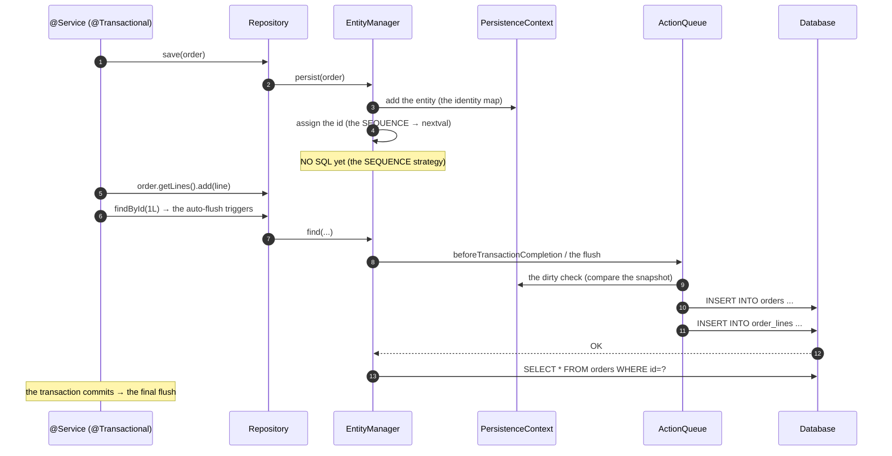
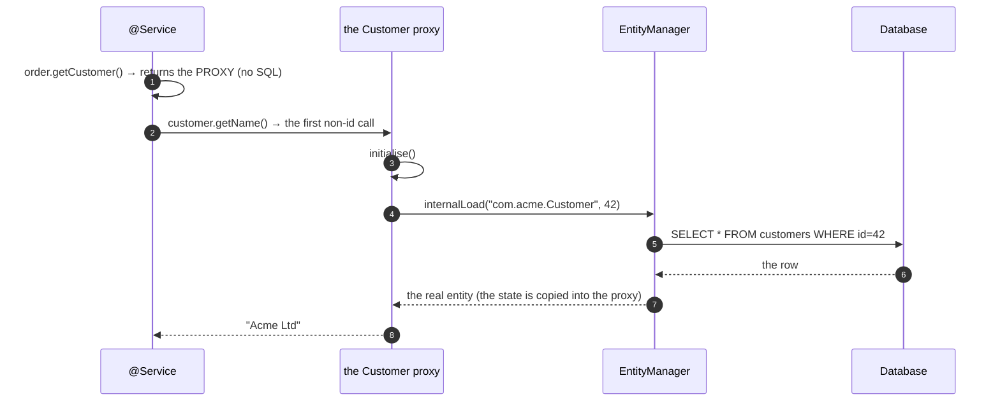

# 02 · JPA Internals & the Persistence Context

> **Level:** Advanced → Expert
> **Interview Frequency:** ★★★★☆ (The "explain the persistence context / the dirty checking /
> the proxies" question)
> **Prerequisite:** [01 · ORM Theory](./01-ORM-Theory-and-JPA-Fundamentals.md)
> **Last Updated:** 2026

---

## 📋 Table of Contents
- [0. TL;DR — The 30-Second Answer](#0-tldr--the-30-second-answer)
- [1. What & Why](#1-what--why)
- [2. Mental Model — the Unit of Work](#2-mental-model--the-unit-of-work)
- [3. Deep Dive — Theory](#3-deep-dive--theory)
- [4. Internal Working Mechanism](#4-internal-working-mechanism)
- [5. Step-by-Step Execution Flow](#5-step-by-step-execution-flow)
- [6. Architecture Diagrams](#6-architecture-diagrams)
- [7. Production-Level Use Cases](#7-production-level-use-cases)
- [8. Code Examples — Production-Grade](#8-code-examples--production-grade)
- [9. Common Mistakes & Gotchas](#9-common-mistakes--gotchas)
- [10. Performance Considerations](#10-performance-considerations)
- [11. Security Considerations](#11-security-considerations)
- [12. Best Practices — The Checklist](#12-best-practices--the-checklist)
- [13. Hands-On Exercises](#13-hands-on-exercises)
- [14. Code Challenges](#14-code-challenges)
- [15. Scenario-Based Questions](#15-scenario-based-questions)
- [16. Interview Q&A — Level-wise](#16-interview-qa--level-wise)
- [17. Counter-Questions & Traps](#17-counter-questions--traps)
- [18. Tricky Interview Questions](#18-tricky-interview-questions)
- [19. Follow-Up Questions Asked by Interviewers](#19-follow-up-questions-asked-by-interviewers)
- [20. Real 3–5 Year Experience Scenarios](#20-real-35-year-experience-scenarios)
- [21. Frequently Asked Production Issues](#21-frequently-asked-production-issues)
- [22. Debugging Scenarios](#22-debugging-scenarios)
- [23. Architecture Design Questions](#23-architecture-design-questions)
- [24. Rapid-Fire MCQs](#24-rapid-fire-mcqs)
- [25. Cheat Sheet — One-Page Summary](#25-cheat-sheet--one-page-summary)
- [26. Real-World Production Notes](#26-real-world-production-notes)
- [27. Follow-up Learning](#27-follow-up-learning)

---

## 0. TL;DR — The 30-Second Answer

- **The `EntityManager` (JPA) = the `Session` (Hibernate)** = the **persistence context** = the
  **Unit of Work**.
- **Inside a transaction, the `EntityManager` is thread-bound**; the injected bean is a **proxy**
  that resolves the per-thread instance.
- **Four guarantees:**
  1. **The Identity Map** — one row → one object per context.
  2. **The Dirty Checking** — the changed state is written at the flush.
  3. **The Deferred Flush** — the SQL is issued at the flush/commit, not at the setter.
  4. **The Transactional Write** — the changes are atomic.
- **The flush algorithm:** the dirty check → the action queue (the inserts, the updates, the
  deletes, the collection actions) → the SQL generation → the callbacks.
- **The action queue's order** matters: the collection actions (the orphan removals) → the
  **inserts** → the **updates** → the collection recreations (the "the collection was replaced"
  → the delete + insert) → the **deletes**.
- **The proxies:** the runtime subclass, the lazy initialisation on the first non-id getter call.
- **The `merge` vs the `persist`:** `persist` = the new → managed; `merge` = the detached → the
  managed copy (and the return value is the managed one).
- **`@Version`** = the optimistic locking (the version is incremented on the update, and the
  `WHERE` clause includes it).
- **The one-liner:** *"The persistence context is a **unit of work** — an identity map, a dirty
  tracker, and a write-behind buffer, all scoped to one transaction. Understanding those three
  things explains the N+1, the stale reads, the `merge` surprises, and the flush ordering."*

---

## 1. What & Why

Knowing the internals is what separates "I use JPA" from "I understand JPA". It explains:
- Why the **same query** in the same transaction returns the **same object**.
- Why `save()` on a **detached** entity doesn't update your instance.
- Why the **collection** changes cause a **delete + insert** instead of an `UPDATE`.
- Why the **N+1** happens (and why the second query is issued at the *access*, not at the *load*).
- Why the **flush** order matters (the FK constraint violation on the flush, not on the persist).

---

## 2. Mental Model — the Unit of Work

```text
   ┌───────────────────────────────────────────────────────────────┐
   │                   PERSISTENCE CONTEXT                         │
   │                                                               │
   │  ┌──────────────┐   ┌──────────────┐   ┌──────────────────┐  │
   │  │ IDENTITY MAP │   │  DIRTY       │   │  ACTION QUEUE    │  │
   │  │              │   │  TRACKER     │   │                  │  │
   │  │ entityKey →  │   │              │   │  [insert Order]  │  │
   │  │   entity     │   │ the loaded   │   │  [update Line]   │  │
   │  │              │   │ state vs the │   │  [delete Item]   │  │
   │  │ → the same   │   │ current state│   │  [collection ops]│  │
   │  │   object for │   │              │   │                  │  │
   │  │   the same   │   │ → the changed│   │  → the SQL to    │  │
   │  │   row        │   │   properties│   │   execute at the │  │
   │  └──────────────┘   └──────────────┘   │   flush          │  │
   │                                          └──────────────────┘  │
   └───────────────────────────┬───────────────────────────────────┘
                               ▼
                        the flush → the JDBC → the DB
```

> **Caption:** Three structures, one scope (the transaction). The identity map gives you the
> **object identity**, the dirty tracker gives you the **change detection**, and the action queue
> gives you the **write-behind**.

---

## 3. Deep Dive — Theory

### 3.1 The `EntityManager` → the `Session`

| JPA | Hibernate |
|-----|-----------|
| `EntityManager` | `Session` / `StatelessSession` |
| `EntityManagerFactory` | `SessionFactory` |
| `Query` | `org.hibernate.query.Query` |
| `TypedQuery<X>` | `QueryImplementor<X>` |
| `CriteriaBuilder` | `CriteriaBuilder` |
| `PersistenceUnit` | `Configuration` |

**`EntityManager` vs `Session`:**
- The `EntityManager` is the **standard** API (the portable subset).
- The `Session` is the **Hibernate** API — it exposes the Hibernate-specific features (the
  statistics, the `setDefaultReadOnly`, the `enableDirtyTracking`, the `getSessionFactory`).

**The `StatelessSession`:** no persistence context, no dirty checking, no identity map — the
**minimum** overhead for the bulk reads. The trade-off: no lazy loading (or the lazy loading
returns an uninitialised proxy), no automatic cascade, no the first-level cache.

```java
StatelessSession session = sessionFactory.openStatelessSession();
session.createQuery("from Order", Order.class).scroll(ScrollMode.FORWARD_ONLY);
```

### 3.2 The identity map — the object identity

```java
@Transactional
public void demonstrate() {
    Order a = em.find(Order.class, 1L);
    Order b = em.find(Order.class, 1L);
    Order c = em.find(Order.class, 1L);

    System.out.println(a == b);   // true
    System.out.println(a == c);   // true
    System.out.println(a.getClass());  // Order (not a proxy — it's already loaded)
}
```

**The identity map's key:** the **entity key** — the entity's **id** and the **entity class**
(and the **root** entity for the joined inheritance). Two different entity classes with the same
id are **different** objects.

**The consequences:**
1. The **memory** grows with the loaded entities (the context holds them all until the clear).
2. The **stale reads**: the entity in the context is returned even if the DB changed (in another
   transaction).
3. The **identity** is guaranteed within the context: `a.equals(b)` is true by reference.

### 3.3 The dirty checking — the snapshot

**When an entity is loaded**, Hibernate stores a **snapshot** of its state in the
`EntityEntry`:

```text
  EntityEntry
    ├─ entity          → the entity object
    ├─ id             → the id
    ├─ loadedState    → the Map<PropertyKey, Object> (the snapshot!)
    ├─ status         → MANAGED / LOADING / READ_ONLY / GONE
    ├─ propertyNames  → the persistent properties
    └─ loadedStateDirty  → whether the snapshot is up to date
```

**At the flush**, for each managed entity, Hibernate compares the **current** state with the
**snapshot**:

```text
  for each managed entity:
      for each persistent property:
          if (!Objects.equals(currentValue, snapshotValue)):
              → the property is dirty
      → if any is dirty → schedule an UPDATE (with only the dirty columns)
```

**The detection mechanisms:**

| The mechanism | How | The trade-off |
|---------------|-----|---------------|
| **The bytecode enhancement** | Hibernate instruments the setters to mark the entity dirty | The best performance; the build complexity; the "lazy loading" of the attributes |
| **The `DirtyTracker`** (the default) | Hibernate snapshots the state at the load and compares at the flush | The default; the memory cost of the snapshot |
| **The interceptor** (`hibernate.use_sql_comments` / the `Interceptor`) | The event-based | Not the dirty detection itself |

**The "dirty" vs the "actually changed" subtlety:** if you set a field to the **same** value, the
dirty check sees **no change** (the comparison is by equality) → no `UPDATE`. That's an
optimisation — but it depends on the `equals`. If the `equals` is broken (an identity equals), a
no-op set looks dirty → an unnecessary `UPDATE`.

### 3.4 The action queue — the write-behind

**The actions** (`ActionQueue` in Hibernate):

```text
  ActionQueue
    ├─ orphanRemovals        (the collection removals)
    ├─ entityInsertions      (the INSERTs)
    ├─ entityUpdates         (the UPDATEs)
    ├─ collectionRemovals    (the collection recreations)
    ├─ collectionUpdates     (the collection recreations)
    ├─ collectionCreations   (the collection recreations)
    ├─ entityDeletions       (the DELETEs)
    └─ the queued operations (the bulk ops)
```

**The execution order** (in `ActionQueue.executeActions()`):

```text
  ① The orphan removals            (the DELETE of the removed children)
  ② The entity insertions          (the INSERTs — the parents first)
  ③ The entity updates             (the UPDATEs)
  ④ The collection removals        (the DELETE of the old collection rows)
  ⑤ The collection recreations     (the DELETE + INSERT of the modified collections)
  ⑥ The collection updates/creations
  ⑦ The entity deletions           (the DELETEs — the children first)
```

> **Why the order matters:** the **inserts before the updates** (so a new parent's id is
> available for the child's FK), and the **deletes last** (so the FK constraint isn't violated
> by deleting the parent before the child).

**The `ActionQueue` is a `Queue` (a `List` in Hibernate 6) of the `Executable` actions** — each
action knows how to produce its SQL.

### 3.5 The collection recreation — the "delete + insert" surprise

```java
@OneToMany(mappedBy = "order")
private Set<OrderLine> lines = new HashSet<>();

// The scenario:
order.getLines().remove(line);      // → a DELETE of the line
order.getLines().add(newLine);      // → an INSERT of the new line
```

But Hibernate's default for a **dirty** collection is to **delete all the rows and re-insert
them** (the "collection recreation") — unless the collection is a `Set` (the "the deleted
entity is detected" — Hibernate 6 optimises it) or the mapping is configured for the
incremental.

**The Hibernate 6 improvement:** the `@OptimisticLocking`/`@OptimisticLock` and the
**"the optimistic lock with the collection"** — Hibernate 6.2+ handles the collection changes
more granularly (the "the dirty collection" is diffed) — a big improvement for the collections
with many rows.

**The practical advice:** the collections with many rows are a **performance trap** — the
collection recreation loads them all into the memory and rewrites them.

### 3.6 The flush — the algorithm

```java
// In Hibernate's SessionImpl.flush()
public void flush() {
    flushBeforeTransactionCompletion();
    // ...
}

private void flushBeforeTransactionCompletion() {
    actionQueue.beforeTransactionCompletion();
    // ① The dirty check
    managedFlush();           // → the flushEvent listeners → the DirtyCheck + the AutoFlush
    // ② The action queue
    actionQueue.executeActions();   // → the SQL
    // ③ The post-insert
    postFlush();
}
```

**The `flush` triggers:**
1. The **auto-flush** (before a query that overlaps the pending changes — the
   `FlushModeType.AUTO`).
2. The **commit** (the transaction's `beforeCompletion` → the flush).
3. The **explicit** `flush()`.
4. The **`@PreUpdate`/`@PrePersist`** — no, those are triggered by the flush itself.

**The auto-flush** (`FlushMode.AUTO`): before a JPQL/HQL query, Hibernate flushes if the query's
"query space" (the tables) overlaps the pending changes. This is the `AutoFlushEventListener`.

### 3.7 The proxies — the lazy loading

```java
Customer customer = order.getCustomer();   // a proxy (no SQL)
String name = customer.getName();          // ← the initialisation happens HERE
```

**The proxy mechanics:**
```text
  ① The proxy is created (a runtime subclass of Customer, via ByteBuddy/ Javassist)
  ② It holds: the id, the lazy initializer (the Session), the entity name
  ③ The getter for the id (getId()) does NOT initialise it
  ④ Any other method call → the initialisation:
       - the session is open? → load the entity (a SELECT) and copy the state
       - the session is closed? → LazyInitializationException
       - the row is gone? → EntityNotFoundException
```

**The `getClass()`:** `customer.getClass()` returns the **proxy class**, not `Customer` — a
classic trap:
```java
if (order.getCustomer().getClass() == Customer.class) { ... }   // FALSE for a lazy proxy
```

**The `equals`/`hashCode` on a proxy:** the `equals` is delegated to the underlying entity → it
**initialises** the proxy → an unexpected query.

**The `toString`:** the default `Object.toString` is **not** delegated (Hibernate's proxies
override it to print the identifier) — so `System.out.println(customer)` doesn't trigger the load.

### 3.8 The bytecode enhancement

**What it does:** Hibernate (or a build plugin) instruments the entity classes:
- The **setters** mark the entity dirty (no snapshot comparison needed).
- The **lazy attributes** (`@Basic(fetch = LAZY)` with a group) are intercepted — the attribute is
  loaded on the first access.
- The **dirty tracking** becomes a boolean flag instead of a full comparison.

**The configuration:**
```properties
spring.jpa.properties.hibernate.bytecode.provider=bytebuddy
```

**The trade-off:** the enhanced classes can't be `final`, the `equals`/`hashCode` need care (the
enhanced classes handle it), and the enhancement must happen at the build time (the
`hibernate-enhance-maven-plugin`) or at the runtime (the `hibernate.enhancer.enableLazyInitialization`).

### 3.9 The `merge` — the state transfer

```java
@Transactional
public void update(Long id, UpdateCommand command) {
    Order detached = new Order(id, command.name());   // a detached instance (an id, no session)
    detached.setStatus(OrderStatus.PAID);

    Order managed = em.merge(detached);   // returns the MANAGED instance
    // The managed instance has the changes; `detached` does NOT
}
```

**What `merge` does internally:**
```text
  ① Is the entity already managed? → return it (no copy)
  ② Else: load the entity from the DB (a SELECT) → the managed instance
  ③ Copy the state from the detached instance to the managed instance
       - for each property:
           if the detached value is non-null → copy it
           if the detached value is null → LEAVE the managed value (JPA's spec!)
  ④ Schedule the UPDATE (the dirty check will detect the differences)
  ⑤ Return the managed instance
```

> **The null behaviour** is the classic trap: `merge` **ignores the null** fields in the
> detached instance (per the JPA spec). So a `PUT` (a full replacement) can't be implemented with
> `merge` — the fields you don't set won't be nulled. Hibernate 6 has the
> `@DynamicUpdate`/`@Nullify`... (Hibernate's `merge` copies the nulls by default — a Hibernate
> deviation; set `hibernate.merge.null`... in Hibernate 6.6 there's the `MERGE` semantics
> configuration).

### 3.10 The `persist` — the new entity

```java
@Transactional
public void create(Order order) {
    em.persist(order);      // the id is assigned (for the IDENTITY: the INSERT happens now)
    order.getLines().forEach(em::persist);   // the cascade (if configured) does it for you
}
```

**The `persist` with the `IDENTITY` strategy:** the `INSERT` is executed **immediately** (to get
the generated id) — that's why the `IDENTITY` breaks the JDBC batching. With `SEQUENCE`, the id
is allocated from the sequence (no insert) → the batching works.

### 3.11 The `detach` vs the `clear`

```java
em.detach(order);   // one entity — it becomes detached (the changes are not tracked)
em.clear();          // EVERYTHING — the context is emptied (all the entities are detached)
```

**When to use `clear`:**
- After a bulk `@Modifying` query (the stale context).
- In a long-running loop (the memory).
- Between the independent units of work in a batch job.

### 3.12 The `EntityManager` lifecycle in Spring

```text
  ┌────────────────────────────────────────────────────────────────┐
  │ Spring Boot's startup                                         │
  │   LocalContainerEntityManagerFactoryBean                       │
  │     └─ EntityManagerFactory (the Hibernate SessionFactory)    │
  │          └─ the metadata (the mappings, the queries)          │
  └────────────────────────────────────────────────────────────────┘

  Per transaction:
    TransactionInterceptor → the EntityManager is created/bound
      └─ bound to the TransactionSynchronizationManager (the thread)

  After the transaction:
    the EntityManager is closed (and the context is cleared)
```

**The `SharedEntityManagerCreator`:** the `@PersistenceContext`-injected `EntityManager` is a
**proxy** that, on each call, does:
```java
EntityManager em = getEntityManager();   // from the TransactionSynchronizationManager
// or, if no transaction: create a new one for the call
```

**The consequence:** outside a transaction, each repository call gets a **new** persistence
context → the lazy loading fails, and the identity map doesn't span the calls.

### 3.13 The `@Transactional` and the flush timing

```java
@Transactional
public void method() {
    orderRepository.save(order);   // for the IDENTITY: the INSERT happens HERE
    // for the SEQUENCE: the INSERT happens at the flush (the commit)
}
```

**The rule:** the SQL is issued at the **flush**, which happens:
- Before a query (the auto-flush).
- At the commit.
- Explicitly (`flush()`).

**The practical consequence:** if you need the generated id (or the DB-generated value) inside
the transaction, you must **flush**:
```java
orderRepository.saveAndFlush(order);   // the INSERT is executed now
```

---

## 4. Internal Working Mechanism

### 4.1 The Hibernate `SessionImpl` — the key fields

```java
public class SessionImpl extends AbstractSharedSessionContract implements Session {
    protected transient ActionQueue actionQueue;
    protected transient PersistenceContext persistenceContext;
    protected transient EventListener listeners;
    protected transient Interceptor interceptor;
    protected transient JdbcCoordinator jdbcCoordinator;
    protected transient FlushEventListener[] flushListeners;
    ...
}
```

### 4.2 The `PersistenceContext` — the internals

```java
public class StatefulPersistenceContext {
    // The identity map
    private Map<EntityKey, Object> entitiesByKey;
    // The managed entities (the insertion order — the flush order!)
    private List<EntityEntry> managedEntities;
    // The collections
    private Map<EntityKey, PersistentCollection> collectionEntries;
    // The "loaded" state (the nullability, the transient)
    private Set<EntityKey> nullabilityTransientEntities;
    // The proxies
    private Map<EntityKey, Object> proxiesByKey;
    // The interceptor (the dirty tracker)
    private Interceptor interceptor;
    // The load context (the FlushEntityEventListener's)
    private LoadContexts loadContexts;
}
```

**The `EntityKey`:** the (the entity name, the id, the root entity name) — the identity map's
key. The entity name (not the class) is used so the **proxy** and the **real entity** map to the
same key.

### 4.3 The flush — the listener chain

```text
  flush()
    │
    ├─ ActionQueue.beforeTransactionCompletion()
    │
    ├─ managedFlush()
    │     └─ flushListeners (the DefaultFlushEntityEventListener)
    │           ├─ the dirty check (the entity's status)
    │           ├─ the cascade (the CascadeEventListener → the CascadingActions)
    │           │     ├─ the cascade onFlush (the persist → the collection persist)
    │           │     └─ the collection dereferencing
    │           └─ the schedule (the ActionQueue.addAction)
    │
    ├─ ActionQueue.executeActions()
    │     ├─ EntityInsertAction  → the SQL (the EntityPersister)
    │     ├─ EntityUpdateAction
    │     ├─ CollectionRemoveAction
    │     ├─ CollectionUpdateAction / CollectionRecreateAction
    │     ├─ EntityDeleteAction
    │     └─ the queued operations (the bulk)
    │
    └─ postFlush() → the post-insert/post-update events (@PostPersist, @PostUpdate)
```

### 4.4 The `EntityPersister` — the SQL generation

```text
  EntityPersister (per entity type)
    ├─ the mapping metadata (the properties, the columns, the associations)
    ├─ the SQL templates (the insert, the update, the delete, the load)
    ├─ the "the identifier" (the generator)
    ├─ the "the version" (the optimistic locking)
    ├─ the "the lazy" (the property's lazy group)
    └─ the "the loading" (the loader plans)
```

**The generated SQL:**
```sql
-- The insert
insert into orders (order_number, status, total_amount, currency, customer_id, version, created_at)
values (?, ?, ?, ?, ?, ?, ?)

-- The update (the dirty check → only the dirty columns)
update orders set status=?, version=? where id=? and version=?

-- The load
select o1_0.id, o1_0.order_number, ... from orders o1_0 where o1_0.id=?
```

**The update's `WHERE` clause with the `@Version`:** `where id=? and version=?` → if the row
count is 0 → the `OptimisticLockException`.

### 4.5 The `AutoFlushEventListener`

```java
public class AutoFlushEventListener implements EventListener {
    // Called before a query
    public void onAutoFlush(EventSource source) {
        if (source.getHibernateFlushMode() == FlushMode.AUTO) {
            // Is the query's "query space" affected by the pending changes?
            if (flushMightBeNeeded(source, query)) {
                source.getSession().flush();
            }
        }
    }
}
```

**The `flushMightBeNeeded`:** the query space (the tables the query touches) is compared with
the **action queue's affected tables**. If they overlap → the flush. This is why a native query
**doesn't** trigger the auto-flush (the query space is unknown) — hence the
`flushAutomatically=true` on the `@Modifying` queries.

### 4.6 The `CascadeEventListener` — the cascade

```text
  CascadeEventListener
    ├─ cascadeOnFlush   (the persist → the collections, the "the cascade=PERSIST" case)
    ├─ cascadeBeforeDelete
    ├─ cascadeAfterDelete
    ├─ cascadeOnDelete
    └─ cascadeOnLock
```

**The cascade scope:**
- `CascadeType.PERSIST` → the `cascadeOnFlush`.
- `CascadeType.REMOVE` → the `cascadeOnDelete` / `cascadeBeforeDelete`.
- `CascadeType.MERGE` → the `merge` cascades.
- `CascadeType.ALL` → all of them.
- `CascadeType.DETACH` / `REFRESH` → the corresponding operations.

**The cascade and the orphan removal:** the orphan removal is a separate mechanism (the
`CollectionRemoveAction` when the child is removed from the collection).

### 4.7 The `SpringDataJpa` and the `EntityManager` — the flush on the repository call

```java
// SimpleJpaRepository.save()
public <S extends T> S save(S entity) {
    if (entityInformation.isNew(entity)) {
        em.persist(entity);
        return entity;
    } else {
        return em.merge(entity);
    }
}
```

**The `isNew`:** the `Persistable` interface (`isNew()`) or the `JpaMetamodelEntityInformation`
(the id == null → new). The `Persistable` is the way to handle the **assigned ids** (the UUID
generated by the application):

```java
@Entity
public class Order implements Persistable<Long> {
    @Id
    private Long id;

    @Override
    public boolean isNew() { return id == null; }   // or a transient flag
}
```

---

## 5. Step-by-Step Execution Flow

### 5.1 The full lifecycle of a write



### 5.2 The proxy initialisation



---

## 6. Architecture Diagrams

### 6.1 The flush pipeline

```text
  flush()
    │
    ▼
  ┌────────────────────────────────────────────────┐
  │ 1. THE DIRTY CHECK                             │
  │    the snapshot (the loaded state) vs the now   │
  │    → the dirty properties                      │
  └───────────────────┬────────────────────────────┘
                    ▼
  ┌────────────────────────────────────────────────┐
  │ 2. THE CASCADE                                 │
  │    the persist cascade → the children          │
  │    the collection dereferencing                │
  └───────────────────┬────────────────────────────┘
                    ▼
  ┌────────────────────────────────────────────────┐
  │ 3. THE ACTION QUEUE (the ordered actions)      │
  │    the orphan removals → the inserts           │
  │    → the updates → the collection ops          │
  │    → the deletes                               │
  └───────────────────┬────────────────────────────┘
                    ▼
  ┌────────────────────────────────────────────────┐
  │ 4. THE SQL GENERATION (the EntityPersister)    │
  │    the insert/update/delete templates          │
  └───────────────────┬────────────────────────────┘
                    ▼
  ┌────────────────────────────────────────────────┐
  │ 5. THE JDBC EXECUTION (the batched)           │
  │    the prepared statements → the DB            │
  └───────────────────┬────────────────────────────┘
                    ▼
  ┌────────────────────────────────────────────────┐
  │ 6. THE POST-EVENTS                             │
  │    @PostPersist, @PostUpdate, @PostLoad       │
  └────────────────────────────────────────────────┘
```

### 6.2 The state transitions and the visibility

```text
      ┌─────────┐
      │  NEW    │  (not in the DB, not in the context)
      └────┬────┘
           │ persist()
           ▼
      ┌─────────┐         ┌──────────────┐
      │ MANAGED │────────►│  PERSISTENT  │ (in the DB, in the context)
      │ (in the │         │  (visible to │
      │ context)│         │  the others) │
      └────┬────┘         └──────────────┘
           │ remove() / evict()
           ▼
      ┌─────────┐
      │ REMOVED │  (scheduled for the delete at the flush)
      └────┬────┘
           │ evict()
           ▼
      ┌─────────┐
      │ DETACHED│  (in the DB, NOT in the context → the changes aren't tracked)
      └─────────┘
```

### 6.3 The three levels of caching

```text
  ┌──────────────────────────────────────────────────────────────┐
  │  LEVEL 1 — the persistence context (the session)             │
  │    Scope: ONE transaction                                   │
  │    Scope of the ids: ONE EntityManager                      │
  │    The identity map + the dirty checking                     │
  │    Automatic (enabled by default)                            │
  └──────────────────────────────────────────────────────────────┘
                              │ misses
                              ▼
  ┌──────────────────────────────────────────────────────────────┐
  │  LEVEL 2 — the Hibernate region cache                       │
  │    Scope: the EntityManagerFactory (the whole app)           │
  │    Configurable (disabled by default)                        │
  │    The entities + the query results (the query cache)        │
  │    The invalidation is CLUSTER-UNAWARE by default            │
  └──────────────────────────────────────────────────────────────┘
                              │ misses
                              ▼
  ┌──────────────────────────────────────────────────────────────┐
  │  LEVEL 3 — the database's buffer cache / the query cache     │
  │    (the shared buffers, the OS page cache)                   │
  └──────────────────────────────────────────────────────────────┘
```

---

## 7. Production-Level Use Cases

| Use case | The technique |
|----------|---------------|
| **A read-heavy endpoint** | The DTO projection (no entities loaded) |
| **A batch job** | The `StatelessSession` or the keyset pagination + the JDBC batching |
| **A long-running loop** | `em.clear()` periodically (the memory) |
| **A bulk update** | `@Modifying(clearAutomatically = true, flushAutomatically = true)` |
| **A read-modify-write with the concurrency** | The `@Version` (the optimistic) or the atomic update |
| **The "the entity is detached" case** | `merge` (and use the returned instance) |
| **A large collection** | Avoid loading it (the projection, the `@BatchSize`, the sub-select) |
| **The memory pressure** | The stateless session, the projections, the `clear()` |
| **A "the write must not be lost" scenario** | The `saveAndFlush` / the explicit `flush()` |
| **A dirty-checking-heavy entity** | The bytecode enhancement (the dirty flag instead of the snapshot) |

---

## 8. Code Examples — Production-Grade

### 8.1 The `Persistable` entity (the assigned id)

```java
@Entity
@Table(name = "orders")
public class Order implements Persistable<Long> {

    @Id
    @Column(name = "id", nullable = false, updatable = false)
    private Long id;

    @Transient
    private boolean isNew = true;

    protected Order() { }

    public static Order create(Long id, String orderNumber, BigDecimal total) {
        Order order = new Order();
        order.id = id;
        order.orderNumber = orderNumber;
        order.total = total;
        order.isNew = true;
        return order;
    }

    @Override
    public boolean isNew() {
        return isNew;
    }

    @PostPersist
    @PostLoad
    @PostUpdate
    void markNotNew() {
        this.isNew = false;
    }
}
```

### 8.2 The explicit flush — the generated values

```java
@Service
@RequiredArgsConstructor
public class InvoiceService {

    private final InvoiceRepository invoiceRepository;
    private final AuditService auditService;

    @Transactional
    public Invoice createInvoice(Long orderId) {
        Invoice invoice = new Invoice(orderId);
        invoiceRepository.save(invoice);

        // The DB-generated columns need the INSERT to have happened
        invoiceRepository.flush();

        // Now the generated values are available
        auditService.record(invoice.getId(), invoice.getGeneratedNumber());
        return invoice;
    }
}
```

### 8.3 The bulk update with the cache handling

```java
@Transactional
public int markExpired(List<Long> ids) {
    return invoiceRepository.bulkMarkExpired(ids);
}
```

```java
@Modifying(clearAutomatically = true, flushAutomatically = true)
@Query("""
       update Invoice i
       set i.status = 'EXPIRED', i.updatedAt = CURRENT_TIMESTAMP
       where i.id in :ids and i.status = 'PENDING'
       """)
int bulkMarkExpired(@Param("ids") List<Long> ids);
```

### 8.4 The `EntityManager` used directly (the native query)

```java
@Repository
@RequiredArgsConstructor
public class OrderReportRepository {

    private final EntityManager entityManager;

    public List<OrderRow> fetchReport(Instant from, Instant to) {
        return entityManager.createNativeQuery("""
                        select o.id, o.order_number, o.total_amount
                        from orders o
                        where o.created_at between :from and :to
                        """)
                .setParameter("from", Timestamp.from(from))
                .setParameter("to", Timestamp.from(to))
                .addScalar("id", LongType.INSTANCE)
                .addScalar("order_number", StringType.INSTANCE)
                .addScalar("total_amount", BigDecimalType.INSTANCE)
                .getResultList()
                .stream()
                .map(row -> new OrderRow(((Number) row[0]).longValue(),
                                         (String) row[1],
                                         (BigDecimal) row[2]))
                .toList();
    }
}
```

### 8.5 The batch job with the keyset pagination and the periodic clear

```java
@Component
@RequiredArgsConstructor
@Slf4j
public class OrderArchivalJob {

    private final EntityManager entityManager;
    private final ArchivalService archivalService;

    @Transactional
    public void archive(int batchSize) {
        Long lastId = loadWatermark();
        int total = 0;

        while (true) {
            // The keyset pagination (not the OFFSET!)
            List<Order> batch = entityManager.createQuery("""
                            select o from Order o
                            where o.id > :lastId and o.archived = false
                            order by o.id
                            """, Order.class)
                    .setParameter("lastId", lastId)
                    .setMaxResults(batchSize)
                    .getResultList();

            if (batch.isEmpty()) break;

            archivalService.archive(batch);
            lastId = batch.get(batch.size() - 1).getId();
            total += batch.size();

            // Release the memory (the persistence context holds everything!)
            entityManager.clear();

            if (batch.size() < batchSize) break;
        }

        saveWatermark(lastId);
        log.info("Archived {} orders", total);
    }
}
```

### 8.6 The `readOnly` optimisation

```java
@Transactional(readOnly = true)
public List<OrderResponse> listByCustomer(Long customerId) {
    return orderRepository.findByCustomerId(customerId).stream()
            .map(mapper::toResponse)
            .toList();
}
```

**What `readOnly = true` does in Hibernate:**
- The session's `FlushMode` = `MANUAL` → **no flush** (the accidental changes aren't written).
- The **dirty checking is skipped** for the loaded entities (a big performance win).
- The entities are still loaded (the snapshot is still created — Hibernate's `readOnly` on a
  session-level setting doesn't skip the snapshot unless the entity is `@Immutable`).

> **Note:** the `readOnly` hint on the **query** (`@QueryHints(@QueryHint(name = "readOnly", value = "true"))`)
> skips the snapshot entirely (a bigger win).

### 8.7 The `StatelessSession` for the bulk read

```java
@Component
@RequiredArgsConstructor
public class OrderExporter {

    private final EntityManagerFactory entityManagerFactory;

    public void export(Writer writer) {
        try (StatelessSession session = entityManagerFactory.unwrap(SessionFactory.class)
                                                         .openStatelessSession()) {
            ScrollableResults<Order> results = session
                    .createQuery("from Order order", Order.class)
                    .scroll(ScrollMode.FORWARD_ONLY);

            while (results.next()) {
                writer.write(results.get()::toCsv);
            }
        }
    }
}
```

### 8.8 The `@DynamicUpdate` — the partial update

```java
@Entity
public class Order {

    @DynamicUpdate      // only the dirty columns in the UPDATE
    @Column(name = "note", length = 500)
    private String note;
}
```

> **The trade-off:** the `@DynamicUpdate` generates a **different SQL per combination of dirty
> columns** → the **statement cache** is less effective (the SQL plans aren't reused). It's a
> trade-off: the smaller the update, the bigger the win — for the large entities with the
> frequent small changes.

### 8.9 The `Persistable` + the `save` semantics in the Spring Data

```java
// The repository with the custom isNew
public interface OrderRepository extends JpaRepository<Order, Long> {
    @Override
    default Optional<Order> findById(Long id) { ... }   // not needed, but shows the pattern
}
```

### 8.10 The `EntityGraph` for the dynamic fetch

```java
@Service
@RequiredArgsConstructor
public class OrderService {

    private final EntityManager entityManager;
    private final OrderRepository orderRepository;

    @Transactional(readOnly = true)
    public Order loadWithDetails(Long id, boolean withLines) {
        EntityGraph<Order> graph = entityManager.createEntityGraph(Order.class);
        graph.addAttributeNodes("customer");
        if (withLines) {
            graph.addSubgraph("lines").addAttributeNodes("product");
        }

        return entityManager.find(Order.class, id, graph);
    }
}
```

---

## 9. Common Mistakes & Gotchas

| # | ❌ Wrong | ✅ Right | Why |
|---|----------|----------|-----|
| 1 | Using the `merge` result incorrectly | Use the returned instance | Your instance stays detached |
| 2 | `save()` outside a transaction | `@Transactional` | The merge → the new context → the changes are lost |
| 3 | The lazy access outside the transaction | Map to the DTO inside | `LazyInitializationException` |
| 4 | The collection with many rows loaded | The projection / the `@BatchSize` | The memory + the rewrite |
| 5 | The `merge` with the null fields | Use the explicit update method | The nulls are ignored by the JPA merge |
| 6 | The `getClass()` check on a lazy proxy | Use `Hibernate.unproxy()` or avoid it | The proxy class ≠ the entity class |
| 7 | The `equals`/`hashCode` on a lazy association | Use the business key | The lazy load in the `equals` |
| 8 | A long-running loop without `clear()` | `em.clear()` periodically | The memory |
| 9 | The native query without a flush | `flushAutomatically = true` | The stale reads |
| 10 | The bulk `@Modifying` without `clear` | `clearAutomatically = true` | The stale entities |
| 11 | The `final` entity class | Not final | It can't be proxied |
| 12 | The `final` getter with the lazy loading | Not final | The proxy can't override it |
| 13 | The entity in a `HashSet` with a mutable hash | The immutable business key | The hash changes |
| 14 | The `persist` on an entity with an id | Use the `merge` or the `Persistable` | `PersistentObjectException` |
| 15 | The `flush` inside a loop | Batch it | The round trips |
| 16 | The `System.identityHashCode` for the entities | The business key | The session's identity |
| 17 | The `@Version` with a manual `setId` | Let the ORM manage it | The version check breaks |
| 18 | The proxy in the `equals` (the `getClass()` check) | The `instanceof` + the `getIdentifier` | The classic bug |

---

## 10. Performance Considerations

| Aspect | Impact | Guidance |
|--------|--------|----------|
| **The identity map** | The memory per entity (the entity + the snapshot) | The projections, the `clear()`, the stateless session |
| **The dirty tracking** | The snapshot per entity (the memory + the CPU at the flush) | The bytecode enhancement; the `readOnly`; the projections |
| **The proxy** | The memory per proxy + the interception | The projections (no entities, no proxies) |
| **The flush** | The SQL batching (the `batch_size`) | The batching + the `order_inserts` |
| **The collection recreation** | The delete + insert of the whole collection | Avoid the large collections; the `@BatchSize`; the projections |
| **The auto-flush** | An extra flush before a query | The `FlushMode.COMMIT` for the bulk reads (carefully) |
| **The cascade** | The deep traversal of the graph | The shallow aggregates; the `orphanRemoval` only where needed |
| **The `merge`** | An extra SELECT + the state copy | The dirty checking instead of the `save` |
| **The second-level cache** | The lookup + the serialisation (the CPU) | The reference data only |

---

## 11. Security Considerations

| Risk | Mitigation |
|------|-----------|
| **The lazy loading of a "hidden" entity** | The authorisation must happen at the **query** level (the predicate), not after the load — the lazy loading can bypass a naive check |
| **The entity in the response** | The DTO (never the entity) |
| **The merge of the client's data** | The mass assignment (a `merge` of a client-supplied entity can overwrite the fields) — use the commands |
| **The audit trail** | The `@CreatedBy`/`@LastModifiedBy` (the auditing) — the reliable source (not the app logs) |
| **The tenant isolation via the lazy loading** | The tenant predicate on every query (a lazy-loaded entity must also be tenant-scoped) |
| **The soft-delete bypass** | The `@SQLRestriction` / the `@Where` (Hibernate 6.4+) or the explicit predicate |

---

## 12. Best Practices — The Checklist

- [ ] **The transaction in the service**, the DTO mapping inside it.
- [ ] **The dirty checking** (don't call `save` on a managed entity).
- [ ] **The `merge` return value** used when you merge.
- [ ] **The projections** for the reads (no entities, no proxies, no snapshot).
- [ ] **`em.clear()`** in the long loops.
- [ ] **`flushAutomatically`/`clearAutomatically`** on the bulk queries.
- [ ] **The `readOnly = true`** on the read transactions.
- [ ] **The `Persistable`** for the assigned ids.
- [ ] **`@Version`** everywhere.
- [ ] **The `Persistable`/`isNew`** consistent with the id strategy.
- [ ] **The `equals`/`hashCode`** on the business key.
- [ ] **The proxies** never escape the service (no entity in the response).

---

## 13. Hands-On Exercises

**🧪 Lab 1 — The identity map**
1. In a `@Transactional` method, call `findById(1L)` twice.
2. Assert `a == b` (the same object).
3. Change the DB row externally (a raw SQL) and call `findById` again → the **stale** value.
4. Call `em.refresh(a)` → the fresh value.

**🧪 Lab 2 — The dirty checking**
1. Enable the SQL logging.
2. Load an entity, change a field, and **don't** save → no SQL.
3. Call `em.flush()` → the `UPDATE`.
4. Change the field to the **same** value → no `UPDATE` (the equality check).

**🧪 Lab 3 — The flush order**
1. Create a parent with 3 children in one transaction.
2. Look at the SQL log → the INSERT of the parent, then the children.
3. Try the reverse (the children first) → the FK violation. (This is the order the ORM handles
   for you.)

**🧪 Lab 4 — The merge**
1. Load an entity in a transaction, modify it, return it, and modify it again outside.
2. `save()` it → the changes are lost (the detached entity).
3. Use the `merge`'s return value → the changes are persisted.

---

## 14. Code Challenges

### Challenge 1 — A generic audit trail (hard)
**Goal:** Every entity change is recorded (the entity, the operation, the before/after, the
actor, the timestamp).
**Requirements:** the Hibernate **event listeners** (`PostInsertEventListener`,
`PostUpdateEventListener`, `PostDeleteEventListener`) — the **Hibernate** way (it captures the
changes at the ORM level, even the ones made by the JPQL bulk queries? no — the bulk queries
don't fire the listeners); the **AOP** way (the service-level); the **DB trigger** way (the
most reliable — it catches everything).
**Discuss:** the pros and cons of each.

### Challenge 2 — A generic soft-delete repository (hard)
**Goal:** A base repository with the soft delete (the `deletedAt`), the automatic exclusion, and
the restore.
**Requirements:** the `@SQLRestriction` (Hibernate 6.4+) or the `@Where`, the base repository
with the `delete` overridden, the restore operation, the unique-constraint handling (the partial
index), and the test.

### Challenge 3 — A batch processing framework (hard)
**Goal:** A generic "process all the rows of a table in batches" utility.
**Requirements:** the keyset pagination, the periodic `clear()`, the checkpointing (the
watermark), the idempotency, the metrics, and the resumability (the job can be restarted).

---

## 15. Scenario-Based Questions

**S1.** *"A user updates a profile. The update doesn't persist. The logs show no error."*
>
> **Ideal answer:** (1) **The hypotheses**: (a) the **entity is detached** — the service loaded
> it in one transaction and modified it in another (or outside a transaction) → the dirty checking
> doesn't apply → nothing is written; (b) the **transaction isn't active** — the method isn't
> `@Transactional` (or the `@Transactional` is on a **private** method — the Spring AOP proxy
> doesn't intercept the self-invocation!); (c) the `save()` was called but the transaction was
> **rolled back** (an exception swallowed upstream); (d) the entity is **immutable** (a
> `@Immutable` entity or a record) — the changes are discarded; (e) the field isn't **mapped**
> (`@Transient`); (f) the **`merge` without using the return value** — the managed copy is updated
> but the transaction... no, the merge would still flush. (2) **The diagnosis**: (a) check
> `em.contains(entity)` — if false, it's detached; (b) enable the SQL logging — if there's no
> `UPDATE`, the change was never detected (detached/no transaction/immutable); (c) check the
> transaction's rollback (the `TransactionAspectSupport.currentTransactionStatus().isRollbackOnly()`);
> (d) check the `@Transactional` on the **public** method and the **proxy** (the self-invocation!).
> (3) **The fix** by the cause. (4) **The prevention**: (a) the **integration test** that
> persists and re-reads (the Testcontainers-based test — it catches this class of bug
> immediately: the test's own transaction rolls back, but the assertion inside the transaction
> sees the change — hmm, careful: the test's transaction **masks** the bug! The test must use
> `TestTransaction`/`REQUIRES_NEW` or a non-transactional test to catch it); (b) the
> `@Transactional` on the service methods (the convention: **the service methods are
> transactional**); (c) the **`em.contains` assertion** in the critical paths.

**S2.** "The memory usage of the app grows during the nightly batch job until it OOMs."
>
> **Ideal answer:** (1) **The cause**: the **persistence context** accumulates every loaded
entity (the entity + the dirty-check snapshot + the proxies) for the whole transaction. A
multi-hour transaction with millions of rows → the heap explodes. (2) **The confirm**: the heap
dump (the `SessionImpl` → the `PersistenceContext` → the `entitiesByKey` map holds everything) or
the `Hibernate` statistics (`getEntityLoadCount()` climbing). (3) **The fixes**: (a) **the
periodic `em.clear()`** — after each batch, clear the context (the entities become detached; you
don't need them anymore); (b) the **keyset pagination** instead of the offset (and the batch
size); (c) the **`StatelessSession`** for the bulk reads (no context, no dirty checking, no
snapshot — the minimal overhead); (d) the **projection** (the DTOs, not the entities); (e) the
**JDBC batching** for the writes (`hibernate.jdbc.batch_size` + `order_inserts`); (f) the
**chunked processing** — split the job into the smaller transactions (each with its own
checkpoint) so the context is reset naturally. (4) **The prevention**: (a) the **load test** for
the job (a representative dataset — the Testcontainers with the generated data!); (b) the
**batch size as a config** (the tunable); (c) the **monitoring** — the heap usage per job, the
job's runtime (a budget), the alert on the abnormal duration; (d) the **checkpointing** (the
job resumes instead of restarting). (5) The senior framing: "a long-running job is a **batch
pipeline**, not a long transaction — the design is the **bounded unit of work** (the batch), the
**checkpoint**, and the **idempotency**."

**S3.** "We get intermittent `OptimisticLockingFailureException`s under load on a hot row. The
users are complaining."**
>
> **Ideal answer:** (1) **Understand**: the `@Version` check failed — another transaction modified
the row between your read and your write. (2) **Is it really a problem?** The exceptions are
**correct** — they prevent the lost update. The question is the **UX**: the user sees a 409.
(3) **The options**: (a) **The retry** — a bounded retry (2–3 attempts) with a small backoff,
in a **new transaction** (the failed one is rolled back). It works for the high-contention
scenarios (the probability of the collision decreases with each retry). (b) The **atomic update**
— the best for the counters/stocks: `UPDATE inventory SET available = available - 1 WHERE id = ?
AND available > 0` — the check-and-set in **one statement**, no lock, no exception. The check
the affected rows == 1 → the success. (c) The **pessimistic lock** — `SELECT ... FOR UPDATE` —
the row is locked (the other transactions wait). It serialises the access (the throughput cost)
and risks the **deadlocks** (order the locks consistently). (d) The **redesign** — the hot row
is a **design smell** (a single counter contended by everything): shard it (the per-user
counters, the time-bucketed counters — the "the counter per minute" trick), or use a different
mechanism (the queue, the Redis's atomic increment). (4) **The analysis**: which row is hot? The
**metrics** per entity/table (the conflict rate). The fix depends on the semantics: the counter
→ the atomic update; the "the same user edits the profile" → the retry + the 409 (the user can
reload); the "the inventory" → the atomic update. (5) **The prevention**: the **conflict rate
monitoring** (a spike = a design problem), the **load tests** with the concurrency (the
conflicts surface), the **documented conflict semantics** in the API contract (the 409 + the
"reload and retry"). (6) The senior framing: "the optimistic locking exception is a **symptom of
contention** — the fix is either to **handle** it (the retry) or to **remove the contention**
(the atomic update, the sharding, the queue). Choosing the retry blindly hides a design problem."

---

## 16. Interview Q&A — Level-wise

### 🟢 Beginner
**Q: What is the persistence context?**
**A:** The in-memory registry of the entities loaded within a unit of work. It provides the
**identity map** (the same row → the same object), the **dirty checking** (the automatic
`UPDATE`s for the managed entities), and the **first-level cache**. It's bound to the
`EntityManager`, which inside a transaction is thread-bound.

**Q: What is the dirty checking?**
**A:** The mechanism where the ORM detects the changes on the managed entities and issues the
`UPDATE`s at the flush. It works by comparing the **loaded state** (the snapshot) with the
current state. It only applies to the **managed** entities — a detached entity's changes are
ignored.

**Q: What is a proxy in JPA?**
**A:** A runtime-generated subclass of the entity that holds the id and loads the real entity on
the first method call (the lazy loading). It's created for the lazy associations.

### 🟡 Intermediate
**Q: What is the difference between `persist` and `merge`?**
**A:** `persist` takes a **new** entity and makes it managed (the id must be null). `merge` takes
a **detached** entity (or a new one), copies its state into the managed instance (loading it if
needed), and **returns** the managed instance — your original instance stays detached. The
classic bug: ignoring the `merge`'s return value.

**Q: What is the first-level cache?**
**A:** The persistence context itself — the entities loaded in the current session. It's scoped to
the transaction. A second `findById` for the same id returns the **same object** (and doesn't
hit the DB).

**Q: What is `flush()`?**
**A:** It writes the pending changes to the DB (the SQL is executed) but the transaction stays
open (a rollback is still possible). The flush happens automatically before a query (the
auto-flush) and at the commit.

**Q: What is the difference between `detach` and `clear`?**
**A:** `detach(entity)` detaches **one** entity; `clear()` detaches **everything** in the
persistence context (the subsequent operations get a fresh context). The `clear()` is used after
a bulk update and in the long loops.

### 🔴 Advanced / Senior
**Q: Explain the internals of the flush.**
**A:** (1) The **dirty check** — for each managed entity, compare the current state with the
**loaded-state snapshot** (stored in the `EntityEntry` when the entity was loaded); the changed
properties are detected. (2) The **cascade** — the `cascadeOnFlush` traverses the graph and
schedules the persist actions for the children. (3) The **action queue** — the actions are
collected in a **specific order**: the orphan removals → the inserts → the updates → the
collection removals/recreations → the deletes. The order matters: the inserts come before the
updates (so the generated ids are available), and the deletes come last (so the FKs aren't
violated). (4) The **SQL generation** — the `EntityPersister` produces the SQL from the templates
(with the dirty columns only, and the `WHERE id=? and version=?` for the optimistic locking).
(5) The **JDBC execution** — the batched prepared statements. (6) The **post-events** —
`@PostPersist`, `@PostUpdate`, `@PostLoad`.

**Q: Why does my entity update do a DELETE + INSERT instead of an UPDATE?**
**A:** It's a **collection** change. Hibernate's default behaviour for a **dirty collection** (a
`List`/`Bag` — the unordered ones) is to **delete all the rows and re-insert them** (the
"collection recreation"), because the order/index position changed. For a `Set` (or a
`SortedSet`/`Map`), Hibernate detects the individual removals and additions (the "the dirty
collection" diffing) — Hibernate 6 improved this significantly. The fixes: (1) use a `Set` for
the unordered collections; (2) avoid loading the big collections (the projections); (3) use the
`@BatchSize` on the association (the batched lazy loading); (4) for the really large
collections, model them as a separate entity (not a collection).

**Q: How do you minimise the memory footprint of the persistence context?**
**A:** (1) The **projections** (the DTO queries) — no entities, no snapshots, no proxies. (2) The
**stateless session** for the bulk reads (no context at all). (3) The **periodic `clear()`** in
the long loops. (4) The **`readOnly = true`** (the read-only hint on the query skips the
snapshot). (5) The **bytecode enhancement** (the dirty flag instead of the snapshot — a smaller
per-entity cost). (6) The **short transactions** (the context lives for the transaction's
duration). (7) The **avoid the large collections** (the `@BatchSize`/the projections).

**Q: Explain the proxy mechanism.**
**A:** When a lazy association is accessed, Hibernate creates a **runtime subclass** (via
ByteBuddy) of the entity class with an overridden finalizer. The proxy holds the **identifier**,
the **entity name**, and a reference to the **Session**. The `getId()` (and the other "id
methods") do **not** trigger the initialisation; any other method call does: the proxy loads the
entity with a `SELECT`, copies the state into the proxy's fields, and delegates. If the session
is closed → a `LazyInitializationException`; if the row is gone → an `EntityNotFoundException`.
The traps: the `getClass()` returns the proxy class; the `equals`/`hashCode` trigger the load;
the final methods can't be overridden (the lazy loading on a final getter doesn't work without
the bytecode enhancement).

### ⚫ Expert / Principal
**Q: Design the persistence internals strategy for a high-write, multi-tenant platform.**
> **Answer structure:** (1) **The write model** — the JPA aggregates with the optimistic locking,
the `@Version`, the natural keys (the idempotency). (2) **The flush strategy** — the JDBC
batching (the `batch_size` tuned to the DB), the `order_inserts`/`order_updates`, the
`FlushMode.COMMIT` for the bulk reads (avoiding the auto-flush), the explicit `flush()` at the
right boundaries. (3) **The context management** — the projections for the reads, the stateless
session for the bulk, the `clear()` in the batch jobs, the read-only transactions. (4) **The
concurrency** — the optimistic locking with the retry, the atomic updates for the counters, the
pessimistic locks only where needed (and the deadlock ordering). (5) **The isolation levels** —
the per-operation choice (the `READ COMMITTED` default, the `REPEATABLE READ` for the
reporting, the `SERIALIZABLE` for the financial transfers — and the retries for the
serialisation failures). (6) **The schema** — the indexes, the partitioning, the migrations (the
online DDL). (7) **The observability** — the query count, the slow queries, the pool metrics,
the flush counts, the conflict rate. (8) **The testing** — the Testcontainers integration tests,
the query-count assertions, the concurrency tests (the optimistic locking), the migration tests.

---

## 17. Counter-Questions & Traps

### CQ1. "Does the first-level cache make the queries faster?"
- **Naive answer:** "Yes, the repeated queries hit the cache."  ← true, but limited
- **The trap:** The first-level cache is scoped to a **transaction** — it doesn't help across
requests. And it can **hide** the N+1 (the entities are already in the context).
- **Expert answer:** It helps **within** a transaction: the repeated `findById` for the same id
doesn't hit the DB, and the **identity map** means the same object is returned (the consistency
guarantee). But it's **per transaction** — it's not a performance cache across the requests (that's
the second-level cache or the Redis). And it's a **correctness** feature first: the identity
guarantee. The trap to mention: in a **read-only** transaction with many entities, the memory
grows; and the repeated queries in the same transaction can mask an N+1 in the tests (the query
count looks better in the test than in production, where each request is a new transaction).

### CQ2. "Is the entity manager thread-safe?"
- **Naive answer:** "Yes, Spring injects it as a singleton bean."  ← **dangerous**
- **The trap:** The **bean** is a proxy, but the underlying `EntityManager`/`Session` is **not**
thread-safe.
- **Expert answer:** The JPA spec says the `EntityManager` is **not** thread-safe — it's bound to
a thread (and a transaction). The Spring-injected bean is a **shared proxy** that resolves the
thread-bound instance per call (via the `TransactionSynchronizationManager`), so the **bean** is
safe to inject anywhere. But: (1) the **entities** are not thread-safe either (the lazy loading
would use the wrong session); (2) outside a transaction, each call creates a **new**
`EntityManager` → the lazy loading fails; (3) sharing an entity across the threads is a bug —
pass the **ids**.

### CQ3. "Why does the `merge` ignore the null fields?"
- **Naive answer:** "Because the JPA spec says so."  ← technically right, practically incomplete
- **The trap:** The developers expect a `merge` to be a full replacement (the `PUT` semantics).
- **Expert answer:** The JPA spec says the merge copies the **non-null** state (the nulls are
"unknown" — the "the client didn't send it" semantics). Hibernate's historical behaviour was to
copy the nulls (a deviation), but Hibernate 6.2+ has the configurable merge semantics
(`hibernate.merge` with the `MERGE` behaviour options). The practical consequence: you can't
implement a `PUT` (a full replace) with a `merge` — use an explicit update method (a JPQL
update, or a `@DynamicUpdate` with the explicit nulling). And the advice: "the `merge` is for
the **detached → managed** transfer, not for the field-by-field update."

### CQ4. "Why is my collection rewritten on every update?"
- **Naive answer:** "Because the collection is dirty."  ← right, but incomplete
- **The trap:** The users think it's a bug; it's Hibernate's default strategy for the
unordered collections.
- **Expert answer:** For a **`List`/`Bag`** (the unordered), Hibernate can't map the collection
change to a minimal SQL (the position/index isn't stored) → it **deletes and re-inserts** the
whole collection. For a **`Set`**, Hibernate diffs (the removed/added elements) → the minimal
SQL. Hibernate 6 improved the diffing. The fixes: (1) use a `Set` (if the order doesn't
matter); (2) avoid loading the big collections (the projections, the `@BatchSize`); (3) model
the huge collections as a separate entity.

### CQ5. "Does the dirty checking happen on every setter?"
- **Naive answer:** "Yes, Hibernate compares the fields."  ← the mechanism is different
- **The trap:** The comparison happens at the **flush**, not at the setter.
- **Expert answer:** With the default mechanism (the `DirtyTracker`), the **snapshot** is compared
at the flush — the setters just mutate the object. With the **bytecode enhancement**, the setters
mark the entity dirty (a flag) — the comparison is skipped. The consequence: (1) the entity
changed between the load and the flush is detected (the snapshot approach) — the enhanced
version detects the same (the flag); (2) the **cost** is at the flush (the snapshot comparison)
vs at the setter (the flag) — the enhanced version is faster for the write-heavy workloads; (3)
the enhancement also enables the **lazy attributes** (the `@Basic(fetch = LAZY)` with a group).

### CQ6. "Why is my update not including the column I changed?"
- **Naive answer:** "The dirty checking is broken."  ← the cause is usually different
- **The trap:** The `merge` with the **null** fields (the CQ3), or the `@DynamicUpdate` with a
stale snapshot.
- **Expert answer:** The causes: (1) the **merge semantics** (the nulls aren't copied); (2) the
**detached** entity (the change isn't tracked); (3) the **`@DynamicUpdate`** + a **stale
snapshot** (the dynamic update uses the snapshot to compute the SQL — if the entity was loaded
in another context...); (4) the field is **`@Transient`** or not mapped; (5) the **immutable**
entity (`@Immutable`); (6) the **`updatable = false`** on the column. The diagnosis: enable the
SQL logging and look at the generated `UPDATE`.

### CQ7. "Is the flush a performance problem?"
- **Naive answer:** "It's just a bit of overhead."  ← vague
- **The trap:** The flush can be a **huge** cost — the SQL count (one statement per entity, without
the batching), the collection rewrites, and the **auto-flush** before the queries.
- **Expert answer:** The flush costs: (1) the **SQL count** — without the batching, one INSERT per
entity; the batching (`hibernate.jdbc.batch_size`) fixes it; (2) the **auto-flush** before a
query — it flushes the pending changes even if the query doesn't need them (the `FlushMode.COMMIT`
avoids it, but then the changes are only written at the commit); (3) the **collection
recreation**; (4) the **dirty check** (the CPU). The mitigations: the batching, the
`order_inserts`, the `saveAll`, the projections (no entities to flush), the `FlushMode` tuning,
and the short transactions.

### CQ8. "Why is my query returning the stale data after I updated it in the same transaction?"
- **Naive answer:** "The cache."  ← which one?
- **The trap:** Within the same transaction, the first-level cache returns the **same object** —
so the update IS visible (the same object). But if you update it with a **native query** (which
doesn't update the context), the entity in the context stays stale.
- **Expert answer:** (1) The **first-level cache** — the `findById` returns the cached instance;
if you modified it in the DB via a native query, the context doesn't know → the stale value.
Fix: `em.refresh(entity)` or `em.clear()`. (2) The **native query doesn't see the pending
changes** — the flush is needed before it (`flushAutomatically = true`). (3) The **second-level
cache** — the stale entity. (4) The **replica lag**. The diagnostic: "is it stale within the
transaction (the context), across the transactions (the 2nd-level/app cache), or only on the
replicas (the lag)?"

### CQ9. "What does `getReferenceById` do vs `getOne`?"
- **Naive answer:** "They both return a lazy reference."  ← historically
- **The trap:** `getOne` is **deprecated** (since Spring Data JPA 2.5) because its behaviour was
ambiguous.
- **Expert answer:** `getReferenceById` returns a **proxy** (or the managed instance if it's
already loaded) — it doesn't hit the DB (until the proxy is initialised). `getOne` was the old
name with the same intent, but it was **ambiguous** (it could throw if the entity didn't exist)
→ deprecated. The **usage**: the reference for the FK (a `customer_id` from a request) — the
proxy is resolved when the FK is set (at the flush). The **trap**: the proxy's initialisation
happens at the flush → if the entity doesn't exist → an `EntityNotFoundException` **at the flush**
(the deferred failure, harder to debug). And the **`getReferenceById` on a non-existent id**
doesn't fail immediately — the advice: use `findById` when you need the existence guarantee.

### CQ10. "How do you profile the Hibernate internals?"
- **Naive answer:** "Enable the SQL logging."  ← the start, not the end
- **The trap:** The SQL logging shows the **what**, not the **why** (the query count, the flush
count, the entity loads).
- **Expert answer:** The tools: (1) the **Hibernate statistics**
(`sessionFactory.getStatistics()` → the query execution count, the entity load count, the flush
count, the collection load count) — the `entityLoadCount` is the **N+1 detector**; (2) the
**statement inspector** (a `hibernate.session_factory.statement_inspector` that logs the
query + the timing + the row count) — a custom implementation; (3) the **`datasource-proxy`**
(the query count + the timing per HTTP request — the best for the request-level view); (4) the
**JFR** (the Java Flight Recorder) for the CPU/allocations; (5) the **APM** (the spans); (6) the
**bytecode enhancement** + the JPA's own metrics (`jakarta.persistence` / the Micrometer's
Hibernate metrics). The best practice: the **`datasource-proxy` in the dev** (the query count
per request, visible in the logs) + the **statistics assertions in the tests**.

---

## 18. Tricky Interview Questions

**T1. "What is the difference between the identity map and the first-level cache?"**
> They are the **same structure** viewed from two angles: the **identity map** is the
**correctness** guarantee (one row → one object, the identity is stable); the **first-level
cache** is the **performance** view (the repeated reads don't hit the DB).

**T2. "What does `em.refresh(entity)` do exactly?"**
> It reloads the entity from the DB, **discarding** the in-memory changes, and refreshes the
associations (per the `LoadType`s — `EAGER` reloads them, `LAZY` schedules them). It's the way
to get the fresh state after an external change.

**T3. "What is the auto-flush and when does it happen?"**
> Before a JPQL/HQL query, Hibernate checks whether the query's **query space** (the tables it
touches) overlaps with the pending changes; if so, it flushes (the `FlushMode.AUTO`). A **native
query** has an unknown query space → it does **not** trigger the auto-flush → use
`flushAutomatically = true`.

**T4. "What is the difference between `flush` and the auto-flush?"**
> The flush is the **operation** (the write of the pending changes); the auto-flush is the
**policy** that triggers it before a query. With `FlushMode.COMMIT`, the auto-flush is disabled
(the changes are only written at the commit).

**T5. "What happens when two threads use the same entity?"**
> It's a data race — the entity is not thread-safe. The lazy loading in thread B would use
thread B's session (or fail). Never share the entities across the threads; pass the **ids** (or
the DTOs).

**T6. "What is the `orphanRemoval` and how does it differ from the `CascadeType.REMOVE`?"**
> The `CascadeType.REMOVE` removes the child when the **parent is removed**. The
`orphanRemoval = true` removes the child when it's **removed from the collection** (while the
parent lives). They're independent (you can have both). The `orphanRemoval` is a JPA-only
concept (the DB has no equivalent — the FK would be violated or nulled).

**T7. "What is the difference between `save` and `persist` in Spring Data?"**
> `save` is the **repository's** method: it checks `isNew()` (the `Persistable` or the null id)
and calls `persist` (new) or `merge` (existing). `persist` is the **JPA's** method: the new
entity → managed. `saveAndFlush` additionally forces the flush.

**T8. "What is a `detached` entity and how do you detect it?"**
> An entity that was in a persistence context but is no longer (the transaction ended, or
`detach`/`clear` was called). `em.contains(entity)` returns **false**. The symptoms: the changes
aren't tracked (the dirty checking doesn't apply) and the lazy loading throws. The fixes: the
`merge` (and use its return), or re-load it.

**T9. "What is the `FlushModeType.COMMIT` used for?"**
> To avoid the intermediate flushes (the auto-flush before the queries) — the changes are
written only at the commit. The trade-off: the **constraint violations** surface at the commit
(not earlier), and the queries don't see the pending changes.

**T10. "What is the 'collection dereferencing'?"**
> The collection that was **fully loaded** (the initialisation) can be **dereferenced** at the
flush: Hibernate detects that the collection was loaded and modified and can avoid the extra
SELECT (the "the collection was already initialised" optimisation). It's a performance
optimisation in the cascade processing.

**T11. "Why does `em.merge` sometimes issue an UPDATE when nothing changed?"**
> The merge copies the state → the dirty check compares → if the `equals` is broken (an identity
equals on a mutable field), the comparison reports a difference → a spurious `UPDATE`. Also, the
merge itself triggers a flush of the pending changes.

**T12. "What is the `hibernate.jdbc.batch_size` and what does it actually batch?"**
> It batches the **JDBC** statements (the driver-level `addBatch`/`executeBatch`) for the
same **entity type** and the same **operation**. The `order_inserts = true` groups the inserts
by type (so the batch isn't interleaved with the updates). It doesn't batch across the
transactions. And the `IDENTITY` strategy breaks the batching (the insert is executed
immediately to get the id) — use `SEQUENCE` for the batched inserts.

---

## 19. Follow-Up Questions Asked by Interviewers

**F1** (after "the persistence context") → *"What's in it?"*
→ The identity map (the entity keys → the entities), the managed entities (the insertion order),
the collection entries, the proxies, the dirty tracker (the snapshots), and the interceptor.

**F2** (after "the flush") → *"When does the insert actually happen?"*
→ At the flush. With the `IDENTITY` strategy, the `persist` executes the INSERT immediately (to
get the id); with `SEQUENCE`, the id is allocated from the sequence and the INSERT waits for the
flush. That's why the batching doesn't work with `IDENTITY`.

**F3** (after "the dirty checking") → *"How do you know which fields changed?"*
→ The **snapshot** (the `loadedState` map in the `EntityEntry`) vs the current state — the
comparison by `equals`. With the bytecode enhancement, the setters set a dirty flag.

**F4** (after "the proxies") → *"Why can't I proxy a final class?"*
→ The proxy is a **subclass** — a final class can't be subclassed. The same for the final
methods (they can't be overridden) — the lazy loading on a final getter needs the bytecode
enhancement.

**F5** (after "the merge") → *"How do you do a full replace (PUT) then?"*
→ Not with the `merge` (the nulls are ignored). Use: (1) an explicit update method (a JPQL
update with the nulls, or the entity's `applyUpdate` method with the explicit setters); (2)
delete + insert (a poor idea — the id changes); (3) the `@DynamicUpdate` with the explicit
nulling. The recommended: an explicit command → a domain method that sets every field.

---

## 20. Real 3–5 Year Experience Scenarios

**R1. "The production API returns 500s with 'could not initialize proxy' / 'LazyInitialization'
intermittently."**
>
> **Ideal answer:** (1) **The diagnosis**: the lazy loading outside the session. The
intermittent nature is the clue: it happens **when the entity is accessed outside the
transaction** — the classic case: the controller maps the entity to the DTO **after** the
transaction closed (the service returned the entity, the controller serialised it). With
`open-in-view=true`, it works (the context stays open) — which is why it "worked before".
(2) **The proof**: the stack trace (the `LazyInitializationException` at the serialisation, or
the `HibernateProxyException`). (3) **The fix**: (a) map to the DTO **inside** the transactional
service method (the `OrderResponse` returned, not the `Order`); (b) or keep `open-in-view=true`
(the anti-pattern). The correct answer is (a). (4) **The systemic fix**: (a) an **architecture
rule** — "the controller never touches an entity" (a code review rule; an ArchUnit test:
"the controller's return types must not be the `@Entity` classes"); (b) a **static analysis**
(an IDE inspection / an ArchUnit rule) to catch the entity leaks; (c) the **DTO mapping** in a
shared place (a `mapper` with the `Entity → DTO` methods, called from the service). (5) **The
other intermittent cause**: the lazy access in a **`@PostConstruct`/`@PrePersist`** or in an
**event listener** (the `PostLoad` runs inside the session — OK), or in a **serialisation** that
happens in a different thread. (6) The senior framing: "the entity leaking out of the service
is a **layering violation** — the `LazyInitializationException` is the symptom. The fix is the
**boundary**: the service returns the DTOs."

**R2. "The batch job is slow and the DB shows a huge number of tiny queries."**
>
> **Ideal answer:** (1) **The diagnosis**: the **N+1** in the job (the loop touches the
associations) + the **missing batching** (one INSERT per entity). (2) **The proof**: the
`pg_stat_statements` (the count of the calls per query) — the same query executed 500,000 times.
(3) **The fixes**: (a) the **DTO projection** for the read (one query for the whole batch); (b) the
**JDBC batching** for the writes (`batch_size = 100`, `order_inserts = true`, `saveAll`); (c) the
**keyset pagination** (no OFFSET); (d) the **`em.clear()`** per batch (the memory); (e) the
**multi-row INSERT** (`@Modifying` with a native `INSERT ... VALUES (...), (...), (...)` — the
Postgres multi-row insert, the fastest for the bulk); (f) the **COPY** (the Postgres `COPY`
for the huge imports — via the `JdbcTemplate` or the `CopyManager`); (g) the **StatelessSession**
for the reads. (4) **The architecture**: the job should be a **batch pipeline** with the
bounded batches, the checkpointing, the idempotency, and the retry. (5) **The prevention**: the
**query count metrics** in the non-prod, the **load test** with a representative dataset, the
**performance budget** per job, and the **job monitoring** (the duration, the rows processed
per second — the alert if it degrades). (6) The senior framing: "a batch job's performance is
a **design** property (the batch size, the pagination, the projections), not a tuning knob — the
tiny queries are the symptom of the object-oriented access pattern applied to a bulk operation."

**R3. "We see `OptimisticLockingFailureException` in the logs but the users report 'my update
was lost'."**
>
> **Ideal answer:** (1) **The distinction**: the exception means the update was **rejected** (the
row was changed by someone else) — that's the **correct** behaviour (the lost-update prevention).
The user's complaint is likely a **UX** problem: they don't see an error, or the error is
generic. (2) **Check the flow**: is the exception actually reaching the client as a **409**? If
it's a 500, the UX is broken (the "the update was lost" is the client's interpretation of a
generic error). (3) **The fix**: map it to a **409** with a clear message ("this record was
modified by someone else — reload and try again") and, better, implement the **retry** (2–3
attempts with a small backoff) — the retry succeeds when the contention is transient. (4) **The
deeper analysis**: (a) is the **@Version** actually present and incremented?; (b) why is there
contention on this entity? (the hot row — the shared counter) → the **atomic update** is the
right fix; (c) is the **entity loaded in a long transaction** and updated much later (a
read-modify-write spread over time) → the window is huge → the **shorter transaction** (load,
modify, save in one unit of work) is the fix. (5) **The client contract**: the **ETag/If-Match**
— the client sends the version it read; the server rejects the stale update with a **412**. That
gives the client the information to do a proper "reload and merge" UX. (6) The **observability**:
the conflict rate per entity type — a spike = a design problem (a hot row). (7) The senior
framing: "the optimistic locking exception is the ORM **working as intended** — the problem is
the **UX** and the **contention** — and the fix is either the retry (the transient contention)
or the atomic update (the design)."

---

## 21. Frequently Asked Production Issues

| Symptom | Cause | Diagnosis | Fix |
|---------|-------|-----------|-----|
| `LazyInitializationException` | The lazy access outside the session | The stack trace | Map to the DTO inside the transaction |
| `HibernateProxyException` | A final class / a final method | The stack trace | Remove the final / enhance the bytecode |
| `EntityNotFoundException` | The proxy was initialised and the row is gone | The stack trace | Handle it; the `getReferenceById` is lazy |
| `A different object with the same identifier` | The bulk update without a clear | The stack trace | `clearAutomatically = true` |
| `StaleObjectStateException` | The optimistic locking | The version | The 409 + the retry |
| The update isn't persisted | The detached entity / no transaction | The SQL log (no UPDATE) | The dirty checking / the `@Transactional` |
| The stale data after a native query | The auto-flush doesn't apply to the native queries | The comparison | `flushAutomatically = true` / `em.clear()` |
| The DELETE + INSERT of the collection | The unordered collection | The SQL log | Use a `Set` / avoid the big collections |
| The OOM in the batch job | The persistence context accumulates | The heap dump | `em.clear()` / the stateless session / the projections |
| The slow job (many tiny queries) | The N+1 + no batching | `pg_stat_statements` | The projection + the batching |
| The `PersistentObjectException` | The `persist` with an id | The stack trace | The `Persistable`/`isNew` |

---

## 22. Debugging Scenarios

**D1. "What SQL is being generated, with the parameters?"**
```properties
logging.level.org.hibernate.SQL=DEBUG
logging.level.org.hibernate.orm.jdbc.bind=TRACE
spring.jpa.properties.hibernate.format_sql=true
```

**D2. "How many queries did this request make?"**
```java
Statistics stats = emf.getSessionFactory().getStatistics();
stats.setStatisticsEnabled(true);
stats.clear();
// ... the request ...
log.info("queries={} loads={} flushes={}",
    stats.getQueryExecutionCount(), stats.getEntityLoadCount(), stats.getFlushCount());
```

**D3. "Is the entity managed?"**
```java
em.contains(entity);
Hibernate.isInitialized(proxy);
```

**D4. "Which SQL statement is the N+1?"**
Turn on the SQL logging and look for the **repeated** query with a different parameter — that's
the N+1. Or use the `datasource-proxy` (the query count per request).

**D5. "Why is the entity's hash changing?"**
```java
System.identityHashCode(entity);   // the identity
entity.hashCode();                 // the business key
```

---

## 23. Architecture Design Questions

**Q1. 🏗️ Design the persistence internals strategy for a high-write, multi-tenant platform.**
> (Covered in the Expert Q&A above — the key points: the write model, the flush strategy, the
> context management, the concurrency, the isolation levels, the schema, the observability, and
> the testing.)

**Q2. 🏗️ Design the read path for a high-traffic catalogue (1000 rps, 50M products).**
> **Answer structure:** (1) The **projection query** (one query, the needed columns, the
pagination). (2) The **indexes** (the composite index for the filter + the sort, the covering
index). (3) The **caching** — the Redis (the application level, with the tenant in the key and
the explicit invalidation) for the hot products; the CDN for the static content; the
**second-level cache** for the reference data. (4) The **read replica** (the traffic split) with
the consistency caveat. (5) The **denormalisation** — a search-optimised table (the
`product_search`) updated via the events (the CQRS). (6) The **pagination** — the keyset for the
deep pages; the cursor. (7) The **CDN** + the stale-while-revalidate. (8) The **observability** —
the cache hit ratio, the query latency, the DB's CPU.

**Q3. 🏗️ Design the write path for an inventory system (the hot spots, the consistency).**
> **Answer structure:** (1) The **atomic update** — `UPDATE inventory SET available = available - ?
WHERE sku = ? AND available >= ?` → the affected rows = 1 → the success. No lock, no version, no
exception. (2) The **optimistic locking** as the fallback (the `@Version`) with the retry. (3) The
**pessimistic locking** only for the complex multi-row operations (the order of the locks to
avoid the deadlocks). (4) The **queue** for the high-contention flows (the reservation is queued,
the checkout processes it). (5) The **isolation level** — the `READ COMMITTED` for the
inventory (with the atomic update, the correctness comes from the statement, not the isolation).
(6) The **idempotency** — the reservation has a request id (the unique constraint) → the retries
are safe. (7) The **observability** — the failed reservations (the "the stock ran out" rate),
the conflict rate.

---

## 24. Rapid-Fire MCQs

**1.** The persistence context provides the:
A) The connection pool  B) The identity map + the dirty checking  C) The second-level cache  D) The SQL generation
**✅ B**

**2.** The dirty checking applies to the:
A) New entities  B) Managed entities  C) Detached entities  D) All
**✅ B**

**3.** `em.merge` returns:
A) The same instance  B) The managed instance  C) null  D) A proxy
**✅ B**

**4.** The `persist` on an entity with a non-null id:
A) Works  B) `PersistentObjectException`  C) A silent no-op  D) An update
**✅ B** (unless the entity is `Persistable` with `isNew() == true`)

**5.** The first-level cache's scope:
A) The application  B) The transaction  C) The JVM  D) The entity type
**✅ B**

**6.** The second-level cache's scope:
A) The transaction  B) The EntityManagerFactory (the app)  C) The request  D) The connection
**✅ B**

**7.** The auto-flush happens:
A) After every query  B) Before a query whose query space overlaps the pending changes  C) At the commit only  D) Never
**✅ B**

**8.** The flush's action order:
A) The deletes → the inserts → the updates  B) The inserts → the updates → the collections → the deletes  C) The updates → the inserts  D) Random
**✅ B**

**9.** The `clear()`:
A) Commits the transaction  B) Detaches everything  C) Flushes  D) Closes the session
**✅ B**

**10.** A native query triggers the auto-flush:
A) Yes  B) No  C) Only in the AUTO mode  D) Only for the SELECTs
**✅ B** — use `flushAutomatically = true`.

**11.** The collection recreation (the DELETE + INSERT) happens for:
A) The `Set` collections  B) The unordered (`List`/`Bag`) collections  C) The `@OneToMany`  D) The lazy collections
**✅ B**

**12.** The `getId()` on a lazy proxy triggers the initialisation:
A) Yes  B) No  C) Only after the flush  D) Only for the sequences
**✅ B**

**13.** The `EntityManager` is thread-safe:
A) Yes  B) No  C) Only in a transaction  D) Only with the stateless session
**✅ B**

**14.** The `em.contains(entity)` returns true for:
A) A new entity  B) A managed entity  C) A detached entity  D) A removed entity
**✅ B**

**15.** The `readOnly = true` on a transaction:
A) Prevents the SELECT  B) Skips the flush + the dirty checking  C) Makes the entities immutable  D) Uses the read replica
**✅ B**

**16.** The `IDENTITY` strategy breaks the JDBC batching because:
A) The IDs are sequential  B) The INSERT is executed immediately (to get the id)  C) The DB doesn't support it  D) The sequences are slow
**✅ B**

**17.** The `Persistable.isNew()` is used for:
A) The lazy loading  B) The assigned ids (the save's new/detected decision)  C) The auditing  D) The versioning
**✅ B**

**18.** The `@DynamicUpdate`:
A) Always updates all the columns  B) Updates only the dirty columns  C) Disables the dirty checking  D) Batches the updates
**✅ B**

---

## 25. Cheat Sheet — One-Page Summary

```text
┌──────────────────────────────────────────────────────────────────────────────┐
│  THE PERSISTENCE CONTEXT = THE UNIT OF WORK                                  │
├──────────────────────────────────────────────────────────────────────────────┤
│  EntityManager (JPA) = Session (Hibernate) = the persistence context         │
│  Thread-bound inside a transaction; the injected bean is a PROXY            │
├──────────────────────────────────────────────────────────────────────────────┤
│  THE THREE STRUCTURES                                                       │
│    The IDENTITY MAP    → the same row = the same object (per transaction)   │
│    The DIRTY TRACKER   → the snapshot vs the current → the changed fields   │
│    The ACTION QUEUE    → the ordered pending SQL                             │
├──────────────────────────────────────────────────────────────────────────────┤
│  THE FLUSH ORDER                                                             │
│    the orphan removals → the INSERTS → the UPDATES                          │
│    → the collection ops → the DELETES                                       │
│    (the auto-flush before a query; the flush at the commit)                 │
├──────────────────────────────────────────────────────────────────────────────┤
│  THE LIFECYCLE                                                               │
│    new → persist → managed → (the flush → the DB)                           │
│    managed → detach/clear → detached (the changes aren't tracked!)          │
│    managed → remove → removed (the DELETE at the flush)                     │
├──────────────────────────────────────────────────────────────────────────────┤
│  ⚠ The entities must not leave the service (the lazy loading!)              │
│  ⚠ The merge returns the MANAGED instance — use it                          │
│  ⚠ The bulk @Modifying → flushAutomatically + clearAutomatically            │
│  ⚠ em.clear() in the long loops (the memory)                                │
│  ⚠ The projections for the reads (no entities, no snapshot, no proxies)     │
│  ⚠ The @Version → the 409 + the retry (the lost-update prevention)         │
└──────────────────────────────────────────────────────────────────────────────┘
```

---

## 26. Real-World Production Notes

- **The persistence context is a transaction-scoped cache that happens to give you object
  identity.** Both properties matter.
- **The entity leaving the service is the most common JPA bug.** The `LazyInitializationException`
  is the symptom; the fix is the layering.
- **The dirty checking is a feature, not a bug** — but it only works inside the transaction.
- **The bulk operations are the sharpest edges of the JPA** — always the `flushAutomatically` +
  `clearAutomatically`.

---

## 27. Follow-up Learning

- → [03 · Entity Lifecycle & Mappings](./03-Entity-Lifecycle-and-Mappings.md) — the mapping
  patterns.
- → [05 · Transactions & Query Optimisation](./05-Transactions-and-Query-Optimization.md) — the
  transaction semantics and the tuning.
- → [02 · Dependency Injection](../02-Spring-Core/02-Dependency-Injection.md) — the proxying (the
  same mechanism, different layer).

---
**Next Chapter:** → [03 · Entity Lifecycle & Mappings](./03-Entity-Lifecycle-and-Mappings.md)
**Previous Chapter:** ← [01 · ORM Theory](./01-ORM-Theory-and-JPA-Fundamentals.md)
