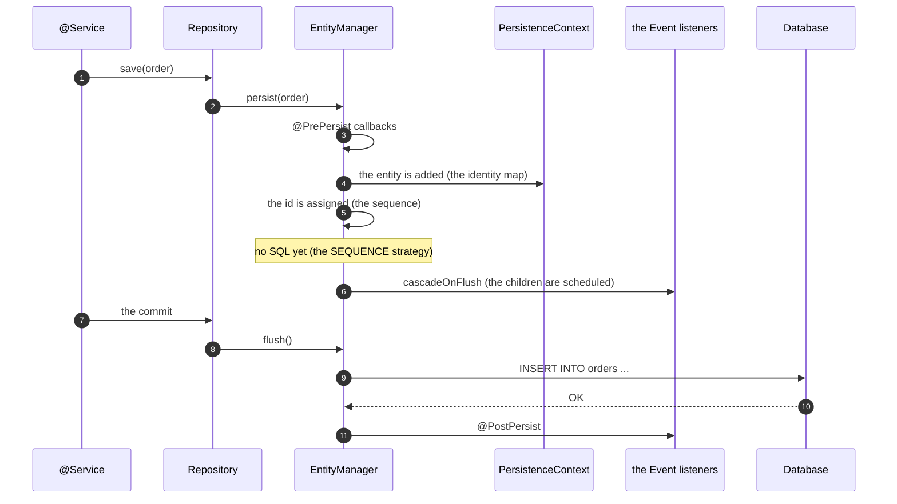
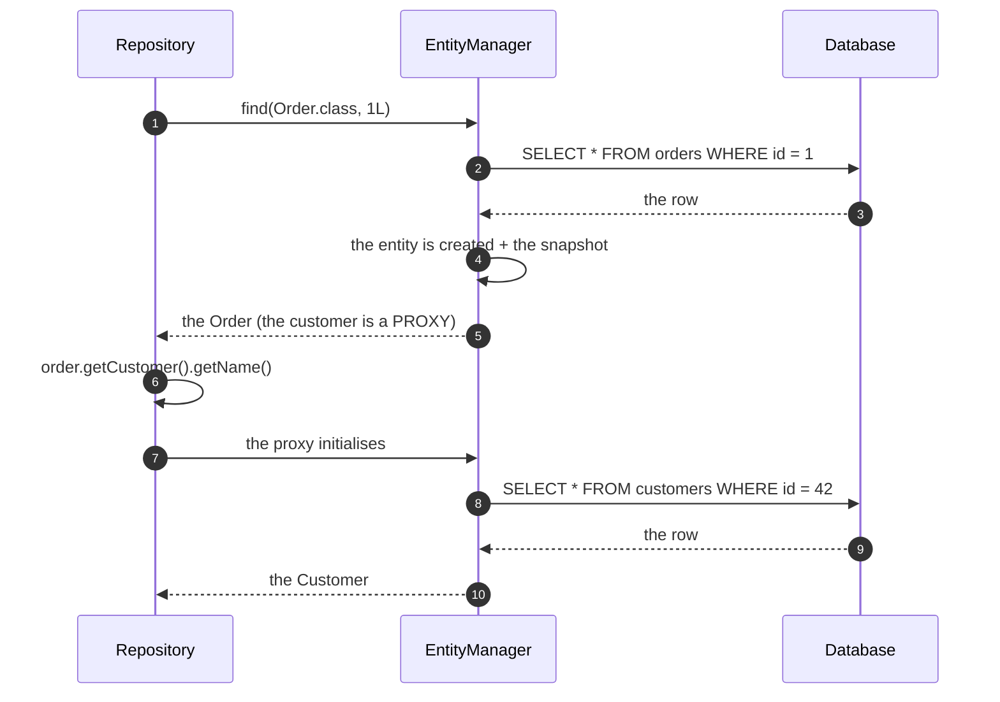
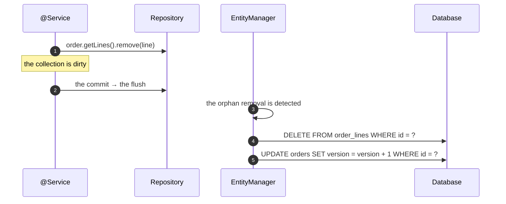

# 03 · Entity Lifecycle, State Transitions & Mapping Strategy

> **Level:** Beginner → Advanced
> **Interview Frequency:** ★★★★☆ ("Explain the entity lifecycle / how do you map this
> relationship?")
> **Prerequisite:** [02 · JPA Internals](./02-JPA-Internals-and-Persistence-Context.md)
> **Last Updated:** 2026

---

## 📋 Table of Contents
- [0. TL;DR — The 30-Second Answer](#0-tldr--the-30-second-answer)
- [1. What & Why](#1-what--why)
- [2. Mental Model — the Entity as a State Machine](#2-mental-model--the-entity-as-a-state-machine)
- [3. Deep Dive — Theory](#3-deep-dive--theory)
- [4. Internal Working Mechanism](#4-internal-working-mechanism)
- [5. Step-by-Step Execution Flow](#5-step-by-step-execution-flow)
- [6. Architecture Diagrams](#6-architecture-diagrams)
- [7. Production-Level Use Cases](#7-production-level-use-cases)
- [8. Code Examples — Production-Grade](#8-code-examples--production-grade)
- [9. Common Mistakes & Gotchas](#9-common-mistakes--gotchas)
- [10. Performance Considerations](#10-performance-considerations)
- [11. Security Considerations](#11-security-considerations)
- [12. Best Practices — The Checklist](#12-best-practices--the-checklist)
- [13. Hands-On Exercises](#13-hands-on-exercises)
- [14. Code Challenges](#14-code-challenges)
- [15. Scenario-Based Questions](#15-scenario-based-questions)
- [16. Interview Q&A — Level-wise](#16-interview-qa--level-wise)
- [17. Counter-Questions & Traps](#17-counter-questions--traps)
- [18. Tricky Interview Questions](#18-tricky-interview-questions)
- [19. Follow-Up Questions Asked by Interviewers](#19-follow-up-questions-asked-by-interviewers)
- [20. Real 3–5 Year Experience Scenarios](#20-real-35-year-experience-scenarios)
- [21. Frequently Asked Production Issues](#21-frequently-asked-production-issues)
- [22. Debugging Scenarios](#22-debugging-scenarios)
- [23. Architecture Design Questions](#23-architecture-design-questions)
- [24. Rapid-Fire MCQs](#24-rapid-fire-mcqs)
- [25. Cheat Sheet — One-Page Summary](#25-cheat-sheet--one-page-summary)
- [26. Real-World Production Notes](#26-real-world-production-notes)
- [27. Follow-up Learning](#27-follow-up-learning)

---

## 0. TL;DR — The 30-Second Answer

- **The entity lifecycle:** `new` → **transient** → `persist()` → **managed** → `flush` →
  **persistent** → `remove()` → **removed** → `detach`/`clear` → **detached**.
- **The three persistence contexts:** the **transient** (not in the DB, not in the context), the
  **managed** (in the context → the changes are tracked), the **detached** (in the DB, not in the
  context → the changes are **not** tracked).
- **The callbacks:** `@PrePersist` / `@PostPersist` / `@PreUpdate` / `@PostUpdate` /
  `@PreRemove` / `@PostRemove` / `@PostLoad`.
- **The `EntityListeners`** (the `AuditingEntityListener`) for the auditing.
- **The mapping decisions:**
  - `@OneToMany` **without** the FK column (the mappedBy) → the **unidirectional one-to-many**;
  - `@OneToMany` **with** the FK on the many side → the **unidirectional one-to-many with a join
    table** (the extra table!) — the trap.
  - The **bidirectional** one-to-many needs the `mappedBy` + the maintenance of both sides.
  - The `@ManyToMany` → the **join table** (the ownership matters).
- **The cascade:** the `CascadeType` (`PERSIST`, `MERGE`, `REMOVE`, `REFRESH`, `DETACH`, `ALL`) and
  the `orphanRemoval`.
- **The fetch types:** `LAZY` (the default for the many-to-one/one-to-one) vs `EAGER` (the default
  for the one-to-many/many-to-many) — and the `@BatchSize`, the `@Fetch(FetchMode.SUBSELECT)`,
  the `@EntityGraph`.
- **The identifier strategies:** `IDENTITY` (the insert immediately, no batching), `SEQUENCE`
  (the batching-friendly), `UUID` (the app-generated, the `uuid` type in Postgres), `TABLE`
  (the legacy).
- **The four states, one `EntityManager`:** the `em.contains()`, `em.getEntityManagerFactory()`,
  the `Persistable.isNew()`.

---

## 1. What & Why

The mapping strategy is where the **domain model** meets the **relational model**. The wrong
choices produce the N+1s, the unexpected `UPDATE`s on the whole collection, the impossible
constraints, and the "why is my IDENTITY breaking the batching?" moments.

**The interview angle:** "How do you map this relationship?" is a question that separates the
candidates who have designed a schema from the ones who have only generated the entities from
the DB.

---

## 2. Mental Model — the Entity as a State Machine

```text
                         persist()
        ┌──────────┐  ───────────────▶  ┌──────────┐
        │          │                    │          │
        │ TRANSIENT│                    │ MANAGED  │◀──────┐
        │ (new)    │                    │ (in ctx) │       │ refresh() / the
        └──────────┘                    └────┬─────┘       │ re-read
              ▲                                │             │
              │ detach() / clear()             │ flush()    │
              │                                ▼             │
        ┌──────────┐    remove()        ┌──────────────┐   │
        │ DETACHED │ ◀───────────────   │  PERSISTENT  │───┘
        │ (in DB)  │   (after the      │   (in DB)    │
        └────┬─────┘    flush+commit)  └──────────────┘
             │                              ▲
             │ remove() + flush              │ persist()
             ▼                              │
        ┌──────────┐                        │
        │  REMOVED │────────────────────────┘
        └──────────┘   (the DELETE at the flush)
```

> **Caption:** The states are **context-relative**, not properties of the entity. The same object
> can be transient in one context and managed in another.

---

## 3. Deep Dive — Theory

### 3.1 The lifecycle callbacks

| The callback | When | The typical use |
|--------------|------|-----------------|
| `@PrePersist` | Before the INSERT | The defaults, the audit fields, the validation |
| `@PostPersist` | After the INSERT | The event publishing, the id-based setup |
| `@PreUpdate` | Before the UPDATE | The computed fields, the last-modified |
| `@PostUpdate` | After the UPDATE | The event publishing, the cache eviction |
| `@PreRemove` | Before the DELETE | The soft-delete conversion, the cleanup |
| `@PostRemove` | After the DELETE | The event publishing |
| `@PostLoad` | After the entity is loaded | The transient field computation, the auditing |

**The `EntityListeners`:**
```java
@EntityListeners(AuditingEntityListener.class)
@Entity
public class Order { ... }
```

```java
public class AuditingEntityListener {
    @PrePersist
    void onCreate(Object entity) { ... }

    @PreUpdate
    void onUpdate(Object entity) { ... }
}
```

**The ordering:** the `@PrePersist` callbacks run in the **superclass → subclass** order, and
the `@PostPersist` in the **subclass → superclass** order.

**The trap:** the callbacks are invoked by the **ORM**, not by the constructor. A `new Order()`
without a `persist` never triggers `@PrePersist`. And the `@PreUpdate` only fires if the entity
is actually **dirty** — setting the same value doesn't trigger it.

### 3.2 The identifier strategies

| The strategy | The mechanism | The trade-off |
|-------------|---------------|--------------|
| `@GeneratedValue(strategy = IDENTITY)` | The DB's auto-increment | The INSERT executes **immediately** (to get the id) → **the JDBC batching breaks**; the id is DB-generated |
| `SEQUENCE` (the default in Hibernate 6) | `select nextval('seq')` | The batching-friendly; the sequence gaps (the rolled-back transactions consume the ids); the "the id is known before the insert" |
| `TABLE` | A separate table with a counter | The legacy; the contention |
| `UUID` (the app-generated) | The app assigns it | The DB storage is bigger (the `uuid` type in Postgres, the `binary(16)`); the index locality is poor; the client-friendly (the id known before the insert) |
| `AUTO` (the legacy) | The dialect decides | Deprecated in Hibernate 6 → use the explicit strategies |

**The `SEQUENCE` allocator (Hibernate 6):**
```java
@Id
@GeneratedValue(strategy = GenerationType.SEQUENCE, generator = "order_seq")
@SequenceGenerator(name = "order_seq", sequenceName = "order_id_seq", allocationSize = 50)
private Long id;
```
The `allocationSize = 50` (the **pooled optimizer**) → the app grabs 50 ids at a time → far fewer
DB round trips. The trade-off: the **gaps** (the crashed app wastes the remaining ids).

**The UUID in Postgres:**
```java
@Id
private UUID id;   // the Postgres `uuid` type (the native, 16 bytes)
```
vs the `@UuidGenerator` (the Hibernate 6) with the `UUID.randomUUID()` (the v4) or the
`@GeneratedValue` with the `UUID` (the v7 in Hibernate 6.6 — **time-ordered** → a better index
locality).

**The "the id is the business key" anti-pattern:**
```java
@Id
private String orderNumber;   // the business key as the PK
```
**The problems:** (1) the business key can change (the renumbering → the PK update → the FKs
cascade); (2) the DB can't generate it; (3) the "the natural key" should be a **unique
constraint**, not the PK. The **surrogate key** (the `id` + a unique business key) is the
default.

### 3.3 The relationship mappings — the decision table

| The relationship | The FK is on | The mapping | The trap |
|-----------------|--------------|------------|---------|
| **One-to-one** | The many side (the child) | `@OneToOne` + `mappedBy` on the inverse side | The eager loading of the inverse side (the `Optional` one-to-one is eager by default!) |
| **One-to-many (bidirectional)** | The many side | `@OneToMany(mappedBy=...)` + `@ManyToOne` | The maintenance of both sides (the `setParent`) |
| **One-to-many (unidirectional)** | The many side | `@OneToMany` + `@JoinColumn` | The **extra join table** by default! (see below) |
| **Many-to-many** | A join table | `@ManyToMany` + `@JoinTable` | The **ownership** (which side writes the join table) |
| **Many-to-one** | The many side (always) | `@ManyToOne` | The N+1 (the default is lazy — good) |
| **Element collection** | A join table (or a JSON) | `@ElementCollection` | The `@ElementCollection` is **always** eager by default! |

#### 3.3.1 The unidirectional one-to-many — the join-table trap

```java
// ⚠️ THE TRAP
@Entity
class Parent {
    @OneToMany
    private List<Child> children;    // → a JOIN TABLE (parent_child) — NOT a FK!
}
```

**The default for the unidirectional `@OneToMany` is a join table**, because the JPA spec says the
one-to-many has no FK (the many side doesn't "know" its parent). To get a **FK on the child**
(the usual production design), you must specify it:

```java
@Entity
class Parent {
    @Id Long id;

    @OneToMany(mappedBy = "parent")            // the bidirectional version
    private List<Child> children;
}

@Entity
class Child {
    @Id Long id;

    @ManyToOne(fetch = FetchType.LAZY)
    @JoinColumn(name = "parent_id")
    private Parent parent;
}
```

**Or, the unidirectional with an explicit join column:**
```java
@Entity
class Parent {
    @OneToMany
    @JoinColumn(name = "parent_id")
    private List<Child> children;
}
```
> **The trade-off:** with the explicit `@JoinColumn`, the **unidirectional** one-to-many has a FK
on the child, but the **child doesn't have the back-reference** (no `parent` field) → the
navigability is one-way (the parent → the children, but not the child → the parent) → and
Hibernate manages the FK on the child **without** the child knowing (the "the shared FK
column" — Hibernate warns about it: "the shared column" — and the `mappedBy` is the cleaner
solution).

**The recommendation:** the **bidirectional** mapping with `mappedBy` (the shared FK) — the
child has the `parent` field (the navigability both ways) and the parent doesn't write the FK.

#### 3.3.2 The many-to-many — the ownership

```java
@Entity
class Student {
    @ManyToMany
    @JoinTable(name = "student_course",
               joinColumns = @JoinColumn(name = "student_id"),
               inverseJoinColumns = @JoinColumn(name = "course_id"))
    private Set<Course> courses;    // the OWNER — it writes the join table
}

@Entity
class Course {
    @ManyToMany(mappedBy = "courses")
    private Set<Student> students;  // the INVERSE — read-only
}
```

**The rules:**
- The **owner** side has the `@JoinTable` and manages the join rows.
- The **inverse** side has the `mappedBy` and **cannot** persist the relationship changes alone
  (you must update the owner side, or the `merge`/the flush handles it — Hibernate syncs the
  owner's collection during the flush **if the owner is managed**; the classic bug: updating the
  inverse side's collection does nothing).
- The **extra field in the join table** (the grade, the enrolledAt) → the
  `@ManyToMany` + the `@OrderColumn`? No — for the attributes in the join table, use a
  **separate entity**: `Enrollment` with `@ManyToOne` to both sides and the `@IdClass`/the
  `@EmbeddedId` (the composite key). The `@ManyToMany` with the attribute overrides is a
  Hibernate extension — it works but it's non-portable and the operations are awkward.

**The composite key (the `@EmbeddedId`):**
```java
@Embeddable
public class EnrollmentId implements Serializable {
    private Long studentId;
    private Long courseId;
    // equals/hashCode
}

@Entity
public class Enrollment {
    @EmbeddedId
    private EnrollmentId id;

    @ManyToOne
    @MapsId("studentId")
    private Student student;

    @ManyToOne
    @MapsId("courseId")
    private Course course;

    private Grade grade;
}
```
> The `@MapsId` derives the FK from the embedded id — **no duplicated columns**.

### 3.4 The cascade

| The `CascadeType` | The trigger | The use |
|-------------------|------------|---------|
| `PERSIST` | `persist()` | The aggregate's children (the aggregate root owns them) |
| `MERGE` | `merge()` | The same |
| `REMOVE` | `remove()` | The aggregate's children |
| `REFRESH` | `refresh()` | Rarely |
| `DETACH` | `detach()` | Rarely |
| `ALL` | All of them | The aggregate root |
| `NONE` (the default) | — | The default (the explicit is safer) |

**The rules:**
1. **The cascade only from the parent to the child** (never the reverse).
2. **The cascade on the `@ManyToOne` is usually wrong** — a `CascadeType.ALL` on a
   `@ManyToOne` means "persisting the order also persists the customer" → the accidental updates
   of the shared entities. **Never cascade to a `@ManyToOne`** (except the "the aggregate
   owned by the root" cases — the "the order owns its lines" is the one-to-many, not the
   many-to-one).
3. **The `orphanRemoval`** is the "the child removed from the collection → the DELETE" (it's
   the inverse of the cascade on the collection).
4. **The cascade + the detached entities:** the `merge` cascades to the children → the
`merge` returns a new managed graph (the classic "the merge returns a different object"
surprise).

### 3.5 The fetch strategies

| The annotation | The behaviour | The use |
|----------------|---------------|---------|
| `FetchType.LAZY` | The proxy; the load on the first access | The default for the `@ManyToOne`/`@OneToOne` |
| `FetchType.EAGER` | The join/select at the load | The default for the `@OneToMany`/`@ManyToMany` |
| `@BatchSize(n)` | The batched lazy loading (the `in (:ids)`) | The collections that are accessed in a loop |
| `@Fetch(FetchMode.SUBSELECT)` | One query for all the parents' collections | The parent + the children lists |
| `@Fetch(FetchMode.JOIN)` | The join (an eager join) | The rare cases |
| `@EntityGraph` | The dynamic fetch plan | The per-query control |

**The eager defaults — the traps:**
- The `@OneToMany` and the `@ManyToMany` are **eager by default** → every query joins the
  collection → the N+1 becomes an "always expensive" query.
- The `@OneToOne` is **eager by default** → the inverse side (the `mappedBy`) too — this is the
  classic: a `User` with an `Optional<Profile>` (the inverse one-to-one) loads the profile for
  every user query.
- The `@ElementCollection` is **eager by default**.

**The fix:** set `spring.jpa.properties.hibernate.default_batch_fetch_size=50` (the global
batching) and make the collections `LAZY` explicitly.

**The `@ElementCollection` — the "the JSON column" alternative:**
```java
@ElementCollection
@CollectionTable(name = "order_tags", joinColumns = @JoinColumn(name = "order_id"))
@Column(name = "tag")
private Set<String> tags = new HashSet<>();
```
**The alternatives:** the JSON column (the Postgres `jsonb` + a `@Convert` with the
`AttributeConverter` or the Hypersistence utils) — a better fit for the read-mostly,
write-rarely data (the tags, the settings, the metadata).

### 3.6 The `@Embeddable` and the value objects

```java
@Embeddable
public class Money {
    private BigDecimal amount;
    @Enumerated(EnumType.STRING)
    private Currency currency;

    // the equals/hashCode — the value semantics!
}
```

**The rules:**
- The `@Embeddable` can't be **lazy** (it's part of the owner's row).
- The `@EmbeddedId` for the composite keys (with the `@MapsId`).
- The `@AttributeConverter` for the custom types (the `enum` → the `varchar`, the
  `ValueObject` → the JSON).

### 3.7 The `@Version` — the optimistic locking

```java
@Entity
public class Account {
    @Id Long id;

    @Version
    private Long version;    // 0, 1, 2, ...
}
```

**The mechanism:** the UPDATE becomes `update accounts set balance=?, version=? where id=? and
version=?` → if the affected rows = 0 → the `OptimisticLockException`.

**The rules:**
- The version is incremented on every update.
- The version must be a primitive wrapper (or a primitive) and it can't be null.
- **The `@Version` on the `@ManyToOne` = the pessimistic-ish** (the parent's version is
  checked) — it doesn't lock the parent but it detects the parent's concurrent change.
- The **`@OptimisticLock` on the collection** (`@OptimisticLock(excluded = true)`) — the
  collection changes increment the version.

### 3.8 The soft delete

```java
@Entity
@Table(name = "orders")
public class Order {
    @Id Long id;

    @Column(name = "deleted_at")
    private Instant deletedAt;    // null = not deleted
}
```

**The three implementation approaches:**
1. **The manual filter** — the repository's `@Query` with `where deletedAt is null` (and the
   `findById` overridden). **The risk:** forgetting it in one query → the "ghost rows".
2. **The Hibernate filter** (`@FilterDef` + `@Filter` + `enableFilter` in the repository) — the
   automatic (but the filter must be enabled per session).
3. **The `@SQLRestriction`** (Hibernate 6.4+, the successor of `@Where`):
   ```java
   @SQLRestriction("deleted_at is null")
   @Entity
   public class Order { ... }
   ```
   The **automatic** — the restriction is applied to every query on the entity. **This is the
   modern answer.**

**The trade-off:** the soft delete breaks the **unique constraints** (the deleted row still holds
the value) → use a **partial unique index** (`create unique index ... where deleted_at is null`).

### 3.9 The auditing

```java
@Entity
@EntityListeners(AuditingEntityListener.class)
@EnableJpaAuditing
public class Order {
    @CreatedDate
    @Column(name = "created_at", updatable = false)
    private Instant createdAt;

    @LastModifiedDate
    @Column(name = "updated_at")
    private Instant updatedAt;

    @CreatedBy
    @Column(name = "created_by", updatable = false)
    private String createdBy;

    @LastModifiedBy
    @Column(name = "updated_by")
    private String updatedBy;
}
```
**The setup:** `@EnableJpaAuditing` + a `AuditorAware<String>` bean (the current user's
principal).

**The trade-off:** the auditing needs the `SecurityContext` → the coupling to Spring Security
(acceptable in a Spring Boot app; a problem in a reusable library — the common solution: an
`AuditorAware` bean that the app provides).

### 3.10 The inheritance strategies

| The strategy | The tables | The query | The trade-off |
|-------------|-----------|----------|--------------|
| `SINGLE_TABLE` (the default) | 1 (the discriminator column) | The simplest | The nullable columns; the discriminator; the "the big table" |
| `JOINED` | One per class + a join | The joins | The joins on every query |
| `TABLE_PER_CLASS` (the union subclass) | One per concrete class | The union | The polymorphic queries are hard; the no-associations-to-the-parent restriction |

**The recommendation:** the `SINGLE_TABLE` for the shallow hierarchies; the `JOINED` for the deep
ones with the few shared fields.

### 3.11 The `AttributeConverter` — the custom types

```java
@Converter(autoApply = true)
public class OrderStatusConverter implements AttributeConverter<OrderStatus, String> {
    @Override
    public String convertToDatabaseColumn(OrderStatus attribute) {
        return attribute == null ? null : attribute.name();
    }

    @Override
    public OrderStatus convertToEntityAttribute(String dbData) {
        return dbData == null ? null : OrderStatus.valueOf(dbData);
    }
}
```

**The use cases:** the enums (the `STRING` vs the `ORDINAL` — always the `STRING`, the ordinal
is a schema-breaking trap), the value objects, the JSON columns, the encrypted columns, the
`Duration` (the `Interval`).

**The `autoApply = true`** applies it to all the matching types (the enum). The downside: the
global effect (the surprises in the other entities) — the explicit `@Convert` on the field is
safer in a library.

### 3.12 The Spring Data repository — the query derivation

```java
public interface OrderRepository extends JpaRepository<Order, Long> {

    // The derived query — the method name IS the query
    List<Order> findByCustomerIdAndStatus(Long customerId, OrderStatus status);

    // The keyword support
    List<Order> findByCreatedAtBetween(Instant from, Instant to);
    List<Order> findByStatusIn(Collection<OrderStatus> statuses);
    List<Order> findByCustomerEmailIgnoreCase(String email);
    List<Order> findByTotalAmountGreaterThanEqual(BigDecimal amount);
    Optional<Order> findFirstByOrderNumber(String orderNumber);
    List<Order> findTop10ByStatusOrderByCreatedAtDesc(OrderStatus status);
    long countByStatus(OrderStatus status);
    boolean existsByOrderNumber(String orderNumber);
    void deleteByStatus(OrderStatus status);
}
```

**The keyword cheat sheet:**
`And` `Or` `Not` `IgnoreCase` `Between` `IsNull` `IsNotNull` `StartingWith` `Containing`
`GreaterThan` `LessThan` `In` `NotIn` `True` `False` `First` `Top` `Distinct` `OrderBy` `Asc`
`Desc` `Pageable` `Sort`.

**The derived queries vs the `@Query`:**
- The derived queries are **type-safe** and **refactor-friendly**.
- The `@Query` (the JPQL) is needed for the **complex** logic, the **joins**, the
  **projections**, the **bulk operations**.
- The **native queries** for the DB-specific SQL (the window functions, the CTEs, the
  `ON CONFLICT`).

**The `Specification` (the dynamic queries):**
```java
public interface OrderRepository extends JpaRepository<Order, Long>, JpaSpecificationExecutor<Order> {
}
```

```java
Specification<Order> byStatus = (root, query, cb) -> cb.equal(root.get("status"), status);
Specification<Order> byCustomer = (root, query, cb) -> cb.equal(root.get("customer").get("id"), customerId);
Specification<Order> spec = byStatus.and(byCustomer);
```

**The `Specification` and the N+1:** the `Specification` is applied to the query, but the
**fetching** isn't controlled → the N+1 remains. The fix: the `@EntityGraph` on the
repository's method + the `JpaSpecificationExecutor` (the custom `findBy` with the
`EntityGraph`).

---

## 4. Internal Working Mechanism

### 4.1 The metadata building (the startup)

```text
  The Spring Boot startup
    │
    ├─ the entity scanning (the @Entity classes in the scanned packages)
    │     └─ the JPA metamodel (the annotations → the MappingMetadata)
    │
    ├─ the XSD/ORM XML validation (the mapping errors fail the startup!)
    │
    ├─ the SessionFactory build
    │     ├─ the EntityPersister per entity (the SQL templates, the loaders)
    │     ├─ the collection persisters (the "the collection recreation" logic)
    │     ├─ the query plan cache (the HQL → the AST → the SQL)
    │     └─ the second-level cache regions
    │
    └─ the "the database is reachable" check (the schema validation)
```

**The startup validation:** the `spring.jpa.hibernate.ddl-auto=validate` (the default in the
Boot's tests) → the schema must match the mappings, or the app **fails to start**. That's a
feature: the mismatch is caught at the deploy, not at the 3am page.

### 4.2 The metadata vs the schema — the drift

```text
  The @Entity annotations
        │  (the metamodel)
        ▼
  ┌────────────────────┐        ┌────────────────────┐
  │ The mapping        │  ◄──►  │ The DB schema      │
  │ (the expectations) │        │ (the reality)      │
  └────────────────────┘        └────────────────────┘
        ▲
        │ the drift: the manual DDL, the changed column, the renamed field
        │
  The symptoms: the "the column not found" (a runtime error), the "the data is wrong"
  (the silent drift), the "the startup validation fails" (the good case)
```

**The rule:** the schema is **owned by the migrations** (Flyway/Liquibase) — never by
`ddl-auto=update` in production.

### 4.3 The collection persister — the recreation logic

```text
  CollectionPersister
    ├─ the role (the owner / the inverse)
    ├─ the "isOneToMany" / "isManyToMany" (the table, the key)
    ├─ the loading (the batched, the subselect)
    └─ the mutation:
         ├─ the one-to-many:  the removed elements → the DELETE (the orphan)
         ├─ the one-to-many:  the added elements → the INSERT (the FK update)
         ├─ the many-to-many: the diff → the DELETE + the INSERT of the join rows
         └─ the indexed list: the position → the @OrderColumn update
```

### 4.4 The `EntityPersister`'s loaders — the "the N+1" machinery

```text
  the load plan (per entity)
    ├─ the loader: the "SELECT ... WHERE id = ?" (the single)
    ├─ the batch loader: the "SELECT ... WHERE id IN (?, ?, ...)" (the @BatchSize)
    ├─ the collection loader: the "SELECT ... WHERE parent_id = ?"
    ├─ the subselect loader: the "SELECT ... WHERE parent_id IN (the loaded parents)"
    └─ the join loader: the "SELECT ... LEFT JOIN ..." (the eager)
```

**The loader choice** (at the runtime, per query):
```text
  the "the entity is already in the context"? → no query (the identity map)
  the "the eager association"? → the join in the same query
  the "the @BatchSize is set and the batch is available"? → the IN query
  the "the @Fetch(SUBSELECT)"? → the IN query for the parents
  otherwise → the single query per parent (the N+1)
```

### 4.5 The `@SQLRestriction` (Hibernate 6.4+) — the internals

```text
  the entity's persister
    └─ the sqlRestriction: "deleted_at is null"
         └─ applied to:
              ├─ the JPQL/HQL queries (the SQL generator appends the predicate)
              ├─ the native queries (NO — the native SQL is yours)
              └─ the direct entity loads (find, getReference)
```

> **The caveat:** the **native queries** and the **direct JPQL with the explicit where** are
affected, but a **native query** is **not** filtered. And the `@SQLRestriction` doesn't apply to
the **association** loads? (It does — the restriction is per-entity and applies to the joins too,
but be careful with the `@ManyToMany` through the restricted entity.)

---

## 5. Step-by-Step Execution Flow

### 5.1 The persist flow



### 5.2 The load flow with the lazy association



### 5.3 The delete flow with the orphan removal



---

## 6. Architecture Diagrams

### 6.1 The mapping decision tree

```text
  "I have a relationship between A and B"
            │
            ▼
  ┌───────────────────────────────┐
  │ How many A to one B?         │
  └───────────┬───────────────────┘
              │
   ┌──────────┼───────────────┐
   ▼          ▼               ▼
 Many-to-one  One-to-one     One-to-many
   │             │               │
   │        the FK on the      the FK on the
   │        "many" side        "many" side
   │             │               │
   │        the owner:          ┌──────────────┐
   │        @JoinColumn        │ bidirectional?│
   │             │              └──────┬───────┘
   │             │                 ┌───┴───┐
   │             ▼                 ▼       ▼
   │        the owner side    mappedBy  @JoinColumn
   │        (writes the FK)   + @ManyToOne (unidirectional)
   │             │                 │
   │             ▼                 ▼
   │        the inverse side:   the child has no
   │        mappedBy           back-reference
   │
   └──────────────────────────────────┐
                                      ▼
  Many-to-many → the @JoinTable (the owner side writes it)
```

### 6.2 The fetch strategies compared

```text
  The parent query + the children access
  ─────────────────────────────────────────────────────────────────

  LAZY (no @BatchSize)          →  1 + N queries   (the N+1)
     SELECT * FROM orders
     SELECT * FROM lines WHERE order_id = 1
     SELECT * FROM lines WHERE order_id = 2
     ...

  LAZY + @BatchSize(50)         →  1 + 1 query     (the batched)
     SELECT * FROM orders
     SELECT * FROM lines WHERE order_id IN (1,2,3,...,50)

  LAZY + @Fetch(SUBSELECT)      →  1 + 1 query     (the subselect)
     SELECT * FROM orders
     SELECT * FROM lines WHERE order_id IN (the loaded parents)

  EAGER (the join)              →  1 query         (but a big result set)
     SELECT o.*, l.* FROM orders o LEFT JOIN lines l ON ...

  @EntityGraph(attributePaths)  →  1 query         (the dynamic)
     SELECT o.*, l.* FROM orders o LEFT JOIN lines l ON ... WHERE o.id = ?
```

### 6.3 The cascade & the orphan removal matrix

```text
  ┌────────────────────┬──────────────────────┬──────────────────────┐
  │                    │ The parent is        │ The child is         │
  │                    │ PERSISTED            │ REMOVED from the     │
  │                    │                      │ collection           │
  ├────────────────────┼──────────────────────┼──────────────────────┤
  │ CascadeType.NONE   │ the child is NOT     │ nothing (the FK     │
  │                    │ persisted → the      │ violation at the     │
  │                    │ TransientProperty    │ flush)               │
  │                    │ ValueException       │                      │
  ├────────────────────┼──────────────────────┼──────────────────────┤
  │ CascadeType.PERSIST│ the child IS         │ nothing              │
  │ (or ALL)           │ persisted            │                      │
  ├────────────────────┼──────────────────────┼──────────────────────┤
  │ orphanRemoval=true │ the child is         │ the child is         │
  │                    │ NOT persisted (the   │ DELETED at the flush │
  │                    │ orphan removal is    │                      │
  │                    │ for the removal only)│                      │
  └────────────────────┴──────────────────────┴──────────────────────┘
```

---

## 7. Production-Level Use Cases

| Use case | The mapping/technique |
|----------|----------------------|
| **The aggregate with the children** | The bidirectional one-to-many with the `mappedBy` + the `CascadeType.ALL` + the `orphanRemoval` |
| **The reference data** | The separate table (no FK) + the cache |
| **The audit/history** | A separate table (the append-only) + the `@Version` |
| **The soft delete** | The `@SQLRestriction` + the partial unique index |
| **The multi-tenant** | The tenant id on every table + the composite index (the tenant id first) |
| **The tags/metadata** | The JSONB column + the `AttributeConverter` (the Postgres) |
| **The high-volume events** | A separate table, no FK (the loose coupling), the partitioning |
| **The hierarchical data** | The `@ManyToOne` self-reference (the adjacency list) or the `@SqlResultSetMapping` (the closure table) |
| **The many-to-many with the attributes** | A separate entity with the `@EmbeddedId` + the `@MapsId` |
| **The legacy schema** | The `@JoinTable` on the unidirectional one-to-many (the "the join table as the migration bridge") |

---

## 8. Code Examples — Production-Grade

### 8.1 The aggregate root with the children

```java
@Entity
@Table(name = "orders", indexes = {
    @Index(name = "idx_orders_customer_id", columnList = "customer_id"),
    @Index(name = "idx_orders_status_created_at", columnList = "status, created_at")
})
public class Order extends BaseEntity {

    @ManyToOne(fetch = FetchType.LAZY, optional = false)
    @JoinColumn(name = "customer_id", nullable = false)
    private Customer customer;

    @OneToMany(mappedBy = "order", cascade = CascadeType.ALL, orphanRemoval = true)
    @OrderBy("createdAt ASC")
    private List<OrderLine> lines = new ArrayList<>();

    protected Order() { }

    private Order(Customer customer, List<OrderLine> lines) {
        this.customer = customer;
        lines.forEach(this::addLine);
    }

    public static Order place(Customer customer, List<OrderLine> lines) {
        if (lines.isEmpty()) {
            throw new IllegalArgumentException("An order must have at least one line");
        }
        return new Order(customer, lines);
    }

    // The invariant-preserving mutation — the collection is never exposed directly
    public void addLine(OrderLine line) {
        line.attachTo(this);
        this.lines.add(line);
    }

    public void removeLine(OrderLine line) {
        this.lines.remove(line);
        // No need to call line.detach() — the orphanRemoval handles it
    }

    public BigDecimal total() {
        return lines.stream()
                    .map(OrderLine::subtotal)
                    .reduce(BigDecimal.ZERO, BigDecimal::add);
    }
}
```

```java
@Entity
@Table(name = "order_lines")
public class OrderLine {

    @Id
    @GeneratedValue(strategy = GenerationType.IDENTITY)
    private Long id;

    @ManyToOne(fetch = FetchType.LAZY, optional = false)
    @JoinColumn(name = "order_id", nullable = false)
    private Order order;

    @ManyToOne(fetch = FetchType.LAZY, optional = false)
    @JoinColumn(name = "product_id", nullable = false)
    private Product product;

    @Column(nullable = false)
    private int quantity;

    @Column(name = "unit_price", nullable = false, precision = 19, scale = 2)
    private BigDecimal unitPrice;

    protected OrderLine() { }

    public OrderLine(Product product, int quantity) {
        this.product = product;
        this.quantity = quantity;
        this.unitPrice = product.getPrice();
    }

    void attachTo(Order order) {
        this.order = order;
    }

    public BigDecimal subtotal() {
        return unitPrice.multiply(BigDecimal.valueOf(quantity));
    }
}
```

> **The key idea:** the `lines` collection is **never** exposed as a getter returning the
> mutable list (the `getLines().add(...)` from outside bypasses the invariants). The aggregate
> root controls the mutations. This is the **DDD** approach and it prevents the classic bugs
> (the FK not set, the invariant broken).

### 8.2 The base entity with the auditing and the optimistic locking

```java
@MappedSuperclass
@EntityListeners(AuditingEntityListener.class)
public abstract class BaseEntity {

    @CreatedDate
    @Column(name = "created_at", nullable = false, updatable = false)
    private Instant createdAt;

    @LastModifiedDate
    @Column(name = "updated_at", nullable = false)
    private Instant updatedAt;

    @CreatedBy
    @Column(name = "created_by", length = 100, updatable = false)
    private String createdBy;

    @LastModifiedBy
    @Column(name = "updated_by", length = 100)
    private String updatedBy;

    @Version
    @Column(nullable = false)
    private Long version;
}
```

### 8.3 The soft delete with the `@SQLRestriction`

```java
@Entity
@Table(name = "orders")
@SQLRestriction("deleted_at IS NULL")
public class Order extends BaseEntity {

    @Id
    @GeneratedValue(strategy = GenerationType.IDENTITY)
    private Long id;

    @Column(name = "order_number", nullable = false, length = 40)
    private String orderNumber;

    @Column(name = "deleted_at")
    private Instant deletedAt;

    public void softDelete() {
        this.deletedAt = Instant.now();
    }
}
```

```java
// The partial unique index — the deleted rows don't block the reuse
// V2__orders.sql
CREATE UNIQUE INDEX idx_orders_order_number_active
    ON orders (order_number)
    WHERE deleted_at IS NULL;
```

### 8.4 The `AttributeConverter` — the JSONB column

```java
@Converter
public class JsonbConverter implements AttributeConverter<Map<String, Object>, String> {

    private static final ObjectMapper MAPPER = new ObjectMapper();

    @Override
    public String convertToDatabaseColumn(Map<String, Object> attribute) {
        try {
            return attribute == null ? null : MAPPER.writeValueAsString(attribute);
        } catch (JsonProcessingException e) {
            throw new IllegalStateException("Cannot serialise the metadata", e);
        }
    }

    @Override
    public Map<String, Object> convertToEntityAttribute(String dbData) {
        try {
            return dbData == null ? null
                    : MAPPER.readValue(dbData, new TypeReference<>() { });
        } catch (JsonProcessingException e) {
            throw new IllegalStateException("Cannot deserialise the metadata", e);
        }
    }
}
```

```java
@Entity
public class Product {
    @Id Long id;

    @Convert(converter = JsonbConverter.class)
    @Column(name = "attributes", columnDefinition = "jsonb")
    private Map<String, Object> attributes;
}
```

### 8.5 The many-to-many with the attributes → a separate entity

```java
@Embeddable
public class EnrollmentId implements Serializable {
    private Long studentId;
    private Long courseId;

    protected EnrollmentId() { }

    public EnrollmentId(Long studentId, Long courseId) {
        this.studentId = studentId;
        this.courseId = courseId;
    }

    @Override public boolean equals(Object o) {
        if (this == o) return true;
        if (!(o instanceof EnrollmentId other)) return false;
        return Objects.equals(studentId, other.studentId) && Objects.equals(courseId, other.courseId);
    }

    @Override public int hashCode() { return Objects.hash(studentId, courseId); }
}
```

```java
@Entity
@Table(name = "enrollments")
public class Enrollment {

    @EmbeddedId
    private EnrollmentId id;

    @ManyToOne(fetch = FetchType.LAZY)
    @MapsId("studentId")
    @JoinColumn(name = "student_id")
    private Student student;

    @ManyToOne(fetch = FetchType.LAZY)
    @MapsId("courseId")
    @JoinColumn(name = "course_id")
    private Course course;

    @Enumerated(EnumType.STRING)
    @Column(nullable = false, length = 20)
    private Grade grade;

    protected Enrollment() { }

    public Enrollment(Student student, Course course) {
        this.id = new EnrollmentId(student.getId(), course.getId());
        this.student = student;
        this.course = course;
    }
}
```

### 8.6 The repository with the dynamic fetch and the specifications

```java
public interface OrderRepository extends JpaRepository<Order, Long>,
                                        JpaSpecificationExecutor<Order> {

    List<Order> findByCustomerIdAndStatus(Long customerId, OrderStatus status);

    @EntityGraph(attributePaths = {"customer", "lines", "lines.product"})
    @Query("select o from Order o where o.id = :id")
    Optional<Order> findByIdWithDetails(@Param("id") Long id);

    @EntityGraph(attributePaths = {"customer"})
    @Query("select o from Order o where o.status = :status")
    List<Order> findByStatus(@Param("status") OrderStatus status);

    @Modifying(clearAutomatically = true, flushAutomatically = true)
    @Query("update Order o set o.status = :newStatus, o.updatedAt = CURRENT_TIMESTAMP "
         + "where o.status = :oldStatus and o.updatedAt < :cutoff")
    int bulkTransition(@Param("oldStatus") OrderStatus oldStatus,
                       @Param("newStatus") OrderStatus newStatus,
                       @Param("cutoff") Instant cutoff);
}
```

### 8.7 The `Specification` with the pagination

```java
public class OrderSpecifications {

    public static Specification<Order> hasStatus(OrderStatus status) {
        return (root, query, cb) -> cb.equal(root.get("status"), status);
    }

    public static Specification<Order> hasCustomerId(Long customerId) {
        return (root, query, cb) -> cb.equal(root.get("customer").get("id"), customerId);
    }

    public static Specification<Order> createdAfter(Instant from) {
        return (root, query, cb) -> cb.greaterThan(root.get("createdAt"), from);
    }

    public static Specification<Order> withMinimumTotal(BigDecimal min) {
        return (root, query, cb) -> cb.greaterThanOrEqualTo(root.get("totalAmount"), min);
    }
}
```

```java
@Service
@RequiredArgsConstructor
public class OrderQueryService {

    private final OrderRepository orderRepository;

    @Transactional(readOnly = true)
    public Page<OrderSummary> search(OrderSearchCriteria criteria, Pageable pageable) {
        Specification<Order> spec = Specification.allOf(
                OrderSpecifications.hasStatus(criteria.status()),
                OrderSpecifications.hasCustomerId(criteria.customerId()),
                OrderSpecifications.createdAfter(criteria.from())
        );
        return orderRepository.findAll(spec, pageable).map(this::toSummary);
    }
}
```

### 8.8 The `AttributeConverter` for the enum (the `STRING`)

```java
// The default: @Enumerated(EnumType.STRING) — no converter needed.
// The custom converter for the DB's enum type (Postgres):
@Converter
public class OrderStatusConverter implements AttributeConverter<OrderStatus, String> {
    @Override public String convertToDatabaseColumn(OrderStatus status) {
        return status == null ? null : status.name();
    }
    @Override public OrderStatus convertToEntityAttribute(String dbData) {
        return dbData == null ? null : OrderStatus.valueOf(dbData);
    }
}
```

### 8.9 The `persist` with the assigned UUID

```java
@Entity
public class Payment extends BaseEntity {

    @Id
    @UuidGenerator
    @Column(name = "id", nullable = false, updatable = false)
    private UUID id;

    @Column(name = "idempotency_key", nullable = false, unique = true, length = 64)
    private String idempotencyKey;

    public Payment(String idempotencyKey) {
        this.idempotencyKey = idempotencyKey;
    }
}
```

> The UUID is generated by the **application** (before the insert) → the client can use it
> (the idempotency), the insert doesn't need the DB round trip, and the batching works.

---

## 9. Common Mistakes & Gotchas

| # | ❌ Wrong | ✅ Right | Why |
|---|----------|----------|-----|
| 1 | The unidirectional `@OneToMany` without a `@JoinColumn` | The `mappedBy` + the `@ManyToOne` | The **extra join table** appears |
| 2 | `CascadeType.ALL` on a `@ManyToOne` | No cascade (or a narrow one) | The accidental updates of the shared entities |
| 3 | The `@Enumerated(ORDINAL)` | The `STRING` | The schema breaks when the enum's order changes |
| 4 | The `getLines().add()` from the outside | The aggregate method (`addLine`) | The FK isn't set → the FK violation |
| 5 | The eager `@OneToMany` | The `LAZY` + the `@BatchSize` | The always-expensive queries |
| 6 | The `Optional<Profile>` (the inverse one-to-one) eager | The `LAZY` explicitly | The N+1 on every user query |
| 7 | The `@ElementCollection` eager | The `LAZY` | The same |
| 8 | The soft delete without a partial unique index | The partial index | The unique violation on the re-create |
| 9 | The `ddl-auto=update` in production | The migrations (Flyway) | The schema drift |
| 10 | The business key as the `@Id` | The surrogate + a unique constraint | The renumbering breaks the FKs |
| 11 | The `IDENTITY` with the batching needed | The `SEQUENCE` | The batching breaks |
| 12 | The `equals`/`hashCode` on the mutable fields | The business key or the id | The `HashSet` corruption |
| 13 | The `final` entity class | Not final | The proxy can't subclass it |
| 14 | The `getClass()` check | The `instanceof` | The proxy class |
| 15 | The `@ManyToMany` with the attributes | A separate entity | The join table can't hold the data portably |
| 16 | The native query ignoring the `@SQLRestriction` | Add the predicate | The ghost rows |
| 17 | The `@Version` on a `@ManyToOne` (the "the parent's version") | The explicit lock | The confusing behaviour |
| 18 | The `equals` with the lazy association | The business key | The lazy load in the `equals` |
| 19 | The `@Entity` with the public field / no-arg constructor missing | The protected no-arg constructor | The Hibernate requirement |
| 20 | The `@Column(name = "order")` (a reserved word) | The quoting | The SQL syntax error |

---

## 10. Performance Considerations

| Aspect | Impact | Guidance |
|--------|--------|----------|
| **The eager collections** | Every query joins the children | The `LAZY` by default |
| **The N+1** | 1 + N queries | The `@BatchSize`, the `@EntityGraph`, the projections |
| **The `@BatchSize`** | The IN query (the size tuning) | `hibernate.default_batch_fetch_size=50` |
| **The join fetch + pagination** | The **in-memory** pagination (a famous bug!) | The `join fetch` + `Pageable` → use the `@EntityGraph` (the two queries) or the `Slice` with a subquery |
| **The `IDENTITY`** | The insert per entity (no batching) | The `SEQUENCE` |
| **The `IN` clause limit** | The Oracle's 1000-element limit | The batched loading |
| **The wide entities** | The row size, the memory | The projections, the `@Basic(fetch=LAZY)` with the enhancement |
| **The `@SQLRestriction`** | An extra predicate on every query | The index must cover it |
| **The soft delete** | The table grows; the queries get slower | The partitioning, the periodic purge |
| **The inheritance (`SINGLE_TABLE`)** | The wide table; the discriminator | Keep the hierarchy shallow |
| **The version increment** | An extra column in the WHERE | Fine (the index) |

---

## 11. Security Considerations

| Risk | Mitigation |
|------|-----------|
| **The mass assignment** (the client sets the `role`, the `ownerId`) | The commands (the DTOs) → the explicit setters; never `merge` a client-supplied entity |
| **The tenant isolation** | The tenant id on the entity + the query predicate (a Hibernate filter or the `@SQLRestriction` with the tenant) |
| **The soft delete bypass** (the native query) | The predicate everywhere; the native queries are reviewed |
| **The data leakage via the lazy loading** | The authorisation at the query level, not after the load |
| **The audit trail** | The `@CreatedBy`/`@LastModifiedBy` + the DB-level audit (the triggers for the critical tables) |
| **The PII in the logs** | The `toString()` of the entities must not print the PII (the card number, the password) |
| **The encryption at rest** | The DB-level encryption (the TDE) + the column-level encryption (`pgcrypto`) for the sensitive fields |
| **The soft-deleted data** | The purge policy (a retention) + the audit of the deletions |

---

## 12. Best Practices — The Checklist

- [ ] **The surrogate key** (`id`) + the business key as a **unique constraint**.
- [ ] **`@Enumerated(EnumType.STRING)`** everywhere.
- [ ] **The bidirectional one-to-many** with the `mappedBy` (no accidental join tables).
- [ ] **The aggregate root** owning the mutations (the invariants).
- [ ] **`CascadeType.ALL` + `orphanRemoval`** on the aggregate's children only.
- [ ] **No cascade on the `@ManyToOne`** (except the deliberate aggregate ownership).
- [ ] **`LAZY` for everything** (the explicit `LAZY` on the one-to-one and the element collection).
- [ ] **`hibernate.default_batch_fetch_size`** set.
- [ ] **`@Version`** on every aggregate root.
- [ ] **The `equals`/`hashCode`** on the business key (or the id, but the id changes on the
  merge...).
- [ ] **The `protected` no-arg constructor** + the non-final class.
- [ ] **The migrations own the schema** (never `ddl-auto=update` in prod).
- [ ] **The soft delete** with the `@SQLRestriction` + the partial index.
- [ ] **The auditing** via the `@EntityListeners`.
- [ ] **The projections** for the read models.

---

## 13. Hands-On Exercises

**🧪 Lab 1 — The join table surprise**
1. Create a `Parent` with `@OneToMany private List<Child> children;` (no `mappedBy`).
2. Run the app and inspect the schema (Hibernate's DDL or `SHOW TABLES`).
3. Find the unexpected join table. Now add the `mappedBy` + the `@ManyToOne` on the child and
   compare.

**🧪 Lab 2 — The cascade trap**
1. Add `cascade = CascadeType.ALL` to a `@ManyToOne private Product product;`.
2. Update the product's name in one place → check whether the other orders' products change.
3. Remove the cascade and re-test.

**🧪 Lab 3 — The N+1 detector**
1. Enable the SQL logging.
2. Load 10 orders and iterate over the lines.
3. Count the queries. Now add `@BatchSize(50)` → count again.

**🧪 Lab 4 — The soft delete**
1. Implement the soft delete with the `@SQLRestriction`.
2. Try to create a new order with the same `orderNumber` after a soft delete → the unique
   violation (the index isn't partial).
3. Add the partial index and re-test.

---

## 14. Code Challenges

### Challenge 1 — A generic aggregate base (medium)
**Goal:** A `BaseAggregate` with the id, the version, the auditing, and the `equals`/`hashCode`
on the id.
**Requirements:** the `@MappedSuperclass`, the auditing, the `Persistable` support (the assigned
ids), the `Serializable` for the session, and the test.

### Challenge 2 — A dynamic specification builder (medium)
**Goal:** A fluent specification builder (`where("status", EQ, status).and("total", GT, 100)`).
**Requirements:** the type-safety, the join support, the pagination, the count query, and the
test with the Testcontainers.

### Challenge 3 — A schema migration tool (hard)
**Goal:** A tool that compares the JPA metamodel with the live schema and reports the drift.
**Requirements:** the metamodel introspection, the schema introspection (the `DatabaseMetaData`),
the diff, the output (the suggested migration), and the test.

---

## 15. Scenario-Based Questions

**S1.** *"We're migrating from a shared PK to a surrogate key. The tables have 50M rows. How do
we do it without downtime?"*
>
> **Ideal answer:** (1) **The strategy**: the **expand-and-contract** (the parallel change), not
the big-bang. (2) **The phase 1 (the expand)**: add the new `id` column (the surrogate, the
sequence/identity), backfill it in **batches** (the `UPDATE ... WHERE id IS NULL LIMIT 10000` in
a loop, with the sleeps — never one big transaction: the lock, the WAL, the replication lag);
add the unique index **concurrently** (`CREATE UNIQUE INDEX CONCURRENTLY` in Postgres — outside
a transaction!); add the FKs as `NOT VALID` + `VALIDATE CONSTRAINT` (the non-blocking
validation). (3) **The dual write**: the application writes both the old and the new column
during the transition (the `MERGE`/the trigger — the trigger is the safer way to guarantee it for
all the writers, including the scripts). (4) **The phase 2 (the migrate)**: switch the reads to
the new key (the feature flag); the backfill catches up. (5) **The phase 3 (the contract)**: drop
the old column (after the full validation and the rollback window). (6) **The risks**: the
**foreign keys** to the changed table (the other 20 tables' FKs must be migrated too — the
"the deferred FK" approach); the **replication lag** (the backfill load); the **disk space**
(the WAL); the **lock contention** (the `CREATE INDEX` without `CONCURRENTLY` blocks the writes).
(7) **The tools**: the `pg_repack`, the `pglogical`, the logical replication, the zero-downtime
toolkits. (8) The senior framing: "a PK migration on a large table is a **multi-week project**
with the **expand/contract**, the **batched backfill**, the **concurrent indexes**, and the
**dual-write** — and the **validation** at each phase (the count reconciliation)."

**S2.** "Our `Product` entity has 40 columns and the queries are slow. The team wants to split it
into a `ProductCore` and a `ProductDetails` (the 1:1)."
>
> **Ideal answer:** (1) **The diagnosis**: the wide row (the I/O), the wide SELECTs (the network
transfer, the mapping cost), the wide updates (the row rewrite), and the null padding. (2) **The
split** — a good instinct, but: (a) the 1:1 split doesn't reduce the **row width** unless the
details are **rarely accessed** and the join is **lazy** — the join cost may exceed the benefit;
(b) the `@OneToOne` with the FK on the details side → the eager-by-default trap → the details
are loaded on every product query (unless the `LAZY` is explicit). (3) **The better options**
depending on the symptom: (a) **the projections** — if the queries are slow because they select
40 columns when they need 3, the DTO projection is the fix (no schema change!); (b) the
**split** — if the 30 detail columns are rarely needed (the `ProductDetails` with the `LAZY`
one-to-one); (c) the **JSONB** for the rarely-read, rarely-written attributes (the
`AttributeConverter`); (d) the **read model** (the CQRS — a denormalised `product_search` table
for the catalogue queries). (4) **The measurement**: before the refactor, measure — the query
time, the row size (`pg_column_size`), the index usage, the p95. The projections are usually
the **cheapest** win (no migration, no ORM change). (5) **The migration plan** for the split:
the new table, the backfill (the batched), the dual read/write, the switch, the drop. (6) The
senior framing: "**don't split the entity because it's wide — split it because the access
patterns differ**. The wide row is only a problem if the I/O is the bottleneck; the projections
usually solve the symptom without the migration risk."

**S3.** "The `order.total_amount` is computed from the lines, but sometimes it's wrong. The
support team says 'the total is stale'."
>
> **Ideal answer:** (1) **The diagnosis**: a **denormalised** field that isn't kept in sync — the
classic "the derived data stored". The causes: (a) the lines are changed **after** the total is
computed (the direct SQL, the bulk operation, another service, the admin tool); (b) the total is
computed **outside** the aggregate (in the service) and the line changes don't update it; (c) the
race: two transactions modify the lines concurrently → the last write wins with a stale total.
(2) **The options**: (a) **Remove the denormalisation** — compute the total in the query (the
`SUM` over the lines) — the simplest, always correct, but the query is more expensive and the
listings can't sort by the total without the aggregate. (b) **Keep it, but maintain it in the
aggregate** — the `Order.addLine()`/`removeLine()` recompute and set the total (the invariant) —
the fix for the application writes; the bulk/direct SQL paths must also update it. (c) **A
database trigger** — the total is recomputed by the DB on every line change — the most reliable
(it catches every writer) but the "the business logic in the DB" objection; the modern answer: a
**generated column** (the `GENERATED ALWAYS AS ... STORED` — Postgres supports the subquery
expressions? Postgres's generated columns require an **immutable** expression — a `SUM` over
another table is not allowed; so the trigger or the periodic reconciliation). (d) **The
reconciliation job** — a periodic job that recomputes and repairs the totals (and alerts on the
drift) — the pragmatic production answer. (3) **The fix here**: (a) move the total computation
into the aggregate (the invariant); (b) audit the other write paths (the admin tools, the
imports, the bulk operations) — the `bulk...` repository methods bypass the aggregate's methods
→ they must update the total; (c) add the **reconciliation job** to catch the historical drift;
(d) add the **monitoring** (the count of the mismatches). (4) **The prevention**: the
**invariant in the aggregate** + the **no-direct-SQL rule** (the repositories are the only write
path) + the **reconciliation** as the safety net. (5) The senior framing: "a denormalised field
is a **cache** — it needs an **invalidation strategy** (the aggregate maintains it) and a
**reconciliation** (the safety net). The bug isn't the denormalisation; it's the missing
invalidation."

---

## 16. Interview Q&A — Level-wise

### 🟢 Beginner
**Q: What are the three states of an entity?**
**A:** **Transient** (new, not in the DB, not in the context), **managed** (in the persistence
context → the changes are tracked and flushed), and **detached** (in the DB but not in the
context → the changes aren't tracked). The **removed** is a fourth, transitional state.

**Q: What is the difference between `@OneToMany` and `@ManyToOne`?**
**A:** `@OneToMany` — one parent, many children (the FK is on the child, with the `mappedBy` on
the parent side). `@ManyToOne` — many children, one parent (the FK is on the child). The
`@ManyToOne` is the **owning** side (it holds the FK).

**Q: Why use `@Enumerated(EnumType.STRING)`?**
**A:** Because the `ORDINAL` stores the **position** in the enum → inserting a new constant in
the middle breaks every existing row. The `STRING` is stable (at the cost of the storage).

### 🟡 Intermediate
**Q: What is the `mappedBy`?**
**A:** It marks the **inverse** side of a bidirectional relationship and names the field on the
owning side that holds the FK. Without it, the JPA assumes the relationship is unidirectional
and (for the `@OneToMany`) creates a **join table**.

**Q: What is the `CascadeType` and when do you use it?**
**A:** It defines which operations cascade from the parent to the child. Use it for the
**aggregate's** children (`PERSIST`, `MERGE`, `REMOVE` — the `ALL` is common). Never cascade from
a `@ManyToOne` to a shared entity (the accidental updates).

**Q: What is the `orphanRemoval`?**
**A:** It deletes the child when it's removed from the parent's collection (while the parent
lives). It's the opposite of the cascade on the collection (which handles the parent's
removal).

**Q: What is the difference between the `LAZY` and the `EAGER`?**
**A:** `LAZY` → a proxy, the query on the first access. `EAGER` → the association is fetched
with the owner. The defaults: the `@ManyToOne`/`@OneToOne` → lazy; the `@OneToMany`/
`@ManyToMany` → eager. The recommended: **everything lazy** + the `@BatchSize`/the
`@EntityGraph`.

**Q: What does the `persist` do to the entity's id?**
**A:** It assigns it, according to the strategy: `IDENTITY` → the INSERT runs immediately (to
get the id); `SEQUENCE` → the id comes from the sequence (the INSERT waits for the flush);
`UUID` (the app) → the id is already there.

### 🔴 Advanced / Senior
**Q: Why does an unidirectional `@OneToMany` create a join table?**
**A:** Because the JPA spec models the one-to-many as a **separate collection** with no FK on
the child (the child doesn't reference the parent). Hibernate's default implementation is a join
table. To get the FK on the child, use the **bidirectional** mapping (`@OneToMany(mappedBy)` +
the `@ManyToOne` on the child) or the explicit `@JoinColumn` on the unidirectional one-to-many
(the "the shared FK column" — Hibernate manages the FK on the child without the child having
the field).

**Q: How do you model a many-to-many with extra attributes?**
**A:** Not with the `@ManyToMany` (the join table can't hold the attributes in a portable way) —
use a **separate entity** with a composite key: the `@EmbeddedId` (or the `@IdClass`) + the
`@MapsId` on the associations (deriving the FK from the embedded id — no duplicated columns).
The `Enrollment` example above.

**Q: Explain the `IDENTITY` vs the `SEQUENCE` and their impact on the batching.**
**A:** `IDENTITY` → the DB generates the id with an auto-increment column → the INSERT must
execute **immediately** to learn the id → the JDBC batching **breaks** (one insert per row, one
round trip). `SEQUENCE` → the id is allocated from the sequence (a separate, cheap call, and
Hibernate's **pooled optimizer** grabs `allocationSize` ids at a time) → the entity can be
inserted at the flush → the **batching works**. The `SEQUENCE`'s trade-off: the **gaps** (the
rolled-back transactions and the crashed apps waste the ids) and the sequence's contention on
the high-concurrency (the solution: the `allocationSize`).

**Q: How do you implement the soft delete?**
**A:** The **`@SQLRestriction`** (Hibernate 6.4+, the successor of `@Where`) on the entity —
the restriction is appended to every generated query. Plus: (1) the **partial unique index**
(`where deleted_at is null`) so the soft-deleted rows don't block the re-creation; (2) the
**native queries** need the predicate manually (the restriction doesn't apply to them); (3) the
**purge policy** (the scheduled cleanup of the old soft-deleted rows); (4) the **restore**
operation.

**Q: What is the difference between the `mappedBy` and the `@JoinColumn` on a `@OneToMany`?**
**A:** The `mappedBy` = the **bidirectional** mapping: the child owns the FK (the `@ManyToOne`
with the `@JoinColumn`), and the parent declares the inverse. The `@JoinColumn` on the
`@OneToMany` (without the `mappedBy`) = the **unidirectional** mapping with the **shared FK
column**: the parent writes the child's FK column directly (the child has no reference to the
parent — the navigability is one-way). Hibernate warns about the shared column (it's a
non-standard extension) — the bidirectional is the cleaner design.

### ⚫ Expert / Principal
**Q: Design the entity model for a multi-tenant SaaS.**
> **Answer structure:** (1) **The tenant isolation** — the `tenant_id` on every table + the
composite indexes (the tenant id first) + the repository-level scoping (a Hibernate filter or
the `@SQLRestriction` with the tenant — but the filter must be enabled per session, and the
**native queries** bypass it → the "the tenant predicate must be in the native SQL too"
discipline). (2) **The aggregate design** — the bounded contexts (the billing, the catalogue,
the identity) → the separate aggregates; the **no cross-aggregate FKs** (the id references, not
the FK constraints) → the "the hard FK vs the soft FK" trade-off. (3) **The schema** — the
partitioning (the tenant, the time), the indexes, the **soft delete** vs the hard delete (the
per-tenant retention), the **soft delete** with the `@SQLRestriction`. (4) **The id strategy** —
the UUID (the app-generated, the tenant-safe, the client-friendly) or the `SSEQUENCE`; the
tenant-scoped sequences (the sequences per tenant → the isolation, but the sequence management).
(5) **The auditing** — the `tenant_id` + the `created_by` + the timestamps; the immutable audit
table. (6) **The data isolation at the DB level** — the Postgres RLS (the row-level security)
as the defence in depth. (7) **The migrations** — the per-tenant schema vs the shared schema
(with the RLS) — the trade-off. (8) **The testing** — the tenant isolation tests (the
"the tenant A can't see the tenant B's data" test suite — the most important test in a
multi-tenant app).

---

## 17. Counter-Questions & Traps

### CQ1. "Is the `LAZY` always better than the `EAGER`?"
- **Naive answer:** "Yes, always."  ← the interviewer pushes back
- **The trap:** The `EAGER` isn't always wrong — the **short-circuit** case: the association is
  always accessed (the `customer` for every order) → the eager join is one query instead of
  two.
- **Expert answer:** The `LAZY` is the default because it's **safer** (the accidental joins are
the common failure). The `EAGER` is right when: (1) the association is **always** accessed and
the entity is always loaded in a batch (the join avoids N+1); (2) the association is **small**
(a `@Basic`); (3) the lazy loading would fail (outside the transaction). But the `EAGER` has
the costs: the **always**-paid join, the **cartesian** risk (two eager bags → the row
multiplication), and the **unnecessary** data. The modern answer: **the lazy by default + the
`@BatchSize`** (the batched lazy beats the eager join for the collections) + the `@EntityGraph`
for the specific queries.

### CQ2. "Does the cascade remove the need for the transaction?"
- **Naive answer:** "Yes, the cascade handles it."  ← wrong
- **The trap:** The cascade is about the **entity graph**, not the **transaction**.
- **Expert answer:** No — the cascade propagates the **JPA operations** (`persist`, `merge`,
`remove`) to the children, but the **transaction** is still needed for the atomicity (the
cascade without a transaction = one INSERT per `persist` call, no atomicity). The cascade
without a transaction is also a **performance disaster** (the `persist` outside a transaction →
each call gets a new context → an INSERT per row). The rule: **the transaction at the service
boundary, the cascade for the aggregate's graph**.

### CQ3. "Why does my `@OneToMany` create an extra table?"
- **Naive answer:** "Because of the unidirectional mapping."  ← the cause, but the interviewer
wants the fix
- **The trap:** The developer adds a `@JoinTable` with a custom name and doesn't realise the
issue is the **mapping style**, not the name.
- **Expert answer:** The JPA spec models the one-to-many as a collection without an FK on the
child → the join table. The fixes: (1) the **bidirectional** mapping (`@OneToMany(mappedBy =
"parent")` + the `@ManyToOne` on the child) — the standard, the recommended; (2) the explicit
`@JoinColumn(name = "parent_id")` on the `@OneToMany` — the shared FK column (the child has no
back-reference; Hibernate manages the FK). The diagnostic: the schema — the join table appears
in the DDL.

### CQ4. "Is the `@Version` the same as a pessimistic lock?"
- **Naive answer:** "Yes, both are locks."  ← the interviewer checks the depth
- **The trap:** The optimistic locking **doesn't block** — it **detects** the conflict at the
commit.
- **Expert answer:** No — the **optimistic** locking (the `@Version`) doesn't lock the row: it
checks the version at the UPDATE time and **fails** if it changed (the conflict is detected at
the commit, the transaction is rolled back). The **pessimistic** locking (`SELECT ... FOR
UPDATE`) **blocks** the other transactions from the start (the serialisation at the read). The
trade-off: the optimistic → high throughput, the conflicts fail fast (the retry); the
pessimistic → the serialisation, the risk of the deadlocks (the lock ordering), the longer
transactions. The choice: the optimistic for the low contention (the majority), the pessimistic
for the invariants that must hold at the read (the inventory with a multi-row operation) or the
high contention with a careful design.

### CQ5. "Why does my `equals()` cause an infinite loop?"
- **Naive answer:** "The mutual recursion."  ← the symptom, not the cause
- **The trap:** The developer adds a `HashSet` workaround and the bug persists.
- **Expert answer:** The `equals` compares the **lazy association** (`this.customer.equals(other.customer)`)
→ the proxy's `equals` initialises it → the loading → the `equals` → the recursion. The fixes:
(1) the `equals` on the **id** only (and the business key for the new entities); (2) the
`Hibernate.getClass()`/`instanceof` check in the `equals` (the proxy-aware pattern); (3) never
use the entity in a `HashSet` with a mutable `hashCode` — use the business key.

### CQ6. "Does the `save()` on a managed entity cause an UPDATE?"
- **Naive answer:** "Yes, it saves it."  ← the nuance
- **The trap:** The developer calls `save()` everywhere, thinking it's needed.
- **Expert answer:** `save()` on a **managed** entity → `merge` → the state copy → the dirty
check → an `UPDATE` only if something actually changed. So the `save()` is unnecessary (the
dirty checking handles it) and it's **harmful** in the ways: (1) it forces a **SELECT** (the
merge loads the entity); (2) it can overwrite the changes with a stale snapshot; (3) the
"the update happens even if nothing changed" (if the `equals` is broken). The best practice: the
**dirty checking** — don't call `save()` on the managed entities; the `save()` is for the
detached/new ones.

### CQ7. "Should I use the `@EmbeddedId` or the `@IdClass`?"
- **Naive answer:** "The `@EmbeddedId`."  ← half the answer
- **The trap:** The developer picks the wrong one for their use case.
- **Expert answer:** The **`@EmbeddedId`** — the composite key is a **value object** with its own
semantics (the equals/hashCode, the `Serializable`) → it's cleaner, it supports the `@MapsId`
(the FK derivation), and it can carry the extra attributes. The **`@IdClass`** — the key is a
"bag of fields" (the simple POJO) → used when the key is a primitive/simple type and you don't
want the extra class. The rule of thumb: the `@EmbeddedId` unless there's a strong reason.

### CQ8. "Is the `@SQLRestriction` the same as the Hibernate filter?"
- **Naive answer:** "Yes, both filter."  ← the difference matters
- **The trap:** The developer relies on the filter and forgets to enable it in a new entry point
→ the data leak.
- **Expert answer:** The **`@SQLRestriction`** (Hibernate 6.4+, the successor of `@Where`) is
**always on** for the entity — the predicate is a part of the entity's mapping → the safest. The
**Hibernate filter** is **enabled per session** (`session.enableFilter("tenant")`) → the
**caller** must remember → the risk of the leak (a new code path that forgets). The filter's
advantage: it's **dynamic** (the parameterised — the tenant id from the session) and it can be
enabled/disabled at the runtime. The recommendation: the `@SQLRestriction` for the static
predicates (the soft delete), the filter (or the Spring Data's `Specification`/the query-level
scoping) for the dynamic ones (the tenant).

---

## 18. Tricky Interview Questions

**T1. "What happens if the entity's `@Id` is a `BigDecimal`?"**
> It's allowed (the JPA doesn't restrict the id's type), but it's a **design smell** — a
floating-point id. Use a `Long`, a `UUID`, or a `String` (a business key, with the caveats).

**T2. "Can a `@OneToOne` be lazy?"**
> Yes — but only if it's the **owning** side (the one with the FK) and the FK is **nullable**
> (otherwise Hibernate must check the existence → it loads it eagerly to determine the null).
The **inverse** side (the `mappedBy`) can't be lazily proxied reliably (Hibernate can't create
a proxy without the FK) → it's always eager (or a `TargetAware` proxy trick). The modern
answer: use the `Optional<X>` on the owning side with the nullable FK.

**T3. "What is the difference between the `orphanRemoval` and the `CascadeType.REMOVE`?"**
> The `CascadeType.REMOVE` → the children are removed when the **parent** is removed. The
`orphanRemoval` → the child is removed when it's **removed from the collection** (the parent
stays). They're independent. The `orphanRemoval` is the "the composition" semantics (the
part doesn't exist without the whole).

**T4. "Why does Hibernate recommend the `mappedBy` for the bidirectional one-to-many?"**
> Because the **child owns the FK** — the child's `@ManyToOne` is the source of truth. The
`mappedBy` tells Hibernate "don't write the FK from this side; read it from the other side". It
avoids the **duplicate writes** and the inconsistent state.

**T5. "What is the difference between the `@JoinTable` and the `@JoinColumn` on a `@OneToMany`?"**
> The `@JoinTable` → a separate table with the two FKs (the join table). The `@JoinColumn` → the
FK is on the child table (the existing column). The default for the unidirectional one-to-many
is the `@JoinTable`; the `@JoinColumn(name = "parent_id")` overrides it (the shared FK column).

**T6. "Can you have a `@ManyToOne` with a nullable = false and a lazy proxy?"**
> Yes — the proxy is created with the id, and the `null` check happens when the FK is set or
the entity is loaded. The `optional = false` is a **DDL + the validation** constraint (the
`@NotNull` on the association is the runtime check).

**T7. "What is the difference between the `@Transient` and the `transient` keyword?"**
> The Java `transient` keyword — the field isn't serialised. The JPA `@Transient` — the field
isn't persisted. They're **independent** (a `@Transient` field can still be serialised; a
`transient` Java field can still be persisted by JPA... actually the JPA providers honour the
Java `transient` keyword too — the spec says the `transient` fields are not persistent). The
practical rule: use the `@Transient` for the derived/computed fields and be explicit.

**T8. "What is the 'the entity with the composite primary key' and how do you generate the id?"**
> The `@EmbeddedId` — the id is assigned by the application (the parts are the natural key:
the tenant id + the local id). Or an `@IdGeneratorType` (a custom generator) for the assigned
ids. The `@MapsId` derives the FKs from the embedded id.

**T9. "What happens with the `equals`/`hashCode` on the entity with a mutable business key?"**
> The `hashCode` changes → the entity can't be found in a `HashSet`/`HashMap` → the "the ghost
entity" bug. The fixes: the `equals`/`hashCode` on the **immutable** id (but the id changes on
the merge → the same issue), or the "the business key is immutable by design" rule (enforced by
the domain), or the **no entities in the sets** (use the ids).

**T10. "What is the difference between the `LAZY` on a `@ManyToOne` and the `LAZY` on a
`@OneToMany`?"**
> The proxy mechanics are the same, but the **N+1's shape** differs: the `@ManyToOne` lazy → 1
query per parent accessed (the classic N+1); the `@OneToMany` lazy → 1 query per parent
accessed (the same). The difference is in the **join fetch + pagination** (the collection
fetch with a `Pageable` → the in-memory pagination) and in the **eager defaults**.

**T11. "Can the entity have a field of an interface type?"**
> Yes, with an `@ElementCollection` of a basic type, or with a `@Convert` (a JSON column), or
with an `@Any` (a polymorphic association — the "the interface reference" mapping, discouraged
for the performance).

**T12. "What is the difference between the `SINGLE_TABLE` and the `JOINED` for the inheritance?"**
> The `SINGLE_TABLE` — one table with a discriminator (the default): the simplest, the fastest
(the joins), but the wide table with the nullable columns. The `JOINED` — a table per class with
the joins: the clean schema, the normalised, but the join on every query. The `TABLE_PER_CLASS`
— the union subclass: the queries are hard (the polymorphic ones are expensive).

---

## 19. Follow-Up Questions Asked by Interviewers

**F1** (after "the entity states") → *"How do you tell if an entity is managed?"*
→ `em.contains(entity)` — the reliable check. The `Hibernate.isInitialized(proxy)` for the
proxy's state.

**F2** (after "the cascade") → *"What if the cascade is on a `@ManyToOne` to a shared entity?"*
→ The `persist` of the child also persists the parent (the "the accidental insert/update of the
shared entity") — and the `merge` cascades → the **overwriting** of the shared entity's fields
with the (possibly stale) child's copy. The rule: no cascade on the `@ManyToOne` unless the
parent is genuinely owned by the child (the aggregate).

**F3** (after "the id strategy") → *"What happens to the ids with the `SEQUENCE` and the rolled-back
transactions?"*
→ The **gaps** — the sequence values are consumed even by the rolled-back transactions. That's
by design (the sequences are gap-free by design for performance) — the id is **not** a
business-meaningful number. If you need gap-free ids, you need a different mechanism (the
transactional sequence, the `SERIAL` with the rollback risk, or the "the id is not a count"
convention).

**F4** (after "the soft delete") → *"How do you handle the unique constraint?"*
→ The **partial unique index** (`where deleted_at is null`) — the soft-deleted rows don't block
the re-use. And the purge job (the retention) keeps the table small.

**F5** (after "the entity graph") → *"What's the difference between the `@EntityGraph` and the
`join fetch`?"*
→ The `@EntityGraph` is a **declarative, reusable** fetch plan (on the repository method) and
it's **safe with the pagination** (it applies the paging as a **second query** — the count + the
data). The `join fetch` in the JPQL is an **ad-hoc** fetch that **breaks the pagination** (the
join happens before the limit → the in-memory pagination → the `HHH000104` warning).

---

## 20. Real 3–5 Year Experience Scenarios

**R1. "We added a `@ManyToOne` to an entity and now the API is 10x slower."**
>
> **Ideal answer:** (1) **The diagnosis**: the new association is **eager** by default? No — the
`@ManyToOne` is lazy by default. So: (a) the **N+1** — the new field is accessed in the
serialisation (the DTO mapping) → one query per row; (b) the **eager default** — if it's a
`@OneToOne` or a `@OneToMany`, it IS eager → the join on every query; (c) the **JSON
serialisation** — the entity is serialised directly (not the DTO) → the lazy proxy is
initialised during the serialisation → the N+1. (2) **The proof**: the SQL log (the repeated
queries) or the APM (the span's query count). (3) **The fixes**: (a) the **DTO mapping** (never
serialise the entity — the mapping happens in the service, with the projections); (b) the
**`@BatchSize`** or the `@EntityGraph` on the repository; (c) the **projection** query (the
JOIN FETCH or the DTO query — the "the JPA interface projection"); (d) the `LAZY` explicitly
(for the one-to-one/element collection). (4) **The prevention**: (a) the **query-count
assertions** in the tests (the `datasource-proxy` in the test, or the Hibernate statistics
assertion) — the CI catches the regressions; (b) the **DTO-only responses** (the architectural
rule); (c) the **code review** checklist. (5) The senior framing: "the N+1 is a **design
symptom**: the data model and the access pattern disagree. The fix is the **fetch plan** (the
query shape), not the annotation."

**R2. "The `ddl-auto=update` in production created a column that the app can't use, and the
production schema has drifted from the staging one."**
>
> **Ideal answer:** (1) **The diagnosis**: the schema is managed implicitly → the drift; the
`update` only **adds** the columns (it never drops or alters safely) → the "half-applied"
changes; the staging/prod divergence (the different data volumes, the different history). (2)
**The impact**: the prod's schema doesn't match the code's expectations; the migrations can't be
replayed (the Flyway's checksum validation fails on the existing schema → the app won't start
until the baseline is created). (3) **The migration plan**: (a) **freeze the DDL** — turn off
`ddl-auto` immediately; (b) **capture the current prod schema** as the **baseline** (the
Flyway's `baselineOnMigrate` with a baseline version) so the app starts; (c) **generate the
diff** (the `flyway` against a clean schema vs the prod's) → the scripts; (d) **apply the
scripts** in a controlled way (the staging, then the prod, with the monitoring); (e) **reconcile**
the prod and the staging (the prod is the source of truth — the staging is reset from it, or
the schema is managed by the migrations and the staging is rebuilt). (4) **The prevention**:
(a) the **migrations in the CI** (the migration runs against the ephemeral DB in the CI — the
"the migration is tested" practice); (b) the **`ddl-auto=validate`** in the prod (the app
verifies the schema matches the mappings — it fails fast); (c) the **schema review** (the PR
must include the migration); (d) the **expand-and-contract** for the changes. (5) The senior
framing: "the schema is a **deployed artifact** with a **version** — the migrations are the
source of truth, the CI tests them, and the prod validates (not creates)."

**R3. "The `Optional<Profile>` on the `User` loads the profile for every user query — the
`UserRepository.findAll()` is slow."**
>
> **Ideal answer:** (1) **The diagnosis**: the **inverse one-to-one** is **eager by default** —
Hibernate can't create a proxy for the inverse side (the FK is on the other side), so it always
loads it. (2) **The proof**: the SQL log shows the join (or the extra select) on every user
query. (3) **The fixes**: (a) the **DTO projection** (the repository returns the interface
projection with only the needed columns — the profile isn't fetched at all); (b) the **query
method with the `JOIN FETCH`** on the specific endpoints that need the profile; (c) the
**mapping restructure** — make the `Profile` the **owning** side (the FK on the profile) → then
it's lazy-able; (d) the `@EntityGraph` for the specific queries. (4) **The prevention**: (a)
the **DTO-only** responses; (b) the **query-count assertions** in the tests; (c) the **code
review** rule: "no the entity serialisation, no the inverse one-to-one". (5) The senior framing:
"the inverse one-to-one is a **mapping smell** — the entity relationship forces an eager load
you can't avoid. The fix is the **fetch plan** (the DTO projection) and, if the profile is
genuinely optional, the **ownership** (the FK on the profile)."

---

## 21. Frequently Asked Production Issues

| Symptom | Cause | Diagnosis | Fix |
|---------|-------|-----------|-----|
| The unexpected join table | The unidirectional `@OneToMany` | The DDL | The `mappedBy` + the `@ManyToOne` |
| The `TransientPropertyValueException` | The `persist` of a child without a parent | The stack trace | The aggregate's method (the FK is set) |
| The N+1 | The lazy access in the loop | The SQL log | The `@BatchSize`/the `@EntityGraph`/the DTO |
| The "in-memory pagination" warning (`HHH000104`) | The `join fetch` + the `Pageable` | The log | The `@EntityGraph` or the two-query approach |
| The `EntityNotFoundException` on the flush | The `getReferenceById` to a missing row | The stack trace | The `findById` (the existence check) |
| The `DataIntegrityViolationException` on the flush | The FK/not-null violation | The SQL | The validation in the domain |
| The "the update overwrites the concurrent change" | No `@Version` | The data | The `@Version` |
| The "the entity is not in the session" | The detached entity | `em.contains()` | The `merge` (and use the return) |
| The "the unique violation on the re-create" | The soft delete + the full unique index | The SQL | The partial unique index |
| The `StaleObjectStateException` | The optimistic locking | The version | The 409 + the retry |
| The `ClassCastException` in the `@ElementCollection` | The wrong type in the collection | The stack trace | The type safety |
| The "the schema validation fails at the startup" | The drift | The startup log | The migrations (the app is protected) |

---

## 22. Debugging Scenarios

**D1. "What SQL does Hibernate generate for this entity?"**
```properties
logging.level.org.hibernate.SQL=DEBUG
logging.level.org.hibernate.orm.jdbc.bind=TRACE
spring.jpa.properties.hibernate.format_sql=true
```

**D2. "Is the association loaded or a proxy?"**
```java
Hibernate.isInitialized(customer);
Persistence.getPersistenceUtil().isLoaded(customer);
```

**D3. "What does the metamodel say about the mapping?"**
```java
Metamodel metamodel = em.getMetamodel();
for (EntityType<?> type : metamodel.getEntities()) {
    System.out.println(type.getName() + " → " + type.getIdType());
    for (Attribute<?, ?> attr : type.getAttributes()) {
        System.out.println("   " + attr.getName() + " : " + attr.getPersistentAttributeType()
                + (attr.isAssociation() ? " assoc" : " basic"));
    }
}
```

**D4. "How many queries did the request make?"**
```java
Statistics stats = emf.getSessionFactory().getStatistics();
stats.clear();
// ... the request ...
stats.getQueryExecutionCount();
```

**D5. "What columns does the table actually have?"**
```java
// The JDBC metadata
DatabaseMetaData meta = dataSource.getConnection().getMetaData();
meta.getColumns(null, "public", "orders", null);
```

---

## 23. Architecture Design Questions

**Q1. 🏗️ Design the entity model for an e-commerce platform (the aggregates, the boundaries).**
> **Answer structure:** (1) The **aggregates** — the `Order` (the root, the lines, the shipping
address as a snapshot, the payment reference), the `Product` (the root, the pricing, the
inventory as a separate aggregate), the `Customer`, the `Promotion` (the root, the rules, the
coupons). (2) The **boundaries** — the `Order` references the `Customer` and the `Product` by
**id** (the soft FKs) → no cross-aggregate FK constraints → the loose coupling (the delete
problem, the performance). The exceptions: the `OrderLine` → the `Product` (the tight
coupling, the snapshot of the price). (3) The **snapshots** — the order stores the price and the
product name at the time of the order (the historical correctness) — the immutable record. (4)
The **consistency** — the intra-aggregate (the transaction), the inter-aggregate (the events, the
eventual consistency, the saga). (5) The **data model** — the Postgres (the JSONB, the
partitioning, the constraints) vs the polyglot (the Elasticsearch for the search, the Redis for
the cache) — the polyglot's cost. (6) The **migrations** (the expand-and-contract), the
**backfills**. (7) The **testing** — the domain tests (the unit, no Spring), the integration
tests (the Testcontainers).

**Q2. 🏗️ Design the schema for a multi-tenant SaaS with 10k tenants.**
> **Answer structure:** (1) The **isolation model** — the shared schema (the `tenant_id` + the
RLS) vs the schema-per-tenant vs the database-per-tenant (the trade-off table: the cost, the
isolation, the migrations, the connection pool, the noise neighbour). (2) The **indexing** — the
composite index (the `tenant_id` first) on every table; the Postgres's partition by the tenant
hash (for the big tenants). (3) The **queries** — the tenant predicate **always** (the
repository-level scoping, the filter, the RLS as the defence in depth); the **native queries**
must include it. (4) The **data volume** — the partitioning, the archival (the cold tenants to
the object storage), the retention. (5) The **migrations** — the per-tenant schema migration
(the 10k migrations!) vs the shared (the one migration, the RLS). (6) The **observability** —
the per-tenant metrics, the noisy-neighbour detection. (7) The **cost** — the connection pool
(the 10k databases → the pooler, the pgbouncer).

**Q3. 🏗️ Design the "the product catalogue with the 50M products" data model.**
> **Answer structure:** (1) The **write model** (the Postgres: the `products`, the `variants`,
the `prices` (the history), the `categories` (the closure table)). (2) The **read model** — the
denormalised `product_search` (the Elasticsearch, or a Postgres table with the search vectors) —
updated via the **events** (the CQRS) → the read is fast and the write is eventually consistent.
(3) The **caching** — the Redis (the product detail, the invalidated by the events), the CDN.
(4) The **partitioning** — by the category, by the time (the products are the "hot" ones). (5)
The **search** — the full-text (the Postgres's `tsvector` for the simple case, the
Elasticsearch for the complex). (6) The **consistency** — the read model's lag (the "the product
shows the old price for 2 seconds" — the acceptable SLA).

---

## 24. Rapid-Fire MCQs

**1.** The default `FetchType` for a `@OneToMany`:
A) LAZY  B) EAGER  C) Depends  D) N/A
**✅ B**

**2.** The `mappedBy` is used on:
A) The owning side  B) The inverse side  C) Both  D) Neither
**✅ B**

**3.** The `orphanRemoval = true` means:
A) The child is deleted when removed from the collection  B) The child is deleted when the parent is deleted  C) The cascade  D) The lazy
**✅ A**

**4.** The default `@Enumerated`:
A) ORDINAL  B) STRING  C) INT  D) None
**✅ B** (in JPA 3.0+; Hibernate's default was ORDINAL before 6.0)

**5.** The `@GeneratedValue` with `IDENTITY` breaks:
A) The transactions  B) The JDBC batching  C) The dirty checking  D) The lazy loading
**✅ B**

**6.** The unidirectional `@OneToMany` without a `@JoinColumn` creates:
A) A FK on the child  B) A join table  C) A duplicated column  D) An error
**✅ B**

**7.** `CascadeType.ALL` on a `@ManyToOne` is:
A) Recommended  B) Dangerous (the shared entities)  C) Required  D) Ignored
**✅ B**

**8.** The `@EmbeddedId` requires:
A) A `Serializable` id class  B) Nothing  C) The `@MapsId`  D) The `@IdClass`
**✅ A** (the id class must be `Serializable` and have the `equals`/`hashCode`)

**9.** The `orphanRemoval` requires:
A) The `CascadeType.REMOVE`  B) The cascade on the child  C) Nothing (it's independent)  D) The `LAZY`
**✅ C**

**10.** The `@Version` field must be:
A) `int`  B) A wrapper or a primitive (never null)  C) `long` only  D) `UUID`
**✅ B**

**11.** The `@SQLRestriction` (Hibernate 6.4+) replaces:
A) The `@Where`  B) The `@Filter`  C) The `@Formula`  D) The `@JoinColumn`
**✅ A**

**12.** The `join fetch` + `Pageable` causes:
A) An error  B) The in-memory pagination (the HHH000104 warning)  C) A deadlock  D) Nothing
**✅ B**

**13.** The `@ElementCollection` default fetch:
A) LAZY  B) EAGER  C) Depends  D) N/A
**✅ B**

**14.** The `SINGLE_TABLE` inheritance uses:
A) A join  B) A discriminator column  C) A separate table per class  D) A union
**✅ B**

**15.** The `SEQUENCE` generator with the `allocationSize = 50`:
A) Allocates 50 ids per sequence call  B) Allocates 50 rows  C) Is invalid  D) Sets the batch size
**✅ A**

**16.** The `Persistable.isNew()` is used by Spring Data to decide:
A) The flush mode  B) The `persist` vs the `merge`  C) The cascade  D) The fetch
**✅ B**

**17.** The `@MapsId` derives:
A) The primary key  B) The foreign keys from the embedded id  C) The version  D) The index
**✅ B**

**18.** A `final` entity class breaks:
A) The dirty checking  B) The lazy proxying  C) The auditing  D) The `merge`
**✅ B**

---

## 25. Cheat Sheet — One-Page Summary

```text
┌──────────────────────────────────────────────────────────────────────────────┐
│  THE ENTITY LIFECYCLE                                                        │
│    transient → persist() → MANAGED → flush() → PERSISTENT                    │
│    MANAGED → remove() → removed → (the DELETE at the flush)                 │
│    MANAGED → detach()/clear() → DETACHED (the changes are NOT tracked!)     │
├──────────────────────────────────────────────────────────────────────────────┤
│  THE MAPPING DECISIONS                                                       │
│    The surrogate id + the business key as a UNIQUE constraint                │
│    The one-to-many: the BIDIRECTIONAL (mappedBy + @ManyToOne)               │
│    The many-to-many: the @JoinTable (the owner writes it)                   │
│    The many-to-many + attributes: a separate entity (@EmbeddedId + @MapsId)  │
│    The cascade: only from the parent to the children (never on a @ManyToOne) │
│    The fetch: LAZY everywhere + the @BatchSize + the @EntityGraph           │
│    The enum: @Enumerated(STRING)                                           │
│    The id: SEQUENCE (the batching) or UUID (the app-generated)              │
├──────────────────────────────────────────────────────────────────────────────┤
│  THE CALLBACKS                                                               │
│    @PrePersist @PostPersist @PreUpdate @PostUpdate @PreRemove @PostRemove  │
│    @PostLoad  (+ the @EntityListeners for the auditing)                     │
├──────────────────────────────────────────────────────────────────────────────┤
│  ⚠ The aggregate root owns the mutations (never expose the mutable list)    │
│  ⚠ The @Version → the 409 + the retry (the lost-update prevention)         │
│  ⚠ The soft delete → the @SQLRestriction + the partial unique index         │
│  ⚠ The migrations own the schema (never ddl-auto=update in prod)           │
│  ⚠ The entities never leave the service (the DTO mapping inside)           │
└──────────────────────────────────────────────────────────────────────────────┘
```

---

## 26. Real-World Production Notes

- **The mapping decisions are the design decisions.** The `mappedBy` vs the join table, the
  cascade, the fetch type, the id strategy — they determine the performance, the correctness,
  and the evolvability of the system. Spend the time on them.
- **The aggregate root with the invariant-preserving methods** is the single highest-leverage
  JPA pattern. The `order.getLines().add(line)` is a bug waiting to happen.
- **The `@Version` is not optional.** The lost updates are silent data corruption.
- **The soft delete needs the partial index.** The `@SQLRestriction` alone breaks the unique
  constraints.

---

## 27. Follow-up Learning

- → [04 · Caching, Fetching & the N+1 Problem](./04-Caching-Fetching-and-N-plus-1.md) — the
  fetch strategies in depth.
- → [05 · Transactions & Query Optimisation](./05-Transactions-and-Query-Optimization.md) — the
  transaction semantics and the tuning.
- → [11 · Database Design & Optimisation](../11-Database-Design-Optimization/README.md) — the
  schema design.

---
**Next Chapter:** → [04 · Caching, Fetching & the N+1 Problem](./04-Caching-Fetching-and-N-plus-1.md)
**Previous Chapter:** ← [02 · JPA Internals](./02-JPA-Internals-and-Persistence-Context.md)
